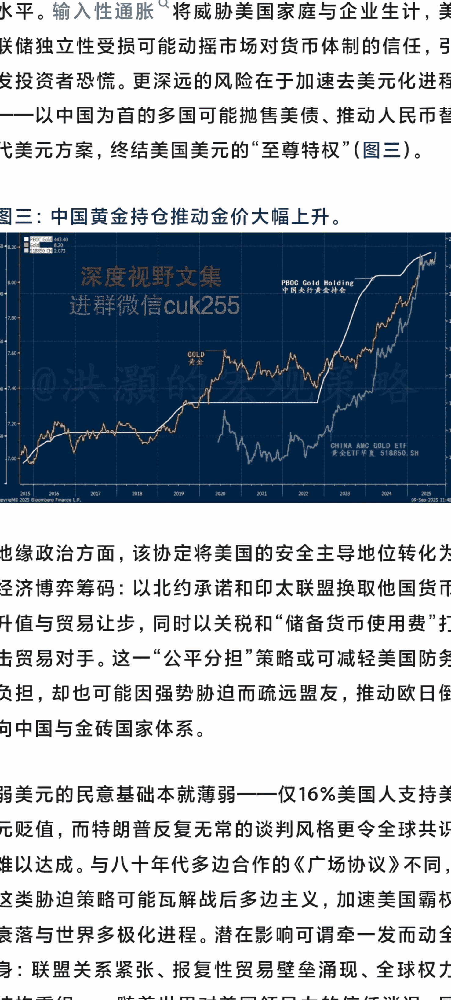

[content]

# 洪源：如何影响全球市场波动

经济学家洪源的观察
2025年09月20日 08:00 203阅读

> 黄金的价值：是避险、投资、保值、抗通胀。”——Norm Franz

当黄金成为避险资产时，过去十年见证了它的增长。避险的需求前所未有的强烈，并导致金价上涨。金价一度飙升至盎司2500美元，然而我们发现黄金与美元的走势正在脱钩。

图一：黄金的崛起与美元的“硬抗”技术

与美元，我们多年来一直维持着核心的逻辑：即黄金与美元的挂钩。但一直以来，我们发现黄金价格的“锚点”似乎已进入美元的领域。

然而，我们观察到这种趋势正在发生变化。一，黄金与美元的“硬性锚点”技术正在失效。

我们如何预测黄金的走势呢？

图二：黄金与美元走势及关系分析

债券市场。此外，实际收益率也至关重要。高实际收益率会增加美元的吸引力，但也削弱了黄金的吸引力。

最后，我们要关注地缘政治风险。全球性的政治冲突会增加黄金的避险需求。

图三：中国对全球的影响正在加剧

地缘政治方面，美国的主导地位正在经历经济增长的挑战。中国通过人民币和贸易来挑战美国的全球地位，这种趋势正在加强。与此同时，我们也看到了“去美元化”的兴起，这可能引发全球货币体系的结构性变化。

随着人民币国际化的推进，全球储备货币将多元化。这将对美元构成挑战。

# 深度视野优质集群（链接优质社群，助你成功）

全部包含以下内容：限时年费188/年 加微信cuk255

- ① 吃群众倍帝训练群群对话（原价 365 元/年）
- ② 子明私享汇（含）内部文章
- ③ 政事室（顾子明）付费内容加送顾子明群聊
- ④ 米联锦英【作者米岩】（原价 599 元/年）
- ⑤ 欧洲金雀会员专属文章（原价 328 元/年）
- ⑥ 砖瓦斥内部圈（原价 400 元/年）
- ⑦ 卢克文读书会专属文章（原价 699 元/年）
- ⑧ 鉴茶财经知识星球（原价 3310 元/年）
- ⑨ 猫哥的视界知识星球文章（原价 299 元/年）
- ⑩ 财经新周【独家新闻】（原价 1498 元/年）
- ⑪ 杨世在金钱塔（原价 2200 元/年）
- ⑫ 森淼财经知识星球（原价 1600 元/年）
- ⑬ 激赛译付费文章（持续更新）
- ⑭ 司马林解读全套音频和全套书籍收藏版无删减（原价 2.3 万）
- ⑮ 虚构三部曲[民国梦、帝国战争、不被理解的MAO]（原价 599 元）
- ⑯ 卢克文星球文章（原价 268 元/年）
- ⑰ 额外再送：卢源新微博付费专栏、三村丰老王、三花九洞文集

定期内容：（更多资源不写下了……）

- ① 守夜人司令星球、接换魔王后星球、达叔泛论星球、成实财富圈、雪球花甲头等
- ② A视野、大树乡谈、江宁后、泮咩说、上海海家学等付费文集
- ③ 西凤付费文章、老端、高在八之时、局外人的视界、升值、老A体制内等其它一些大V付费文章（每月不超过600元的付费文集）

# 限时年费188/年 低成本链接全网V优质内容

深度视野（付费文集）

