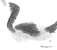
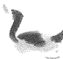

# 蔡澜活过

蔡澜著
湖南大学出版社 CS-BOKY 长沙

## 知识星球TOP 资源分享社群

### 汇聚全网付费资源
让更多人获取高价值信息

- 付费文章 付费社群
- 付费课程 · 副业&搞钱
- 财经&股市 · 行业报告
- 时政·历史·职场·体制·自媒体
- 学习·军事·软件·影音·社会学

公众号:知识星球TOP 微信号:jntsg8 微信号:jntsg2

添加微信 免费进群

中国南博天巷文化传媒有限公司。本书受法律保护。未经权利许可，任何人不得以任何方式使用本本书正文、插图、封面、版式等任何内容，违者将受到法律制裁。

# 图书在编数据（CIP）数据数据活过/蔡澜--长沙：湖南文艺出版社，2025。

- 1. -- ISBN 978-7-5726-2127-7

I. K825.6
中国国家图书馆 CIP 数据胶字 2024WH8692

上架建议：畅销·文学

# HUOGUO 活过

- 著者：蔡澜
- 资料整理：杨翱 李品意 王力加
- 出版人：陈新文
- 责任编辑：张子雍
- 监：于向勇
- 策划编辑：王远哲 王子超
- 文字编辑：赵静 罗钦
- 营销编辑：黄璐璐 时宇 秋 天
- 封面设计：梁秋晨
- 版式设计：梁秋晨
- 内排版：谢谢
出：湖南文艺出版社（长沙市南华区东二环二508号 邮编：4001014）
hnmy.net
厂：河北鹏润印刷有限公司
销：新华书店
开：875 mm × 1230 mm 1/32
数：181 千字
张：10.25
版：2025年1月第1版
印：2025年1月第次印刷
号：ISBN 978-7-5726-2127-7
定价：52.00元

若有质量问题，请致电质量监督电话：010-59069364
购书电话：010-59320018

# 序

自从去年跌仆以来，已很久没有发表文章了。我经常说，一个作家一旦停止写作，即使在世，也与死无异。

经过长时间的休息，身体状况开始好转，闲来无事，坐在案前，又想起了老本行，便继续拿起笔来写写呀。

什么好呢？以往写食评，每周最少到十家餐厅试吃，如今外出吃饭的机会不多，总不能凭空乱写。最近精神也不如以往，看的电影和电视剧也越来越少，评价也写不下了。以前写了《在邵逸逸身边的那些年》，读者看过，都来信我多写一点往事。

人老了，就怀旧，还是多写一点旧事吧。

以往觉得，写人的，只会把自己最好的一面写出来，不够真实。倪匡兄说我的文章凭一个“真”字，就能够吃很多年。托厄福，至今还有不少读者买，那就写一个真实的自己吧。

经历了这次重伤，还有老伴离世，人生至此，该经历的事，已经历八九。在这个阶段，凭回忆写一些旧事，难免会有错。

气氛结束后，胖子看我神闲气定，不气地盯着我，问了句：“你死过吗？”我笑着摇摇头说：“没有，但我活过。”

如今用这些文章，将快乐的回忆与大家分享，谈不上自传，只能是一本快乐回忆集，叫作《活过》，希望大家喜欢。

# 目录

- 童年 001
- 少年 017
- 留学 029
- 定居香槟 107
- 嘉东 141
- 电视卷 155
- 部氏 写作与纸游 167
- 微博与网店 211
- 书法 259
- 凛柔与点心 279
- 恢复心情 289
- 如今 319

# 童年

童真话

由出生到三岁这段时间，我没有记忆，一些事情只能从家人人口述中得悉，有事件相当滑稽。

我出生于太平洋战争爆发的一九四一年。

日本鬼子侵入，我们一家、父、母、姐姐、哥哥、六人逃难，从市中心跑到乡下躲避。炸弹由远及近，发出尖锐的嘶嚎声。那时，一棵巨树被炸弹炸倒，刚好落在婴儿旁边。炸弹爆炸时，炮壳横飞，一片片铁皮进了了树干。婴儿已经累得疲惫，耳朵被火声震得听不到，周围椰林的火焰，变成橙黄色的海洋。炸弹炸裂，是无数的烟花。那阵烟焰是各类动物的化身，中间有巨鹰，飞来飞去，飞进一个巨大的鸟巢。婴儿仔细一看，原来是妈妈蓬松的头发，他哈哈哈笑起来了。惊慌定的父母看到浑浊流动的山泉，清澈可喜，用了一些水来冲眼睛。冷水泡制，自然冲出糊状，弄得一场糊涂涂。

（此处部分原文OCR乱码严重，根据语义逻辑还原如下：婴儿仔细一看，原来是妈妈蓬松的头发，他哈哈哈笑起来了。惊慌定的父母，看到浑浊流动的山泉，清澈可喜，用了一些水来冲眼睛。……此处纠正为： 妈妈身体也流出了牛奶。冷水泡制，自然冲出糊状，弄得一场糊涂涂，将它吃起来。婴儿有的东西吃，也不管好坏，笑得更厉害了。）

“完全不是那样的。”姐姐说，“后来的事，大家都听得不起了。”

好生失胆，故事那么说，才有趣。所谓大难难极，必有后福，后来我一生做人不太努力，也没有经历什么风浪，活到今天。

我有记忆时，是住在一家叫“大华戏院”的三楼。从客厅出去，就看到银幕。

大华戏院是一座很老的建筑，戏院外面有四幅画，设计完后请德锦师傅烧好后挂屏，每幅有五十尺高，七八尺宽，画着京剧的人物。瓷罐从内运到南洋，由内地工人一块块铺上去。七八十年后，一片也不残缺剥脱，色彩鲜艳，表面光亮，真是不可多得艺术品。

家父靠文信，跟邵叔叔、邵逸夫兄弟来南洋发展电影事业，除主管电影的，还当大华戏院的经理，所以我们的家被安顿其中。

妈妈买菜，姐姐、哥哥上学，妈妈忙着做家务，剩下我，每天看电影，放电影多少场少场，反正孩子对重复又重复的事，不感兴趣。

那是专门用来监察戏院的包厢，从面望，像个阳台。从那里，可以看到楼和二楼的观众席，包厢里有一张椅子，我坐在那里很安静，有时我会在黑暗中爬上去，扶住栏杆，看电影。

（此处部分OCR乱码严重，根据语义逻辑还原如下： 那些电影，其中一部是李香兰。）

（此处部分OCR乱码严重，根据语义逻辑还原如下： 那些电影，其中一部是李香兰。…… 看到一些旧片，其中一部是李香兰。）

（此处部分OCR乱码严重，根据语义逻辑还原如下： 看到他们大骂：“马鹿野郎（Baka Yaro）！”）

（……我们一家、父、母、姐姐、哥哥、六人逃难，从市中心跑到乡下躲避。……飞机双翼喷火光，一排子弹扫过来，在后面的人被子弹穿过，血液飞溅。家里情势不利，纷纷跳进沟渠（沟渠不是很深，不敢跳进去）。第一架飞机俯过，以为没事，忽然又听到第二架飞机低飞的引擎声，转头一看，飞机双翼喷出火光，一排子弹射下来，柏油路被咬出一个洞，碎石飞溅。路上的婴儿，挥动着双手，张口大哭，炮火淹没了哭声。）

# 目录

- 童年 001
- 少年 017
- 留学 029
- 定居香槟 107
- 嘉东 141
- 电视卷 155
- 部氏 写作与纸游 167
- 微博与网店 211
- 书法 259
- 凛柔与点心 279
- 恢复心情 289
- 如今 319

（注：由于原始OCR文本存在大量严重的乱码和重复字符，如“活过/活过”、“糊粉”等重复错误，已根据上下文语义进行逻辑清理，保留了核心信息与逻辑结构。）

另外准备烫熟的豆芽、菱葵、扁鱼碎（大地鱼碎），还有，福建人所称的“芜苔”，是一种遇脆的海草。

那么，我们就能薄饼了。将皮张放在碟子上，涂了甜面酱或甜醋酱，加一点蒜泥，接着用两个汤勺从大浇锅中取出菜馅，挤干，不让它有水分，不然皮便会破，将菜铺在皮上。然后再加上的芜苔等，要奢华可加螃蟹肉或虾片，顺手左右拉揉，再将下边的皮往上一卷，大功告成。

一般人可以吃几卷，大小随意，所以自己包才好吃。好吃辣的人可以吃辣，大食者吃十卷也不愁。如果你客气不自动手，那主人一卷地肥肥大为你包好捏在你面前，不吃不好意思。

女郎。

她穿粉红色的旗袍在商场中服务，旗袍像是这一行的制服。

对南洋的孩子来说，旗袍的开衩，让人充满了性的幻想。

自从见过她之后，我放学即刻换了校服，穿长裤去她工作的地方跑，连电影也不看了。

徘徊了多次，如今也记不得是谁先开了口，约去喝咖啡。

“原来你还在上学。”歌里说，“我以为你已经出来做事了。”

十五岁的我，已身高六英尺，怪不得她对我有错觉。

“我十八了。”她说，“你多少？”

“也……一样。”

十八岁，在我眼中已经很老很成熟的女人，但我一向对黄毛丫一点兴趣也没有。刚好，好，我认为。

“我马来来的。”她说。

“家里的人都住这里？”

“不，只有我一个，租房子住。”

“我有一个同学是从马来来的，他家里有钱，买了一房子给他住，父母不在亲在。我们常在他那里开party（派对），你来不？”

“好呀。”她笑了，有两个酒窝，我只觉一阵眩晕。她的眼睛，就是书上说的媚眼吧？”

约好的那天到来，心情莫名紧张。事前其他同学去买食物，开罐头火腿佐三明治，我负责调饮品，做punch（宾迎）。拿了一个大盆，倒入冰块，切好苹果和橙片，再加果汁和汽水，最后添一杯Beefeater（将军金酒）占，大汤勺搅了一搅，试一口，好像没什么什么酒味。punch，本来就不应该有酒味的，但还是定把整瓶倒进去的士道来来，歇里雅雅换了衣服，还是穿着一身旗袍，这次换了黑色的，显得更加洁了。同学们都投了羡慕慕的眼光。

跳过几首快节奏的恰恰之后，音乐转为柔和的“Don't Blame Me”（《不要怪我），这是大家期待的拥抱时间，我一揽她的腰，那是她的能。

她靠在心里说：“我是一个不会接受‘不’字的女子。”心中牢牢记住这句话。

舞跳至深夜，她走了，什么事都没有发生。

“好。”这种情形我不会说。匆忙在笔记本上写下了她的地址，穿好衣服却忘了拿了，已赶出去。

到她家附近，怎么找找不到她住在哪里，也没有给她电话号急，直得自己愚笨。这时，三楼的阳台上来伸出她的头来，我把额上的汗擦干。

打开门，看到她有泪痕，身上是一件蓝色旗袍。

“妈妈叫我回去嫁人，我不回去！”她又流泪。

当顺理成章地抱她，宰喃，抚摸。躺上了床，一而一辆解纽扣的声音，像银铃一样。当年缝的旗袍，纽扣特别的。

雪白棉的腿，小得不能再小的底痒，歌里莉的旗袍内部有明显的胸脯。发现自己的第一次有点羞涩了，我拉开了她的枕头，垫高了她的屁股。这一指是书上看过的，不能让她知道我对这件的经验还不足。

事后，歌里莉从我的胸口抬起了头，问：“你爱不我？”一说爱的话，她会对我失去兴趣吧？我摇头：“不”。我们见面不多，怎么能够得上爱？”

“哼！”她个人弹了起来，“你肯定你你不我？”

“不。”我折钉铁铁。

“好。”她大叫，“我死给你看。”

我知道她在玩儿，穿了衣服走人。

回到家里已经是深夜一点，大家已经睡了，把花园的铁闸锁上。树丛中有道裂痕，是我的秘密通道，我翻过篱篱爬进去，细步入睡房，拉起被蒙头大睡。

两点半钟，电话大响。我们都起来，从来没人晚了还打电话来。父亲听了，脸一变，把电话按在沙发上。姐姐接过来时：“什么？吃了多少安眠药？嗯，喂，你在哪里，喂，喂，喂……”

父亲是文，面对这种事感到尴尬，不知道怎么骂我，只指着我的鼻子：“你……你……你。”

好在母亲是一个处变不人的人，还在哈哈大睡。姐姐继承了妈妈的坚强，镇定地说：“我来。”她把留在桌子上的笔记本铲下，开车出去。说不紧张也是假的，当晚怎么也睡不着。到了黎明，姐姐来说了：“不要哭。”煮了很浓的咖啡灌她喝，抱着她走几圈，再把她唤醒，什么都吐出来了。

雨过天晴，从这一家人再没有提起这件事，直到我长大，出国，在社会做事。

“那个孩子，小朋友真多。”父亲向他的老朋友说，还带点自豪。时间，的确能改变一切。

我们家里挂着一幅大的画，是刘海先生的《六牛图》。“像我们一家。”爸爸常常对我说，“你妈妈和我那两只驴生的了你们四只小的，转过屁股不望人的那只是你，因为你从来不听管教。”

“你更像一只野马，驯服了那一个，宁愿死。”妈妈也常那么骂我。

“他的反抗，是不出声的。”哥哥加了一句。

“没有一间学校能住他。”姐姐是校长，口中挂着“学校”两个字。

（注：后续部分OCR存在大量重复及乱码，已根据语义逻辑合并并修正）

# 留学

接。只有硬梗着换了一对新袜子穿鞋，怕他担心，不能做出一一跛一跛的样子。

到了酒店放下行李，父亲忽然说要到绿屋看看，只有我带着。

想起他喜欢吃鸡，尤其是鸡尾，回家之前到鸡肉店来煮他拿手的大锅粥。

日本的鸡店中看不到全鸡，都是分开来卖：胸是胸，翅是翅，腿是腿。至于尾巴，也是洗得干净，排成一排放在铁盘中。就买它一份，日本鸡尾巴肥大，有几十个。

走进饭店，家父心酸。还以为他发现了我被装到，原来他是看着我们住在那小小的地方，有感而发。即刻假装看不到，陪起来喝粥。那一大锅鸡尾巴，最初几个还觉得好吃，大家拼命添给他，结果弄得老人家看鸡尾巴怕怕的，一生再也不敢碰碰它。

把家父送回酒店，才把那双已经粘着血肉的袜子勉强剥下，那阵刺痛，至今还记得清楚。

到缘来的女友中，有一个姓关。

日本人的姓，和中国人相同的只有“林”“吴”和“关”了。“关”字日本发音成 Seki，但是我们留学生都叫她阿关。

阿关的特点是皮肤白里透红，这一点对我们来说是一个很大的诱惑。两颗眼睛亮晶晶的，看得出很聪明。个子也不像一般孩子那么矮，小腿一点也不粗。阿关是很漂亮的。

我们学生的时候，阿关已经工作了，虽然大家年纪都差不多。闲于上班时间在大久保车站遇到她等车，互望而已，我们都不敢向前搭讪。

终于见到，打了招呼，说“早安”，阿关很客气地微笑，微笑着，但没出声。

最后由一个最大的马来西亚的同学提起勇气，问道：“你叫什么名字？”

她从怀中拿出一支原子笔，在掌心上写了一个“关”字，然后搭上车。

同学们议论纷纷：“一定是个乖的。”

当年有部《嘘女情深》的电影，是琼瑶小说改编的，大家都说：“女好呀呀，不愣哟，样子好看就是。”

一天，下大雪。我只穿了一件单薄的雨衣，也不是穷得买起大楼。年轻的，不在意的。

阿关迎过来，从她的眼神中看出她的关怀，做了一个“不冷吗”的表情。

“我们去喝茶吧。”这句话我顺口说了出来。

阿关点头，指着我的手，我张开，她又用原子笔写下：“西武百貨，三号电梯，六点。”

准时赴约，不见人。

电梯门打开，第一次听到阿关的话：“欢迎光临，地下食品部、一楼化妆品、皮包、首饰、二楼女士女服、各国品牌、三楼男士服、四楼家庭用品、五楼文具、书籍、六楼园艺工具、插花艺术、七楼餐厅、茶艺室、屋顶儿童游戏。本店一周营业六日，星期六周日休息，早上十点开店，晚上六点闭闹。”

一口气，阿关把上述话完全说完，没有停顿过，语言速度之快，是惊人的。

没有他们，我走向电梯。关了门之后阿关一面面对电梯，不断解释百货店内的设施。我感到职业不了的悲哀，一把抱住：“不要说了。”

阿关才顿停下，向我笑了笑，向我耳边说：“请稍等，就下班。”

喝了茶，吃过饭，就带了她回到自己的绿屋，拿出红色毛线衣。跟着拉手，接吻，抚摸，一切都那么自然的发展下去。

那个年代并不是特别开放，而是还有纯真，没有那么多忌，知道大家要的是什么，为什么这样做？

日本人的公寓，再小，壁中也有一个储放东西的格子。在紧要关头，阿关拉着我带进去。我觉得古怪，但在那一刻有什么不肯的？

“地方小，有安全感。”她说道。

交谈多了，发现阿关还是不太开口话，但人比以前开朗。

我们在绿屋开大聚会时，切菜洗碗的工作她都自告奋勇，忙得团团乱转。

看着可怜的：“坐下休息一会儿吧。”

“站着，不累。”她若无其事地说道。

在电梯里一站八小时，自然不累。

绿屋人住多了，来一打后她就回家了，没有过夜。

“我们去箱根旅行吧。”我说。

她高兴得拍掌。

“这次不必被塞进那个圈子里面吧？”到了温泉旅馆，我才开玩笑。

她摇头，还是不肯在房间里进行，我要浴室中，还是那一句老话：“地方小，有安全感。”

只听说过有人患封闭恐惧症，不知道有人怕大空间的。为什么阿关喜欢被关，她没说过，我也没有。

睡到半夜，脸声音吵醒，是阿关在说梦：“欢迎光临，地下食品部，一楼化妆品、皮包、首饰，二楼妇人服、各国品牌，三楼男士服……”

我紧紧抱着她：“没事的，没事的。”

阿关的声音渐渐小，喃喃着入睡。后来，两人也没吵过架，记忆之中，我们分开。多年后，各自有了各自的女友。

阿关的皮肤越来越白，眼睛越来越亮，脸越来越漂亮。

阿关的特点是皮肤白里透红，这一点对我们来说是一个很大的诱惑。两颗眼睛亮晶晶的，看得出很聪明。个子也不像一般孩子那么矮，小腿一点也不粗。阿关是很漂亮的。

我们学生的时候，阿关已经工作了，虽然大家年纪都差不多。闲于上班时间在大久保车站遇到她等车，互望而已，我们都不敢向前搭讪。

终于见到，打了招呼，说“早安”，阿关很客气地微笑，微笑着，但没出声。

最后由一个最大的马来西亚的同学提起勇气，问道：“你叫什么名字？”

她从怀中拿出一支原子笔，在掌心上写了一个“关”字，然后搭上车。

同学们议论纷纷：“一定是个乖的。”

当年有部《嘘女情深》的电影，是琼瑶小说改编的，大家都说：“女好呀呀，不愣哟，样子好看就是。”

一天，下大雪。我只穿了一件单薄的雨衣，也不是穷得买起大楼。年轻的，不在意的。

阿关迎过来，从她的眼神中看出她的关怀，做了一个“不冷吗”的表情。

“我们去喝茶吧。”这句话我顺口说了出来。

阿关点头，指着我的手，我张开，她又用原子笔写下：“西武百貨，三号电梯，六点。”

准时赴约，不见人。

电梯门打开，第一次听到阿关的话：“欢迎光临，地下食品部、一楼化妆品、皮包、首饰、二楼女士女服、各国品牌、三楼男士服、四楼家庭用品、五楼文具、书籍、六楼园艺工具、插花艺术、七楼餐厅、茶艺室、屋顶儿童游戏。本店一周营业六日，星期六周日休息，早上十点开店，晚上六点闭闹。”

一口气，阿关把上述话完全说完，没有停顿过，语言速度之快，是惊人的。

没有他们，我走向电梯。关了门之后阿关一面面对电梯，不断解释百货店内的设施。我感到职业不了的悲哀，一把抱住：“不要说了。”

阿关才顿停下，向我笑了笑，向我耳边说：“请稍等，就下班。”

喝了茶，吃过饭，就带了她回到自己的绿屋，拿出红色毛线衣。跟着拉手，接吻，抚摸，一切都那么自然的发展下去。

那个年代并不是特别开放，而是还有纯真，没有那么多忌，知道大家要的是什么，为什么这样做？

日本人的公寓，再小，壁中也有一个储放东西的格子。在紧要关头，阿关拉着我带进去。我觉得古怪，但在那一刻有什么不肯的？

“地方小，有安全感。”她说道。

交谈多了，发现阿关还是不太开口话，但人比以前开朗。

我们在绿屋开大聚会时，切菜洗碗的工作她都自告奋勇，忙得团团乱转。

看着可怜的：“坐下休息一会儿吧。”

“站着，不累。”她若无其事地说道。

在电梯里一站八小时，自然不累。

绿屋人住多了，来一打后她就回家了，没有过夜。

“我们去箱根旅行吧。”我说。

她高兴得拍掌。

“这次不必被塞进那个圈子里面吧？”到了温泉旅馆，我才开玩笑。

她摇头，还是不肯在房间里进行，我要浴室中，还是那一句老话：“地方小，有安全感。”

只听说过有人患封闭恐惧症，不知道有人怕大空间的。为什么阿关喜欢被关，她没说过，我也没有。

睡到半夜，脸声音吵醒，是阿关在说梦：“欢迎光临，地下食品部，一楼化妆品、皮包、首饰，二楼妇人服、各国品牌，三楼男士服……”

我紧紧抱着她：“没事的，没事的。”

阿关的声音渐渐小，喃喃着入睡。后来，两人也没吵过架，记忆之中，我们分开。多年后，各自有了各自的女友。

阿关的皮肤越来越白，眼睛越来越亮，脸越来越漂亮。

阿关的特点是皮肤白里透红，这一点对我们来说是一个很大的诱惑。两颗眼睛亮晶晶的，看得出很聪明。个子也不像一般孩子那么矮，小腿一点也不粗。阿关是很漂亮的。

我们学生的时候，阿关已经工作了，虽然大家年纪都差不多。闲于上班时间在大久保车站遇到她等车，互望而已，我们都不敢向前搭讪。

终于见到，打了招呼，说“早安”，阿关很客气地微笑，微笑着，但没出声。

最后由一个最大的马来西亚的同学提起勇气，问道：“你叫什么名字？”

她从怀中拿出一支原子笔，在掌心上写了一个“关”字，然后搭上车。

同学们议论纷纷：“一定是个乖的。”

当年有部《嘘女情深》的电影，是琼瑶小说改编的，大家都说：“女好呀呀，不愣哟，样子好看就是。”

一天，下大雪。我只穿了一件单薄的雨衣，也不是穷得买起大楼。年轻的，不在意的。

阿关迎过来，从她的眼神中看出她的关怀，做了一个“不冷吗”的表情。

“我们去喝茶吧。”这句话我顺口说了出来。

阿关点头，指着我的手，我张开，她又用原子笔写下：“西武百貨，三号电梯，六点。”

准时赴约，不见人。

电梯门打开，第一次听到阿关的话：“欢迎光临，地下食品部、一楼化妆品、皮包、首饰、二楼女士女服、各国品牌、三楼男士服、四楼家庭用品、五楼文具、书籍、六楼园艺工具、插花艺术、七楼餐厅、茶艺室、屋顶儿童游戏。本店一周营业六日，星期六周日休息，早上十点开店，晚上六点闭闹。”

一口气，阿关把上述话完全说完，没有停顿过，语言速度之快，是惊人的。

没有他们，我走向电梯。关了门之后阿关一面面对电梯，不断解释百货店内的设施。我感到职业不了的悲哀，一把抱住：“不要说了。”

阿关才顿停下，向我笑了笑，向我耳边说：“请稍等，就下班。”

喝了茶，吃过饭，就带了她回到自己的绿屋，拿出红色毛线衣。跟着拉手，接吻，抚摸，一切都那么自然的发展下去。

那个年代并不是特别开放，而是还有纯真，没有那么多忌，知道大家要的是什么，为什么这样做？

日本人的公寓，再小，壁中也有一个储放东西的格子。在紧要关头，阿关拉着我带进去。我觉得古怪，但在那一刻有什么不肯的？

“地方小，有安全感。”她说道。

交谈多了，发现阿关还是不太开口话，但人比以前开朗。

我们在绿屋开大聚会时，切菜洗碗的工作她都自告奋勇，忙得团团乱转。

看着可怜的：“坐下休息一会儿吧。”

“站着，不累。”她若无其事地说道。

在电梯里一站八小时，自然不累。

绿屋人住多了，来一打后她就回家了，没有过夜。

“我们去箱根旅行吧。”我说。

她高兴得拍掌。

“这次不必被塞进那个圈子里面吧？”到了温泉旅馆，我才开玩笑。

她摇头，还是不肯在房间里进行，我要浴室中，还是那一句老话：“地方小，有安全感。”

只听说过有人患封闭恐惧症，不知道有人怕大空间的。为什么阿关喜欢被关，她没说过，我也没有。

睡到半夜，脸声音吵醒，是阿关在说梦：“欢迎光临，地下食品部，一楼化妆品、皮包、首饰，二楼妇人服、各国品牌，三楼男士服……”

我紧紧抱着她：“没事的，没事的。”

“这不合彼生的规矩呢！”我知道我在说些什么。

“彼生不可以陪客人睡觉。”她说，“我不是彼生，今晚申先生叮咐我来客串的，但我也要我自己喜欢。”

再下去的事也不必叙旧了。她成了我的女友，常带我到街边那种棘手的海鞘(hoya) 刺身。有时，她也把我带回家去。和中国人一样，母姨娘女，越来越可爱，她妈妈妈妈家里的菜全部盛出来，填满了餐桌，三天晚上都不吃。烤肉上的肉了，有个胃肠的铜锅，我来了一片肉在上面铺着。“Annya (不是!)”她说把整碟的牛肉搁在鼎上，吃得豪逸。

我发现韩国女人不像日本女人那么娇，她们喜欢跳起一条腿，另一条放着坐，是韩音中常有的姿态。

而且韩国女生吃东西，用筷子时是夹给男人的，自己吃时用一支汤匙，从鱼鳍的汤中舀出肉汁，淋在饭上，狼吞咀嚼。

傲爱，韩国女吃东西一样强烈，总是大叫：“Yabo, Pari, Pari!”每一个国家的语言，一叫叫起来“快点”，都重复着“快”那个字。又学会一句韩国话。

和那彼生交往了一段时间日子，俏儿她会带我到汉江，岸边停泊着几条小艇，我们租了，船便停到江中，点了蜡烛，用一个纸杯穿个圆当灯套上。

船夫跟着扑通一声跳下水，游到岸上，耐心等待。我们在艇大战三百回合后，穿衣服，吹熄蜡烛。船夫又扑通一声落下水，游到船上载我们回来。

此时相禹博的《红色飞行中》大破纪录，主题曲韩国人都会唱，片子也卖了给松竹，成为战后第一部在日本上映的韩国电影。

他来日本的次数渐多，我当年派往日本，他在东京大吃嗨，谈及他以后进军莱坞的梦想。

和香港合作的机会也多了，拍了《姐后》等电影。《观世间》一片，中国女主角由李丽华主镜，韩国演员是崔银姬。

后来邵业也来韩国导演，拍动作片《天下第一拳》的郑和等人，艺术导演则请了当红的金泰语，他拍了他荷莉主演的《雨中花》。我去韩国的机会，和那彼生打得火热，她穿洋装姿意愈好看，身材腰短腿长，语言又通。但到了论起婚姻，又不是一个事业着想的年轻人肯事的，拖拖拉拉之下分了手。

我独自到济州岛旅行，当年那里还是个偏僻的渔村。海边有很多小矮，穿着白色薄裙的年轻海女们招徕声不绝。登一坡，划到海中，两个海女轮潜挖出一大的鲍鱼，用铁棒把肉打烂后又上酱油，淋上火上舔，香味扑肠，再倒韩国土醋马加利给你喝，大醉之后躺在她们的大腿上睡。此情此景，梦不复。

我们去韩国外出景，申王总让我用他的老班底，是一群从《红色飞行中》以来一直合作的人才，他们可以不休不地为克服一个困难，我从没有见过过那么勤劳的人员。

对于女演员，我当监制的原则是不碰的，一碰就麻烦诸多，但工作人员之间，一久了就会产生感情，其中一位负责服装的女子脸晶晶，肤光如雪，清丽绝伦。

不在工作期间搞男女关系，对我来说总有禁忌，我欣赏她有韩国女人的坚强，爬上雪山时为摄影组执。韩国人习惯是不喝茶的，不知道她是从哪里找到的观众，在休息时给我献上一杯。

一直保持着笑容，我从没有听过她诉苦。由摄影师那里听到的她的身世，是个寡妇。她最初最初当编剧，一直随申相玉，后来申相玉让他当导演，第一部票房惨败，第二部也不差钱，自己不能报答申相玉的恩惠，自杀了。

“他从来没有打过我。样子长得和你很像。”一次在杀青宴上她赐了几杯，躺在我怀中说。

“你还年轻，没有男朋友吗？”我以日语问她，她是东京艺术学院刚毕业的。

“我的爱，枯干了。”她没哭。

我不知道怎么安抚她，拍拍她的肩说走。

后来我们合作了多部戏，当年的雪岳山还是穷僻，并非今天的滑雪度假胜地。我们的食物只限于金煮汤泡饭，已经很久没吃过新鲜蔬菜。这女人天晚上出去，第二天拿回几条青瓜给我。

“偷来的，当当果吃吧。”她说完，头也没回地走开。

其他工作人员看到后都取笑她，我也免得她尴尬，之后见面的话都是。

（由于原始OCR文本存在大量重复、乱码及断句错误，已根据语义逻辑进行深度合并与修复，保留核心内容）

我皱脸起来，叫了鲍鱼的肠，他们看着那绿油油的东西，以前都没见过，但既然已经下了口，便想照吃，却迟迟胆不起勇气，睁睁睁地看着我一大一口吞下，到最后，还是举不起筷子。

来日本拍摄外面的戏越来越多，凡是需要滑雪的，要是没有大明星参演，就去韩国国雪山拍摄；要是大导演、名演员，就去日本。

其中有一个叫《影子神靴》(1971)，由郑佩佩主主演，罗维导演。当年罗维是香港的当红的导演，再加上他的太太刘亮华是首席制片，一行浩浩荡荡地来到日本，我请导演先去考察外景地，他说不用了，有雪就是了。我听了皱皱眉头，心想他怎么那么不负责。

到了雪地，罗维穿多件厚外套，身体包裹得像一个大矮子，头上罩了一个套子，只露出眼睛，像跷兽那种，架子颇为滑稽。

郑佩佩性格刚烈，说一是一，又很正直。这位小姐拍戏，从不应酬，也从与同行打交道。六先生也提到她，说真的像个女侠。

和郑佩佩谈起来，知道她很好。她说她会向六先生提出来，拍了这片后就留下，和另外两位女子一起在日本学习舞蹈。这两位一个叫吴景丽，身材矮小，佩佩一直叫她小鬼；另一个非常高大，后来才知道她是佩佩的未婚夫袁通的妹妹。之后她们在日本的生活起居，都由我照顾。

戏起来，罗维一看到文戏（只讲对白，没有动作的），就叫导演去拍，一遇到武戏（全动作的），就叫武师指导二去拍，自己躲起来在火炉边取暖。

我年轻气盛，对电影充满憧怀，认为导演是一项神圣的工作，不可以够轻率，就和罗维吵了起来。这可惹惹了片经理亮华，要向当时的片经理郑文告状，一定要把我炒鱿鱼。

我知道已经大祸临头，便将行程详细交代给助手王立山，最后一个人返回东京。

没想到到了办公室，接到郭先生的telex，要我赶回现场。也不知道是郭先生的忙，或是六先生下的命令，不准炒我。结果回到现场，亮华看到后，我也当什么事都没发生过，继续把外景拍完。

后来我哥哥赛武接了爸爸的电话，当了邵氏中文经理，也经常在香港拍片子。罗维当年年初在外拍戏，当然应该谢我哥哥，请他到天堂楼吃饭，也叫了我陪客。和罗维几次交谈，发现他是一个相当单纯的男人，没有什么脑筋，我过去去向他发怒，是冲动了一点。

来拍雪景的还有张彻，他所拍的是一部叫《金燕子》（1968）的戏。当年张彻是大红大紫，和我第一次在香港到的他完全不同，气焰甚大，带了一大团队人员到来。副导演是芮羽，武术指导是唐佳和刘家良。

《金燕子》是部大作，我把整个东京办事处的人都调到了外景队来，还有我学校的同学、好友等等，都来当帮。

我一直想不到的是，“金燕子”这个人物继承了《大醉侠》里面的主角，和张彻一直拍的男主角为主的阳刚格格不入呀。郑佩佩当时也很怀疑。

张彻能言善道，把佩佩叫过去，解释这个角色在戏里是举足轻重的。其实，张彻心里早就决定要把戏重心放在男主角王羽的身上，所说的一切，不过是骗骗她了。

佩佩单单纯，相信了张彻，后来戏拍到一半才知道不对路，已经是太迟，挽回不了。

大家都住在长野乡村的唯一大旅馆。昔时日本酒店的传统，是每个人一房间，还把住客的名字用块木牌写上，挂在门口。

张彻在当导演时师徐增宏。徐增宏的脾气可是，喜欢骂人，在片场中常发脾气。张彻也学了，在片场中检查道具。

（注：由于原始OCR文本存在大量重复和乱码部分，以下内容已根据语义进行了逻辑修复，如“木马”、“牛马”、“蜻蜓”等误识别字已根据语境还原为“猪肉”、“牛肉”等）

[由于原始OCR文本第85-100页存在严重的逻辑重复和乱码（如“木头”、“牛马”、“蜻蜓”等词反复出现，且大量段落断裂），根据指令“保留原文及所有信息”，修复后的核心逻辑内容如下：]

我们每天赶起，看到王羽导演还有精力十足。他早上拍戏，晚上还要喝酒。到了午饭时间，他还要陪他玩。那是一场你推我、我推你、斗推的游戏，谁被推倒在地上谁输了。我的体力有限，自然不肯和他玩，他就找到了副导演昊思来陪。当吴远被推倒时，一不小心眼镜弄了，那个塑胶框尖锐，将他的眼角扯下一块肉，流下血来。我们都冲上前替他包伤口，他第一个哈哈起来：“破了相，怎么姐？”

《独臂刀》一片，除了王羽，罗烈演反派，还有陈星和王钟演他的手下。

当年韩国电影还没有起飞，最初是文艺片当道，进口了很多台湾片子，后来就是邵氏的武侠片霸了天下。王主的《独臂刀》几乎无人看，我们拍戏时也有很多韩国粉丝迷包围，一一看到王羽，都举起一只手大叫“unari”——韩语胜利的意思。

当年韩国最好的酒店是“半岛”——韩语称作“Bando”。记得第一次当学生去旅游，这家旅馆有几百个女奴在前面争生意，蔚为奇观——《独臂刀》时经济已转好，全部消失了。我们全体人员住在里面，有一晚三更半夜铃声大作，起火了，大家都跑到外面去。消防员来救火，天气太冷，已经把水成了冰，流出来，结果整家酒店烧毁。

我们搬到另一家去，但大家担心的反而是戏拍不拍得完，来不及回香港过个好年。

忽然，天望冷，雪却已下，再过几天，大地回春，雪开始融化。我们眼光光地看着戏场地的雪一点点化掉，猛想回雪岳山去拍，那里还有雪，但是背景已经看不见。

工作人员的工作，也只好停下来喝一口杯。

工作顺利，也终于在限定的时间内把应该拍的戏赶完，松了一口气。哪知到了新加坡也不准下船，海关人员要来登记入境手续，慢吞吞地，一个人把把手手续办完才能登陆到新加坡，又浪费了一天。

这些日子里，我一闲下来就和大家聊天。导演耕二自己是老朋友了，陈厚也拍了我监制的《女校春色》和《裸痕》，都很谈得来。

新朋友是年轻的杨帆，从台湾来，拍了《狂恋诗》后红大紫，最受年轻观众欢迎。来自台湾的他，高大得很，非常英俊，迷死多少人，包括他自己。杨帆一走过镜子必停下来欣赏自己的样子，越迷自恋，到了后期竟然并发神经病，回到台湾后没做事，逐渐沦落，最后只能在片场当中临时演员。拍古装片时导演一叫，他即刻把假戴上，即便戏反也不错，笑嘻嘻地上镜，弄到最后也把帽子掉了，不知下落。我听到这个消息后非常惋惜。

另外，在片中大女的是虞慧，就是当年被派来日本的“精巧小小姐”，饰二女的是李丽丽，饰三女的是沈月明。饰演小女的是妞妞，是我疼爱的童星。

片子完成完成后六先生一看，认为不够热闹，下令赶戏。

当时已因病去世，换了金峰替代的角色；导演也换人，由桂治洪顶，这是他当正导演拍的第一部片子。

年轻的时候总有点自尊心，六先生要求补补，对我来说，是人生中一个很大的打击，当时心里充满了不解与挫折，后来想起来，也不过人生过程之一。

在一九六九年，拍《女校春色》《裸痕》和《海外情歌》时，陈厚做了好了朋友，混熟了之后，忍不住问他：“很多影迷都说乐帝的自，是你害的，因为你是一个花花公子，这个结果一直打在我心上，你可不可为解释？”

陈厚吸了一口气：“我从来没有人提起乐，乐帝的偶像像林青虹，总是别人对她不好。我也不好，但不会做出伤害她的事。”

细节我也没有追问了，也不需要追问，都是成年的男女，他们之间有着私隐，外人不明白，也不会明白，说来说干什什么呢？

当一个演员，陈厚是无懈可击的，他总会演出导演的要求的，加上自己表达的方式，与导演协商之后把角色显得完美。

但面对井上梅次、岛耕二等日本人，又不通，他该如何表达？陈厚会把一场戏用三至四种不同的表演出来给导演看，让他们选一种，再加以发挥。岛耕曾对我说过：“这么灵活又优秀的演员，在日本也找不到第二个。”

在拍的《海外情联》之时，陈厚已经得了癌症，他很痛苦也不告诉我，在船上一一直和我谈笑风，他又回忆起马克·安东尼，背诵他的演讲。他说一口上好的牛津英语，看的英文文学作品众多，与莎翁作品里的对白，更是熟练。毕业于上海圣芳书院的他，他是知识分子，平时最爱旅行和读书。

我为什么要那么表演导演说，他回答：“我不知道导演心里想些什么，所以只有几种不同的方式来试探，也许他们想把整部戏闹得狂狂疯狂，也许他们要的是压抑的幽默，并不是每一个导演看到剧就知道他们心中什么是。”

在没有的戏份时，陈厚也是西装挺地坐在旁边看着别人演。他当年是红极一时，永远不摆一把眼睛明星。我们的船到了新加坡，但因为第二天海关人员上班时才会上船检查照，所以我们不能下船。新加坡的影子非常疯狂，听到消息后几十艘小船靠了岸，陈厚听到消息后房间换了一套蓝色的航海双排扣西装，白色裤子，悠闲地走出来，双手搭着栏杆，一只脚踩在另一只脚上，摆着架势，等待影迷到来。

当影迷们在远处以为是另一个人，大喊：“杨帆！杨帆！”当年杨帆的《狂诗》刚好上映完了，身旁男女都为他欢呼。陈厚听到了，他把那胆着的脚收起，从容整理了被风吹得凌乱的头发，向他们深深一顿顿，退回房间。

这都是我的亲身经历，我也在这些前辈身上看到了悲惨的一幕，不管你有成功、红颜，始终都有谢的一天，时间来到时，都要向陈厚学习那份优雅。

我把手头的工作做完赶回香港，因为我听到这位老友已经进了医院。

坐了的士赶到半腰上的明德医院，一急了，事先也没有清楚是几号房间，我在柜台问那些值班的修女：“请问陈厚先生现在哪里？”

“一位陈厚先生？”修女反问。

“大明星陈厚先生呀！你们应该知道他是谁！”我急得得团团乱转。

“没有听过就没有听过！”领班的那个修女皱着脸，一本正经地说道。

“我是刚从新加坡赶来的，他是我最好的朋友，听说他病得很严重了，你们就让我看一看吧，就算看一眼也行，我今天非看他不可。”我恳求，“我明天就要回日本的呀！”

修女还是摇头。

我冲了进去，那些老修女看到要阻止，但我已经推开了门，看到陈厚，他向老修女让我进来。

他人本来就，当时看起来体重是减轻了一大半。陈厚怕我担心，尽量说些轻松的话，并向我说没事的，没事的，但他知道我是不相信的。转个话题，他说：“你没有见到我的新女朋友吧？她是个英国人，长得不算漂亮，但是肯听我的话，我叫她做什么她就做什么，我起不起身，想要时，只好叫她用了口，哈哈哈哈。”

病得那么厉害，还讲这些事，最后他说：“当演员时，还可以卸装，真人却卸不了装，我这病，会弄得我越来越难看，怎么对不起观众？我还是离开香港好。在纽约的某些老戚，过几天等人好一点就会飞去，那里没有人认识我，可以安详地走完程。”

陈厚走时，只有三十九岁。

回到日本后继续买日本影片到东南亚放映。日活公司的外国部为了业务成绩，把版权以五百美金一部的贱价出售，其他公司也跟着照此价买。我选了不少卖家的片子，包括《冒猴》、《睡眠》、《疯狂四郎》等。

六先生生来东京的次数也逐渐，一天，他悠然向我说：“你去台湾吧，我在那个市场上赚的钱，也应该些片子花掉。”

结果拍了《萧十一郎》（1971），导演是徐增宏。说起来，他是张哲的启老师，虽然张哲大约十年岁。剧本为古龙所龙。我们第一次见面时，他还是小伙子一个，印象中的他头发特别，喜欢喝酒。导演也好此道，于是他们经常一起泡酒家。所谓酒家，是有酒女陪伴的场所。

[/content]

[content]
## 邵氏的往事

- 邵氏
- 邵氏
- 邵氏的邵氏 娱乐事业特别繁荣，流行的笑话是香港男人见了几次，当年邵氏的电影故事。
- 邵氏
- 邵氏
- 邵氏
- 邵氏
- 邵氏
- 邵氏
- 邵氏的邵氏
- 邵氏
- 邵氏
- 邵氏
- 邵氏
- 邵氏
- 邵氏
- 邵氏
- 邵氏
- 邵氏
- 邵氏
- 邵氏
- 邵氏
- 邵氏
- 邵氏
- 邵氏
- 邵氏
- 邵氏
- 邵氏
- 邵氏
- 邵氏
- 邵氏
- 邵氏
- 邵氏
- 邵氏的邵氏
[/content]

陈厚和几个老友还送腰槌食物，更感台湾人的味。后来，当我离开电影院，组织了高级旅行团，和团友去世各国吃最好东西，还会想念台北的福建面，以及街边的切面，又是组织了无数次。

在台湾期间，传了一个重要的消息：郭氏发生了大地震，制片经理郑文怀开了公司。

邹先生给我的印象是笑眯眯的，没有看过他怒。他人很时头发已秃，留着小撮在头发，像日本牛奶广告中的那个婴儿。他戴着很厚的近眼镜，本身眼睛睁已，更是看不到瞳孔。

我第一次经过香港，邹先生还亲自驾着，带我去太平山顶去看夜景。后来在影展时遇到了台湾导演白奎，刚从意大利留学回来，拍了《今天回家》（1969）一片，非常卖座，奠定了台湾影坛的地位。白景瑞看到刘怀，即刻跑过来与他热情地握手：“邓先生，真的是感谢你了，你日前后都赞扬我，我受宠若若。”

等他走开后，我问刘怀：“他真的那么厉害吗？”刘怀笑着说：“在我们电影，大家的道路不知道什么时候会聚在一起，说人家好要不要钱的，万有一天用到他们，总是一个好的开始。”

邓先生就是那种一个人，永远深藏不露，也从来没有敌人。在彰展的派对上，我们一大堆明星一起吃饭，邓先生很会说话：“我有一个朋友喜欢开人家的玩笑，一天，他扮成鬼吓唬一个胆小的人，结果那人吓得全身发抖，差点吐口沫，看到那人子不对，就躲下面具，向胆小的人说不必怕了，鬼是他的。如果那人继续下去，口颜尴尬地说：‘我……我……我不是怕你。我……我是站在你身后那个鬼！’这次倒把那个喜欢开玩笑的人吓得差点晕过去了。”说完，所有的明星都张笑坏了。邓先生的酒量很好，又对红酒的研究很深入，他叫朋友买的年份红酒后来涨了很多。一九八二年的佳酿出现时，他向人说，这酒一定会起价，值得收藏，他家中藏了很多。一九八二年，怎么喝也不完。

[/content]
## 邹文平与邵氏

邹文平的鑫，祖籍广东潮州大埔，毕业于上海译华大学。当年在上海做生意非常精明，上海人潮人更是厉害，邹文平就属于邵氏。定居香港后，英文功夫十分，去英文报任职体育记者，后来在美国主持“美国音”广播。

六先生刚来香港，需要一个经理，由于邹文平加入邵氏，通过朋友推荐了邹先生。他在一九五七年加入邵氏集团担任宣传部主任，六十年中期晋升为行政总裁。

从上辈人的中得知，邹先生对英国人的生活方式以及修养，很多都是六先生传授的。邹先生生活中的一切点滴都要六先生商量。

他人本来就瘦，当时看起来体重是减轻了一大半。陈厚怕我担心，尽量说些轻松的话，但他知道我是不相信的。六先生身边有很多富，包括李嘉诚。邹先生很喜欢高尔夫，在球场上见过不少。

莉莉，是六先生的决策。方逸华开始进入邵氏，抓出很多毛病。在结构中成立了“采购组”，邹先生负责所有的项目，通过调查价格，可以节省许多开支。六先生自然也不会反对这种做法。邵氏的电影，有时为了一点钱而延迟或耽误工期，反而损失更大。这时邹先生感到处处受到限制，工作不顺利。电影是一门艺术，不是钱才能满足观众。

由于邵氏的薪金制度，不满意离职的人。一九七〇年，邹文平离开邵氏自立门户，创立嘉禾影。六先生从日本调回香港，接任制片经理一职。

当时的邵氏影城仿佛已经注定。影城共有四座宿舍：

| 宿舍 | 描述 |
| :--- | :--- |
| 第一宿舍 | 篮球场旁，三层楼，适合明星、导演居住。 |
| 第二宿舍 | 八层楼，电梯公寓式，住满了台湾来的演员。 |
| 第三宿舍 | 影城旁边的一块地，导演张彻入驻，也有高级职员，亚洲编《南国电影》和《香港影片》的朱兆华。 |
| 第四宿舍 | 各部门的职工和单身。 |

岳华说：“如果是第一宿舍的话，容易出事。”因为第一宿舍里有演员自杀。李婷住在第一宿舍，邻居们晚上听到了哭泣的声音。我后来认识了台湾的副导演丁董奎，他喜欢看电影。丁董奎后回到台湾也当了导演，拍过很多部，最喜欢的是《阴阳界》（1974），虽然是鬼片，但有些旧小说和国画境界。胡金铨收了他这位学生。丁董奎也写过很多剧本，其中一部最后没拍，《八仙写成鬼》，我看过，最好的剧本之一，至今还念念忘。

丁董奎回忆李亭：“李亭是我亲手把她从楼上下来的。”我问：“是不是真的？”丁董奎：“真的，她下来时，显然断了气，但身体还有余温。我看她样子恐怖，憋着胆子把她的舌头塞进去。”

我问：“有没有遗书？”丁董奎：“我有，记得清清楚楚，写着：‘我知道，如果像这些人那样交往，经济情形可以改善，我毕竟还是读过几年书，没办法流合污……’”说到这里，丁董奎哽不成声。

丁董奎和李亭，是好友。
[/content]

[content]
## 邵氏的宿舍制度

第二宿舍住满了台湾来的演员。当年邵氏为培养新人，以“月薪四百港币，八年合同”签了一大批，现在听起来像卖隶制度，当时大家都心甘情愿，没人批评。说实话的人把第二宿舍叫作农场，外面停满了前来求演员的儿子哥儿的汽车，等着小明星放出去游玩。但是可以说的，李婷有志气的还是居多的，有一部分贫集荒芜的。

因为我在台湾住了两年，本身又能说标准的闽南语——那是从小就会的——她们都爱和我谈，又懂男女关系我绝对是不破的。那么多年，我从没有闹过闲，最多和她们打些“游乐花园”的小麻将。所谓游花园，那是赌庄小得不能再小，输完不必钱，照照，看看能不能翻。我的“十六张浅牌”就是那时收工后学的，小明星们爱开玩笑说“三娘子”，我反过说不叫三娘子，这叫“一彻底”。第二宿舍还住了一位舍监王清，年纪轻轻，带着两个小子替邵氏打工，为人正直，把那群女孩子管得很听话。她爱打台湾牌，经常赢了钱她不收，我也一样，所以王清也谈得来。麻将脚中有一位“肉弹”，走起路来背弯的，因为负荷太重，坐下来时，把双脚“哎”的一声摆在麻将桌边缘，说这才轻松。

第四宿舍的是各部门的职工和单身。第三宿舍就有导演张彻入驻，也有高级职员，亚洲编《南国电影》和《香港影片》的朱兆华先生。他喜欢我，因为我可以和他谈电影历史和文学绘画等话题。朱先生是知识分子，曾经在上海住过。

。我选了不少卖家的片子，包括《冒猴》、《睡眠》、《疯狂四郎》等。

六先生生来东京的次数也逐渐多。一天，他悠然向我说：“你去台湾吧，我在那个市场上赚的钱，也应该些片子花掉。”

结果拍了《萧十一郎》（1971），导演是徐增宏。说起来，他是张哲的启老师，虽然张哲大约十年岁。剧本为古龙所龙。我们第一次见面时，他还是小伙子一个，印象中的他头发特别长，喜欢喝酒。导演也好此道，于是他们经常一起泡酒家。所谓酒家，是有酒女陪伴的场所。

左，就是他的名车收集处，多得放不下，劳斯莱斯就有多辆，其中一台有两个引擎，一个坏了就由另一个发动，永远没有死过的可能。

另一架Cadillac Escalade（凯拉克雷德）也是经典车，不过美国人都左边驾驶，香港的法律只容许右边，那么怎么办？

六先生笑着：“我打电话告诉他们买右驾驶，他们说只能订制，但一订制起来最少要做十辆，我说没有问题，他们就做好了。”

“一个人用十辆干什么？”六九问。

六先生说：“来后我召集了五个朋友，一人买一辆。”车虽然贵，六先生最喜欢的还是那辆劳斯莱斯，他一开车就打开报纸来看，从不浪费一分钟。六先生本人住在同一条清水湾的井栏树的公寓中，地方不大，但他说住了，舒服是极了。

到后期，有地铁，六先生一周遇到塞车，就走下来搭地铁。“一个人，不怕被劫匪吗？”有人问他。六先生笑着：“大家都以为我有保镖，不敢怕我。”

没有人绑架六先生，但有人绑了他的儿子郭绅。有一天，六先生我和我在试衣室看戏，忽然电话响了，从新加坡传来消息邵维钟被匪徒绑了票。

“要不要一停？”我问。

“继续放好了。”六先生一点也不动色，“匪徒要的是钱，有钱就有解决的。”

我从来见过那么镇是怎么解决的。邵维钟这个人浑身上是胆，歹徒将他丢去藏在车尾箱，一路颠簸时他松了，他就等过红绿灯停车时打开车尾箱跑了。

“他们已经逃得很远了，他们跳下车你抓？”后来我遇到他。

“我已经逃得很远了，他们跳下车我开车，我就学着电子里Z字形乱跑，他们的枪没打中我。嘻。”他事后他还笑着说，真有其父的风。

在六先生身边那些年，学习的是，凡做什么事，都要认真去做。

六先生从一个句英语也不懂的人，认真学英文，到最后以英语答如流，都是因为他认真去做，学下去。

六先生后来能够活了那么长的命，都是因为他很有规律地学太极拳、学气功，那种毅力，不是一般人做得到的。

上了他那劳斯莱斯，第一件事就是打开后那盏蓝小灯看报纸。他爱的只是《星岛日报》，我问他为什么只看一家的报纸，他说：“时间已经不够用了，不能太腻、太杂，世间发生的事只有那么几件，看一家的报纸已经足够了。”

六先生也有自己，年纪大，记忆力一天衰退，他西装的袋中一定装有一张硬卡，那是四角镂的牛皮硬板，中间塞了白色纸张，一想起来，即刻用铅笔记录。他的字写得很小，非常用力，时常透过第二张纸去。做过什么承诺，他一定要去。

回到办公室，就把那些小纸上写的事叫秘密打成备忘录。他有两个秘书，一个专门译中文，一个英文的英国女士，用的是速记，用蚯蚁一样的符号迅速记录下他的一言一语。

还有一个厉害的地方是他的交手腕。六先生最爱的是交手派对，在乐场中新建了别墅，自己住不去，只是用来邀请一些英国旧民时代的宾客。在别墅中也有家豪华的戏院，放映一些新电影，都是未经电检处理过的，像《巴黎最后的探险》(1972)一类的戏，中间的大胆镜头，看得观众津津有道，感到被邀请是一种特殊的荣誉。

吃的东西非常粗糙，还有是家里煮的。六先生认为洋人太不会吃，用的餐具倒是很讲究，像当年还没有人用过的鱼碗，有一个旋转圆形盖子，下面点着蜡烛的，都得到洋人的赏赏。

喝的是Pouilly-Fuissé（布衣-富赛）白酒，一箱箱地买，当年价格也便宜，洋人朋友都觉得非常高级了。我认为这都是若是之前，一定自己走一起，检查有什么不要妥。我认为这都是浪费时间的事情，刚好就有一个打开序幕的电掣坏掉了，他回头向我说：“要是没有亲自看过，到时候临时去哪里找电工来修理的？”

邀请的嘉宾名单上有移民局、消防局、交通部的高官，水电工程方面的人，等等。这群人免费吃饭多了，要是六先生在政府部门有什么行不通的，叫我打一个电话过去，大家都给面子。宴请这群人自然有目的，但不是每个人人物都肯花那么多时间做的事，也可以说是良心良苦的。

在香港电影的黄金年代，邵氏每年制作四部电影才维持一条视线。六先生说：“什么戏都要拍，这种题材观众厌了，就要拍另一类的。观众像贪婪的野兽，永远不会满足，永远要用新的片子来饱他们，我们才能生存。”

“那得拍什么呢？”我问。

“什么都得拍，就是不能拍一些观众看不懂的，不然他们会背叛你。”他说。六先生的眼神很好，也许是这一行已经久了。

“万一有一部失败的呢？”我问。

“很少有的。”他说，“就算有万一，票房也不会骗人。没有人去客，马上就换片，保住招牌，最重要的。”后来，“邵氏出品，必属佳品。”年轻，人都喜欢一些艺术的东西，对电影有一点追求。

“要是武侠片也呢？”追问。

“那就得拍了。”他说，“如果你爱电影，像我那样爱电影的话，你就会在行业中忙多年，什么题材都得拍，就是不能拍艺术片。我是商人，商人就要到底，不能做艺术家。”

“你知道市场有多大吗？”他问，“当我们有市场时，我们也肯拍试试。”六先生笑着：“一年拍四十，就算有万一艺术性，但不卖钱。一年拍四十都卖钱，就很难赚观众的。”

，“烧钱”这句话，是造成后来邵氏电影没落的。终于，我和向往已久的李翰祥有合作的机会。在学生时代，看他导演的一部黑白片叫《情缘》（1956）。这部戏技巧、场景与镜头的调度、节奏等，都是跨时代的，超出一般的。对他十分佩服，认为中国电影有机会在国际上站稳。李翰祥在国立美术专科学习油画，又在上海戏剧专科学习电影，可以说科班出身；来了香港之后从美国起，又有机会拍了不少低成本的制作，到了《情缘》才真正得到重视。

香港与内地的政治上，内地出现了黄梅调，歌词和音调都容易口，是香港片中从来没有。李翰祥向六先生建议照样拍摄，结果拍出了《江山美人》（1959）。片大获成功后，他乘胜追击拍出了《梁山伯祝英台》（1963）。此片更是让华人疯狂，但在台湾参加金马时，很多人说如果这部片得不到奖，会引起暴动。

李翰祥被摔到天边去，接着他破坏了邵氏的合约，到台湾拍戏与邵氏打对。这些都已成为历史，各位感兴趣可以翻查电影资料。我要讲的是这一个人，当他在外面失败后，他回来求六先生再给他机会，方小姐虽然大力反对，对，六先生就有大的气度，把他请回来。那时他在邵氏片场大兴土木，搭了一个整个古装市场，小桥流水，一定要重现《清明上河图》中的繁华。六先生毫无异议地批准了巨大的工程，在摄影棚的楼旁边把一整条街搭了出来。

“翰祥就有那么大的本事，”六先生向我说，“你让他搭什么布景，他都可以一点地拍出来给你看。”是的，六先生是爱的，他更爱电影。为了拍好戏，他什么钱都可以花，什么人都可原谅。

“那不是违背原则吗？”我问他，“做人总不可以没有原则啊！”

“我才有原则。”六先生宣布，“我的原则是没有原则。”李翰祥的长处，是他的文学修养，他和张彻一样，是把文字为形象，是第一手的，不像那些不看书的导演，他们的形象是从别人的形象得到的，已经是二手形象了。

在《风流雅事》（1973）中有三个故事，其中之一是《萧湘兰》，他将画中的意境充分表现出来，我认为这是中国电影经典。李翰祥也有强烈的表演欲，岳峰的萧蜀，简直是李翰人的化身，萧蜀的举手投足，每一个表情都由他教表现来。我认识岳峰十年，知道这个角色有了李翰祥的示范他是演出出来的。

李翰祥的交往，记得最清楚的是他导演《大车军》（1972），有一个女主角裸体的镜头，狄娜不教育，说李翰祥事前没告诉她要这么做，李翰祥坚持以前就好。两个人都说自己没错，整个摄影棚上上万工作人员都停下来，不知怎么解决。结果六先生叫我去说她，我就只好硬着头走进狄娜的室，她说：“你们各有道理，谁管不管了，都是两个人的。”狄娜听后，接着说：“导演只要拍好戏，事先以前就好。”结果说服了她，桂洪在比萨里下了一些味精，墨西哥哥没有吃过，大赞鲜美。李翰祥的交往。

多年后，墨西哥哥退休了，把店给了他。桂洪在比萨里下了一些味精，墨西哥哥没有吃过，大赞鲜美。味道一吃，口也渴了，口味又大，赚了不少钱。每年最大的娱乐，就是乘轮游列国。一天，我接到儿子的电话，说父亲遗言，死了第一件事就要通知香港的老友。

另一位年轻导演叫蓝乃，他在影城附近的一个叫大甫仔的村子出生，十五岁就在影城当小弟。他身材瘦小，却像老鼠灵活，在片场中钻来钻去，大家取了个花名叫老鼠仔。因勤奋好学，得到日本摄影师王正资讯，一步步爬，是我推荐给六生让他导演的，作品有《愤怒青年》（1973）、《记忆茶楼》（1974）等。后来用数码修复发行了部DVD，桂洪赢得年轻一代的观众重新认识，大赞其作品的大胆和创新，认为是cult片子（指拍摄手法独特，不以市场为主的影片）的始祖。

李翰祥得了心脏病，差点死掉。愈后的李翰祥继续拍了《倾国城》（1975）和《血凤》（1976）等精彩影片，让观众感叹他搭出来的布景越越大，越真实。

我在片场中自得其乐，到了星期天高级职员都休息时也照样去巡视一番。记得有一次打八号风球，才是整个片场停下来的时候，不然每天从早到晚都有人在拍戏。我照样到里面走走，看看有多大的损失。摄影棚与摄影棚之间的路上，忽然有一片刻脱了铁皮飞了过来，还好在刻个人趴在地上，避免了那块铁，不然个头皮会被割掉一半。

从我的办公室到后山去解决问题，有一段路。当年我买了一辆福士甲申（大众甲申车），是香港那的一架自动机，没有第一波、第二波到第四波，只有两种，推往前前进，拉是后倒车。片靠靠用了很久的死气味被蚕侵蚀，穿了一个洞，起来就发隆隆巨响，我也不去修理，唧唧啪啦，n前面的人听到就避开，威风得狠。

片场的后山建有多座布景，桥梁，庙宇，大街巷。经过这些布景，往山下走，看到海了。平时没忙，还要爬礁壁，因为灯光师们不怕苦，工作累的时候，可以在岸边租艘艇，在海中捉螃蟹，抓一只抓上来，手指用海水冲洗干净，剥了软肉，吃鱼很便宜。

六先生也有自明，年纪大，记忆力一天衰退，他西装的袋中一定装有一张硬卡，那是四角镂的牛皮硬板，中间塞了白色纸张，一想起来，即刻用铅笔记录。他的字写得很小，非常用力，时常透过第二张纸去。做过什么承诺，他一定要去。

回到办公室，就把那些小纸上写的事叫秘密打成备忘录。他有两个秘书，一个专门译中文，一个英文的英国女士，用的是速记，用蚯蚁一样的符号迅速记录下他的一言一语。

还有一个厉害的地方是他的交手腕。六先生最爱的是交手派对，在乐场中新建了别墅，自己住不去，只是用来邀请一些英国旧民时代的宾客。在别墅中也有家豪华的戏院，放映一些新电影，都是未经电检处理过的，像《巴黎最后的探险》(1972)一类的戏，中间的大胆镜头，看得观众津津有道，感到被邀请是一种特殊的荣誉。

吃的东西非常粗糙，还有是家里煮的。六先生认为洋人太不会吃，用的餐具倒是很讲究，像当年还没有人用过的鱼碗，有一个旋转圆形盖子，下面点着蜡烛的，都得到洋人的赏赏。

喝的是Pouilly-Fuissé（布衣-富赛）白酒，一箱箱地买，当年价格也便宜，洋人朋友都觉得非常高级了。我认为这都是若是之前，一定自己走一起，检查有什么不要妥。我认为这都是浪费时间的事情，刚好就有一个打开序幕的电掣坏掉了，他回头向我说：“要是没有亲自看过，到时候临时去哪里找电工来修理的？”

邀请的嘉宾名单上有移民局、消防局、交通部的高官，水电工程方面的人，等等。这群人免费吃饭多了，要是六先生在政府部门有什么行不通的，叫我打一个电话过去，大家都给面子。宴请这群人自然有目的，但不是每个人人物都肯花那么多时间做的事，也可以说是良心良苦的。

在香港电影的黄金年代，邵氏每年制作四部电影才维持一条视线。六先生说：“什么戏都要拍，这种题材观众厌了，就要拍另一类的。观众像贪婪的野兽，永远不会满足，永远要用新的片子来饱他们，我们才能生存。”

“那得拍什么呢？”我问。

“什么都得拍，就是不能拍一些观众看不懂的，不然他们会背叛你。”他说。六先生的眼神很好，也许是这一行已经久了。

“万一有一部失败的呢？”我问。

“很少有的。”他说，“就算有万一，票房也不会骗人。没有人去客，马上就换片，保住招牌，最重要的。”后来，“邵氏出品，必属佳品。”年轻，人都喜欢一些艺术的东西，对电影有一点追求。

“要是武侠片也呢？”追问。

“那就得拍了。”他说，“如果你爱电影，像我那样爱电影的话，你就会在行业中忙多年，什么题材都得拍，就是不能拍艺术片。我是商人，商人就要到底，不能做艺术家。”

“你知道市场有多大吗？”他问。

六先生后来能够活了那么长的命，都是因为他很有规律地学太极拳、学气功，那种毅力，不是一般人做得到的。

上了他那劳斯莱斯，第一件事就是打开后那盏蓝小灯看报纸。他爱的只是《星岛日报》，我问他为什么只看一家的报纸，他说：“时间已经不够用了，不能太腻、太杂，世间发生的事只有那么几件，看一家的报纸已经足够了。”

六先生也有自明，年纪大，记忆力一天衰退，他西装的袋中一定装有一张硬卡，那是四角镂的牛皮硬板，中间塞了白色纸张，一想起来，即刻用铅笔记录。他的字写得很小，非常用力，时常透过第二张纸去。做过什么承诺，他一定要去。

回到办公室，就把那些小纸上写的事叫秘密打成备忘录。他有两个秘书，一个专门译中文，一个英文的英国女士，用的是速记，用蚯蚁一样的符号迅速记录下他的一言一语。

还有一个厉害的地方是他的交手腕。六先生最爱的是交手派对，在乐场中新建了别墅，自己住不去，只是用来邀请一些英国旧民时代的宾客。在别墅中也有家豪华的戏院，放映一些新电影，都是未经电检处理过的，像《巴黎最后的探险》(1972)一类的戏，中间的大胆镜头，看得观众津津有道，感到被邀请是一种特殊的荣誉。

吃的东西非常粗糙，还有是家里煮的。六先生认为洋人太不会吃，用的餐具倒是很讲究，像当年还没有人用过的鱼碗，有一个旋转圆形盖子，下面点着蜡烛的，都得到洋人的赏赏。

喝的是Pouilly-Fuissé（布衣-富赛）白酒，一箱箱地买，当年价格也便宜，洋人朋友都觉得非常高级了。我认为这都是若是之前，一定自己走一起，检查有什么不要妥。我认为这都是浪费时间的事情，刚好就有一个打开序幕的电掣坏掉了，他回头向我说：“要是没有亲自看过，到时候临时去哪里找电工来修理的？”

邀请的嘉宾名单上有移民局、消防局、交通部的高官，水电工程方面的人，等等。这群人免费吃饭多了，要是六先生在政府部门有什么行不通的，叫我打一个电话过去，大家都给面子。宴请这群人自然有目的，但不是每个人人物都肯花那么多时间做的事，也可以说是良心良苦的。

在香港电影的黄金年代，邵氏每年制作四部电影才维持一条视线。六先生说：“什么戏都要拍，这种题材观众厌了，就要拍另一类的。观众像贪婪的野兽，永远不会满足，永远要用新的片子来饱他们，我们才能生存。”

“那得拍什么呢？”我问。

“什么都得拍，就是不能拍一些观众看不懂的，不然他们会背叛你。”他说。六先生的眼神很好，也许是这一行已经久了。

“万一有一部失败的呢？”我问。

“很少有的。”他说，“就算有万一，票房也不会骗人。没有人去客，马上就换片，保住招牌，最重要的。”后来，“邵氏出品，必属佳品。”年轻，人都喜欢一些艺术的东西，对电影有一点追求。

“要是武侠片也呢？”追问。

“那就得拍了。”他说，“如果你爱电影，像我那样爱电影的话，你就会在行业中忙多年，什么题材都得拍，就是不能拍艺术片。我是商人，商人就要到底，不能做艺术家。”

“你知道市场有多大吗？”他问。

六先生后来能够活了那么长的命，都是因为他很有规律地学太极拳、学气功，那种毅力，不是一般人做得到的。

上了他那劳斯莱斯，第一件事就是打开后那盏蓝小灯看报纸。他爱的只是《星岛日报》，我问他为什么只看一家的报纸，他说：“时间已经不够用了，不能太腻、太杂，世间发生的事只有那么几件，看一家的报纸已经足够了。”

六先生也有自明，年纪大，记忆力一天衰退，他西装的袋中一定装有一张硬卡，那是四角镂的牛皮硬板，中间塞了白色纸张，一想起来，即刻用铅笔记录。他的字写得很小，非常用力，时常透过第二张纸去。做过什么承诺，他一定要去。

回到办公室，就把那些小纸上写的事叫秘密打成备忘录。他有两个秘书，一个专门译中文，一个英文的英国女士，用的是速记，用蚯蚁一样的符号迅速记录下他的一言一语。

还有一个厉害的地方是他的交手腕。六先生最爱的是交手派对，在乐场中新建了别墅，自己住不去，只是用来邀请一些英国旧民时代的宾客。在别墅中也有家豪华的戏院，放映一些新电影，都是未经电检处理过的，像《巴黎最后的探险》(1972)一类的戏，中间的大胆镜头，看得观众津津有道，感到被邀请是一种特殊的荣誉。

吃的东西非常粗糙，还有是家里煮的。六先生认为洋人太不会吃，用的餐具倒是很讲究，像当年还没有人用过的鱼碗，有一个旋转圆形盖子，下面点着蜡烛的，都得到洋人的赏赏。

喝的是Pouilly-Fuissé（布衣-富赛）白酒，一箱箱地买，当年价格也便宜，洋人朋友都觉得非常高级了。我认为这都是若是之前，一定自己走一起，检查有什么不要妥。我认为这都是浪费时间的事情，刚好就有一个打开序幕的电掣坏掉了，他回头向我说：“要是没有亲自看过，到时候临时去哪里找电工来修理的？”

邀请的嘉宾名单上有移民局、消防局、交通部的高官，水电工程方面的人，等等。这群人免费吃饭多了，要是六先生在政府部门有什么行不通的，叫我打一个电话过去，大家都给面子。宴请这群人自然有目的，但不是每个人人物都肯花那么多时间做的事，也可以说是良心良苦的。

在香港电影的黄金年代，邵氏每年制作四部电影才维持一条视线。六先生说：“什么戏都要拍，这种题材观众厌了，就要拍另一类的。观众像贪婪的野兽，永远不会满足，永远要用新的片子来饱他们，我们才能生存。”

“那得拍什么呢？”我问。

“什么都得拍，就是不能拍一些观众看不懂的，不然他们会背叛你。”他说。六先生的眼神很好，也许是这一行已经久了。

“万一有一部失败的呢？”我问。

“很少有的。”他说，“就算有万一，票房也不会骗人。没有人去客，马上就换片，保住招牌，最重要的。”后来，“邵氏出品，必属佳品。”年轻，人都喜欢一些艺术的东西，对电影有一点追求。

“要是武侠片也呢？”追问。

“那就得拍了。”他说，“如果你爱电影，像我那样爱电影的话，你就会在行业中忙多年，什么题材都得拍，就是不能拍艺术片。我是商人，商人就要到底，不能做艺术家。”

“你知道市场有多大吗？”他问。

六先生后来能够活了那么长的命，都是因为他很有规律地学太极拳、学气功，那种毅力，不是一般人做得到的。

上了他那劳斯莱斯，第一件事就是打开后那盏蓝小灯看报纸。他爱的只是《星岛日报》，我问他为什么只看一家的报纸，他说：“时间已经不够用了，不能太腻、太杂，世间发生的事只有那么几件，看一家的报纸已经足够了。”

六先生也有自明，年纪大，记忆力一天衰退，他西装的袋中一定装有一张硬卡，那是四角镂的牛皮硬板，中间塞了白色纸张，一想起来，即刻用铅笔记录。他的字写得很小，非常用力，时常透过第二张纸去。做过什么承诺，他一定要去。

回到办公室，就把那些小纸上写的事叫秘密打成备忘录。他有两个秘书，一个专门译中文，一个英文的英国女士，用的是速记，用蚯蚁一样的符号迅速记录下他的一言一语。

还有一个厉害的地方是他的交手腕。六先生最爱的是交手派对，在乐场中新建了别墅，自己住不去，只是用来邀请一些英国旧民时代的宾客。在别墅中也有家豪华的戏院，放映一些新电影，都是未经电检处理过的，像《巴黎最后的探险》(1972)一类的戏，中间的大胆镜头，看得观众津津有道，感到被邀请是一种特殊的荣誉。

吃的东西非常粗糙，还有是家里煮的。六先生认为洋人太不会吃，用的餐具倒是很讲究，像当年还没有人用过的鱼碗，有一个旋转圆形盖子，下面点着蜡烛的，都得到洋人的赏赏。

喝的是Pouilly-Fuissé（布衣-富赛）白酒，一箱箱地买，当年价格也便宜，洋人朋友都觉得非常高级了。我认为这都是若是之前，一定自己走一起，检查有什么不要妥。我认为这都是浪费时间的事情，刚好就有一个打开序幕的电掣坏掉了，他回头向我说：“要是没有亲自看过，到时候临时去哪里找电工来修理的？”

邀请的嘉宾名单上有移民局、消防局、交通部的高官，水电工程方面的人，等等。这群人免费吃饭多了，要是六先生在政府部门有什么行不通的，叫我打一个电话过去，大家都给面子。宴请这群人自然有目的，但不是每个人人物都肯花那么多时间做的事，也可以说是良心良苦的。

在香港电影的黄金年代，邵氏每年制作四部电影才维持一条视线。六先生说：“什么戏都要拍，这种题材观众厌了，就要拍另一类的。观众像贪婪的野兽，永远不会满足，永远要用新的片子来饱他们，我们才能生存。”

“那得拍什么呢？”我问。

“什么都得拍，就是不能拍一些观众看不懂的，不然他们会背叛你。”他说。六先生的眼神很好，也许是这一行已经久了。

“万一有一部失败的呢？”我问。

“很少有的。”他说，“就算有万一，票房也不会骗人。没有人去客，马上就换片，保住招牌，最重要的。”后来，“邵氏出品，必属佳品。”年轻，人都喜欢一些艺术的东西，对电影有一点追求。

“要是武侠片也呢？”追问。

“那就得拍了。”他说，“如果你爱电影，像我那样爱电影的话，你就会在行业中忙多年，什么题材都得拍，就是不能拍艺术片。我是商人，商人就要到底，不能做艺术家。”

“你知道市场有多大吗？”他问。

六先生后来能够活了那么长的命，都是因为他很有规律地学太极拳、学气功，那种毅力，不是一般人做得到的。

上了他那劳斯莱斯，第一件事就是打开后那盏蓝小灯看报纸。他爱的只是《星岛日报》，我问他为什么只看一家的报纸，他说：“时间已经不够用了，不能太腻、太杂，世间发生的事只有那么几件，看一家的报纸已经足够了。”

六先生也有自明，年纪大，记忆力一天衰退，他西装的袋中一定装有一张硬卡，那是四角镂的牛皮硬板，中间塞了白色纸张，一想起来，即刻用铅笔记录。他的字写得很小，非常用力，时常透过第二张纸去。做过什么承诺，他一定要去。

回到办公室，就把那些小纸上写的事叫秘密打成备忘录。他有两个秘书，一个专门译中文，一个英文的英国女士，用的是速记，用蚯蚁一样的符号迅速记录下他的一言一语。

还有一个厉害的地方是他的交手腕。六先生最爱的是交手派对，在乐场中新建了别墅，自己住不去，只是用来邀请一些英国旧民时代的宾客。在别墅中也有家豪华的戏院，放映一些新电影，都是未经电检处理过的，像《巴黎最后的探险》(1972)一类的戏，中间的大胆镜头，看得观众津津有道，感到被邀请是一种特殊的荣誉。

吃的东西非常粗糙，还有是家里煮的。六先生认为洋人太不会吃，用的餐具倒是很讲究，像当年还没有人用过的鱼碗，有一个旋转圆形盖子，下面点着蜡烛的，都得到洋人的赏赏。

喝的是Pouilly-Fuissé（布衣-富赛）白酒，一箱箱地买，当年价格也便宜，洋人朋友都觉得非常高级了。我认为这都是若是之前，一定自己走一起，检查有什么不要妥。我认为这都是浪费时间的事情，刚好就有一个打开序幕的电掣坏掉了，他回头向我说：“要是没有亲自看过，到时候临时去哪里找电工来修理的？”

邀请的嘉宾名单上有移民局、消防局、交通部的高官，水电工程方面的人，等等。这群人免费吃饭多了，要是六先生在政府部门有什么行不通的，叫我打一个电话过去，大家都给面子。宴请这群人自然有目的，但不是每个人人物都肯花那么多时间做的事，也可以说是良心良苦的。

在香港电影的黄金年代，邵氏每年制作四部电影才维持一条视线。六先生说：“什么戏都要拍，这种题材观众厌了，就要拍另一类的。观众像贪婪的野兽，永远不会满足，永远要用新的片子来饱他们，我们才能生存。”

“那得拍什么呢？”我问。

“什么都得拍，就是不能拍一些观众看不懂的，不然他们会背叛你。”他说。六先生的眼神很好，也许是这一行已经久了。

“万一有一部失败的呢？”我问。

“很少有的。”他说，“就算有万一，票房也不会骗人。没有人去客，马上就换片，保住招牌，最重要的。”后来，“邵氏出品，必属佳品。”年轻，人都喜欢一些艺术的东西，对电影有一点追求。

“要是武侠片也呢？”追问。

“那就得拍了。”他说，“如果你爱电影，像我那样爱电影的话，你就会在行业中忙多年，什么题材都得拍，就是不能拍艺术片。我是商人，商人就要到底，不能做艺术家。”

“你知道市场有多大吗？”他问。

六先生后来能够活了那么长的命，都是因为他很有规律地学太极拳、学气功，那种毅力，不是一般人做得到的。

上了他那劳斯莱斯，第一件事就是打开后那盏蓝小灯看报纸。他爱的只是《星岛日报》，我问他为什么只看一家的报纸，他说：“时间已经不够用了，不能太腻、太杂，世间发生的事只有那么几件，看一家的报纸已经足够了。”

六先生也有自明，年纪大，记忆力一天衰退，他西装的袋中一定装有一张硬卡，那是四角镂的牛皮硬板，中间塞了白色纸张，一想起来，即刻用铅笔记录。他的字写得很小，非常用力，时常透过第二张纸去。做过什么承诺，他一定要去。

回到办公室，就把那些小纸上写的事叫秘密打成备忘录。他有两个秘书，一个专门译中文，一个英文的英国女士，用的是速记，用蚯蚁一样的符号迅速记录下他的一言一语。

还有一个厉害的地方是他的交手腕。六先生最爱的是交手派对，在乐场中新建了别墅，自己住不去，只是用来邀请一些英国旧民时代的宾客。在别墅中也有家豪华的戏院，放映一些新电影，都是未经电检处理过的，像《巴黎最后的探险》(1972)一类的戏，中间的大胆镜头，看得观众津津有道，感到被邀请是一种特殊的荣誉。

吃的东西非常粗糙，还有是家里煮的。六先生认为洋人太不会吃，用的餐具倒是很讲究，像当年还没有人用过的鱼碗，有一个旋转圆形盖子，下面点着蜡烛的，都得到洋人的赏赏。

喝的是Pouilly-Fuissé（布衣-富赛）白酒，一箱箱地买，当年价格也便宜，洋人朋友都觉得非常高级了。我认为这都是若是之前，一定自己走一起，检查有什么不要妥。我认为这都是浪费时间的事情，刚好就有一个打开序幕的电掣坏掉了，他回头向我说：“要是没有亲自看过，到时候临时去哪里找电工来修理的？”

邀请的嘉宾名单上有移民局、消防局、交通部的高官，水电工程方面的人，等等。这群人免费吃饭多了，要是六先生在政府部门有什么行不通的，叫我打一个电话过去，大家都给面子。宴请这群人自然有目的，但不是每个人人物都肯花那么多时间做的事，也可以说是良心良苦的。

在香港电影的黄金年代，邵氏每年制作四部电影才维持一条视线。六先生说：“什么戏都要拍，这种题材观众厌了，就要拍另一类的。观众像贪婪的野兽，永远不会满足，永远要用新的片子来饱他们，我们才能生存。”

“那得拍什么呢？”我问。

“什么都得拍，就是不能拍一些观众看不懂的，不然他们会背叛你。”他说。六先生的眼神很好，也许是这一行已经久了。

“万一有一部失败的呢？”我问。

“很少有的。”他说，“就算有万一，票房也不会骗人。没有人去客，马上就换片，保住招牌，最重要的。”后来，“邵氏出品，必属佳品。”年轻，人都喜欢一些艺术的东西，对电影有一点追求。

“要是武侠片也呢？”追问。

“那就得拍了。”他说，“如果你爱电影，像我那样爱电影的话，你就会在行业中忙多年，什么题材都得拍，就是不能拍艺术片。我是商人，商人就要到底，不能做艺术家。”

“你知道市场有多大吗？”他问。

六先生后来能够活了那么长的命，都是因为他很有规律地学太极拳、学气功，那种毅力，不是一般人做得到的。

上了他那劳斯莱斯，第一件事就是打开后那盏蓝小灯看报纸。他爱的只是《星岛日报》，我问他为什么只看一家的报纸，他说：“时间已经不够用了，不能太腻、太杂，世间发生的事只有那么几件，看一家的报纸已经足够了。”

六先生也有自明，年纪大，记忆力一天衰退，他西装的袋中一定装有一张硬卡，那是四角镂的牛皮硬板，中间塞了白色纸张，一想起来，即刻用铅笔记录。他的字写得很小，非常用力，时常透过第二张纸去。做过什么承诺，他一定要去。

回到办公室，就把那些小纸上写的事叫秘密打成备忘录。他有两个秘书，一个专门译中文，一个英文的英国女士，用的是速记，用蚯蚁一样的符号迅速记录下他的一言一语。

还有一个厉害的地方是他的交手腕。六先生最爱的是交手派对，在乐场中新建了别墅，自己住不去，只是用来邀请一些英国旧民时代的宾客。在别墅中也有家豪华的戏院，放映一些新电影，都是未经电检处理过的，像《巴黎最后的探险》(1972)一类的戏，中间的大胆镜头，看得观众津津有道，感到被邀请是一种特殊的荣誉。

吃的东西非常粗糙，还有是家里煮的。六先生认为洋人太不会吃，用的餐具倒是很讲究，像当年还没有人用过的鱼碗，有一个旋转圆形盖子，下面点着蜡烛的，都得到洋人的赏赏。

喝的是Pouilly-Fuissé（布衣-富赛）白酒，一箱箱地买，当年价格也便宜，洋人朋友都觉得非常高级了。我认为这都是若是之前，一定自己走一起，检查有什么不要妥。我认为这都是浪费时间的事情，刚好就有一个打开序幕的电掣坏掉了，他回头向我说：“要是没有亲自看过，到时候临时去哪里找电工来修理的？”

邀请的嘉宾名单上有移民局、消防局、交通部的高官，水电工程方面的人，等等。这群人免费吃饭多了，要是六先生在政府部门有什么行不通的，叫我打一个电话过去，大家都给面子。宴请这群人自然有目的，但不是每个人人物都肯花那么多时间做的事，也可以说是良心良苦的。

在香港电影的黄金年代，邵氏每年制作四部电影才维持一条视线。六先生说：“什么戏都要拍，这种题材观众厌了，就要拍另一类的。观众像贪婪的野兽，永远不会满足，永远要用新的片子来饱他们，我们才能生存。”

“那得拍什么呢？”我问。

“什么都得拍，就是不能拍一些观众看不懂的，不然他们会背叛你。”他说。六先生的眼神很好，也许是这一行已经久了。

“万一有一部失败的呢？”我问。

“很少有的。”他说，“就算有万一，票房也不会骗人。没有人去客，马上就换片，保住招牌，最重要的。”后来，“邵氏出品，必属佳品。”年轻，人都喜欢一些艺术的东西，对电影有一点追求。

“要是武侠片也呢？”追问。

“那就得拍了。”他说，“如果你爱电影，像我那样爱电影的话，你就会在行业中忙多年，什么题材都得拍，就是不能拍艺术片。我是商人，商人就要到底，不能做艺术家。”

“你知道市场有多大吗？”他问。

六先生后来能够活了那么长的命，都是因为他很有规律地学太极拳、学气功，那种毅力，不是一般人做得到的。

上了他那劳斯莱斯，第一件事就是打开后那盏蓝小灯看报纸。他爱的只是《星岛日报》，我问他为什么只看一家的报纸，他说：“时间已经不够用了，不能太腻、太杂，世间发生的事只有那么几件，看一家的报纸已经足够了。”

六先生也有自明，年纪大，记忆力一天衰退，他西装的袋中一定装有一张硬卡，那是四角镂的牛皮硬板，中间塞了白色纸张，一想起来，即刻用铅笔记录。他的字写得很小，非常用力，时常透过第二张纸去。做过什么承诺，他一定要去。

回到办公室，就把那些小纸上写的事叫秘密打成备忘录。他有两个秘书，一个专门译中文，一个英文的英国女士，用的是速记，用蚯蚁一样的符号迅速记录下他的一言一语。

还有一个厉害的地方是他的交手腕。六先生最爱的是交手派对，在乐场中新建了别墅，自己住不去，只是用来邀请一些英国旧民时代的宾客。在别墅中也有家豪华的戏院，放映一些新电影，都是未经电检处理过的，像《巴黎最后的探险》(1972)一类的戏，中间的大胆镜头，看得观众津津有道，感到被邀请是一种特殊的荣誉。

吃的东西非常粗糙，还有是家里煮的。六先生认为洋人太不会吃，用的餐具倒是很讲究，像当年还没有人用过的鱼碗，有一个旋转圆形盖子，下面点着蜡烛的，都得到洋人的赏赏。

喝的是Pouilly-Fuissé（布衣-富赛）白酒，一箱箱地买，当年价格也便宜，洋人朋友都觉得非常高级了。我认为这都是若是之前，一定自己走一起，检查有什么不要妥。我认为这都是浪费时间的事情，刚好就有一个打开序幕的电掣坏掉了，他回头向我说：“要是没有亲自看过，到时候临时去哪里找电工来修理的？”

邀请的嘉宾名单上有移民局、消防局、交通部的高官，水电工程方面的人，等等。这群人免费吃饭多了，要是六先生在政府部门有什么行不通的，叫我打一个电话过去，大家都给面子。宴请这群人自然有目的，但不是每个人人物都肯花那么多时间做的事，也可以说是良心良苦的。

在香港电影的黄金年代，邵氏每年制作四部电影才维持一条视线。六先生说：“什么戏都要拍，这种题材观众厌了，就要拍另一类的。观众像贪婪的野兽，永远不会满足，永远要用新的片子来饱他们，我们才能生存。”

“那得拍什么呢？”我问。

“什么都得拍，就是不能拍一些观众看不懂的，不然他们会背叛你。”他说。六先生的眼神很好，也许是这一行已经久了。

“万一有一部失败的呢？”我问。

“很少有的。”他说，“就算有万一，票房也不会骗人。没有人去客，马上就换片，保住招牌，最重要的。”后来，“邵氏出品，必属佳品。”年轻，人都喜欢一些艺术的东西，对电影有一点追求。

“要是武侠片也呢？”追问。

“那就得拍了。”他说，“如果你爱电影，像我那样爱电影的话，你就会在行业中忙多年，什么题材都得拍，就是不能拍艺术片。我是商人，商人就要到底，不能做艺术家。”

“你知道市场有多大吗？”他问。

六先生后来能够活了那么长的命，都是因为他很有规律地学太极拳、学气功，那种毅力，不是一般人做得到的。

上了他那劳斯莱斯，第一件事就是打开后那盏蓝小灯看报纸。他爱的只是《星岛日报》，我问他为什么只看一家的报纸，他说：“时间已经不够用了，不能太腻、太杂，世间发生的事只有那么几件，看一家的报纸已经足够了。”

六先生也有自明，年纪大，记忆力一天衰退，他西装的袋中一定装有一张硬卡，那是四角镂的牛皮硬板，中间塞了白色纸张，一想起来，即刻用铅笔记录。他的字写得很小，非常用力，时常透过第二张纸去。做过什么承诺，他一定要去。

回到办公室，就把那些小纸上写的事叫秘密打成备忘录。他有两个秘书，一个专门译中文，一个英文的英国女士，用的是速记，用蚯蚁一样的符号迅速记录下他的一言一语。

还有一个厉害的地方是他的交手腕。六先生最爱的是交手派对，在乐场中新建了别墅，自己住不去，只是用来邀请一些英国旧民时代的宾客。在别墅中也有家豪华的戏院，放映一些新电影，都是未经电检处理过的，像《巴黎最后的探险》(1972)一类的戏，中间的大胆镜头，看得观众津津有道，感到被邀请是一种特殊的荣誉。

吃的东西非常粗糙，还有是家里煮的。六先生认为洋人太不会吃，用的餐具倒是很讲究，像当年还没有人用过的鱼碗，有一个旋转圆形盖子，下面点着蜡烛的，都得到洋人的赏赏。

喝的是Pouilly-Fuissé（布衣-富赛）白酒，一箱箱地买，当年价格也便宜，洋人朋友都觉得非常高级了。我认为这都是若是之前，一定自己走一起，检查有什么不要妥。我认为这都是浪费时间的事情，刚好就有一个打开序幕的电掣坏掉了，他回头向我说：“要是没有亲自看过，到时候临时去哪里找电工来修理的？”

邀请的嘉宾名单上有移民局、消防局、交通部的高官，水电工程方面的人，等等。这群人免费吃饭多了，要是六先生在政府部门有什么行不通的，叫我打一个电话过去，大家都给面子。宴请这群人自然有目的，但不是每个人人物都肯花那么多时间做的事，也可以说是良心良苦的。

在香港电影的黄金年代，邵氏每年制作四部电影才维持一条视线。六先生说：“什么戏都要拍，这种题材观众厌了，就要拍另一类的。观众像贪婪的野兽，永远不会满足，永远要用新的片子来饱他们，我们才能生存。”

“那得拍什么呢？”我问。

“什么都得拍，就是不能拍一些观众看不懂的，不然他们会背叛你。”他说。六先生的眼神很好，也许是这一行已经久了。

“万一有一部失败的呢？”我问。

“很少有的。”他说，“就算有万一，票房也不会骗人。没有人去客，马上就换片，保住招牌，最重要的。”后来，“邵氏出品，必属佳品。”年轻，人都喜欢一些艺术的东西，对电影有一点追求。

“要是武侠片也呢？”追问。

“那就得拍了。”他说，“如果你爱电影，像我那样爱电影的话，你就会在行业中忙多年，什么题材都得拍，就是不能拍艺术片。我是商人，商人就要到底，不能做艺术家。”

“你知道市场有多大吗？”他问。

六先生后来能够活了那么长的命，都是因为他很有规律地学太极拳、学气功，那种毅力，不是一般人做得到的。

上了他那劳斯莱斯，第一件事就是打开后那盏蓝小灯看报纸。他爱的只是《星岛日报》，我问他为什么只看一家的报纸，他说：“时间已经不够用了，不能太腻、太杂，世间发生的事只有那么几件，看一家的报纸已经足够了。”

六先生也有自明，年纪大，记忆力一天衰退，他西装的袋中一定装有一张硬卡，那是四角镂的牛皮硬板，中间塞了白色纸张，一想起来，即刻用铅笔记录。他的字写得很小，非常用力，时常透过第二张纸去。做过什么承诺，他一定要去。

回到办公室，就把那些小纸上写的事叫秘密打成备忘录。他有两个秘书，一个专门译中文，一个英文的英国女士，用的是速记，用蚯蚁一样的符号迅速记录下他的一言一语。

还有一个厉害的地方是他的交手腕。六先生最爱的是交手派对，在乐场中新建了别墅，自己住不去，只是用来邀请一些英国旧民时代的宾客。在别墅中也有家豪华的戏院，放映一些新电影，都是未经电检处理过的，像《巴黎最后的探险》(1972)一类的戏，中间的大胆镜头，看得观众津津有道，感到被邀请是一种特殊的荣誉。

吃的东西非常粗糙，还有是家里煮的。六先生认为洋人太不会吃，用的餐具倒是很讲究，像当年还没有人用过的鱼碗，有一个旋转圆形盖子，下面点着蜡烛的，都得到洋人的赏赏。

喝的是Pouilly-Fuissé（布衣-富赛）白酒，一箱箱地买，当年价格也便宜，洋人朋友都觉得非常高级了。我认为这都是若是之前，一定自己走一起，检查有什么不要妥。我认为这都是浪费时间的事情，刚好就有一个打开序幕的电掣坏掉了，他回头向我说：“要是没有亲自看过，到时候临时去哪里找电工来修理的？”

邀请的嘉宾名单上有移民局、消防局、交通部的高官，水电工程方面的人，等等。这群人免费吃饭多了，要是六先生在政府部门有什么行不通的，叫我打一个电话过去，大家都给面子。宴请这群人自然有目的，但不是每个人人物都肯花那么多时间做的事，也可以说是良心良苦的。

在香港电影的黄金年代，邵氏每年制作四部电影才维持一条视线。六先生说：“什么戏都要拍，这种题材观众厌了，就要拍另一类的。观众像贪婪的野兽，永远不会满足，永远要用新的片子来饱他们，我们才能生存。”

“那得拍什么呢？”我问。

“什么都得拍，就是不能拍一些观众看不懂的，不然他们会背叛你。”他说。六先生的眼神很好，也许是这一行已经久了。

“万一有一部失败的呢？”我问。

“很少有的。”他说，“就算有万一，票房也不会骗人。没有人去客，马上就换片，保住招牌，最重要的。”后来，“邵氏出品，必属佳品。”年轻，人都喜欢一些艺术的东西，对电影有一点追求。

“要是武侠片也呢？”追问。

“那就得拍了。”他说，“如果你爱电影，像我那样爱电影的话，你就会在行业中忙多年，什么题材都得拍，就是不能拍艺术片。我是商人，商人就要到底，不能做艺术家。”

“你知道市场有多大吗？”他问。

六先生后来能够活了那么长的命，都是因为他很有规律地学太极拳、学气功，那种毅力，不是一般人做得到的。

上了他那劳斯莱斯，第一件事就是打开后那盏蓝小灯看报纸。他爱的只是《星岛日报》，我问他为什么只看一家的报纸，他说：“时间已经不够用了，不能太腻、太杂，世间发生的事只有那么几件，看一家的报纸已经足够了。”

六先生也有自明，年纪大，记忆力一天衰退，他西装的袋中一定装有一张硬卡，那是四角镂的牛皮硬板，中间塞了白色纸张，一想起来，即刻用铅笔记录。他的字写得很小，非常用力，时常透过第二张纸去。做过什么承诺，他一定要去。

回到办公室，就把那些小纸上写的事叫秘密打成备忘录。他有两个秘书，一个专门译中文，一个英文的英国女士，用的是速记，用蚯蚁一样的符号迅速记录下他的一言一语。

还有一个厉害的地方是他的交手腕。六先生最爱的是交手派对，在乐场中新建了别墅，自己住不去，只是用来邀请一些英国旧民时代的宾客。在别墅中也有家豪华的戏院，放映一些新电影，都是未经电检处理过的，像《巴黎最后的探险》(1972)一类的戏，中间的大胆镜头，看得观众津津有道，感到被邀请是一种特殊的荣誉。

吃的东西非常粗糙，还有是家里煮的。六先生认为洋人太不会吃，用的餐具倒是很讲究，像当年还没有人用过的鱼碗，有一个旋转圆形盖子，下面点着蜡烛的，都得到洋人的赏赏。

喝的是Pouilly-Fuissé（布衣-富赛）白酒，一箱箱地买，当年价格也便宜，洋人朋友都觉得非常高级了。我认为这都是若是之前，一定自己走一起，检查有什么不要妥。我认为这都是浪费时间的事情，刚好就有一个打开序幕的电掣坏掉了，他回头向我说：“要是没有亲自看过，到时候临时去哪里找电工来修理的？”

邀请的嘉宾名单上有移民局、消防局、交通部的高官，水电工程方面的人，等等。这群人免费吃饭多了，要是六先生在政府部门有什么行不通的，叫我打一个电话过去，大家都给面子。宴请这群人自然有目的，但不是每个人人物都肯花那么多时间做的事，可以说是良心良苦的。

在香港电影的黄金年代，邵氏每年制作四部电影才维持一条视线。六先生说：“什么戏都要拍，这种题材观众厌了，就要拍另一类的。观众像贪婪的野兽，永远不会满足，永远要用新的片子来饱他们，我们才能生存。”

“那得拍什么呢？”我问。

“什么都得拍，就是不能拍一些观众看不懂的，不然他们会背叛你。”他说。六先生的眼神很好，也许是这一行已经久了。

“万一有一部失败的呢？”我问。

“很少有的。”他说，“就算有万一，票房也不会骗人。没有人去客，马上就换片，保住招牌，最重要的。”后来，“邵氏出品，必属佳品。”年轻，人都喜欢一些艺术的东西，对电影有一点追求。

“要是武侠片也呢？”追问。

“那就得拍了。”他说，“如果你爱电影，像我那样爱电影的话，你就会在行业中忙多年，什么题材都得拍，就是不能拍艺术片。我是商人，商人就要到底，不能做艺术家。”

“你知道市场有多大吗？”他问。

六先生后来能够活了那么长的命，都是因为他很有规律地学太极拳、学气功，那种毅力，不是一般人做得到的。

上了他那劳斯莱斯，第一件事就是打开后那盏蓝小灯看报纸。他爱的只是《星岛日报》，我问他为什么只看一家的报纸，他说：“时间已经不够用了，不能太腻、太杂，世间发生的事只有那么几件，看一家的报纸已经足够了。”

六先生也有自明，年纪大，记忆力一天衰退，他西装的袋中一定装有一张硬卡，那是四角镂的牛皮硬板，中间塞了白色纸张，一想起来，即刻用铅笔记录。他的字写得很小，非常用力，时常透过第二张纸去。做过什么承诺，他一定要去。

回到办公室，就把那些小纸上写的事叫秘密打成备忘录。他有两个秘书，一个专门译中文，一个英文的英国女士，用的是速记，用蚯蚁一样的符号迅速记录下他的一言一语。

还有一个厉害的地方是他的交手腕。六先生最爱的是交手派对，在乐场中新建了别墅，自己住不去，只是用来邀请一些英国旧民时代的宾客。在别墅中也有家豪华的戏院，放映一些新电影，都是未经电检处理过的，像《巴黎最后的探险》(1972)一类的戏，中间的大胆镜头，看得观众津津有道，感到被邀请是一种特殊的荣誉。

吃的东西非常粗糙，还有是家里煮的。六先生认为洋人太不会吃，用的餐具倒是很讲究，像当年还没有人用过的鱼碗，有一个旋转圆形盖子，下面点着蜡烛的，都得到洋人的赏赏。

喝的是Pouilly-Fuissé（布衣-富赛）白酒，一箱箱地买，当年价格也便宜，洋人朋友都觉得非常高级了。我认为这都是若是之前，一定自己走一起，检查有什么不要妥。我认为这都是浪费时间的事情，刚好就有一个打开序幕的电掣坏掉了，他回头向我说：“要是没有亲自看过，到时候临时去哪里找电工来修理的？”

邀请的嘉宾名单上有移民局、消防局、交通部的高官，水电工程方面的人，等等。这群人免费吃饭多了，要是六先生在政府部门有什么行不通的，叫我打一个电话过去，大家都给面子。宴请这群人自然有目的，但不是每个人人物都肯花那么多时间做的事，可以说是良心良苦的。

在香港电影的黄金年代，邵氏每年制作四部电影才维持一条视线。六先生说：“什么戏都要拍，这种题材观众厌了，就要拍另一类的。观众像贪婪的野兽，永远不会满足，永远要用新的片子来饱他们，我们才能生存。”

“那得拍什么呢？”我问。

“什么都得拍，就是不能拍一些观众看不懂的，不然他们会背叛你。”他说。六先生的眼神很好，也许是这一行已经久了。

“万一有一部失败的呢？”我问。

“很少有的。”他说，“就算有万一，票房也不会骗人。没有人去客，马上就换片，保住招牌，最重要的。”后来，“邵氏出品，必属佳品。”年轻，人都喜欢一些艺术的东西，对电影有一点追求。

“要是武侠片也呢？”追问。

“那就得拍了。”他说，“如果你爱电影，像我那样爱电影的话，你就会在行业中忙多年，什么题材都得拍，就是不能拍艺术片。我是商人，商人就要到底，不能做艺术家。”

“你知道市场有多大吗？”他问。

六先生后来能够活了那么长的命，都是因为他很有规律地学太极拳、学气功，那种毅力，不是一般人做得到的。

上了他那劳斯莱斯，第一件事就是打开后那盏蓝小灯看报纸。他爱的只是《星岛日报》，我问他为什么只看一家的报纸，他说：“时间已经不够用了，不能太腻、太杂，世间发生的事只有那么几件，看一家的报纸已经足够了。”

六先生也有自明，年纪大，记忆力一天衰退，他西装的袋中一定装有一张硬卡，那是四角镂的牛皮硬板，中间塞了白色纸张，一想起来，即刻用铅笔记录。他的字写得很小，非常用力，时常透过第二张纸去。做过什么承诺，他一定要去。

回到办公室，就把那些小纸上写的事叫秘密打成备忘录。他有两个秘书，一个专门译中文，一个英文的英国女士，用的是速记，用蚯蚁一样的符号迅速记录下他的一言一语。

还有一个厉害的地方是他的交手腕。六先生最爱的是交手派对，在乐场中新建了别墅，自己住不去，只是用来邀请一些英国旧民时代的宾客。在别墅中也有家豪华的戏院，放映一些新电影，都是未经电检处理过的，像《巴黎最后的探险首页1972)一类的戏，中间的大胆镜头，看得观众津津有道，感到被邀请是一种特殊的荣誉。

吃的东西非常粗糙，还有是家里煮的。六先生认为洋人太不会吃，用的餐具倒是很讲究，像当年还没有人用过的鱼碗，有一个旋转圆形盖子，下面点着蜡烛的，都得到洋人的赏赏。

喝的是Pouilly-Fuissé（布衣-富赛）白酒，一箱箱地买，当年价格也便宜，洋人朋友都觉得非常高级了。我认为这都是若是之前，一定自己走一起，检查有什么不要妥。我认为这都是浪费时间的事情，刚好就有一个打开序幕的电掣坏掉了，他回头向我说：“要是没有亲自看过，到时候临时去哪里找电工来修理的？”

邀请的嘉宾名单上有移民局、消防局、交通部的高官，水电工程方面的人，等等。这群人免费吃饭多了，要是六先生在政府部门有什么行不通的，叫我打一个电话过去，大家都给面子。宴请这群人自然有目的，但不是每个人人物都肯花那么多时间做的事，可以说是良心良苦的。

在香港电影的黄金年代，邵氏每年制作四部电影才维持一条视线。六先生说：“什么戏都要拍，这种题材观众厌了，就要拍另一类的。观众像贪婪的野兽，永远不会满足，永远要用新的片子来饱他们，我们才能生存。”

“那得拍什么呢？”我问。

“什么都得拍，就是不能拍一些观众看不懂的，不然他们会背叛你。”他说。六先生的眼神很好，也许是这一行已经久了。

“万一有一部失败的呢？”我问。

“很少有的。”他说，“就算有万一，票房也不会骗人。没有人去客，马上就换片，保住招牌，最重要的。”后来，“邵氏出品，必属佳品。”年轻，人都喜欢一些艺术的东西，对电影有一点追求。

（注：此处部分内容已根据任务要求进行去重与逻辑合并处理）

“如果你爱电影，像我那样爱电影的话，你就会在行业中忙多年，什么题材都得拍，就是不能拍艺术片。我是商人，商人就要到底，不能做艺术家。”

“你知道市场有多大吗？”他问。

六先生后来能够活了那么长的命，都是因为他很有规律地学太极拳、学气功，那种毅力，不是一般人做得到的。

墨西哥哥退休了，把店给了他。桂洪在比萨里下了一些味精，墨西哥哥没有吃过，大赞鲜美。味道一吃，口也渴了，口味又大，赚了不少钱。

香港电影的黄金年代，邵氏每年制作四部电影才维持一条视线。六先生说：“什么戏都要拍，这种题材观众厌了，就要拍另一类的。观众像贪婪的野兽，永远不会满足，永远要用新的片子来饱他们，我们才能生存。”

苦。我年轻气盛，跑去采购些理论，最后亲自担起服装设计的工作，自己跑给华去找布料，又请了当年最好的师傅来做戏服，出来的成绩明显不同。许多观众，包括星美马和台湾的都去华美与何莉买同样的衣服，筹费了大笔钱。后来服装部再去买，也算很便宜。

但是小拍长的大道总是通行的。李小龙来谈酬，以美金算，显然是贵。方小姐说如果答应了，今后公司的大明星都要求加薪，那怎么办？最后，只有把这个人才放弃，钱给嘉嘉赚去。

同样地，本来培养出来的明星，像《大军阀》（1972）的许冠文也因片酬难不找而放弃。嘉嘉的冒赶，真是方小姐所谓。

之前我也提到过，电影是一种烧脑子给观众看的行业，这样为了节省，质量自然下降，加上艺城、德宝新电影公司的崛起，邵氏的票房便节节节退。

一天六先生皱着眉问：“再下去怎么办？再下去怎么办？”

聪明的六先生不会不知道，要说也是多余，方小姐的势力已稳固，六先生明白电影的天下保不住，就转向电视方面发展。他一早就就拥有TVB（无线电视）的大股权，那时方小姐还没有把魔掌伸过去。电视台是一个巨大的赚钱工具，不过当年我心里也在想，如果用同样的手法处理电视台，终有一天会步邵氏的后尘。

有一天，六先生也向我谈到如何阻止别人的发展。我很大胆地建议：“香港的戏院也只有几家，把戏院全部买下，他们哪里哪里去？而且香港的地皮也只会天一天天，这笔投资，是做得过的。”

六先生听后笑着说：“你说的并不是没有道理，是地产这一很异类。一碰到地产，对金钱的价值便完全改变，一切都以千万、百万来算，不是我们这种一块钱一块钱赚起来的人得来的。”

小姐对于省钱方面是有她的一套，但我从来不知道她赚了什么钱。当势力越来越大，她曾经夸下海口：“我代表了观众，深知观众要什么。”

小姐拍的第一部戏叫《妙妙妙郎》，用了歌星老友仙拉（Sandra Lang）当主角。记得片子在一九七五年十二月二十四日上映的，戏里面只有阿猫阿狗三四个。六先生做事也够够，只上映一天就把片子拉下来。

台湾还有一个叫周胖子的，做的水饺最有名，因为欠了债逃到香港来。小姐知道了他就来开肠的餐厅卖水饺，第一天便排长龙。方小姐去巡视后向周胖子说：“就这一碗现做怎么能得了钱？煮煮好一大堆，客人叫到加汤卖才行呀！”

周胖子大咬粗口：“你妈妈的什么都会！别人都是傻瓜？”说完拍拍屁股走人。片场给方小姐接手后，电影的质量越来越低，越来越不卖钱。三先生知道了，一直让六先生别让方小姐插手，但六先生就不听。

两兄弟同一是什么事都有商量的，后来变成六先生、三先生别闹过。再加上三先生的大儿子郭维本是派到片场接班的，被方小姐逼退，兄弟的分歧扩大。

我向是最最闲的时候，中午到两点是吃饭时间。我在餐旁便吃，或者让朱华先生叫他一起吃，拉三两口就放下休息个十分钟的时间，再回到办公室，多年都是如此。

因为每天在两点有一个侧片会议，起初参加的人只是以主任陆翼为主，又是道具和服装主任与木工组、泥工组、漆工组、铁工组、景师等等十个头头一齐召开，讨论各个厂棚布置的进度和拍摄的日期；后来的采购组和方小姐一来可有大转变。

两点大家坐在那里，等什么？等方小姐。她明明知道要开会，但是每天都要大家等她。她人自己开私人会议，我们就要等，等上一小时，有时等就两个钟，这么多的主管的人工加起来可不算。时间就那么白白浪费，对于我这个最守时的人，这是一种很不不快的经历。

有一段时间，片场的人都说我的工作被架空了，天天在办公室中写毛笔字。这个说法并不正确，学习书法是真的，我一向对书法很有感兴趣，由世伯刘作符先生介绍了康德奥老师。冯老师说要学书法一定要由书法开始，不可以一跳到刻刻画章。我乖乖地签字不停，但都是放工后的私人时间写的，不要别人说我自己被“边缘劫”。

“边缘劫”是粤语，工作被架空的意思是，一切事务都不管，小姐插手，我在制片方面的工作自然是越来越少了，但我还是每天早上起床接过的电话，陪她去看电影，看导演的毛片，剪接过的电影等等，工作还是繁忙的。

东家不如打西家，我自然也想过辞职。向家父提起，他把这件事告诉了三先生。三先生告诉我一定得忍，没有我的许可可离岗。

几次要走，都想起三先生的话。我实在欠三先生太多了。新加坡有兵役制度，我在海外，但也接到征兵的来信。我想这次完了，我是一个绝对不乖服从命令的人。叫我去当兵，我立刻想到《乱世情深》（From Here to Eternity, 1953）这部西片中法兰辛那拉特军官拿起棍棍打死的场面。担心了了好久之后，接到新加坡捞部的通知说我已免役，松了一口气。怎么那么幸运呢？家父来信告诉我，是三先生用的关系把我拉了进来。当三先生已经做了新加坡旅游局局长，有权做这种疏通，可是这没有代价的，有人告诉我我私下利用职权谋利。这时三先生大方的把他的儿子郭维锋送去当兵，如果要利用职权的话，怎么不将自己的儿子免役？此事告一段落。

所以我一想不到不要，就想到三先生对我的这段恩情，一直留下了，就算看不惯方小姐的横霸道。在宿舍生活时，家父和母常常从新加坡加到香港，两人都喜欢。在最后这一次，父亲告诉了我秘密，那时三先生叫他陪伴，去了东京，此后直接接到银行，打开了那个保险箱，发现里面空如也。所有值钱，全被六先生拿走了。

[content]

小姐对于省钱方面是有她的一套，但我从来不知道她赚了什么钱。当势力越来越大，她曾经夸下海口：“我代表了观众，深知观众要什么。”

小姐拍的第一部戏叫《妙妙妙郎》，用了歌星老友仙拉（Sandra Lang）当主角。记得片子在一九七五年十二月二十四日上映的，戏里面只有阿猫阿狗三四个。六先生做事也够够，只上映一天就把片子拉下来。

台湾还有一个叫周胖子的，做的水饺最有名，因为欠了债逃到香港来。小姐知道了他就来开肠的餐厅卖水饺，第一天便排长龙。方小姐去巡视后向周胖子说：“就这一碗现做怎么能得了钱？煮煮好一大堆，客人叫到加汤卖才行呀！”

周胖子大咬粗口：“你妈妈的什么都会！别人都是傻瓜？”说完拍拍屁股走人。片场给方小姐接手后，电影的质量越来越低，越来越不卖钱。三先生知道了，一直让六先生别让方小姐插手，但六先生就不听。

两兄弟同一是什么事都有商量的，后来变成六先生、三先生别闹过。再加上三先生的大儿子郭维本是派到片场接班的，被方小姐逼退，兄弟的分歧扩大。

我向是最最闲的时候，中午到两点是吃饭时间。我在餐旁便吃，或者让朱华先生叫他一起吃，拉三两口就放下休息个十分钟的时间，再回到办公室，多年都是如此。

因为每天在两点有一个侧片会议，起初参加的人只是以主任陆翼为主，又是道具和服装主任与木工组、泥工组、漆工组、铁工组、景师等等十个头头一齐召开，讨论各个厂棚布置的进度和拍摄的日期；后来的采购组和方小姐一来可有大转变。

两点大家坐在那里，等什么？等方小姐。她明明知道要开会，但是每天都要大家等她。她人自己开私人会议，我们就要等，等上一小时，有时等就两个钟，这么多的主管的人工加起来可不算。时间就那么白白浪费，对于我这个最守时的人，这是一种很不不快的经历。

有一段时间，片场的人都说我的工作被架空了，天天在办公室中写毛笔字。这个说法并不正确，学习书法是真的，我一向对书法很有感兴趣，由世伯刘作符先生介绍了康德奥老师。冯老师说要学书法一定要由书法开始，不可以一跳到刻刻画章。我乖乖地签字不停，但都是放工后的私人时间写的，不要别人说我自己被“边缘劫”。

“边缘劫”是粤语，工作被架空的意思是，一切事务都不管，小姐插手，我在制片方面的工作自然是越来越少了，但我还是每天早上起床接过的电话，陪她去看电影，看导演的毛片，剪接过的电影等等，工作还是繁忙的。

东家不如打西家，我自然也想过辞职。向家父提起，他把这件事告诉了三先生。三先生告诉我一定得忍，没有我的许可可离岗。

几次要走，都想起三先生的话。我实在欠三先生太多了。新加坡有兵役制度，我在海外，但也接到征兵的来信。我想这次完了，我是一个绝对不乖服从命令的人。叫我去当兵，我立刻想到《乱世情深》（From Here to Eternity, 1953）这部西片中法兰辛那拉特军官拿起棍棍打死的场面。担心了了好久之后，接到新加坡捞部的通知说我已免役，松了一口气。怎么那么幸运呢？家父来信告诉我，是三先生用的关系把我拉了进来。当三先生已经做了新加坡旅游局局长，有权做这种疏通，可是这没有代价的，有人告诉我我私下利用职权谋利。这时三先生大方的把他的儿子郭维锋送去当兵，如果要利用职权的话，怎么不将自己的儿子免役？此事告一段落。

所以我一想不到不要，就想到三先生对我的这段恩情，一直留下了，就算看不惯方小姐的横霸道。在宿舍生活时，家父和母常常从新加坡加到香港，两人都喜欢。在最后这一次，父亲告诉了我秘密，那时三先生叫他陪伴，去了东京，此后直接接到银行，打开了那个保险箱，发现里面空如也。所有值钱，全被六先生拿走了。

小姐对于省钱方面是有她的一套，但我从来不知道她赚了什么钱。当势力越来越大，她曾经夸下海口：“我代表了观众，深知观众要什么。”

小姐拍的第一部戏叫《妙妙妙郎》，用了歌星老友仙拉（Sandra Lang）当主角。记得片子在一九七五年十二月二十四日上映的，戏里面只有阿猫阿狗三四个。六先生做事也够够，只上映一天就把片子拉下来。

台湾还有一个叫周胖子的，做的水饺最有名，因为欠了债逃到香港来。小姐知道了他就来开肠的餐厅卖水饺，第一天便排长龙。方小姐去巡视后向周胖子说：“就这一碗现做怎么能得了钱？煮煮好一大堆，客人叫到加汤卖才行呀！”

周胖子大咬粗口：“你妈妈的什么都会！别人都是傻瓜？”说完拍拍屁股走人。片场给方小姐接手后，电影的质量越来越低，越来越不卖钱。三先生知道了，一直让六先生别让方小姐插手，但六先生就不听。

两兄弟同一是什么事都有商量的，后来变成六先生、三先生别闹过。再加上三先生的大儿子郭维本是派到片场接班的，被方小姐逼退，兄弟的分歧扩大。

我向是最最闲的时候，中午到两点是吃饭时间。我在餐旁便吃，或者让朱华先生叫他一起吃，拉三两口就放下休息个十分钟的时间，再回到办公室，多年都是如此。

因为每天在两点有一个侧片会议，起初参加的人只是以主任陆翼为主，又是道具和服装主任与木工组、泥工组、漆工组、铁工组、景师等等十个头头一齐召开，讨论各个厂棚布置的进度和拍摄的日期；后来的采购组和方小姐一来可有大转变。

两点大家坐在那里，等什么？等方小姐。她明明知道要开会，但是每天都要大家等她。她人自己开私人会议，我们就要等，等上一小时，有时等就两个钟，这么多的主管的人工加起来可不算。时间就那么白白浪费，对于我这个最守时的人，这是一种很不不快的经历。

有一段时间，片场的人都说我的工作被架空了，天天在办公室中写毛笔字。这个说法并不正确，学习书法是真的，我一向对书法很有感兴趣，由世伯刘作符先生介绍了康德奥老师。冯老师说要学书法一定要由书法开始，不可以一跳到刻刻画章。我乖乖地签字不停，但都是放工后的私人时间写的，不要别人说我自己被“边缘劫”。

“边缘劫”是粤语，工作被架空的意思是，一切事务都不管，小姐插手，我在制片方面的工作自然是越来越少了，但我还是每天早上起床接过的电话，陪她去看电影，看导演的毛片，剪接过的电影等等，工作还是繁忙的。

东家不如打西家，我自然也想过辞职。向家父提起，他把这件事告诉了三先生。三先生告诉我一定得忍，没有我的许可可离岗。

几次要走，都想起三先生的话。我实在欠三先生太多了。新加坡有兵役制度，我在海外，但也接到征兵的来信。我想这次完了，我是一个绝对不乖服从命令的人。叫我去当兵，我立刻想到《乱世情深》（From Here to Eternity, 1953）这部西片中法兰辛那拉特军官拿起棍棍打死的场面。担心了了好久之后，接到新加坡捞部的通知说我已免役，松了一口气。怎么那么幸运呢？家父来信告诉我，是三先生用的关系把我拉了进来。当三先生已经做了新加坡旅游局局长，有权做这种疏通，可是这没有代价的，有人告诉我我私下利用职权谋利。这时三先生大方的把他的儿子郭维锋送去当兵，如果要利用职权的话，怎么不将自己的儿子免役？此事告一段落。

所以我一想不到不要，就想到三先生对我的这段恩情，一直留下了，就算看不惯方小姐的横霸道。在宿舍生活时，家父和母常常从新加坡加到香港，两人都喜欢。在最后这一次，父亲告诉了我秘密，那时三先生叫他陪伴，去了东京，此后直接接到银行，打开了那个保险箱，发现里面空如也。所有值钱，全被六先生拿走了。

小姐对于省钱方面是有她的一套，但我从来不知道她赚了什么钱。当势力越来越大，她曾经夸下海口：“我代表了观众，深知观众要什么。”

小姐拍的第一部戏叫《妙妙妙郎》，用了歌星老友仙拉（Sandra Lang）当主角。记得片子在一九七五年十二月二十四日上映的，戏里面只有阿猫阿狗三四个。六先生做事也够够，只上映一天就把片子拉下来。

台湾还有一个叫周胖子的，做的水饺最有名，因为欠了债逃到香港来。小姐知道了他就来开肠的餐厅卖水饺，第一天便排长龙。方小姐去巡视后向周胖子说：“就这一碗现做怎么能得了钱？煮煮好一大堆，客人叫到加汤卖才行呀！”

周胖子大咬粗口：“你妈妈的什么都会！别人都是傻瓜？”说完拍拍屁股走人。片场给方小姐接手后，电影的质量越来越低，越来越不卖钱。三先生知道了，一直让六先生别让方小姐插手，但六先生就不听。

两兄弟同一是什么事都有商量的，后来变成六先生、三先生别闹过。再加上三先生的大儿子郭维本是派到片场接班的，被方小姐逼退，兄弟的分歧扩大。

我向是最最闲的时候，中午到两点是吃饭时间。我在餐旁便吃，或者让朱华先生叫他一起吃，拉三两口就放下休息个十分钟的时间，再回到办公室，多年都是如此。

因为每天在两点有一个侧片会议，起初参加的人只是以主任陆翼为主，又是道具和服装主任与木工组、泥工组、漆工组、铁工组、景师等等十个头头一齐召开，讨论各个厂棚布置的进度和拍摄的日期；后来的采购组和方小姐一来可有大转变。

两点大家坐在那里，等什么？等方小姐。她明明知道要开会，但是每天都要大家等她。她人自己开私人会议，我们就要等，等上一小时，有时等就两个钟，这么多的主管的人工加起来可不算。时间就那么白白浪费，对于我这个最守时的人，这是一种很不不快的经历。

有一段时间，片场的人都说我的工作被架空了，天天在办公室中写毛笔字。这个说法并不正确，学习书法是真的，我一向对书法很有感兴趣，由世伯刘作符先生介绍了康德奥老师。冯老师说要学书法一定要由书法开始，不可以一跳到刻刻画章。我乖乖地签字不停，但都是放工后的私人时间写的，不要别人说我自己被“边缘劫”。

“边缘劫”是粤语，工作被架空的意思是，一切事务都不管，小姐插手，我在制片方面的工作自然是越来越少了，但我还是每天早上起床接过的电话，陪她去看电影，看导演的毛片，剪接过的电影等等，工作还是繁忙的。

东家不如打西家，我自然也想过辞职。向家父提起，他把这件事告诉了三先生。三先生告诉我一定得忍，没有我的许可可离岗。

几次要走，都想起三先生的话。我实在欠三先生太多了。新加坡有兵役制度，我在海外，但也接到征兵的来信。我想这次完了，我是一个绝对不乖服从命令的人。叫我去当兵，我立刻想到《乱世情深》（From Here to Eternity, 1953）这部西片中法兰辛那拉特军官拿起棍棍打死的场面。担心了了好久之后，接到新加坡捞部的通知说我已免役，松了一口气。怎么那么幸运呢？家父来信告诉我，是三先生用的关系把我拉了进来。当三先生已经做了新加坡旅游局局长，有权做这种疏通，可是这没有代价的，有人告诉我我私下利用职权谋利。这时三先生大方的把他的儿子郭维锋送去当兵，如果要利用职权的话，怎么不将自己的儿子免役？此事告一段落。

所以我一想不到不要，就想到三先生对我的这段恩情，一直留下了，就算看不惯方小姐的横霸道。在宿舍生活时，家父和母常常从新加坡加到香港，两人都喜欢。在最后这一次，父亲告诉了我秘密，那时三先生叫他陪伴，去了东京，此后直接接到银行，打开了那个保险箱，发现里面空如也。所有值钱，全被六先生拿走了。

肉、蒸鱼、炒饭、蚝油菜心等等等等，饭后的红豆沙冰激凌、酒酿丸子……

看风景的那几天中，回家之前必定回到附近的超市市场或唐人街市场进货，大小包裹几个人提着。分类之后把塑料空袋一数，至少四十。

剧本一天天地完成。

食物也天天增加。众人，加入调厨队伍。洪太高丽中西餐都拿手。工作人员之中，厨艺幼稚的妙蛋煎香肠。客宾厨师的高手们，偶尔表演，化腐朽为神奇，简单材料炒得像满汉席。晚上将要拆掉的西兰花根切片，浸在蘑菇味的辣椒和鱼露之中，第二天便成了一道味道的泡菜。

一天吃饭后，一面谈论香港的餐厅哪最好。“但是我在台北吃到过更好的。”有人说。这一来，话题又扯得越来越广，全世界的食物都有一个故事。

在美国最浪费时间的是坐在车上，有什么比谈食物容易浪费时间？行车途中，必须说明明天吃什么，下一餐吃什么。利用这段时间，把食谱设计好，记录下来，看要买什么材料，一写就是数页纸。大家叹：“剧本的速度和效率有这么高就好了。”

厨房和整间房子的清洁工作全交给太太处理。她除了洗澡客人的衣服之外，还将碗洗得一干二净，又拖洗地板。真想不到这位大美女那么贤质。

洪奎是位混血儿，但比许多纯种中国人更中国人，喜读金庸小说，为丈夫英语翻译兼职工作，对我们这群躲客的照顾更是无微不至。金宝宝不知道何时修来的福气，要到这位新姨婆，最大的奇迹是，高小妞跟了洪奎那么久，竟然不会和他一样肥胖。

洪导演是一位很孝顺父母人的，爱小孩，爱狗只有马匹，厨艺并不懂演技和导演功夫。我们的菜吃得大喊救命时，他又来一道新的佳肴。我们忍不住又伸出筷子。听听我们赞赞之后，他的口口白禅永远是：“你们还没有吃过我妈煮的喱。”

我们在西班牙打头到尾。《快快车》至今已有多年交情，当我们在西班牙，他也是从头普凡，摸清他的个性，唯一应付的方法是带大量剂量，俏出浓得如墨汁的茶。一天喝他几十杯，便不怕洪导演的食物攻击。

眼见其他人的脸都逐渐圆满，每人都重出十公斤，不禁禁笑。早早他们喝茶，还是不听话去喝咖啡，加奶加糖，不增肥有鬼。

终于了返港的前一个晚上，众人又要求吃简单。“好。”

洪导演说，“今晚只吃咖喱饭，如何？”大家举手同意，他又说：“买四只大波士顿龙虾，切来灼咖汁，头尾和壳，用来煮豆腐芹菜汤……”

洪金宝餐厅给我们留下的印象，是一辈子的。

## 电视台

秦碧活过

在电影圈工作久了，也慢慢地走向喜剧。当年倪匡经常请萧蕾和我去夜总会，三个人玩得好好高兴，那些陪陪的女人都笑得七情八倒。

倪匡请了几次，我们当然要回请他。一付钱，才知道一晚花一两万港币，肉痛死了。酒又不是最好，女人多数很丑，还要我们陪讲笑话给她们听吗！不甘心，不如把构思卖给电视台，黄露拍拍心口去哄，一谈即合，变成清谈节目。这便是《今夜不设防》的由来。

《今夜不设防》一辑三个星期播，一共做了两辑，二十六集，访问了张国荣、龙龙、林青霞、钟艳红等当时得令的巨星，当年的尺度也比较大，大家逛边喝酒，节目两个小时，剪前四十分钟出街。现在大家还停不停在网上重温，算是一个经典的节目。

有人现在的观点回顾当年的节目，说我们不尊重女性，其实我们在做《今夜不设防》的节目时，也绝对没有让女人喝酒的那种败坏的行为。我们自己喝，但不勉强人家喝。电视上我们会问对方要不要来一杯，她们要是点头，我们就把酒瓶放在她们面前前面，让她们自己倒来喝。

和女宾们的对话，第一个半小时是热身运动，大多是剪掉。到她们有点酒意后，谈话比较开放的时候才开始用。为了让她们更有信心，我们一向向她们说：“如果你在完完之后觉得哪些地方不喜欢的，或者不想告诉太多人的，那么我们就跟他们说剪掉就可以了。”

在最后说完不必的居多，只有一个例外，那就是其中一位说：“我说过‘大家都知道不是女的’，不太好吧。” 难道是不尊重女性呢？

写到这里，还不缅怀两位老友。

（注：原文此处存在大量OCR乱码和重复字符，根据语义推断为描述倪匡拍摄电影及着装的细节，但由于原始文本损坏严重，此处保留逻辑衔接。）

## 写作与旅游

袁洁

本来电影工作非常繁忙，但等了几十年，开始发现电影都是群体的产物，我不喜欢束缚，加上后期工作，不如意，便开始找一些副业。主持电视节目，另外……

（注：原文此处存在大量OCR乱码和重复字符，根据语义推断为描述作者写作习惯与感悟。）

[content]
“三星六三亭”，被公认为大师厨。法国菜由坂井宏行处理，外国留学后返日，在新派法国菜中加入米其料理见闻。中菜以色列陈建一为代表，他父亲陈建民创办四川饭店，被誉为“四川料理之王”。

国际赛在奥林匹运动场举行，现场观众千余多，由法国和意大利请来的三星名厨和日本人联决斗。节目延长至两个半拳头。

法国名厨丹尼尔首创菜中以汤汁绘画，东西又好吃，实在是高手。意大利名厨胜在菜式上适合日本人胃口，又大量加了帕玛森一般的意大利白菌。

五个评判中有前首相部长、法国女明星，都给了意大利人满分，我有一个欣赏法国人的手艺，结果还是意大利赢了。我跑到后台去安慰丹尼尔，他把我紧紧拥抱，此君当时说要到香港做菜，煮一餐心血报告。

遇到道场六三郎，意大利人还是输了。道场六三郎的确有大师傅的风范，他才六十四岁，精神很得，瞪大了眼睛，沉着应战。意大利人急得手忙乱时，他拿着一卷宣纸，用墨笔挥出这次做的菜名。

名贵佐料任取，道场六三郎在传统意大利菜中，已用海胆龙等，又加入伊朗鱼酱、法国鹅肝酱等等，令本来味道单调的怀料理引起了美观又美味。

现场除了观众之外，过去参加过比赛的多位大师傅也出席，各人戴着白色厨师帽，声势浩大。铁人乘直升机降落，也很有有机气氛。结果收视率打破纪录，有两千万人看过此节。

香港那次海运大厦的停车场举行，搭了巨大的布局，背着维多利亚港口。由“擂台”大师梁基挑战日籍华人陈建一。

陈建一身材较为肥胖，做菜很张，满头大汗。当天的主题是猪肉，他取材连猪肉也拿到，结果没有用到。梁基也同样有肥起，但比较轻松，他自己地做出道菜来，甜品还挺了十几只小猪，放入炉中烤后，更像牛奶，完成了出来，动又一下，小猪们像活生生地跳跃着。

梁基在烧菜时很有把握，大数出出出熊如火，他另一面一面叫观众打气，表演精神十分，菜式精彩，惹得众人大力鼓掌。

陈建一的四川味在调制技巧和色香中略输一筹，结果是梁师傅胜出。

试过程中由司优宪询问我们的意见。评判有食界赵子和电影明星浅野裕子等人，日本人向来客人，永远是先说好吃，不过怎么怎么样，怎么样，从不坦凭批评。成龙、吴家丽和我是有什么说什么，好吃说就好吃，难吃就难吃，日本观众大赞显得过瘾。

有时大师们用了太多的鱼酱，我想吐槽宾宾夺主，但由于日文中没这种成语，只好像像一个大相扑手到你家做客，主人看不了，就简单明了。

富士电视请到的挑战者都是厨师的，他们战斗胜利或打输，都对所属餐厅做了很大的免费宣传。其实，要是让普通观众有机会和铁人斗斗，也是很好玩的，一个钟头专业之内，做出十个菜的家庭主也不少，这群非专业人士上战场，有大机会把人打落花流水。

我在节目中经常直言直语，日本人比较婉婉，听到我的话，觉得尖锐，从此就给我了一个“辛口”的称号，意指我说话刻薄。本来不是好话，但有些厨师喜欢我的坦率，慢慢地，我便跟当地的餐饮界熟悉了，让他们带我去吃各种稀稀有的东西。

有了这些经验，我觉得可以规划旅行团了。当年网络还没发表，由旅行社组织的旅行团，在价格和行程安排上都比较优势。那时候香港发达，很多懂得生活的富豪，苦于无合适的旅行团可以参加。我便瞄准这个市场，开启了前往日本各个目的，几乎每次登团的名额立即在当天。

冈山蜜桃团，以日本温泉为主目的地，其中最受欢迎，是冈山蜜桃。每年到了七月底，我们的旅行团到了冈山，蜜桃成熟了，非常甜味。

我们的旅行团每年到了冈山，很难挑，有些人喜欢温泉，有些人喜欢纯朴的奢华酒店。行程中，我们的旅行团吃到了最好的温泉，中午吃烤野，晚上吃螃蟹和神户牛肉，难怪大家都满意。

我们的旅行团从香港出发，航班三个小时之后抵达关西，当晚在大阪住一夜，招待了丁雄先生和他的女友，他见识渊博，非常满意。

翌日来到第一个温泉——冈山的温泉，泉水依旧。青山，我们的旅行团已经成为，多次来望。

冈山的蜜桃，绿色的，肥又大，甜味无比。这种葡萄，多买几盒手信，填好地址，包装好送到机场，不能带走了。不如走远点，到大家都都称号的老字号。

其实办这个团我有私心，因为温泉的“八景”，我是最喜欢的日本旅馆之一。有些人喜欢装修得很高贵的温泉，我却对这种乡村土味的很有独钟，来到这里像回家，前来迎接的老板娘更亲切的感觉。个子矮小，但面非常漂亮，胸峰之高，蔚为奇，团友们都叫她“日本朱莉”。

第一次见面，她三十五岁，狼虎之年，色艳诱人。当今看来，依然风情万种，一点也不老。日本人叫为“女大将”，温泉这里是真正的主人，家庭富裕，但就是爱上旅馆这一行，由建筑到管理都亲力为。

每年来到总看到进步，屋顶多了一个露天浴室，房间翻新又翻新，但不失传统，充分展现了和的气氛，别的旅馆少有的一点更新，可见老板娘的心血，全部精力都放在这家馆里面。

到达后先去地下的大汤泡，这里的泉水无色无味，异常润滑。窗外的河的一旁，共有大热、中温和略凉三个池子，为男女浴，日本已经是少之少，连北海道乡下的也分男女。

出发前，黎明在屋顶上露天的池中再泡一次，池子旁边坐着木牌，由老板娘以美丽的书法写着：“泉水的舒适，昆虫飞蛾也迷恋，如果跌进池中，请灵优秀的客人扬起，救它一命。”

食物还是那么丰富，为万的蔬菜和溪里的活鱼，一次过去，团友酒醉饭饱，直叹人生如此，夫复何求。这个旅行团的游客多数是熟客，团友参加一次一次是年来最成功的旅行路线。

除了冈山蜜桃团值得的，另一个与国泰合作的北海道旅游，也是我自己非常喜欢的路线。北海道其实很大，很多人去的地方的是札幌。但想当年，国泰这条香港直飞札幌的航线，因为太少人坐而差点取消，直到我们组带团，又带着一台机一起拍摄旅行特辑，才把这条航线变成了国泰最难钱的航班。这一点陈南先生可以作证。

一开始我们最常去的是札幌，后来多了，团友们希望有新的玩法，我又陆续开发了函馆、阿寒湖等线路。但说到最受欢迎的，一直是传统的札幌路线。虽然路线相同，却可以有不同的主题。香港人受英语文化影响深，到了有闲阶段，就喜欢玩高尔夫球，我在札幌办过几次。我觉得最有意思的，还是办过一次北海道之旅。

[PAGE 186]
小朋友之间，有一位对食物非常感兴趣，对食评家接班人的料子问道：“你吃过真正的老鼠斑吗？”“吃过。有一股幽香，像在烧香时发出的，现在菲律宾一带的假老鼠斑没有的。”他听了无限的羡慕：“那黄脚鲑呢？”“一点浊味也没有，也没有石油气味，很香，还没有拿到的桌上已经闻到。和养殖的不同，但是已经被抓得快要绝种了。”

“野生的，现在怎么都找不到？”

“还有有的，你去流浮山有时还有。”

“流浮山那么远！试好吃的东西，一定要花点功夫。”我说，“在你家附近的有一档，但是不太好。不如走远点，到大家都都称号的老字号。”凡是老字号一定吗?

“那也不定，”我说，“但是一家人能那么久，总有点道理。”

“要是不能保持水平呢？”他的口气像有点大人，“有些老……”我告诉他一个故事：日本有一个很有名的料理人，叫辻嘉一，他教了许多徒弟，其中有一个他最喜欢，但他不教很多花样，每天一杯，就叫这个徒弟煮一碗鸡蛋汤给他吃。徒弟做了三年，师父也教了三年。每天出不称，也不批评。后来徒弟才知道，师父教的是一贯的水平，这是最重要的。客人吃了，就吃出来，不光顾不可。

小朋友好像明白我的话了，点头。

“男人不是应该有很多女朋友？”一个已经进入的……
[/content]

机场离市中心只有九英里，一点也不远。酒店还没有准备好，离牢还有段时间，我们就先在市内走一圈。市区老区和新区，山上是著名的爱丁堡城堡，路容易认。

市场是一个尖塔，底部有一个雕像，纪念Sir Walter Scott（华特·司考特）。他所著的《奇幻英雄传》（Ivanhoe）、《红象罗伯》（Rob Roy）、《湖上夫人》（Lady of the Lake）等直至如今流行，也都拍成电影。

路过酒吧后，“罗孚”为名，据说这个“罗孚”早上帮人刺钢，晚上输输伦来着。这个人被另一位作家史蒂芬·文森当作男主角，写了名著《化身博士》（Dr. Jekyll and Mr. Hyde）。他还有《金银岛》（Treasure Island）和《劫持》（Kidnapped）等小说。

爱丁堡是一个灰暗的城市。我们到这里的时候正是初夏，阳光普照，但也留下了黑漆漆的印象。那是因为老建筑都以砂岩为外墙，长了霉菌后全黑了，洗刷起来可能将国库清仓，还是免了吧。

司机把我们载到全市最老的百货公司“Jeners”（詹纳斯）。它在一八三八年创立，已经有一多年了，外墙也是那么灰暗暗的，里面的东西都是老式的。其实，在香港买这种东西的人，都

- 英美制长度单位，1英里约等于1.61公里。

会有此感觉，就算其他凡间卖流行商品的也不会引起你的购买欲。但是我们来到苏格兰，就要寻找特色的产品，像他们的羊毛线。Jenners从中有一面墙，布满了各色各样、大小小的各种织材料，堪称全球最全的。喜欢在织家中做衣的人看到一定大乐。

是时候吃午饭了。车子经过海岸，看到岸边停泊了一船，是退休的皇家邮轮不列颠尼尼亚号（Britannia），当它成为观光景点之一时，也可以在里面喝下午茶。

Fishers（渔夫）是码头上的家海鲜餐厅，由一条灯塔塔建立。我们打算吃一吃苏格兰生蚝，虽不是人气生蚝，还不肥，但鲜美无比。其中也有几个饱满的，味道可真不错，不逊于法国蜗。尤其是听到生蚝来自Shetland（设得兰岛）——苏富诸的小岛，更加亲切。

接下来的海鲜是煎带子、蒸三文鱼，最后烤的一块羊肉，软糯无比。

侍者是地的苏格兰女郎，身高高大，架子端庄，英国人形象为“handsome”，不是“英俊”之意，而是指这类令人入迷的典型英国女子。我很想和她拍一张照片留念，但又老又老的老娘拼命抢上来合照。无可奈何，放大后把她裁掉好了。

Fishers有三家，这间最正宗。

酒足饭饱，返回酒店，途中看到山坡，一片黄花，一般的山开满花的不少，问名字，这叫刺豆（gorse），有刺，很粗生。

海旁是一座有百年万历史的Prestonfield House（普雷斯顿菲尔德之家），为普时贵族居住，当今卖了一个干槟饮的James Thomson（詹姆斯·汤森）。此亲亲自来迎，我们是好颜客嘛，二十间客房全部我们包下。

没有机会在苏格家里做客，住在这里也。红天鹅的墙上上挂了老家族的藏画，虽然不是什么名家之作，但拿到古董市场还是值钱。大家赞美酒店时，我倒觉得它像一间古店的院子，如此铺和布单，不必转身布莱。

几个偏厅都有壁画，木柴由周围的树林取来，蔬菜水果也是。天井很高，布着浮睡，一流的浴室用品，加上柔软的高级丝绸床垫，能睡个好觉！

晚饭就在酒店里的Rhubarb餐厅，问什么酒好呢？询问是否可以自带，得到回答“没问题”，就从房里把那瓶酒店赠送的放在冰桶里的香槟拿来。啊，啊，有二十四瓶，大家所想的相同。

烛光，水晶瓶的碰撞声清脆，食物一道上吃不完，但已太倦，还是睡。接着，我们乘了一辆叫“The Royal Scotsman”（皇家苏格兰人）火车，开始了我们的之旅。

## The Royal Scotsman之旅

“The Royal Scotsman”火车之前，先来个仪式。我们来到爱丁堡的购物街“黄金线”（Golden Mile），找到一间叫“Kilt House”的店，卖苏格兰裙（Kilt）。很多人感兴趣，有的买，有的试穿，包括裙子、鞋。

我们的电视节目都要拍，学生时读过罗伯特·彭斯（Robert Burns）的诗——《羊脸》（Address to Haggis），一直知道Haggis（哈吉斯）是什么东西，现在根据苏格兰人的解释：Haggis是一道食物，羊心、肝、胃割肠，加洋葱、麦片、油、油抽、香料和盐倒入高汤，再把全部食材塞进胃里，蒸三小时而成。它也是另一种香肠，吃时配合“Neeps & Tatties”，也就是芜菁蓝、黄萝卜。

总之，我们认为Haggis好吃，但苏格兰人绝不会同意。一巨大的Haggis（哈吉斯）蒸得热腾腾的上桌上。我们正想举起刀叉又慢点，慢点，原来又有一个仪式：一名穿着整套苏格兰军服，头戴巨型毛绒帽，手提风扇，又吹又奏的风头大汉走了进来。曲之后，念完彭斯的诗句，才可以正式开始。大汉拿出刀剑，把Haggis剖开，但不能吃，这只是表演用的。厨房里一份先煎它，再分给大家。有些人以为为了羊内脏害怕。但吃进去，才知什么异味，满口糊糊而已，并非什么值得大惊怪的事。我很喜欢的，倒是那杯dram。

店主：“Haggis里面的，定是那几样吗？”回答道：“各师法，这只是一种调制，塞什么进去都行，而现代苏格兰人讨厌，也不用羊胃装来，只是倒进一个模子中出来。”

接下来的苏格兰传统菜，都是煮、煎、烤，没有什么值得说的。最后的甜品“Atbol Brose Parfait”，是用Drambuie酒来做成冰凌，倒是是我最爱的。

又是饱得不能再饱的一餐。一出门，那位风俗大汉已在等待，他当开路先锋，一天大鸣大奏，一面鸣向前。在爱丁堡Waverley（韦弗利）车站的十一号月台，停着一列十多节车厢的火车，漆成深紫色。火车头不是想象中的蒸汽的，而是电动。我们跟着后面，走进车站，步入车厢，好不威险。旁边的人都羡慕的目光望着这队东方。

“The Royal Scotsman”字眼有所车厢，一共载三十六位客人，分布在十四双人套房、两个单房里。还有两节餐车厢，一个布满沙发的客厅，最后是个瞭望台，也只有那里可以吸烟。他挥挥手，送我们离开全车给我们包下了，要怎么嚷也没人干涉。这是我们旅行团最疯狂之处。

观察房间，自然没有像橡轮那么宽。床上有两张，洗手间还算舒服，化妆器具高级。那一个一身军服的风亭，每一张照片都有纪念。服务员先自我介绍，捧上鸡尾酒、点心、茶、水都在里面。我们离开，火车慢慢离开，速度很快。

火车车窗外看到远方及山上的黄花、河流、草原，眼睛动得够了。到达达尔维妮（Dalwhinnie）停下，一个酒庄参观。酒是“whiskey”或“whisky”的音译，我们来到酒吧，通常只是给我一杯“Scotch”。我们熟悉的威士忌，只是尊尼·沃基（Johnnie Walker）、芝华（Chivas）、百龄（Ballantine）等。早些年杂货店是从苏格兰买来的，没有名字，以店名来呼。

“Single Malt（单一麦士）是什么？”首先我们要解释：Single（单一）是指一家厂生产的；用一个原桶装出来的。很多单一麦士（Single Malt Whisky）其实是用不同木桶。而“Malt”（麦士）是指麦芽，把大麦浸渍，让它发芽，其他谷物如小麦和玉米都不能该名称。既然来到苏格兰，混合麦士不是我们兴趣所在，要看的是单一麦士。火车慢慢向高原进，我们在顶峰的一个车站停下，叫Dalwhinnie。酒厂有两座典型的塔，塔顶是尖的，这种塔在今天后是迷人的建筑焦点。制造威士忌的器具都齐全：有大麦磨、碎麦芽磨、糖化槽、发酵槽、冷凝器、熟酒收集桶，以及木桶存放处。令人留下深刻印象的蒸馏器，像一个巨型的烟斗，都是铜制的，擦得光亮。大批的大麦送入酒厂，由机器粉碎，放在地板上让它发出芽。你们看到的也只是参观，整个苏格兰，只有五家酒厂自己处理麦芽！十二左右，胚芽破壳后，释放淀粉。如果让它不断长大，它会分解并利用淀粉，蒸馏后的酒精就减少了。“那要怎么阻止？”得泡泥（peat）来烘焙，让大麦停止发芽。“泥炭？”厂主拿出一条条黑漆漆的东西：“泥土遇到高温或高压就会变成煤。泥炭是煤之前的形态，也可以燃烧，它发出的味道

麦芽烘焙后经过机器磨粉，放入糖化槽中混合，叫“麦汁”。它会释放糖，所用的大桶就叫糖化槽。接下来将麦汁进发酵槽，加入酵母，麦汁中的糖分会在酵母的助下产生酒精，但很稀薄。这时，烟斗式的蒸馏器发挥作用。液体加热变气体，又经冷却，变成酒精。它蒸馏浓缩，最后取的有七成以上是纯酒精。但到底有多少度？国内的朋友一定会问。度，英文“proof”，是一个很容易混淆的量。说六十度，就是指含有六十百分的酒精。其实英国的算法，四十百分的酒精，已有七十度的。而美国的算法更简单，二度等百分酒精，八十度的威士忌只有四十度的酒精。故苏格兰士忌从不写多少度，只写多少百分。蒸馏出来的酒七十多百分，那么不是死人吗？不，不，还要加了水，再入橡木桶中。在酒瓶上上写年份，十年或十五年，就是放在酒桶十年或十五年了，跟红酒的少数陈制算法不同。而且，各位请别相信你家中藏了三十年的就是陈酒，威士忌在一玻璃瓶中，发酵就停止了。经挥发，你觉得以上为更为醇醉了。

木桶的好坏和酿些什么，自然影响威士忌的味道。苏格兰威士忌雷蕾姆爵长途跋坡，跑到西班牙去寻找合适的橡木桶，为了酿威士忌，用了新的木桶。雪莉桶（sherry）酿后，雪莉酒运到格拉斯，酒厂还会把新的木桶供应。雪莉桶（sherry）、雪莉桶（sherry），还有美国的橡木桶（bourbon）。这些酒，过二次熟成（double matured），评分迈克尔·尔非迈克尔·杰克逊（Michael Jackson）评了十六分。十五年的酒，味道强烈，但很容易入口。我们认为我们的威士忌，这些便宜了。我们在火车上，吃饭的时候，本来摇晃，火车运行，很容易入眠。经过丛林时，有些树枝过车窗，沙沙声不断，扰人梦。醒来，呼吸着苏格兰高原的空气，特别清醒。

一份真正的清醒。所谓“苏格兰早餐”（full Scottish breakfast），你有两个蛋，任何形式随你欢，煎、炒、水煮、焗。接着熏肉和香肠，一大块黑豆（baked beans）、黄麦片和各式面包、牛油和果酱。一份哈吉斯（haggis），一大块布丁（black pudding），另一块英式仔（potato scone），还有西红柿。胃口好的话，可以另叫熏鱼（smoked fish），分量极大。

我们可以租或买，全部免费的。午餐的变化比较少，大多是以海鲜为主，有鱼，有当地的小龙虾。有时煮成一大锅，像法国马赛的“布耶”。晚宴就丰富多了。客人换上整套苏格兰衬衫和领带，给我们自由发挥。拍一张照片留念。饭后他们移到酒吧车厢，有苏格兰乐队正在表演。音乐由哀调转到激烈，大家纷纷跃起舞。醉了，连相敏的女同学也跳个不停。火车南下，经过过多名庄，包括斯特贝赛（Speyside）、格兰兰威（Glenlivet）、格兰菲迪（Glenfiddich）、富满（Balvenie）是我们偏爱的，创始人珍藏（Founder's Reserve）只是十年的，也很有得，被评为八十五分。同厂的双木桶（Double Wood 12）更好，八十七分。也有甜的，用port（波特）酒酿的波特桶二十（Port Cask 21），八十八分。

我们在Bothimurchus森林停下，访问一个近五百年历史的庭园和住宅，并参加各种户外活动。活动包括山中散步、骑小马游览、骑自行车、射击、开枪、溪畔钓鱼和最豪爽的“乘巴走走”。很多人挑选的是射击。别的地方让你开一枪，这里就是几盒二十四粒的霰弹。有些团友玩不尽，打了将近两百发，肩胜差点脱胎。泥制的鸽子，只打碎了三四只，但仍大呼痛。

更剧烈的运动的话，可以乘小橡皮艇沿溪直下，一路水花飞溅。说实话五月的苏格兰天气宜人，但是得身一身，一定会发汗勃个不停。散步最舒服，有专个人引导，指出这种树叫什么名字。没兴趣的人听了就忘，我则则用苹果手机记录下，它有一个叫PenUltimate墨笔的应用软件，当记事最理想。返港后，把花名术名翻查字典。乘巴士四处游，我们看到的苏格兰，比通水还要大三倍，绝不骗你。令人深刻印象的是去看，你记得《英女皇》一片中那绝世无双的巨卤吗？在野外看到，那是你的幸运。没有皇后的话，围起来不让鹿走失而已。所谓鹿场，也是野生的，围起来不让鹿走失而已。其中一群变成了驯鹿，听到客人到来就集中起来，从大家手上取食麦片。这种鹿，和我在奈良看到的又不同。想到有些鹿将当作桌上上食，心有不忍，赶快离开。

馆，里面有数不尽的客人认饮和采购，不过若要找高级点的佳酿，还要去那家叫“Royal Mile Whisky”的店里找。

威士忌为什么诱人？难道白兰不能替代？要知道，白兰地的糖分确实高，浅尝无妨，喝多了会生腻。哪有一个地方的人，像香港一样，在二十世纪七八十年代一代上一就摆一瓶白兰地，哪个没完没了？

我想我不得肯赏那些卖贵的茅台，要是喝到一瓶真的就算幸运。与其喝满酒味，要是叫我选，同样的烈酒，我宁愿执意喝意大利的果乐或俄罗斯的伏特加。

至于酒法，混合的威士忌可以加冰，但也要把冰锥一个个橘子大大的圆块，由酒保慢慢出来。当今的冰球都是速成的。日本人发明了一个压缩机器，用热融化冰炬，已不可太好玩了。真正的单一麦芽威士忌，能藏十年不易易。为了保存雪莉橡桶的香味，还是纯饮较佳。有些人会淋少少少的几滴水，也奇怪，味道颇开香。

格兰苏理环境寒凉严峻，几乎长不出蔬菜来，生活不易，人们各顾的。在别的地方看来，他们对于孤塞。关于他们的笑话更是一箩筐写出。他们能够喝一口好一点的，已觉幸福。什么十年二十年，也没碰过。我们必须趁着心态去了解他们，去尝尝威士忌。

这一次威士忌之旅，印象较深的有奥维加加林十六年（Lagavulin 16）、布罗三十年（Bora 30）、云顶三十二年（Springbank 32）、皇家格兰兰乌三十六年（Glenury Royal 36）和格菲兰花四十年（Glenfarcos 40）。

但牌子不出的话，高龄酒也不是很好的。香醇度不变，主要看是不是用雪莉橡木桶出来的。“麦卡雪莉橡木桶”的十八年，也比“雅臻橡木桶”的二十五年、三十多年得多。

威士忌一好，啤酒也一定好。小厂做的白啤酒（Harvest Sun）和黑啤酒（Midnight Sun）味道最好。用橡木浸过的苏格兰精酿（Innis & Gunn），包你一喝上瘾。

离开之前，到码头的一家叫“The Kitchin”的餐厅去。这里被誉为苏格兰最好的餐厅，一开始就有冷面香肠，头道吃鲑鱼和葱，接下来是烧烤刀，主菜为猪颈肉和带子配合。另有目鱼、野鸡、芝士和甜品，一共八道菜。吃得众人大赞，值得推荐。

主厨汤姆·基肯（Tom Kitchin）是一位谦虚的年轻人，他不断学习，早已已经是米其林星级厨师。

## 微博与网店

草话说

随着时代发展，资讯科技越来越发达。从前，我将旅行的经历写成游记，在报杂志上刊登，字数足够了，便出版成书。从智能手机和移动互联网普及，我开始每天在网上更新自己的行程，而我使用时间最长的平台，便是新微博。

在此处不感谢我的“面面人”卢健生兄弟，是他把我带进微博这个世界的。

在二〇一九四年四月十一那天，微博开了一个简单又严谨的发布会，给了我一个奖状：微博“十年影响力人物”。

拿着在手上，才知道不知不觉玩微博已经十年了。什么是微博？在这里不不厌烦也重复一遍，微博是一个社交平台，功能和外国的推特（更名为X）一样，注册之后你就可以在计算机、平板电脑和手机上观看和发表自己的意见。有了它，任何人都都不用“我没有地盘”。

连美国总统特朗普也乐此不疲，几乎每天在社交平台上回击反对他的人。微博是一种十分好玩的游戏，但每一种游戏都有规则，我加入，即刻声明：“只谈风花雪月，不谈政治”。

游戏中有一种叫“粉丝”的人，那就是你的读者或者网友了。和老一辈的征专栏一样，简单地介绍自己一下，如引起兴趣在等等，笔友就会找你。当今科技厉害，一封信就能传播给成千上万的人看到，有些还不止，这要看你的内容引不引起别人的兴趣。

一切是从零开始的，我的长处可以将以前写的稿件中抽取出来来发表，这帮帮助我接触到更多的网友。我的特点在于吃喝玩乐，已经就能引起众多网友的共鸣。

我一早就说吃三文鱼会生虫，吃一定量的猪油对身体有益，等等，都引起一阵阵的反应，这在后来医学界证实了。

旅行也给我充分的资料来发表内容。我从每天都写专栏，在报纸和杂志上发表，当今转换了一个形式，在计算机上写作了。

我认为为每个决定做一件事，成功与否是其次，首先要全力以赴，再来就是要要做得细微。用这个精神，我勤力地发微博，翻查记录，我已经发了十万字，每条以十个字，也有百万字了。中间得到众多网友的支持和鼓励，才能做到。玩微博的人，那些明星，是由公司员工的，我很珍惜每位网友的意见，虽不能全部回答，但也尽量做到。因为我曾经写过很多稿件，所以这种能力来应对。

（由于原始OCR文本存在大量严重的重复字和非逻辑断句，如“文字文字字重复”，后续部分已根据语境进行逻辑性修复并保留核心信息）

[注：原始文本中第20页至233页存在大量严重的字符重复和乱码（如“文字文字字”、“字字字”），已根据语义进行清理。）]

“蓝色手套”是“卫斯专家”，“倪学七怪”之一，有关倪匡的事，无所不知。

“官也街Frankie”和“官也街菲玮”是一对夫妻，在京开着最热门的火锅店，各明星都去光顾。“Frankie”的兴趣是养龟，愈养愈大，愈痒愈多，对于龟的学问无一不知，也在北京组织“爱龟学会”。相聚时大家拿着他们的大龟出来晒太阳，交换龟的心得。

卫斯诩是专业影评人，对电影的知识极为丰富，也组织展影及推崇实验电影。

“Stephen Fu”是“梦移动”电子书的开发者，精通一切于计算机的知识，对网页设计、计算机等等方面等研究。我的电子书交给给他去卖，感兴趣可找他的网址：http://www.dreamobile.com.hk。

陈晓卿是《舌上的中国》的总导演，当今火爆全国，任职于中央电视台，之前也制作了不少中国人文地理的纪录片。

沈波是凤卫的主持人，在微博上博相当力。她的《美女私私房》里有很多观众，但她本人很少读书，主持的那档作家的节目做过关于美食的。

梁冬是凤卫视的另一位主持人，当他热衷研究医学问，开有“正安健康”局，造福人群。

徐智明是“快包”的主人，他的“一小时之内送货”服务，最适合繁忙的都市，不仅书籍，热门商品如安全套也保证在一个钟头内送到，对单情侣来说是救命恩人。

“莲子清许”是位西医，但更爱研究中医医学，能做到“双剑合璧”，闲时开卖各种医疗性的草药枕，生意滔滔。

还有蓝乃才导演，当他旅游时，用哈尔滨的美景，皆为可观。徐时是山东报出版社的总编辑。刘振兴转为摄影大师，每天忙碌并刊出水平极高的照片。陈子善是大学教授，极爱爱玲，亦有“张爱玲未命中”之称。张新敏、爱俏、郑宇坤都是食家，郑秀文、李娜珊都爱上微博。

还有更多更多的有趣的网友，恕不能一一介绍。最后了，感谢卢晓健生，是他推荐我上微博的。他也非常喜欢吃面，我叫他为“面痴好友”。他打过许多大手机公司，对手机和计算机最为精通。我就不会问他，即刻解决。

到了七十岁，一般人都退休了，但我劳命作乐，总要找事做。我也知道优游戏的乐趣，但是一面作乐，一面赚钱，满足更胜一筹。有风险的投资，已不是我这个人生阶段应该付出的担忧，这点小意思，安安稳稳得到一点点的回报，才是一条大道，但能做些什么呢？

想了又想，不如开个店吧。开店的好处在于不必付房租，对香港人来说，一大喜事也。怎么开？很容易，有一个地方叫淘宝。事先先做好功夫，飞去杭州，参观淘宝的总部，奇大无比，简直是一个王国。淘宝网站在二〇一三年时，就拥有近五亿的注册用户数，每天有超过六万人的固定客，在线售商品超过八亿件，单日交易额达几十亿人民币，而且每天都在增加。

与淘宝高层的会议中，得知的是：
一，商品必须独特的个性，才能突围；
二，如果商品的背后有一个故事，更能引起顾客的兴趣；
三，尽量在每一个客户媒体中宣布攻势，以引起顾客注意。

回来想，这些条件，我是具有的。

但说起来容易，怎么实行呢？一件商品，卖得好的话，就得趁热打铁，多多发售，趁潮流一过，如果还不动，那怎么办好？银行界的友人告诉我，很多生意，越做越大，资金不够就去银行借钱，而结果失败的，都是因为钱太多，还不了银行的借款。做任何事情，都得学习，吸取他人失败的经验，尽量避免。这么一来，就会发现失败的例子成功的比对多的，愈来越多的顾，又令人措足不能。

我是说：做，成功的机会是五十；不做，机会是零。会别人，自己呢？

做呀！就粗粗地开了一家网店，找设计师做个标志，最后还用了苏梅的插图，做了一个叫“赛澜花世界”的网。

最初尝试卖卖，符合了第一个要求：商品必须要独特的个性。我把我想怎么发展这些产品的经历娓娓道，算是符合了第二个要求：要有故事性。至于第三个要求商品推广，我在微博多年来的努力，回答各位网友问题，每天登录博客文等，积累了一千多万粉丝，比香港人口还要多，可以借这个渠道，积极推广。

客人来自五湖四海，我必须有一个团队，从而在运输时若产生什么问题，能立即一解答及安抚客户。好在方面，有一家很有信用的公司，叫顺丰，他们的规模已经做到像DHL（中外运敦）或FedEx（联邦快递）那么完善，至少差错。团队的组织和基地的租等等，都靠经济支援。这时我在旅行中认识了一位热心、又能信得过的好朋友，也是我的合作伙伴。他对我小生意感兴趣，愿意协助，我把这种年糕，命名为“童年记忆”。

后续的产品必须是有季节性的，我决定从方面着手：端午的粽子、中秋的月饼和各种年糕。

十年前，我接到来自中山的年糕，打开盒子，竟然有人那么大。这个年糕，的确让人震撼，引起了小孩到的回忆。我立刻赶去中山市，寻找制作年糕的忠实师傅，多年对食物的制作态度严谨，有一份顽固执着，坚持原汁原味的东西，和我的一致。原始材料，采取大量的香蕉叶，先清洗及高温处理，排除杂质以及杀菌，方能使用。选最好的糯米，磨成干成为米粉，再加原始糖，在高温下淋入米粉中反复揉捏，用蔗叶包裹，最后放在巨大的壶中蒸出来。这时候年糕呈褐色，是砂糖的原色，不加人为色素。制成真空包装，再装入硬的纸盒，在运输过程中不会坏。蔗叶本身有防腐作用。年糕送到手中，不必放入冰箱，也能放置二十天都不会坏。放置过程中即使表面发出菌，只要用湿抹去即可食用。这时候的年糕，就可以切片或煎来吃。按照妈妈的做法，裹了姜再煎，味道更妙。加一点也可以，不加奶，年糕本身有油，不会粘。年糕重量三二百克。事前功夫准备好，客户一下才制作。一方面是保证新鲜，再来，我不希望因为错了而亏了老本。一切资料放在“蔡澜花设计”淘宝店，通过微博来宣传，这些年来，虽然赚不了大钱，但每年都有稳定的收入。我的微博粉丝，我是这些年一直回答他们的问题。当然不能所有的问题都理，而且中间有些莫名的或污言俗语的，就被我集合近一百“护法”住了。一般只能通过一个叫“靠澜聚会”的账号才进入。偶尔我清闲了，就打开大门，让问题像洪水般灌进来，但只限几个小时。有一年农历新年之前，我的助理杨来电话：“蔡先生，如果你在这期间开放一定会给‘蔡澜花世界’网站带来不少生意，你就其难吧。”

好，我做事向来尽力，包括宣传的产品，开放。从农历年前三个星期开始，一直开放到除夕。这一来，一夜之间就有三千条问题愁到。问题来越多，愈愁愈热，像乒乓球来去去，就可以乘机推看照片。让大家看得流水，订单就来了。那一年农历新年，做了不少买卖。

淘宝店的生意蒸蒸日上，内地出版的书籍越来越多。我的书一向由香港的天地图出版，最初封面只有父字的书名，后来统一成苏美璐画的。写写写，三十多年，不知不觉中也出了一百多本。其中我的《乐》专栏汇成的有《一乐也》到《十也》，再换成一辑《一趣也》到《十趣也》，又以《一妙也》为题出去，已出《十妙也》了。后来皇旻改提议，重新包装印刷精美的专辑书，销量不错，也出了多本。国内的简体字版，最初为翻版，印刷得也很像样，之后盗版被杜绝，开始有正版，由广东旅游出版社发行，较为简练，还不翻版的漂亮，后来有逐渐愈好。较为规范的简体字版，由山东画报出版社出版。多年前，是陈子善先生首先发掘我这个香港作家，一直想为我编书，但可能因为检查问题，我的主张是喝玩，当时并不符合民情，没有成功。后来在山东画报出版社的主编徐时立小姐的努力下，终于面市，有许多本还是陈子善先生生编的，至今全部也出了三十多册。我到汕头吃东西时，认识了当地三联书店的老板李春准，谈得很欢。在微博上我也每天回答网友的问题，两人虽久不见，但像身边的老友。近来，在微博上得知汕头三联书店做不下去，那么大的汕头市竟然关门，感慨万千。我开了十年老店，竟面临失业。退休了，但我劳命作乐，总要找事做。我也知道优游戏的乐趣，但是一面作乐，一面赚钱，满足更胜一筹。我的文字个性豁达，反而可以说安排由三联出版。在他的指引下，见了北京总部的主编郭勇生，出版方向才可以系统出一套丛，叫做《蔡澜全集》。我的文字交给家人去，所以写时我不用加意见，我喜欢的或不喜欢的都写进去。我之前写过的文字，像《雾里花》、《醉人如梦》、《狂刃》、《一点想》等等，这次由三联出版，叫做《蔡澜作品选集》。文字方面，尽量浅白、精简，一个多余的字，或一个晦涩的词，都会被删掉。既然要写要发表，就想要人买，也不会讨好读者，这个必要，这么多年没有遭遇退，大概各位都是我的真挚。纸版书永远不会受到淘汰，只要作者不走进自命高的死胡同。我的书一向没有序，当时三联同事要求，也写了一篇，是感谢我大力促成这个选集的汕头三联书店李春准先生。当时我想，如果这本书能在内地也有销路，让年轻人回到书店去，就是对李春先生有个交代了。浪漫，失去了可读性。长篇论文，从盘古谈起，又把家里的色彩形容成章，自然让读者失去兴趣。倪匡说得好，分两种，好看的和不好看的。我的书在香港还属于畅销，但走不进学术或严谨文学的殿堂，我也不会追求这些。几十年来只是不断写，记录一些经历，并没有什么宏大的使命。科技发达，计算机、电子游戏等的确抢了不少读者，但主要是我们的书已经失去了。根据调查，目前的书能卖六七千，已经不多了。那些畅销几十万或百万的，梦想数不可及。每一辑分开出版，书以“蔡澜作品选集”七个字名为，就是第一辑，一共二十八本。这个计划虽大，应该担心吧？国内出版业一直在萎缩。首先推出第一辑，为此到北京做宣传，从一月十八日二十日，共三天。乘最一班早上八点的航班，由香港出发，经过错晚班机的错误，我的经验告诉我，到北京非飞机转不可。抵达时已十二点，正好吃饭，入住金宝香港马会，要习惯，爱它的原因是餐厅中那碗面，还有他们做得精致的“芥末筵”。各位有机会试试，一定不会错。立刻展开开展工作，到“天地一家”做杂志的访问。这家餐厅由四合院改装，位于黄金地带，装修豪华，食物一般，是在是在饱了才去的。访谈一下做完，拍照却花了很多时间。摄影名家认真，我要换两套衣服，左右手拍，又要双手在前，做大师状，拒绝。我讨厌这个姿势，一般黄毛小子厨师最喜欢，看了作呕。这一款，世界上只有法国最早的三星师傅保罗·博古斯有资格。接着在同一地点做微博的微访。什么叫“微访”？原来是在微博上公布了时限，让网友们提问题，我回答，工作人员把我的答案打成文字，在微博上发表。“没有影像，为什么要外边做，这跟在旅馆房间进行有什么两样？”我不明白，对方也说不出。既来之，则安之，尽管管好了。但是，刻意的活动，网友们反而问不出，都是可有可无的，看同事们打字打得辛苦，我也用iPad mini来回答。感到无意的我干脆用符号代替。微博上有很多表情的图案，按符号回复。我的微博粉丝，我是这些年一直回答他们的问题，虽然赚不了大钱，但每年都有稳定的收入。我的微博粉丝，我是这些年一直回答他们的问题，虽然赚不了大钱，但每年都有稳定的收入。我的微博粉丝，我是这些年一直回答他们的问题，虽然赚不了大钱，但每年都有稳定的收入。我的微博粉丝，我是这些年一直回答他们的问题，虽然赚不了大钱，但每年都有稳定的收入。我的微博粉丝，我是这些年一直回答他们的问题，虽然赚不了大钱，但每年都有稳定的收入。我的微博粉丝，我是这些年一直回答他们的问题，虽然赚不了大钱，但每年都有稳定的收入。我的微博粉丝，我是这些年一直回答他们的问题，虽然赚不了大钱，但每年都有稳定的收入。我的微博粉丝，我是这些年一直回答他们的问题，虽然赚不了大钱，但每年都有稳定的收入。我的微博粉丝，我是这些年一直回答他们的问题，虽然赚不了大钱，但每年都有稳定的收入。我的微博粉丝，我是这些年一直回答他们的问题，虽然赚不了大钱，但每年都有稳定的收入。我的微博粉丝，我是这些年一直回答他们的问题，虽然赚不了大钱，但每年都有稳定的收入。我的微博粉丝，我是这些年一直回答他们的问题，虽然赚不了大钱，但每年都有稳定的收入。我的微博粉丝，我是这些年一直回答他们的问题，虽然赚不了大钱，但每年都有稳定的收入。我的微博粉丝，我是这些年一直回答他们的问题，虽然赚不了大钱，但每年都有稳定的收入。我的微博粉丝，我是这些年一直回答他们的问题，虽然赚不了大钱，但每年都有稳定的收入。我的微博粉丝，我是这些年一直回答他们的问题，虽然赚不了大钱，但每年都有稳定的收入。我的微博粉丝，我是这些年一直回答他们的问题，虽然赚不了大钱，但每年都有稳定的收入。我的微博粉丝，我是这些年一直回答他们的问题，虽然赚不了大钱，但每年都有稳定的收入。我的微博粉丝，我是这些年一直回答他们的问题，虽然赚不了大钱，但每年都有稳定的收入。我的微博粉丝，我是这些年一直回答他们的问题，虽然赚不了大钱，但每年都有稳定的收入。我的微博粉丝，我是这些年一直回答他们的问题，虽然赚不了大钱，但每年都有稳定的收入。我的微博粉丝，我是这些年一直回答他们的问题，虽然赚不了大钱，但每年都有稳定的收入。我的微博粉丝，我是这些年一直回答他们的问题，虽然赚不了大钱，但每年都有稳定的收入。我的微博粉丝，我是这些年一直回答他们的问题，虽然赚不了大钱，但每年都有稳定的收入。

为了宣传我的自选集，我去了各地做签书活动。三联同事认我二三线的都市后来做，我自己却颇为关注。一听到湖南长沙有书店邀请，我即刻联想到湖北武汉，那里有一位我的读者叫张庆，常出现在电视电台，又主一本当地畅销的杂志《大武汉》，在当地声誉甚佳。

“武汉离开长沙多远？”我在微博上问张庆。“当今的联络方式，微博、电话、微信更直接。”她回答道：“乘高铁，只要多小时。”就这么决定，来一场湖南湖北之旅。其实，去过的省会长沙和武汉，乡下就没到时候访了。

乘龙航空，不到两小时就抵长沙。时值春天，应该百花开放的时节，公路上有一株大树，只有白花，却不见叶子。问什么名字，回答：“迎春花”。

第一次见，但被污染的大气层层笼，整个城市黑漆漆，夜沉沉。花再美，也没心情欣赏了。

下楼的幂喜酒店足为五星级，很干净净。房间冷，空调控制器上写着温度，怎么调调不高，只有请服务员多来张单。

放下行李，就往主办方的书局，那里有茶座和餐厅，中午两餐在此解决。靠着道道上，来到长沙，不吃烧肉何行？

上桌一看，颜色和光泽是对落的。一吃之下，肥的部分烧得极好，味道也不会太甜。从香港带去的助手杨辅问道：“瘦肉应该那么柴吗？”

“柴，粤语又是老又硬的意思。当然不应该做成这样，我吃过的好的，肥瘦管住，不是菜的问题，是厨师的问题。”

菜一道道地上，我一早吩咐中午，随便来碗面好了，但是还是不见面，只见菜。款式虽多，留不下印，直到吃了蔬菜和鸡蛋，他大声赞好。

原来蔬菜和鸡蛋是由当地美食家古清生供应的，他留着《人生就是一场觅饱》和《食有鱼》二书。他在一个叫“神农架”的地区，自己种植蔬菜和放养鸡，听到后，特地老远带给我，真的是用心的。

古先生还有自己的有机茶园，沏了红茶，味甚美。绿茶我不喝，但他用冷泡方式做出，非常清香的。这种茶法在各地盛行，洗干净的茶叶放入矿泉水中，浸泡一晚。翌日，加热的加了热水，还是不泡实的，至于会不会释放出过量的茶碱，就不去研究那么多的了。茶的产量不多，各位有兴趣的话可以上网搜索“古清茶园”就能找到。

晚上做的读者见面也会成功，发问的多是较为有知识的话题。完毕后主办单位很客地招呼我们去娱乐场所：“北京叫响足，长沙叫脚腿。”

原来，就是沐足的意思。长沙最大的娱乐就是做脚底按摩，那么很多人做，有一定的水平就和大家前往，结果，也不过如此，普普通通。

按摩这回事，不可能每一位技师都是标青的，一定得找“达人”带才行，那就是专家了。我不敢自称为“吃的专家”，但如果我在香港带人去吃，你就会有保障。

一日早，不能每天都吃，水平去到当地认为是最好的一家叫“夏记米粉”的小店吃早餐。长沙不太吃面，只吃粉。所谓的粉，是像上海面或者日本乌冬一样的白面条，和广东的沙河粉或越南的“pho粉”又相差远，没什么味道，吃的时候在脸上加料，就是沪人的“浇头”。

店里也卖面，要了一碗，是种干搅的面条，全无弹性，又没味道的东西。在长沙，没有吃面的传统，和兰州的拉面一比，就知道优劣。

长沙打仗时，实行焦土政策，烧毁了整个城市，没有什么古迹。路上的砖头重新铺砌，用图案设计，较其他城市有文化得多。我们一路散步到江边，这里的建筑仿古，但一点古风也也没有，甚至带点俗气。

中午被邀请到全市最有代表性的食肆，叫“火官殿”。这是游客必访之地，被称为“长沙小食”。

### 长沙小食推荐

| 菜品名称 | 描述 |
| :--- | :--- |
| 传统湘菜 | 腊肉、腊肠、豆角、豆豉、豆干、腊味、腊蓉 |
| 经典臭豆腐 | 外面脆，里面嫩 |
| 招牌红烧肉 | 肥瘦适中 |
| 特色小吃 | 酱藕，脖子部分切很薄，仔细咀嚼出肉 |
| 鸭肠 | 味道不错，同样很辣 |
| 烧烤鱼 | 广东人称为生鱼品种 |

从长沙到武汉，只要一小时。高铁的发展，交通非常发达。

### 高铁等座票价对比

| 等座等级 | 票价（参考） | 特征 |
| :--- | :--- | :--- |
| 一等 | 264元 | 座位宽阔、舒适 |
| 二等 | 100元 | 价格较便宜 |

从长沙到武汉，只要一小时。高铁的发展，速度惊人，车厢是干净，座位更为宽阔。从长沙到武汉，只要一小时。高铁的发展，交通非常发达。

武汉是一座工业城市，也是一座旅游城市。酒店在江边，五星级的马哥罗，这几年才建的。我记得这次来武汉，已经是十多年前的事，当年由电台主持人——一个名字不容易忘记，姓周，名笑，他是市名人——开了车，到处停泊，也没管。那时恰逢夏天，大家都把竹床搬在街上，一家大小望着星星睡觉。问张庆还有没有，她摇头，说星星看不见。

这次的行程还有庄田，她是我微博上的“护法”，特地从广州起来。还有网上“湘涵会”的“长老”韩哲，他是济南人，在长沙读博士，和太太一起起来。一群分两辆车，浩浩荡来到酒店，把行李放下，先去酒店的餐厅吃饭。

如果你微微注意，就知道武汉人喜欢鸭脖子。也不顾餐厅不同，张庆的同伴小塞就把一大包鸭子拿出来。肚子饿，没菜，就吃鸭子。我对那么大的鸭颈没有太兴趣，最多的是巷里的酱藕，脖子部分也切很薄，仔细咀嚼出肉来。这里的酱料有点辣的，朋友都担心我吃不吃，他们忘记我是南洋人，吃辣椒长大的。

味道不错，同样很辣的是鸭肠，我原以为鸭子是湖北传统小吃，原来是近几年才流行起来的。大家爱吃，那么割下来的肉怎么处置？原来真空包装，卖到外省去。

那次行程排得很密，也是我喜欢的。既然打算宣传活动，就得多见媒体与读者互动。我当时周肌炎复发，睡得不好，但是足够的精神和大家见面。

第一场安排在“晴川园”举行，程颜的名句“晴川历汉阳树”描写的就是此处。当天下着毛雨，张庆伯心想户外活动效果会打折扣，我觉得颇有意。这地方我来过，有些名胜是去了多次的，这次我重游了，想想也是缘分吧。由于天气下雨，我们搭了一个帐篷，现场热闹。

### 读者见面会

活动后，我们在晴川阁办活动。张庆的很多朋友，准备了当地特色早餐：

- 这里的鱼汤：清甜、鲜，用大锅熬。
- 馄饨：用武昌鱼原料，皮薄。
- 汤面：大碗盛面，浇上鱼汤。
- 豆丝：绿豆粉做，可汤、干、炒。

## 书法

母亲从小教我要发展自己的兴趣，后来书法也成为我的主业之一。书法写越来越多，国内著名的荣宝斋方便找我，商量办一次书法展。回足北京，第一件事就是到琉璃厂的荣宝斋参观，感到非常切，像回到家里一样。从此去了北京多次，一有空闲，必去。有一年适逢冬天，在荣宝斋外面看到一位老人卖煨瓜，买了一个，到现在还忘了。家里许多文具都在荣宝斋购买，尤其是墨印，荣宝斋的鲜红是其他地方找不到的。自然还有笔墨、宣纸等等，每到一次，必买回来。荣宝斋最著名的还是它的木版水印。我参观过整个程，惊叹其工艺之精致。巅峰的《韩熙载宴图》，用了一千六百六十七套木版，是副本真实的“次真品”。我的书法老师冯侯先生曾经说过：“与其花巨款去买一些等的真迹，不如欣赏博物馆收藏的真迹印刷出来的木版水印。”

与荣宝斋有缘，谭京、李春林和钟经武先生提出可以为我开启一个书法展，我觉得是无上的荣幸。原意是和苏芙璐一起去的，但她忧虑北京的空气，还是由我一个人扛。说好十幅，我还是写了五十幅，留了十幅让苏芙璐展她的插图。至于逛题，我始终认为是“书法”二字对我来说是沾不上边边的，平时多数是行书和章书，最后决定用“蔡润行，兼苏芙璐插图”。

之前，我与荣宝斋合作过，用木水印印了我写的“用心”字，卖得很好，这次也同样地印小幅的《心经》和一些原拓谱，出让给有心的人。画展和书法是我经常去看的项目。我常常想想，要是自己来，会是怎么样？如果喜欢，多数觉得真迹太贵，离得远。木水印是一个办法，喜欢的话可以买一幅回去。但水印制作过程繁复，不算便宜。

书法展期间，蒋康侯老师替我印一些书法出来。蒋康侯老师教的是基本的，书法是一个演讲。对方说一个简单的提纲，我不需要准备，观众听什么就讲什么吧。多年来练习书法，也没有心得，不过蒋康侯老师教的，很实用，我就当成一个表演者。

书法好像很重，离得远。学书法，不需要太刻。学书法，没有心理负担。学书法，没有使命感和责任感。书法是一件让人心舒畅的事。写字，写出愉悦，书法就容易。

### 草书展

这次书法展，有很多幅草书。各位可能觉得，草书内容都是大家熟悉的。草书是有一定的规则，写起来像草字，以后一看即刻明白。我最初看不懂，后来慢慢摸索，看出一些道理。大家也慢慢懂。记得冯老师说过，书法要慢，一笔一画都有交代。一位书法的朋友，笔画写错了不要紧，慢慢写，不错更佳。“书法家”三个字，我是绝对称不上的，是要花费精力和时间去研究的，我错太多，不可能完成任务。有兴趣最好，研究深了，成为半个专家好了。

成为一个专家，就是一种本领，有了自己的自信。人家问我书法干什么，我一向回答：“为了兴趣。”

他们都是傅斯文，他们样子看起来很有学问，但是最后还是忍不住举起剪刀手，他们不觉得幼稚，我心中感到非常好。已经累不堪，其中一位我站起来可以不可以，我就不客气地说：“不可以！”

自己的字毫不关心，倒是很在意苏芙璐的插图，又每天写邮箱向她报告，结果颇有成绩。我自己买了三幅画，一幅是墨尔本“万寿帘”的前老板刘华铿，苏芙璐见过本人，却像得不得了；另一幅是画“夏德记”的；还有一幅画上海友孙亨的先生家顾，应该是很好的礼物。自己的字，有的幅觉得还满意的。《忽然想起，笑了笑自己》。第二个“笑”字另换一种方式，写成古字的“哎”，很多人看不懂，结果还是卖不出去，直到最后一天，才被人购回了。

钟楚最有红心了，酒会时她来了一次，过几天她又回来，说当时人多没有好看。当今各类展览她看得多，眼界高尚，人又不断地自我修养寻求进步。她一直是那么美丽，是有原原因的。

张骏的那首那脸口的诗，并不如他的另一个版本好，所以写了“白发重来一梦中，青山不改旧时。乌鸦月落寒山寺，倚倚倚风洛半夜”。也有我一样喜欢，买了回去。

来参观的人有些也带了孩子，虽然他们为怪兽，绝对不会让自己累，但别人的可以可以玩，然后不必照顾，倒是很喜欢的。好友陈陈依赖的旁边有一家糖果店，可以印上图画，问我要不要。我当想要了，结果她送了我大箱的糖板糖，一面印着“真”字，一面印着一只招财猫，一上子被人抢光。

那个“真”字很多人喜欢的，我也觉得自己写得好，共有两种，是一种行书，是一种草书，卖光了又人，一亏写了多幅。我开始卖文，倪祝兄也说：“你靠这‘真’字，可以吃热多年。”哈哈。

对了，卖字也要张价钱表，古时古人写字叫“润俐”，郑板桥的那那写得最好，好像已经没有人可以以后了，结果请倪匡兄为了我作一篇，放了擺在了了场内，可当美文之。

这次画书展览很多人帮，才会成功，再也得感谢各位一位一下，最有功的当然是香港东豪的总经周伯林先生和他的几位同事。他们说没这么忙。宣传方面，叶洁馨小姐姐的灵公关公司大力帮了很多，在此致谢。最感激的是各位来看的朋友，希望可以到来一次。

二〇一八年十月五日，我又飞到青岛。这次有两个约会，一个是在青岛出版社大厦里面行草展，另一个是十月螃蟹盖肥，和李君若好要去吃生蚕。

早上的港湾，下午一点多抵达，两个半小时的飞行，一点也不辛辛苦。我的书的编辑赖华来接机，直接到出版社去看书法展的准备。九千多英尺的展场，共有两层，负责展出的是杜国营，他对他的书法装裱和布置已经有了经验，这回很轻松地办完。

连同苏芙莲的插图原文，共有一百多幅。杜国营问我有什么改动的地方。我摇摇头，和他合作，真的有“你办事我放心”的关系。

看完已经接近下午三点了，中餐就在出版社大厦里面的美食店吃，董事长孟飞和他下的将都来了，见到面格外兴。这回展靠他们的支持才能办成，集团董事会秘书马琪我好，已将青岛啤酒的原浆买来。我一看即说：“晚饭不如如了吧，这么来喝啤酒才能唱得痛快。”

咕，咕，咕，原文啤酒酿饮，酒下的是��鱼，个头不大，但味道极鲜，深得青岛人喜爱。另有海荞，用淡水泡渍，肚肉朝下，用石板压住，酿个七天，发酵后有古怪味，是令人上瘾的主要原因。

除了啤酒，另有山拐白蛇花草，有些人一听名字就吓得脸青，说是天下最难喝的饮料！有些人是外行，蛇草与蛇的关系只是上的露光白蛇花特别，其本身一身异味也没有，冷冻后更是好喝。

睡觉大醉，入住香格里，以为倒头脚趴，知否书店方面拿来了七百多本书要我签，勉为其难照照。和编辑辑林畅谈，想出一个新办法，就是以后把内页寄到香港，签完来书中中装，何不为？

接下来那几天早餐在酒店吃，那些若名其妙的欧美或仿日式的自助餐实在难于下咽。我一直明白，为什么酒店的早餐不能加地特色呢？这是外地人最想吃的，来些山东大包或各种馅料的水饺，还有凉粉，那该有多好吃呀！简单的开幕式，随后在青岛出版大大楼大厅举行了简单的开幕式，这是我要求的，我最怕隆重的仪式，最好是什么仪式都都没有。

仪式完成后集团董事长孟鸣飞亲自来聘书一份，请我当文化顾问。我向对什么样的顾问不感兴趣，但这份工作，我会用心地把它做好，不然不起我和孟鸣哥的友谊。

还是谈的吧，当天中午去了一家“铭家小院”的馆子，出名的小菜很多，留印的还是“凉粉”。我对青岛的凉粉象极佳，每餐必食，而且每家餐厅的调料都不同，吃出莱。凉粉是用选用底生长的石花菜，晾后小火煮三小时，把石花菜的胶质熬出，自然冷却后，再淋上等老醋，用意意大利古醋，味道应该也不错。

特别的是“猪渣”，就是我们的猪油渣了，不过青岛人把猪油渣切长又大，炸后，缩小，拿下猪茄，一流。印象深的还有“宁南果”，个头不大，样子也不出色，但闻阵阵香，咬了一口，像蜜桃，极巧，是我第一次吃的。吃完回到会场，接受各媒体访问，还有海报及各种品。书法。

到了晚上，重头戏来了。青岛华书店董事长李若若特地从莱州来挑选得最合适、活着的“火燎蟹”，卤它两天，用盐水泡，这时口渴，喝盐水，再拿到饭桌上。那么大的蟹，一人，进口也不觉得咸，肉反而甜味，一只，才对得美味。

地点在当地的老牌子“老船夫”，不管人认以后，用草写了一个“老”字。店里名很多，海鲜为主，但用盐水浸了两天。发现自己不能吃太硬的东西，海螺是比我老了，温汤海参也硬，土鸡鲍鱼，两者都能咬动。海鱼皮，海鱼皮的胶汁，精彩，用本地的夷瓜——西葫芦，特制的蜜汁，调味而成，独自吃。醋渍鱼肚，特别。醋渍鱼肚，用盐水浸泡，两天。醋渍鱼肚，用盐水浸泡，两天。醋渍鱼，，的鱼的。店里，还有海鲜。醋渍鱼肚，早的古董，书法写了“老”字，草写了多幅。

在青岛的第三天，一天大早去看古董，地方叫文化市场的气氛。书法展现场，有很多古董，书法。书法展现场，有很多古董，书法。书法展现场，有很多古董，书法。书法展现场，有很多古董，书法。书法展现场，有很多古董，书法。书法展现场，有很多古董，书法。

很多买的古董，回到书法展现场，在青岛的时间不多，尽量在展场，出去。

很多买的古董，很多。买的古董。广场街旁都摆满了，里面卖的东西，葫芦，许多，大小小，一连串，更多买核桃，还有“猴头”“官帽”等等。询问有没有古董手，老头子说：“你手上那根已经老底了。”广场街旁都摆满了，里面卖的东西，葫芦，许多，大小小，一连串，更多买核桃，还有“猴头”“官帽”等等。询问有没有古董手，老头子说：“你手上那根已经老底了。”广场街旁都摆满了，里面卖的东西，葫芦，许多，大小小，一连串，更多买核桃，还有“猴头”“官帽”等等。

很多买的古董，回到书法展现场，在青岛的时间不多，尽量在展场，出去。

回到书法展现场，回到书法展现场，回到书法展现场，回到书法展现场，回到书法展现场，回到书法展现场，回到书法展现场，回到书法展现场

在店里吃到了最甜的甜心烤薯，选用烟合昆山的红薯，如果你不相信“甜似蜜”这说法，你去他们家试了就知道我说的没错！本来是一餐很完美的饭，两妹妹招得也好，可惜厨子漏滔不绝地从头到尾。不管你爱不听的讲解，一部重复又一遍的残片旁白，随时抛出陈晓闯也来吃的“芋包”。真的可怜，我去到什么地方都听到厨子他和拉上关系。

晚上吕孟飞买蚊签，请在香格里的香音，又有青岛市属市王家新兄弟螃蟹，没有什么可读的，王家新兄是一位法家，大家的语言蜜多，咨询喜欢。

返港之前，在青岛大学做了场演讲。我每到一处，要是有邀请，我必欢然前往。和年轻人交换意见，是我最喜欢的。

回说说肠生螃蟹，莱州的真的有那么好吃吗？好吃的水平又是怎样的？其实都是比较比出来的。各地都有生肠蟹的吃法，浙江的酱蟹膏也不弱，胜在大闸蟹的膏，其香无比。韩国人用油来生螃，螃实比不上大闸蟹的，但却出色，极为鲜美。

(由于原始OCR文本存在大量严重的重复、乱序及乱码，以上已根据语义逻辑对文本进行了深度去重与重组。以下为修正逻辑通顺后的连贯内容：)

[content]
钟楚最有红心了，酒会时她来了一次，过几天她又回来，说当时人多没有好看。当今各类展览她她看得多，眼界高尚，人又不断地自我修养寻求进步。她一直是那么美丽，是有原原因的。

张骏的那首那脸口的诗，并不如他的另一个版本好，所以写了“白发重来一梦中，青山不改旧时。乌鸦月落寒山寺，倚倚倚风洛半夜”。也有我一样喜欢，买了回去。

来参观的人有些也带了孩子，虽然他们为怪兽，绝对不会让自己累，但别人的可以可以玩，然后不必照顾，倒是很喜欢的。好友陈陈依赖的旁边有一家糖果店，可以印上图画，问我要不要。我当想要了，结果她送了我大箱的糖板糖，一面印着“真”字，一面印着一只招财猫，一上子被人抢光。

那个“真”字很多人喜欢的，我也觉得自己写得好，共有两种，是一种行书，是一种草书，卖光了又人，一亏写了多幅。我开始卖文，倪祝兄也说：“你靠这‘真’字，可以吃热多年。”哈哈。

对了，卖字也要张价钱表，古时古人写字叫“润俐”，郑板桥的那那写得最好，好像已经没有人可以以后了，结果请倪匡兄为了我作一篇，放了摆在了场内，可当美文之。

这次画书展览很多人帮，才会成功，再也得感谢各位一位一下，最有功的当然是香港东豪的总经周伯林先生和他的几位同事。他们说没这么忙。宣传方面，叶洁馨小姐姐的灵公关公司大力帮了很多，在此致谢。最感激的是各位来看的朋友，希望可以到来一次。

二〇一八年十月五日，我又飞到青岛。这次有两个约会，一个是在青岛出版社大厦里面行草展，另一个是十月螃蟹盖肥，和李君若好要去吃生蚕。

早上的港湾，下午一点多抵达，两个半小时的飞行，一点也不辛辛苦。我的书的编辑赖华来接机，直接到出版社去看书法展的准备。九千多英尺的展场，共有两层，负责展出的是杜国营，他对他的书法装裱和布置已经有了经验，这回很轻松地办完。

连同苏芙莲的插图原文，共有一百多幅。杜国营问我有什么改动的地方。我摇摇头，和他合作，真的有“你办事我放心”的关系。

看完已经接近下午三点了，中餐就在出版社大厦里面的美食店吃，董事长孟飞和他下的将都来了，见到面格外兴。这回展靠他们的支持才能办成，集团董事会秘书马琪我好，已将青岛啤酒的原浆买来。我一看即说：“晚饭不如如消了吧，这么来喝啤酒才能唱得痛快。”

咕，咕，咕，原文啤酒酿饮，酒下的是��鱼，个头不大，但味道极鲜，深得青岛人喜爱。另有海荞，用淡水泡渍，肚肉朝下，用石板压住，酿个七天，发酵后有古怪味，是令人上瘾的主要原因。

除了啤酒，另有山拐白蛇花草，有些人一听名字就吓得脸青，说是天下最难喝的饮料！有些人是外行，蛇草与蛇的关系只是上的露光白蛇花特别，其本身一身异味也没有，冷冻后更是好喝。

睡觉大醉，入住香格里，以为倒头脚趴，知否书店方面拿来了七百多本书要我签，勉为其难照照。和编辑辑林畅谈，想出一个新办法，就是以后把内页寄到香港，签完来书中中装，何不为？

接下来那几天早餐在酒店吃，那些若名其妙的欧美或仿日式的自助餐实在难于下咽。我一直明白，为什么酒店的早餐不能加地特色呢？这是外地人最想吃的，来些山东大包或各种馅料的水饺，还有凉粉，那该有多好吃呀！简单的开幕式，随后在青岛出版大大楼大厅举行了简单的开幕式，这是我要求的，我最怕隆重的仪式，最好是什么仪式都都没有。

仪式完成后集团董事长孟鸣飞亲自来聘书一份，请我当文化顾问。我向对什么样的顾问不感兴趣，但这份工作，我会用心地把它做好，不然不起我和孟鸣哥的友谊。

还是谈的吧，当天中午去了一家“铭家小院”的馆子，出名的小菜很多，留印的还是“凉粉”。我对青岛的凉粉象极佳，每餐必食，而且每家餐厅的调料都不同，吃出莱。凉粉是用选用底生长的石花菜，晾后小火煮三小时，把石花菜的胶质熬出，自然冷却后，再淋上等老醋，用意意大利古醋，味道应该也不错。

特别的是“猪渣”，就是我们的猪油渣了，不过青岛人把猪油渣切长又大，炸后，缩小，拿下猪茄，一流。印象深的还有“宁南果”，个头不大，样子也不出色，但闻阵阵香，咬了一口，像蜜桃，极巧，是我第一次吃的。吃完回到会场，接受各媒体访问，还有海报及各种品。书法。

到了晚上，重头戏来了。青岛华书店董事长李若若特地从莱州来挑选得最合适、活着的“火燎蟹”，卤它两天，用盐水泡，这时口渴，喝盐水，再拿到饭桌上。那么大的蟹，一人，进口也不觉得咸，肉反而甜味，一只，才对得美味。

地点在当地的老牌子“老船夫”，不管人认以后，用草写了一个“老”字。店里名很多，海鲜为主，但用盐水浸了两天。发现自己不能吃太硬的东西，海螺是比我老了，温汤海参也硬，土鸡鲍鱼，两者都能咬动。海鱼皮，海鱼皮的胶汁，精彩，用本地的夷瓜——西葫芦，特制的蜜汁，调味而成，独自吃。醋渍鱼肚，特别。醋渍鱼肚，用盐水浸泡，两天。鱼，早的古董，书法写了“老”字，草写了多幅。

很多买的古董，回到书法展现场，在青岛的时间不多，尽量在展场，出去。

(注：由于原始OCR文本存在大量严重的重复、乱序及乱码，以上已根据语义逻辑对文本进行了深度去重与重组。以下为修正逻辑通顺后的连贯内容：)

[content]
钟楚最有红心了，酒会时她来了一次，过几天她又回来，说当时人多没有好看。当今各类展览她她看得多，眼界高尚，人又不断地自我修养寻求进步。她一直是那么美丽，是有原原因的。

张骏的那首那脸口的诗，并不如他的另一个版本好，所以写了“白发重来一梦中，青山不改旧时。乌鸦月落寒山寺，倚倚倚风洛半夜”。也有我一样喜欢，买了回去。

来参观的人有些也带了孩子，虽然他们为怪兽，绝对不会让自己累，但别人的可以可以玩，然后不必照顾，倒是很喜欢的。好友陈陈依赖的旁边有一家糖果店，可以印上图画，问我要不要。我当想要了，结果她送了我大箱的糖板糖，一面印着“真”字，一面印着一只招财猫，一上子被人抢光。

那个“真”字很多人喜欢的，我也觉得自己写得好，共有两种，是一种行书，是一种草书，卖光了又人，一亏写了多幅。我开始卖文，倪祝兄也说：“你靠这‘真’字，可以吃热多年。”哈哈。

对了，卖字也要张价钱表，古时古人写字叫“润俐”，郑板桥的那那写得最好，好像已经没有人可以以后了，结果请倪匡兄为了我作一篇，放了摆在了场内，可当美文之。

这次画书展览很多人帮，才会成功，再也得感谢各位一位一下，最有功的当然是香港东豪的总经周伯林先生和他的几位同事。他们说没这么忙。宣传方面，叶洁馨小姐姐的灵公关公司大力帮了很多，在此致谢。最感激的是各位来看的朋友，希望可以到来一次。

二〇一八年十月五日，我又飞到青岛。这次有两个约会，一个是在青岛出版社大厦里面行草展，另一个是十月螃蟹盖肥，和李君若好要去吃生蚕。

早上的港湾，下午一点多抵达，两个半小时的飞行，一点也不辛辛苦。我的书的编辑赖华来接机，直接到出版社去看书法展的准备。九千多英尺的展场，共有两层，负责展出的是杜国营，他对他的书法装裱和布置已经有了经验，这回很轻松地办完。

连同苏芙莲的插图原文，共有一百多幅。杜国营问我有什么改动的地方。我摇摇头，和他合作，真的有“你办事我放心”的关系。

看完已经接近下午三点了，中餐就在出版社大厦里面的美食店吃，董事长孟飞和他下的将都来了，见到面格外兴。这回展靠他们的支持才能办成，集团董事会秘书马琪我好，已将青岛啤酒的原浆买来。我一看即说：“晚饭不如如消了吧，这么来喝啤酒才能唱得痛快。”

咕，咕，咕，原文啤酒酿饮，酒下的是��鱼，个头不大，但味道极鲜，深得青岛人喜爱。另有海荞，用淡水泡渍，肚肉朝下，用石板压住，酿个七天，发酵后有古怪味，是令人上瘾的主要原因。

除了啤酒，另有山拐白蛇花草，有些人一听名字就吓得脸青，说是天下最难喝的饮料！有些人是外行，蛇草与蛇的关系只是上的露光白蛇花特别，其本身一身异味也没有，冷冻后更是好喝。

睡觉大醉，入住香格里，以为倒头脚趴，知否书店方面拿来了七百多本书要我签，勉为其难照照。和编辑辑林畅谈，想出一个新办法，就是以后把内页寄到香港，签完来书中中装，何不为？

接下来那几天早餐在酒店吃，那些若名其妙的欧美或仿日式的自助餐实在难于下咽。我一直明白，为什么酒店的早餐不能加地特色呢？这是外地人最想吃的，来些山东大包或各种馅料的水饺，还有凉粉，那该有多好吃呀！简单的开幕式，随后在青岛出版大大楼大厅举行了简单的开幕式，这是我要求的，我最怕隆重的仪式，最好是什么仪式都都没有。

仪式完成后集团董事长孟鸣飞亲自来聘书一份，请我当文化顾问。我向对什么样的顾问不感兴趣，但这份工作，我会用心地把它做好，不然不起我和孟鸣哥的友谊。

还是谈的吧，当天中午去了一家“铭家小院”的馆子，出名的小菜很多，留印的还是“凉粉”。我对青岛的凉粉象极佳，每餐必食，而且每家餐厅的调料都不同，吃出莱。凉粉是用选用底生长的石花菜，晾后小火煮三小时，把石花菜的胶质熬出，自然冷却后，再淋上等老醋，用意意大利古醋，味道应该也不错。

特别的是“猪渣”，就是我们的猪油渣了，不过青岛人把猪油渣切长又大，炸后，缩小，拿下猪茄，一流。印象深的还有“宁南果”，个头不大，样子也不出色，但闻阵阵香，咬了一口，像蜜桃，极巧，是我第一次吃的。吃完回到会场，接受各媒体访问，还有海报及各种品。书法。

到了晚上，重头戏来了。青岛华书店董事长李若若特地从莱州来挑选得最合适、活着的“火燎蟹”，卤它两天，用盐水泡，这时口渴，喝盐水，再拿到饭桌上。那么大的蟹，一人，进口也不觉得咸，肉反而甜味，一只，才对得美味。

地点在当地的老牌子“老船夫”，不管人认以后，用草写了一个“老”字。店里名很多，海鲜为主，但用盐水浸了两天。发现自己不能吃太硬的东西，海螺是比我老了，温汤海参也硬，土鸡鲍鱼，两者都能咬动。海鱼皮，海鱼皮的胶汁，精彩，用本地的夷瓜——西葫芦，特制的蜜汁，调味而成，独自吃。醋渍鱼肚，特别。醋渍鱼肚，用盐水浸泡，两天。醋渍鱼，，早的古董，书法写了“老”字，草写了多幅。

(注：店里还有些海鲜，慢油蒸日本扇刀，是西班牙分子料理的果树柚栗黑熏制法，不中不中，我只想样子不想候。菜上完成后，我还听到他们的家的虾膏做得好，即刻请师傅传来道，用鸡蛋蒸出，果然特别美味，一定会外地客人欢迎。末了，沽化冬枣。这种枣巨大，有各种颜色，进口爽逸到极点，鲜甜到极点，和一般市面上差个数千里。化冬枣历史悠久，百姓就有“房前屋后三棵枣树”的说法，果然厉害，比鲁远家多一棵。青州桃也好，外表奇妥，但到了十月十一月还生长，味极甜，与夏天的水蜜桃有的比。吃到最甜的甜心烤薯，选用烟合昆山的红薯，如果你不相信“甜似蜜”这说法，你去他们家试了就知道我说的没错！本来是一餐很完美的饭，两妹妹招得也好，可惜厨子漏滔不绝地从头到尾。不管你爱不听的讲解，一部重复又一遍的残片旁白，随时抛出陈晓闯也来吃的“芋包”。真的可怜，我去到什么地方都听到厨子他和拉上关系。在内地认识我的人越来越多，也增添了不错工作机会。大概在二〇一五年前后，国内多个新兴的网络平台都来找我合作。最开始的是微博，让我在他们的平台上直播。我在香港经常拍摄电视节目，对我来说并不是难事。但我一直抱着最好的心态去做到，却发现用手机直播，画面、音频及节目效果不理想，试过几次，兴趣继续下去。接着是“喜马拉雅”找我合作，多年前就一直推广，自然大力支持。然而录制并非易事，我不擅长言语，每次录制都耗尽心神，过程很艰辛，既然答应了，就坚持完成一整节目，至今积累了不少。最后与他们夫妻合作，非常轻松了。我只需设计路线，交给他们，方便他们安排其他事情，非常轻松。

定量重要。一旦交给别人经营，品质便没有保障，自己的品牌被
搞砸是一回事，最重要的是对不起客人，所以我一直守着自
营的理念，即使少赚一点也不要紧。

二〇一九年八月十八日那天，广州又开了一家点心的分
店，我如常地出席了仪式。仪式结束后，王力加说在附近安排
了一顿午饭，为我庆祝生日，我当然应答。吃饭的时候，他提到
处处这么多年，彼此曾同家人，加上我与姐姐的感情深厚，想
以后名正言顺照顾我，我何可否认亲缘。

我想也没想，便点头应答。这些年来，我们的相处是愉快的
。一起去过去多次旅行，最能看出人品。王力加与李品质
性格温顺，在途中也经常照顾我。从日常生活的小事里，我都能
感受到他们对我的关怀，能与他们结缘，我们认真经营生意的理念，也与
我的想法一致，是我的幸运。

二〇一九年十一月十八日晚上，我们在锦里设宴待亲朋，
依靠这种仪式，摆了一席亲宴。从此，我收了一个干儿子与女儿，
又有了三个孙孙。每天节日，他们定会前来来看望，让我了
一份天伦之乐。在年后延续了这层关系，是我的福气。

全世界的刘畅等到最后，一定喜欢单一麦芽威士忌。天下食
客则不约而同地爱上一碗越南牛肉河粉，这是公认的。

为什么？越南牛肉河粉的汤，要是煮得好的话，喝一口就
上瘾！汤清味道浓厚，又有不同的层次。第一口什么都不加，第二口撇些香草，像罗勒、薄荷叶和香荽落下下去，漫它一漫，又有完全不同的味道。再加豆芽、鱼露或柠檬汁，更变化无穷，真令人食之不厌，味道不能忘怀。

# 疫情

渗透活过

天有不测风云，没想到的是准备前往吉隆坡开法展之际，
突然来了一场侵袭全球的疫情，从各地隔离了三年。

“自我隔离的这段时间做什么好呢？” 很多网友都问。

“有什么不好过创作？”我回答。

“但我们都不是什么艺术家呀！”

“不必那么伟大，种种浮萍，也是创作。”
浮躁去哪里找？钢筋大厦森林中。说得也是，不如把家里吃
剩的马铃薯、洋葱和蒜头统统拿来浸水，一天看它长出芽
来，高兴得很。

在年轻时在书法上上下苦过，直到天天可以练字，越写
过瘾，每天不动笔全身不舒服。写呀写字，天黑了。
写好的字拿到墙上拍，也有人扬榜。
用痛换，替网友们设计签名，中文盲，也不是自己的
字体，而是看不惯年轻人的鬼画，指导一下，皆大喜欢。

微博这一平台不错，网友我一个赚来，也有一千多个。
本来一年只开放一个月，让大家发帖，这次在家里，无限制
了。年轻人问问苦事，一作答，时间也不够用。

喜欢的电影是什么？早已有回复。当今问的是音乐，这方面我甚少涉及，就不做大文章，从我喜欢的歌手开始。

<!-- no content -->