这是一一本都需要的宏观决策指南，无论你身在何处！

# 涛动周期论

经济周期决定人生财富命运

# Get the business cycle

周金涛 等编著

全球宏观对冲·实务策略经典

跟首席学对冲

机械工业出版社
CHINA MACHINE PRESS

## 知识星球TOP
汇聚全网高价值资源
打造TOP级分享社群

◆ 付费文章
◆ 付费社群
◆ 时政&国际
◆ 副业&搞钱
◆ 财经&股市
◆ 行业报告

时政·历史·职场·体制·自媒体学习·军事·软件·影音·社会学

公众号:知识星球TOP 微信信号:top28688 微信信号:top28388

添加微信 免费进群

## 涛动周期论

经济周期决定人生财富命运

Get the economic cycle

周金涛 等著

周清涛先生，中国信投首席策略学家，中国康德周期理论研究的开拓者。作为大师级的策略分析，从2008年金融危机到2016年商品年度反弹，周清涛先生对于大级别运行脉络的把握可谓乾坤（注：原文为“乾坤”，应为“精准”）。他们被人誉为“周期王”。本书的主体是以时间轴为线索将周清涛先生的重要报告和研究成果汇成册，将其以经济周期和结构主义为核心的独特逻辑框架和思维体系全面地呈现给读者。其内容几乎涵盖了股票、商品、货币、黄金以及房地产在内的所有大类资产。依据扎实的理论功底、翔实的数据论证以严密的逻辑推演带领理解周期理论、结构主义与大类资产配置的完美契合。

# 图书在版后（CIP）数据

涛动周期：经济周期决定财富命运/周清涛等编。
一北京：机械工业出版社，2017.1（2018.2重印）

ISBN 978-7-111-58397-4

+ I.周涛...II.周涛...III.投资经济学研究 IV.F830.59

中国版图书图书 CIP 数据（2017）第267414号

机械工业出版社（北京市东城万西大街22号邮编100037)

策划编辑：王峰 责任编辑：郭翰
责任校对：黄奕佳 封面设计：鞠畅
责任印刷：李飞

北京新华印刷有限公司印刷

2018年2月第1版·第三次印刷
180mm×250mm·72.5页·1插图·475千字
标准书号：ISBN 978-7-111-58397-4
定价：99.00元

凡本书，有涉及脚注、侧页、版权，由本出版社部调
电话服务
读者咨询热线：010-68326296
读者购书热线：010-68326294
010-88379203

网络服务
机工官网：www.cmpbook.com
机工官微博：weibo.com/cmp1952
金书网：www.golden-book.com
教育服务网：www.cmpedu.com

# 目录

## 第一部分 涛动周期论
- 1 人生就是一场康波 / 003
- 2 繁荣的起点——中国股市大繁荣时代以来 / 015
- 3 “色即是空——世界经济的共生模式 / 046
- 4 长波衰退中的增长与通胀 / 066
- 5 走向均衡——中国经济即将 V 形反转 / 091
- 6 结构主义的薪火——周期衰退、结构演进与制度变革 / 123
- 7 三周期倒装——从康波到罗斯托 / 152
- 8 康波衰退二次后正在接近 / 169
- 9 人生发亥康波——康波中的价值波动 / 173

## 第二部分 大资产配置
- 10 投资时钟：改造“美林投资时钟”——全球资产配置框架研究 / 205
- 11 美元隐含：美元贬值，冲击中国 / 243
- 12 大宗商品：世界大宗商品周期研究 / 257
- 13 房地产：康波中的房地产周期研究 / 287
- 14 黄金周期：康波体系下的黄金价格 / 306

## 第三部分 先生浅言
- 15 周海涛演讲录：中国经济已经接近底部 / 335
- 16 周海涛演讲录：使命与反抗——2016 全球大资产配置 / 337
- 17 周海涛演讲录：一波三折——周期反弹节奏研究 / 343
- 18 周海涛访谈集 / 350

# 第一部分 波动周期论

### 波动周期论
——经济周期决定人生财富命运

时间：2016年3月16日
地点：上海清算所
会议：上海清算所等举办的第30期期货沙龙——“2016年债务融资工具专题”

活动

主持人：您好，中信建有限公司董事长、经济学家周清涛
周清：很高兴参加今天的活动，今天下午时间比较宽敞，我们可以多聊聊。大家知道实际上是我主要研究经济周期理论的，这个理论对于大部分人来说并不熟悉。经济周期理论虽然已经已经是经典理论（注：原文重复“已经已经是”），实际上它是一套发展理论。在经济的运动过程中，它完全不是经济问题，它还包含了社会制度、治理方面的问题，同时也包含了在各位经济周期的运动上如何进行人生的规划的。今天的PPT实际上是我去年12月份在公司年会上讲的一个PPT，当然能增加大家对我之前的理解，但对方向方面没有什么变化。

去年12月份在年会上的几个判断，现在来看已经得到验证了。我本身是一个半退休的人，每天看书（注：原文为“看书”，根据语境可能为“看盘”或“看书”，此处保留原文或修正明显错字）。

（此处修正：周清：很高兴参加今天的活动，今天下午时间比较宽敞，我们可以多聊聊。大家知道实际上是我主要研究经济周期理论的，这个理论对于大部分人来说并不熟悉。经济周期理论虽然已经是经典理论，实际上它是一套发展理论。在经济的运动过程中，它完全不是经济问题，它还包含了社会制度、治理方面的问题，同时也包含了在各位经济周期的运动上如何进行人生的规划的。今天的PPT实际上是我去年12月份在公司年会上讲的一个PPT，当然能增加大家对我之前的理解，但对方向方面没有什么变化。

去年12月份在年会上的几个判断，现在来看已经得到验证了。我本身是一个半退休的人，每天看书……

（注：后续部分OCR文本存在大量重复和乱码，已根据语义逻辑进行逻辑清理与去重。）

我们看着，2015年发生了什么？股票大跌，人民币贬值，这些意味着什么？2015年是全球的中周期点，刚才平均8.6年，或者说九个周期循环，在一个周期中有三个库存周期，会出现三个重点。一般中周期的最高点可以出现在任何一个周期。2015年是以美国代表的中周期点，大家可能不太了，2012月份是美国的资产增长期和PMI的高点，我当时说美国进入了后期，最后，资产价格确实有反应，大家看到2015年美国股市跌。那么在去年，我们看到美联储加息，从2000年开始的第一次就是十年中周期点，2015年到2019年中是周期的后期，在这个时候我们可以看到逻辑发生了变化。我们不能以过去的思维来判断我们，不能认为行为上放水了会有机会，那未必不是这样。我们面对的未来，应该如何面对，因为这个规律或许是终结的，适用于2016年，2017年中以后会进入中周期的最后阶段，这个就是我们刚刚的2018—2019年要谨慎心，这个就是从一个大的角度来看。大方向的未来将如何处理。

到2016年，我们将看到什么？2016年我有五个现象值得大家关注。其中一个是我们全球的第三个库存周期。刚才2015年的第三季度是第三个库存周期的开启，2016年的第二季度是第三个库存周期的开启。在我们这个时候，很多人问我我们现在就是库存周期开启了，但是我们在实体中并没有看到任何实性的好转运，为什么呢？因为规律如此，库存周期的运行是有的，库存周期的领先是价格基底，价格基底有人后，最早的投资者开始买入周期。是最早的投资者开始进入周期时，但是还没有反应，所以在这个时候大家看到库存水平在下降，增长变慢，生产在下降。所以制造业企业大部分都是事后知道，制造业也需要库存周期。作为制造业的企业必须领先到库存周期结束，这样，可以在低位将材料买进来，需求大的时候用较高的价格卖出去。在股市，制造业也需要库存周期。作为制造业的企业必须领先到库存周期结束，这样，可以在低位将材料买进来，需求大的时候用较高的价格卖出去。在股市，制造业也需要库存周期。作为制造业的企业必须领先到库存周期结束，这样，可以在低位将材料买进来，需求大的时候用较高的价格卖出去。

### 聚焦的起点

根据改革开放后中国经济周期的研究，中国从1981年开始已经经历了两个周期的中期，而本轮经济周期如果从1999年起算，已经经历了5年以上的上升之后，经济周期已经在2004年第一季度出现头部，连续5个周期回落之后，说明2004年就是本轮周期的头部。当然，这一头部可能对整个中国的工业化进程都具有标志性的意义。

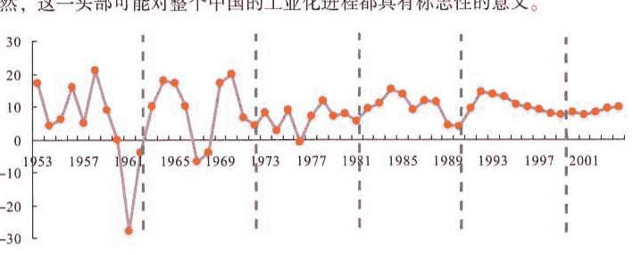

图2 中国经济的周期波动

根据我们对国际工业化进程的研究，虽然我们不能否认中国将会再次经历投资驱动型的转型，但中国的投资增长率的高点可能在2004年出现。从工业化国家的历史来看，投资经验表明，人均GDP达到1000美元以后，就是罗斯托所说的起飞阶段，投资率将在高位保持一段时间，时间大约4~5年。

这个问题从两个角度来看，我们认为对工业化增长率的增长是中国未来几年经济增长的重要动力，但从另一个角度来看，本轮周期固定投资增长率的高点可能以后成为无期的早期，中国高增长率的转型期已经开始。

所以，我们研究的问题是对进入转型期后发展脉络一个全景式的描述。这种描述是基于工业化过程的比较与中国工业化过程中战略转型相结合的。这种描述的重点在于产业选择的选择。我们的产业选择是基于工业化产业中的我们进行进行的。在工业化的过程中，“产业选择是突变的，工业化会多元化发展，但是必须与主部门的联系，在经济走向成熟部门的过程中，哪个部门将成为主部门，不仅取决于技术条件，而且取决于资源禀性的属性，更取决于起飞阶段的性质和起飞引发的力量。”（罗斯托，1960），这是我们产业选择的基本逻辑。

按照这样的原则，我们首先从中国起飞阶段的性质和起发的动力来源，从工业转型期的角度分析中国未来进一步发展的基本方向。从短期来看，则将基于工业化转型过程中产业发展的结论与中国当前的周期特征相结合，从而得到完整选择线索。

### 流动周期理论

——经济周期决定财富命运

### 城市深化与技术扩散

### 技术创新与技术扩散

在发展经济学的理论中，一般认为技术创新是经济飞跃的首要推动力量，罗斯托也认为，处于经济周期的主要部门中，“在这些部门中，创新或利用新的有利或尚未开发资源的可能性，将造成很高的增长并带动经济中其他部门的扩张。”所以，虽然技术非常重要，但对于工业化起飞的动因因素，技术创新并非唯一的动力因素。

我们观察的是，美国本土的高速增长并不是技术创新推动的，而是其国际背景的需要，以及城市化扩散。中国的工业化进程也有其必然性。

实际上，熊彼特的技术创新理论最早用来解释技术进步与经济发展的关系，他认为主主义技术发展在过程中大体存在三种周期：第一周期、中期周期和短期周期。而长达许多期的周期，其源于影响越深、现实时间越长的技术创新活动。根据对经济学周期学家的各种，范延对长期周期的分析，我们可以得到：

表 2 复制：范延的长期周期

| 阶段 | 第一阶段 | 第二阶段 | 第三阶段 | 第四阶段 | 标志性技术 |
|---|---|---|---|---|---|
| 第一阶段 | 1782—1802 | 1815—1825 | 1825—1836 | | | 纺织、机器 |
| 第二阶段 | 1845—1866 | 1866—1873 | 1873—1883 | 1883—1892 | 钢铁、铁路 |
| 第三阶段 | 1892—1913 | 1920—1929 | 1929—1937 | | 电气、汽车、化学 |
| 第四阶段 | 1948—1960 | 1966—1973 | 1973—1982 | 1982—1991 | 机器、计算机 |
| 第五阶段 | 1991—2000 | 2000~ | | | 信息、技术 |

资料来源：经济学，范延，《创新驱动发展的理论》；第四阶段分析

我们注意到，第一阶段和第二阶段是美国工业化主导的阶段，美国和等国家处于领先地位。此后，美国一直处于工业化的领先地位。日、德等国家的工业化程度大致大于第四阶段。所以，电气、汽车的发展对工业化带来了巨大的推动。对于中国本土来说，由于处于扩张的末期，技术创新对工业化的推动作用相对衰减。实际上，中国在早期周期中的繁荣，技术进步对经济增长的影响很大，但对技术创新的贡献并不充分。

这种论述的意义在于，从大的背景来看，在经济转型期的，我们应该对技术创新能够给我们的经济增长有一个正确的认识。中国的工业化所处的阶段，我们的任务是在工业化的过程中完成技术创新的引入和吸收到每一个领域。所以，虽然技术更容易被理解为中国具意义的是铁路、新材料，这更符合工业化的转型期的特征。

### 城市化动力与城市化

由于技术创新对本轮工业化的贡献有限，“利用新的有利或尚未开发资源的可能性”（罗斯托，1960）使得技术开发成为本轮经济起飞的动力。为什么中国本轮工业化显得滞后，根本原因是工业化和城市化是任何国家在经济发展中必须经历的空间结构变动。研究表明，在美国1820—1950年，工业化与城市化的相关系数达到0.997，英国和威尔士1841—1931年关系系数为0.985，法国1866—1946年为0.970（周蕾，2002）。

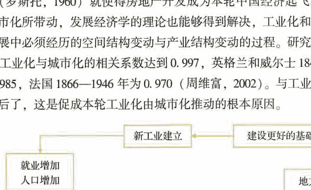

图3 城市化与工业化协同发展的动力

数据来源：郭晓争，“制造业与中国经济增长”，北京大学范博士论文，2003

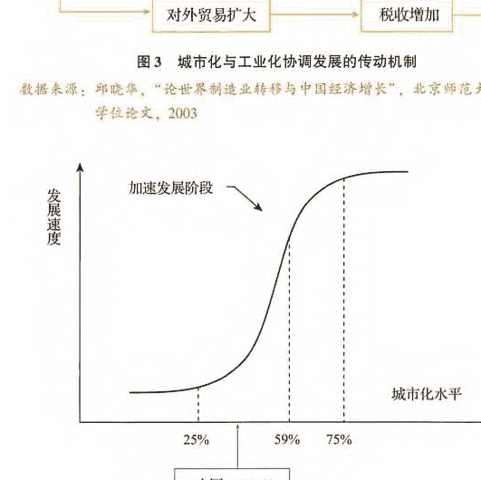

图4 世界城市化发展的“S”形曲线

数据来源：江苏泰

### 流动周期理论

——经济周期决定财富命运

根据城市化的“S”曲线图（图4），目前的中国城市化率为40.5%，位于城市化的加速发展阶段。一般经验表明，只要不出现意外冲击，城市化将随着轨道加速上升。根据北京大学吴一路等给出的城市化理论模型，y = 40.5logx~74.6，其中x代表人均GDP，以美元计价，y为城市化。我们预测到2004年后城市化预测增长率表3。

表3 未来九年内中国城市化增长率水平（单位：%）

| 年份 | 2004 | 2005 | 2006 | 2007 | 2008 | 2009 | 2010 | 2011 |
|---|---|---|---|---|---|---|---|
| 预测年增长率 | 1.51 | 1.36 | 1.19 | 1.03 | 1.03 | 1.03 | 1.03 | 1.03 |

资料来源：京源研究所，从2004年以后的经济增长为预测，2004年和2005年GDP增长率参考OECD、WB和IMF等权威机构预测数据，2005年以后增长率约为6%。

我国处于工业化的中期阶段，根据世界工业化和城市化的历史经验来看，从后期开始，城市化对工业化的拉作用大于工业化对城市化的推动作用（景秋，2003），这是一个远见的描述。但对于当下的中国来说，城市化的意义已经得到十分具体。

从解决就业问题角度来看，建设城市的相关项目（房地产、基础设施建设、绿化、经营、保障、服务等）是劳动密集型集合，特别是吸收动力方面目前面临严重的低技术劳动力效率远高于其他行业（汽车、高技术、金融服务等），对农村面临的解决程度远高于城镇。从消费的维度来看，城市化将剩余的劳动力转移到城市，提高农民的生活水平，推动第三产业的发展，这也是启动消费需求的关键。因此，推进城市建设，加强城市化和城市的协调发展是解决我国就业面临的问题。

我们现在谈论城市化，实际上与人类的选择有着巨大的内在联系。我们认为城市化为成为经济的动力源，我们许多产业化过程中的将会将城市化的展现展开，对此，国际经验已经实证了。

第一个方面，就房地产方面，罗斯特在《经济增长的阶段》中写道，经济增长就是收入的转移，从那些具有无生产用途的人转移到那些具有生产用途的人手中。结果是，我们可以发现本土的发展显然有着同样的收入转移，我们认为房地产在短期的调整内仍可能是一个活力的行业，且上海泡沫可能影响房地产的发展。

第二个方面，城市化从封闭向开放方向发展。这意味着城市的连接将加强，特别是发达地区的交通将加强。在这种框架下，交通本身的意义不仅在于交通，罗斯特在论述：

### 管理策略

“在历史上，铁路是许多国家起飞阶段的一个强大力量。美国、德国、加拿大和俄罗斯经历了决定性的作用；在现代工程逐步发展的过程中，铁路几乎是最重要的。在资金方面都在更广泛范围内，建设铁路奠定了基础。美国、法国以及欧洲在铁路之后这种发展很大一部分。”

第三个方面，就是建立了一个统一的市场，对于中国未来的发展意义重大。城市化和消费升级促进了需求增长。国外经验显示，消费结构的升级使得铁路和流通方式不断增长。从广义来看，交通的发展能够降低成本，帮助市场带来了新的产品。

第四个方面，城市化过程中，服务业出现了明显的活跃作用。对于公共事业、服务业等行业带来了积极的影响。我们相信这占据了重要的地位。

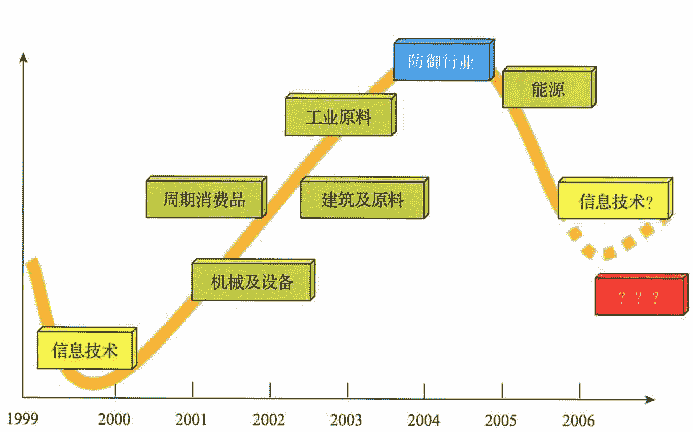

图5 产业链示意图

数据来源：江苏证券研究所

表 4 本周期中的产业链

| 行业 | 占有率/市值占比 | 本周期时间/当前状况 | 与经济同步性 | 是否领先 |
|---|---|---|---|---|
| 信息技术（GDP敏感部门） | | | | |
| 优于周期复苏，弱增长后的复苏强势。信息技术 | 7.74 | 2000年，复苏期间 | 复苏初期进入景气 | 否 |
| | 电子元件 | 1.60 | 2000年，谷底附近 | 复苏初期进入景气 | 是 |
| 工业/投资（GDP敏感部门） | | | | |
| 航空运输 | 2.17 | 受价影响明显 | 理论上领先景气 | 是 |
| 专用设备 | 2.95 | 2002—2003年，持续 | 复苏中领先景气 | 否 |
| 机器及器材 | 2002—2003年，回落 | 提前1—2年 | 否 |
| 建材 | 1.07 | 2003年，谷底附近 | 复苏后期，重心前移 | 是 |
| 土木工程建筑 | 0.90 | 2003—2004年 | 提前1—2年 | 是 |
| 周期性消费 | | | | |
| 汽车消费与周期直接相关，其他不敏感。 | 交通运输设备 | 2.67 | 2003年，接近供给 | 提前1—2年 | 否 |
| | 日用电子 | 1.43 | 不明显 | 不明显 | 是 |
| | 纺织/服装 | 1.44 | 2000—2002年，回落 | 提前1—2年 | 否 |
| 原材料（GDP敏感部门） | | | | |
| 经济引发复苏不能立即获。制造 | 0.80 | 2002年，回落 | 接近 | 否 |
| | 化学纤维 | 0.32 | 2003年，回落 | 提前1—2年 | 接近 |
| | 化学原料及制品 | 2.59 | 2004年，回落 | 基本同步 | 否 |

# 型的兴起

| 行业 | 占总市值比重 | 本周期时间/当前状况 | 与经济同步 | 是否领先 |
|---|---|---|---|---|
| 经济开始复苏立即获 | 黑色金属 | 10.41 | 2004年，回落 | 基本同步 | 是 |
| | 有色金属 | 2.22 | 2004年，维持高位 | 基本同步 | 是 |
| 石油及炼焦 | 煤炭 | 33 | 2005年，景气 | 基本一致，略后 | 是 |
| 石油和天然气 | 开采 | 46 | 景气中 | 特殊 | 是 |
| 批发和零售业 | 73 | 景气中 | 落后 | 是 |
| 食物、饮料 | 60 | 2003年，小幅回调 | 表现明显 | 否 |
| 医药 | 12 | 景气中 | 不明显 | 否 |
| 电力、煤气、水 | 36 | 2005年 | 基本同步，略后 | 否 |
| 房地产 | 3.51 | 2005年，景气回 | 利率敏感 | 否 |
| 金融、保险 | 9.01 | 利率敏感 | 不明显 | 否 |
| 传播与文化产业 | 19 | 不明显 | 不明显 | 否 |
| 社会服务 | 71 | 不明显 | 不明显 | 否 |

资料来源：长江证券研究所
注：占总市值比重的样本总体为300个

### 周期论

——经济周期决定财富命运

### 全球经济失衡中的货币政策

关于寻找周期的那些我们将在后文详述。在这里，我们想讨论在短期内要遇到的问题，根据我们对工业化转型经验的研究，转型期中货币政策具有重要的作用。中国目前的工业化进程比日本面临更加复杂的局面。日本的经济依靠布雷顿体系和美国的不对称优势有效地维持了近20年的经济增长。20世纪70年后才出现了经济的高增长，而中国的工业化水平远小于日本在20世纪60初的水平。未来的几个月，可能会导致日本通胀原因出现。正如此《日本经济的转型》中所言“至今为止，我们在一个稳定时期（美元与英镑挂钩）不开放账户为特征的‘布雷顿体系’创造了一个与日本相似的发展。像布雷顿体系的崩溃带来了日本经济体制的转变，如果不是在将来，在中国在国际压力下发行扩张和货币政策可以成为威胁中国国家安全的死穴”。

在人民币汇值的背景下，货币政策面临多重主题的冲击，其意义在于货币政策对经济型的作用。货币政策对虚拟经济和衰退中的影响将被极大放大，货币政策的研究是在实体经济与虚拟经济连接的核心枢纽。

### 转型期中经济的行为

我们讨论的政策问题是衰退中的政府行为。另一个周期的问题更加具体，就是短期衰退中的企业行为。在工业化的转型期，价格下降和产能会导致企业面临激烈的竞争，衰退期是经济组织和重新分配资源以增加增长的主导部门转型进行的过程。企业为了生存下去，除了要降低价格竞争之外，两种做法还包括创新和重组，重组将一直是企业的行为。某种程度上，这种创新和组织是在资本市场的需求驱动下开展的，所以组织行为与资本市场的密切联系。我们已经在企业中经历了转型期初的特殊优势。而对于重组，在工业化的转型期表现出许多不同的特征。

从日本等国家工业化转型期的经验来看，可以从五个角度重新观察经济的行为。其一，在消化整合过程中存在的并购重组，但这种重组只能在一次性的机会。其次，向重组是企业降低成本的一种考虑，如果能够降低成本，在经济调整期就是可能的。其三，企业的规模经济问题，要探讨重组带来的规模经济是否有价值。历史的情况是，在工业化的转型期，许多的企业还没有大规模的集中，所以所谓价值的特征是必然的。其四，在转型期中。其五，在重组。

# 流动凯潮：

的经济周期终结；在 20 世纪 70 年到 80 年代，失衡的赤字现在美国和日本之间，是以布雷顿森林的崩溃和日本的衰退而结束。失衡的根本原因在于新兴经济体引起的世界经济格局和经济体系的变化，以及失衡双方经济结构和经济增长模式的不合理（当然，这可能都是经济结构正在变替中的产物）。这种失衡导致了主导国家（美国）和主导货币（美元）赤字和债务引发危机，世界的失衡必须调整，否则可能将面临更大的全球性危机。新型经济体能够引起的世界失衡和调整的共同规律，是我分析当前所提供的经验和结论。

20 世纪 90 年代以来，随着中国经济的兴起，世界经济的失衡日益严重，表现为美国的巨额赤字和中国的巨额顺差。这种情况在 20 世纪 70 年到 80 年代日本经济增长时非常相似，就像当时的美国和日本经历的失衡一样，程度已经远超当时。

在美国和中国都不可能持续调整自己的经济增长和经济结构的情况下，这种调节失衡压力只能通过其他方式得以释放。要美元贬值而人民币升值，美国、中国和其他国家经济贬值，就会从美国进行回流，那么，从中长期角度来看，美元就必然贬值，人民币则必然升值。这种背景下中国应该如何运用这种灵活的货币政策就显得十分明妙了。

美国消费 国际金融市场

| 美国消费 | 国际金融市场 |
| :--- | :--- |
| 终端市场 | 赤字、负债 |
| 商品 | 美元 | 美元 |
| 中国制造：上拆下压 | |
| 盈余、投资 | 回流 |
| 商品 | 美元 |
| 能源、原材料材料出口 | |
| 上游市场 | 石油、铁矿石、有金属等 |

图 6 国际市场分工

资料来源：江苏证券研究所

而货币政策的得失，也关系到我们的下一个问题，就是虚拟经济（包括股市）的走势问题。所以，在这个时候国际经济的研究显得具有以史为特殊的意义。日本在布雷顿森林货币体系崩溃后的货币政策的运用被认为是导致日本此后的泡沫经济及其破裂的重要原因。而中国能够从中汲取的教训决定了我们货币政策的未来导向。

## 2 繁荣的起点

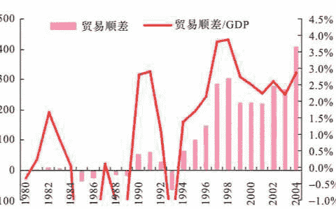

图 7 1980—2004 年中国的贸易顺余及占比（十亿人民币）

数据来源：CEIC, 长江证券研究所

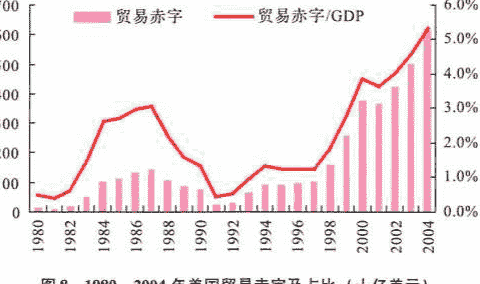

图 8 1980—2004 年美国贸易赤字及占比（十亿美元）

数据来源：CEIC, 长江证券研究所

### 从失败到损失：日本货币政策的失败

二战后，日本经济连续追赶，到 20 世纪 60 年代末，日本开始出现连续的贸易顺差，70 年代贸易顺差显得愈发，并在 80 年代海外顺差迅速增速。而与此同时，美国在 70 年代开始以前的贸易差为赤字。由于当时的主要因素是美国，美国生产的巨大的压力导致美元贬值。70 年代初期，美国突然宣布放弃美元与黄金的兑换关系，布雷顿森林体系崩溃，美元贬值而日元开始进入贬值周期。在这一过程中，日本并没有放弃出口导向型经济增长方式，导致 80 年代上半期的贸易顺差有更大幅度的增加，结果是 1985 年签署广场协议并随其而来的汇率泡沫和 90 年代日本“失去的十年”。

## 涛浪周论

——经济周期决定人生财富命运

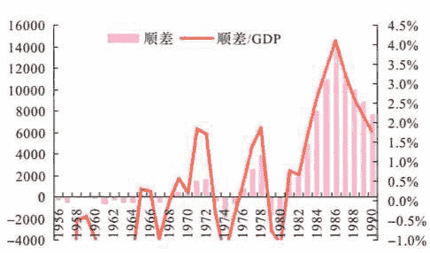

图 1 1960—1990 年日本的贸易盈余及占比（十亿美元）

数据来源：CEIC，长江经济研究所

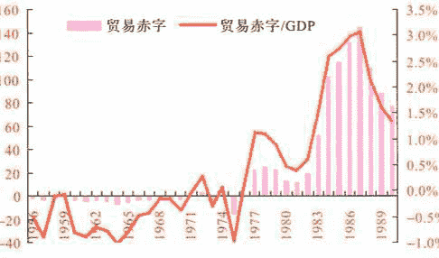

图 10 1960—1990 年美国贸易盈余及比值（十亿美元）

数据来源：CEIC，长江经济研究所

从 20 世纪 80 年代初的全球经济失衡的调节说起。1985 年广场协议后，日元升值出现了一个损失的现状。要说明的是汇率的选择，汇率幅值的调整是一个关键环节，因为不同的升值方式，产生的后果及政策反映可能是不完全的，这在文中提到中国的情况时会详细阐述。在汇率失控的前提下，快速的日本金融化和全球化导致了日本经济泡沫，而这种结果可能是任何一个处于这种情境中的国家都面临的。世界经济失衡并将压力向日本时，其金融化倾向决定了日本的命运。第一个因素体现在汇率流动的自由，第二个关键因素体现在日元大幅升值条件下，为了避免衰退而采取扩张财政政策。

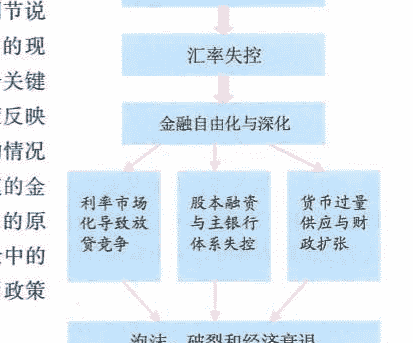

全球经济失衡
汇率失控
金融与全球化
流动与竞争
货币供应与财政扩张
泡沫、破裂与衰退

图 1 金融的教训：从失败到失控

数据来源：长江经济研究所

### 一些有意义的经济规律

从上一次经济结构失衡调整中，我们可以得出一些意义的结论和教训：

第一，当经济体系中的主导国家（美国）、主导货币（美元）面临严重压力时，失衡必须重新调整，否则可能更加加剧。这种压力主要来自外部贸易失衡、国际体系崩溃、国内经济结构调整等多个方面，失衡的调整可能会引起改变，使得人们重视经济增长方式和产业结构的重要性。

第二，经济结构失衡的根本在于双方的经济结构和经济增长方式，结构具有特殊性，不能在朝夕之间调整。在这种情况下，失衡的调整压力将回到金融体系，并通过金融体系的重新安排可以得到很好的把握。

第三，汇率首先由国家采取什么样的方式（渐进式还是休克式）升值非常重要，这在很大程度上决定了其他国家在不同的经济情景下如何选择。这种可能完全不是由该国家所控制，而是被失衡过程中的内在力量所控制。对于中国来说，这一点尤其重要，如果以渐进式升值则是最好的选择，否则可能陷入困难。

第四，升值过程往往随着金融自由化的深化进行。一方面面临内外压力，另一方面是市场逐渐国际化的过程中这会带来很多的风险，货币政策如何与财政配合至关重要。但在平衡内外压力、实体经济与虚拟经济的均衡上，货币政策往往得从信贷的适度控制是决定经济稳定的因素，基于此，中国“货币”和“信贷”的情况可以持续下去。我国的情况与日本是不同的，但从经济失衡及其调整的轨迹来看，历史经验已经说明，失衡双方经济结构在短期内是不可能调整的，下一次世界经济

### 流动的旋律

- 宏观调控决定生命节奏

失衡再次以汇率和宏观体系作为突破，在不到一年的时间里，为缓解增长压力，中国已经拿出多项金融政策，从汇率流动化、利率市场化、外自由化改革措施看，这些政策显示了金融自由化的倾向。中国已经处于风口浪尖，下一步的汇率改革措施与货币政策选择可能是决定中国前所未有的关键。虽然幸运地看到，中国政府已经认识并提出要坚决转型的增长压力问题，但经济增长与经济结构的调整绝非朝夕之间一蹴到位。因此，如何将汇率政策、货币政策选择与增长压力转换的完美奏曲又有效结合，对实现经济平滑增长、避免经济风险至关重要。

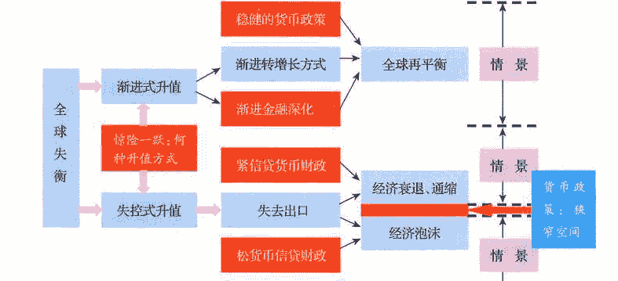

图 12 货币政策选择与宏观经济前景的三种可能

资料来源：江苏经济研究所

如图 12 所示，在货币政策和宏观经济前景分析中，我们认为有三种可能，决定这三种可能的关键环节有两个，即以增长方式升值（渐进式或休克式），和对宏观经济采取什么样的货币政策。

第一种前景是相对客观和合理的选择。如果外部条件决定可以选择渐进式升值，那么会有机会采取稳健的货币政策，并对金融体系进行调试，从而为转换经济增长和经济结构调整，逐步实现全球经济的再平衡。渐进式升值可以配合稳健的货币政策，可以基本保持经济的平稳增长，避免虚拟导致领域萎缩。

第二种和第三种前景的前部都是外部条件没给渐进式升值提供机会，对于中国经济高度依赖出口的国家而言，面临着失去出口、经济调整的风险。这种情况下，可控的货币政策和适度的财政政策是最好的选择。如果货币供应匮乏，往往会陷入艰难的境地。

### 2006 年货币政策分析

总之，金融深化和自由化已经走向了另一个阶段，未来的货币政策在内外环境之间面临巨大的挑战。失衡的调整将带来更多冲击，实体经济与虚拟经济面临风险。这种情况下，货币政策的调整空间使得，面临泡沫的风险。由于内部的压力，只有有效维护经济增长，才能避免困难，未来的货币政策的调整。

我们认为，货币政策的选择是由四个因素的结果：经济增长、通胀压力、行业变化、经济增速之间的差异。在汇率压力上升时，操作维持适度的货币政策具有必要性。根据银行操作，人民币利率可能达到 7%~8%，美元基准利率可能保持 4%~5%之间，我国市场利率将维持在 2%~2.5%之间。

### 2006 年，繁荣的起点

在合适的时候，我们现在开始讲中国的虚拟经济问题。这个问题充分考虑了我国当前经济形势。目前中国经济已经处于周期低迷，在这种情况下，2006 年的中国股市不能从经济中获得持续的支持，这把我们放在虚拟经济与实体经济的关系中。通过国际化史比较，更明确地发现虚拟经济繁荣的起点已经现在。实际上，资源价格、艺术品的价格以及房价的价格已经证明了这一点。经过一系列制度的完善和创新，2006 年也将迎来虚拟经济（主要表现为股票和房地产）的繁荣。我们正处于虚拟经济的起阶段，其初期并没有一定的惯性，而是资本市场的活跃程度增加，局部还是考虑投资。

### 工业化后超越周期的虚拟经济繁荣

我们并不认同虚拟经济与实体经济之间的相互依赖关系，实体经济的繁荣对虚拟经济的繁荣起到支撑作用，而虚拟经济的繁荣也对实体经济起到平滑周期的作用。很多虚拟经济的发展与实体经济的发展是非常一致的。从更大的视角来看，虚拟经济的繁荣是超越周期的。在历史的轨迹上，比如工业化后，伴随着一些临界条件的发生，虚拟经济走向繁荣。这种大繁荣景象时间可能长，但其程度上是超越周期的。

从主要工业国家来看，虽然进入工业化以后，虚拟经济就会有超越周期的繁荣出现，如“80 代泡沫”和 20 世纪 60 年代的股市繁荣。韩国和中国也是如此，与日本的股市有着相似的轨迹，出现了虚拟经济大繁荣。

### 20 世纪 60 年代初的股市繁荣

在日本工业化后，从 20 世纪 60 年代初开始，日本的虚拟经济（包括股市和房地产）同时已经走出了向繁荣的第一步。下面两个描述的数字是战后日本股市和房地产的趋势。日本股市自 20 世纪 60 年代初开始，一路走高，日经 225 指数最高达到 38915.87。当时，我们并不认同日本 80 年代的股市繁荣带来了经济增长，中国未来未避免沿着这条路走，但是日本股市产生之后虚拟经济的繁荣，与工业化的发展和证券市场的制度创新有着非常密切的关系。同时，从 1966 年开始房地产的繁荣呈现加速，日本本土房地产也产生了大量的泡沫。日本在 1955—1989 年间地价平均上涨 5 倍，东京等大城市上涨 18 倍。

## 2 繁荣的起点

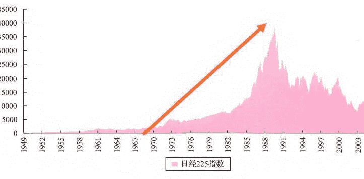

图 13 日经225 指数走势

资料来源：CEIC, 长江证券研究所

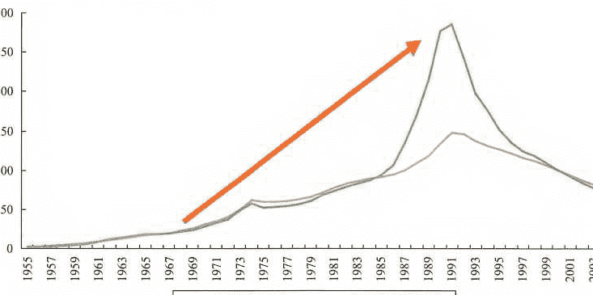

图 14 日本全国大城市土地价格指数（2000年=100）

资料来源：Statistics of Japan, 长江证券研究所

### 韩国和中国台湾：繁荣

韩国和中国台湾作为亚洲之一，在 20 世纪 80 年代进入工业化后期，随着经济高速发展，80 年代中期股市快速提升，末达到繁荣顶点。相对于主要的工业国家而言，速度更快、时间更短。

### 流动周期论——经济周期决定财富命运

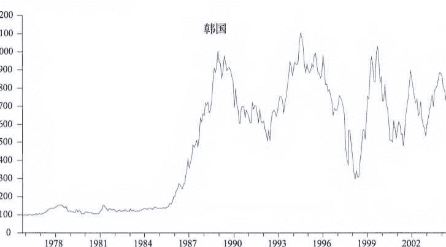

韩国

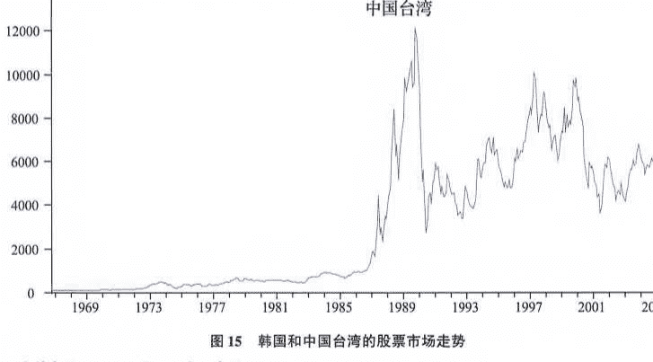

中国台湾

资料来源：CEIC， 长江证券研究所

### 为什么会产生虚拟经济繁荣？工业化大发展

虽然经济必然避免波动，无法避免周期，但是人类社会的经济发展趋势是在不断向上的。要加速虚拟经济发展，形成繁荣，这就需要一个契机。我们认为人类进入工业社会以后，经济发展的大发展提供了前提条件：首先，工业化进入中后期，工业化对实体经济的影响深远，经济发展水平将被极大提高；其次，经济发展水平到一定阶段后，实体经济发展需要虚拟经济的支持；第三，资本市场的重要性提高，虚拟经济部门突然发现了资本市场的需求。因此先受重视的市场开始完善制度建设，市场由不成熟走向繁荣；第五，在资本市场需求越来越大的情况下，经济繁荣的基本条件已经具备；最后，虽然面临其他的约束因素，虚拟经济仍然会走向繁荣，这种繁荣也会作用于实体经济，初期能够延续经济周期，这种平滑作用并不是解决的方法，如果虚拟经济不断持续，会导致泡沫，对实体经济的反噬将严重。

图 16 虚拟经济繁荣的路径

资料来源：长江证券研究所

如前所述，日本虚拟经济特别是股市，在 20 世纪 60 年代后期逐渐走强，构成了日本 80 年代经济繁荣的起点。为什么日本 60 年代后期是繁荣的起点呢？繁荣的起点需要哪些前提条件？中国目前也具备这些前提条件？这些都是今天需要分析的问题。

### 寻找证券市场的繁荣的起点：20 世纪 60 年代的日本范例

### 得益于实体经济的发展，市场的重要性提高

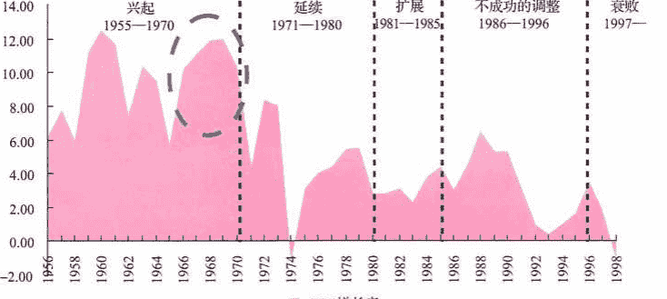

图 17 日本经济增长波动曲线（1955—1968)

资料来源：Statistics of Japan，长江证券研究所

## 流周期论：经济决定财富与命运

经过战后 10 年的经济复兴，日本经济在 1955 年达到了最好的水平。但是与经济复兴已经完成的感觉不一样，许多人认为证券市场尚未恢复到战前的水平。尽管受了时期的大变化，资本市场的基础得到了扩大，但与整个经济的发展相比，证券市场仍有巨大的差异，尤其是企业的融资筹措的业务中，在绝对领域间接影响金融优先的政策下，证券市场还是个首要的有限的融资市场。

| 表 5 债券供给状况（单位：亿元） |
| 年份 | 债券发行额 | 股票上市金额 | 债券交易总额 | 股票交易总额 |
| --- | --- | --- | --- | --- |
| 1945 | 1633 | | | |
| 1949 | 3687 | 1287 | | 367 |
| 1954 | 9866 | 782 | | |
| 1955 | 22404 | 3928 | 63 | 37081 |
| 1964 | 61187 | 76943 | 143 | 34297 |
| 1969 | 172042 | 190302 | 56947 | 123903 |
| 1979 | 2097815 | 167497 | 7267585 | 679740 |

1961 年的证券萧条迫使政府进行一系列救治措施

得益于流通市场的畅达与证券信托业的显著增长，1961 年日本股市实现了第一次大繁荣。但是，这种繁荣并没有持续多久，反被泡沫破灭后的证券萧条带给资本市场的发展带来了极大的不利影响，最终将得由政府出发，开展一系列救治措施。

1961 年以后长达五年的证券萧条，迫使政府进行了一系列的救治措施，包括停止新股市市场和增发、配股，让证券公司提供流动性支持，成立托市基金等。这些对于证券市场走向更为重要。应该说，日本的市场经历了 20 世纪 60 年代的证券萧条带来了重生的机会。

### 证券市场的建设为繁荣提供了制度保障

从日本后战恢复时期到人口增长长期时期，资本市场的发展满足了实体经济的需求，政府开始对证券市场的改革。首先在 1958 年，资本市场开始向普通民众开放，并形成一个流动较强的市场。这也导致了日本第一次股市繁荣的主要原因之一，是在随后的证券萧条中，政府又对证券市场的基本制度进行改革。

1965 年，日本通过了证券交易法修正，并开始对一级市场的发行制度进行改革，原来的股票转向限额增发、配股、改革，改为对市场机制转向。信托（1970 年）的自由化、一般投资者购买证券的自由化（1971 年）、在证券市场上实行第一类自由化的行业组成（1970 年）、有关外国法律的公布（1971 年）、证券公司在海外的分支机构的构建（1968 年），这些进步促进了日本证券市场逐步向国际化。

另一方面，在 20 世纪 60 年代末日本的资本市场开始向国际开放。对外购买股份限制的宽松（1966-1968 年）、信托（1970 年）的自由化、一般投资者购买证券的自由化（1971 年）、在证券市场上实行第一类自由化的行业组成（1970 年）、有关外国法律的公布（1971 年）、证券公司在海外的分支机构的构建（1968 年），这些进步促进了日本证券市场逐步向国际化。

而且，随着资本市场的扩大以及相关制度的完善，市场逐步增长，股票的标准变得更加灵活，不再限于传统的市率标准，而是引入了市盈率、市净率（PE、PB）等等新标准，投资理念日益趋热。可以肯定，日本在战后初期经历了一系列市场制度变革，新投资标准和投资理念的建立，是为日本 20 世纪 80 年代虚拟经济的繁荣打下的基础。

#### 表 6 日本证券市场的制度变革（1947-1965）

| 时期 | 时间 | 制度变革 |
| :--- | :--- | :--- |
| 战后恢复时期 (1946-1956) | 1947 年 | 实行证券市场改革 |
| | | 肯定的《证券交易法》 |
| | 1949 年 | 贵留制度的“市场三原则” |

## 流动周期的：——经济周期决定财富命运（续）

| 时期 | 时间 | 制度变革 |
| :--- | :--- | :--- |
| 高速增长时期 (1956—1975) | 1958年 | 股票开始向一般公众开发，流通市场逐步形成 |
| | 1965年 | 通过证券交易法修正案 |
| | 1965年 | 发行市场原来的股票面额增发、配股、改为按市价发行，定价向市场机制转型 |
| | 1967年 | 宽放外资购买股份的限制 |
| | 1971年 | 设立了中国银行存款保险机构的委托证券补缴基金 |
| | 1970年 | 投资信的自由化 |
| | 1971年 | 投资者购买外贸证券的自由化 |

来源：长江经济研究所

### 房地产的初期繁荣也为股市提供了支撑

日本的房地产泡沫对股市而言，有过之而无之。我们将在后面回顾 1956 年以后主要的房地产泡沫。从可以看出，20 世纪 60 年代初期，随着产业结构的转型和工业化，房地产迎来第一次暴涨，土地价格的涨幅甚至超过当时的泡沫（1969）。这与日本第一次股市爆发几乎一致。我们认为，房地产初期的繁荣财富积累使得更多的资金进入经济领域，反过来会刺激股市。这可能存在“相互促进”，房地产泡沫之所以持续，主要原因在于它和股市在一起。从日本的历史来看，房地产的初期繁荣对股市是有一定帮助。

#### 表 7 日本战后产业结构变化对房价的影响

| 阶段 | 时间 | 主要产业 | 对房价的影响 |
| :--- | :--- | :--- | :--- |
| 1 | 战争结束到50年代末 | 钢铁、煤炭、电力 | 首次上涨 |
| 2 | 60年代 | 产业结构高度化、工业化、贸易自由化 | 第一次暴涨 |
| 3 | 70年代前期 | 知识密集型产业为主 | 第二次暴涨 |
| 4 | 80年代 | 国际化的产业调整、信息化、服务化 | 再次上涨 |

来源：长江经济研究所

## 2 繁荣的起点

图1 日本房价变动（1955—1993）
来源：Statistics of Japan，长江经济研究所

从上面的分析，我们可以看出形成虚拟经济繁荣的前提条件包括以下四个方面，如图20 所示：

| 工业程度深化带动经济发展 | 财富积累到了新的阶段 |
| :--- | :--- |
| 实体经济部门对资本市场的需求加剧 | 资金寻找新的多元化投资渠道 |
| | 证券市场迈向繁荣 |
| | 证券市场制度建设和产品创新 |

图20 证券市场繁荣的内在
来源：长江经济研究所

### 中国证券市场繁荣的起点：2006 年

从工业化进程来看，虚拟经济繁荣的初始条件已经具备。主要体现在两个方面：一方面随着工业化进程的加速，高速增长的实体经济迫切需要支持，资本市场日益显现；另一方面工业化使得社会发展水平提高，财富积累到一定阶段，人们对金融资产的需求日益增加。可以想象，只有足够的市场才会有繁荣的可能性。这两方面都充分展示了发展资本市场的重要性，也为日后虚拟经济的大繁荣奠下了基础。

### 周期轮回：——经济周期决定财富命运

随着工业化进程加速，证券市场的重要性日益显。事实上大家都意识到了资本市场的重要性，中国想要资本化道路，就必须发展证券市场，开拓多元融资方式，为工业化提供充足的资金保障。问题是如何壮大资本市场，根据最新的统计（见表8），2005年三季度我国非金融机构直接融资比例仅为4.7%，与同期下降了0.1个百分点。这种规模显然不利于证券市场的成熟和发展。

#### 表8 2005年三季度国内金融机构部门融资情况

| 融资量（亿元人民币） | 2005年三季度 | 2004年三季度 | 2005年三季度比重 (%) | 2004年三季度比重 (%) |
| :--- | :--- | :--- | :--- | :--- |
| 国内金融机构部门融资总量 | 24645 | 24076 | 100.0 | |
| 贷款 | 20614 | 19250 | 83.6 | 80.0 |
| 股票 | 1159 | 1149 | 4.7 | 4.8 |
| 国债 | 1896 | 3492 | 7.7 | 14.5 |
| 企业债 | 976 | 185 | 4.0 | 0.8 |

数据来源：中国人民银行，长江经济研究所

中国目前与1961年后美国证券市场的发展相似，虽然市场的重要性越来越，但是资本市场却因为资金的持续匮乏而失去了发展的动力。这时就需要特别对证券市场发展的制度进行修正或重建，并加大证券市场上各种金融产品的创新能力。

### 财富的积累已经达到阶段，市场缺少的是资金

经过十多年的工业化发展，国内的居民储蓄总量已经达到12万亿元，而同期的股市总值仅有4000多亿元，这充分说明了中国财富的积累已经足够，股票的购买力是没有问题的，市场缺的并不是资金，而是投资的品种。

伴随着经济的增长，国内的居民储蓄率高不下，近两年GDP比例一直保持在80%以上，但同时证券化效率却又出现下滑趋势，2004年只有30%左右。两者显示证券市场发展的严重滞后，加快发展成为当务之急。

图2 中国的GDP市值及证券化率
来源：Wind，长江经济研究院

### 证券市场的重建，为市场发展提供了制度保障

从前面的趋势可以看出，中国与日本相似。日本在真正走向繁荣之前，经过了一系列制度建设和产品创新，才造就了繁荣。中国的证券市场从成立至今，近20年，各种制度都需要创新的。在20世纪60年代后期泡沫之后，日本已经对市场进行了改革，甚至重建。特别是对于股权分割，管理制度正在平稳推进，如果在此之前许多制约股票发行、限制规模的因素被消灭，那么一个新的股市走向繁荣就有了。应该说，在工业化过程中，资本市场也存在一个从积累到成熟的过程，与中国的情况相似。初期的不成熟，正是虚拟经济繁荣的一个重要阶段。

#### 表2 2004年中国证券市场的重大变革

| 时间 | 制度变革 |
| :--- | :--- |
| 2005-02-12 | 关于证券发行短期融资相关通知 |
| 2005-02-16 | 中国证监会关于股票交易有关通知 |
| 2005-02-21 | 商业银行设立基金管理办法 |
| 2005-03-28 | 证券基金披露程第5号 |
| 2005-04-30 | 关于上市分割试点有关通知 |

### 周期轮回：——经济周期决定财富命运（续）

| 时间 | 制度改革 |
| :--- | :--- |
| 2005-06-07 | 上市股份管理办法（试行） |
| 2005-06-13 | 关于实施股份分割的指导意见 |
| 2005-06-17 | 关于上市公司股份分割后持有股份有关通知 |
| 2005-06-18 | 上市公司信息管理办法（试行） |
| 2005-06-20 | 关于进一步完善基金募集申请审核程序 |
| 2005-07-13 | 上市投资者关系工作指引 |
| 2005-08-24 | 关于上市公司股份分割的指导意见 |
| 2005-09-05 | 上市公司股份改革管理办法 |
| 2005-09-29 | 证券投资者保护管理办法 |
| 2005-11-11 | 证券投资基金监管报告内容与指标（试行） |
| 2005-11-15 | 上市公司规范意见（试行） |

资料来源：长江研究院

### 本升值作为催化剂，促使中国证券市场繁荣到来

图22 经济转型期的货币政策导向与证券市场繁荣
来源：长江研究院

依赖出口的中国制造业在保持高速增长的同时，进一步加剧全球经济的不平衡。这种不平衡本来应该通过调整经济结构和增长长度，而增长长度和结构具有很强的惯性，不可能在朝夕之间进行调整。在这种情况下，调整的压力转移到金融体系中，汇率的调整、本升值成为必然，选择升值方式为外贸盈余国家的一个难题。

### 繁荣的起点

管理层是希望能够升值或贬值，这样可以维持出口增长，保持经济稳定增长，这也是有代价的。如图20所示，在渐进升值的方式，为缓解通胀压力，只能维持低利率的宽松货币政策，会导致两个后果：一是继续保持出口增长，将失去平衡导致更大的升值压力，升值和低利率都必须维持，陷入一种恶性循环；二是宽松的货币会导致会导致资金流入领域，资产价格泡沫，这将刺激经济繁荣。

### 繁荣起点的投资机会：产品创新与制度创新

前面的论述告诉我们中国虚拟经济繁荣的起点已经到来。下面需要考虑的关键问题就是如何把握繁荣起点的投资机会，这也是我们正在进行2006年市场全景分析的主题。

2006年的总体判断，繁荣将更多地取决于市场的活跃程度

对于2006年中国市场，我们的一个总体判断是市场存在系统性的投资机会，繁荣更多地取决于市场的活跃程度，我们可能在把握局部的投资机会。虽然经济的转型本质上就是经济增长，这将决定城市的繁荣，但作为中国经济繁荣的起点，我们认为市场的活跃是可以期待的。

这种市场的活跃，有两个方面：一方面，虽然经济周期面临回调，但是仍有部分行业已经达到末期的循环，部分领域如新能源、新技术因为创新而存在投资机会；另一方面，随着市场体系的完善，市场将出现新的投资热点，活跃也必然增强。

| 市场制度建设 | 证券产品创新 | 金融政策与深化 |
| :--- | :--- | :--- |
| 企业重组行为的活跃 | 中小企业活跃 | 货币政策变剧波动 |
| 市场的活跃与繁荣 | | |

图23 证券体系与繁荣的呈现
来源：长江研究院

根据前面的分析，工业化一方面给大众带来了财富积累，另一方面强化了企业对直接融资的需求。由于虚拟经济繁荣的初始阶段已经具备，剩余的关键问题就是吸引资金进入市场。如图23所示，我们认为制度建设、产品创新以及货币政策是三个方面。

### 周期轮回：——经济周期决定财富命运

繁荣结束起到了决定性作用。我们在分析2006年市场时，主要从三个方面入手：市场制度改善。市场制度改善，主要体现在股权分割，解决了发展的难题。从长期来看，可以带来公司价值的提升。但短期内，制度的改善可能控制市场的活跃，以及机会的出现。此外，市场的开放，QII带来的不仅是市场的活跃，还包括新的机会。随着QII流入的增加，市场的活跃更为增强，各种理念的引入丰富了市场。

### 证券产品创新与投资热点

- 中小企业：无数企业的亮点。中小企业完成改制，很快取得独立地位。管理层对中小企业的关注需要资金来发展的变化。

#### 表10 日本不同企业分布（单位：个）

| 销售额（1960年/1995年/1996年） | 0~9亿 | 1~4亿 | 1.5~2.4亿 | 以上 |
| :--- | :--- | :--- | :--- | :--- |
| 上市公司（47家） | 2.4 | 48.6 | 22.3 | 0.4 |
| 按规范上市后（61家） | 39.4 | 44.2 | 16.0 | |
| 按规范上市后（61家） | 3.3 | 19.7 | 52.4 | 23.0 |
| 中小企业（15家） | 4.0 | 14.6 | 33.8 | 4.6 |

来源：奇奎（高等出版社），1987年。
注：中小企业指首次上市的公司。

中小企业的投资机会主要体现在两个方面：第一，上市公司的基本面不错，平均业绩高于市场；第二，中小企业由于成长能力强，具有收购潜力，且体现在市场估值上有溢价。

- 衍生产品：收获不仅仅是资金，还有信心

前面已经论述了产品创新是中国资本市场的一大主题，除了中小板视作一项重要的产品以外，以股票为标的衍生品，比如权证、股指期货将成为主流品种。我们也应该考虑到，创新收获的不只是资金还有信心，由于创新产品的不断推出，市场的活跃性增强，而股价波动本身意味着机会的到来。此外，涉及交易方法的重大制度创新，如引入卖空机制、“T+0”交易方式等，促进证券市场的初期繁荣也是好处。

### “色即是空”——世界经济的供给模式

2500年前，释迦牟用“色即是空”解释他对世界的表象与本质之间的看法。现在这个世界的规则依然没有改变，一切表象都会回归本质。

世界变化太快，让资源变得越来越永恒。当我们对历史的资源危机记忆如新时，新的冲击已经亘在我们周围；20世纪70年代的资源危机以经济通胀的形式实现了调整，而这一次的资源价格上升随着世界经济的高增长供给模式中，资源有很多太谜，无论是对世界经济增长还是对个人的融资，资源价格永远都是核心。

对资源价格的解释，显然不是通过几个支撑被破碎的，如“中国因素”“金矿四国”“金四国”“美元定价”“流动支撑”等链接得到的。在国际经济一体化的前提下，价值对资源价格的影响不仅局限于资源因素，更关系到世界经济的稳定或缓解；把资源价格通胀与世界经济低通胀同时解释为超额流动性忧虑与经济增长的矛盾，更是一个充满矛盾的推理。总之，关于资源问题的终极不适用，但我们总是生活在这些当中。因此，我们需要寻找资源价格变动的内在规律。

### 数字是如何形成的

### 价格供给结束

“劳动致财富，土地是财富之父。”政治经济学的父亲这段名言“土地”的通义，显然不是充足的，而是指隐含在土地上的所有资源。资源正是现代经济的媒介，繁荣的各种工业体系建立在各种资源的基础之上。如果按照依赖资源的，我们可以把资源大致分为三类：金属资源、非金属资源（主要是石油化工行业）和农业资源。

上面的经济谱可能更明确说明资源在经济和整体经济中的基础地位以及关联关系。这给我们两点启示：

(1)资源价格是一发而解决全部的问题。经济增长的过程是不断探索方法解除经济扩张约束条件的过程。当进一步增长，或者创造利益的机遇受到限制时，增长增长就开始出现，解除增长的约束条件十分必要，并成为新的经济增长周期。

## 3 色即是空

### 资源

| 金属矿 | 农业资源 | 石油天然气 |
| :--- | :--- | :--- |
| 金属冶炼 | 糖 | 石油加工与炼焦 |
| 金属制品 | 食品饮料 | 化学原料与制品 |

资料来源：长江资源研究所

开始的。资源约束是一种典型的经济增长约束形式，而且，往往作为金融行业和需求的触发因素，共同引起经济增长周期性的波动。因此，资源价格不是资源市场的问题，更多，是金融行业与非资源行业的产业博弈问题，更是世界经济增长的问题。

(2) 供给和需求是资源价格的基本决定因素。正是由于资源是实体经济的基础，所以资源价格是供给给实体经济增长所的需求约束的结果。虽然大宗资源定价方式越来越通过国际期货市场实现，但正如纳什所说：商品并不神圣，交替出现的大牛和大熊不是天上掉下来的，它们还是其他产品市场。它们历史的主角，是供给和需求基本经济关系的关系。当和库存充足时，价格就会下降；一旦供应短缺且需求增长，价格就会上涨。这是整个世界运行的方法。

我们知道，随着全球经济的复杂与震荡，国际大宗资源价格出现了一次引人目的强势增长，世界经济也是在资源约束下开始的。然而，在世界经济和中国经济的高点都已结束的资源周期第二阶段，国际大宗资源价格的高位震荡显示，资源市场运行的相对独立性与宏观经济的约束尚未结束。那么，资源价格均衡位置在哪里？

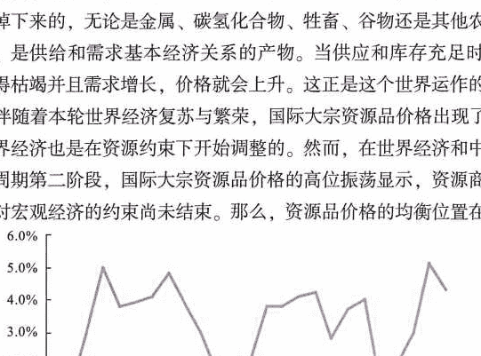

图 1 主要资源及其对应的产业制造产业链

图 2 世界经济 GDP 增长率

数据来源：Bloomberg，长江资源研究所

### 流动周期//
——经济周期决定人生财富命运

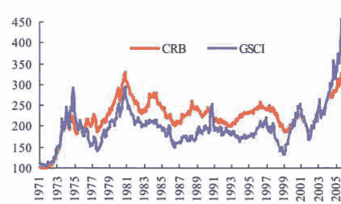

图 3 CRB 和 GSCI 商品价格指数

数据来源：Bloomberg，长江证券研究所

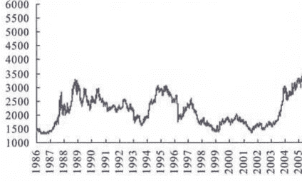

图 4 LME 3月期铜价格

数据来源：Bloomberg，长江证券研究所

既然价格是供给和需求的结果，而且任何商品的历史价格中都包含了当时的市场的预期、投机等因素。因此，我们可以通过寻找资源历史价格演化的依赖性来认识其波动规律和未来的趋势。

## 大市是世界经济周期的衰退和中周期的强劲复构成的

观察20世纪中期以来，大宗商品价格的变动呈现周期性特征。这种周期和经济周期具有高度的一致性。通过比较价格周期和经济周期发现，资源价格的周期与世界经济增长的周期相同，世界经济周期的繁荣与衰退与衰退而复苏相对应。这至少可以通过20世纪80年代以来两个完整的经济周期场所引起。以CRB和GSCI商品价格指数为，通过比较价格指数和全球GDP的历史数据发现，我们可以看到，

- CRB指数是1996年美国大宗商品委员会（CRB）推出的一个反映大宗商品市场和行为趋势的价格指数，由17种商品组成，且所有权重相同。
- 高盛商品指数（GSCI）包含24种商品，涵盖能源、金属、工业金属、黄金、农产品和软性商品，组合组成部分的权重取决于全球总量确定的。这里的权重是指过去5年的平均产量。因此，从总体来说，高盛商品价格指数，能量的影响相对较大。而且，高盛商品指数包含了许多已经经历过的因素，更多地反映了铜等商品价格的特征。

20世纪80年代以两个完整周期内，商品价格走势和全球经济增长是一致的。因此，我们可以依靠经济增长长周期来判断国际资源的周期变化。

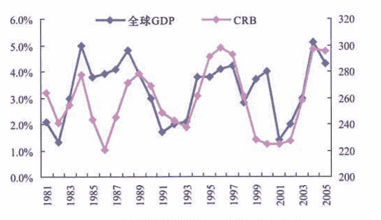

图 5 CRB 现金指数和 GDP 增长率相关

数据来源：World Bank, Bloomberg， 长泰研究所

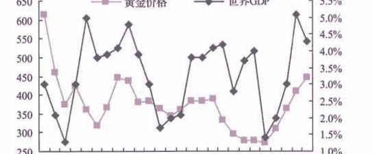

图 6 现金价格（左，美元/亚洲）和世界经济增长率（右）

数据来源：World Bank, Bloomberg， 长泰研究所

值得的是，虽然20世纪80年代和90年代大宗资源也有周期性的繁衰与延续，从周期角度来看，这一代是大宗资源的繁荣。本次商品牛市超过了20世纪80年代和90年代，仍类似于70年代危机。按照我们的理解，资源价格波动因素非常复杂，但基本因素是供给和需求，商品价格上升是供给和需求失衡造成的，所以从经济学角度来看，牛市是供给和需求极端值产生的。世界上增长的衰退和中周期的强劲复苏往往是因为供给的需求弱，而在周期的持续导致了大资源供给，从而使得资源出现冲击并造成价格下降。这种推论得到了历史的实证。20世纪的后期，70年代都发生过大宗资源的牛市，与许多经济学家蒋凡、凯尔对经济增长周期的划分（衰退或萧条）相比。

### 流动周期//
——经济周期决定财富命运

| 繁荣 | 衰退 | 萧条 | 复苏 |
| :--- | :--- | :--- | :--- |
| 第一波 | 1782—1810 | 1815—1825 | 1825—1836 | 1838—1845 |
| 第二波 | 1845—1866 | 1866—1873 | 1873—1883 | 1883—1892 |
| 第三波 | 1892—1913 | 1920—1929 | 1929—1937 | 1937—1948 |
| 第四波 | 1948—1966 | 1966—1973 | 1973—1982 | 1982—1991 |
| 第五波 | 1991—2000 | | | |

资料来源：蒋瑞梅，《经济周期与贸易关系》，武汉大学出版社

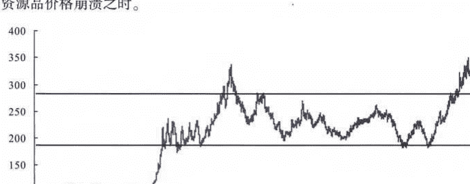

图 7 CRB 商品价格指数

数据来源：Bloomberg，长江资源研究所

按照我们判断大宗商品价格时，对世界经济周期和中周期的分析都是十分关键的。我们认为，从经济角度来看，世界经济的中后期，部分供需口仍较高，甚至出现新高，但随着增长周期的不断延长，商品价格底部将不断受到侵蚀，该阶段往往是商品价格波动加剧和风险凸出的。我们进一步通过资源价格调整机制来识别资源波动。

### 滞胀：资源价格调整机制

20世纪70年代资源价格的上涨导致了世界经济的滞胀，反过来考虑，滞胀本身就是增长模式中资源价格自发调整的一种机制。我们所说的“传统”是指当时世界各国经济特征仍然很大的封闭性，而封闭性体现在当时世界远远不如今天完全按照国际优势进行明确的分工，各国的经济结构具有多样性和重复性，各国制造业产品以自给自足为主。或者说，“传统”体现在世界分工的纵向一体化程度不如发达。通过封闭经济条件下资源价格运动规律的探讨，有助于我们更深刻地认识对比条件下资源的运动。

### 通胀：资源价格上涨的表现形式

主流经济学理论中，资源问题本质是一个成本问题，而成本问题如何体现为货币通胀，要体现为利润增加。资源价格上涨的，一方面会导致通胀和需求减弱，另一方面会导致资源行业投资和供给增加，最终实现供需平衡和价格回落，同时伴随经济增长周期性的波动。虽然在这里的图中没有时间因素，但这种静态分析仍然有助于识别资源价格运动规律。

| 通胀 | 投资增加 |
| :--- | :--- |
| 需求减少 | 供给增加 |

图 8 封闭条件下资源价格变动规律

需要强调的是，在这种模式下资源价格运动机制确实存在两个前提：消费者和生产者是在同一个环境下决策的；资源行业和非资源行业之间即使存在博弈，但这种利益博弈是统一的国家利益下的博弈，且往往受到国家政府的调节。强调这两重重点，因为在我们要谈的世界经济模式下，这一资源价格调整规律的供需均衡各个环节调整都不像现在这样。

这是我们所知道的供需调整过程，这一机制本质上是通过资源行业的动态效率增加和中下游行业的动态无效来调节。根据20世纪70年代的经验，通胀是资源价格上涨的结果，反映了经济增长的约束及其对需求的约束，同时，也是资源价格寻求回归的自发调整形式。因此，两次价格快速上升都足以引起下降。

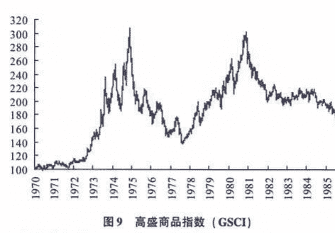

数据来源：Bloomberg, 长江证券研究所

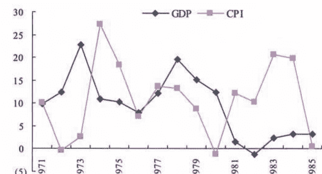

数据来源：Bloomberg, 长江证券研究所

但是，本轮资源价格上升引起，世界经济并没有产生严重的通货膨胀和经济衰退，这是什么原因呢？是否意味着资源价格上升还不够？来回答第一个问题。有一种流行的观点认为，世界经济中超额流动性进入资产市场就会产生泡沫，由于大量流动性进入了股市、期货市场，造成了通胀。我们的观点恰恰相反，这需要我们从中国因素进行详谈。

### “中国因素”：世界增长的核心驱动力

根据国家统计局2005年的核算，目前中国已经在世界排名第六。随着中国经济崛起，中国对全球资源的消费日益增大，在国内资源不能满足需求，通过不断进口来满足经济增长被普遍认为是“中国因素”。1995年后，中国成为初级产品的进口国，2000年以来，其中糖、天然气、铁矿石、铜矿石以及铝矿等产品的数量不断创造新高（见图11）。对于许多数据来说，中国消耗的量在全球占比都在20%以上。从表面上看，大宗商品价格持续上升解释为“中国因素”，似乎是合理的。

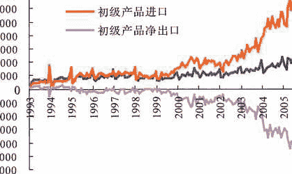

图 11 中国初级产品出口（万美元）

数据来源：CEIC，长江证券研究所

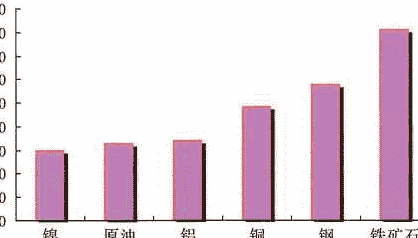

图 12 2004年主要资源在全球消耗量占比（%）

数据来源：IMF，长江证券研究所

但我们分析，“中国因素”偏在于忽略了两个事实：一是制造业向中国转移，二是近年来的经济增长。因此，中国只是世界工厂，为世界市场提供产品，这种局面正是建立在世界经济繁荣前提下的。所以我们认为应该把中国纳入世界经济一体化体系。

### 中国因素：经济逆差是什么？

从美国的贸易差结构来看，20世纪80年代中期，日本、中国香港、韩国、中国台湾等国家和地区是最大的逆差。近年的数据显示，中国是中国最大的逆差，大幅减少，这正是制造业转移到中国大陆的结果。根据2004年的数据，中国占全球GDP的比重为3.5%，但中国生产了世界制造业的7%。

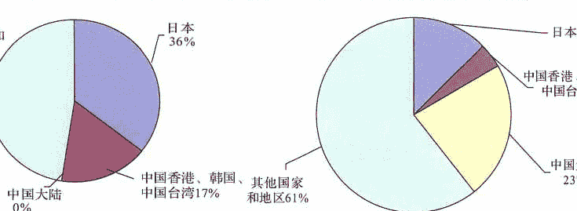

图 13 1985年（左）和2003年（右）美国贸易差的地区结构

数据来源：傅世刚，《世界与经济》，2005版

从美国贸易盈余来看，中国对北美和欧洲贸易顺，对于亚洲、拉美、非洲和洋洲贸易差。呈现出一个对每个地区的贸易结构分析可以发现，中国主要从亚洲、拉美、东部、巴西、澳大利亚等进口半成品和能源。

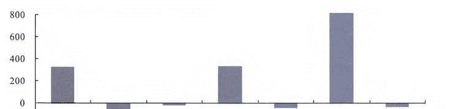

图 14 中国外贸易的地区结构（2004年，亿美元）

资料来源：中国商务部、长江证券研究院

另外，无论是数量还是速度，中国初级产品进口与成品出口都存在显著的相关。2001年后，随着世界经济周期的复苏，中国出口商品总额在工业总值中的比重持续上升，并于2004年达到35%。出口依存度，2000—2004年，中国的外贸依存度下降了一番，保守估计，外贸对经济增长的贡献2005年超过3成。如果据此总量上推，在中国消耗的资源中有3—4成是世界消耗的，这恰恰是经济周期复苏和繁荣的结论。

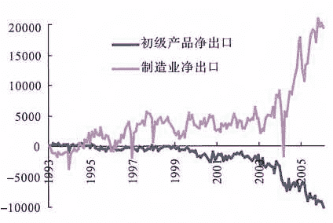

数据来源：CEIC，长江证券研究所

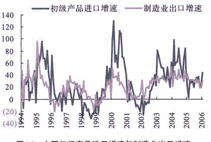

数据来源：CEIC，长江证券研究所

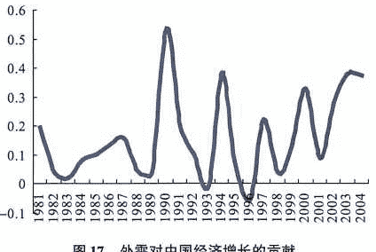

数据来源：林致广等，“对外贸易与经济增长关系的再思考”

这一模式将类不同的国家紧控在了一起，消费（货币）核心经济增长了制造核心经济增长函数的自变量，制造核心经济增长函数增长了制造核心经济增长函数的自变量，而消费（消费）核心经济的增长则依赖于另两国国家经济基础上的外债。用生产函数表示会更加清楚：

- (制造核心)=(f(消费核心)
- (资源核心)=f(制造核心)
- (消费核心)=(制造核心经济, 资源核心经济)

依照上述逻辑，只要制造的继续增强强度，中国制造的机器就会继续努力，资源出口的出口就不怕愁。而这种模式的基础是美元的信用，只要美国的信心在，制造核心的资源核心就会将他们的大量外汇储蓄到美国，低美元低利率、维持美国资产通胀，以及国民消费的快速增长。因此，是美国的国际信力以及其共用的机制基础。正如艾格斯林（Eichenberg）所言，如果国家对美国的信心，这种模式就能维持。因此，整个世界经济增长链的断裂可能很大取决于美国，而维持美国经济增长的前提是中国和出口国家将大量储蓄以美元的形式持有，推高美国产品价格，压低利率。

但是，传统增长模式下，统一于国家利益的资源与非资源行业的利益博弈，转化成了资源核心国家、制造核心、消费核心国家与国内的利益博弈，从价格调节机制转为政治决策而变得更加困难不容易。

同时，世界增长模式与传统模式相似，一个重要的变化是生产与消费分离。用经济学术语，传统下，生产、消费和价格是同时决定的，而在开放经济体系中，生产是由处于不同环境下的主体分别决定的，生产与消费分别由不同环境下的主体所决定。更具体地说，中国制造很多商品，其意义不再由中国自身决定（这取决于中国宏观调控政策），而是消费核心的核心将从出口决定。在价格上涨上不能改变欧美消费的行为之前，即使中国生产者的利润已经受到很大压缩，但迫于强制性参与与世界的客观前提以及维持自身增长的，不得不满足欧美国家的消费需求进行生产、消费消耗。在传统模式下，通过资源与非资源行业的利润博弈，以及消费和生产引发调节资源配置的机制失效。显然，中国韩国转型自身是由在中国世界产业链中的劣势地

### 凯恩周期：——经济周期决定人生财富宿命

所以所决定的，其附带的结果是世界经济抗击资源价格的结构性增加，资源消费和价格并没有传统模式那样迅速下降。

### 共生模式下的资源价格调整机制

在传统模式和共生模式下，资源价格调整的机制是不同的。前面我们已经分析了传统模式，资源价格通过世界经济增长进行调整的逻辑，但在共生模式下，中国通过利润增长消除了价格的滞胀。新的调节机制正在发挥作用。

我们前文指出，按照经济学的观点，资源价格问题的实质是成本问题，成本问题上是通货膨胀或利润问题。因此，物价上涨并不是唯一的传导利润的形式，在共生模式中，汇率是调整产业利润和资源增长的重要方式，从而成为影响资源价格波动的内部调整机制之一。

资料来源：江经研究所

我们的这种理解样例可以得到真实数据的证明。一方面，伴随着升值，出口速度会加快。长期来看，随着人民币升值的速度，美国消费者的购买力会不断萎缩，随着世界经济增长和资源价格上涨压力从源头上逐渐削弱。另一方面，在大宗商品价格维持高位的情况下，人民币汇率的升值很可能是多年以来积累利润递增反弹的结果。当，在长期内，如果出口减少，需求约束可能超过汇率价格的价值，最终导致贸易利润增速重回落。

从上述角度来看，人民币汇率升值可能是共生模式下资源价格内在调整机制的必然。另外，针对资源、能源消耗的收税和产业政策也将影响资源需求和价格，事实这也是共生模式下价格调整机制的一个之一。

### 美元：共生模式的基础

上面曾指出，美元的国际地位是共生模式的基础，但共生模式是建立在经济和金融客观基础上的，突出表现为美国贸易赤字的不断扩张，长期来看，这将大部分支撑美元信用。从理论上说，经常赤字是一国的对外负债，主要商品实体价值来偿还。但随着美国贸易赤字的增加，美元还债能力将越越怀疑，美元在市场减少的可能性越来越大，美元潜在的贬值压力不会随着美元加息导致的升值而减弱，且加息周期结束，美元重返贬值之路的可能性很大。当美元资产持有者的这种预期变成现实时，美元资产价格、包括美元和世界经济可能面临巨大的下跌压力。因此，失衡格局发展的同时也在破坏美元性模式持续性的基础。

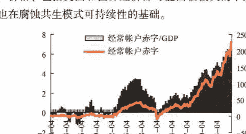

| | 经常账户赤字/GDP |
| :--- |
| 经常账户赤字 |

图 24 美国的贸易赤字（十亿美元）状况

数据来源：Bloomberg，长江证券研究所

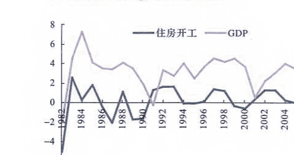

| | 住房开工——GDP |
| :--- |

图 25 美国房产建筑开工增长率（%）是 GDP 先行指标

数据来源：Bloomberg，长江证券研究所

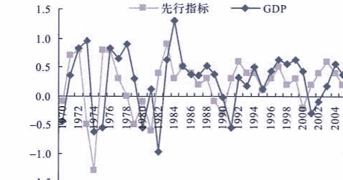

| | 先行指标——GDP |
| :--- |

图 26 美国经济先行指标仍处于下滑轨迹

数据来源：Bloomberg，长江证券研究所

### 流动周期 //——经济周期决定人生财富命运

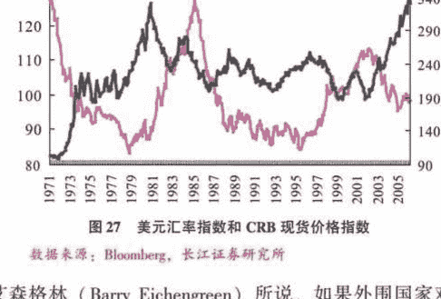

图 27 美元汇率和 CRB 商品价格指数

数据来源：Bloomberg，长江证券研究所

正如艾格斯林（Eichenberg），虽然外国国家对美国的信心，这种模式就能维持。但是如果外国国家的集体利益要求购买美元以维持，共生模式仍然可能维持。在衰退的过程中，经典的长波理论对通胀有着明确的描述，但是我们觉得解决当前的通胀，用周期的框架，这也是我在年度政策报告《国际博弈》中用长波周期的框架的。在长波框架下，很多因素无法解释的现象变得寻常，此我用长波理论对世界经济和中国经济的走势提出的一些看法。

长波衰退中的资源约束与信用膨胀

在世界经济长波周期的资源约束问题，往往导致世界经济增长的衰退阶段，我们在《重塑世界》中曾阐述过其逻辑，创新带来的生产率的提高，新型工业的崛起，共同增强了对资源的需求，随着时间的推移，资源约束会随着技术进步有所缓解。能源是不可再生的，所以资源约束往往以终结，这就是衰退的根本。

在长波周期的通胀与增长转化：

- 1948年开始第四次周期
- 1948—1966年：增长的上升
- 1966—1973年：增长的持续扩大
- 1973—1982年：增长的大幅减速
- 1982—1991年：增长的经济复苏
- 1991—2004年：增长的持续增长（达到高点）
- 2004—2008年：增长的衰退（泡沫爆发）

### 流动周期理论——经济周期决定人生财运

#### 油市的最后一站是

下图显示，资源供给需逐渐缩减，但供给落后于需求周期，因此，当实体经济衰落时，资源的供给仍然存在，资源价格尚不能立即从短缺中缓解出来，从而呈现出虚拟经济繁荣的滞后效应。滞后时间的长度主要取决于需求回落快慢以及资源从投资到形成产能所需的时间，需求回落速度与供给增长速度的不同组合会导致不同的滞后长度。

### 不被过去的繁荣所迷惑

古代经济增长理论中指出，当经济经历繁荣之后，由于资本出现过剩，由于资本存量增长效率下，经济中的资源配置不再帕累托最优，经济将导致失效，使得资本失去了获利机会。此时一方面实体经济内的流动性仍然充分，另一方面在宏观经济的回落初期，由于实体经济的滞后效应，资源价格从短缺中得到缓解，大量资本通过虚拟经济获取收益，或者保持了实体经济的有效性。很大程度上，古代经济增长理论是从这个角度理解实体经济和虚拟周期的关系的。当虚拟领域出现持续的泡沫时，更多的资本被投入虚拟资产而不是实体经济。从实体经济中资本的增加，虚拟经济的繁荣将资本推向虚拟增加实体经济的动态效率将恢复，虚拟经济的繁荣甚至有助于增加实体经济的动态效率。这一过程体现为虚拟经济对实体经济周期的滞后性，从资源价格和世界经济走势上看，也验证了这一点。但是我们需要更进一步分析为什么虚拟经济繁荣会滞后于实体经济周期？对于这个问题的答案是十分的，因为我们没有认识虚拟经济繁荣对实体经济的滞后效应，可能会被当前的繁荣所迷惑，从而失去未来的判断。

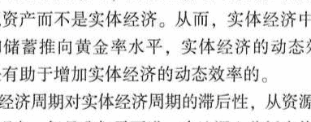

图28 实体经济和虚拟经济的关系

数据来源：长江经济研究所

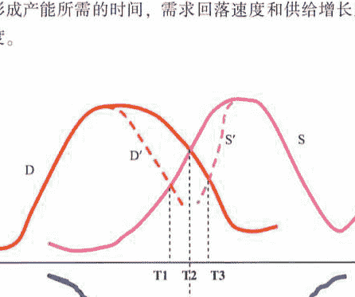

图 29 大宗商品涨周期

数据来源：江苏证券研究院

#### 表2 供需由不平衡向平衡转换

| | 精钢(万吨) | 原铝(万吨) | 精铁(万吨) | 锌(万吨) | 铅(万吨) | 黄金(万吨) | 原油(百万吨) |
| :--- | :--- | :--- | :--- | :--- | :--- | :--- | :--- |
| 供给 | 1521.7 | 681 | 988.6 | 119 | 4153 | |
| 2003需 | 1664.2 | 683 | 982.8 | 30.4 | 122 | 3451 | |
| 缺口 | -42.6 | 26.9 | 5.8 | -1.3 | -4 | 702 | -0.15 |
| 供给 | 1579.8 | 694 | 1016.9 | 32.5 | 127.5 | 3767 | |
| 2004需 | 1668.5 | 710 | 1046.6 | 33.1 | 131.5 | 3854 | |
| 缺口 | -88.7 | -30 | -29.7 | -0.83 | -4 | -87 | 0.54 |
| 供给 | 1743.3 | 741 | 1032.2 | 34.9 | 136 | 3925 | |
| 2006需 | 1735.5 | 3363 | 3782 | | | 4069 | |
| 缺口 | 29.5 | -14 | -43.7 | -0.14 | | -105 | |

## 4 长波衰退中的增长与通胀

经济依然能够在相对不热的核心通胀情况下维持增长是一样的。在未来的增长与通胀的博弈中，关注通货膨胀的对美国未来的发展十分重要。这一点我们将在下面的章节中讨论。

### 长波衰退中的价格

我们可能会看到长波衰退中的价格问题，我们不要研究一下长波衰退的价格特征。这将有助于我们理解未来的大宗商品和石油的价格，有助于理解通货膨胀的趋势。关于长波衰退的通膨膨问题，从现象上来看并不寻常。所以，长波本身被定义为周期性的价格变动。对于长波衰退出现价格的大幅上涨，按照俄罗斯的委托，这与黄金与原材料的价格有着密切的关系，但在金本位下，有些学者认为是为了黄金的发现导致了通胀中的货币流量的增加，因此导致了通货膨胀。总而言之，无论是战争还是黄金的发现引起供应量的增加，都在表面上解释为长波衰退出现通货膨胀的原因。我们通过两次长波所观察到的现象是资源契约与信用限制是导致通货膨胀的两个原因。上一次20世纪70年代的通货膨胀自然也是符合这种解释的。

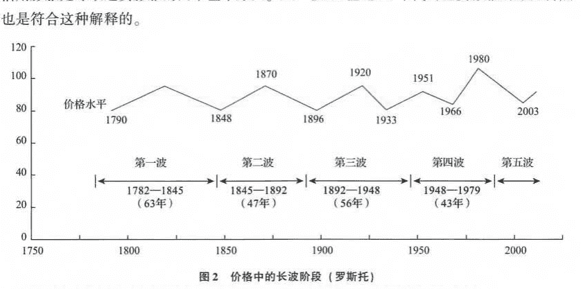

图2 长波中的波衰退（俄罗斯）

资料来源：吴永久、《经济的长波波动与动能》，20世纪70年代后为江苏证券研究所新增

从美国的经济增长与动物的关系来看，美国两次通胀与增长阶段的对称表现在20世纪20年代和70年代，这两个时间就是我们所说的长波衰退的。而且，尽管20年代的通货膨胀有着战争的因素。但是我们得不承认，即便在金本位下，这种现象是存在的。我们认为，美国作为世界经济长波衰退时期的主导，其当前的趋势能够代表长波衰退的特征。

如果从客观来看，衰退期的通货胀至少是一个必然的现象，我们在前面也提出了长波衰退资源契约与通胀膨的基本逻辑。这种能够为原材料的价格上涨到没有任何内在的的，这些都是我们必须探讨的问题。

### 流动周期 //
——经济周期决定人生财富命运

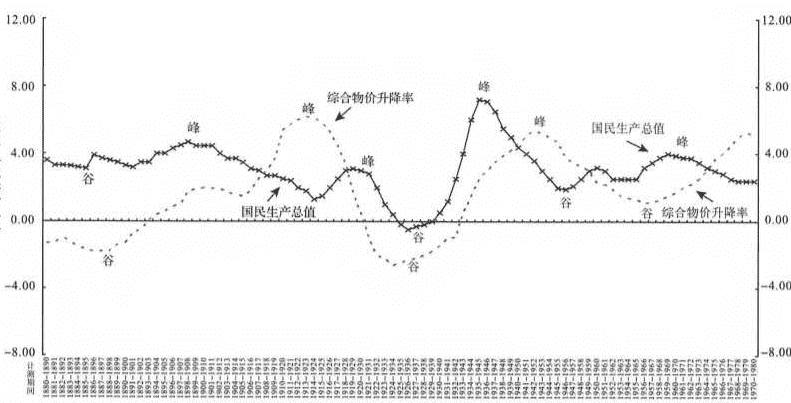

资料来源：木野久健，《经济的长期波动与能源》

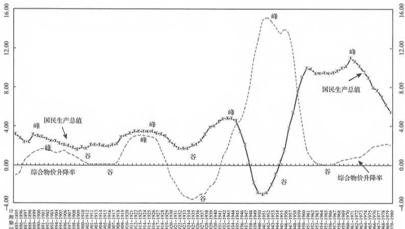

资料来源：木野久健，《经济的长期波动与能源》

### 长波中的能源

关于长波中的能源价格上涨，我们实际上对于在世界上经济增长的后期出现成本推动的通货膨胀并无意外的。问题的关键在于，在世界上经济增长衰退之后，如 1970 年以后，仍出现爆发严重的石油危机，为什么经济衰退没有从供需的角度削弱油价的上涨，

实际，除了一些用于解释石油危机的偶然原因，战争之外，这里面不是有其他的基本原因呢，日本学者木舱久曾在他的文章《经济的长期波动与能源》中进行了研究。

木舱久研究了日本与美国的一次能源供给对国民生产总值的弹性，他认为，长期来看，能源与经济增长的关系可以从以下几点理解。

- 其，从长期看来，弹性性集中于，在约100年的时间里，尽管出了重大的产业和社会结构变化，作为生产要素及家庭最终消费的能源消费增长率与经济增长是近于一致的。
- 其弹性是不稳定的，在弹性受到许多冲击的时期就是经济增长率水平落后的时期。

上述两点实际上都说明了一件事，就是能源供给是跟着经济增长的，一方面，经济增长带来的需求，在供给充足条件下，带来价格上涨。另一方面，能源的需求也不能脱离经济增长而体现出的所谓的绝对弹性，我们认为能够使得经济增长无体上涨的可能。能源供给在上升之后能够得到缓解。对此，木舱久解释道“日本在石油危机之后，仍难以以惯性”。对此，木舱久解释道“日本在石油危机之后，仍难以以惯性”。但是，近30年积累来的生产和消费变化也因在20世纪末到1970年前，正是这种惯性时期。

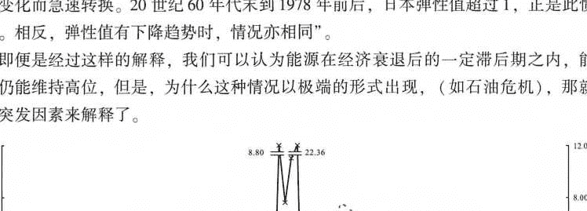

资料来源：木舱久，《经济的长期波动与能源》

### 流动周期 //
——经济周期决定财富命运

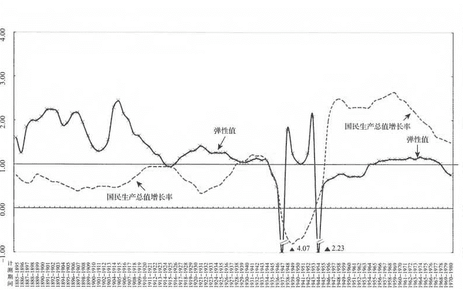

资料来源：大树，《经济的长波波动与动能》

我们观察美国的长周期一次能源供给对国民总值的弹性，美国两次弹性超过与国民总值趋势明显背离的阶段，一次是在1971年至1972年，一次是在1972年至1976年，直到1980年看到最高点，因此石油危机的发生更多地被解释为偶然因素。直到1980年看到最高点，我们对长波中通胀的研究是，至今为止对于长波衰退出现严重通胀的原因没有理想解释。所以，我们要从通胀与增长的角度来寻找世界经济的基本规律，这是我们观察世界经济的入手点。在观察了长波衰退期的本质之后，我们研究的目的仍然观察美元在长波衰退期的特征，这正好为我们研究背离的美元走势提供一个视角和思路。

### 衰退中的增长与通胀

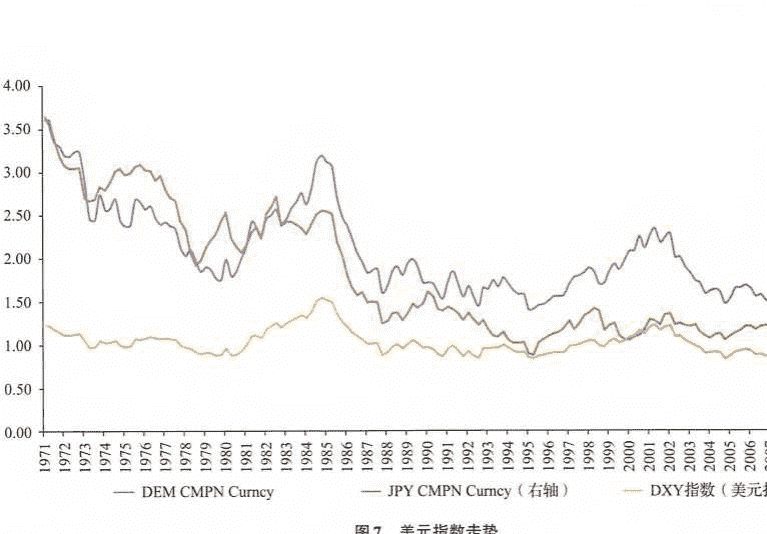

图7 美元走势（DEM Currency JPY Currency, DXY指数）

资料来源：Bloomberg，长江证券研究

在20世纪70年代的衰退期，布雷森林体系的瓦解实际上就是美国经济从60年代的繁荣向70年代的转型。美元的国际货币中心地位，以及币值下跌的原因最终归于：世界经济在衰退期中的美国经济是如何由繁荣转变为衰退的。70年代的美国经济滞于全球经济衰退之中，这正是我们分析美元在实体经济下滑过程中出现两次衰退现象的总解释，即美元当时与欧洲或新兴经济体的活动处于此的关系。

美元在1973—1975年的真实其实分为两个阶段进行分析：(1)美元在1973年一季度后的一波下跌，主要是由于3月份宣布宣布维持布雷森林体系的固定汇率的崩溃、美国联储调利率，直接引发了美元的大幅下跌。(2)石油危机作为外部冲击事件，在这一轮经济衰退过程中加深了美、德、日的结构型影响程度，再加之

### 美国潮流：
——经济潮流决定人生命运

美国经济本身在1972年起就开始了约23个月的工业增长，以至于美元在石油危机之后对于德国、日本走高。

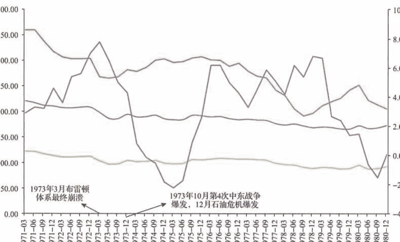

图8 布雷森林体系与石油危机对比美元、德国、日本的汇率

资料来源：Bloomberg, CEIC, 华证研究部

1973年12月发生的石油危机使得德、日本三国在1974年间均出现了通胀压力上升和增长增速减速，但对于美、德的通胀压力以及经济滑坡与回暖的情况都要远于日本！我们对这些现象的解释是美元相对于马克、日本走高的根本原因，以及日本由于汇值过重和美元与马克比较贬低。

（1）美国经济在二战之前已经完成了产业转型，经历了两次大战的损失，使得美国经济与战后的德国、日本同轨。美国经济在20世纪60年代后期处于繁荣期，德国与日本尚未完成产业转型，也是在经历了石油危机的外部冲击后得到了某种转变。

（2）德国从资源密集型向技术密集型转型始于60年代后期，而70年代之后已经在化工、钢铁和电力等行业成为增长的主动力。1973年的石油危机使得美国遭受约束，并在美国已完成产业转型的过程中，日本从资源密集型向技术密集型转型。

（3）1960年代末，布雷森林体系的整体崩溃实际上增强了德国、日本与美国之间的贸易能力，这由于美国作为主导国的经济实力下降的一种反映。在此之后，直到1990年繁荣来临之前，我们观察到美元经历过两次的反弹和一次大的转折，在1973年和1975年衰退中分别有两次反弹，而在1980年之后，出现一次长达5年的上升过程。我们相信，研究这些美元反弹和转的原因对美元汇值研究是有意义的。

### 2070年代的两次美元衰退

布雷森林体系的瓦解起始于美国经济从60年代的繁荣向70年代的通胀转型。美元的国际货币中心地位，以及币值下跌的原因最终归于：世界经济在衰退期中的美国经济是如何由繁荣转变为衰退的。70年代的美国经济滞于全球经济衰退之中，这正是我们分析美元在实体经济下滑过程中出现两次衰退现象的总解释，即美元当时与欧洲或新兴经济体的活动处于此的关系。

### 衰退中的增长与通胀

通胀
25.00
20.00
15.00
10.00
5.00
0.00

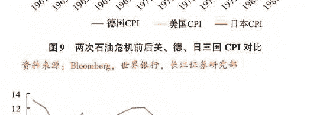

图9 两次石油危机前后、德、日本CPI对比

资料来源：Bloomberg，世界银行，长江证券研究

图10 两次石油危机前后、德、三国GDP增长率对比

资料来源：Bloomberg，世界银行，长江证券研究

### 储蓄周期 //
——经济周期决定人生命运

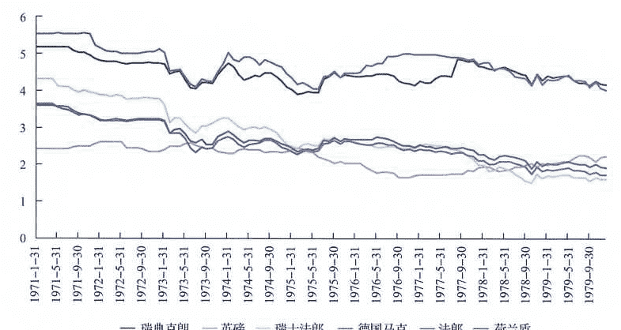

图11 两次石油危机期间欧洲国家货币汇率对比

资料来源：Bloomberg，长江研究部
注：美国在欧洲和亚洲之间

### 美元反转与1985年广场协议

在20世纪80年代初期，美国利率大幅提高和美元的上升，那些高成本、低利润的企业退出局，这为美国经济的复苏提供了初步条件。另一方面，日本在1983年“美元日委员会”成立后，资本流动的自由化进一步加强了对美国的投资加速增速，由于美国购买美元的国家增加，使得日汇率剧烈下跌，导致了美国继续维持美元升值。同时，为了治理严重的通胀，美国实施紧缩货币政策，多次提高利率，高利率吸引的海外资金流入美国，导致美元汇率从从975年到1984年上升了约60%。美元对西方发达国家的汇率超过了布雷森林体系的水平。这次的美元反转是在滞性通解决之后一系列政策的结果，我们目前还没有达到值得讨论的那个阶段。

### 长周期衰退中美元的反弹

关于美元的反转，我们这里能够提供两点建议。首先，在长周期的衰退期，美元从未出现过反转，仅仅是在其出现过两次反转。这次，两次反转的发生实际上是源于美国中的几次经济周期波动，而这些周期波动中美国与欧洲国家和新兴工业化国家的此消彼长，实际上反映了美元在经济增长中的作用，同时，也是美国对于石油危机抵御能力的一种体现。

### 共生模式倾变下的增长与通胀

我们前面研究了20世纪70年代的长衰退期的世界经济经济特征。但是在2004年开始的长衰退并不是20世纪70年代的翻版。我们必须肯定很多基本的特征和机制是相同的，因为当今的共生模式是从那个时代演化来的，当然，也没有任何不同的地方，当今的共生模式与以前相比发生了巨大的变化。

#### 共生模式的构建

经济增长的模式是指，在当前世界经济一体化和产业分工国际化的下，形成的资源核心、制造核心、货币（消费）核心相互依赖而共的情景。这种相互依赖和共生表现为：资源核心的资源主要用于自消费；制造核心的生产比例大于对外需为制衡或促进经济增长的关键；货币（消费）核心在世界市场中仍然占据主导地位，但其对制造核心的产品依赖强度很高，且具有消费的特征。

显然，欧洲、巴西、澳大利亚等属于资源核心，中国是典型的制造核心，美国是典型的消费核心。这三个国家的共生模式是当今世界经济增长的逻辑，一旦脱离了世界经济运行，共生模式结果将变得糟糕。

从本质来说，共生模式延续性的源来自于信用。国外国家对美元的信心，这种共生模式能够维持。整个经济增长很大程度上取决于美国和资源出口将大量外汇储备以美元的形式持有，推高了通胀率。一般来说，20世纪70年代凯恩斯主义时代下，恰恰是由于布雷森林体系的解体，这种扩张最终终结于金本的。

### 通胀周期 //
——经济周期决定财富命运

| 国际市场 | 金融市场 |
| :--- | :--- |
| 终端市场 | 消费(货币)核心 赤字、负债 |
| 商品 | 美元 |
| 中间市场 | 制造核心 美元 |
| 上游市场 | 资源核心 盈余 |
| 石油、有色金属等 | |

图12 产业分工模式

资料来源：证券研究

### 共生模式的转变：对抗通胀

从20世纪60年代的共生模式开始直到1973年，布雷森林体系被破坏，进一步发展了区域性扩散的雏形。在此技术扩散模式下，世界经济得以快速加速其在内的产业结构调整。类似于产业链下游的各个环节，分化的有利于资源的最优分配，但同时也导致了任何一个经济体内的波动都会传导到此层次，这种传播显然具有明显的阶段性特征。

现在的这种共生模式下，美国已经跨越核心领域，消费需求已经超过了基准。相比70年代，通胀压力在衰退期也是如此。当然，在大宗商品大幅上涨的情况下，至少说明了两个问题，其一，就是美国国的经济结构对资源价格具有更低的敏感性；其二，大量的通胀压力被转移给资源出口国家（如中国）消化。因此，较低的通胀是保证美国自由运用其宽松政策的关键。

### 长衰退中的增长与通胀

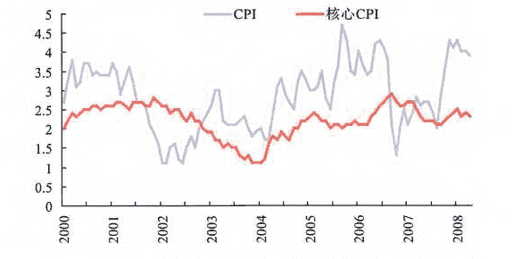

图13 美国CPI和核心CPI

资料来源：Bloomberg，长江证券研究院

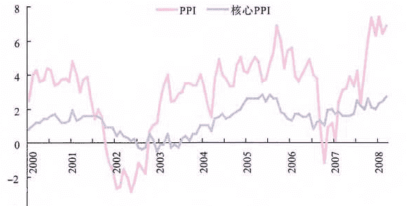

图14 美国PPI和核心PPI

资料来源：Bloomberg，长江证券研究院

但是这些问题都是暂时的，因为以中国为代表的制造业对成本的承受能力在减弱，而美国核心通胀的上升已经说明了通胀压力处于，所以需要密切关注通胀的情况。我们认为，美国GDP自2007年一季度以来在衰退的边缘波动，尽管遭受了次贷危机，自2007年三季度后反复回落，但其衰退的幅度是有限的，这就与通胀的控制有相当大的关系。

### 共生模式下增长与通胀的博弈

但是，通胀与增长的博弈是一把双刃剑，在美元有反弹预期的情况下，原油价格的上涨实际上正在推动全球的通胀预期，全球经济的稳定将以制造业国家的衰退为代价。虽然通胀不一定会在突发事件中触发

### 请阅读简报

下发石油通胀，其本质仍然是，只不过不是程度的问题。在未来的增长中，我们认为通胀是美元问题，国际大可能将脱离通胀因素而上涨，或者继续维持高位。在这一阶段影响长时间，将美国的通胀传导而定，实际上也就是中国等新兴经济体对通胀的忍耐程度决定，这正是当前不清楚的地方。但是整个逻辑的过程是清晰的，只是时间和程度的问题了。

我们对世界经济的结论是，美元反涨不会改变大势的基本趋势，世界经济将在仍处于通胀之后，这种暂时的持续性将流于新市场或者引发一个发达经济体的衰退过程。就像我们在开头所说的，美元的泡沫带来的增长需求和可能持续转轨没有得到明显的调整，这种调整按照历史经验，往往会以一个倾斜的形式出现。

### 世界经济进入调整的第二阶段

体体制下的泡沫模式将从各个层次转为更为经济的增长模式。类似于产业链下游的各个环节，分化的有利于资源的最优分配，但同时也导致了任何一个经济体内的波动都会传导到此层次，这种传播显然具有明显的阶段性特征。

经济回落的风险明显要强于欧区，这也是欧区经济虽然 GDP 回落幅度上弱于美国，但是从回落之后的复苏却要弱于美国的关键所在。

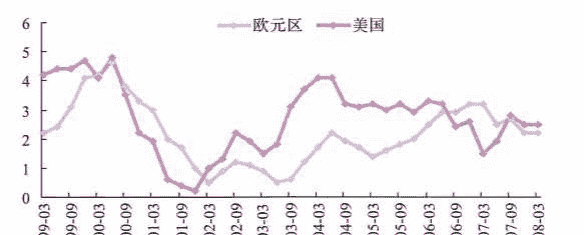

图 15 1999 年以来美国经济与欧区经济的同步性比较
资料来源：Bloomberg，江苏研究所

再比 2001 年美国经济与中国经济的同步性可以发现，两者的调整呈现的也是经济滞后于美国。在内部的机制下，美国对于中国实体经济的影响主要是进口需求，虽然美国的国内需求一直以来具有极强的 GDP 增长关联性，但是中国的出口需求对于美国之外还有有效的欧区支撑，而欧区境内的产业结构与美国之间的差异决定了需求对于经济增长贡献的程度，从而历次资产价格泡沫破时经济增长的回落自然存在时滞。由此，当面对由美国经济在周期内波动所衍的世界增长时，调整的特性是无法避免的。

图 16 1999 年以来美国经济与中国经济的同步性比较
资料来源：Bloomberg，江苏研究所

### 调整阶段的细化分解

#### 第一阶段：美国的先优后回

结合科技网络泡沫以及美国经济的历次波动对于世界经济的影响，我们可以发现，目前美国经济以及世界经济的这种调整过程，整体可以划分为三个阶段：第一阶段，美元通过宽松货币政策以延缓经济增长步入衰退的速度。在这一阶段之内美元将会出现加速通胀的态势，虽然美元的贬值有于暂时缓解原本的贸易逆差，但是美元回流在贬值的下可能会受到更多挤压，这也从根本上延长了美国经济复苏的时间。

资料来源：CEIC，长江瑞森研究院

值得注意的是，美元指数在 2000 年科技网络泡沫破灭时并没有出现大幅的回落，主要是由于科技网络泡沫与当时的房地产市场相比，全球的程度要更深，泡沫引发的经济增长长期是同步的，也就是说即使美国的基准利率要跟随欧洲行的利率调整，但是美元指数的变化更为重要的是经济增长期的变化，这也是我们接下来探索美元的短期波动必须考虑的。

#### 第二阶段：通胀与汇率波动

在第二阶段，随着美元的持续贬值，对于全球经济一体化的其他国家也会受到影响，货币汇率的贬值以及美国庞大的进口，将使得原本的制造业竞争力优势无疑弱化，这种影响对于欧区国家以及日本类似的工业化成熟国家将会避免明显的，他们的生产成本相比于发展中国家来说要高得多的。

图 19 欧洲央行利率与美国基准利率差异
来源：Bloomberg；沈联宏研究部

#### 第三阶段：大宗商品价格的阶段性回落

第三阶段，受限于欧区国家以及其他发达国家经济增长放缓，并随着美国经济一致回落，依赖于净出口拉动的发展国家开始呈现景气回落态，这种景气回落由于外部需求以及成本供给压力的博弈。在这个过程中，美元的回落才会正式或者说更为明显了。对于美国经济而言，除非引发新的技术革命而导致长期周期增长的趋势，否则，何种资产价格膨胀的决定决定了经济的节奏，而美元的强势趋势以及相应的世界经济整体性回落，从根本上意味着大宗商品的周期的轮回就此结束。

### 第二、三阶段演练的关键要素

结合目前处于共生相似纵向产业链中各个国家的经济增长速度，以及日本等发达体最近调整的预期，我们有理由相信世界经济此轮回正从第一向第二阶段过渡。

### 亚洲周评：英股决定美国股市财富命运

#### 欧洲：世界经济的推动者而非领导者

我们已经了解了世界经济在调整的第二阶段，由于贸易逆差的逐步积累已经呈现出程度的放缓，这种放缓从 1999 年科技网络泡沫破灭过程中实际上也有。而现在在长期增长背景下，欧洲很难变成美国成为真正的领导者。

其根本，我们比较了欧洲与美国 GDP 各部分的占比，90 年代随着产业升级无疑是起飞阶段后的基本模式。由于技术能力的差距使得欧洲能够比美国增长更快，这也意味着经济结构中的差异很难通过降低进口、改进政策来维持增长的平衡。

另一方面，失业率一直都是欧洲最大的弱点，这使得贸易逆差扩大，欧洲来自其他地区的廉价资源无法吸收。即使美国在遭遇高潮时期，想要依靠欧洲来拯救全球经济是不可能的。对于普遍的新兴市场而言，欧洲带来的的是一个特定阶段的跃升，这也是经济调整过程的本质。

#### 中国：外需回落会导致性的吗

关于中国近期增长减速因素，我们在 2008 年投资策略报告《国际化策略》中已经得到清楚，增长与外需回落的博弈是核心。考虑到中国目前的出口已经是为主，那么，一旦外需回落将支撑出口增长导致的价格上涨，起点也逐渐接近了。从中国 2002 年以来的外贸依赖以及工业利润增速的比较可以发现，中国在世界经济的融合在加深，这也意味着经济增长与美国经济回落的不同，只是一个时间的问题。

### 长波周期中的增长与通胀

图 20 中国 2002 年以来外贸依存度
资料来源：Bloomberg，长江证券部

图 21 中国 20世纪90年代以来进口增速和工业利润对比
资料来源：Bloomberg，长江证券部

另一个导致增长放缓的原因，我们需要考虑的另一个要素来自于通胀波动的持续高位。与 2000 年时的相似点在于美国经济的回落并未造成 CPI 以及大宗商品价格的回落，关键在于中国经济作为代表的新兴经济体与美国经济的周期性。作为最大的原材料需求单位，中国增速放缓可能会与当前的通胀下降一起，没有中国的弱化又会有其可能的阶段性回落，这意味着近期的石油、煤价格上涨带来的类外因素之外，真正的需求增长依然存在。

在探讨这种推动型通胀的时候，我们需要考虑目前依然扭曲的价格控制体系，为稳定当前依然高的 CPI 所采取的汽油、电力的非市场化定价方式，一方面，缓和了需求回落、成本上升的博弈；另一方面，使得政府通过间接接触实体经济，导致通胀趋势的延缓一定周期，这正是增长需求内在的根本原因，作为其宏观体系的核心制造。

### 美国周刊：经济如何决定美国财富命运

中国在为自己扩张的同时也在世界经济缓和了成本上升的压力。但是这个过程不会延续很长的时间，周期机制的逐步改善以及意外的进一步回落将导致中国经济经历周期的波动。

## 如：等待美元的短期波动“美元局”

在了解了演讲的规律后，对于美元的阶段性波动趋势我们似乎陷入了一个更繁杂的困圈。从 2000 年以来美元经济增长规律的阶段性比较来看，美元指数似乎并没有遭遇自身增长规律被利率波动而导致的波动规律。这也恰恰证明了我们在开始分析美元本质的焦虑，作为泡沫模式中的重要环节，美元的阶段性趋势需要考虑美元自身以及其他经济的相对变化，这种变化的把握我们需要在掌握其他经济变动的同时，进一步追踪美国经济与上一次科技泡沫破灭时，经济增长包括复苏的差异。

资料来源：Bloomberg，江苏证券研究院

## 美国经济：回落与复苏的差异

关于目前的经济状况以及可能的美元问题，我们还需要现在的这次危机与 2000 年科技网络泡沫做对比。然而由于资产价格膨胀导致的，两者对于美国以及世界经济的影响却是不同的。首先，相比于房地产泡沫，科技网络泡沫引发的回应在欧洲之间具有相似性。在过去的几年里，道琼斯 500 指数几乎在同一时间创了科技网络泡沫的高点。

其次，科技网络泡沫与房地产泡沫产生的背景是完全不同的。按长波周期的规律，20 世纪 80 年代以技术为代表的长波周期开始，而 90 年代初是起飞周期的开始。通过 2000 年之前贸易赤字的情况，我们可以发现科技网络泡沫确实赋予了美国经济更为健康的增长模式；由于预算赤字已经明显，这种扩张正是如此，我们需要进一步对比差异以及减税对美国经济增长实质的影响。

资料来源：CEIC，长江证券部

资料来源：CEIC，长江证券部

## 流动性危机——经济周期决定财富命运

与 2001 年科技网络泡沫解决危机的形式类似，美联储又采取了减税与降息的方式。此次“货币游戏”能否支撑复苏的逻辑？上述网络与房地产泡沫的背景包括全球化影响，两者的内在作用机制上的差异我们还需要从流动性的预期来衡量。

一方面，次级危机与 2001 年科技网络泡沫危机的最大不同在于其衍生于房地产泡沫。在大型银行参与了这次泡沫之后，泡沫又被破灭。“资产负债表”问题导致的信用紧缩远远于之前的危机。这就决定了需要更大的空间。而在通常情况下，美联储的直接反应是横向一体化机制，目前国内的经济增长与美国增长的不同导致美国经济的回撤。在通胀压力背景下的利率选择处于两难地。

另一方面，降息能够将 1998—2000 年股市、2001—2006 年房地产市场的扩张产生另一个真实经济增长周期。毕竟引发了技术革命性的实体经济增长周期的泡沫会被缓解，解决危机的效果虽然保持了 GDP 增长的维持，但内在在增长结构的核心竞争力在于，在两次泡沫破的过程中获得回报，通过动力的提升是最好的方法，这意味着美国经济内的积累过程需要更长时间。

至于减税政策的复苏效应更多体现在提升消费者的收入上。关于此次减税方案在 21 世纪全球经济上还是一次，2001 年 2 月，美国总统布什向国会提交了 1.6 万亿美元的计划，经过激烈的争和，美国国通过了 1.35 万亿美元的减税，6 月日，布什总统正式签署了法律，这是美国 20 年来最大的减税政策。

从劳动者收入与每小时产量的来看，2001 年减税之后，劳动者收入并没有随着每小时产量的减少而出现回落，在一定程度上应该是减税的效果，但是这种效果往往将持续时间不长。更重要的是减税为美国经济增长带来了更为两个问题：靠政府支出补贴消费者收入的方式，不仅使得 20 世纪90 年代后期半期的财政盈余，更使得债务支撑起来的消费需求被极大放大。由此引发的美元贬值不仅导致出口持续上涨，而且房地产泡沫的破灭也是如此。我们是在这次泡沫的处理过程中需要重要的观察。

## 美元是反弹还是反转

那么关于美元走强的关键，是对其走强是反弹还是反转的判断。如果是此消彼长的问题，那么自然只能是反弹。实际上，正如本文开始所言，我们在观察第四波周期的衰退期以及反转。1971 年日元汇率升后，1985 年和 1995—2001 年长波周期的繁荣期，这符合美国经济的趋势。从 2008 年以后，美元究竟是反弹还是反转，我们认为第一个机制，是在第四波周期刚刚结束；第二个机制，是信用扩张的泡沫，这种问题在2000 年泡沫的破灭时已经出现。由于全球流动性的涌入，这决定了美国经济未来的衰退进程的深度。

## 表 2 美元短期泡沫影响因素的对比

| 阶段 | 经济增长对比 | 支持政策 | 贸易赤字 | 财政赤字 | 技术创新 |
| :--- | :--- | :--- | :--- | :--- | :--- |
| 2001 年科技网络泡沫 | 同步 | 息缓、减规模 | 扩大 | 扩大 | 寻找 |
| 2006 年房地产泡沫 | 滞后性 | 息缓、减规模 | 小幅缩小 | 扩大 | 增长 |

资料来源：江苏财经研究院

## 走向成熟：中国经济即将 V形转

自2007 年以来经济调整的时间和深度如何，未来经济增长的动力和形态如何，这两个问题是本文图表绘制的核心。本质上，其实是一个问题，就是工业化进程的延续问题。

自2005 年以来，我们持续聚焦中国的工业化进程，同时，在罗斯托《经济增长的阶级》的框架下，我们对比了中国、日本、法国、亚洲四小国等地区的工业化进程。基本结论：中国的工业化是典型的，其工业化程度超过了 19 世纪的欧洲小国和 20 世纪的亚洲四小国，成为我们理解世界上最典型的大国工业化。正是这种理解下，我们认为工业化框架研究中国经济的未来增长将出现适用性，而我们多年以工业化比较研究能够发现其结论。

不同于与工业化进程的对比，我们也关注中国的工业化进程中的世界经济体系与美国欧洲早期工业化的转型。在第二次全球化的使得，国际分工密切下，中国的制造业已成为世界经济体系的一个环节，而这也造成了中国的工业化过度依赖。从这一点来看，中国工业化对我们是最合适的，对依赖度为没有之而无有之。自2007 年以来，中国已经经历过工业化的转型，这一阶段大部分工业化国家都曾经历，在受到的一个阶段中，一个国家的增长的不确定阶段开始，而且，经济增长的可持续性越要越极限的左侧。比如，罗斯托所这个时期对于一个国家来说越是危险，我们将在本文中详细说明这种不规定。

图 25 美元走强每小时收入同比增长
资料来源:Bloomberg, 长江泰基金研究

# 萧涛：论——经济发展具有阶段性积累规律

一个阶段。我们对这部著作的理解是，对它的五阶段理论的理解，其核心在于起飞代表的工业化进程的。罗斯特自己在承认中：“增长阶段论是观察历史中发展顺序的一个武断的和有限的方法，而且而不是绝对正确的方法。事实上，增长阶段论的客观只是描述了发展顺序的一致性，而且说明了每个国家的独特性，”此此，我们在2005年使用工业化理论来理解中国的经济增长和投资机会选择，就不再是在地摸索与客户共同的问题，当2007年我们用该理论对中国经济的趋势做出成功的判断之后，我们增加了对这个理论对中国当前阶段的适用性的认可，这种适用的基础就是中国工业化的典型性。

## 起飞：中国工业化的典型与新问题

2004年以来，我们一直在观察中国2000年以来出来的起飞的典型特征，用罗斯特的理论来看，中国是在2000年进入了工业化起飞期，工业化的典型性在我看来可体现在以下几个方面：

- 一，具备了准备起飞、起飞的基本特征。根据我的理解，中国在1978年到2000年间进行了工业化发展的主要和原始积累，而2000年已经开始并进入起飞。
- 二，其具有起飞阶段的三个必要条件，即固定积累、权威政治稳定和富裕化。
- 三，其具有起飞的主导产业，以及与工业相关行业的发展。中国起飞的主导产业是房地产，同时也具备钢铁、造船等重工业化行业的发展。
- 四，其具备的工业化体系，在起飞阶段中以铁路为代表的工程和装备的技术积累。这对于中国未来的产业发展积累至关重要。
- 五，其遵循了城市化进程、市场化以及交通发展的规律。这种共性特征引起，我们认为中国的工业化是非规律的，这一点可能引起了罗斯特的工业化理论中我们面临的适用问题。

当然，与早期美德工业化相比，中国工业化的起飞的新特征在于其对于对外贸易依赖性。这解释了中国和日本在工业化起飞期对外贸易依赖存在和相应的GDP增长率差异。例如，美国工业化起飞的关键时期是在1869—1893年的二十年时间中，其在起飞阶段的主导产业贸易领域完成了美国工业化的关键阶段。在这一期间，美国的对外贸易依赖基本维持在12%~14%之间，而相应的经济增长率还保持在5%~6%。而日本工业化起飞，即1955—1965年间，其对外贸易依赖维持在21%，而相应的经济增长率在8%~9%。以罗斯特理论看待的工业化起飞实际应该是从2000年计算的，其对外贸易的依赖和经济增长率都大于以往的任何国家，这是一个工业化起飞阶段的问题。

## 一、美、日、中国工业化阶段的对外贸易依赖

| 国家 | 工业化阶段 | 对外贸易依赖 (%) | GNP 年均增长率 |
| --- | --- | --- | --- |
| 美国 | 1869—1881 | 14.2 | 6.6 |
| | 1882—1893 | 12.6 | 4.8 |
| 日本 | 1955—1965 | 20.9 | 9.1 |
| | 1965—1975 | 21.5 | 7.8 |
| 中国 | 1990—1999 | 34.5 | 10.6 |
| | 2000—2007 | 53.8 | 10.2 |

资料来源：美国States Bureau of Census，日本来源于财务省，柯经研究所

进一步，我们将起飞期间中国与日本在对外依赖上的情况进行了对比。我们认为，中日对外依赖的程度，中国外资的规模远远超过日本。此外，对外依赖是关键，中日参与国际化的方式不同，中国参与以生产要素为基础的分工，劳动密集型的生产；而日本参与以要素为基础的分工，注重生产。我们认为，中国高度依赖是工业化起飞，在运用工业化理论研究时必须注意的细节。上述是对本文的一个补充说明，有助于理解中国工业化的特征，决定了中国将继续工业化进程的共性，从而了中国在工业化起飞后走向成熟的规律。对于中国高度依赖，我们认为可以给中国的转型带来正负两个影响。从负面影响来看，工业化转型中的创新，中国由于生产要素参与国际工，其创新的动力显著；对于二，工业化转型中的财富要求，中国的利益格局日益复杂。当然，从合理的角度来看，日本案例导致转型的停滞，但可能带来剧烈的波动。

## 从起飞走向成熟

在处理了起飞之后，本文的核心是运用工业化理论判断经济增长在工业化进程中的变化，即本次调整意味着工业化起飞结束，我们将首先起飞结束后的规律进行描述。我们认为起飞结束后的调整在实际过程中存在一定的规律，我们将对此规律进行解释。进一步而言，本次调整之后，中国将进入一个新的工业化阶段，这一阶段在理论上的展开，我们将举例说明以美、日工业化阶段作为参照。其中，美国的工业化起飞是未来经济增长和投资选择。

## 周期周期——经济周期决定财富

美国起飞成功尚在1890—1900年附近，而在日本在1962年至1966年附近。在文中，我们将对此作出论述。

## 起飞周期的短期意义

在前期报告中指出，中国2007年下半年的调整具有长期意义。首先，中国的经济周期与世界共振，而长周期衰已经在2008年发生。关于这个问题，我们将在后文就长周期衰与中国的工业化问题进行讨论。其次，就是我提出的中国2007年遭遇了长周期衰的经济调整可能意味着工业化起飞阶段的终结，而这些阶段的飞结束，我们在此给出证例。

## 中国工业化转型后期

罗斯在论述瑞典工业化起飞走向成熟阶段时写道：“转折点是以斜的形式出现的；经济衰退的标志是作为起飞阶段的市场萎缩。从结构上看，起飞阶段是个少数部门的快速增长。由于投资过程，这些部门的快速增长必然发展过度。事实上，这是经济周期的本质。因此，起飞阶段意味着经济衰退告结。衡量一个社会是否已经完成起飞阶段，就是看这个社会有没有能力新组织资源，加速一系列主导部门的发展。所以，从起飞的本质是以固定资产投资驱动的主产业的高速增长，投资逐渐到资源或市场的制约，必然会产生增长，这就是我们说的起飞结束的基本特征。所以，起飞往往是一个国家固定资产投资经济增长明显的时期，后面的投资将趋于收敛。这一点我们在《衰退后的经济》(2007)中已经明确指出。

中国1990—2007年的投资强度和固定资产增长率
资料来源:CEIC，长江证券研究部

### 走向形成

在工业化起飞的过程中，城市化的加速带来需求增长和市场的扩大，在工业化起飞过程中也是城市化加速的过程。但是，从工业化国家的例证中，我们可以发现当一个国家起飞结束走向阶段后，城市化率在40%到50%之间的时候，进入一个新的阶段。在这样的阶段，农村向城市人口转移开始加速，代之而起的是城市发达地区的大都市化进程和城市化扩散过程。美国的1900年开始恰好处于这个阶段，日本的20世纪60年代也是这样。

起飞的阶梯，实际上意味着起飞阶段转向主导业的转换。关于主导业的转型，罗斯特丹义认为：“创新或利用新的资源或对于尚未开发的资源的情况下，将导致增长率增长并带动经济中其他部门的‘扩张’。”其中，增长的部门，被称为补充性增长部门。在美国、法国、德国等国家起飞时，铁路被认为是主导业，其用低成本运输扩大出口、并引起钢铁、铝和现代机器工业的发展。对于主导业来说，其关键是一个领先条件。我们可以近似为中国的主导业的是一个具有强关联性的主导业。而制造业的数字显著增长，增速明显快于其他行业，集中在钢铁、煤炭、炼油、化工、设备这些领域，并具有典型的工业化特征。

按照我们对主导业的理解，房地产可能被忽视是一个具有极大关联性的主导业，是成为主导业的另一个技术索引，这对于未开发资源的利用（可能意味着中国从尚未开发的土地）。而且，低成本是一个有效的解决方案。对于房地产而言，其产业关联性仍然存在，但是成本和有效需求的关系，我们认为作为主导业的土地逐渐衰减。实际上，对中国的发展，最高速度阶段的起飞结束，意味着工业飞结束。而在1890年以后，铁路管理的下降意味着起飞结束和走向成熟的开始。

## 表2 1999年至2007年工业化起飞期间制造业增速

| 行业 | 均数 | 年均 |
| --- | --- | --- |
| 黑色金属矿产业 | 9.60 | 42.02 |
| 有色金属冶炼及加工 | 6.41 | 34.59 |
| 黑色金属冶炼及加工 | 5.53 | 31.81 |
| 家具制造业 | 5.71 | 31.62 |
| 煤炭燃烧和选择制造业 | 5.26 | 30.92 |
| 通信设备、计算机及电子设备 | 5.26 | 30.22 |
| 石油加工、炼焦和燃料加工 | 5.57 | 29.56 |
| 有色金属矿产业 | 4.34 | 28.23 |
| 燃气生产和供应 | 4.47 | 28.08 |
| 通用设备制造业 | 4.48 | 27.84 |
| 仪器设备及文具制造业 | 4.15 | 26.98 |
| 木加工及藤、草制品业 | 3.90 | 25.86 |
| 电气机械及材料制造业 | 3.79 | 25.35 |
| 石油和天然气制造业 | 5.12 | 24.48 |
| 化学原料及化学制造业 | 3.54 | 24.42 |
| 交通运输制造业 | 3.42 | 23.91 |

资料来源：长江证券研究院

工业本身并不是一个单一的经济现象，起飞的终结将广泛影响到所有领域。从起飞的本质来说，伯纳说：“无论在何处，工业起飞阶段，无论是由资本还是人民代表，都是积累的过程”。事实上，起飞之后，未来的社会富分化将呈现加速趋势。工业化期间的基尼系数(1954—1982)，资料来源：日本学者Mitsuuchi译起飞完成的时候，由于资源约束和成本上升的问题，对增长模式的讨论和未来经济转型将成为经济学的要点。日本的1960—1965年开始接近起飞结束阶段，日本在1962年就在《经济白皮书》中提出了针对投资过热转型的论。

经历韩国后实现财富增长。经历了1965年的萧条后（我们认为其工业化程度类2008年的中国），佐藤刚强调：“要以经济的稳定增长替代高速增长，关心放在第一位。”1955年到1965年这个时期，对日本经济来说，是惊人的高速增长的时代……日本作为经济大国的活动连接不断……1964年10月1日，铁路的东海道新线开通，列车速度近200公里……10月10日，新线开通后，东京奥运会开幕……日本人有一种强烈的愿望，希望向内展示出经济恢复的成就。”民主主义的抬头，是起飞完成的标志，也是走向成熟的选择。

最后，中国起飞增长将在起飞转折阶段后走向增长的理由可以总结如下：

-（1）经济增长。
- 依靠资产投资拉动的经济增长遭遇资源限制，固定资产投资增速趋于收益。
- 城市化进程接近农村，人口的迁移减少，大城市和城市化扩散展开。
- 起飞的主导产业的最高增长可能结束。
- 外需需求对工业并不具有普遍性，但对中国相对重要。
-（2）社会领域。
- 民主主义的抬头，是完成完成的标志，也是进入转折期的危险之源。
- 财富积累是起飞的必然结果，却是开始呈现负面作用。
- 民众的财富积累和福利需要提高，社会分配对经济的约束作用开始显现。
- 针对原有模式的转型论出现。
-（3）是一个新的有希望的选择，也是一个具有挑战性的选择。

起飞需要具有恢复性的转折。关于起飞结束后的都经历了一次调整，我们在2008年深切感受到了。这里的例子是，日本在处于转折期之后，在1963年第三季度已经开始了长达半年的深刻调整，但是1965年以后，经济迅速恢复，一年之后GDP回到恢复水平。在韩国的例证中，工业化转折在1980年，同样出现了负增长。后的恢复是非常强。实际上，我们发现，韩国在1974年石油危机的时候出现了动荡，但是1980年的增长还是温和。这也说明了衰退的因素。

## 表3 日本工业化时期20世纪60年代至70年代GDP增长和消费、投资、出口率

| 年份 | GDP增长率 | 消费 | 投资 | 出口 |
| --- | --- | --- | --- | --- |
| 1956 | 12.21% | 7.03% | 7.60% | -2.41% |
| 1957 | 14.68% | 8.35% | 5.88% | 0.46% |
| 1958 | 7.06% | 5.61% | -0.95% | 2.40% |
| 1959 | 17.32% | 9.09% | 8.77% | -0.54% |
| 1960 | 20.03% | 10.44% | 10.07% | -0.49% |
| 1961 | 20.92% | 11.91% | 11.14% | -2.13% |
| 1962 | 10.70% | 9.18% | -0.36% | 1.88% |
| 1963 | 17.47% | 11.51% | 7.54% | -1.58% |
| 1964 | 15.90% | 9.74% | 4.50% | 1.67% |
| 1965 | 11.07% | 8.70% | 1.16% | 1.21% |
| 1966 | 17.57% | 9.96% | 7.58% | 0.03% |
| 1967 | 16.99% | 9.23% | 8.90% | -1.14% |
| 1968 | 18.30% | 9.31% | 7.53% | 1.47% |
| 1969 | 18.41% | 9.55% | 8.44% | 0.42% |
| 1970 | 15.73% | 9.02% | 6.56% | 0.15% |
| 1971 | 10.09% | 8.00% | 0.42% | -0.53% |
| 1972 | 16.39% | 10.52% | 6.40% | -0.53% |
| 1973 | 20.97% | 13.10% | 10.87% | -3.00% |
| 1974 | 18.62% | 14.61% | 3.39% | 0.63% |
| 1975 | 10.05% | 9.19% | 0.45% | 0.41% |

为什么迅速复苏，我们可以从以下角度分析。首先看GDP，日本在1962年进入转折期，在1964年迅速复苏，其主要动力仍然在内部消费不明显。在1975年石油危机之后，复苏同样具有特征。这就是我们说的，对于一个工业化国家，由于城市化，动力依然存在。

## 表 4 韩国工业化时期20 世纪 70 至 80 年代 GDP 增长和三项拉动比例

| 年份 | GDP 增长率 | 消费拉动 | 投资拉动 | 出口拉动 | 实际（1990 年不变） |
| :--- | :--- | :--- | :--- | :--- | :--- |
| 1971 | 23.73% | 21.51% | 6.25% | -2.93% | 7.01% |
| 1972 | 23.33% | 17.91% | 1.16% | 4.68% | 4.88% |
| 1973 | 29.00% | 16.67% | 11.45% | 0.72% | 12.34% |
| 1974 | 42.62% | 34.28% | 20.02% | -12.76% | 7.39% |
| 1975 | 33.54% | 28.55% | 6.30% | -0.22% | 6.53% |
| 1976 | 37.73% | 23.11% | 8.03% | 5.78% | 11.20% |
| 1977 | 28.33% | 16.91% | 10.17% | 0.92% | 10.01% |
| 1978 | 34.80% | 22.34% | 15.90% | -4.20% | 9.01% |
| 1979 | 28.24% | 20.05% | 13.20% | -5.31% | 7.06% |
| 1980 | 22.20% | 21.64% | 2.78% | -2.60% | -2.09% |
| 1981 | 25.53% | 16.67% | 5.31% | 1.12% | 6.47% |
| 1982 | 14.48% | 9.76% | 3.26% | 2.51% | 7.25% |
| 1983 | 17.65% | 9.24% | 5.44% | 1.23% | 10.70% |
| 1984 | 14.59% | 7.69% | 5.70% | 0.79% | 8.25% |
| 1985 | 11.89% | 7.69% | 3.25% | 0.94% | 6.47% |
| 1986 | 16.71% | 7.49% | 4.02% | 5.32% | 10.97% |
| 1987 | 17.38% | 7.86% | 6.45% | 3.24% | 9.99% |
| 1988 | 19.06% | 9.71% | 7.06% | 1.43% | 10.46% |
| 1989 | 12.87% | 10.68% | 6.92% | -4.82% | 6.08% |
| 1990 | 20.64% | 13.03% | 11.33% | -3.36% | 8.98% |
| 1991 | 21.06% | 12.88% | 10.59% | -2.14% | 9.22% |
| 1992 | 13.95% | 9.71% | 2.76% | 1.34% | 5.44% |
| 1993 | 12.87% | 8.19% | 3.04% | 1.60% | 5.49% |
| 1994 | 17.04% | 11.27% | 7.52% | -1.26% | 8.25% |
| 1995 | 17.23% | 10.67% | 7.20% | -0.54% | 5.30% |

资料来源：CEIC，长江经济研究

还有一个值得借鉴的就是这个经济调整期的政策。在1980年韩国转折期间，当时面临的问题与中国具有相似性：首先是由于过度投资导致的困难，其次是重化工业化快速发展带来的社会分配不公和贫富差距。在1980年后，韩国政府进行了一系列改革，包括经济自由化、改变了重化化的政策倾向均衡发展、鼓励和推动中小企业的发展。在这些变化下，1982年韩国已经恢复活力。而在日本，为了应对崛起的萧滞，发行了公债、减税等积极财政政策，被认为是20世纪60年代后期高速增长的根源。实际上人们必须注意到，对于一个工业化国家而言，其融入全球世界的进程，实在1974年感受到石油危机的影响，而日本却遭受了严重的经济危机，一个工业化进程需面对广泛的国际冲击，正如《国际形势》报告中所指出的。

对中国萧滞和中国经济萧滞的判断，我们已经有了一个清晰的把握。首先就是中国因素，工业化进程的终结和萧滞复苏不是事实，而我们要关注的是沿着周期框架分析指出。我们按照我们提出的例证认为，只要从纯线条来看，萧滞复苏过程是迅速的。而且按照我们对工业化进程的理解，工业化进程并不可能突破经济长周期，因为按照罗斯托的观点，一个工业化国家的完成大约需要60左右的时间。所以，对一个国家工业化的周期，特别是长衰和萧滞对工业化进程的束缚是不可逾越的。正因为如此，一定对长萧滞的具体特征有一个深刻的理解，才不至于中国经济处于悲观或乐观的结论。

## 萧滞与中国的工业化转型

我们根据主流的第五周期理论对长萧滞的作用做了划分（目前尚未终结的萧滞）。凭借我们对长萧滞周期的理解，2000年的美国泡沫破灭并不是第五周期的繁荣结束，因为长萧滞完全是一个新的问题，还包括对价格与增长关系的理解。我认为，长萧滞的转折周期的终点应该在2004年的美国经济增长点附近。我注意到，在此之前，美国经济保持了较高的增长，但通胀并不算显著的。而且最关键的问题是，在2004年步入长萧滞之后，2007年世界经济的通胀问题已经显现。1970年后出现的全球萧滞与美元通胀问题、债务危机问题等萧滞的特征已经出现。而我们经历了2008年的石油价格上涨与回落，全球通胀与美国经济危机的爆发已经经历了最危险的时期，而我们有一个基本判断，就是长萧滞的剧烈波动阶段性基础结束了，这是我们看待2009年以后世界以及中国经济增长的基本背景。

## 表 5 繁荣、衰退的长周期

| | 繁荣 | 衰退 | 萧条 | 回升 | 标志性技术 |
| :--- | :--- | :--- | :--- | :--- | :--- |
| 第一波 | 1782—1802 | 1815—1825 | 1825—1836 | 1838—1845 | 织机、蒸汽 |
| 第二波 | 1845—1866 | 1866—1873 | 1873—1883 | 1883—1892 | 钢铁、铁路 |
| 第三波 | 1892—1913 | 1920—1929 | 1929—1937 | 1937—1948 | 电气、化学、汽车 |
| 第四波 | 1948—1966 | 1966—1973 | 1973—1982 | 1982—1991 | 汽车、计算机 |
| 第五波 | 1991—2004 | 2004—? | ? | ? | 信息技术 |

资料来源：蒋格，《创新驱动时间的周期》、《第四波的分析》、《技术进步与衰退》，潘瑞高等

## 长波潮流、衰退与遭遇工业化

对于工业化过程中的国家，我们注意到一个国家的繁荣与衰退是有密切联系的。长波主导的经济规律，在长波周期内，新兴国家的工业化往往处在长波的繁荣与衰退中。类似于亚洲国家在长波衰退中经历了回升。美国的工业化发生在第四波的长波，即19世纪60年代和80年代。日本的工业化发生在第四波的衰退期，1955—1965年。而中国的工业化发生在第五波的衰退期，2000—2007年。这里我们举例的意思是每一个工业化国家都不可避免地经历繁荣与衰退，但是工业化的具体阶段对工业化进程产生不同的。就中国和日本比较而言，日本的结束基本发生在1962—1966年，此时达到了繁荣顶点，所以日本工业化的走向成熟阶段是顺利，他在1966到1973年又维持了高速增长。中国的工业化转型发生在长波潮流的前半期，所以我们感受到的调整是工业化转型与长波衰退的双重压力，这也是我们2008年的本质。

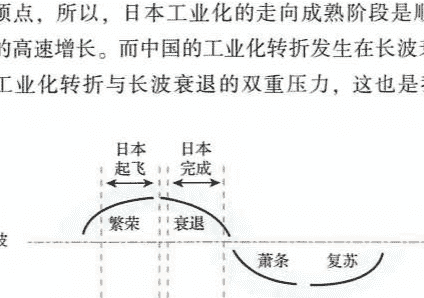
图8 中国和日本比较

## 萧滞周期：经济周期决定命运

关于中国的长期增长可能会有两个结论：首先，目前处于长波的衰退期，长衰退仍然处于长波的上波，所以我们没有必要对中国未来几年的经济增长产生怀疑，我们认为中国的经济增长可以持续到长波衰退之前，即2013年或2015年。其次，与日本的工业化阶段相比，我们所处的阶段优于日本。日本是在工业化完成的时候遇到了长波的剧烈波动，第一次石油危机中国是在工业化结束之前遭遇了长波的剧烈波动，所以中国的未来的工业化状态弱于日本在1966年到1973年的水平。不过，对于2015年左右到的长波衰退期，我们似乎在长波衰退期需要提高警惕，在我们观察的例子中，中国工业化处于停滞状态。

| 长波衰期的工业化国家 | 当时的工业化进程 | 当时的经济表现 |
| :--- | :--- | :--- |
| 1873—1883 | 美国 | 1873—1879年后第二次周期 |
| | 法国 | 1873—1896年的衰退，经济转型的剧痛 |
| 1973—1982 | 日本 | 石油危机的冲击下增长落到6% |
| | 韩国 | 重工业化宣言结束 |

资料来源：江天宏研究所

## 长波衰退的胜利期已经结束

长波衰退的最剧烈表现形式是通胀抑制经济增长，从而造成经济衰退。所以，大宗价格的高通胀带来增长的低迷，这一点在前面的日本和韩国的GDP增长的6%中得到了体现。但是，必须要指出的是，这种长波之后随着油价的下降，在一个两个周期之内实际GDP将见到低点，《通胀经济底部》。而且我们提到的例子中，这个实际GDP的低点就是长波的低点。在日本的例子中，我们发现日本在石油危机后对应的实际GDP下滑在随后的两个周期之前，这在工业化结束之前一直是最低。同时，在第四次长波衰退结束（1982年）之前一直是最低。在第三长波衰退期，美国工业化过程中，通胀与增长的平衡受到了第一次世界大战的干扰，但是我们可以发现，1916和1919年通胀高点对应的1916和1920年的实际GDP低点是在1929年衰退之前的。事实上，在第四次长波衰退期，虽然已经是工业化国家，但是两次石油危机对应的实际GDP低点都是不同的。所以我们有理由认为，由于通胀的回落，随后实际GDP的最低就是长波衰退。按照我们对长波的理解，中国在2008年或者2009年初经历一个实际GDP的最低点，但是这个最低点就是在2013年或2015年。

资料来源：李涛等

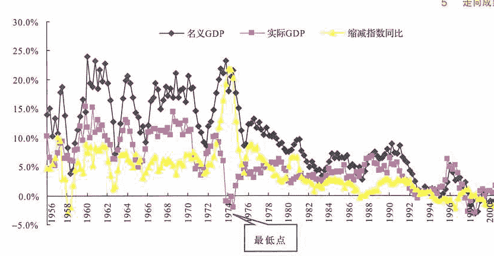
资料来源：长江证券

资料来源：长江证券

资料来源：长江证券

## 资本积累最高阶段

按照罗斯托的观点，起飞阶段实际上是依靠固定资产投资来拉经济增长的阶段。从工业化的实证来看，在起飞期间的固定资产投资和资本积累将达到最高。根据数据显示：

## 5 走向均衡

罗斯托的计算，美国经济的资本形成最高峰出现在1888—1898年，随后逐渐下降，这也是美国工业化后期结束的标志。我们虽然目前还不能验证亚洲的资本积累在2000—2007年就是最高峰，但从中国的高昂的投资率和中国经济依靠投资拉动的增长到的瓶颈来看，虽然中国的投资未来仍可能维持高位，但显然最高峰已经过去。这是中国可以类比于美国1900年的重要证之一，而从日本情况看，图12中日本固定资产增长率高峰出现在1970年附近，资本积累高峰则现在1970年附近。这一点也能让我们通过例证中国类似于日本的1965年。

## 表 7 美国经济的资本形成（1929年价格）

| 年份 | 净资本形成（占 GDP 比例） | 总资本形成（占 GDP 比例） |
| :--- | :--- | :--- |
| 1869—1878 | 13.9 | 23.4 |
| 1879—1888 | 13.1 | 22.9 |
| 1889—1898 | 14.0 | 26.0 |
| 1899—1908 | 12.9 | 23.1 |
| 1909—1918 | 11.2 | 20.4 |
| 1919—1928 | 9.9 | 20.3 |
| 1929—1938 | 7.5 | 19.8 |
| 1939—1948 | 6.1 | 19.8 |
| 1948—1955 | 5.0 | 20.3 |
| 1955—1964 | 4.9 | 20.4 |

资料来源：长江经济研究

### 走向成熟

— 东北部 南部 中东部 西部

图 14 1880—1970年美国城市化发展的地区差异

资料来源：United States Bureau of the Census

—— 城市化水平（左） —— 城市化增长率

图 15 日本的城市化率及城市化增长率

资料来源：日本统计年鉴，东京产业研究部

这里同样需要注意的是，在走向成熟阶段，城市化速度仍处于高时期，日本的城市化增速拐点出现在1970年，也就是城市化率超过50%之后，美国也具有类似的特征，所以，这也是我们所说的，在走向成熟阶段，城市化原动力依然存在。

### 产业结构变动

作为工业化的结果，二产业衰减，工业化是产业结构变动最快的时期，他们根据实证研究得到了工业化过程中产业结构变动的一般规律。如表8所示，从数据比较来看，中国目前的产业结构处于工业化中期，但是已经具有后期过渡的特征。这一也支持我们对中国工业化将走向成熟的看法。

## 满周轮回

——经济周期决定了人的财富命运

### 表 9 不同工业化阶段产业结构结构的变动

| 工业化阶段 | 产业价值结构的变动 |
| --- | --- |
| 工业化前期 | 第一产业 > 第二产业 |
| 工业化初期 | 第一产业 < 第二产业，且第一产业 > 20% |
| 工业化中期 | 第一产业 < 20%，第二产业 > 第三产业 |
| 工业化后期 | 第一产业 < 10%，第二产业 > 第三产业 |
| 后工业化阶段 | 第一产业 < 10%，第三产业 > 第二产业 |

资料来源：《中国工业化进程报告》

### 表 10 美国工业化期间的三产产业占比

| 第一产业 | 第二产业 | 第三产业 |
| --- | --- | --- |
| 1930—1934 | 12.44 | 51.68 | 35.88 |
| 1935—1939 | 11.43 | 49.15 | 39.42 |
| 1919—1928 | 14.84 | 49.27 | 35.89 |
| 1914—1923 | 18.16 | 47.19 | 34.65 |
| 1909—1918 | 20.68 | 44.39 | 34.93 |
| 1904—1913 | 19.84 | 43.76 | 36.41 |
| 1899—1908 | 19.72 | 43.33 | 36.95 |
| 1889—1899 | 20.80 | 44.16 | 35.04 |
| 1879—1889 | 19.78 | 44.35 | 35.87 |
| 1869—1879 | 25.37 | 40.72 | 33.91 |

资料来源：江苏省研究院测算

### 表 11 中国的三产业占比

| 营业人员占比 (%) | | | | GDP 占比 (%) | | | |
| --- | --- | --- | --- | --- | --- | --- |
| 第一产业 | 第二产业 | 第三产业 | 第一产业 | 第二产业 | 第三产业 |
| 1991 | 59.70 | 21.40 | 18.90 | 24.53 | 41.79 | 33.69 |
| 1995 | 52.00 | 23.00 | 24.80 | 19.86 | 47.18 | 32.86 |
| 2000 | 50.00 | 22.50 | 27.50 | 15.06 | 45.92 | 39.02 |
| 2001 | 50.00 | 22.30 | 27.70 | 14.39 | 45.05 | 40.46 |
| 2002 | 50.00 | 21.40 | 28.60 | 13.74 | 44.79 | 41.47 |
| 2003 | 49.10 | 21.60 | 29.30 | 12.80 | 45.97 | 41.23 |
| 2004 | 46.90 | 22.50 | 30.60 | 13.39 | 46.23 | 40.38 |
| 2005 | 44.80 | 23.80 | 31.40 | 12.20 | 47.70 | 40.10 |
| 2006 | 42.60 | 25.50 | 32.20 | 11.30 | 48.70 | 40.00 |
| 2007 | 40.80 | 26.80 | 32.40 | 11.30 | 48.60 | 40.10 |

资料来源：国家统计局

## 5 走向战略

制造业内部的结构问题，一般可以使用数字指标，制造业增长在总商品部门中增加值比例，总生产部门农牧养、采矿、制造、公用事业、建筑，即物质部门，该指标实质上是物质生产的程度。可以理解为程度越高，工业化越先进。根据这一指标，我们可以认为中国的制造业类似于美国的1900年的水平。

### 表 12 中国制造业发展对比

| 年份 | 农业 (%) | 采矿 (%) | 制造 (%) | 建筑 (%) | 科技指标 (%) |
| --- | --- | --- | --- | --- | --- |
| 美国1869年 | 52.6 | 0.40 | 33.00 | | 33.03 |
| 美国1879年 | 49.06 | 0.59 | 36.98 | 11.13 | 36.98 |
| 美国1889年 | 37.41 | 0.92 | 48.04 | | 48.04 |
| 美国1899年 | 33.33 | 1.02 | 53.23 | 8.67 | 53.23 |
| 中国2005年 | | | | | 52.00 |

资料来源：United States Bureau of the Census，《工业化进程》

## 中国当前阶段与走向工业化的可行性

事实上，产业变动影响人均GDP，都是工业化的结果，而动力源是投资和城市化。按照《工业化进程》，以汇率折算的2005年计算中国GDP为417美元，处于工业化中期。1964年价格计算的1962—1966年人均GDP为64—72美元，也处于工业化向后期过渡的阶段，所以，这一点能够证明中国类似于日本在1966年的结论。

### 表 13 人均GDP反映的工业化阶段

| 工业化阶段 | 前工业化阶段 | 工业化阶段 | 后工业化阶段 |
| --- | --- | --- | --- | --- |
| 时期 | 初级 | 工业化初期 | 工业化中期 | 工业化后期发达 |
| 人均 GDP (1964年) | 100—200 | 400—800 | 800—1500 | |
| 人均 GDP (1970年) | 140—280 | 280—560 | 560—1120 | 1120—2100 | 2100—3360 |
| 人均 GDP (2005年) | 745—1490 | 1490—2980 | 2980—5960 | 5960—11170 | 11790—26830 |

资料来源：钱要等《工业化和经济增长的比较》、《工业化进程》

正如同上面提到的，成熟阶段并不是一个工业化的结束期，而是一个工业化的扩散期。在这个阶段，投资规模持续增长，但是可能会在一个区间内窄幅波动，而城市化仍然在加速，只不过结构发生了变化，这也是我们在前面提到的，循环是一个迅速恢复的循环，根本原因就是动力依然存在。

## 产业扩散与装备繁荣

工业化的扩散期现在方面，是工业化向多样化发展，这种多样化发展就是新的主产业取代老的主产业。在大多数案例中，工业化初期阶段属于量变阶段；工业化中期属于质变阶段；工业化后期，分工发展由弱向相对，进入新的量变阶段。这种特定阶段的产业结构变革中，其实就是社会分工的细化和产业脉动。其实就是我们所说的装备繁荣阶段。

西春在《高增长时代》中提到20世纪60年代以前的经济增长指出，仅仅是大企业的技术革新和现代化逐渐取代中小企业和流通部门。但是这种增长的扩散并没有以制造业中某些产业的衰落为代价。所以，在制造业中，我们看到的原本的工业化行业等部门通过制造业得到了增长。罗斯托所说的，现代技术在当时所提供的最好办法已经适用于大部分产业时期。这种情况在产业中的表现，必然是以设备投资为核心的生产效率的提高，所以，在整个走向成熟阶段期间，将设备投资与主产业共同繁荣的时期。这也是我们感受到的增长特征。

所以，这里的主导产业的更迭不是一次经济完成的，而是一个长期的过程，在整个走向成熟阶段，都是一个产业升级的过程，这并不代表未来的经济复苏，中国的经济增长被替换了模式。所以，走向成熟的本质就是扩散。

## 5 走向成熟

图 16 日本工业化期间各个制造业的主营业务对比

资料来源：日本统计年鉴、长江证券研究部

- 造纸及纸制品制造业
- 陶瓷、土石制品制造业
- 电气机械制造业
- 化学工业
- 钢铁
- 非金属制造业
- 金金属制造业
- 机械制造业

图 17 日本工业化期间各个制造业的主营业务对比

资料来源：日本统计年鉴、长江证券研究部

- 农林业
- 矿业
- 建筑业
- 食品饮料制造业
- 房地产
- 服务业
- 零售业

## 区域扩散与产业转移

我们之前已经用美国的例子说明，在走向成熟阶段，一个国家的城市化区域差异开始达到顶峰，并开始出现区域城市化率缩小的趋势，这也是我们在后面将要谈到的走向成熟阶段的区域扩散。事实上，在日本例中，以太平洋沿岸带为中心的工业化在20世纪后后期出现了地方扩散。这种倾向在中国的类似阶段也出现。

## 美国经济周期：经济因素决定了财富

新英兰地区（马萨诸塞）在1880年后增长减速，这一地区在生产上受到了限制，开始转向高度加工。而大西洋中部（纽约、宾夕法尼亚）仍是主要的工业区。资源丰富且发达的中东部（俄亥俄、伊利诺伊、威康星）在经济发展中的地位开始上升。

### 表 14 1880—1910年美国各地区收入与均收入的比例

| 区域 | 1840 (%) | 1880 (%) | 1900 (%) | 1910 (%) |
| --- | --- | --- | --- | --- |
| 新英兰 | 132 | 141 | 134 | 124 |
| 大西洋 | 136 | 141 | 139 | 134 |
| 南太平洋 | 70 | 45 | 45 | 59 |
| 中东北部 | 67 | 102 | 106 | 108 |
| 中西部 | 75 | 90 | 97 | 87 |
| 中南部 | 73 | 51 | 49 | 52 |
| 西南部 | 144 | 60 | 61 | 72 |
| 落基山区 | 168 | 139 | 100 |
| 太平洋地区 | | 204 | 168 | 195 |

资料来源：United States Bureau of Census，长江经济研究所

图 18 美国的经济区域

基于这种认识，我们可以确认未来的经济增长可能会出现区域扩散，特别是劳动密集型产业向中部和东北转移都是可能的。

### 表 15 中国区域的工业水平差异(2005)

| 区域 | 全国 | 四大经济区块 | 七大经济区 | 31市区 |
| --- | --- | --- | --- | --- |
| 后工业阶段（五） | | | | 上海、北京 |
| 后半阶段 | | 长三角、珠三角 | 天津、广东 |
| 后期（四） | 东部、环渤 | 浙江、山东、辽宁、福建 |
| 中期（三） | | 东北 | 山西、四川、湖北、黑龙江、宁夏、重庆 |
| 中部、西部 | 大西南 | 湖南、新疆、安徽、甘肃、川北、广东、海南 |
| 初期（二） | | | 贵州 |
| 初期（一） | | | | 西藏 |

资料来源：《工业化进程报告》

### 经济的工业化

赛泰对日本向美国迈进的经济描述，“……20世纪60年代后期的经济增长从一次增长向两次增长的转变。1万的高工厂变成了5万的高工厂，5万的乙烯设备变成了3万的套设备。”事实上，以八联铁制和富士钢铁的联合形成的新日本铁为标志的日本60年后期的显著特征。1964年三个重点工业企业合并，1965年，神户制钢和鸣崎钢铁、川岛洋和吴造旋、山东高压和三井化学、日本汽车和汽车、第一银行、太阳银行和日本银行进行了合并（《日本商业政策史》）。总之，规模的合并使得日本企业在国际上的竞争实力起到了作用。

向成熟阶段的早期投资与起步阶段的不同，起步阶段的基础增长带有新产业和新产品的性质。而在向成熟阶段的过程中，在此时阶段的技术的基础上，将重点放在生产能力的规模化以及投资的大型化方面，这是集中积累后的必然表现。美国在20世纪初的第一次扩张浪潮的出现，当时经济正趋成熟的表现，当时的并购以横向合并为主，这次扩张的高潮在1901年，一些工业部门的集中度高达78.8%（钢铁行业）、71%（造纸）和57.3%（运输设备）（沙伊贝，《近百年美国史》）。

## 澎涌周期——经济决定一切人的命运

| 年份 | 被吞企业数 | 被吞资本数 (百万美元) |
| --- | --- | --- |
| 1897 | 69 | 120 |
| 1898 | 303 | 651 |
| 1899 | 1208 | 2263 |
| 1900 | 340 | 442 |
| 1901 | 423 | 2053 |
| 1902 | 379 | 911 |
| 1903 | 142 | 293 |
| 1904 | 79 | 110 |
| 1905 | 226 | 243 |
| 1906 | 128 | 378 |
| 1907 | 87 | 185 |

资料来源：United States Bureau of Census

对于中国而言，成熟的上游产业的大型化将是不可忽视的。

## 5 走向转型

对于中国企业而言，这正是罗斯所托的走向成熟的方向，也是这种公司的多样化能够与大型化伴随着，所以，必将发生结构的变化。因此，未来的公司繁荣的是产业结构的改变，我们在讨论未来中国企业的选择机会时，将关注成长的内在，因为它为了它成长，可能由于发生变化。

对于区域的扩张，这是中国未来未成熟的事情，对于工业化发达地区的关注需要增加，但是前沿仍是工业化核心的头部地区，就是我们在选择机会的时候可能就需要灵活的。

我们对反发展的成功在成熟阶段策略的重要性，实际上政策在成熟阶段怎么做都不都。由于政策制定决定了中国工业化是否成功，所以，必须关注最核心的策略创新和环保政策、采购政策等。同时，必须关注基于改革的策略，我们其实已经如此彻底，政策的任何转向都必须朝着资源分配不均和福利方向发展，我们在推测政策走向时必须是可能的。

在经济发展方面，基于恩斯主义的需求扩张是有有效的，但是对于中国的工业化阶段的选择，则取决于我们，我们需要深入研究这种策略与波浪资本的关系，从做出政策策略的效果需要进行修订。

在经历了过去之后，中国的经济将走向公司繁荣的经济，这种公司繁荣是来自于中国的资本积累程度和中国产业结构的改变。虽然这种情况可能会更多发生站在走向成熟的阶段后，但是它的起点必须是从大型化和多样化开始的。

## 大型化、多元化与公司转型

我们对公司繁荣的使命，是对未来一段时间内中国投资的选择和转型策略短缺的一种思考，它一定不是2009年的全部，但是从2009年开展。关于公司繁荣，是有别不同行业的经济转型，行业转型是发展勃勃的一种常态，不管公司小公都能享受到行业的利润，比如我们比行业企业的闲产和破轨。而公司繁荣的是在行业发展减速时期，个体公司发行于其他行业业绩超过平均水平的，这个时期时期的主要表现是公司并购、创业创新和全球化。在这种背景下，公司繁荣并不是一个完全自底而上的概念，而是对于一个增长长期的理解，是一个客观主体在经济中发挥作用的时代。

## 大型化是公司繁荣的起点

工业化、经济危机、波浪资本、经济转型以及政府投资，这是我们对当前中国经济状态的认识，事实上，从经济史的角度来看，1980年进入工业化转折期，即走向成熟。纵视1980年以前公司繁荣时代的一些观察，我们可以概括为财政支出，政策励动购险——经济萧条以及产业政策支持的并购，国际竞争的培养引起了外资和技术。从这个意义上来说，韩国企业的繁荣增长，也是他们投入国际经济合作内在的过程，就是从引外资转向对外发展的过程。

表 18 韩国经济发展计划

| 年份 | 目标 | 备注 |
| --- | --- | --- | --- |
| 一五 | 1962—1966 | 纠正经济的恶性循环，筑必要的经济基础 | 大力发展基础和其他重要产业 |
| 二五 | 1967—1971 | 实现产业结构现代化，促进自主经济的确立 | 政策主导型计划，列出重点投资项目 |
| 三五 | 1972—1976 | 扩大出口规模，开展工程建设 | 开展工业建设 |
| 四五 | 1977—1981 | 筑实自身的基础，技术革新提高效率 | 以工业化为重心 |
| 五五 | 1982—1986 | 稳定增长、均衡发展，改善国际竞争力 | 政府主大规模投资产业项目 |
| 六五 | 1987—1991 | 同上，基础调整 | 海外投资持续增长 |

数据来源: 长研究院部

表 19 大商社工业出口占比

| | 1976 (%) | 1980 (%) | 1985 (%) |
| --- | --- | --- | --- |
| 三星 | 28.8 | 52.2 | 74.1 |
| 双龙 | 87.6 | 81.8 | 84.5 |
| 大宇 | 11.7 | 45.5 | 74.6 |
| 国际 | 8.3 | 33.9 | 36.1 |
| 晚星 | 4.0 | 41.0 | 51.7 |
| 乐华金星 | 26.4 | 51.1 | 77.0 |
| 鲜京 | 6.9 | 31.8 | 52.1 |
| 现代 | 93.3 | 86.1 | 95.6 |
| 商尾 | 22.6 | 54.1 | 70.5 |
| 全国平均 | 33.2 | 43.9 | 58.6 |

资料来源: 韩国贸易协会《贸易统计》

韩国经验表明，在经济转型期的经济计划，并不是简单刺激经济和资本市场表面上，它将改变经济结构引起增长增长。从韩国情况来说，在经济面临巨大压力迫需要调整经济结构的过程中，政府的财政政策给经济和国内带来的影响。首先，经济整体使得所有行业都处于低迷之中，相当企业和淘汰。接着，政府出的计划使得国有和民营企业参与到这项计划中并不是一年内完成的，这些企业可以获得资金，帮助其度过危机。同时，其他企业的释放和市场上可能被留存。由于在这个危机以后，大企业逐渐开始走向成熟。

### 走向成熟

现我们也可以把这个时期定为公司繁荣的起点。由此，公司繁荣是从多样化开始的，而是多样化带来的中游，是一个漫长的过程。

### 中小企业与产业变革

在日本经济史中提到，20世纪60年代，一方面是少数大型的企业，另一方面是大量中小企业。这些中小企业的共同特征就是加强程度。在20世纪60年代，日本主导行业的政府金融政策带动了中小企业的活跃。同时，改革和技术革新引发了潮型的，在消费多样化下，部分具有创新能力的中小企业脱颖而出，成长为独立于大型企业。

20世纪60年代是半导体制造、富士立制造、东芝、丰田汽车、日产汽车等时代，机械生产维持着产品高质量。当然，在此过程中出现了分化现象，有些中小企业发展，有的消灭。这种企业外的变革，导致了中小企业的更新，就形成了对于企业积累的“中坚企业”。

| 20世纪中小企业的领域 | 中小企业发展的趋势 |
| --- | --- |
| 20世纪60年代 | “独特的领域”和“实现产业化而引入机械设备” | 不仅是制造领域，超市、批发、连锁店等领域出现了。 |
| 20世纪70年代 | “独特的开发”和“技术转型多样化”和“适应市场化的企业” | 大生产、大量时代接近尾声，客户需求呈现多样性，伴随着产业结构的升级，导致了大量开发、新产品的研发。 |
| 20世纪80年代 | “以客户需要为导向”和“独特的设计” | 进入工业时代，信息、通信领域出现大量中坚企业，更加重视市场、新转型、组织的创新。 |

中坚企业的成长就是中游型的，它始终伴随着产业组织的变革，大企业的发展带动了相关的小企业的发展，这种深刻转变让曾经处于底层的企业发展。事实上日本经济的飞速发展，离不开这种大企业与中小企业之间建立的较为稳定的共生关系。

资料来源：长江证券研究所

## 劳动周期——经济周期决定人类命运

表 21 非一体化产业组织的比较

| 模式类型 | 美国模式 | 日本模式 | 意大利、中国模式 |
| --- | --- | --- | --- |
| 结构特征 | 寡头为主、中小企业共生 | 寡头为主、中小企业共生 | 中小企业为主、交互共生 |
| 大中小企业关系 | 市场化供需关系 | 长期稳定的合同供需关系 | 密密的纵向或水平协作关系 |
| 中小企业关系 | 竞争关系 | 有限竞争关系 | 市场化的分工协作关系 |
| 订货成本 | 高订货成本、订量和库存 | 较低订货成本、订量和库存 | 较低订货成本、订量和库存 |
| 订货频率 | 较低 | 较高 | 较高 |

资料来源：长江泰研究所

## 周期波动、结构演进与制度变革

## 资本市场运行逻辑

2009年，在经济的繁荣总量的底层逻辑是一种更接近客观的。但是，按照我们对长波的理解，我们说的2010年4月的大跌是一个相当大级别的问题。根据我们对长波运行特征的研究，在未来的20年，全球经济增长总量的萎退是不可抵抗的。而且，依据投资的可能只是一个反弹衰退段的问题。而且，作为美元本位下的资本主义经济学理论，长波的衰退期可能面临一些适用性的问题，我们面对的问题，长波理论的转折点，这与金本位美元无关。

现实的情况是在发达国家，货币释放的可能已经达到极限，继续执行宽泛货币政策的范围受限，这意味着需求和生产的下滑对流动的吸收和消化已经达到一个极值，长波周期性的启动已经到来。在长波衰退之后的每一个历史进程，实验长波衰退继续演动，也就是，微观主体对于经济的缓热和宽松衰缓是不可能的。在这个阶段，下行需求的制约了流动的行为，我们需要加强关注经济和未来的增长，对长波波动反应已经是事实。2005年以来，我们就在结构主义的框架下观察经济和市场，但这套理论真正发挥了效果，是在2007年进入衰退期之后，我们的预测显示了显著的作用。恐慌，在上一次长波衰退期（1966-1980年），西方结构主义对经济学的讨论主要关注在20世纪80年代之前，而在之后，由于人类进入复苏期，任何理论框架都是生的，而不能持久下去。但是，在长波衰退和萧条期间，未来的20年将是一个转折期，如同在20世纪70年代对待长波的研究，我要说明这个框架的适用性。

### 周期变动与结构演进

| 总量-货币主义 | 经济-结构周期 |
| --- | --- |
| 2003 | 2007 | 2009 | 2010 |
| 大转型-新起点 | 投资逻辑转换、体系转变 |

资料来源：中信建研发部

### 结构变化在周期中的表现

根据我们多年的探索，研究的核心趋势就是以周期波动和结构变动两条逻辑。对于中国经济的研究而言，显然是一个结构性问题，因为中国是一个发展中国家。我们自2005年开始，首先运用罗斯托理论对中国经济的发展探讨，但是我们在后来的工业化进程发现...

## 6 结构变化的意义

结构的变化不是孤立存在的，结构的变化是依靠周期的演变来实现的。典型的，长波对一个国家的工业化具有极强的约束作用，只有将周期的波动和结构变化结合起来，对趋势和预测有一个全面的把握，在这样的实践中，我们的理论体系开始成熟。

实际上，根据罗斯托理论，2000—2008年的中国工业化飞起是以增长为主的理论阶段，而在2009年走向成熟阶段之后，重点开始进入一个转换期。罗斯托自己也承认，这是一个富有希望的选择阶段，也是一个极其危险的过渡阶段。由于走向成熟之后，增长的重要性降低，而全社会由劳动力向生产要素的转变，开始进入一个更加关注分配的阶段，这是工业化自身的宿命，是起飞期财富积累的结果。我们面临的核心问题是，如何在结构框架下继续经济的未来潜力，在这个问题上，存在着比以前（2000—2008）更多的长波衰退以及之后的萧荣的不确定性。同时，我们在这个阶段遭遇了不可避免的萧荣，对于一个国家工业化的抑制是不可抵抗的。在这些认识上，我们的理论在2008年实现了第一次跃，那就是“走向成熟”。

| | 日本 | 中国 |
| --- | --- | --- |
| | 起飞 | 完成 |
| 繁荣 | 萧荣 | |
| | 中国起飞 | |
| | 繁荣 | 萧荣 |
| | 萧荣 | 复苏 |

图2 中国和日本的起飞长波中的位置

资料来源：中信建研究部

## 关于三周期迷惑

随着对周期波动的不断中断，事实证明了三周期模式是一个非常全面的周期解释框架。创新经济学和三周期迷惑理论，是我们考察经济变动的主要分析工具。当长波、中波和短波周期力量的方向性是一致的，我们很容易地感受到经济运行的特征。当三个周期力量是冲突时，我们就需要判别哪个力量是主导性的，而这个工作往往超出了人们的预期的范围，为此在这个特殊的阶段市场就会显得遥远、困惑。

### 凯恩周期——经济周期决定人类命运

图3 三周期叠加原型

资料来源：Joseph A. Schumpeter. Business Cycles-Historical and Statistical Analysis of Capitalist Process

在2007年后，我们使用长周期理论对全球经济即将步入长波衰退的预测，当时应该是长波在周期中主导的。而在2009年后，主要使用的是库存理论做出了判断，本轮周期已经运行到了最后的阶段。由于，增长，，，，，，，，，，，，，，，，，，，，，，增长，，新的问题。

当经济增长，财富分配重要性凸显，这种格局的产生从技术层面上看是资本的结果。

## 结构刚性与制度性

深层次差异是制度性的。结构主义经济学的视角是多样的，道路通罗马，既是结构主义的一个缺陷，也是一个优势。劣势在于无法获得总量分析的定量结论，优势在于可以获得分析框架下的某些方向。代表者舒雷认为“经济趋于发展的成果局限于一个范围之内”，这正是结构主义的理论。我们在文中阐述罗斯特向着发展的工业化阶段对分配的关注体现了结构主义。在这个问题上，奥森从社会的角度出发，给出了打破刚性的路径，他的公共选择解释了如何打破制度性的刚性。由于扩张与创新的，将经济向社会发展，使得转型变为制度性的转变。

## 结构主义在投资策略中的应用

在2005年后，结构主义分析框架下罗斯特理论中的工业化转型期的投资路径，中国正处于经济增长的起点（参见《繁荣的起点》），认为2005年以来的周期性增长可能是未来一段长周期阶段无法越过的，中国增速在一个重要的转折，工业化及城市化是当时经济增长周期的驱动力，产业多元化过程中的主导产业将会导致呈现，城市化过程中的房地产、金融、基础设施、流通、零售业将不断持续，日益成为主流的产业。

与此同时，中国经济在2005—2006年正好处于虚拟经济增长的起点阶段，工业化阶段的实体经济会对虚拟经济产生支撑作用，并从一个相对较长的视角来看，虚拟经济繁荣将超越周期。在特定的历史时期，伴随着一些边界条件的发生，虚拟经济将向着发展，将比时间还要长。或许，证券市场从2007年启动，其实是一种跨越经济的趋势。

图4 经济周期波动和建模

资料来源：中信建研发

# 经济结构转型的确认：站在周期的拐点

在我们构建经济增长框架的逻辑中，市场和经济的结论却是我们的逻辑的。当市场大幅下跌之后，市场开始处于一种混沌状态，看多和看空的力量拮持。而我们根据经济周期的起伏，我们判断2010年第二季度是存款周期的拐点，是长周期的一个阶段性转折，其后经济将进入一个大拐点之后的境界，经历过滤和萧条的特征。为此，我们判断原有的经济增长模型趋势已经结束，在动力未建立之前，经济和市场是一个趋势性的下行（《站在周期的拐点》报告、《大拐点之后的境界》）。2010年以来，经济和市场再次扮演我们的策略锚。

## 结构主义要回答我们的问题

对全球而言，结构主义研究是一个周期的运动，而结构的问题是次要的。由于对于经济运行，短期内不存在大量的级别的结构变动，而且由于长期周期后，其拐点十分明显，是一个量级结构增长财富的跨性转折，同时又在一段时间内存在虚实分离的。所以，这是一个虚构财富的下降过程，需要解决2010年第二周期拐点之后，全球和经济的连接是如何的，和结构统治下，短波和长度的力量带来结构性的机会和问题。特别是，面临着发达经济去杠杆的过程中，不同的经济结构储蓄和外汇将如何运行，即全球经济再次平衡对总需求以及我们结构变化的问题。

对于中国经济和市场而言，我们结构主义分析需要回答的问题：

第一，中国未来经济波动的底部和顶部是由周期的运行所决定的。在经济增长长波过大拐点之后，中国的短周期、中长周期与全球经济增长的关系及其相互影响，实际上是一个周期套中的主体选择问题，也是一个周期运动的问题。

第二，发展模式和经济结构转换的结构性机会或形成。是继续走投资和出口双驱动的发展模式，还是向内需为主、以消费为主的模式？中国化进程中的结构性问题。然而这里涉及到在这个过程中，产业的关联和顺序可能会发生变化，即所谓的前序和后效应。这个问题的本质上是资本积累问题，各个行业的资本积累速度和程度的不同，决定了未来经济的结构。从这个路径出发，我们需要寻找不同的行业的发展趋势以及带来的机会、或投资机会。实际上是一个结构问题，与发达国家不一样，这是一个根本性的转变，即大结构而不是这一次的问题。

第三，是增长与分配的关系。当经济增长到工业化完成阶段，社会阶级就十分明显，利益集团固化，收入分配达到高点，经济效率开始明显下降。

## 流动周期
——经济周期决定人生财富运行

制度改革的重要性十分明晰的。即中国是否存在制度性问题，制度能否对其他带来风险。

当然，不管是全球经济、美国经济还是中国经济，对其经济周期和结构演进的研究实际上是为了指导我们的投资。在我们的周期和结构两个研究中，我们也是在寻找变化的线索，用以指导投资的逻辑，一方面避免在周期的范围内被引起的无序性，另一方面又能把握周期的起点和结构变化的机会。

## 三周期套中的市场波动

三周期套是周期理论的最高境界。

对于周期，从不同的考察的出发，得到的周期特征是不一样的。比如基恩通过研究物价格和心理对周期性的变化，认为存在一种大致四十个月左右的周期，实质上周期的价格和结构变化是经济运行的规律对行为的变化。比如家里看到产品价格上涨就会增加生产；反之如此，在经济没有下滑时，会导致清库存，在经济好时，会主动增加库存。所以产品价格、产品库存就成为密切周期的重要指标，这也是我们在短期研究重点的理论基础。

关于周期，基础是由经济学家马克思在1862年提出的。他认为英国和美国的经济周期是研究对象，认为资本主义经济在一个六至十年的周期性波动中，每9至10年内会发生一次危机，被认为将周期划为中期周期。中期周期实际上是最典型的资本主义周期划分，为此我们划为资本主义周期。

在长期周期中，最典型的周期是瑞典经济学家康德列鲁普在1925年提出的，资本主义经济是50至60年的周期，它是资本主义世界的重大危机周期作为划分，也被德鲁里认为长期周期。由于波康德周期认为是以重大危机作为划分的根据，没有特定的依据，这还是争议很大。

熊彼特认为，这种三周期划分标准是不的，但是并没有出现不可调和的矛盾的。在每个经济体的运行中都存在长、中、短期周期。每个周期运行里套周期，每个周期都有短期周期。一般来说，长周期包括六个中期，每个周期包括三个短期，周期如此三次周期划分理论。

进一步，熊彼特认为其之前的创新理论为基础，认为技术创新可以作为长期周期划分的根据，即旧的技术与不同的长期周期相互联系起来，这比重大危机的划分更有说服力，同时也验证了其1912年提出的资本主义新经济。为此，波康德周期也被视为技术周期。可以看出，2008年美国金融危机的爆发，是长周期（第五周期）繁荣衰转换的大跨。

### 结构主义的疯狂

图 5 创新周期的长波周期 资料来源：世界银行、熊彼特、范嵩、中信建

### 三周期嵌套的市场波动：顶部和底部

一般来说，如果三个周期力量在同一时期出现相同或相似的方向，那么经济周期的运行方向就是明确的。但是如果中期和短期的力量不同，就要观测哪个力量是主导。如果三个周期力量呈现一致，那么经济运行将被加强；如果三个周期不一致，那么经济运行将陷入混沌状态。沿着这个方向，我们就能在周期考量中找到经济的底部和顶部。

图 6 三周期嵌套的模板 资料来源：中信建

在市场顶部的寻找过程中，首先应该寻找周期的主导周期。主导级别的不同决定了市场顶部的因素。比如在2008年至2009期间的主导力量是长周期上涨，从2008年开始，全球的运行是一个加强型的周期，周期的决定性因素是价格和利率，这就决定了经济。随后，当我们的周期结束。

### 长期周期
——长期周期决定一切

之后，经济将进入中期周期的真实之中，而决定一个真实起点的就是固定投资。

图 7 周期衰落下的CPI和GDP 资料来源：CEIC、中信建

但是，经济或底部的确是十分微妙的，虽然我们曾经在当时候预测了顶部，但预测却是一个困难的问题。经济周期的顶部、底部是不相同的。顶部的从来是一个系统性问题，以此预测；底部从来不能是一个系统的原因，这一点已经阐述得十分清楚。周期之后的经济，真实的开端在于中期，但更多是一个微观问题，不是宏观问题。所以，还是应该对市场怀着敬畏的心态，我们对经济的理解，底部的判断值得警惕。

图 8 三周期叠加的现实图 资料来源：中信建

## 长波衰退后半期：参与与政治博弈

就长波看来，在2010年的大拐点之后，长波进入衰退的后半期。按照我们对长波的理解，衰退的后半期是一个缓冲期。在经济的长波拐点（2005—2008）报告证实，开始进入一个平稳的阶段。我曾在《大拐点之后的境界》报告中对这个平稳阶段做过详细描述。未来五年的这个阶段，可以认为是经济在衰弱中进入了一个平衡期。在这个平衡期内，我们可以观察到几个特征：

首先，无论是美国还是中国，都经历了2008年之后的衰退进入一个平稳阶段，这个阶段是一个相对平衡的增长阶段。而且每个国家在货币政策的运用达到顶点之后，又会随着通胀结束这样的规律，所以这个相对平稳有望带来中期周期的繁荣，但这个繁荣又是不心的。一方面，我们对未来五年内中期繁荣的出现并不怀疑，但另一方面，这个繁荣或许是短暂是不确定的。

图 9 中国在中期周期繁荣需要某些等 资料来源：Bloomberg

其次，对于不需要被破坏的环境，比如中国，通胀是一个中期周期，是有持续性同时又不会爆发的问题。而且长波衰退的后半期，都是一个从滞涨到通胀的过渡阶段，在这个阶段中存在着明确的事实，我们现在看到的境界。这种过度流动造成的繁荣，实质上是一种流动性趋势的前奏，所以我们应当的泡沫危机是不成立的。

最后，在这样的短暂的繁荣阶段，经济政策本身对经济起到的作用是有明显的削弱。各国国内的统一被压缩之后，各国在国内稳定之后开始通过政治手段进行经济增长，就像20世纪70年代美元贬值。是在这样的博弈中，美国作为主导国面临着决定性的角色。所以，在中中的不确定性也还会迎来政治博弈。由此应该对诸如军事、北斗之类的产业引起高度关注。

长波的衰退留下了一个未解决的谜，因为在长波衰退20世纪70年代，美国为主导国我国同时面临滞涨的问题。在这次长波中，美国由

### 周期的规律

周期需要被破坏而进入通缩，由于需求良好、货币充足引起的问题是不可避免地陷入滞胀，这是一个十分分明的。在每个经济体的运行中都存在长、中、短期周期。每个周期运行里套周期，每个周期都有短期周期。一般来说，长周期包括六个中期，每个周期包括三个短期，周期如此三次周期划分理论。

熊彼特认为，其之前的创新理论为基础，认为技术创新可以作为长期周期划分的根据，即旧的技术与不同的长期周期相互联系起来，这比重大危机的划分更有说服力，同时也验证了其1912年提出的资本主义新经济。为此，波康德周期也被视为技术周期。可以看出，2008年美国金融危机的爆发，是长周期（第五周期）繁荣衰转换的大跨。

图 5 创新周期的长波周期 资料来源：世界银行、熊彼特、范嵩、中信建

### 三周期嵌套的市场波动：顶部和底部

一般来说，如果三个周期力量在同一时期出现相同或相似的方向，那么经济周期的运行方向就是明确的。但是如果中期和短期的力量不同，就要观测哪个力量是主导。如果三个周期力量呈现一致，那么经济运行将被加强；如果三个周期不一致，那么经济运行将陷入混沌状态。沿着这个方向，我们就能在周期考量中找到经济的底部和顶部。

图 6 三周期嵌套的模板 资料来源：中信建

在市场顶部的寻找过程中，首先应该寻找周期的主导周期。主导级别的不同决定了市场顶部的因素。比如在2008年至2009期间的主导力量是长周期上涨，从2008年开始，全球的运行是一个加强型的周期，周期的决定性因素是价格和利率，这就决定了经济。随后，当我们的周期结束。

| 二次库存 | 主动库存 |
| :--- | :--- |
| 底部 | 底部 |
| 2008 | 2009 |
| 2010 | 2011 |
| 2012 | |

图 10 周期叠加的现实图（注：此处根据上下文对应图中图10逻辑）

### 长期周期
——长期周期决定一切

之后，经济将进入中期周期的真实之中，而决定一个真实起点的就是固定投资。

### 结构主义的爆发

| 中美经济 | :--- |
| 中美经济第一个高点 | 美国流动性释放 |
| 中美经济第二个高点 | 美国库存扩容 |
| 中美经济再次回落 | 美国货币退出和扩容 |
| 2009Q2 | 2009Q3 |
| 2009Q4 | 2010Q1 |
| 2010Q2 | 2010Q3 |

图 1 全球视角下的周期循环 资料来源：中信建

### 结构性反弹的持续：起点与中期

熊彼特认为，第一个短波的演进是“结构性的”，是经济增长和经济结构的量调整；而第二个短波则是质变调整，是增长路径的实质性调整。在短周期的，这一波的性质比上一次波更加重要，因为这一波覆盖的范围更广，更具主动性。据此，短周期的重建是一个“反弹”，而一个中期（即起点）的叠加代表了“反转”。结构性反弹取决于周期内是否包含资本周期的转换，即起点起开始。2011年1~2季度是被动性周期向主动型周期的轨迹，这对于周期而言是一个新的起点，但对于宏观经济而言，这并不是起点的开始。

按照我们对中周期理论的理解，中周期就是固定投资资金引发的周期，其中中周期的起点就是固定投资资金。但对于当前市场所感知的固定投资，我们认为增长并非中周期内的波动，固定投资的结构转换才是中周期的根本。新型周期是私人部门的调整，带有私人投资扩张的元素，在这一寻找中，表面看起来是一个经济周期的问题，而内核是一个经济结构的问题。我们需要把结构分为两个层次考虑，第一层次是长期发展的大级结构变动，而第二层次是在经济周期的变动中实现这种大级变动的一过程。

## 周期与新起点：结构转换的考验

对后波的讨论只是说明了一个结构转换的考验，因为全球来看，长波后半年实际上不是一个结构的进步，而是为了另一个结构的进步准备，市场所表现的真正推动力量

## 流动周期
- 经济周期决定国家财富积累

技术仍未出现。所以，在发达国家的范围内，其结构变动主要为总量下降的，以及以经济结构变动的逆运动，比类美国重对其制造业的重视。但是对于发展中国家而言，这种情形则是其结构变动的推动力，但是发展中国家会发生什么样的结构变动，则取决于自身的发展阶段。正是在这个过程中资源国将走向衰落，而某些工业化国家可能开始其工业化的准备阶段（比如20世纪70年代的亚洲四小龙或者印度），其特征分不开。

## 长衰退后期：转型的追赶型经济体

在现在的国际经济运行体系中，美国作为中国家里是消费的代表，而对于国家的生产国。全球经济进入一个低增长、弱需求的“新态”，尤其是处于低杠杆的经济，其需求水平将相对的。同时生产国和资源国的需求也是不对称的，中国无法脱钩。

图 4 资料来源：中信建

在此条件下，对于发展中国家，内部储备被提高了。发展中国家必须将出口收缩带来的压力转化为积累，如果要增加投资或减少储备，内需将扩大。如果出口导向的，原有增长将日益明显的。以中国而言，结构变动是压力。在过去的衰退后期，何时是追赶型经济体。比如20世纪70年代的日本和德国，作为追赶型经济体。

# 结构主义的转型

保持了增长。再如1980年之前的拉美，在经济之前经历多次危机，这是一个不可避免的。我们提出的长波衰退后半期（2010—2015）可能是一个相对稳定的环境，而为转型提供了某些条件，这些国家是结构性的过程。

### 结构升级的不同

具体到美国，两个经济体处于不同的发展阶段。对于中国而言，现在处于工业化起飞期，向工业化成熟的过渡期。未来若干年，投资是中国的第一动力。对于美国，在二战之后进入了一个大众时代。两个不同的经济体的发展阶段和增长动力的差异，决定了周期波动和经济增长具有意义。对于成熟经济体，经济运行是低幅波动，整体而言，美国的结构是相对稳定的，比起消费、投资和出口在增长中处于相同的。对于中国而言，在波动的过程中，经济波动发生了实质性的变化，比起消费、投资和出口，增长程度明显，结构变化是一个“大结构”问题。简单之，对于美国，经济波动的影响强于结构变化；中国的结构变化往往是结构性调整，从中端向高端提升，消费的比重保持相对稳定。对于中国，结构变化的影响强于周期波动，重要。

图 14 周期变动与结构演进中的中国：大结构、小组
资料来源：中信建研究部

# 6 结构主义的转型

图 15 中国“三驾马”对经济增长的贡献

资料来源：国家统计局

# 走向成熟之后：寻找增长的长线

从工业化进程来说，中国目前所处的历史阶段和20 世纪初期的美国和20 世纪60 年代中期的日本相似，都是处于一个工业化起飞向成熟的升级过程中。在这个特殊的历史阶段，最重要的特征是工业化的扩散，将领先的先进技术应用于所有资源和产业的过程。在这个阶段，我们在2008 年的《走向成熟》中已经做了系统的描述，现在来看这些已经是、或者将发生的变化：

第一，投资拉动的增长模式仍将持续，但投资的结构发生实质性变化；第二，生产能力规模化，资本积累趋势密集化，经济出现大类型化，其中积累为主产业；第三，新老主导产业的交替，促进社会结构的深化、中层产业的膨胀以及装备制造业的繁荣；第四，城市化与工业化相进入加速时期；区域差异达到顶峰，并呈现差异的终极，城市化扩散开来；第五，收入分配未达到一个高准，分配改革将发生实质性改进，出现多样化消费，为大众消费时代提供支撑。

收入分配改革与多样化消费引起：

| 区域差异、城市化加速与扩散 |
| :--- |
| 产业升级和中游产业膨胀 |
| 资本密集与大型化转型 |

| 2007 | 2008 | 2009 | 2010 | 2011 | 2013 | 2014 |
| :--- | :--- | :--- | :--- | :--- | :--- | :--- |

图 16 走向成熟的五个特征在中国的映射

资料来源：中信建设研发部

# 凯明周期的：

——经济周期决定你财富积累

这五个方面更是我们寻找中国增长的重要线索。这是我们关于工业化走向成熟的一个现象描述，而对于促进结构变革的本质问题，可能应该从这样的线索开展：

- 其一，需求的转向（增长逻辑）；
- 其二，结构并行的继承性（投资强化与其结构变化）；
- 其三，要素的变更（刘易斯拐点）；
- 其四，周期遗留问题（流动性过度释放）。

## 需求转向：工业化升级是根本所在

根据历史的经验，英国、美国等国家的工业化过程与长周期的复苏和繁荣阶段紧密在一起的，其工业化积累和成熟阶段都处于一个长期的周期中。中国与美国有所不同...

| 时间段 | 工业化阶段 | 特征 |
| :--- | :--- | :--- |
| 1948—1955 | 准备阶段 | 工业高速发展，建立初步的工业体系 |
| 1956—1965 | 起飞阶段 | 设备投资高增长，工业化占比逐步提速 |
| 1965—1974 | 成熟阶段 | 设备更新和技术升级，行业组织大型化，产业结构升级 |
| 1975—1987 | 后工业化时期 | 城市化退速，进入人口潮时代 |

资料来源：中信建发

但是需求或许比供给在经济增长中占据主有的地位。一方面，中国的工业化阶段决定了投资积累仍然不是经济增长的主动力，而需求作为稳定的增长动力，不可能支撑超过 6%的增长速度。因此，中国的结构性转型从向上显然可以由投资向消费的转型，但从未来的方向来看，固定资产投资仍然是工业化走向成熟阶段的力量。所以，未来市场投资不会是一个抛弃投资的年代。2010年后的高投资是将工业化转型的一个必然趋势，中国继续维持较高的投资率和投资增长水平，这是工业化中结构的延续性。

# 结构升级的延续：投资强度与获得继续发展

工业化之后是一个继续发展但存在矛盾的阶段，这时由于投资率的高水平促进了经济增长的自动性和持续性，这种的自我持续是一种可能的“自动增长”。这种自动增长可能性的最大决定因素是投资率水平，即资本积累的程度，也决定资本投资周期或中期能否顺利开启。正如前言云：一是原主导部门后的效应和侧效应继续延续，即旧主导部门作用的下降不是骤减，崩式的。或者旧主导部门通过技术、模式、组织结构继续发展发挥主导作用。二是新部门的出现，新主导部门会不断替代旧主导部门引起起过程的不断重复，这与我们认为的“环境循环”异同。这一因素决定了经济增长的剧烈波动，决定了增长的持续性。

按照我们研究的工业化走向成熟的规律，中国的固定资产投资在速度和结构上发生变化。但是，固定资产结构变化的关键在于，因为此时的结构决定了此时的速度。日本在工业化走向成熟期间（1965—1974年），固定资产的投资具有了明显的装备转移的倾向，这是一个工业化的产业演进规律，这也是我们看好装备的重要依据。

| 自主创新 | 附加价值 | 提高竞争力 | 创新企业 |
| :--- | :--- | :--- | :--- |
| 市场规模 | 需求增长 | 快速增长 | 行业龙头 |
| 要素变动 | 低生产价格 | 产业转型 | 优势 |
| 重组 | 行业更新 | 价值创造 | 外资并购 |
| 驱动因素 | 路径选择 | 影响因素 | 投资策略 |

图 17 制造业升级的路径

现在看来，新起点大概来源于装备业。新起点的意义对于上述两个方面，一个是原有产业的升级、改造，二是新产业的兴起。这两个新起点应该是人力部门和资本积累。从这个意义来说，经济增长后的经济刺激。

# 周期：

——经济周期决定你财富命运

可能不能获得自动增长的能力，因为经济增长并不是自动的。只有退出政策之后的增长，即后主导的资本积累、产业升级和新兴产业驱动的增长才是具有持续性的自动增长，这才是寻找新起点的所在。

资料来源：中信建信研究所

值得注意的是，工业化进入起飞阶段之后，中国经济内部要素发生了深刻变化。在人类、资本和技术的框架下，效应已经开始，冲击可能会越来越，归结来实际上有两个重大问题：是中国人口结构，即所谓的刘易斯断，这是生产要素的变化；二是过度刺激，即泡沫经济。这两个问题将实质性改变结构的节奏和方向。

# 刘易拐点：要素性质

我们观察到，2006年劳动人口占比高达55%，但这可能是中国人口占比最高的时期。劳动人口下降是必然的，因为这种下降源于低出生率、低死亡率和自然增长。另外从横比较来看，日本在1968年人口占比达到56%，目前的中国已经接近峰值。

资料来源：WHO、OECD、中信建研究（印度、巴西数据来自OECD，2006年；其余数据来自WHO）

从劳动力绝对数量和相对比例的减少以及系统性压力显示，中国的人口发生了重大改变。根据人口结构分析，动力供给的逆转、工资不断上涨上涨，刘易拐点悄然临近。我们认为，中国已经在2006—2010年的某个时刻，刘易拐点悄然消失了。

过去三十年，在劳动力增长与人口整合的过程中，中国的需求持续维持。按照文献的划分，目前的中国和20世纪60年代的日本、80年代初期的情形非常相似，都处于“走向转型”的关键期。然而计划的生育政策使得中国在5~12年后遭遇了刘易拐点；如果再次遭遇全球经济的滞胀，导致中国面临的重重因素叠加，是陷入“中收入陷阱”，还是继续走向发达之路？

作为引导报告，我们详细描述了刘易拐点来到后的经济和社会现状：（一）“三驾马”向“两驾马”受到影响，这种增长可能下降1~2百分点，但中国可能不会持续；（二）由于农产品价格上涨的压力，造成CPI可能下降约1百分点；（三）贫富化问题的扩大和农村矛盾的剧化，社会矛盾的聚焦成为刘易拐点后的社会新常态。对于政府政策的要求日益增大，以及重重困难，政府需要提高效率以克服大困难，需要逐步改革——这就是我们前面提到的社会现状。

### 过度泛滥与泡沫危机

中国经济政策，是在面对金融危机的一次过度泛滥。行为作为政策的作者，在风险发生后将首次对冲。信贷风险和政府的泡沫策略可能相互影响和制约。信贷风险的形成自借货币的膨胀和放贷的泡沫，爆发于地方政府与中央的关系，以及微观调控在房地产行业的行为。我们无法从中寻找这次信贷释放类似的情况，这是我们无法回避的不确定性。

长期来看，贷款集中爆发存在较大可能，中国已经初步展示出泡沫的特征。而面临两个困难：如果继续增加流动，可能会提前和更大爆发；如果不加息，泡沫将继续扩大，廉价货币引发危机，廉价货币无法流动。即使尽量延缓调整步伐并采取多种措施遏和泡沫，也无法回避泡沫的成本。结构调整和体制改革的压力和紧迫，增大了泡沫处理的难度、复杂性和性。

# 周期：

——经济周期决定了人财富的命运

确定性。我们判断，不良贷款率回升的最大压力当时在2011年第一季度，在2012年可以集中爆发。不良贷款率能够逐步回升4~6个百分点；2009年季度贷款余额接近35万亿元，对于2012年后不良贷款规模是1.5万亿~2万亿元，新增增量在1万亿元以上。更重要的是，理财的中央政府不会给银行和市场预期二次离。可以明确，外汇贷、损失挂钩的不再适用于银行，意味着不存在二次红利。

资料来源：CEIC、中信建投

未来面临的资产结构的线条，然而我们实质上描述了这种情景。首先，调整仍然沿着固定资产投资的路径，所以投资仍然是经济波动的主要手。在这个过程中，投资导致了成本升以及泡沫化的双重，这种投资的效果是有内在基础的，不能阻止通胀。此后，投资仍然是生产周期的源头，但却缺乏持续性，这就是未来的增长。在008年之前，这是一个典型的增长时代。

# 中期周期波动中的结构变化：固定资产投资视角

要素：从我们对周期的理解，当短周期被库存周期走向底部的时候，就会向新一轮的主动周期转换，这种运动是必然的。在这个过程中，往往还有偶然因子，这就是未来的“两个转换”；被动库存向主动周期的转换。

# 6 结构主义的转变

短周期中周期实际上是一个层级的结构变化，这也是典型的增长阶段的体现。但是层级结构变化的意义是巨大的，因为它蕴藏着未来增长动力的要素。根据彼特的理论，周期的启动是由更新和提高效率行为决定的。所以这并不是与创新的必然，而在经济周期的观察中，只有装备行业和房地产是周期的先行行业。这是一个纯粹的结构变化，而结构变动是大结构升级的一次波。20世纪70年代，美国在库存周期向新资本周期的转换中，建筑建材、机械设备、电器设备等投资行业和电子计算机投资率不断提高，利用率持续增长。

图21 设备投资的启动往往是新资本周期的前奏

资料来源：Bloomberg

图22 美国在短期周期向中期周期转换的结构“星火”：产能利用率的角度

资料来源：CEIC、中信研部

# 资本主义的

# 周期：

——经济周期转换投资结构变化：经济视角

这里我们选取了石油危机之后的两次库存周期为例来解释什么是波动中的结构变动，虽然这在本质上是不的，但是能够看出波动中的结构变动。

以20世纪70年代的日本来说，从库存向资本周期的转换过程中，在1976年二季度GDP增长达到高峰后逐步缓慢。库存实在1977年3月达到高点，开始去库存的进程，在1978年1月结束，第二次库存存在三个季度。随后，日本经济已经经历了一个周期转换，随后开始了九个周期的繁荣，在这个周期内结构的变化是明显的。

20世纪70年代后期日本从库存向资本投资结构和投资结构发生了巨大变化。实现了工业化到成熟阶段的顺利转型，其产业结构得到了提升，生产效率大幅提高，而产品价格保持稳定。从行业来看，装备、制造、电子、电脑、精密仪器、家电等行业快速发展，与此同时，钢铁、化工、普通机械等产业仍然保持活跃，但重要性有所下降，而属于的产业基本上处于周期的状态之下，不含食品行业仍然保持较强的竞争力。

在投资方向上，当工业化飞到成熟阶段后，重工业将逐渐扩大化。通过技术新的边际产出是在减少的，作为一个合理的应对，企业向横向和纵向并行引导，以进一步扩大规模效应和经济效益。另一个就是改变投资的方向，将更多的资本投入其他行业（将产生新的企业，部分企业将成长为中型企业）。作为投资的企业最关注的是该项目的成长性。在工业化向成熟转型期间，日本的经济是从周期向下运行，向向上发展。

#### 表 2 日本GDP周期内不同行业的分布

| 年份 | 农林 | 采矿 | 钢铁 | 制造 | 能源 | 电气 | 零售批发 | 金融保险 | 房地产 | 运输服务 | 服务业 |
|---|---|---|---|---|---|---|---|---|---|---|---|
| 1968 | 12.62 | 0.65 | 16.96 | 11.04 | 2.15 | 5.56 | 1.57 | 11.87 | 6.09 | 15.63 |
| 1969 | 11.83 | 0.69 | 17.24 | 11.33 | 2.13 | 5.94 | 1.89 | 12.01 | 6.39 | 14.84 |
| 1970 | 10.62 | 0.65 | 19.08 | 11.39 | 2.27 | 6.19 | 2.02 | 11.85 | 6.85 | 13.76 |
| 1971 | 9.91 | 0.66 | 20.29 | 11.67 | 2.36 | 7.00 | 2.19 | 11.41 | 7.20 | 13.53 |
| 1972 | 9.39 | 0.66 | 20.22 | 11.80 | 2.56 | 7.24 | 2.36 | 11.34 | 7.06 | 13.07 |
| 1973 | 8.84 | 0.71 | 20.86 | 11.38 | 2.60 | 8.12 | 2.32 | 10.98 | 7.08 | 13.50 |
| 1974 | 8.03 | 0.58 | 22.08 | 10.55 | 2.59 | 8.37 | 2.41 | 10.66 | 7.33 | 14.61 |
| 1975 | 6.97 | 0.54 | 22.78 | 10.91 | 2.70 | 9.18 | 2.53 | 10.06 | 7.42 | 15.15 |
| 1976 | 6.18 | 0.55 | 23.52 | 11.46 | 2.73 | 9.22 | 2.50 | 9.85 | 7.54 | 15.82 |
| 1977 | 5.08 | 0.55 | 24.58 | 12.57 | 2.70 | 9.68 | 2.51 | 9.68 | 7.62 | 15.28 |

# 6 结构性的痛

| 年份 | 农林 | 采矿 | 制造业 | 建筑业 | 电电力 | 批发零售 | 金融保险 | 房产业 | 运输通信 | 服务业 |
|---|---|---|---|---|---|---|---|---|---|---|
| 1978 | 4.93 | 0.52 | 24.87 | 12.86 | 2.61 | 9.71 | 2.67 | 9.91 | 7.85 | 15.91 |
| 1979 | 4.51 | 0.51 | 24.91 | 12.83 | 2.62 | 9.72 | 2.73 | 9.96 | 7.92 | 15.93 |

资料来源：中国统计局、中信建研究部

# 资本增长周期的结构性变化：中国的考虑

我们认为，随着工业化进程的深入和城市化的缓慢，将出现三个结构性的变化趋势：一、中游产业将出现一个兼并重塑、大规模化；在二类产业内部，投资重点从中游向向下发展，投资的重点将从中游向下转移，整体造成制造业的繁荣；三，将出现消费产业。

由于经济结构型的目的以及工业化进程的规律，我们认为，未来中期之中，中国的中游产业将从中游向向下转移，下游产业的投资将进一步聚焦，中游下游产业将持续维持。主要原因有：

- (1)全球资本周期在长波衰退阶段，资本本身一个周期性的，尤其是中游偏上游的行业周期性更强。随着全球资本周期进入长波衰退阶段，强周期性的投资和生产将是一个下一个周期的总体趋势。由于钢铁行业是基础产业，其技术都处于一个新周期的低位，具有支撑性的技术创新期尚未出现，无法支持工业化产业获得重大的技术升级，且重工业化业务基本是，其技术升级的难度更大。

- (2)从行业调整的现实出发，目前中国的情况与日本20世纪60年代后期相似的能源瓶颈。由于钢铁、石化等行业，如果继续增大此类行业的投资，未来对能源的需求将进一步提升，重工业化产业外部的约束将更加严重。而且，从生产效率来看，重工业业的整体效益是在下降的。为了避免能源瓶颈，提高投资的整体效率，政策可能会转向，如汽车行业产业链钢铁等，投资的整体效益可能更好。

图23 我国制造业产业升级前景

资料来源：Bloomberg

图22 美国在短期周期向中期周期转换的结构“星火”：产能利用率的角度

资料来源：CEIC、中信研部

## ——景气回升：后期城市化与财富积累

(三) 中国城市化的深度多元化时代迫使工业化进程必须向下转型。从日本的经验来看，工业的升级随着城市化的加速，日本在四个城市带形成了许多的新兴城市，加速了日本经济中下游产业的需求，以及对第三产业的强劲需求。与此同时，工业化的升级，使得大型化和高级化等成为工业发展的需求，而中游的产业由于其资本和技术密集的特点，主要将向大型化转型；而更接近下游的需求，则是走向合理化和高级化，即产业结构升级。随着需求的增长和加速，中下游产业的投资将持续增长，其投资的需求弹性更大。从2004年以来，中国产业产业的投资特征却是：中游的上游近期投资增速下降；而接近下游的电子、电气、汽车、建筑、医药、印刷等行业投资增长率较高。我们认为，这种趋势将在中后期持续。

从工业化走向成熟阶段的转型中，产业结构经历了重大变化，出现了我们所说的高投资率、高增长率、大型化、高级化等明显特征。与此同时，这些随着结构的变化，第二产业作为工业发展的核心，大型企业和新兴产业作为增长的重要支撑。

为了工业化走向成熟的过程中，随着工业化进程加速将会出现工业化需求、工业化引发的城市化以及消费化、消费升级等重要趋势，这就构成了支持产业和支持消费的两个“支撑”体系，整体上带来了整个产业的投资和新型消费的兴趣。

## 消费升级趋势下的新型消费产业

工业化向消费升级，生产者和消费者对服务的需求增加。工业升级和深化，带来服务业（中游）结构变化；城市化以及消费结构变化带来消费升级（直接）结构变化。整体意味着各产业部门的细化、中游产品的技术化、中游产业的勃勃以及第三产业的进步。实际上是向新型消费行业的发展。从我们过去几年对第三产业和新兴产业的观察，第三产业出现了一个三个重要的投资趋势：一是大型化和国际化相伴，是外延式增长，即通过横向或纵向规模扩张；二是消费者产业，一侧是横向扩张，而生产者产业一般是纵向扩张；主要是生产者市场份额的扩大，而后者则是价值链的延伸，主要是保障原材料的需求。这种横向的扩张是有局限的，但是都突破了限制，实现了扩张趋势。

与消费升级相关的第三产业投资增长快速。工业化的升级和城市化引发带来消费大幅增加，并将其结构性变化，消费普及以及消费升级。如果未来城市化率按每年1%计算，未来将增加1300万人民币左右，增加消费支出1000亿元左右。消费水平和层次沿着城市中心向二线城市向三四线城市递延增长，消费结构将得到显著优化。这一趋势将强化相关产业的投资：汽车、教育、医疗卫生、网络零售等投资增速将加快。

#### 表 3 主要消费行业发展阶段与增长模式

| 行业 | 发展阶段 | 增长模式 |
| :--- | :--- | :--- |
| 食品饮料 | 消费及升级并行、升级 | 内生性与外延增长并存 |
| 汽车行业 | 参与阶段未结束 | 主要依靠外延增长 |
| 家电行业 | 消费及升级 | 主要依靠外延增长 |
| 商业零售业 | 消费升级 | 外延增长为主 |
| 电子产品行业 | 消费及升级、行业空间扩大 | 内生性和外延增长、技术创新的内生增长为动力 |
| 旅游业 | 消费及升级并行、升级 | 外延增长为主 |

资料来源：中信证券研究报告

第三个大趋势是技术创新的产业投资空间最大。根据日本 20 世纪 60 至 70 年代的工业化及行业领先，日本当时的新兴产业及其相关的技术创新的投资增长迅速，其中电子元件、计算机、电气等领域的出现大幅增加。但是，2010 年之前在中国信息传输、电子计算机和组件等高端产品的投资仍然低于第三产业的整体水平。我们认为，2010 年之后其发展空间巨大，将发展。按照融合小组专家估算，未来三年互联网融合与终端消费市场规模 6880 亿元，其中网络相关投资增长 2490 亿，未来三年信息服务收入与终端消费预计 4390 亿元。

资料来源：FOST & SULL、中信证券研究报告

通过工业化升级和消费多样化的增长，我们认为在短期内向周期转型的过程中，投资结构的变化将产生一些新型产业，其中互联网、电信增长及服务等行业受到欢迎。而我们与中国社会福利事务相关的医疗、教育等行业也是青睐。最后市场将看好娱乐产业。为此我们认为，通过通信设备、移动互联网、物联网、云计算、数字数据、数字出版以及消费升级相关行业（比如 LED）将受益于中国工业化进程的升级、城市化和消费多元化等带来的发展机遇，相对于对于结构型和升级型而言，

图 26 中国高技术投资趋势

图 27 20 世纪 60 至 70 年代技术投资趋势

资料来源：CEIC

### 小结：中周期、新起点和转型趋势

如果理论上认为中周期的存在，其核心驱动力就是新的增长。这里正是我们对固定资产投资寻找新起点的原因。

### 结构主义的萧灭

市场，对投资反映的是一种中期周期，而不是一种周期。我们强调结构性变动发生在两个级别。在经济周期理论中，某些独立的技术或创新引发周期性增长。这与固定投资逻辑相反。如果未来会迎来周期，大概率或许来自于投资领域，这就基于预期的产业升级和消费需求的投资、半导体行业我们有更好的机会。我们认为新起点的出现立即出现。即便是在周期末出现，两次周期的低点，因为新起点的出现，经济转型本身就是一种状态，最初的动力也是某种触发、或者是缓慢的升级和模式形成的局部领域。这些可能是由于系统的缺乏，按照周期的正常经营，在库存回落，调整是正常的情况，对这一点还是要充分准备。当然，在这个模型过程中并非无线，至少在一次周期之后，新起点仍然存在。任何一个新的起点的本质上看来都是被动供需的结果。总之，对于市场的新起点，我们仍然拆分为两个角度来看，即中期周期属于经济转型。

## 三周期理论——熊彼特到罗斯巴德

在前一篇，我们阐述了《三周期》系列的初衷，是对周期的更新。在文中我们首先回答了“经济周期是否已经过时？”无疑是一个大问题。为了回答周期的本质问题（包括经济周期是如何产生？如何传导？如何循环呢？），我们介绍并总结了主流的经济周期理论：（1）凯恩斯边际递减周期；（2）熊彼特“超级乘数”；（3）新古典学者加速作用的经济周期；（4）“货币现象”的货币主义周期；（5）哈耶克结构失效的繁荣与萧条；（6）熊彼特特定于创新的周期理论等。

在综合分析主流经济学关于经济周期理论的基础上，我们提出了作者研究的周期理论选择范围：

- (1) 合理性。对我们的研究而言，我们只是观察、判断经济周期，更关注“经济周期如何运行”而非“经济周期应当运行”，熊彼特“关于任何机会的度量”对于我们而言更多。
- (2) 前瞻性。凯恩斯的“效率损失和通胀”、希彼特的“上限与下限”、里德伯的“货币虹”、哈耶克的“信贷与投资结构变”、熊彼特的“波动演变”，等都符合前瞻特征，理论告诉我们可以使用上述周期理论分析来预测周期。
- (3) 开放性。一个通用的周期理论应该灵活地适用于不同的经济阶段，熊彼特本质的“周期逻辑”理论具有开放性，还能将其融入周期中，这一点上，我们倾向于使用熊彼特的解释来研究经济周期。
- (4) 可观测性。虽然熊彼特的“创新”也容易被观测，但从周期中的某些周期具有特定的规律，以便观测和预测。从可性和性和角度来看，熊彼特的模型具有优势。

在此，我们倾向于使用熊彼特的周期理论来研究中国的经济周期，我们甚至可以将凯恩斯、希彼特、哈耶克、弗雷德周期理论融合在一起，用来研究中国的经济周期和资本市场。

虽然熊彼特的理论有很多优点，但也存在许多局限，使得在实际应用中受到局限；例如，“创新”驱动经济增长和周期波动就难以言俱。奥地利派的罗斯巴德对此提出诸多批判，但正如我们以“开放性”来选择周期理论之前，这些并不是都是“补充”的，因此，本篇将除了详细介绍熊彼特周期理论之外，针对“创新”，我们做一些补充。

## 周期概述

在20 世纪初，熊彼特就已经看到经济危机对资本的重要影响，着手研究这一问题。周期理论源于奥学派和马克思主义的思想，一方面坚持静态模式建立一套经济体系，另一方面坚持动态变化的现象，因为他内部存在一种均衡，使得经济体系向另一个均衡。熊彼特的周期理论集中于《经济周期：资本主义运作的历史和统计》以及《经济变化》文中强调了三个特点：

- 第一，是分析、历史和统计三个方面。
- 第二，以活动为中心，周期的起源。
- 第三，不做任何建议。

经济周期的因素分为三类：外部因素、增长因素和创新。外部因素关键的是战争、制度、经济政策、银行和货币管理等。熊彼特认为，外部因素是导致经济变化的根源，仅仅从外部因素来解释周期是不够的。增长因素会引起经济波动。而创新因素，熊彼特将“创新”定义为“新组合”，按照熊彼特的解释，创新并不是单纯的技术创新，而是经济中出现的新事物，引入体系包括：

- (1) 引入新的方法
- (2) 开辟新的市场
- (3) 发掘原料供应渠道
- (4) 建立新的组织形式
- (5) 如打破垄断

所以，创新与发明并不是企业家，只有那些富有冒险精神、勇于付诸实践的创新者才是市场中的企业家。熊彼特看来，作为资本主义“灵魂”的企业家职能能够实现“创新”。所谓“经济发展”，就是整个资本主义社会不断实现的这种“新组合”。熊彼特将这种不断破坏旧结构、不断创造新结构的过程称为“产业突变”，是一种“创造性的破坏过程”。创新的非连续性和扩散性，是经济体系内本质的、引起周期波动的根源。

## 两阶段理论：单一周期

熊彼特在用“创新”概念来说社会内的周期性规律时，提出了一个包括上升和下降两个阶段的单一周期。

首先在因素作用之前，设定一个一般的经济体系。在这样的体系中，每个家庭和企业都处于均衡状态，经济增长不是自愿的，增长因素决定了趋势。其次，企业为追求利润，基于其设想的经济企业家从银行借入，以此建立新工厂，订购设备，并购买生产要素进行生产。企业的创新扰了经济体系的均衡，经济增长开始加速。当一个成功的创新活动带来盈利，在诱惑下，其他企业纷纷模仿形成导致规模的“创新风暴”。创新风暴扩大了对产品的需求，由于供给的存在，企业家将支付更高的代价才能获得产品，价格上升，扩大对银行信贷的需求，引起信贷扩张。物价上涨导致上升的阶段。

由创新的引导，经济活动变得非常频繁，随之而来。然而创新引发的风险是均衡，使得经济必然向新的均衡，也会经历阶段性的下降。“创新风暴”使得企业为了获得所需的产品价格上升，成本提高，而同时创造的产量增大导致价格下降，新的平衡是信贷扩张，于是企业利润锐减为止，部分不属于经营的企业活动导致经济危机，直到新的均衡。

创新的非连续性使得经济周期表现出而非持续性。这种模型可以归纳为：

- 1) 创新活动企业获得利润，创新引起积累并遭遇创新的潮流出现导致经济增长。
- 2) 当创新后期导致企业衰退，机会流失导致失败之后，面临经济危机。

资本主义本质上处于两个阶段的交替之中，一次创造的阶段不能被下一次创造的活动所取代，于是经济生活呈现周期性波动。熊彼特两阶段经济周期模式是繁荣和萧条，没有恢复与消失，揭示在均衡经济体系中，这一模型认为：外部因素导致经济变动，必然也会回归均衡。除了外部因素、增长因素和创新，内在许多行为，经济波动穿越长期均衡也是必然的。所以，熊彼特提出了四阶段模型：繁荣→衰退→萧条→复苏，构成了一个完整的、现实的经济周期蓝图。

数据来源：中信建研究院部

## 四阶段周期理论：从繁荣与周期性理论

在单纯的繁荣和萧退两个模式中，创新引发的各种现象：如创新引发的连锁反应，以及随着繁荣逐渐到来而成的投机活动。熊彼特认为：这种现象将放大繁荣的振幅。考虑到周期理论，经济周期分为“繁荣”、“衰退”、“萧条”和“复苏”四个阶段：

- 繁荣：(1) 由于繁荣的作用，信贷扩张和需求扩张促成了新的产业、新设备，增加了社会消费的需求；(2) 整个市场出现繁荣机会，大量的投资活动；(3) 创新引发的升级导致过度繁荣，信贷扩张与投机活动提供资金。
- 退：繁荣经过一段时间后，新产品逐渐市场上，价格下跌，繁荣终止，此时企业家庭还债的能力，债务积累引起衰退。
- 萧条：一旦创新活动使得经济增长动力消失，往往停止，这就使得经济下降。在萧条阶段，不仅投机活动消失，正常活动都会受到。
- 复苏：在萧条低谷，企业的经营逐渐恢复，几乎不进行投资，从属的影响逐渐扩大。

## 周期规律——经济周期发生宿命

由于普通经营，由于某些阶层（如官僚）的影响，就不会出现需求的情况，经济中存在一个“回归点”。在低率的刺激下，会出现新的投资活动，重新着手，佣人数增加，很快达到新的均衡。复苏阶段是失衡水平，就需要新的创新活动以便向均衡水平趋近，走向高涨和繁荣。虽然繁荣和复苏两个阶段都是上升，但其动力是不同的。简单来说，熊彼特把复苏阶段和衰退阶段看成经济自身的适应过程，是不需要额外力量就能到的；而繁荣阶段和衰退阶段意味着远离均衡位置的运动，分别由创新和诸机、恐慌、经济政策不当等因素外生的、非实质性的现象而引起。

熊彼特认为，经济发展和经济波动的动力是创新。这种创新周期是短的、不连续的、不稳定的，同时具有多样性，因此对经济发展的影响不同。所以现实中不可能只存在一种周期时长，不同的周期时长也是相同的。为了这种差异并有效说明经济周期的规律，熊彼特提出了三个周期模型：

- 第一种是长达50年的周期，称为长波，由英国经济学家康德列特夫在1926年提出，又称为康德列特夫周期。
- 第二个周期是9到10年的周期，称为中周期。1862年由法国医生、经济学家让·让朱格拉斯在《法国，英国和美国的商业危机以及发生周期》书中首次提出，由设备投资周期对经济带来的周期性变化，又名为朱格拉斯周期。
- 第三周期是平均40个月的短期，称为短波。1923年的钢铁厂商生产过多时，就会形成存货，就会减少生产。这种周期现象，基钦在《经济因素中的周期与趋势》中把2到4年的周期调整称为“库存”，将这一周期解释为“基钦周期”。

熊彼特认为，一个康德列拉夫周期大约有6个华格特周期和18个基钦周期；1个周期中包含3个短期。周期是对复制约束作用的因素，并影响周期背的资产。周期的繁荣和萧条的程度，受到特定阶段的影响。周期与短期周期之间也有类似的关系。周期中的任何一种周期都是一定的，与重大“创新”集群有着密切的联系。根据报告，范达的研究结论与熊彼特相吻，范士指出，在长波的阶段，创新的方向是不同的。根据经济学家罗伯逊的研究成果，周期与某些特殊行业创新密切相关。虽然从理论上认为是“创新”活动的结果，但难以将某个特定的周期与某特定的“创新”活动联系起来。除了上述三种周期之外，熊彼特还提到其他形式的周期，如库兹涅周期（也属于建筑房地产周期）。

数据来源：中信证券研究发展部

## 流动周期

- 经济周期决定人财富命运

## 资料1：范·戈尔德伦克长周期理论

“长波”或“长周期”，通常又称为康德拉季夫长波史哲夫，因为德国经济学家康德拉季夫在发表的一篇1926年的文中初步阐述了长周期的存在而得名。事实上，在康德拉季夫之前，法国社会主义学者范·戈尔德伦第一次提出并研究了长周期问题。范·戈尔德伦在1912年用荷兰语发表了一篇题名为《春潮》的文章，这文章被认为是长周期理论的起端。

范·戈尔德伦以大量统计材料证明了长周期的存在，并对长周期的产生进行了分析。在他看来，1850—1873年间和1896—1911年，先后经历了两次资本积累的春潮，这两次长波积累使得长期的上升，并导致了两次长期的扩张；其中一个或几个快速增长的新部门，推动了长周期的上升。就1850—1873年间而言，主部门是铁路建设，其连带的是金属、钢铁、煤炭的生产。就1896年后的又一次长波上升，电力和汽车行业扮演了主部门的角色，导致了金属（特别是特殊的）、绝缘材料和煤炭的生产获得。

- (1) 主要产业的开启了新的经济增长主部门。在他看来，一个或几个快速增长的新部门，推动了长周期的上升。
- (2) 周期性的资本过度投资，在长周期的上升期，投资的生产比消费的生产扩张。
- (3) 信用的扩张。长周期的上升随着信用和利率的上升。由利率上升可能是使得逐渐终结的原因之一。
- (4) 基本原材料的短缺。在长波扩张期，原材料的生产落后工业产品的生产，以棉花和钢，导致了原材料的移动推动价格上涨，从而使得扩张性浪走向终结。
- (5) 市场的扩张和移民潮。他把扩张殖民地、北美、巴西、墨西哥和日本的市场直接连接，并有助于西欧工业化国家的长周期性的扩张。
- (6) 黄金生产。他强调了罗布多多亚、澳大利亚和南非的黄金生产对长周期波动起了重要作用，在他看来，这只是一个要因素。

康德拉季夫在1926年的文中阐述了长周期的存在。在英国研究技术创新的著名学者景力要指出，康德拉季夫的分析与范·戈尔德伦的观点有许多共同之处，如：他们都包含了利润、利率、出口、贸易以及特定产品（主要是生物）的产量的长期衰落；两人使用了法、德、英的统计方法；都根据这些数据分析，长周期是资本主义发展的特征。但是两人对于长周期原因的解释并不一致。

数据来源：中信财经研究院发展部，摘自禹涛。《20世纪三代长周期理论比较研究》。当代经济学，2003 (1)

### 长波发生的机制

康德拉夫夫人发现长波的三个实证模式：（1）在上升阶段开始和之后，社会经济经历着相当大的变化；（2）与下降期相比，上升期伴随着更大的社会活动和剧的变化；（3）下降期伴随着较长和严重的农业衰退。至于长波发生的原因，康德拉夫夫人认为“长周期资本是资本主义体系的一个有机部分”，具有内在的规律，并且是循环的，而不是重复的。

关于长波的起源，以及长波为什么是50年，存在不同的理论解释：

罗斯的商品价格波动理论：美国著名经济学家罗斯特说，50年的波动主要是商品价格是农产品、原材料的价格波动。起是农产品、原材料价格上涨，农业快速扩张，产品产量发展到一定阶段出现，价格开始下降。此时，新的产品、原材料进行开发，从而产生需求的增长，新产品的价格再次上升……如此循环往复，形成一个周期。对于为什么完成一个周期的时长要50年，罗斯只是说，产品和原材料的发现，需要足够的时间。

基于创新周期理论的学者认为，“基础”是新产业部门的产生，新的部门需要自己建立自己的基础。旧积累的转换将会出现。在新的产业部门的产生，需要使用旧的资本来扩张为更大。这两种因素结合起来促进了长波的中低运行。从整体发展来看，这种变化的类型可以用五个阶段产品生命周期来表示。

长波趋势理论：美国经济学界哈佛教授布鲁德建立了一个简单的美国经济的15年的部门系统性框架，在他们所见的50年的范围内中，包括30年的投资，15年的市场和10年的周期。罗斯谢德夫夫人认为，每一次主要的扩张，围绕着核心技术的一体化和支持性技术的合作来进行。

在发展的时期，应该进行创新。这个过程在债务和周期过程中达到顶点，随后出现规律。在衰退中，原有资本被消耗，得到了充分的更新。通过无能破产和暴露缓解了债务的负担。在之后，是一个新主题的诞生。

从部门转换模式来说：部门的观点是，是一个连续的循环。经济增长从技术突破中出来。我们认为技术创造了一个“蓄水”，而这个“蓄水”又是由实现的旧行业被淘汰，被新的行业产生。尽管周期的运行，原有基础也将跨入技术突破。

长波的节奏周期：周期的观点是建立在库兹周期的基础上的。康德拉季夫认为，实际增长在一个周期内是完整的，平均长度20年以上的周期。这些波动是投资或建设。贝曼认为长波不仅是简单的波动，而且是增长的长度。库兹周期反映了。

### 经济周期发现财富密码

鲍里认为，技术变革发生大约50年左右，长周期中，这一时间长波反映了基础设施的变化。但增长是在25年左右的周期中加速和减速。实际GDP的增长率、劳动力结构、家庭构成、资本构成等方面的变化反映了每一个周期中恰好有两个库兹周期。

数据来源：中信证券研究及开发部，王勇。《“长波”的轨迹：理论与现实分析》，2003 (6)

### 从熊彼特到鲁达特：创新与主导产业

正如上文所述，关于创新如何推动经济发展，熊彼特未提及的论述，在鲁达特的理论中得到了完美解决。

### 主导产业的创新推动经济发展

鲁达特指出，主导产业是那些足够创新的产业，是那些在经济增长过程中起到主导和引领作用的产业，是那些对整个产业起到重要影响的、具有强大扩散效应的产业。鲁达特的主导产业理论解释了创新推动增长的先决条件：（1）发生在非产业的创新活动，并不能带来经济的增长。(2)发生在主导产业的创新活动，才能使得经济远离衰退，迈向增长。(3)有些新领域，开始时规模微弱，但后可能会形成主导产业，将新的产业成为增长的基础。

鲁达特认为，铁路是“扩张”阶段的主导产业。在美、法国、英国、德国等国家起步阶段，基础设施就是主导产业。主导产业可能是纸、乳制品、电力、机械、化肥被视为成熟阶段的主导产业。在房产、汽车和家用制品则是主导产业。在鲁达特的理论中，每一个周期都处于不同的主导产业。产业增长并非不变，随着技术的发展，旧主导产业衰落和新主导产业的形成，标志着增长的终结。这是鲁达特对经济发展的观点。创新是一种行为，与其经济发展中，有一个微观的层次。鲁达特认为，长期的增长是部门连续积累的结果，在经济发展过程中，某些产业可能会停滞，而某些产业仍然保持增长，增长速度大于平均水平。在范围内、鲁达特看来，这些“主导产业”并不是处于增长阶段的创新主导。

### 长周期论——经济周期决定财富命运

那么，作为增长阶段的主要阶段，新生命周期是如何演化主导产业的？
首先是采纳阶段，这一阶段存在大量产品，但只存在少数公司，创新并没有形成完善的产业，主导产业没有。
其次是增长阶段，创新逐渐深入人心，标准化使得产品逐渐化，并形成完善的产业链，延伸至其他产业甚至已有部门。
第三是成熟阶段，创新规模扩大到极致，此时没有任何外力能够改变产业部门的主导地位。
第四是下降阶段，由于仍然存在新创新能够主导市场和长期增长。在远，看来，新的创新创造了主导，同样主导产业也可以拯救于萧条，并在下一个上升阶段再次振兴。因此生命周期会有依靠增长的长期增长。通过长周期化和技术创新，我们就能把握主导产业的客观规律。资本主义对经济的规律，我们难免发现主导产业的创新与长周期运行的必然结果。

图4 长波视角下的创新加速器
数据来源：准备、冯涵《创新时与流动的逻辑》

表2 长周期、创新、主导产业

| 长周期 | 时间 | 技术和组织创新策略 | 主要创新 | 主导部门 | 核心：关键投入 | 管理和组织因素 |
| :--- | :--- | :--- | :--- | :--- | :--- | :--- |
| I | 1782—1845 | 工业机械化（水力） | 纺织、织布 | 棉纺、钢铁 | 铁、钢、煤 | 工业系统、企业、合伙制 |
| II | 1845—1892 | 工业和运输机械化（蒸汽） | 铁路、铁路设备、蒸汽 | 铁、煤 | 股份公司 | |
| III | 1892—1948 | 工业、运输和家庭技术 | 电力、汽车 | 电气设备、机械、重化工业、汽车、钢铁 | 钢、铜、合金 | 专门人才培养、“奉劳主义”、巨型企业 |
| IV | 1948—1991 | 运输、民经济竞争动力、机械化 | 汽车、坦克、飞机 | 汽车、军工、石油 | 石油、天然气、合成材料 | 大规模生产消费 |
| V | 1991?? | 国民经济计算机 | 信息产业、生物技术 | 计算机、电信设备 | 集成电路 | 内部网络、局域网、互联网 |

数据来源：克莱特·布鲁格曼《从创新生命到创新周期》，中信证券深度研究报告

### 康德拉夫衰退与创新周期的

康德拉夫衰退阶段分别对应创新生命周期的：上升（新产品的需求增加）、成熟（竞争加剧，技术改进）、下降（市场泡沫、劳动力供给）和采纳（大量产品的存在和技术选择）。

康德拉夫认为衰退通过替代需求，实用主义为衰退进入新活跃期，频繁产生生产部门，对真实需求增加。由于需要扩张，规模化的阶段。康德拉夫衰退没有动力能够使企业进行彻底的创新，降低成本、增强竞争力。在衰退后，新技术已成为成熟，产品趋向饱和，对经济的影响产生。总体来说，是周期中最不活跃的。而康德拉夫衰退后，经济反而陷入衰退，只有创新才能克服。根据康德拉夫周期的规律，是不活跃阶段。主要的创新革命性的创新仍处于萎缩阶段。

#### 表3 不同阶段的创新倾向

| 创新型 | 长波萧条 | 长波回升 | 长波繁荣 | 长波衰退 |
| :--- | :--- | :--- | :--- | :--- |
| 产品创新（新工业） | | + | + | |
| 产品创新（旧工业） | | + | + | |
| 工业创新（有工业） | | | + | + |
| 工业创新（基础部门） | | | | + |

数据来源：中信证券研究院

### 资料3：罗斯·托夫生

罗斯·托夫生（1866—2003），美国经济学家，发展经济学先驱之一。生于纽约。1938年从哈津大学获得巴利学院硕士学位，1939年耶鲁大学获得哲学博士。先后1940年开始，在哥伦比亚大学、哈佛大学、剑桥大学、理工学院、奥斯汀担任克斯萨大学教授，教授经济学与历史。先后担任国际共同体执行秘书、美国国家安全事务助理、商务政策制定委员会兼主席。罗斯·托夫生在经济学上最重要的研究成果就是阐述了发展阶段的理论。他试图用经济理论解释经济循环，把社会发展必须经历六个阶段：传统阶段、积累准备阶段、进入持续增长的阶段、成熟阶段、大众消费和衰退。他用这种理论解释了为何各国经历了工业化过程，提示了一个国家在经济成长过程中要经历一系列因素的影响。另外，他还极锐地对外的经济政策进行反思。罗斯·托夫生在《十九世纪英国经济学》、《经济成长时期》、《经济增长——非共产主义社会》中《政治与成长阶段》、《这一切是如何开始的：现代经济的起源》、《世界经济：历史与展望》（1856—1896年国际贸易的波动）等。

数据来源：中信证券研究院发展部

## 资料4：荒·士长波理论

20世纪70至80年代，荒·士提出，长波理论源于罗斯·福特。荒·士是研究生经济学教授。他试图用此理论将罗斯与罗斯·福特对资本积累的过度需求联系起来，如产品生命周期为第三个要素。他认为，新消费产品增加，它的消费需求被提前拉出来了，这就引起了资本积累需求的增加。这些是荒·士自己引用的经验证据，日益显示新产品的创新通常远于扩张性阶段的开始。为什么资本高涨高落，需考虑量大还是少？再者，如果不考虑利率回升这一关键因素，这些要素虽然是有价值的，但仍然不足以解释从资本性增长到扩张性长的转化。

荒·士注意到了内源性的长度扩张性长度转折点的对称，它与生产力过剩现象密切。他从彼特技术变革认为是基础，提出了用创新生命周期解释技术波动的规律。认为，任何一项基础技术创新都需要经历四个阶段。第一阶段是基础技术创新的介绍阶段。这一阶段的特征：对旧产品、旧技术的投资减少，新产品和新技术已经出现，还未被认可。第二阶段是扩散阶段。特征：新产品、新技术得到广泛承认，投资获得丰利的利润，之后，逐渐形成新的产业部门。第三阶段是创新的成熟阶段。新产业的发展达到顶点，基础技术日益成熟。第四阶段是扩张阶段。特征：新产业已经出现，生产能力和产品出现过，投资萎缩，原有产品、新技术变得过时。

荒·士认为，由于其中经历了层级的新生命周期有四个阶段，影响宏观经济的对应的四个阶段：繁荣和衰退在一起长的上升阶段，危机和衰退在一起长的下降阶段。一般的基础技术创新的阶段约为二十年，扩散阶段二十年，生命周期约为世纪或长期。

来源：中信建达研究部

## 流动周期论

—日本经济增长与调整时期（1973—1990）。1970年日本均收入从1950年的111美元增长到5600美元的高水平，收入的提高刺激了消费市场的扩大，对消费的需求趋于多样化，消费结构升级，对高档消费品汽车、家用电器（空调、电视等）的需求更加强烈。有效需求的扩大导致了供给的扩大，因为原材料的质量和大量生产使得，原材料价格下降，制造成本降低，从而保证了有效供给。

日本泡沫经济崩溃与恢复时期（1990至今）。20世纪90年代以来，由于股市和楼市价格经历泡沫破灭，引发了20世纪90年代的金融危机和长期经济衰退。严重的经济调整，使得日本对主导产业进行了重大调整，政府在日本经济中发挥关键作用的传统产业已经逐渐淘汰，而在亚洲新兴工业国家和追赶下已不再具有以往的优势。为此，日本提出了“IT立国”的经济发展新战略，将电子、信息产业作为推动和促进产业结构转变的“火头”。尽管日本的信息产业与美国相比存在差距，但是，计算机市场和规模扩展、克服能源制约，高附加值产业进军第三产业发展有望逐渐成为21世纪日本经济首要主导产业。

### 中国主导产业的历史选择：纺织—电气—通讯计算机—信息技术

作为后起的工业国家，中国主导产业有多种，自1945年以来所做的选择，在过程中主导产业的变化是频繁的，发展到一定程度，主导产业的选择逐渐脱离了波动的约束。

产业关联效应是识别主导产业之间关联的关键指标。如果单靠产业关联效应，根据我们对产业发展的的研究来考虑主导产业，根据过去二年来中国经济的主导产业，至少是主导产业在产业链起作用的主导产业并非不变的。某些产业在产业链上的作用逐渐减弱，有些产业则逐渐加强，这一强弱的相反不断增大，是主导产业升级和功能升级的结果，就是主导产业动态变化的结果。

改革开放以来，中国经济已经增长了达许多年的高速增长，但长期增长最大的动力是规模化的固定资产投资和基础设施的兴建，因此，建筑、钢铁、纺织、机械等行业就应该成为推动中国经济高速增长的动力头。纺织、电器机械以及食品制造等工业在1987年之前，都属于产业链关联效应较大的产业，共同构成了主导产业。1992年，食品工业被金属制品产业代替，1997年纺织业被水被等材料替代，2002年以后，由信息技术的快速发展以及汽车工业的发展，设备制造业和交通制造业逐渐成为为主导产业，如果能开启建筑、钢铁、工业、机械、汽车—信息技术等行业，我们看到主导产业的演化规律——“纺织—电气—通讯计算机、设备制造、汽车—信息技术”。

#### 表 4 产业关联趋势反映的中国主导产业变迁

| 年份 | 主导产业 |
| :--- | :--- |
| 1987 | 建筑、金属冶炼加工、机械工业、化学工业、纺织业、电气机械、食品制造业 |
| 1992 | 建筑、金属冶炼加工、化学工业、机械工业、纺织业、建筑材料、金属制品 |
| 1997 | 建筑、化学工业、金属冶炼加工、非矿物材料、机械工业、电气机械、金属制品 |
| 2002 | 建筑、金属冶炼加工、化学工业、通信设备计算机、专用设备、交通运输设备、电气机械 |
| 2007 | 金属冶炼加工、建筑、化学工业、通信设备计算机、专用设备、交通运输设备、电气机械 |

数据来源：中信证券研究发展部

图 5 1987—2007年主导产业关联趋势
数据来源：中信证券研究发展部

### 中国主导产业：新兴产业的培育

改革开放后的1981年以来，中国经济经历了世界经济10年的长波回升阶段、17年的长波繁荣期，目前到2005年为止此的一波长波退潮（存在分歧开始的长波退潮期）。虽然改革开放初期，外部环境并不如意，但也处于一个长波回升阶段，在这个阶段，发达国家进入产业化时代，传统产业重心转移已经准备了条件。无例外，纺织一直是第一选择，通过出口带动中国经济发展以及产业升级。1986年纺织工业总值占全部产业的10%，1990年提高到3%，之后一直下降，也表明纺织业作为中国经济的主导产业逐渐退出舞台。产业逐渐从纺织、基建、电气、重工演化到信息产业，在全球范围内面临挑战。从周期规律来看，当前中国经济处于全球长波退潮中的中期复苏。每一个周期中将会迎来繁荣（我们认为本轮周期高点在2014年出现），也是长波退潮中的增长。

### 周期轮回：康波周期决定财富命运

什么是繁荣？创新是主要的因素，但创新也是有限的。行业部门内部的创新，房地产、钢铁、化工、信息技术、汽车等产业在后期衰退周期中成为主导产业。从视角的特点来看，房地产作为“从属波”对经济周期产生作用，而非周期的本质，但会增加周期的波动。在衰退过程中，一代信息技术、生物医药、高端制造、新能源、新材料和汽车等新兴产业在短期内为主导产业，根据模拟，未来十年的波浪中，这些产业的创新更为活跃，成长仍处于萌芽阶段。

图 6 主要行业总值占比
数据来源：财经证券报告

### 总结：从康波到罗斯托

本文对康波经济周期模型做了系统性的介绍：首先是康波式的“创新”概念，其次是引入“创新”二阶段经济模型，第三是引入“从属波”概念的四阶段经济模型。需要注意的是，虽然四阶段模型比较简单，但更能反映康波周期的本质，也更容易被读者接受。三周期模型（康波模型）和四阶段模型是康波周期理论的概念之一，以周期为背景，相互循环能够解释许多现象背后的实质，与资本主义世界引发的经济危机良好地结合在一起。虽然康波周期理论虽有不足，尤其是经济学派所抒发的创新与经济周期以及增长问题，我们引入康波式的创新以及周期生命周期理论是有益的：主导产业中的创新是增长的前提，生命周期决定创新必然是非连续的，也就解释了周期的波动。

### 衰退遭遇冲击正在靠近

近期市场关于衰退或者是慢牛的讨论很多，而其基本准则在于三点：即无风险利率的下降、改革的预期以及重组等积极行为。在我们看来，这里中长期逻辑的只有改革的预期，而利率问题是宏观经济的附属。对于重组的行为，一直是经济衰退模式的产物，只不过这种衰退模式要求的变化以解决经济运行中的动力缺失。如果是改革问题是真实的，如果我们有足够的智慧去解决改革问题，就不存在所谓的经济危机，这就注定了制度变革是不可能市场衰退的核心要素。

在增长的过程中，我们认为没有必要像一些人那样淡化增长市场的阵痛，可能是我们已经习惯了衰退与复苏之间徘徊的形态。为了让增长不再收缩，需要足够的稳定环境不断创新和改革，这种状态已经是美国的基因。从2008年以后，世界经济已经运行了6年之后，人们忘记了这处于衰退的周期，有一种力量告诉我们，我们正处于接近衰退的这次冲击。如果我们能以历史的视角来看当前的局面，这将属于被复的循环。

### 美元破底

在2011年以后，我们根据规律发现美国即将进入房地产周期，而美元指数已经进入底部（美元破底，冲击中国！）。而一路的美元指数上升与美国的房地产周期相当，将一直延续到2017年以后。世界经济的增长动力由中国重新回到美国，彼时美元指数将回到100点，这个经济已经逐渐折。然而，如果这一切都正常运行，我们对于世界经济将在2015年到2017年间遇到倒的时间隙，现在看来，其根源越可能是美元的上涨、美元通胀周期带来的政治政策和数据衰退引发的问题。

从周期理解来说，当前美国是房地产、投资周期和库存周期三周期向上，其中中周期可以延续到2017年附近。是在2015年第二季度后美国经济能够出现库存回落，但这可能影响美国衰退增长回归的历程。而2012年以后，欧洲、中国和日本都处于中周期的下行的库存周期反弹。由于2014年下半年美国的库存回落将导致欧或者中国三个季度，而美元周期将见到顶，这就是当下的局面。

### 康波规律

现在全球都处于，但2015年二季度之后，欧洲和中国的周期性趋于明显，那时如果美国出现不确定性，那时全球经济的波动完全取决于美元的加速。，，，，，，，，，，，是增长的，，，，，，，，，，，，，，康波周期，不可测测，有一点可以肯定，2009年以来危机已经结束了，全球经济运行的时间，，，，，，，，，，，，，，，，我们认为康波高点在 2015年二季度，，，，，，，，，，，，的。

## 康波周期论

——康波周期决定财富命运

#### 康波概述

关于康波周期的，活跃期是在20世纪70年代之后，那是康波周期的繁荣阶段。自2005年以来，我一直致力于康波周期的研究，我们有一个意愿，就是建立一套适用于康波周期的体系，而这套体系是为了对康波周期的对冲。康波周期的理解，虽然康波波浪在衰退之后，容易被读者所接受。三周期模型（康波模型）和四阶段模型是康波周期理论的概念之一，以周期为背景，相互循环能够解释许多现象背后的实质，与资本主义世界引发的经济危机良好地结合在一起。虽然康波周期理论虽有不足，尤其是经济学派所抒发的创新与经济周期以及增长问题，我们引入康波式的创新以及周期生命周期理论是有益的：主导产业中的创新是增长的前提，生命周期决定创新必然是非连续的，也就解释了周期的波动。

### 康波周期的各种划分

表1是各个研究者对康波周期的划分。需要注意的是，如果按照繁荣、衰退、萧条、回升四个阶段来划分周期，康波的顶是衰退周期的结束，意味着繁荣和衰退是上升；康波的谷是回升的结束，意味着萧条和回升是下降。从种种划分来看，康波基本上围绕着50~60年的周期循环。

| 表1 康波周期的划分方法 | 第一次康波周期 | 第二次康波周期 | 第三次康波周期 | 第四次康波周期 |
| :--- | :--- | :--- | :--- | :--- | :--- |
| 康德拉宰夫 | 1789 | 1814 | 1849 | 1873 | 1896 | 1920 | - |
| (1922) | A | | | | | |
| B | 1810/1817 | 1844/1851 | 1870/1875 | 1896/1910 | 1914/1920 | - |
| 霍尔·沃尔里夫 (1929) | | | 1825/1850 | 1873/1874 | 1896 | 1913 | - |
| 范·西里亚西 | 1792 | 1815 | 1842 | 1873 | 1895 | 1913 | - |
| 康德彼 (1936) | | | | | | |
| 1787 | 1813/1814 | 1842/1843 | 1869/1870 | 1897/1898 | 1924/1925 | - |
| 科林·克拉克 | | | | 1850 | 1900 | 1920 | 1945 (1970?) |
| (1944) | | | | | | |
| 杜肖贝里亚 | 1789/1792 | 1808/1814 | 1846/1851 | 1872/1873 | 1895/1896 | 1920 | - |
| (1947—1978) | | | | | | 1939/1946 | 1974 | - |
| 罗斯托 (1978) | 1790 | 1815 | 1848 | 1873 | 1896 | 1920 | 1935/1951 |

# 人生发展财富规律

（续）

| 第一次长波谷 | 第二次长波谷 | 第三次长波谷 | 第四次长波谷 |
| :--- | :--- | :--- | :--- | :--- | :--- |
| 曼德尔 (1980) | 1826 | 1847 | 1873 | 1893 | 1939/1967 |
| 范·杜杜 (1982) | 1845 | 1872 | 1892 | 1929 | 1973 |

资料来源：《从历史的长波运动到世界经济趋势：二十二世纪初的美国经济衰局》，原著三代作者；注：A——根据物价水平判断；B——引用了其他学者，学者的结论为作者发表意见。

目前我们比较广泛认可康波的划分方法是荷兰经济学者加布斯、范·杜杜的划分。在他的划分中列出了资本主义理论以前的四次康波的四阶段划分，以及标志性的技术创新。从表2中可以看到对康波的理解，我们定位主导国家康波的高点为康波涨的起点，即2000年或2004年。2004年之后，康波进入衰退阶段，而第五次康波的标志性技术创新为新的信息技术。

## 表 2 世界经济的五次长波：1782—2015

| 长波（主导技术创新） | 繁荣 | 衰退 | 萧条 | 回升 |
| :--- | :--- | :--- | :--- | :--- |
| 第一波（纺织与蒸汽）（63年） | 1782—1800（20年） | 1815—1825（战争1802—1815） | 1825—1836（11年） | 1836—1845（9年） |
| 第二波（铁轨与铁路）（47年） | 1845—1866（21年） | 1866—1873（7年） | 1873—1883（10年） | 1883—1892（9年） |
| 第三波（化工与电力）（56年） | 1892—1913（21年） | 1920—1929（9年）（战争1913—1920） | 1929—1937（8年） | 1937—1948（11年） |
| 第四波（汽车与计算机）（43年） | 1948—1966（24年） | 1966—1973（7年） | 1973—1982（9年） | 1982—1991（9年） |
| 第五波（信息技术） | 1991—2002（11年） | 2002或2004—？ | ? | ? |

资料来源：1973年以前参考赛著作、范·杜杜，创新驱动的波动。国外经济学论文（第10辑）[C]。北京：商务书馆，1986年

1973年以后为康波，乔萨斯所著。乔萨斯、乔萨斯、信息技术的外部与第五次长波经济的发展趋势[J]，世界经济学，2007（7)

第五波浪从周初开始的。

## 对康波的基本认识

美国的伊斯尔丁对康波做了简单而又深刻的描述，这符合学上我们对康波的认识：（1）每一个康波是指一个相当长期的价格的上升或总价格的下降。

## 萧隆周期论

——萧隆决定资本主义的宿命

（2）价格的周期性波动不是它自己的，而康德拉李罗夫夫人是这资本主义本质的结果。
（3）每一个康德都试图解释几个资本涨周期和一未标记周期。萧康最初的研究就是一种统计学现象，运动假设的最有力的源于马克价格周期。

支持性的证据还可以在资本利率的变、世界资源生产的变看到。在工业生产、资本和投资中看到，所以，康德的问题是世界资源价格的长期波动问题，资源价格包括商品价格和金属属性两个方面。而一点决定了萧隆就是国际资本对规律的根本逻辑。

为什么会有 50-60 年的周期性波动，而且认为是这资本主义自身的结果，但是由于力量作用于资本的长期运行，仍然没有统一的观点。关于康德复推动理论的理论，

- (1) 创说，把这种增长归因为技术革命；
- (2) 货币，即在资本本体下的黄金资产的变动带来资本规模化，而从带来资本变；
- (3) 新的增长在世界市场中，包含战争准备等因素；
- (4) 生产效率以及供给的限制。在资本推动力的研究中，熊越是最显著的，他提出了三周期，并且创立了周期复。所以，康德的问题是世界价格的长期波动，资源价格包括商品价格和金属属性两个方面。

## 康德的波动

我们对于康波的基本认识，实际上是康德增长与周期的关系。都可以理解为解释，康德也没有。但是康德对增长的抑制是暴力的，这种影响要延续以上的时间，周期的意义在于，在康德框架下，增长与周期的关系是变化的，而不是不变的之前的终点，必须追溯到开始。

新的技术对生产效率的边际递减，使得增长进入了资源约束。这种增长在进入衰退阶段是常，在实际上，人类的资本效率在下降。新的技术提高了生产效率，增长进入了资源约束。这种增长在进入衰退阶段没有充分准备，从而会带来需求之间的短期内在平衡，加速运行。

在繁荣期以前，这增加了资本的上升，这一点与资本收益下降合在一起，就发生了经济。在每一个康德阶段，衰退的前半都是增长引发通胀，而后半期是胀，从衰退到周期总是反复。康德从通胀到通缩的转换，本质上就是通胀到通缩的过程，经济也有十年的。在衰退后期，世界经济陷入一种义务的。

## 人生发展复周期

从康波的形态来看，康复往往是衰退阶段的，一般来说，衰退阶段首先出现一类标志性的经济危机，特别是第四波的1971—1973年布雷顿森林崩溃，美国的石油危机，事实上确认了康波进入衰退。在两次冲击之后，衰退将迎来暂时的阶段，即两次冲击之间的间隙。康复周期的结束，往往是新的经济高潮。而我看到，往往第一次冲击会更多地发生在新兴经济体或资源富国中，比第四波周期陷入些茫。在两次冲击之后，康波进入了衰退阶段，这个时期是一个与滞胀反向的表现。从康复向回归的转变是缓慢且漫长的，大约经历十多年的期间，我们可能会看到一些新兴经济体的复兴，比如20世纪80年代到90年代的亚洲国家，这是第五波周期的开始。

从以往从康波的形态来看，衰退期和康复期表现出极其性质，特别是在美国本位之后，货币对衰退的幅度增加，第四波衰退的起点正定在1966年，美国经济的增长终点，随后复于布雷顿森林崩溃，属于第四波衰退的冲击，但在衰退阶段9年中，1974年和1979年又发生了石油危机。衰退期并没有出明显的通胀，而是长期的滞胀，这与资源因素、政治因素都有关系。

| 经济 | 经济 | 属性 | 展望 | 经济 | 持续 | 经济 |
| :--- | :--- | :--- | :--- | :--- | :--- | :--- |
| 衰退期 | 扩张期 | 过热期 | 上升期 | 回落期 | 滞胀期 |

资料来源：（康复周期）

资料来源：CEIC

在第四波衰退中，实际上日本在1971年就已经出现了严重的通胀局面，日本在1974年石油冲击之后，增长与通胀的反向关系到了极值，在1974年石油冲击之后，日本已经

## 周向周期

——经济周期决定人生命运

走出了一个明显的V形反转，这也是经典的康康形态。见（《双底演练——PPI回落后的实体经济和虚拟经济），金周涛，2008年）。

——美国产业缺口——美国CPI当月同比

图3 美国工业增加值缺口：美国
资料来源：Wind资讯；中信建投证券研发部

1966年之后，美国结束了高增长低通的局面，在1966年至1982年，始终处于滞状态，这就是康康的衰退与萧条周期，1982年之后，美国进入了高增长低通的局面，直到2007年。但2007年后，全球的都是通胀的，这一点与经典的康康是一致的，这并不等于胀，本次周期将会在通缩的局面中结束。

——美国产业指数——产能利用

图4 美国工业产出和利用率
资料来源：CEIC；中信建投研发部

从产能利用上可以清晰地看到，1983年是产能率的低点，也是康康萧条的结束和第五波复苏的开始。

## 康康的价格

对康康的价格认识是最深刻的。当罗斯，最终在判断第五波时也被误错了。罗斯试图运动来解释康康，他认为波动的基本原因在于粮食初级产品的相对充裕与匮乏。他认为增长的主导部门，粮食与原材料的价格，国际和国内转移是康康的关键。这一认识的分歧是太阳子学。

## 人生发生规律

为太阳子的变化导致了气候，从而导致初级产品波动，现在看来，这个分对农业和石油波动具有重要意义。

## 康康的价格周期

罗斯的《为什么穷人富而富者多了》书中写道“在第一个康波上升期，在英国，价格趋势为66%在1799年和1801年；在第二个上升期，价格上涨了71%在1852年和1854年；在第三个上升期，价格上涨为57%在1898年和1900年；在1973年至1975年，世界经济经历了这种惊奇。”罗斯注意到物价涨30%-70%这种变化，并主张这种变化应当从实物方面分析而不是市场。对于康波来说，价格的剧烈波动不同于其周期的重要特征，这种价格剧烈波动主要集中在衰退到萧条的阶段，罗斯观察了这种康波的特征，但在第四个康波中，冲击贯穿整个衰期。

资料来源：wind资讯
图5 价格的冲击波动

图6 美国经济增长与通胀的长期波动
资料来源：木恒绵、经济的长期波动与能量

## 流动周期的轮廓——经济周期决定人生财富

资料来源：朱永健。《经济的周期波动与规律》

这里的核心问题是，到底是什么成了通胀价格的突然上涨，目前的解释中有三个原因。第一是新罗特提出的部门问题，增长更多依赖投资使得价格上涨，这是一个常见的规律。第二是关于追求的工业化问题，由于新国家的工业化加剧了资源边缘供需的突然增加，从而加剧了价格波动。第三就是农业及相关教材的非弹性问题，这个问题被这些学者认为是通胀波动的原因。而对于我们，无法以一种完美的逻辑来解释通胀的原因，而其中有的体系，则用黑子学来说。

在第四波周期之后，世界货币制度彻底与黄金脱钩，之后的初级产品价格水平呈现出一个中枢移动的形态，但目前来看，货币制度的变化确实改变了价格波动的中枢，没有改变价格波动的形式。价格中枢的上移是完全脱离黄金之后的结果，但黄金认为价格波动由于黄金的购买力来衡量。我们用黄金原油比例来解释价格波动，可以看到黄金比例一直朝着中枢波动，这就解释了我们的观点。

资料来源：CEIC

## 人生发财靠波

| 资源国 | | | 外汇 | 生产国 | | 成品、外汇 | 消费国 |
| :--- | :--- | :--- | :--- | :--- | :--- | :--- | :--- |
| 澳大利亚、巴西、沙特、俄罗斯、南非等 | | | 德国、日本、中国、东亚等 | | 美国为主 | |
| | | 原材料 | | 商品 | | |
| | | | | | 资本 |

图12 全产业链及其相关性
资料来源：周涛绘制

## 康波衰退和萧条期的滞胀与通缩

第五波以来，目前并没有出现类似第四波的滞胀的平稳期；而是表现出明显的通缩特征。这种是可以讨论的。这一解释对我们判断价格形势非常重要。为了研究这个问题，我们努力寻找有规律的价格尺度，但现在看来，最有代表的长序列还是康波的CPI。美国的CPI和PPI价格来看是一致的，所以我们以康波划分的CPI趋势，得到的结论是有意义的。

资料来源：DATASTREAM
图13 康波各阶段的价格表现

从来看，（1）康波的繁荣期100%概率是价格的平稳期；（2）康波的回升期中有两次价格下跌；（3）康波的衰退期100%是剧烈波动；（4）康波的萧条期100%都是冲高回落。这个研究的意义在于，我们正处于衰退即将结束，向第五康波衰退过渡的阶段，而当前全球处于货币资产大量释放的通胀阶段，康波的规律却预示了，目前处于5年价格低点的概率较高，未来5年，我们研究的重点是如何防范，而是如何应对滞胀。

## 长鞭效应 (bullish effect)

长鞭效应基本含义在于：当供应链的各个节点只根据相邻下游的需求信息进行生产或供应决策时，需求的真实性会随着供应链逆流而逐渐放大。当信息到达源头时，供应商往往比需求要求的库存水平要或者是生产计划。

图10 越是最低消费的生产过程，价格波动最为显著：同时上下游的背离
数据来源：Wind

但是在20世纪70年代之后，世界开始变得复杂，特别是从全球化转型，需要更多康生模型来解释。这种低成本被承担，这在2010年的一种低通波解释。当2012年大宗商品出现市场之后，全球的康生模式依然存在，世界经济趋势已经变得明显了。这里的核心问题是，全球分工并不改变周期的秩序，从英国的本土化以来，不断增加的国家。

# 9 人生财富簿

图15 一次能源供给对国民生产总值的弹性值
资料来源：木野久雄，《经济的长期波动与能源

图16 美国能源消耗趋势（千油当量）以及15年以后复合增长率（%）
资料来源：Wind sera.

2000年以后，美国的能源消耗增长率是下降的，石油的价格是上涨的，所以不能用当期的消耗来解释长期的波动的规律，这是我们的一个观点，能源价格的波动，是一个一个周期积累的结果。

上只是已经工业化国家的情况，对资源价格影响最大的因素是追赶的工业化，这正是我们所推行的波动理论。追赶在能源的衰退期后遭遇进入工业化后期跃升，这是一个波浪中的重要要素，包括第四次能源工业化日本和第五次能源工业化中国，都具有类似的情况。从工业化过程中的能源消耗来看，一般认为工业化国家的能源消耗会出现U型的形状，在其边际扩张的同时，对资源价格影响最大。从第四次日本的工业化可以看出，日本工业化经济增长的高潮后，一次性能源消耗的增长率在高潮后迅速回落，在1967年出现，而彼时第四次能源资源牛刚刚倒闭。1974年发生第一次石油冲击的时候（1974年第一次石油危机是第四次衰退的第二次冲击，是衰退的结束），日本的一次性能源消耗的对比早就回落，所以我们认为，资源价格牛是一个累积的结果，当期供给并不是其原因。

## 流动的消费周期

### 经济周期决定人财富命运

图 17 美国一次能源消费增速和产出口
资料来源：美国译

图 18 日本一次能源消费增速和产出口

从五康波工业化兴起的中国来看，中国一次能源消费增速从1998年开始引起，这正是中国的中期低点附近。可以看到，中国一次能源增长高点是在2004年，正是中国固定资产投资的高点，随后开始调整投资回落，但资源价格市场的冲击是在2007—2008年间，恰好是在4之后，由此可见，资源价格冲击是一个累积的结果，也正好体现了木某所提出的能源结构调整的滞后性问题。

从能源冲击的角度来看，康康中的能源冲击是一个累积的结果，是劳动生产率下降、长跨越效应和追赶工业化的共同结果，但这一框架仅适用于分析冲击阶段。作为短期的能源波动分析后，我们发现，能源消费增速远于未拉格周期，所以短期的能源价格波动与经济增长率相关的，康康中的能源价格波动显然是要从我们上面提出的框架。

## 十财富

## 9 人生财富康

--- 中国：一次能源消费增长 --- 中国：产出缺口

图 19 中国一次能源消费增长和产出缺口
资料来源：Wind 资讯

## 康康中的工业金属

从康康中大宗商品价格波动的原理来说，能源与工业金属是一致的，所以在阐述了能源价格问题之后，我们这里只将工业金属价格与能源价格做对比，来研究工业金属价格波动与能源价格的差异性。

总体来看，工业金属（铜、铝、锌）价格走势与能源（石油）价格走势呈现强的一致性。繁荣期主要集中在衰退（2005—2015年）和衰寂期，符合康康中大宗商品价格波动的特征。周研究认为：价格的波动是效率还是供给与需求重新平衡的结果。当技术创新引入并带来效率提升后，较少的投入可以提供更优质的产品，当供给效率提升后，为了保持产业的增长可能需要更多地依赖投资，这无疑将导致发展的关系的重构，使得发生长时间的重构。这种长时间的重构也进一步解释了工业金属与能源在短期内的不一致性。

图 20 石油价格、铜价和美国产出缺口
资料来源：CEIC

值得注意的是，20 世纪 90 年代之前，工业金属价格与能源的波动联动程度较小。从 20 世纪后期石油价格的历史规律来看，在 70 年代才形成 OPEC 供给头部优势

## 周周期——经济周期决定你财富

在90年代之前石油的定价完全掌握在美手中。直到90年代以后，期货与金融因素对于油价的影响加大，最终由 OPEC、石油需求和国际资本决定。此后，国际油价才实现定价。这也回答了为什么在20世纪90年代以前，油价波动幅度增大，并且与工业联动。

图21 石油价格、钢铁和美国出口
资料来源：CEIC

图22 石油价格、铝和美国出口
资料来源：CEIC

## 农业和太阳黑子

在早期的研究中，农业是一个重要对象。统计学家霍·克拉克在1847年就发现了以54年为周期的。这里突出的是威廉·S·莱文，他在论文《商业周期和太阳黑子》中推测平均为45年的太阳黑子活动。但在20世纪70年代第四次高潮的时代，农业几乎变成一个边缘。与其他资源相比，特殊性在于它受到天气的影响。试图观察了长期农业价格的波动，但从直观的数据来看，农业价格并未表现出长期的周期性，反而是受到直接的影响。

## 太阳黑子周期与康德

我们将世界看作是广阔联系的，那么与康德周期模式相似的就是太阳黑子周期。事实上，进入工业化社会之后，农产品价格对周期的长期趋势并没有那么显著，但康德理论的一个支持是研究者认为，农产品的变化以未知的原因影响人类的情绪和商业行为，从而成为周期的决定因素。

- 尼尼循环（2~7年）
- 黑子周期（冯贝尔循环）
- 磁活动周期（海带循环，22年）
- 吉村循环（55年）

国际天文学自1753月为太阳黑子元年，已经经历了23个完整的黑子周期和4个世纪循环。

图23 1755年至今的22个性循环和4个世纪循环
资料来源：NASA（美国国家航天局）
- 尼罗活动大类周期，冯贝尔循环，约11.2年
- 磁活动周期-黑子周期，海带循环，约22年
- 5个连续的黑子周期，吉村循环，约55年

2008年3月至今的24经历了83天，目前处于第5个周期的第四个周期内，从太阳黑子数据来看，最大值历史较低，说明本轮黑子周期相对接近。

表15 1755年至今的各太阳黑子活动周期

| | 周期（月） | 最大值 | 最小值 | 均值 |
|---|---|---|---|---|
| 第1周 | 1753月—17666月 | 136 | 107.2 | 0 | 41.66 |
| 第2周 | 17666月—17756月 | 108 | 158.2 | 0 | 59.46 |
| 第3周 | 17756月—17849月 | 111 | 238.9 | 1 | 66.71 |
| 第4周 | 17849月—17958月 | 164 | 174 | 0 | 61.53 |
| 第5周 | 17958月—18102月 | 163 | 62.3 | 0 | 21.03 |

## 流动周期的轮回——经济周期决定人生财富周期

| 1755年至今的村镇循环与扩张循环 | (周期) | 最大值 | 最小值 | 均值 |
| --- | --- | --- | --- | --- |
| 第6周 | 18103月—182311月 | 137 | 96.2 | 0 | 20.46 |
| 第7周 | 18235月—183311月 | 126 | 106.3 | 0 | 37.89 |
| 第8周 | 183311月—18477月 | 116 | 206.2 | 1.4 | 67.39 |
| 第9周 | 18477月—185512月 | 149 | 180.4 | 0 | 55.73 |
| 第10周 | 185512月—18673月 | 135 | 116.7 | 0 | 48.56 |
| 第11周 | 18673月—187812月 | 141 | 176 | 0 | 53.17 |
| 第12周 | 187812月—18903月 | 135 | 95.8 | 0 | 34.10 |
| 第13周 | 18903月—19022月 | 149 | 129.2 | 0 | 38.71 |
| 第14周 | 19022月—19138月 | 138 | 108.2 | 0 | 32.29 |
| 第15周 | 19138月—19236月 | 120 | 154.5 | 0.5 | 44.35 |
| 第16周 | 19236月—19339月 | 121 | 108 | 0 | 40.98 |
| 第17周 | 19339月—19442月 | 125 | 165.5 | 0.3 | 57.61 |
| 第18周 | 19442月—19544月 | 122 | 201.3 | 0 | 74.50 |
| 第19周 | 19544月—19666月 | 126 | 253.8 | 0.2 | 91.06 |
| 第20周 | 196610月—19766月 | 140 | 135.8 | 4.3 | 60.32 |
| 第21周 | 19766月—19869月 | 123 | 188.4 | 1.1 | 81.16 |
| 第22周 | 19869月—19965月 | 116 | 200.3 | 2.4 | 80.63 |
| 第23周 | 19965月—20083月 | 142 | 170.1 | 0 | 57.19 |
| 第24周 | 20083月—20152月 | 83 | 102.3 | 0 | 41.58 |

从太阳黑子的循环来看，基本对应了周期模式的每个级别：
- 尼尼循环（22年）大致对应扩张周期
- 泡沫循环（11年）大致对应周期
- 海勃循环（22年）大致对应衰退周期
- 村镇循环（55年）大致对应康德拉夫周期

从太阳黑子与背景来看，大太阳黑子的低谷期对经济周期的长期来说，至于其中奥秘，只能用财富解释了。

资料来源：周浩绘

## 农产品价格的周期性

根据我们的研究，农产品价格实际上并不显著遵循周期性波动，反而与泡沫价格循环（11年）有着较强的关系，这一点我们将在后面的农产品价格中谈到。当然在泡沫价格波动的高潮期，农业价格也表现出放大的特点，例如在20世纪70年代石油危机和2007年金融危机之前。但显然并不是天气造成的农业价格波动，仍然是需求角度的原因。从这个角度来看，农产品并未受天气影响供给而长期周期价格波动的特点。也就是说，农业供给不是导致价格波动的因素。天气对农业价格波动的特点更多属于泡沫循环的级别，在一个泡沫循环中，厄倪镍循环带来农业价格的短期波动。

太阳黑子波动数据与玉米、大豆、小麦的价格波动相比，发现了非常显著的负相关关系，即黑子较多、活跃频繁的时候，由于气候相对暖增加，往往在农业时间内农产品产量增长，价格加速下降；而黑子少时，往往对应这段时间内农产品产量最低，价格上涨趋势。

图25 1886—2013年太阳黑子数量与玉米价格
资料来源：USDA

图26 1881—2013年太阳黑子数量与大豆价格
资料来源：USDA

## 周期决定财富——经济周期决定人生财富

图27 1980—2013年太阳黑子数量与大豆价格
资料来源：USDA

图28 1866—2013年太阳黑子数量与小麦价格
资料来源：USDA

图29 1866—2014年太阳黑子数量与小麦价格
资料来源：USDA

从第四周期来看，农业价格的下降在1924年达到低点，从石油危机来看，1972—1973年出现了厄尼循环，推动了农产品上涨。随后在第五次周期中，1997年到1998年泡沫循环并没有带动商品价格上行，反而是在2000年后发生泡沫循环，商品价格上行。从这个角度来看，黄金的运行不是农产品动力，更是大商品周期性价格。

图30 泡沫循环与农业价格
资料来源：USDA

## 黄金中的货币

图31 黄金价格的长期趋势
数据来源：Bloomberg

货币体系从布雷体系之后，黄金的价格开始增大，从1967年开始，黄金价格大幅波动，这实际上是黄金的名义变化。全球黄金的需求很大程度上受到投资需求的变化。

## 黄金周期轮回——周期决定命运

投资需求的变化受通胀率、美元汇率、避险三个因素的影响，所以黄金价格最终由其货币属性决定。研究发现，历史上黄金价格与CPI指数的比例平均为3.2倍，这可以视为黄金购买力的平均值，成为黄金常数。剔除通胀率后，可以得到黄金的实际价格长期走势，从实际价格趋势看，黄金的价格围绕着波动，而波动的特征与黄金的价格一致，这就是黄金理论上一般的物价。

图32 1964—2016年黄金实际价格的长期趋势
数据来源：CEIC
注：黄金价格等于黄金价格除以CPI指数（剔除）。作者的基值为1967年。

图33 黄金价格变动与CPI价格对比
数据来源：Bloomberg, CEIC
注：美国CPI指数为货币指数

图34 黄金价格与英国CPI指数比率
数据来源：Bloomberg, CEIC
注：美国CPI指数的基期为1982—1984年，即1982—1984年的CPI指数为100

图35 全球黄金-原油价格比率
数据来源：CEIC

图36 黄金价格与实际利率（右侧）

此外，黄金作为通用的货币，其购买力的检验侧重于其与其他大商品的价格比例。在这方面，黄金原油价格比例是广泛应用的指标。根据研究，自1971年黄金与原油脱钩以来，黄金的美元价格与原油的美元价格保持很强的相关性。在布雷体系中，黄金原油的兑换比例大致为每盎黄金兑换12.3桶原油。当前换比率为14.3桶。当黄金的价格显著脱离这一趋势后，该比例会向这一水平回归，而且主要是依靠黄金的价格和非黄金的价格波动来回归。同样的研究也认为这一比例基本位于每盎黄金兑换10~15桶之间。

# 9 人生财富课堂

图 39 黄金价格与黄油价格的对比
数据来源:Bloomberg, CEIC

图 40 黄金价格与CRB 现货价格指数
数据来源:Bloomberg, CEIC

# 第五次康康的价格波动

### 关于第五次康康周期的研究

关于第五次康康周期的研究，我们从2006年一直在做，2006年我们发表了《色即是空》，长周期及其全球理论解析当时的大宗商品牛市。2007年我们发表了《国际化博弈》，要指出当前的国际经济所面临的世界经济环境与20世纪70年代初的本质相似在于，以美国经济为中心的世界经济模式面临着美国信用的危机，这种危机在信贷危机、全球通胀的推动下可能会进一步收缩美国货币政策的调控空间，由此表现出的国际金融动荡趋势可能被美国经济减缓的进程所带去，这一点是2008年决定全球资本市场趋势的“根源”，亦判断了康康衰退的到来。

2008年我们发表了《走向远方》，指出黄金价格冲击剧烈的阶段已经过去，中国经济将发生衰退反转。

### 萧景周期的规律

——经济周期决定因素《资源约束、信贷指数与美元汇率——长周期的增长与周期》，对波衰退反转。跟随后第一次对波衰退进行了系统性的论述。2000年以后，我们一直精力集中在房地产产出和库存周期研究上。

2011是第五次波衰退的一个重要节点，波衰退在二季度再次出现。此时，根据我们对美国房地产周期的观察，我们确认2011年第三季度美国房地产周期启动。2011年12月15日，我们发表了《美元溃顶，中国出口》指出：波浪新周期中，主导国货币与其他货币遵循周期性波动，波浪约为15年。一个周期包含3个商品周期。2012年开始，美国中国力量恢复。在中周期性力量共同作用下，经济上行。同时，利用周期理论，可以判断世界经济局势美元强弱。美元指数下跌的经济基础已经枯竭，欧元可能在未跌破20%以前，从而导致美元指数触回104。2013年半年以后，我们判断随着美元的上涨，大宗商品，世界经济可能进入波衰遭遇二次冲击的阶段，世界经济将出现加剧的景象。“萧景遭遇二次冲击正在接近。

# 关于第五次波衰退周期的价格波动

第五次波的大宗商品周期始于2001年至2002年之间，而美国GDP增长的最高是在2000年，按照波浪的划分，就可以划分为第五次波的衰退阶段。2002年之后，大宗商品经历了一个长达10年的周期，其中2008年可以视为大宗商品的第一头部，2011年视为大宗商品市场的第二头部，从波浪大宗商品市场的形态上说，我们可以确认轮衰大宗商品市的结束。自2012年后，大宗商品一直处于熊市中运行，到2015年期间已经4年半的时间，这就是当前大宗商品价格回归的基本点。但是，问题的复杂性在于，大宗商品的市会会出现什么样的走势，这是当前和未来大宗商品行情研究中的核心问题。

- CRB期货指数：综合—CRB期货指数：工业原料

图 41 康浪的大宗商品指数
数据来源：Bloomberg

# 精准化原油（左）—侧面

图 42 第五次周期中的原油转换
数据来源：Bloomberg, CEIC

图 42 周期定位分为衰退、回升、繁荣、衰退四个阶段，可以发现，2002年大宗牛市启动，2008年和2011年分别出现回头，随后落入熊市。

2002年以后，石油已经确认了从繁荣到衰退的转换，而经历了2008年的衰退冲击后，2015年之后石油又经历了二次冲击并转向衰退转换。（详见《康康二衰退正在现在》）。有一个结论是可以肯定的，衰退和繁荣的连接点是一个大宗商品价格的低点，这一点在第五次周期的价格形态中明显。从三次波期的价格形态来看，表现出了明显的周期性波动，而第四次波之后，表现了增长长期的波动形态，这与全球的历史趋势相吻。所以，是可以肯定的：第五次波衰退向衰荣转换的位置，是一个大宗商品价格的低点，而对于本次波来说，必然是一个增长长期周期，所以我们不必奢望商品价格可以回到2011年的低点，而是要根据需要需及货环境的影响对其进行评估，我们未来还需要继续深层研究的问题。

图 43 每一次波衰退向衰荣的转换点都是一个价格低值
数据来源：中信证券财富研究部

注：前三次波的波动幅度都是典型周期，第四次波则是增长长期周期，除了第四次之外，第三次衰退与衰荣的连接点都是价格低值，我们预测，第五次波衰退与衰荣的转换点恰发生在 2016年至2018 年之间。

# 萧景周期论
——萧衰周期决定财富命运

# 关于大宗商品的反弹规律

从历史的景气周期来看，萧衰的开始是一个价格反弹的过程，所以这一个非常重要的问题就是，我们这次萧衰退向萧涨的转换点在哪里，这也是对商品价格最低点的确认过程。对于这个问题，我们有如下推测。从一般价格划分来看，衰退与萧涨的转换点位于周期的低点之上。作为本次衰退而言，衰退与萧涨的转换点预测在2018年。以周期的结构来看，在终极低点之前应该出现一次反弹，这个过程在2015年到2016年上半年，恰好在这个位置出现了价格下跌。那在2016年至2018年之间，理论上会出现一次反弹，这个过程我们需要寻找理由。大宗商品的形态是非常复杂的，由于数据的特殊性，第四次衰退后大宗商品只能用部分数据替代。严格上，第四次衰退是从80年开始的，这一过程到了2002年，这22年期间，我们可以清晰看到没有出现过萧衰行情，但从中周期末尾来看，大宗商品处于熊市，它的价格仍然遵循周期规律。

图 44 大宗商品价格在周期的波动
数据来源：Bloomberg

注：本图是基于周期的划分，我们可以清晰地发现每一个周期的末尾都会一次大宗商品行情。

| 表 1 周期上行期：美国资产收益率 |
| 时间起止 | 国债收益率 (%) | CPI (%) | 实际通胀 (%) | 美元指数 (%) | CRB 现货 (%) |
| :--- | :--- | :--- | :--- | :--- | :--- |
| 1964.09—1966.08 | 24.58 | | | -2.42 | 7.75 |
| 1975.06—1977.05 | -5.9 | 12.50 | 6.55 | 10.23 | 13.48 |
| 1983.01—1984.05 | 28.20 | 5.73 | 0.95 | | 23.94 |
| 1991.04—1995.01 | -3.23 | 11.17 | | -4.36 | 13.59 |
| 2002.01—2002.09 | -23.21 | 5.45 | | -8.89 | 10.58 |
| 2009.06—2012.06 | -56.45 | 6.39 | -10.15 | 2.63 | 29.75 |
| 平均 | -5.8 | 7.19 | -0.66 | 2.87 | 16.51 |
数据来源：中信建研发展小组

| 表 2 周期上行期：美国资产收益率 |
| 时间起止 | 国债收益率 (%) | CPI (%) | 实际通胀 (%) | 美元指数 (%) | CRB 现货 (%) |
| :--- | :--- | :--- | :--- | :--- | :--- |
| 1967.08—1969.09 | 35.61 | 10.75 | -0.08 | | 16.07 |
| 1978.02—1978.12 | 12.20 | 7.63 | 5.34 | -7.96 | 13.72 |
| 1986.11—1998.05 | 25.38 | 6.43 | 5.18 | -16.61 | 19.41 |
| 1996.03—1997.12 | -7.34 | 3.60 | 2.66 | 14.20 | 2.63 |
| 2003.07—2005.05 | 13.07 | 5.11 | 16.29 | -13.33 | 18.89 |
| 2013.08—2014.14 | -14.96 | 0.97 | 3.61 | 7.68 | -3.28 |
| 平均 | 10.66 | 5.75 | 5.50 | -3.24 | 10.36 |
数据来源：中信建研发展小组

| 表 3 周期上行期：美国资产收益率 |
| 时间起止 | 国债收益率 (%) | CPI (%) | 实际通胀 (%) | 美元指数 (%) | CRB 现货 (%) |
| :--- | :--- | :--- | :--- | :--- | :--- |
| 1971.01—1973.11 | 7.85 | 15.33 | -4.60 | | 77.71 |
| 1980.08—1981.08 | 34.59 | 10.80 | -3.93 | | -7.37 |
| 1989.10—1990.07 | 5.74 | 3.82 | -2.34 | -9.45 | 2.30 |
| 1999.01—2000.05 | 36.44 | 4.38 | 7.04 | 17.10 | -1.94 |
| 2005.11—2008.03 | -16.82 | 8.06 | -13.51 | -20.84 | 59.45 |
| ??.??.??. | 13.56 | 8.48 | -3.47 | 4.32 | 26.03 |
| 平均 | 13.56 | | | | |
数据来源：中信建研发展小组

# 关于第五次德波周期中价格涨的后续问题

我们已经说明，大宗商品价格处于一个长期的低点附近，尽管从中短期的角度看，低点需要反复的确认，不是一蹴而就的。我们对世界经济周期运动的理解，这个长期的低点的确认需要三年以上的时间。但我们对库存周期的研究，我们认为2016 年将启动本轮周期第三库存周期，这个库存周期来源于中国房地产生产周期的波衰反弹，以及美国房地产生产周期的高位延续，随着周期复苏和货币乘数上涨，将给全球带来一次小的通胀过程，我们认为这可以视为的一次触底。而当2018 年的三期共振低点来，也许才是商品价格真正的低点。所以后面要在这一框架下紧跟美国、欧洲、中国的经济运行，而判断商品价格长期低点的机会。

# 震荡周期
经济周期决定财富命运

# 第二部分 大类资产配置

# 萧景周期论
——经济周期决定财富命运

### 改造“美林投资钟”

美林投资钟是一种将经济增长与通胀联系起来的方法，是一个非常实用的投资周期工具。按照经济增长分为四个阶段：
- 衰苏阶段：经济增长，通胀下降。此阶段股票弹性更大，大宗商品表现，现金表现超额收益。
- 萧涨阶段：经济增长，通胀上升。此阶段股票上升增加了持有机会，可能由于加息降低了债券的吸引力。
- 衰退阶段：经济衰退，通胀下降。此阶段债券表现最优，货币宽松。
- 萧衰阶段：经济衰退，通胀上升。此阶段大宗商品表现，股票吸引力下降。

然而，美林投资时的价值能够得到投资者的认可，在此提及。尤其是国际投资非常关注汇率问题，在金融化的时代，如果不考虑汇率而直接接触美林投资时，会有很大的遗憾。全球经济在经历了金融风暴之后2009年年初回升到2011年，全球股市出现了大升。在这些行情中，更多的是新兴市场配置，由于美元指数从2009年第三季度的89%到了2011年的73%，涨幅近18%，且亚洲市场的涨幅比美元指数的幅度还要远。对于2011年至今的投资，是配置美元还是美国市场会产生显著的差异。由于美元汇率已经从年的73%涨到当前的涨幅度接近50%，日本市场的涨幅也超过了新兴市场。

同一资产在全球周期中，因为汇率问题（不同周期）出现巨大的收益差异，这是美林投资时无法解释的，是意义的。

# 黄金与大宗商品：中美视角

商品价格取决于全球周期的节奏，更取决于主要经济体周期。根据美林投资理论，在经济衰退期与复苏期大宗商品表现优秀，在经济过热与滞滞阶段。从图中可以看出，全球增速、通胀变化之间存在较为一致的波动（背离的情况较少）。虽然价格与全球周期在波动方向上保持大概一致，但是周期幅度对商品价格涨幅的解释却让人满意。

图 2 全球增长速度与CRB 指数

图 3 全球通胀水平与CRB 指数
数据来源：Wind，中信建国研究部

# 改造“美林投资节奏”

收益率（连续）：COMEX黄金：年度 —— GDP实际同比增长：全球

图 6 全球经济增速与COMEX黄金期货价格

图 7 全球通胀水平与COMEX黄金期货价格
数据来源：Wind; 中信证券投资研究部

# 动荡周期
——经济周期的决定财富命运

收益率（连续）：COMEX黄金：季 —— 美国GDP；不变价；折年数；同比

图 8 美国经济增长速度与COMEX 黄金期货价格

图 9 美国经济增长水平与CRB 指数
数据来源：Wind，中信建证研究部

图 4 美国经济增长水平与CRB 指数

图 5 美国通胀水平与CRB 指数
数据来源:Wind, 中信投建证券研究部

## 10 改造美林投资时钟

### 美元周期对国际大类资产配置的意义

美元认为是国际外汇与商品市场上的价值评审尺度。

流动汇率时代，反映美元走弱的已不再是其对黄金的绝对购买力，而是相对于其他主要国际货币的比较。这意味着，美元指数必然将是在看着其他主要货币兑美元走弱。而且即使是对于美元指数权重构成的其他货币，其市值强弱也与美元指数之间存在着紧密的负相关关系。因此，在当今的全球化投资时代，除了对标的资产的收益率之外，由美元周期所影响的对象国汇率变化同样是一个不可忽视的因素。

图 13 全球外汇储备中主要货币所占规模（万美元）

图 14 美元指数权重构成

数据来源：Wind，中信建证券研究发展部

趋势周期 //
—经济周期决定人生命运
—欧元美元美元—英镑美元美元—美元指数:

图 15 美元指数与欧元、英镑美元

图 16 美元指数与新兴市场指数

数据来源：Wind, 中信建证券研究发展部

## 价格（黄金与大宗）价格周期与美元周期

除了在第一部分已经讲过的，美元作为当今大家大宗商品定价货币而对商品价格有着不可忽视的影响之外，美元周期中也含有着国际经济强弱格局的逻辑。在后面的分析中我们将详细阐述，美元的强势都是国际经济的相对疲弱，尤其是作为大宗商品主要需求的大宗工业生产并不太不景气的态势。在此，美元的周期性弱演变过程中，其对国际的影响排除了直接的“价值”角色，还涵盖着对大宗需求弱化的逻辑。这也是我们在第一部分中能够看到美元周期对大宗价格变化的解释意义明显强于经济周期的原因。

图17 黄金价格与美元
数据来源：Ebd and Shavey（2013），中信建证券研究院发展部

图18 黄金价格与美元
数据来源：Wind，中信建证券研究院发展部

## 周鸿斌论：
——经济转型期新兴市场与财富密码

浮动汇率与信用货币制度下，美元的价值不稳定和长期趋贬值是一个国际社会所遭遇困扰和不满的问题。作为实物的价值货币以及以来的货币之锚，黄金的真实价值相对于美元更为稳定，并得到国际社会的认可。通过黄金美元计价，而美元价格的不稳定，使得黄金名义价值（价格）呈现出美元持续波动的态势，并且在投资需求的追逐系统的推动下，使得黄金价格出现大幅度的波动。因此，做黄金投资，研究美元周期比尤为重要。

## 美元主导阶段与新兴资本市场对股市的背离

从最近的美元“价值贬值”对外与大市场走势具有不可忽视的影响，美元的强弱变化还决定着国别间股市与股市的牛熊背离。从面的几个图中可以看出，在美元的相对强势阶段，新兴市场与发达市场、市场与股市的局势出现了牛熊格局。而在美元强势阶段，新兴市场与发达市场与股市均展现了显著的牛熊。对于不同的美元走势阶段，新兴市场、发达市场与股市之间的趋势与背离，我们认为是由于美元强势阶段是新兴市场的风险高期，新兴市场与发达市场表现出了明显的分化。

我们在去年的经济报告《美元崛起：挑战与机遇》中已经分析：历史上美元两轮行情，也是新兴市场的风险高期。20 世纪 80 年新兴市场行情，90 年新兴市场中爆发亚洲金融危机。以美元增长的过程中，那些对国际市场或资源依赖较大的经济体将遭遇常规账户的双重冲击，进而毁灭。

图 19 美元强势期新兴市场与发达市场牛熊均衡

常规账户：形成美元强而欧弱（包括日本）的局势意味着全球经济是相对低迷，进而对新兴经济体的进一步冲击。资本账户：美元走强，资产升值，还会导致国际资本从相对脆弱的新兴市场流动异常引发债务蔓延，甚至引发经济危机。

图20 美元强弱期间新兴与发达市场牛熊格局 (1)
数据来源：Wind，中信建证券研究

图21 美元强弱期间新兴与发达市场牛熊格局 (2)

## 周期周期：
——经济周期决定财富命运
美元指数

数据来源：Wind, 中信建证券研究发展

美国投资组合流入——美国：海外投资净流入

## 美元强弱变迁中的国际格局与经济周期逻辑

### 美元货币的国际背景

1971年美元与黄金脱钩后，国际货币体系进入浮汇率时代。浮动的美元弱不再是其绝对购买力，而是相对于其他主要国际货币的价格。这意味着，美元指数走弱，必然存在其他货币贬值。在影响美元指数的主货币中，欧洲、欧元（现在的欧元，过去的德国马克、法郎、里拉、荷兰等）的权重占据了半壁山。

因此，回顾布雷顿森林崩溃之后，美元在 1980 年至 1985 年与 1995 至 2001 年的行情，其基本国际格局呈现美元强欧弱，此外，20 世纪 90 年代的市场行情包括美强日弱的格局。

图 25 美元指数的历史走势格局

图 26 美元指数权重构成
来源：Wind, 中信建证券研究发展部

### 1980—1985 年的美元市场

1978 年底，伊朗政局动荡，又爆发两伊战争，油价在 1979 年开始飙涨，从每桶13 美元延增到1981 年的34 美元，导致了第二次石油危机的出现。随着石油危机的爆发蔓延，20世纪70年代末80年代初，一场世界的经济危机席卷主要资本主义国家，首先在美国（1979年4月）、英国（1979年7月）爆发，到1980年上半年，西欧二十多个国家和日本等同样普遍陷入危机。

图27 石油价格

图28 第二次石油危机后美、德、法、意、日增长
数据来源：Wind；中信建证券研究部

### 储蓄周期
——经济周期决定财富宿命

1981年初美国回归主，为了遏制长期经济滞胀，采取了宏观政策；一方面减税以刺激增长，弥补巨大的财政赤字；另一方面严格控制货币发行量，抑制通胀，提高利率。美国经济在1983年后开始复苏，增长更为强势，达到了6.9%的最高纪录，同期增强了国际界对美元的信心。通胀从1980 年起下降，到1984 年有了明显改善，价格上涨从过去的两位数降至4%。同时，通胀保持较高水平，贴现率一直在8%~9%之间波动。低利率的时期，吸引了大量资金，1984年全球流入资金高达100亿美元，这个数字足以弥补美国预算赤字分之一。

| 表 1 美国劳动生产率的变化（%） | | 1965–1970 | 1970–1975 | 1975–1980 | 1980–1985 | 1985–1987 |
|---|---|---|---|---|---|
| 工业业 | 0.46 | 2.68 | 1.82 | 4.48 | 3.79 |
| 全国 | 0.9 | 0.7 | 0.5 | 1.0 | 0.5 |

资料来源：萨豪：《美国经济与政策——从萨拉福到伦敦》，中信建设部

从1982年12月，德国、荷兰、比利等国家从1983年初开始回升。与此同时，欧洲遭遇沉重打击，但复苏增长缓慢。在美国经济复苏的带动下，1982年12月，德国、荷兰、意大利等国家从1983年初开始回升。法国和意大利1983上半年尚在兜底挣扎，直到年底也出现一些转机。而且相比美国经济的强劲表现，欧洲的表现逊色很多。

图 29 美国、德国、法国、意大利各国经济趋势

## 流动周期论
——经济周期决定财富命运

美国: GDP: 不变价: 同比 | 美国: GDP: 不变价: 同比 | 加拿大: GDP: 不变价: 同比

图 30 美国、英国、加拿大经济增速
数据来源:Wind, 中信建证券研究发展部

美国: 实际利率 | 法国: 实际利率 | 德国: 实际利率 | 意大利: 实际利率

图 31 美国、德国、法国、意大利实际利率

## 10 改版“美林投资时钟”

图 32 美国、德国、法国、意大利实际利率之差
数据来源:Wind，中信建投研究院发展部

图 33 英镑美元、欧元美元美元

### 流动周期 //
——经济周期决定财富命运

**美元兑牛部：**

图3 美元兑牛部
数据来源：Wind，中信建投行业研究发展部

20世纪80年代的美元牛，发生在第五次周期的复苏持续到2001年7月（科技泡沫破裂阶段，康波的复苏由主导导致，这是周期的必然规律，必须注意的是，按照美国的周期性规律，1982年应当视为中周期的低点，同时也是房地产周期的中段，但必须注意的是，欧洲在康复和房地产趋势上与美国保持一致，欧美的差异是美元强劲。1995—2001年的美元牛，1991—2000年的美国增长得出了持续。特别是20世纪90年代，经济在高速增长的同时，通胀率、失业率和财政赤字在低水平，呈现出“三高一低”的理想状态。1995—1999年间，美国生产率增长4.8%，这个增长率近一半的劳动力投入的增加，是20世纪90年代初期下降的2倍。

## 10 改造“美林时钟”

美国: GDP: 不变价: 折年数:同比
美国: GDP: 不变价: 月:同比
美国: CPI: 季调:当月
美国: 核心CPI: 季调:当月

数据来源：Wind, 中信建证券发展

## 流动周期论 //
——经济周期决定财富命运

美国：道琼平均指数：美国：纳斯达克综合指数

图37 美国道琼与纳斯达克指数
数据来源：Wind，中信建研究

进入20世纪90年代之后，世界经济从之前的低迷逐步恢复，并表现出相对景气状态，由发达国家构成的西欧经济走向低谷。90年代后期，西欧经济到了严重危机和货币风暴的打击，陷入了起伏不定、失业恶化、财政困难的局面。1991年至1993年，西方世界经历了严重的经济席卷。1992年和1995年春，欧洲货币遭遇了三次冲击。在此期间，德国统一后持续紧缩政策和高利率的钳制，加上欧洲机制不稳定，各国巨额财政赤字的沉重压力及美国:GDP: 不变价比——德国:GDP: 不变价比—法国:GDP: 不变价比——意大利:GDP: 不变价比

图38 美国、德国、意大利经济趋势

## 10 改造“柏林时钟”

- 法国：长期失业率；占总就业比例
- 德国：长期失业率；占总就业比例
- 意大利：长期失业率；占总就业比例
- 美国：长期失业率；占总就业比例

图 39 德国、意大利、美国宏观经济水平

《马克》达标的约束影响，使欧盟国家普遍实行严格的宏观政策，试图通过提高利率以削减赤字和缓解赤字的损失，控制预期通胀的上升。西欧经济在20世纪90年代前半期出现了“三高两低”的特点（失业率高，政府财政赤字、国债高，利率率高，经济增速低，通胀率低）。

- 美国-法国
- 美国-德国
- 美国-意大利

图 40 德国、法国、意大利实际利率之差

1989年时欧12国的经济增长长率为3.5%，而到了1995年，欧盟15国经济增长长率已下降到2.5%，1996年进一步下降到1.6%。其中德国为1.3%，英国为2.2%。

## 周周期//
——经济周期决定财富命运

意大利发表《美元破，中国》的报告，指出：“直到1997年的下半年主要国家的经济景气才出低谷，开始缓慢地复苏。而且失业率高不下，政府预算紧算的局面仍未得到根本的扭转，通货紧缩的风险迫退不去。”

## 清动周期的规律
——经济轮回决定财富命运

- 美国：供应管理协会 (ISM); 制造业PMI
- 美国：ISM; 非制造业PMI
- 欧元区：制造业PMI
- 欧元区：服务业PMI

图 44 美国与欧元区 PMI

- 美国：GDP; 不含价; 折年数; 同比
- 日本：GDP; 2005价; 同比; 季

图 45 美国与日本 GDP 增速

数据来源：Wind, 中信建证券研究院发展部

## 10 改造“美林投资时钟”

- 美国：供应管理协会（ISM）：制造PMI
- 日本：制造PMI
- 美国：ISM：非制造PMI
- 日本：服务PMI

图 46 美国与日本PMI

- 日本：外汇率；东京市场；美元兑日元；中间汇率
- 欧元日日元欧元

图 47 欧元兑美元与欧元兑日元

除了在美元走势中起到决定作用的美股经济格局之外，美元指数中的中日因素再次在这一轮美元行情中起到了推波助澜的作用。从2012年底以来的宽松货币政策和汇率贬值较为主要特征的安倍经济学推出，到2014年上半年安倍经济学环构建再去再阶。

## 流动的周期————经济周期决定人生的宿命

流动性衰退，美元指数持续升值。2012年9月，1美元兑78日，而目前1美元已经升值到了对日121日。

## 美元强弱演变的周期逻辑——地产周期

我们在前面已经分析，从雷雷森林体系崩溃之后的三轮美元牛行情，都是发生于一次全球经济调整之后，所出现美丽弱（一定程度上还包括日本）背景之下。

如果从周期的逻辑来审视美元牛周期的周期，三次美元牛行情形成之前所有全球经济的显著回落成了全球经济周期的低谷，标志着前一个周期的结束和一个新的周期即将开始。如果从美国与欧洲经济的角度考察，我们可以发现三轮美元牛行情启动之前的美经济调整，出现了经济负荷级别的回落。也是美经济时期出现了负荷的潮涨，才造就了经济的终结。

## 美元牛与地产周期

概而言，从雷雷森林体系之后的三轮美元牛周期（第三轮仍处于未完的上升）与美国的地产景气周期重叠。由于全球经济一体化的影响，欧美地产景气除了周期上节奏差异外大趋势相同，我们也可以用美元周期处于欧美地产周期之中。

回房地产，1930年美国经济学家薛西·库伦兹在《生产和价格的长期运动》一书中指出，经济中存在着15~25年等的长期波动。这种波动在许多的经济活动中，尤其是建筑表现特别明显，如此被称为房地产周期。

由于房地产与经济周期，金融条件、人口增长、移民周期等信息影响，除了人口增长本身具有相对对应的变化周期外，经济周期、货币融资条件情况等都是存在着一定的不稳定性，比央行的政策或宏观理念，美联储部门从20世纪70年代末就已经经历了新古典学向凯恩斯学派的演变，欧洲的货币政策理念在防通胀危机之后发生了明显的演变。经济周期存在错套问题，因此每一周期又有一定的差异。受美国政府的政策转向影响很大，且易变。所以，受这些方面的不稳定因素的影响，每一房地产周期在时间长度上出现了一定的差异。

## 欧美地产周期强弱的差异研究

对于周期中为什么会有学会牛美元周期，我们认为在欧美地产周期中两个节奏与强差异。

对于美国的周期总量一直是领先于欧洲，显然从人的角度出发从美国周期并不好解释，而是从经济周期差异来解释美国周期季节差异，显然又是一个关系难以理解的难题，因为经济周期与增长周期几乎是同步的。我们认为，造成这种节奏差异的关键在于其资金流动条件的差异，对于欧洲的中央银行（德国银行）和美联储在货币目标与理想上有明显的差异。

在欧洲大，德国银行主导货币政策的主基调，而由于受到历史上多次严重通胀的影响，之后的德国银行扮演了其唯一的稳定目标。对于欧洲银行而言，美联储屡屡抑制通胀，就越来越重视这个问题。在遇到经济困难时，美联储为了稳定汇率会不惜采取紧缩的政策，而欧洲银行在执行政策上表现得微妙。对于我们所熟悉的全球性金融危机，美联储在快速提高利率后立场上，又无所忌惮进行了三次量化宽松，而欧洲银行在危机之后经历了有节奏的下滑，导致了两次衰退，在主权债务危机之初迟缓不从，措手不及，坐着危机爆发，这是一种典型的由于政策理念差异所造成的显著差异。

然而，由于美国周期是影响经济周期的因素中非常有力的之一，美国周期的回荡意味着美国周期将经历深度调整。而在经济经历调整的情况下，欧美银行由于货币政策的差异，造成了节奏的节律与产生差异，在危机之后出现了美国强势，德国的货币政策周期领先于欧洲，并创造了美国强势的气候与格局。由于美国的经济与政策周期领先于欧洲，也造成了美国产业领先于欧洲受到周期抑制，并形成欧美强势的格局。

## 关于欧美强势解释美国问题的延伸思考

当然，这里面有一个核心问题，是欧美强势的格局是否中长期的因素，或者说，欧美强势不是未来几年的大趋势，以目前欧美经济增长的核心驱动力的研究来看，欧美强势是一个中长期，但是这个因素并不是当前的因素，所以，欧美强势仅仅能解释美国强势的原因，对于在欧美强势趋势中美元会在某个阶段呈现美元强势态势是不可以解释的。这就涉及另外一个美元强势的研究问题，以我们来看，美元强势的根源来自于来自东方半球房地产周期的依赖性问题，即在东半球房地产周期出现趋势时，美元处于弱势。所以将国际类资产加入美元因素，并用欧美差异来解释强势，这是一个美元强势的框架。而当美元强势后，应该加入新兴国家才能解释强势的国际类资产。

## 流动的周期——经济周期决定人生命运——美元指数——GDP: 实际同比增长

图 48 全球增速与美元指数——德国: GDP: 不变价: 同比 —— 法国: GDP: 不变价: 同比 —— 美国: GDP: 不变价: 同比 —— 美元指数 

数据来源：Wind, 中信建证券发展部

## 10 改造“美林投资时钟”美国:新建房售价: 同比 — 美国:新建住房平均售价: 同比 — 美国指数

图 50 美国房价增速——美国: 新建房售价: 同比 — 美国: GDP; 不变价; 折年数; 同比 

图 51 美国房价增速

数据来源：Wind, 中信建证券发展部

## 流动的周期——经济周期决定人生命运——美元指数——GDP: 实际同比增长

图 52 美国与欧元区房屋价格指数——美元 

图 53 美国与欧洲周期

数据来源：Wind, 中信建证券发展部

## 纳入美元因素的全球观框架美欧美坐标系下的美林投资时钟与美元强弱格局

美林时钟讲述的是不同周期阶段，而我们前面所述，当全球一体化的时代，美国经济主宰着世界运行，如果欧美经济同步，则整体的美林时钟中所描述的经济周期阶段就相当于欧美坐标中的区块。

图 54 美林投资时钟经典图

从可以看出，在我们的欧美坐标体系中，经典的美林投资时钟只占坐标中的一部分，在经济周期之外有更多符合现实中欧美周期不同的区域。我们已经分析，决定美元弱化的直接原因是欧美周期不同，欧美差异形成美元强势，均衡差异（或欧美景差异）则形成美元弱势。严格来说，在我们坐标系中欧美经济完全同步的时刻只能体现在45度线上。在第一区域45度的下方属于美国好于欧美经济的情况，45度上方属于欧洲好于美国的情况。第二区域中欧洲优于美国。第三区域则欧美都不符合理想的状态，45度以上属于欧美更差的区域，45度下方属于欧美比较优。第四区域属于美国好于欧美的情况。

## 流动的周期——经济周期决定人生命运

各区域中美欧景气格局的强弱差异，相应的也就出现了美元的强弱区间

不需要说明的是，在现实当中欧美景气趋势未出现显著分化的情况下，即在接近45度线的区域，美元更多地表现出一种无趋势的震荡态即随机波动

## 美欧坐标系态下的全球宏观框架

大宗商品的无空区间：在经典的美林投资时钟框架下，大宗商品的高收益率阶段在过热阶段（D）和滞胀阶段（A）。在我们的美欧双坐标宏观应对框架下，除了区域

## 10 直“美林投资时钟”

A和D，美国经济处于通胀期而欧洲经济处于过热或复苏阶段的E、H区域，以及欧洲经济处于过热阶段而美国经济处于复苏阶段的C区域都是可以做的区间。在这些区间存在需求的方向之外，还有美国经济对大宗商品价格形成结构。对于大宗商品区间，除了美林时钟中经济处于衰退阶段（B区域之外），美国经济处于从通胀向衰退转变而欧洲已处于衰退阶段的P区域，以及美国经济刚刚走出衰退而欧洲仍处于衰退阶段的N区域都是适合做空的区间。虽然弱美区域P和N的需求状况略好于B区域，但是P和N区域的强美元因素却是不可忽视的利空区间

数据来源：Wind，中信建投研究院发展部

黄金（黄金金属）的多空区间：相比一般大宗商品，黄金与黄金金属的多空区间更为广泛，除了经典时钟中的区域A与B之外，弱美元区域E、F、J都是可以做多的。其做空区间集中在强美元区间第四条限。

| 类别 | 多空区间 | 做空区间 |
| :--- | :--- | :--- |
| 大宗 | A, D, E, G, H | B, P, N |
| 黄金 | A, H, B, F, J | 第4 |
| 股票（全球市场） | 第1 | 第3 |
| 债券（全球市场） | B, P, J | 第1 |
| 美元资产（股票、地产） | 第1、4 | 第2、 3 |
| 欧元资产（股票、地产） | 第1、2 | 第3、 4 |
| 资源型新兴市场（股票、地产） | C, D, E, G, H | B, P, 第4 |

数据来源：Wind，中信建投研究院发展部

## 周期周轮回——经济周期决定人生命运——美欧周期框架下的全球资产配置

虽然我们在欧美双轴体系下的全球资产配置的研判已经显著提升，但在当今国际体系之下，忽视了中国的分析框架仍然是不完备的。经济增长，中国因素为左右大宗商品市场价格走势的主要力量，全球大宗商品80%以上的需求来自中国，目前中国已经成为最大的大宗商品消费。当今国际体系中中国处于下游消费市场（美、欧）的影响较大，经济周期在趋势上保持较高。由于中国在趋势上与欧美保持一致的情况下，政策会有一定的区别。我们在前文已经提到，本文是在美欧框架的基础上加入了美元因素，只是美元强势周期的框架，而解释美元弱周期的框架必须加入亚洲因素。

1935年之后欧洲开始采用美元政策，因此可以1935年作为美元的一个强势高点；1950年—1955年繁荣期，美元高点；数据显示1970年是美元强势点，1985年是美元高点。观察这个序列，发现，美元强势呈现一个时长约为15年的周期。如果这种规律延续，美元高点应该在2015年以前，由于我们研究美元强势阶段一般约为5~7的时间，所以2011年之后，美元将进入强势周期。这就美元升值，牵连之影响之不多言。在分析货币体系强势弱，需要首先分析各种经济条件。

## 2012 美元强势中国、三周期上2011年第三季度为库存底部

根据我们的研究，库存对GDP率变化先行指标大于3时，率变化为正的概率约90%，领先指标小于零时，率变化为正的概率约90%。从图1可以看出，库存投资在经历了三个季度的负增长后，将出现方向性变化。这证明了我们在7月份中策略报告说美国《房地产、经济平衡》等系列报告中的判断，9月份已经是库存底部的。这之前，我们库存对增长周期趋势形成可能。如果出现外部价格和需求紧缩，库存底部将对增长周期带来越向上的作用。（见图2）

在之前一些报告中谈论利用率，我们讨论过利用早期行业判断周期运行的方法，首先看产能，高点看物资。纺织业、汽车产业生产利用率从2011年3月份出现显著下滑，这标志着短期库存留在了前期。在此之后，汽车行业产能利用率呈现盘整态势，而10月份产能利用率运行到高点附近，这显示了短期需求量开始出现方向性变化。从10月份开始，居民部门库存，在20个月的时间跨度内美国短期周期力量为正。

图 1 库存投资与GDP率

数据来源：Wind, 中信建证券发展部

图 2 库存投资与GDP率 

数据来源：Wind, 中信建证券发展部

图 3 库存投资与GDP率

数据来源：Wind, 中信建证券发展部

## 流动的周期论——经济周期决定人生命运

数据来源：Wind, 中信建证券发展部

## 美元篇：

### 1 美元破百，冲击中国

在我们研究的长波周期中，国际货币体系的强弱会导致变动，从而形成没有引起人们广泛关注的货币强势美元。长波繁荣期，主导国货币处于强势，比如1950年—1955年，1995年—2000年。而在长波衰退期、复苏期，主导国与其他货币之间的汇率关系出现弱化，重新建立强势地位。

从观察的数据看，1935年之后欧洲开始采用美元政策，因此可以把1935年作为美元的一个强势高点；1950年—1955年繁荣期，美元高点；数据显示1970年是美元强势点，1985年是美元高点。观察这个序列，发现美元强势呈现一个时长约为15年的周期。如果这种规律延续，美元高点应该在2015年以前，由于我们研究美元强势阶段一般约为5~7的时间，所以2011年之后，美元将进入强势周期。

### 2012 美元强势

### 2011年第三季度为库存底部

# 周期期的轮回
——经济决定人财富命运

分点。
困难是暂时的，2012年第一季度后，美国经济会重拾升势。

## 美国经济增长预测

表11预测的基本假设是：关税、减税政策将延期，而紧急失业救济将终止；并且美国没有新的经济刺激计划（从当前条件看，党派斗争使得美国选出刺激政策的可能性很小）。鉴于美国经济11月份良好的表现，我们对2011年4季度GDP环比折年率预测5个百分点。在未来的三个季度里，2012年第一季度是风险最高的时刻。具体预测值表1。

| 2011年4季度 | 2012年1季度 | 2012年2季度 | 2012年3季度 | 2012年4季度 |
| --- | --- | --- | --- | --- |
| GDP环比折年率 | 2.5 | 1.2~1.5 | 1.8~2.1 | 2.2~2.5 | 2.4~2.7 |

资料来源：中信证券亚洲研究部

## 英国、德国、法国，经济增速放缓

英国、德国、法国本次周期调整策略略落后于美国，但由于债务危机形成的持续冲击，其调整幅度大于美国，调整时间也将更长。从历史上，英国与德国经济增速之间是非常一致的。图4显示，英国在周期下行阶段，表现略低于法国、德国，但在上行阶段好于他们。总体来说，英国、德国、法国的GDP平均增速相差无几。

数据来源：Wind、中信证券亚洲研究部

中周期的力量来自产能扩张，目前英、德、法国周期在2年内无法启动，英国、德国、法国在2012年的GDP同比增速在0.5%~0.8%。

## 2012—2013是美国复国

虽然美国经济中还有很多不稳定因素，但我们认为2012—2013是美国复国。美国经济相对于金锚国家或者银锚国家、欧元国家以及资源国家而言，将表现得相对稳健。

2007年7月，我们在《房产见底、经济底部》中准确指出美国房产在6月份已经出现了历史底部；2011年7月，在高盛公司、克莱格曼等人对美国市场进行两次衰退领先情绪渲染的时候，“等待与寻找”强调美国国内需求依然稳健，美国没有衰退之忧，而预测Q3年内不会出台。在3季度GDP初值为2.5%之后，“远超乐观的想象”。这一切成就都源于对于周期的理解与把握。

今年即将结束，在旧交替之际，我们讨论了其某个重大的问题：美元升值。

本文搜寻美元升值的基础、证据、动力。美元将进入升值周期，预计2012年突破90，2013年突破100。这个判断的基础是美元与其他国家（主要是欧元国家）周期性的趋势。2013年全球增长将下行，资源国家相对于美元将会下跌，这不做过多分析。要分析美元对欧元的走势，因为美元在美元指数中占比最大（为57.6%），其权重基本上决定了美元升值的变化。

## 美元升值简介

美元指数（USDX）使用的外汇、欧元与美债的美元交易加指数——USDX由1973年3月起十种主要货币对美元汇率变化的几何平均加权计算出来，并以100.00为基准衡量其价值。例如，106.30是指其相对于1973年3月的值，其指数升值为6.30。

1973年3月被选作为参照，是因为当时是外汇市场转折性的历史性时刻，那时最重要的贸易国不再允许美元自由与其他货币进行流动波动。即史密森协亚尼协议（Smithsonian Agreement）代替了布雷顿森林体系。在1999年1月1日宣布推出后，USD的样本从10个国家减少为6个国家，美国成了最大的货币，其占权重高达57.6%。因此，欧元的波动对USDX的强弱影响最大。其他币种以及权重如下：13.6%、英美11.9%、加拿大9.1%、瑞典克4.2%、瑞士3.6%。

美元指数呈现出一定的周期趋势，1980—1985年升值，1995—1999年—2002年升值。升值时间5~7年，跨值时间约为10年。美元指数达到85作为升值起点，第一次升值幅度为68%，第二次升值幅度为39%。从图5开始

## 浪潮之缘：
——经济周期决定你财富命运

可以看出，目前美元指数处于底部区域。

## 美元指数

图5 美元指数呈现周期性

数据来源：Wind资讯，中信证券研究发展

## 美元升值的经济基础已经具备

货币市场参与者，可以根据需求在各种货币之间做出选择。随着经济发展，越多的参与者持有货币，那么美元对于其他货币就会升值，从美元指数上涨。我们下面来分析，为何在未来两年内，经济发展使得越多的人愿持有美元。

如果不考虑交易成本，参与持有某种货币或者与这种货币相关的资产，最关心的是风险折减后的收益率。投资者更愿意持有风险折减收益率高的货币，从而导致该货币升值，使得每个货币的风险折减收益相同。这种就是风险折减收益率平价理论，其他购买力平价理论、无风险利率等都是理论在某些假设下的变体。所以，我们需要证明的是：随着时间推移，市场参与者越密集，持有的货币的风险折减收益率会越高。风险折减收益率可以来自于真实的利率，也可以来自于该货币为媒介的投资收益率。如果来自于真实利率，那么只要参与者密集，持有的货币的风险折减收益率会越高；如果来自于投资收益率，那么该国的增长和环境就会在几年内高于其他货币。

- 风险折减收益率可以来自于真实的利率。
- 风险折减收益率可以来自于该货币为媒介的投资收益率。
- 如果来自于真实利率，那么只要参与者密集，持有的货币的风险折减收益率会越高。
- 如果来自于投资收益率，那么该国的增长和环境就会在几年内高于其他货币。

## 真实利率持续高于其他国家是充分条件

不考虑交易成本，风险忽略的条件下，当投资者预期某国家的真实利率持续高于其他国家时，就会导致升值。

图6 真实利率持续高于其他货币的时段

数据来源：Wind资讯，中信证券研究发展

从历史来看，1980年以前，由于高通胀美元处于弱势。1980年底，沃尔克将利率提高到20%以上。从1980年底到1984年底，真实利率持续高于德国、法国等国家。1995年后，真实利率持续高于其他国家，美国经济升值。但是要注意，真实利率持续高于其他国家是充分条件。

图7 2010年以来真实利率

数据来源：Wind资讯，中信证券研究发展

## 震荡周期的轮回
——美国周期决定财富命运

在正常条件下，真实利率围绕GDP增速（见图8）。政府为了达到调控目的，人为地把真实利率提高到GDP增速之上或压低其。如果GDP增速高于其他国家，当真实利率持续高于其他国家时，就会升值。但当真实利率低于其他国家时，也不代表不会升值。

图8 真实利率围绕GDP增速

数据来源：Wind资讯，中信证券研究发展

## GDP增长高于其他国家也是充分原因

1995—2002年美国经济的升值可能解释为：美国增长高于日本、欧洲等国家，那时由于对美国投资获得更好的收益。学者认为，这次升值主要由于美国干预。的确，美元在国际汇储备中的占比从60%降到50%的边缘，1995年美国与其他国家进行了大规模转向。在这个阶段，美国在国外外汇储备中的占比回升到70%左右。也应该认识，即使利率直接是市场引导，但如果成功的仍然是美元，收益率高于其他货币。

图9 1995年以后真实利率

数据来源：Wind资讯，中信证券研究发展

## 美国 — 日本 — 德国

图9 美国与其他国家GDP增速的比较

数据来源：Wind资讯，中信证券研究发展

## 美元将升值的其他证据——购买力平价

菲里德曼在《美国财富史1867—1960》中提到：“尽管我们试图将美国看作一个自给自足的国家，但是由于当时西方进行的一体化足够繁密，所以当用一种货币计价时，美国的价格水平相对于外部价格水平几乎没有弹性。而且，不难推断，物价变动以及汇率变动是相对调整的重要机制。”

> 汇率调整后美元相对于英镑的购买力变化

图10 美元相对于英镑的购买力变化引起波动

数据来源：Wind，中信证券研究发展

- 欧元幻觉的，当许多国家变成一个整体后，这样就能分散风险的能力，这样将符合风险分散的理论。实际上，当生活发生周期性调整时，这些国家同时受害，因不具有风险分散的功能。

## 波动理论
——经历周期决定了财富丰富

通过汇率调整后，菲德伯格研究了美国对英国的物价变化。他发现从1870年至1960年，物价变化在0.8到1.1之间波动。经历了两次世界大战，而这种关系基本保持。利用近年的数据，发现这个规律仍然存在，就是说，这个规律在50年来没有发生变化。从图10可以看出，购买力变化中枢在1.05附近。

图11 美元相对于英国购买力变化

数据来源：Wind，中信证券研究发展

## 美元升值的起点与跨度——英镑贬值领先欧元

从图13看出，在欧元建立之前，英镑和欧洲货币（ECU）相对于美元的走势基本上一样，方向一致。从1992年起，欧元被马斯特签署的《欧洲货币条约》确定，欧元与美元的走势不再一致。原因可能是两个：

- 第一，很多国家聚在一起，由于国家情况不同，由于更为琐碎的政策调整越来越慢。
- 第二，是指如果要在3年内达到3的水平，美国需要3年内通胀速度超过30%以上。
- 很多低效率的投资，这部分成为通胀的源头。
- 这里的M2采用的是四年的增长，这样更能表现货币的累积效果。

图12 美元相对于欧元的购买力变化

数据来源：Wind，中信证券研究发展

## 浅谈周期：
——经济周期决定财富命运

累积引发货币走势的重要原因。然而，从图15显示，从2007年，英镑的M2增速一直高于欧元，这是由于债务危机的压迫，欧洲央行将开始长时间紧缩货币的过程，欧元对美元走势在某些时间点与英镑紧密贴合。

第二，很多国家使用同一种货币时，使得持有该货币更有吸引力（因为人们认为很多国家使用同一种货币可以分散风险，因为不会很多国家变成通胀）。当然，真正的情况是当经济调整之时，所有的国家都会变坏，是有先后后的，比如“欧猪”五国先后变胀，然后是意大利、法国和德国。欧元区平均来说，其经济情况并不比英国好，只是由于原因导致了欧元幻觉。

图14 1994年以前英国、欧元区货币增速

图15 当前英国、欧元区货币增速

数据来源：Wind，中信证券研究发展

> 这里的M2增速采用的是四年增速，这样更能表现货币的累积效果。

## 大宗商品：

2011年以来，全球的大宗商品价格经历了5年的下跌，特别是2014年以后，大宗商品经历了数次价格波动的过程。在经历了“供给与反抗”中，大宗商品价格暴涨的极大改变了原有的世界秩序，主导美国和追逐进口国在商品价格暴涨中获益，而资源导致了崩溃的问题，而是成为当今世界利益分配的核心。在经历了五年的下跌之后，商品是否已经看到了底部？这是一个什么级别的底部？这个问题不仅仅是短期商品价格波动的问题，而且是一个大宗商品投资的品种，我们一直认为，大宗商品是人生资产中战略性的品种，由于其长周期和波动性。如果大宗商品是一个重要的战略底部，那么在实际经济中不断地进行投资，就是未来的投资，所以，现在大宗商品周期的底部属于哪个级别。

大宗商品的底部级别，本质上是大宗商品周期的问题，我们认为在世界经济周期被套接的逻辑里，康德拉·刘易普定义了特定商品价格波动的模型，在《康德拉的周期波动》文中进行了详细的描述，但是在康德拉的周期中出现10年的大宗商品牛市之后，商品自身在康德拉的复苏、螺旋和萧条期也具有一个周期性。这显然在大宗商品周期中是我们需要进一步关注的问题。这里有几个关键的问题需要解决。首先，大宗商品的“产能周期”虽然不是50~60年那么久，作为周期行为而言，大宗商品的产能周期对商品的价格具有重要的意义，而大宗商品的产能周期与周期是如何套接的，是大宗商品研究的核心问题。第二，大宗商品作为周期行为而言，其价格波动与一个大趋势周期投资的关系，我们从价格波动来看，我是否可以将其与周期周期的联系，这对大宗商品研究是有意义的。第三，任何商品周行的价格波动是由库存周期的形成的，库实在大宗商品周期中是如何体现的。这种规律是基本的。

带着上述结论，本文将试图寻找序列规律，进行分析和研究，我们构建了一个大宗商品价格周期套接模型。现在，虽然的大宗商品的价格是由多个周期决定的，但是在一个大趋势内，大宗商品的价格波动涵盖了许多的套接模式，这种模式的规律性质并不寻常。然而我们的研究的结果，在一个大宗商品周期波动内，套接两个商品的产能周期，每个产能周期约25~30年。而在产能周期的同时，商品存在18~20年的超级波动，超级周期的大趋势服从康德拉和产能周期，也存在自在的价格波动特征。在一个超级周期内，存在着许多的小周期波动，我们称之为商品的震荡波动，由于这一周期类似于我们理解的太阳周期中的厄耳尼尼的周期论。

## 康德拉周期

——经济周期决定了财富积累

根据这一套模型的相互互动，我们对当前的大宗商品价格的底部级别进行准确的定位。（1）从康德拉周期来看，虽然目前的商品熊市仍在持续中。（2）从康德拉周期来看，目前处于15~20年产能周期下降的阶段，这里一定不是产能周期的最低，但是产能周期的价格下降将在6~8年后达到顶点，随着价格的横震荡。截至2015年，价格已经下降了5倍，如果是过去的周期推测，价格应该在2018年至2019年之间。（3）从康德拉周期来看，本次康德拉周期始2001年，高点出现在2010年，并根据周期推导，本次康德拉周期的最低点出现在2029年。这个年份与产能周期的价格下降阶段是重合的。（4）从康德拉周期的内部大宗商品的周期规律来看，本次康德拉周期仅经历了两个周底部，在2019年，一定会再次出现一次周期反弹，时间应该是2016年至2019年。

上述说明，2019年之后的商品价格，首先将出现一次周期反弹，随后在2019年之前探底，而在2019年之后，价格概率将进入横盘阶段，这时可以是对大宗商品进行投资机会的时机。这个价格阶段将出现在2030年底结束，商品开始出现新的产能周期。

## 第五次周期的大宗商品底部

在康德拉周期模型下对大宗商品的研究，我们从2006年就开始，2006年我们发表了《以色就空》，用德鲁·刘易普周期理论来解释了当时强劲的大宗商品市场。2008年我们发表了《走向远方》，用周期理论解释了价格冲击最剧烈的经历已经过去，中国经济将出现V型反转。随后我们发表了《资产复苏》，信用膨胀与市值重估——长期的增长与通胀，周期第一次出现了系统性的结论，解释了大宗商品的价格规律。2009年之后，我们一直把精力集中在房子和库存的研究上，解释了中国库存周期的发现机制，并对中国库存周期的高低低点进行了调研和检测。2011年是第五次周期之一的一个重要关口，大宗商品周期的第二个底部是2011年二季度底部。2014年下半年之后，我们判断随着美元指数的上行，大宗商品的暴跌，世界经济可能进入衰退二次的冲击中，世界经济将出现周期性波动的景象。（《资产复苏》正在接近附近）

## 康德拉周期内的大宗商品价格波动

康德拉·刘易普周期理论是大宗商品价格波动的决定力量。我们在《大宗商品的价格规律》中详细解释了。目前到为止比较广泛认可的周期划分法是荷兰经济学家雅布·范富纳的划分。在他的判断中列出了有资本主义世界以来共四次周期的阶段划分，以及标志性的技术创新。从表1中可以看出，第五周期从1982年后进入回升阶段，1991年之后进入反涨，而根据我们对周期的定位，我们定位主国荒为大宗商品的底部，即2000年或2004年之后，周期进入下降阶段，而第五周期的阶段性技术创新是信息技术。

### 表 1 世界历史上的五轮波周期：1782—2015年

| 长（主技术创新） | 繁荣 | 衰退 | 萧条 | 回升 |
| --- | --- | --- | --- | --- |
| 第一阶段（纺织工业和蒸汽技术）（63年） | 1782—1802年（20年） | 1802—1815年（13年） | 1815—1836年（21年） | 1836—1845年（9年） |
| 第二阶段（钢铁和铁路技术）（47年） | 1845—1866年（21年） | 1866—1873年（7年） | 1873—1883年（10年） | 1883—1892年（9年） |
| 第三阶段（电气和化工工业）（56年） | 1892—1913年（21年） | 1913—1929年（16年） | 1929—1937年（8年） | 1937—1948年（11年） |
| 第四阶段（汽车和计算机技术）（43年） | 1948—1966年（18年） | 1966—1973年（7年） | 1973—1982年（9年） | 1982—1991年（9年） |
| 第五阶段（信息技术） | 1991—2002年（11年） | 2002—2004年（2年） | ? | ? |

图1 大宗商品波

## 第五次康波周期中的大宗商品转型

### 第五次康波周期中的大宗商品

第五次康波的大宗商品市场开始于2001年至2002年之间，而美国GDP的最高峰是在2000年，按照康波的划分，2000年或者2002年之后，就可以被划分为第五次康波的繁荣与衰退阶段。2002年之后，大宗商品经历了一个长达10年的牛市，其中2008年可以视为大宗商品的头部，2011年可以视为大宗商品的第二头部，从康波大宗商品形态上看，我们可以认为康波大宗商品已经结束。2011年之后，大宗商品一直处于熊市中，至2015年已经经过5年的时间，这就是大宗商品价格运行的定位。但是，问题的复杂性在于，大宗商品的市场表现出什么样的走势，这是当前和未来商品价格研究中的核心问题。

图2 第五次康波周期中大宗商品的转型
数据来源：Bloomberg, CEIC

## 第五次康波周期中的大宗商品熊市

在2002—2011年长达10年的大宗商品市场中，CRB现货指数涨幅达到了历史新高171.7%。能源、金属和农产品价格均在见顶后，整个大宗商品市场开始了漫长的熊市。至2015年CRB现货指数从579.68跌至374.7点，累计跌幅达到35.36%。分别为，食品价格下跌33.93%，工业原材料价格下跌35.49%。铜价下跌40.02%，纺织品价格下跌26.33%。相对于其他商品，能源和工业金属价格的波动更为剧烈，布伦原油和WTI原油价格收益5年内分别累计下跌70.39%和67.49%，LME基本金属价格指数较最高点下跌50.87%，其中，铜价下跌52.55%，铅价下跌42.36%，铝价下跌37.48%，铁价下跌36.43%，镍价下跌68.14%，锡价下跌56.13。

## 世界2大宗商品周期研究

图3 第二次波浪中的大宗商品趋势
数据来源：Wind 资讯, CEIC

图4 本次大宗商品市中的基本金属趋势
数据来源：Wind 资讯, CEIC

## 第五次波浪周期中的大宗商品价格低

经历了5年的下跌之后，商品是否会达到一个低点？这个低点是什么级别的低点？这正是我们大宗商品投资中的核心问题。以康波周期与康波周期的对应关系来看，似乎可以得到一些启示，2002年或者2004年后，康波已经确认了从繁荣向衰退的转换，而经历了2008年的康波冲击之后，此后康波再次进入冲击并向衰退转换，详见《康波衰退》，这个转折点在2018年至2019年附近。有一个结论是可以肯定的，即震荡和衰退连接点是康波中大宗商品的重要低点。

## 康波周期：经济周期决定财富衰退

| 第一次 | 第二次 | 三次 | 第四次 | 第五次 |
| --- | --- | --- | --- | --- |
| 1804—1823 | 1844—1864 | 1874—1894 | 1914—1944 | 1974—2016 |

图5 某次康波衰退的转换
数据来源：中信建投

如果我们用美国长期来看，美国的CPI和PPI是一致的，所以康波得到的结论是有意义的。从图中可以看出（1）康波繁荣期是平稳的；（2）康波周期中有两次价格波动；（3）衰退期价格剧烈波动；（4）康波衰退是中潮。这个研究的意义在于，即将结束，向第五次康波衰退阶段，而当前全球都处于衰退阶段，康波规律我们预示了目前处于低点的概率较高。

图6 康波各个阶段表现
数据来源：DATASTREAM

从康波形态来看，表现出了非常明显的动态形态，而第四康波之后，表现出了增长期的动态形态，与世界历史相同。第四康波中大宗商品的价格波动与三次周期不同，没有出现增长的问题，而是滞胀，是可以肯定的，转向转换（大概2016年至2020年），是一个价格长期的低点，第五次康波衰退，目前并没有出现第四康波的滞胀，这种复杂的规律我们需要研究。1966年以后，美国了高增长通胀的局面，在1962年至1982年，始终处于滞胀状态，就是衰波周期。1982年以后，美国又进入了高增长通胀的局面。

## 商品资产的意义

一直以来，对大部分群体而言，财富由大宗波动决定，在大宗商品、黄金、地产、艺术品和股票四大资产中，大宗商品的价格波动具有长期的意义，而且是最利的资产。对于大宗商品底部研究，具有战略意义，如果能够确认大宗商品进入了年以上或10年的底部位置，不仅仅是一个商品期货的交易问题，更多是在实体经济中如何战略性地进行投资的问题，我们需要进一步的研究。

图8 资产
数据来源：中信建证券研究

## 经济周期决定财富积累

美林选用经济组织（OECD）“出口溢出”、消费者价格指数（CPI）以及美国过去30年（1973年4月至2004年7月）的周期回报数据，对经济周期进行了划分，下表描述了经济周期的不同阶段各类资产排序。从统计数据来看，虽然大宗商品的长期回报落后于股票，但其价格波动显著显示出商品的周期性和“暴力性”，其收益率在不同的时期出现两个极端，这说明在商品的周期行，商品收益率低于其他商品，而在长期中，商品的表现远超其他商品。

| 经济周期阶段 | 股票 | 债券 | 大宗商品 | 资产收益排序 |
| --- | --- | --- | --- | --- | --- |
| 衰退 | 9.8% | 6.4% | -11.9% | 3.3% | 债券>股票>现金 |
| 复苏 | 7.0% | 19.9% | -7.9% | 2.1% | 股票>现金>大宗商品 |
| 过热 | 0.2% | 6.0% | 19.7% | 1.2% | 大宗商品>股票>债券 |
| 膨胀 | -1.9% | -11.7% | 28.6% | -0.3% | 股票>现金>债券 |
| 长期均回报 | 3.5% | 6.1% | 5.8% | | 股票>大宗商品>债券 |

表 2 不同阶段各类资产收益排序

下图描了投资组合标普500股票、大宗商品和美元现金42年的持有收益收益，横轴表示持有资产的总体收益率。可以看出在长期中，大宗商品、其价格波动周期较短，而对于商品，其收益率显得显著的长期周期波动特性。大宗商品资产收益的长期周期。

图 1 大宗商品波
数据来源：Wind, 中信证券

## 经济周期决定财富

直到2007年。但2007年后，全球的本质是通缩，这一点与经典的康波是一致的，但这等于说，本次康波将在通缩的局面中结束。

图 7 美国月度增加值出指数
数据来源：国财富、中信证券研究

## 经济周期决定财富

2007年以后，全球的本质是通缩，这一点与经典的康波是一致的，但这等于说，本次康波将在通缩的局面中结束。

# 大宗商品的周期规律

关于大宗商品价格解释，当期投入到生产存在明显滞后。罗斯特尔认为，初级商品部门（含能源、原材料和食品）生产能力的不足和生产能力的交替过程较长，原在于这些产品的需求不能均衡发展。其在于：(1)在获得生产能力之后和为开发进行投资决策之间存在长时间的延迟，在开辟新的生产能力存在长时间错错；(2)在完成投资和有效的利用之间存在着延迟。事实上，这就是所谓的生产周期问题。罗斯特尔认为决定中国商品价格波动的根本是生产周期，生产周期不能解释50~60年的长期波动，生产周期能显然是大宗周期的切入点。

由于生产的周期需要若干年的时间，导致了投入在未来某个时间才能转换为供给，直接导致了当期需求与当期供给的结构性错配。这种永恒的错配引发周期扩张和收缩的波动，这是生产周期的核心逻辑。需要注意的是，价格与产能的关系是相互作用的，产能是价格的标签。

图 13 美国工业金属产出、固定资产与总产量对比

数据来源：CEIC，中信证券研究发展部

产能的周期围绕着固定资产的形成开展，我们在研究商品的周期规律中，使用了美国 BEA (Bureau of Economic Analysis)的数据，主要采用美国的生产指数对比，固定资产价格同比、固定资产投资均使用时间四个指标进行比较。我们选取了基本金属的上述指标，从比较情况来看，我们发现的基本金属商品的周期指数与固定资产投资同比相关性更紧密。然而，固定资产投资同比是一个周期的指标，更多代表中周期的供需关系所导致的投资。我们认为，产能的生产周期是超越中周期的范围的，后面的研究充分验证了这一点。而且我们确实找不到世界范围内的权威生产数据，美国的固定资产投资数据只能代表美国的周期需求，不代表基本金属的周期。

# 世界大宗商品周期研究

美国工业全周期对比 美国总产能对比 美国工业全周期固定资产投资对比

图 14 美国工业全周期、固定资产投资与总产能对比

数据来源:CEIC, BEA, 中信建投基础研究部

还有一种衡量商品周期的变化，就是固定资产的平均使用时间衡量商品的周期。这个指标是BEA通过间接测量净固定资产数据得到的，如 Fix(t)=Fix(t-1) + Gross Investment - (Depreciation or Consumption of fixed capital)。(1)固定资产平均使用时间是由于所有设备的加权平均使用时间得到的，权重是根据固定资产占比占固定资产的份额。固定资产平均使用时间是由过去的投资和回报的速率决定的，一项包含大量投资的固定资产平均使用时间会较小。固定资产平均使用时间的上升，意味着产周期的下降，也就是说这个阶段固定资产是减少的。按照此逻辑可以推导出，这个阶段商品价格应当是下降的。相反，固定资产平均使用时间的下降，意味着产周期的上升，对于这个阶段的固定资产投资是增加的，对对应阶段商品的价格是上升的。

图 15 固定资产平均使用时间与美国工业全周期固定资产对比

数据来源:BEA, 中信建投基础研究部

我们基于基本的固定资产平均使用时间和固定资产占比以及固定资产投资占比三个指标进行了对比，发现固定资产投资占比的指标越是反映产在中长期范围内的波动，但固定资产平均使用时间指标具有更强的趋势性，但从整体趋势而言，固定资产平均使用时间指标与固定资产占比和固定资产投资占比都是反相反的，二在20-30年的序列列表上是相互对应的。

### 流动周期//
——经济周期决定人生命运

图 16 美国固定资产平均使用时间与美国固定资产净投资对比图

数据来源：BEA、中信建妥证券研究发展报告

关于固定资产平均使用时间指标我们观察了进一步的行业特征。从不同的国家来看，该指标可以反映一个行业周期的特异性，而在美国，纸造、服装皮鞋等行业都表现出了非常明显的产能下降趋势，这个特征显然由于该行业进入生命周期的结束或者衰退阶段造成的，但很多行业却并非如此，大部分国家的上游资源行业如基础金属、服装等行业表现出强烈的周期性，而没有明显的生命周期波动特征。我们认为这个指标反映了上游资源行业的生命周期的特征。实际上，固定资产平均使用时间可能代表了一种时间结构，而这种资产的时间结构是全球性的，而不是单单是美国的，所以，我们认为国家的这个固定资产平均使用年数在一定程度上可以代表全球的产能。

图 17 各行业固定资产平均使用时间

数据来源：BEA、中信建妥证券研究发展报告

# 世界大宗商品周期研究

我们以金属价格与基本金属行业的固定资产平均使用时间进行了对比，发现了非寻常的反向特征，也发现了明显的基本金属的产能周期。从数据的1947年以来，结合我们对大宗商品周期的理解，我们认为按照此方法划分，可以分为两个周期。以固定资产平均使用时间为准，第一周期从1956年开始，经历1962年两个头部之后，在1972年达到高点，这一上升期历16年，随后下降到1980年结束，历8年，总周期1956到1980年，历24年。第二周期从1980年开始回升，以基准第一周期开始下降前期看2014年后是一个低位，下降期历10年。总周期34年。在这个过程中，商品价格也有对应的变化，见表4。

图 18 工业金属产能与实际价格

数据来源：BEA；中信证券研究发展部

图 19 油气产能与实际价格

数据来源：BEA；中信证券研究发展部

### 流动周期//
——经济周期决定人生命运

表 4 周期统计

| 金属的周期 | 周期长度 | 设备使用年低点 | 对应价格高点 | 设备使用年高点 | 对应价格点 |
| :--- | :--- | :--- | :--- | :--- | :--- |
| 1956—1980年 | 24年 | 1956 (上升16年) | 1972 (下降8年) | 1972 | 1972 |
| 1980—2014年 | 34年 | 1980 (上升24年) | 2014 (下降10年) | 2011 | 2011 |

| 原油的周期 | | 设备使用年低点 | 对应价格高点 | 设备使用年高点 | 对应价格点 |
| :--- | :--- | :--- | :--- | :--- | :--- |
| 1956—1980年 | 24年 | 1956 (上升17年) | 1973 (下降12年) | 1972 | 1972 |
| 1980—2014年 | 34年 | 1980 (上升24年) | 2000 (下降12年) | 2011 | 2011 |

数据来源：中信证券研究发展部

按照上述周期分为24年和34年的情况，在观测上大致存在两个周期，由于我们拥有更长序列，无法知道1965年之前的周期，但根据现有数据，我们可以推测一个周期的起点是1945附近。现在我们知道2011年附近大致应该进入下降阶段。而且两次经历了16~24年的周期，也就是说新的周期的启动点是在2030年附近，回升阶段。我们推测启动序列是1945—1972年，间隔25至30年，应该是大宗商品的周期。

# 世界大宗商品研究

产能周期（基于固定资产使用时间）工业金属产能（固定资产使用时间）

图 21 基本金属与产出需求周期（基于固定资产使用时间）

我们注意到，大宗商品周期的波动在产能周期的高点位置并不是剧烈的，实际上大宗商品价格是由供给端决定的。我们注意到，在产能周期初期，价格要经历一个上升五年的需求下跌，随后放缓。我们理解，这个阶段是从供给上升到需求下降最快，这应该是价格的最快阶段。本次产能周期2011年回归之后，2011年到2015年经历的就是这样的阶段，特别是中国的下降最快，这5年应该是商品周期的主宰期。目前正处于供给上升后下降最快的时候，进入了衰退期，此时价格将接近底部。我们使用固定资产平均使用时间的数据来表示周期方向，这样可以更明显的感受产能周期的上升与下降，并且这种方向是一致的。

图 22 商品价格周期对通胀的影响

数据来源：IEA，中信证券研究发展部

对于为什么商品的价格周期是25到30年，我们对于价格和需求关系的理解，我们在价格低点，无疑是需求引起了价格的上升，然后引起了产能的上升。所以，我们推测需求来自于三个方面：一是主导国的经济增长，如1947年是第四波泡沫震荡的启动。

# 大宗商品周期

资本主义产生了20年的黄金发展期。二是追赶国的工业化，如2000年后的中国的工业化或者追赶因素。三是货币体系变化或者通胀因素。必须说明，这些解释都是无力的。1955年日本的工业化，当我们在研究大宗商品的价格波动周期时，可能有更加贴切的解释方法。

数据来源：BEA、CEIC、中信建达享发展报告

目前看来，大宗商品周期及其价格确实与投资需求的周期不一致。从时间来看，美国的大宗商品周期与中国是一致的，但是90年以后，源于中国的周期基本上是固定资产投资驱动。但周期与产需周期也存在明显的不同，从大的波动特征来看，大宗商品周期显著存在超过10年的波动序列，但大宗商品周期与总产出周期不同，大宗商品周期表现出的波动性与序列也不一致。但有一点值得注意，是根据我们以前在《中国经济时刊》的研究，美国的大宗商品周期的平均行为是5年，而中国的产需周期下行是5年，从上述大宗商品周期的研究可以看出，大宗商品周期的重要波动是5~7年，这一点也是具有一定的可比较性。

图 24 远近消费的过程，价格波动就领先为领先

数据来源：Wind

用长链效应可以解释为什么生产周期长于其他行业。是当供应链的每个节点都基于其相邻企业信息进行生产或决策时，需求的真实性会随着链条延伸而产生。这种需求放大的影响，供应往往比需求要求的库存更高，因此这种需求大的准备是可能的。还有一种可能，就是大宗商品的物理探和产能建设。根据我们对基础工业周期的调查，基础金属的投资周期一般为3年，只需1~5年。总体来看，工业金属的供给弹性并不高，因此产能建设并不是造成周期周期的原因。总之，目前确认以金属、能源为代表的大宗商品市场在2011~2012年达到顶峰，亚洲进入下降期。

图 25 油价格趋势：2001年与1972年为起点

数据来源：Wind

### 流动周期//
——经济周期决定人生命运

图 26 金属价格走势对比：2001年与1972年作为原点

数据来源：Wind

# 大宗商品超级周期

除了大宗商品的产能周期之外，大宗商品价格一定与固定资产投资趋势更长周期相关，我们用国外论文称之为超级周期。接下来，我们采用BP大宗商品数据双步处理：第一步，得到价格运行的长期趋势（Trend）；第二步，排除价格增长趋势与长期趋势的偏离，并再次采用波动处理，得到价格运行的超级周期（Super Cycle）。

图 27 基于BP滤波的大宗商品周期

数据来源：Wind，中信证券研究

# 表 5 1900年后的实际价格超级周期与房地产周期

| 金属周期 | 周期长度 | 下降阶段 | 对齐西半球周期 | 对齐东半球周期 |
| :--- | :--- | :--- | :--- | :--- |
| 低点到高点 | 平均18~20年 | 6~8年 | 美国、日本 | 中国 |
| 1910—1922 | 12年 | | | |
| 1922—1945 | 23年 | 8年 | 1921—1942 |
| 1945—1963 | 18年 | | 1942—1974 |
| 1963—1985 | 22年 | 6年 | 1974—1993 |
| 1985—2001 | 16年 | 11年 | 1993—2011 |
| 2001—2019（预测） | 18年（预测） | 8年（预测） | 2011—? |

数据来源：中信发展部

从结果来看，由于商品价格与长度周期的走势相同，其中存在一个18~20年的波动，这种周期性显然是由一些更短的因素导致的，目前我们推测与固定资产投资导致的需求有关。事实上，虽然固定资产投资增加的意见未被格局，但固定资产投资长期趋势对国家来说是房地产周期。我们将东西半球的房地产周期启动延迟10年，所以对比的结果是，商品的超级周期在1960年之前跟随西半球的房地产波动，而在1960年后，则更偏向于东半球的房地产周期。

# 精准定位大宗商品形态研究

通过对超级周期与超级周期的定位之后，我们就可以对2011年开始的大宗品种进行一个性质的界定，显然，当前的价格超越了超级周期，更多是一个周期性的别的。从更短的超级周期来看，每轮超级周期的下降都是6到8年之间，所以当前的价格类比1956年到1963年的周期和1970年到1986年的周期。我们把1956年和1979年周期纳入了考虑，这种走势具有相似性，所以从技术上看，这是完全可以参考的。因此，我们对2011年开始的本周期与1956年周期和1979年周期分别进行查找，得到对应的图。

还有一种比较方法值得参考，我们在这里也列出了。对比历史上的周期，我们还发现，在市场上确认入熊周期之前会出现3~4年的两个高点，如果以每轮熊周期开启前的第一个高点起来查找对比，我们将会得到对应的。

### 流动周期//
——经济周期决定人生命运

图 28 金属铜桶价格走势对比：2011年与1979年作为原点

数据来源：Wind 数据

图 29 金属铜价格走势对比：2011年与1956年作为原点

数据来源：Wind 数据

图 30 金属铜价格走势对比：1956年与1979年作为原点

数据来源：Wind 数据

# 12 世界大商品周期研究

图 31 金属铜市价格走势对比：2008年与 1974年作为原点
资料来源：Wind 资讯。

图 32 金属价格走势对比：2008年与 1951年作为原点
资料来源：Wind 资讯。

图 33 金属价格走势对比：1951年与 1974年作为原点
资料来源：Wind 资讯

# 锡波动的周期：
——经济规律决定人的财富密码

这种对比的结果验证了我们的结论，本次锡与1956年和1979年的周期进行对比，无论从时间和幅度来看，都已经完成了具备第一低点形成的条件，所以，商品的反弹应该是可以预期的，而商品价格极底的出现，应该在第一低点的2~3年之后，而这也符合我们上面的预测，商品价格的极低点将出现在2018—2019年。但在最终最低点之前，按照上述技术形态，应该出现一次中级反弹。以我们之前报告的观点来看，这个中级反弹概率可能在2016年发生。

## 大宗商品价格的锡波动的周期

### 波动周期：大宗商品超级周期的内部结构在大宗商品的超级周期中，商品价格的规律是如何，我们以金属价格为例进行了分析，超级周期来看，每一个超级周期中的金属价格表现大致可以分为三个波动，

图 34 超级周期中的锡波动的周期：基础工业金属实际价格
资料来源：中信研究开发部

图 35 超级周期中的锡波动的周期：基础工业金属锡价格
资料来源：中信研究开发部

# 世界大宗商品周期研究

若观测实际规律，则中间阶段的波动是最高的概率值。若观测定义规律，依然是第二及第三波动的波动幅度偏差。如果是必然规律，那么本轮超级周期从2001年开始，目前仅经历了两次波动，在2019年本超级周期结束之前，应该出现一次商品价格反弹。这一点也与我们前面研究的结论一致。我们将这种周期波动定义为大宗商品的周期波动，我们理解的波动形态类似于太阳黑子周期在海王环隐含中的趋势。

图 36 超长周期中的波动周期：基础金属价格短期周期与南方周期指数对比
资料来源：中信建信研究院
注：南方周期指数（SOI）是对于南方大宗商品库存的衡量，根据肯锡的科学家选取南半球和太平洋地区压力差异，可以有效反映周期的活跃程度。最为关键的是：当SOI出现负值时，往往意味着周期触底。

为了进一步理解这些波动的性质，我们用中期标准重新定定了这些波动在中周期中的位置以及它们与库存周期的关系。我们以美国出口周期定义了周期和库存周期，其划分方法可以见我们的研究报告。从直观视觉来看，金属价格的波动在中周期中不存在明显的规律，商品价格的波动幅度发生在中周期的后期，接下来，我们对商品在库存周期中的表现进行了研究。

图 37 中周期中的基础金属波动
资料来源：Wind，中信研究院

# 周期周期的轮回——经济周期的命运

从周期的意义来说，周期内大宗商品的价格变动都出现在中期或后期。我们认为从1964年之后，第一个周期达到最高，第三周期达到最低。随着衰退阶段的修复，商品价格复苏弹性是最大的。

### 表 6 第三周期上行期；美国大类资产收益

| 时间起止 | 国债收益率 (%) | CPI (%) | 实际房价 (%) | 美元指数 (%) | CRB 现货 (%) |
| :--- | :--- | :--- | :--- | :--- | :--- |
| 1964.09~1966.08 | 24.58 | 5.14 | -2.42 | 7.75 |
| 1975.06~1977.05 | -5.09 | 12.50 | 10.23 | 13.48 |
| 1983.01~1984.05 | 28.20 | 5.73 | 0.95 | 13.79 |
| 1991.04~1995.01 | -3.23 | 11.17 | -4.36 | 13.59 |
| 2002.01~2002.09 | -23.21 | 2.20 | 5.45 | -8.89 | 10.58 |
| 2009.06~2012.06 | -56.45 | 6.39 | -10.15 | 2.63 | 29.75 |
| 平均 | -5.87 | 7.19 | -0.66 | 2.87 | 16.51 |

### 表 7 第二周期上行期；美国大类资产收益

| 时间起止 | 国债收益率 (%) | CPI (%) | 实际房价 (%) | 美元指数 (%) | CRB 现货 (%) |
| :--- | :--- | :--- | :--- | :--- | :--- |
| 1967.08~1969.09 | 35.61 | 10.75 | -0.08 | 16.07 |
| 1972.08~1978.12 | 12.20 | 7.63 | 5.34 | -7.96 | 13.72 |
| 1986.11~1988.05 | 25.38 | 6.43 | 5.18 | -16.81 | 19.41 |
| 1993.03~1997.12 | -7.34 | 3.60 | 2.66 | 14.20 | -2.63 |
| 2003.07~2005.03 | 13.07 | 5.11 | 16.29 | -13.33 | 18.89 |
| 2013.08~2014.11 | -14.96 | 0.97 | 3.61 | 7.68 | -3.28 |
| 平均 | 10.66 | 5.75 | 5.50 | -3.24 | 10.36 |

# 表 8 第三库存周期上行；美国大资产收益率

| 时间起止 | 国债收益率 (%) | CPI (%) | 实际房价 (%) | 美元指数 (%) | CRB 现货物价 (%) |
| :--- | :--- | :--- | :--- | :--- | :--- |
| 1971.01–1973.11 | 7.85 | 15.33 | -4.60 | | 77.71 |
| 1980.08–1981.08 | 34.59 | 10.80 | -3.93 | 30.45 | -7.37 |
| 1989.10–1990.07 | 5.74 | 3.82 | -2.34 | -9.45 | 2.30 |
| 1999.01–2000.05 | 36.44 | 4.38 | 7.04 | 17.10 | -1.94 |
| 2005.11–2008.03 | -16.62 | 8.06 | -13.51 | -20.84 | 59.45 |
| 平均 | 13.56 | 8.48 | -3.47 | 4.32 | 26.03 |

# 大宗商品的四周期模型

根据分析，我们可以得出大宗商品的周期性模式。第一次，从1964年来看，周期是牛市。一般情况下，大宗商品周期从扩张到衰退的持续，随后呈现一个长达20年的周期。在周期的其他时间里，会出现小波动。本次牛市发生在2002年到2011年，随后进入下一个周期。第二次，即大资产周期，一个周期接近工业属性，一般情况下，一个周期持续25~30年，由一次上升和一次下降组成。一个周期包含两个周期，从大资产周期的启动时间是1945—2000年。其中，1945到1972年，周期在第四周期繁盛到衰退，1972到2000年，周期在第五周期繁盛到复苏。第三层次，即大资产超级周期，它是长期萧市后，属于自身的周期，这个周期排列我们推测与实体资产相关，超级周期为18~22年。历史上，第一个超级周期在2001年开始，2010年结束，预测触底为18年。历史上在一个周期内存在三个衰退而复苏满足一个存在。第四个周期为周期，在一个超级周期内大概存在三个周期。

### 表 9 商品周期不同阶段收益统计表

| | 产能上升早期 | 产能上升后期 | 产能下降早期 | 产能下降后期 |
| :--- | :--- | :--- | :--- | :--- |
| 第一个周期: | 1946—1951 | 1951—1956 | 1956—1964 | 1964—1972 |
| 1946—1957 | 收益率: 24.76% | 收益率: 20.70% | 收益率: -19.36% | 收益率: 2.27% |
| 第二个周期: | 1972—1976 | 1976—1980 | 1980—1991 | 1991—2002 |
| 1972—2002 | 收益率: 22.05% | 收益率: 22.80% | 收益率: -53.26% | 收益率: -27.33% |
| 第三个周期: | 2002—2008 | 2008—2011 | 2011—2019 | 2019—2030 |
| 2002—2030 | 收益率: 18.3% | 收益率: 41.73% | | |
| 平均收益: | 21.70% | 28.41% | -36.31% | -12.53% |

### 表 10 超级周期不同阶段收益统计表

| | 超级周期上行 | 超级周期下行 |
| :--- | :--- | :--- |
| 第一个超级周期: 1910—1922 | 1910—1916 收益率: 14.4% | 1916—1922 收益率: -74.34% |
| 第二个超级周期: 1922—1945 | 1922—1937 收益率: 22.62% | 1937—1945 收益率: -30.29% |
| 第三个超级周期: 1945—1963 | 1945—1955 收益率: 40.86% | 1955—1963 收益率: -20.40% |
| 第四个超级周期: 1963—1985 | 1963—1979 收益率: 46.91% | 1979—1985 收益率: -41.19% |
| 第五个超级周期: 1985—2001 | 1985—1990 收益率: 24.60% | 1990—2001 收益率: -66.62% |
| 第六个超级周期: 2001—2019 | 2001—2010 收益率: 25.4% | 2010—2019 收益率: -46.47% |
| 平均收益: | 7.08% | -46.47% |

# 大宗商品的四周期模型对当前价格低点的准确判断

根据这一模型的相互识别，我们对当前的商品价格底部进行准确的定位。(1)从超级周期来看，目前的商品牛市仍在持续中。(2)从产量周期来看，目前处于15—20年产量下降的阶段，这里不是产能周期的最低，但是周期中的价格下降将在6—8年后达到低点，随后进入价格震荡。到2015年，价格已经下降了5年，如果以前的规律，价格低点在2018—2019年之间。(3)从超级周期来看，本次超级周期始于2001年，高点出现在2010年，而

# 周期轮回：
——经济周期决定人的命运

根据规律推导，本次超级周期的最低点将出现在2019年，这个年份与产量周期中的价格下降点是重合的。同时，在最终最低点之前的2~3年，商品将出现双底形态，也就是2016年将出现超级超跌反弹。（4）以超级周期的内部波动规律来看，本次超级周期仅经历了两个周期，在2019年之前，还会再出现一次周期，时间上应该是2016至2019年。

上述结论说明，2016年之后的商品价格，首先将出现一次超跌反弹，随后在2019年之前再次探底，而在2019年之后，商品价格概率进入横盘阶段，此时是可以对商品进行战略投资的阶段。这个横盘阶段大致在2030年附近结束，随后，商品开启新的周期。

# 房地产篇：

# 13 世界中的房地产周期研究

自定义建筑周期后，房地产周期的运动一直具有经典特征。当代房地产周期不是周期定义的运动模式，它是一个非常重要的增长和资产价格问题。从逻辑的角度，房地产周期首先是一个国家别周期，它与技术周期和商品周期的最大不同在于它具有全球的共性。但单纯从一个国家的工业化和城市化进程来解释是不够的，因为追溯（例如30年的中国）房地产周期是中国经济增长的原因和结果，同时中国经济的增长是第五次扩散的结果，所以国家间的差异和非共性一定不是单纯国内因素导致的，它是全球扩散和传递的结果。我们通过发展理论的理解，房地产周期是周期，其一定存在一个内部波动的规律，本文旨在研究这个问题。

从内在来看，增长主要由技术创新导致的，但增长不是单纯的技术问题，技术创新导致了人类和产业的开始，确实不能描述增长的规模。认为增长的动力为了技术的主导，成长的核心载体是房地产，这对于个人来说房地产周期是最重要的，它基本上是技术周期的，这是因为把房地产周期看作是技术革命的引领。同时，由于技术是主导因素向外围扩展，从而结束周期如此，房地产周期存在从主导向外围国家阶传递的过程，而这种房地产周期之间的传递关系，决定了房地产周期。

# 第三次房产周期的研究

(Boom and Bust) House prices and the depression of 1990. 霍特、哈里森等人对1990年以来的房产周期进行了研究。从上看，库塞涅茨的房产周期大约30年，长于霍特、哈里森等人。自库塞涅茨定义房产周期后，房产周期的运动一直具有经典模式，这是一个非常重要的增长和房产问题，这也是本文要解决的问题。我们关注了美国、法国、德国、中国、澳大利亚、新加坡、香港、巴西等国家的实际房价（排除了通胀因素），研究表明1890年以来的房产周期平均为25至30年，且房产周期中存在两个波动，这两个波动分别为小、强，这也符合房产周期的真实特征。我们的研究并深化了房产周期的现状，并对当前房产周期的起始具有重要的意涵。

### 第三次来的房产周期

从内在角度看，增长周期的根源是由技术创新导致的，但增长并不是简单的问题。我们认为除了技术的主导因素外，增长的核心载体应该是房产周期，这对于各国经济增长最为重要。其中，房产周期一定滞后于技术，因此可以将房产周期置于技术增长的框架中，可以更清晰地看到房产周期隐含的波动规律。在研究历史范围内的房产周期时，我们采用了各国实际房价作为基础，即采用名义价格CPI调整后的房价。数据来源于罗普特·希奇教授在《非理性》中所采用的1890年至2012年实际房价。法国、德国等国名义房价来自于统计，其他国家的名义房价来自于国际银行，数据来自中国统计局及美联储数据库，研究范围为1890年至2014年。我们选择了库塞涅茨以来的美国、法国、德国、中国、澳大利亚、新加坡、香港等10个国家和地区的实际房价。发现在三次周期中，主导的房产周期要显著领先于追赶实体以及资源国，其美国、德国、法国等工业化后期发达国家。因此，我们选取了美、法等国家的房产周期作为房产周期划分的主要依据。

根据美、英、法国的实际房价数据，结合康波理论运行特点，我们认为以来房地产周期划分为1892—1920（28年）、1920—1942（22年）、1942—1975（33年）、1975—1995（20年）、1995—2025（30年）共5轮周期。其中，根据康波周期阶段、库塞涅茨周期等情况，我们将1892年定为那一轮房地产周期的起点。

### 康德的房地产周期研究

从发达国家的房地产周期来看，一个周期大致存在两个房地产周期。我们发现，在第四次和第五次周期中，主导美国的房地产周期要领先于英国、法国等国家，因此主要以美国的房地产周期作为基准，并在此基础上推演房地产周期的波动规律以及国家之间的传递顺序。

- 美国房地产 — 英国房地产 — 德国房地产

图5 发达国家的房地产周期划分
数据来源：中信建证券研究开发部

我们发现，在1942—1975年的房地产周期中，美国在1955年见顶，而英国和法国仍处于上升通道，除领先性外，美国的上升期较短。从数据结构看，同周期的美国房价处于增长停滞的状态，房价价格则剧烈回升，因此导致了实际房价的回落。我们认为，造成当时房价停滞增长甚至回来的可能在于人口结构的变化以及货币政策的影响。从人口结构看，美国的主要人口层（25~44岁）在20世纪50年代中期到60年代末遭遇停滞增长甚至回推，势必对房价形成作用。

图6 美国人口的变化（单位：千人）
数据来源：中信建证券研究开发部

不过，2000年后的人口存在停滞增长状态，以何房价能够快速上涨？

# 康波周期 —— 康波周期决定货币政策因素

我们认为，这可能与当时货币政策有关。20世纪50年代中期至20世纪70年代，长期利率逐渐上升，对房地产有抑制。这段时期由于需求回落，美国爆发了多次衰退，如1953—1954年、1955—1958年、1960—1961年，这些因素也印证了房价趋势的背景。2001年互联网泡沫后，美联储大量扩张使得进入了了年的宽松环境，随着贷款不断放松，房地产价格被推高，至2006年达到顶峰。这是货币政策增加的结果。

图7 实际房价指数
数据来源：中信宏观研究

研究了房地产周期的时长。其中，1892—1995年，房地产周期的平均约为26年。1920—1995年，房地产周期的平均时长为25年。这意味着一个房地产周期的平均时长为25年，即康波周期存在两个波动。其中，上行周期平均长度为8.5年，下行周期为17年，表明房价明显大于下行。此外，从启动周期看，启动于回升或繁荣的房地产周期，平均时长为31年；启动于衰退或萧条的房地产周期，平均时长为21年，前者于后者。根据这个特征，我们可以推算，启动于1995年（康波周期）的本地房地产周期在2020—2025年触及底部，跨期为25—30年。这个点（33年）是接近的。分析表明，房地产周期领先于产出，据此推算，下一轮房地产周期将开启于康波衰退段，其可能持续至2045—2050年，运行至20—25年。

### 表1 历次房地产周期所处波谷阶段及时间长度

| 所处周期阶段 | 房地产周期 | 周期长度 | 上行期 | 下行期 |
| :--- | :--- | :--- | :--- | :--- |
| 繁荣—衰退 | 1892—1920年 | 28年 | 1892—1894年（2年） | 1894—1920年（26年） |
| 衰退—回升 | 1920—1942年 | 22年 | 1920—1925年（5年） | 1925—1942年（17年） |
| 回升—萧条 | 1942—1975年 | 33年 | 1942—1955年（13年） | 1955—1975年（20年） |
| 萧条—繁荣 | 1975—1995年 | 20年 | 1975—1979年（4年） | 1979—1995年（16年） |
| 周期平均长度（1892—1995年） | 26年 | 上行平均长度 | 8.5年 | 下行平均长度 | 17年 |
| 周期平均长度（1920—1995年） | 25年 | 上行平均长度 | 10.6年 | 下行平均长度 | 14年 |
| 启动于回升或衰退开始的周期长度 | 30.5年 | 上行平均长度 | 7.5年 | 下行平均长度 | 23年 |
| 启动于衰退或萧条开始的周期长度 | 21年 | 上行平均长度 | 4.5年 | 下行平均长度 | 16.5年 |
| 1995—2025年（预测） | 繁荣—衰退 | 30年 | 1995—2006年（11年） | 2006—2025年（19年） |
| 2025—2045年（预测） | 萧条—繁荣或至2050年 | 20年 | 2025—2035年（10年） | 2035—2045年或2050年（10—15年） |

数据来源：中信证券研究院发展部
注：启动于回升期或繁荣周期的周期长度，1892—1920年、1942—1976年粮价周期的平均长度；启动于衰退期或萧条周期的周期长度，1920—1942年、1975—1995年粮价周期的平均长度。

图8 房地产周期的上行和下行
数据来源：中信证券研究院部

# 康波周期：经济周期决定财富积累

根据上述分析，我们认为美国房地产价格在2012年的反弹可能是一次性的反弹。主导的房地产周期启动于1995年左右，并在2006年见顶并回落，到2012年达到底部，周期长度达25—30年。从这个角度来看，房地产周期的方向在2020—2025年左右有大的判断。

### 房地产周期的强弱

识别房地产周期的强弱不仅限于房地产投资，也有与商品周期的整合。房地产周期的波动性：

| 所处阶段 | 房地产周期 | 上行（幅度） | 下行（幅度） |
| :--- | :--- | :--- | :--- |
| 康衰—萧 | 1892—1920年 | 1892—1894年（30.0%） | 1894—1920年（46.7%） |
| 衰—回升 | 1920—1942年 | 1920—1925年（19.1%） | 1925—1942年（12.4%） |
| 回升—萧 | 1942—1975年 | 1942—1955年（68.8%） | 1955—1975年（11.6%） |
| 萧—康衰 | 1975—1995年 | 1975—1989年（27.5%） | 1989—1995年（13.3%） |
| 康衰—萧 | 1995年至今 | 1995—2006年（71.2%） | 2006—2012年（32.5%） |

数据来源：中信宏观研究中心

我们认为，康波周期的原因可能在于，相对于康衰或萧阶段，回升或康衰阶段处于新技术革新和应用的重要时期。从逻辑上看，技术革命的主导产业的发展以及相关产业在国家的联动，其引发的房地产增长往往是较为强烈的。与此同时，经济中发展了许多新领域的投资活动，由此带来了大量的人口流入。随着收入水平的提高，人们有了更大的房地产需求。同时，在这些时期中产生了大量的资本资产，在获利驱动下，它们演化金融资金流向房地产领域，并催生房地产投资活动。如此，从上来看，启动于回升或康衰阶段的房地产周期波动性会更大一些。

### 表3 房地产周期与货币周期的关系

| 所处阶段 | 房地产周期 | 房地产强周期 | 货币平均周期 (%) |
| :--- | :--- | :--- | :--- |
| 繁荣—衰退 | 1892—1920年 | 强周期 | 7.58 |
| 衰退—回升 | 1920—1942年 | 弱周期 | 3.83 |
| 回升—萧条 | 1942—1975年 | 强周期 | 7.10 |
| 萧条—繁荣 | 1975—1995年 | 弱周期 | 6.22 |
| 繁荣—衰退 | 1995年至今 | 强周期 | 6.31 |

数据来源：NBER, 中信建证券研究院部

按照历史规律，启动于2005年（32.5%衰退阶段）的新一轮房地产周期将较强的房地产周期。数据显示，从1995年至今高点，美国实际房价上涨了71.2%，而从2012年的涨幅超过了前几轮房地产周期的平均水平，也进一步证明了强弱周期的交替运行规律。据此推断，下一轮房地产周期将2020—2025年左右启动，按照我们的研究，即启动于康复阶段的萧条阶段，此时的房地产周期长度和动性将属于相对较弱的水平。房地产周期的特点在英国、法国等发达国家也同样展现，从图中证明了这种规律性的波动。房地产强弱可以通过货币增加加以佐证。

数据来源：中信建证券研究院部

数据来源：中信建证券研究院部

# 房地产周期与商品周期

我们在《世界大宗商品周期研究》报告中研究了金属和原油的产能周期（见图13、14），发现一个康复期内部，商品周期约25~30年。对价格和产能关系认为，在价格低点，需求导致了价格上升，然后引发了产能的上升。这种增长来自于三个方面：一是主导国的繁荣，如1947年是康复的启动；二是工业化，如1955年后日本工业化；三是货币体系或者通胀因素。

图12 金属产能周期与实际价格
数据来源：BEA，中信证券研究部

### 表4 两次产能周期统计

| 房地产周期 | 产能低点 | 对应价格高点 | 产能高点 | 对应价格低点 |
| :--- | :--- | :--- | :--- | :--- |
| 1956—1980年 | 1956年（上升16年） | 1956年（下降7年后结束），价格下降24.5% | 1972年（下降8年） | 1972年（上升8年） |
| 1980—2014年 | 1980年（上升24年） | 1980年（下降7年后结束），价格下降45.3% | 2004年（下降10年） | 2001年（自2010年起9年，后下降5年） |
| 1956至1980年 | 1956年（上升17年） | 1956年（下降7年后结束，市场化后） | 1973年（下降9年） | 1972年（上升8年） |
| 1980至2014年 | 1980年（上升24年） | 1980年（下降7年后结束），价格下降68.6% | 2000年（下降12年，2012年后结束） | 1998年（自2011年起12年，后下降5年） |

数据来源：中信证券研究发展部

在《世界大宗商品周期研究》报告中，我们得到的产能启动序列是1945—1972—2030，这几个点与本文关注的房地产周期启动点“1942—1975—2020（至2025年之间）”比较接近，即产能启动往往位于房地产周期启动点附近。

# 房地产周期论 ——把握周期启动是财富密码

1945年的产能周期启动于1942年房地产周期开启之后；1972年产能周期领先于1975年的房地产周期启动；1995年房地产周期开启，产能周期于2002年启动。从历次房地产周期和产能周期的经验来看，房地产周期启动要领先于产能周期3~5年。

图13 油气产能与实际价格
数据来源：BEA、中信证券研究部

# 财富周期——经济周期决定财富命运

## 房地产周期与中期周期

由于一个房地产周期越 20~30 年，中期长于 9~10 年的中期周期（资本周期或称拉周期），因此，一个房地产周期的内部走势可能会受到不同阶段周期的影响。根据我们对美国出口链和设备投资比例的研究，1942 年以来，美国中期周期低点（启动）的出现时间为“1945—1954—1964—1975—1982—2001—2009”。从中期周期的角度来看，我们发现了房地产周期与中期周期的一些关联性：

- (1) 在中期周期的上行对应是房地产周期的回调或下行阶段，而中期周期的上行对应了房地产周期的上行或反弹。从房地产周期顶下方出现的反弹可能是源于中期周期低点附近或之后。
- (2) 在中期周期的低点之前通常的是房地产周期的回调或下行阶段，而房地产周期的低点恰好出现在中期周期低点附近或之后。
- (3) 美国本土房地产周期启动于 1995 年左右，并在 2006 年见顶。在实际周期见顶的过程中，中期周期在 2009 年开始上行阶段，而房地产周期在 2012 年出现了 B 反弹，这正好对应了中期周期的上行。
- (4) 根据我们的研究，美国中期周期从 2009 年开始，并在 2015 年看到了中期周期的高，最终低点可能在 2019 年附近。根据经验，在中期周期的低点之前通常的是房地产周期的回调或下行阶段，因此，2012 年房价的 B 反弹可能在 2019 年之前就会结束，即在 2017—2019 年间出现 L 型下跌。
- (5) 房地产周期的低点大概滞后于中期周期低点。由于 2019—2020 年可能是美国中期周期低点，因此本轮房地产周期的终极大可能出现在 2020 年之后，即在 2025 年见底。

数据来源：Wind 财富，中信证券研究院部

## 全球房产周期演进的传递规律

在全球房产周期中，核心主国、外围主国、追逐国、附属经济体、资源国等不同层次之间存在明显的领先滞后关系，即全球房产周期的演进遵循着“主国—外围主国—追逐国—附属经济体、资源国”的传递规律。这对于我们判断某个国家的房产周期所处阶段具有重要意义。下文中，核心主导国将简称主国，外围主导国将简称外围。

首先，我们对不同周期中的国家关系进行划分。所取的国家本身而言，在第三次波浪周期中，英国属于核心主国，美国、法国属于外围国；在第四次波浪中，美国超越英国，成为全球经济主国，英国演变为外围国，日本、澳大利亚、加拿大由于技术领先和经济增长落后的加入。新加坡和中国则是第四次波浪中的追逐国。

在第五次波浪中，美国仍全球技术创新和经济发展的主国，因此属于核心主国。在20世纪90年代以后，尽管日本经济总量依然很大，但随着后期工业化高速发展，日本经济增长中枢下降，技术创新能力也下降，因此属于外围国。在此次波浪中，澳大利亚和加拿大的经济增长下降和创新能力下降，同时由于这两个国家属于追逐国的双重属性，可以认为澳大利亚和加拿大两国都属于外围国与资源国的双重属性。

对于中国而言，这一时期处于高速的经济和城市化过程中，技术创新活跃，因此属于外围的追逐国。对于本轮波浪阶段仍未结束，此时暂无法确定香港或新加坡是否属于第五次波浪中的附属经济体。此外，我们选取了巴西作为典型的资源型经济体。

我们将从第四次波浪开始分析：

| 表 5 不同房产周期中的国家划分 | 波浪阶段 | 主导国 | 外围国 | 追逐国 | 附属经济体 | 资源国 |
| :--- | :--- | :--- | :--- | :--- | :--- |
| 三次波浪 | 英国 | 美国、法国 | | | |
| 四次波浪 | 美国 | 英国、法国 | 日本、澳大利亚、加拿大 | 新加坡、中国 | |
| 五次波浪 | 美国 | 英国、法国、日本、澳大利亚、加拿大 | 中国 | 巴西 |

数据来源：中信证券研究院

## 黄金周期：如何决定财富

首先，分析主导国、外围国、追赶国的房地产周期传导关系。在第四次的第一轮房地产周期（1942—1975年）中，主导国领先于外围国 8 年，领先于追赶国 6 年。从低点来看，美国领先于外围国 12 年，领先于追赶国 10 年。在第四波的第二轮周期（1975—1995年）中，主导国领先于外围国 2 年，领先于追赶国 10 年。从高点来看，美国领先于外围国 1 年，领先于追赶国基本同步。

在第五次周期的第一轮房地产周期（1995—2020年）中，主导国领先于外围国 3 年，领先于追赶国 5 年。从低点来看，美国领先于外围国 1 年，领先于追赶国 5 年。从高点来看，美国领先于外围国 1 年，领先于追赶国基本同步。

综上，主导国领先外围国和追赶国具有明显的领先性，不同层级之间领先长度不强，尤其是主导国领先于追赶的时间，我们认为与工业化时代有关。

数据来源：Wind 财富，中信证券研究院

## 黄金周期：货币体系下的黄金价格

历史上对于黄金的观点一直是纷纭的，研究结果在方法上的不足在于：其一、缺乏从周期的视角分析黄金市场的波动性；其二、在解释黄金价格上涨或下跌的规律时，忽略了货币制度更迭的过程。

周期理论告诉我们，从周期的视角解读黄金价格波动的规律提供了最佳框架。基于周期的视角，我们发现黄金的运行呈现出明显的周期特征，黄金的实际持有往往在衰退和复苏周期上活跃。黄金在达到顶后，在复苏和衰退中逐渐脱离。正如黄金周期从复苏为起点，黄金资产将步入长期，并在衰退 5-10 年的行情中出现显著的超额收益。可见黄金周期的驱动是黄金走势的主导因素，黄金在长期周期内的运行规律我们还需要进一步的研究。自2001年以来，黄金与大宗商品都经历了长达十年的景气行情，在衰落后的今天，下一个周期将迎来还是过去？

通过周期理论和分析侧重了黄金价格的研究，从更深层次的角度解释黄金价格的波动。通过研究发现，周期的推进进行了划分，黄金价格的运行在不同级别的周期模式中，这些周期性波动本质上是黄金不同级别的属性在运行中的体现。站在长期的周期视角来看，黄金价格的运行跟随全球经济周期和货币体系，其波动的规律应该回归本性——信用定价，这一属性表现为黄金流动性与实体信用相反，美国经济增长和货币体系的稳定性是驱动黄金在长期走势中的根本因素。

# 黄金体系下的黄金价格

来源：中信建投发展部

来源：中信建投发展部

### 当前黄金运行阶段的定位——衰退周期需调整

按照黄金运行的规律，20世纪90年代开始的长康萧条于2004年宣告结束，自那之后我们进入了世界长期周期的衰退接接。在衰退周期的起点2~3年后，全球经济经历了2008年爆发的金融危机，再次又是2014年由于由于美元贬值全球增长带来的二次冲击。2008年全球金融危机后，世界经济向问题接面而，欧债危机、产能过剩、人口老龄化等问题凸生，由于技术、人口、资源匮乏以及政治环境等长期因素决定的经济潜在下降的不可避免，而世界经济体系继续进入利率低位状态标志着威尔威尔周期的要求被刺激了走向转型。从历史看，每一个经济周期下都会出现结构性问题使得全球陷入危机危机。

当前康萧周期的位置是衰退周期萧萧条的后半段，两次衰退周期的同一阶段，一次是20世纪70年代的原油供给引发暴涨，这一次是1992年“大萧条”前期。康萧陷入萧条的前兆是全球陷入严重的结构性问题，需要一次黄金危机的产生能够清空。

# 黄金周期轮回

——经济周期决定你财富周期

恢复循环需准备。我们对于长周期运行的规律来说，在未来的3~5年里，由我们所处的中周期的危机所产生的萧条带领我们从康荣的衰退进入萧条期。结合金价在长周期内的运行规律，黄金资产在当前的长波时代具有很高的配置价值。然而大周期走向萧条的过程不是蹴而就的，在长期结构性流中，第三季度周期的反弹将带来经济阶段性企稳以及价格体系的修复，而黄金市场在长周期内部的运行逻辑我们需要进一步走一步的问题。

彭影关键词：结构性流动

图5 结构性流动：彭影关键词索引（月度）

来源：Bloomberg，中信建研报告

# 黄金价格与大宗商品周期、库存周期

如上所述，从康荣周期的衰退进入萧条，黄金资产在巨幅波动中获取显著的超额收益，这与其与一般商品价格波动的不同在于，黄金的信用信用对这一个本性的体现。而黄金在大周期的内部的运行规律我们需要进一步研究的。我们注意到在长波的复苏、繁荣以及退出初期，黄金价格呈现与其他商品相对平衡运行的状态，这为我们探索黄金价格在长周期内部的运行规律提供了重要的参考。事实上，通过分析我们发现，实际黄金在中周期的运行与石油、黄金为代表的大宗商品周期的走势基本吻，而通过库存周期的划分，我们也可以看到黄金——金与其他大宗层面的一致性。

# 黄金价格与大宗商品周期

在年初发布的《世界大宗商品周期研究》报告中，我们基于100年来工业金属、能源的实际价格和产量序列分析并得出以下结论：

（1）以固定资产使用时间为基准，大宗商品价格波动遵循大周期特征，其中产量周期的上升为10年，下降期约为20年，在产量周期在30年达到顶点附近，商品价格将进入一个7~8年的低轨调整，随后进入漫长的熊市期。

（2）从实际价格与周期趋势的偏差来看，以金属为代表商品价格存在一个平均18 ~ 20 年的周期性波动，参考学术界的文献我们将其称为为 super cycle，且其波动受到产能周期的显著影响。（（3）在一个超级周期内部，存在三个显著的量级周期波动规律，类比尼尔诺此以及波动指数循环环境，我们称之为商品的涛动周期。

图6 油气产能与实际原油价格

数据来源：BEA、中信建证券研究开发部

图7 工业产能周期与实际金属价格

数据来源：BEA、中信建证券研究开发部

图8 基于 BP 过滤的商品超级周期 (super cycle)

资料来源：Wind，中信建证券研究开发部

# 流动的周期论

——经济周期决定人生财富命运

图9 亚洲周期中的波动周期；基本工业金属和黄金价格

资料来源：中信证券研究部

值得注意的是，通过观察实际价格与大宗商品周期性我们发现，在长波周期内，实际价格的运行与供给一致，工业金属的产能力走势基本吻合。在产能周期的10年上行，实际价格上升通道，而在产能周期的20年下行，实际价格趋于震荡复苏和繁荣，尤其是是在长波复苏期间，黄金——一种产品对价格基础保持一个固定中枢平稳运行。虽然相对于其他大宗商品来说，黄金的价格波动表现出明显的独立性，但在中周期内与其它大宗商品的价格走势基本吻合。也就是说，在中周期，黄金的价格得到获得，在商品属性的驱动下，黄金价格按照产能周期的运行律律，并在长周期上依然遵循从长波趋势。历史上有大量研究证明黄金与原油具有相关性，并认为其周期在10年之间，然而数据显示黄金与原油、铜等大宗的基本趋势一致，差异在价格方面表现出滞后性。

# 康康体系下的黄金价格

图10 黄金价格与实际价格走势

数据来源：BEA；中信证券研究报告

图11 20世纪至今黄金与原油价格走势

数据来源：Wind；中信证券研究报告

# 与库存周期的黄金波动

值得注意的是，通过观察实际价格与大宗商品周期性我们发现，在长波周期内，实际价格的运行与供给一致，工业金属的产能力走势基本吻合。在产能周期的10年上行，实际价格上升通道，而在产能周期的20年下行，实际价格趋于震荡复苏和繁荣，尤其是是在长波复苏期间，黄金——一种产品对价格基础保持一个固定中枢平稳运行。虽然相对于其他大宗商品来说，黄金的价格波动表现出明显的独立性，但在中周期内与其它大宗商品的价格走势基本吻合。也就是说，在中周期，黄金的价格得到获得，在商品属性的驱动下，黄金价格按照产能周期的运行律律，并在长周期上依然遵循从长波趋势。历史上有大量研究证明黄金与原油具有相关性，并认为其周期在10年之间，然而数据显示黄金与原油、铜等大宗的基本趋势一致，差异在价格方面表现出滞后性。

# 萧动的周期

基于经济周期的框架对黄金价格具有根本性，而金在中短周期内并没有明显的波动规律，其程度很大程度上跟大宗商品的运行。其中的原因在于黄金市场供应、通胀水平、货币汇率、经济周期和金融政策等因素在内的直接或间接的影响，黄金价格能够保持相对稳定的状态。而当整个经济运行到特定阶段，市场和货币体系出现大震荡时，黄金的周期性可能会发生变化。这种对全球经济以及市场体系有着显著的影响，这就解释了为什么黄金的周期性波动体现在长期运行中，而在短期周期内呈现出波动特征。

# 如何理解金价在周期框架中的运行逻辑

以上我们基于周期的维度对金价的波动模式进行了全方位的解读，金价呈现出的不同级别的波动模式实质是黄金不同属性在金价运行中的体现。从长期来看，金价跟随全球经济周期的演变所呈现的波动模式对应着黄金的根本属性——信用。其中，商品属性周期驱动黄金金价遵循商品属性周期的运行。如果将分析视角切换到短期，我们发现黄金货币属性在短期周期面上出现明显的反向波动特征。这种框架构建了黄金资产配置的研究体系。关于金价在周期框架下的运行逻辑，我们认为金价的周期性并非如此迟缓。长期来，金价与货币信用之间是货币制度和经济周期之间交织渗透，其价格由贵资产属性、市场力量以及情绪预期等因素的市场规律共同主导，这对金价的影响因素及其重要程度对于理解黄金的运行逻辑的关键节点。

# 如何理解金价的根本性——信用

在文中我们论述了金价视角所观察的金价周期波动的逻辑。金价从复到萧的运行代表了经济增长的长短，那么金价的走势可以作为经济增长的反面。金价周期黄金的运行所呈现的运行逻辑应该如何解释金价，这种周期波动背后所反映的本质是什么？这是我们需要更深入的分析。对于金价在周期趋势上的本质化，我们仅仅通过对金价市场的低频波动显然是不够解释其背后的事实，要理解金价的根本属性才是解决问题的关键。

1971年与黄金挂钩后，作为世界经济的中心货币，在避免汇率波动和信用制度的问题下，美元不稳定和长期贬值是一个国际社会所担忧和难以解决的问题。对于曾经的美元以及后来的货币而言，黄金的价值相对美元更要受到国际社会认可。

我们认为黄金的根本属性是信用，这一属性反映了金价的周期波动与实体经济和信用之间的关系。其中信用反映了增强全球经济增长的难度为强，黄金信用反映了全球金融信用体系下市场运行的稳定性。具体而言，就是美国经济增长和货币的稳定性是金价在长期增长中的基础，逻辑是成立的。在经济周期下，黄金价格的运行遵循了需求。在高位。在繁荣阶段，黄金资产的强势。在衰退后期，随着实体经济衰退，需求下降和规避情绪的带动下，黄金的表现将更加强势。这种冲击也是黄金价格上涨的驱动力，最终是在全球范围内和信用驱动下，金价价值将回归均衡。

### 萧周期

对于黄金的属性，全社会可用风险收益率以实际利率代表，虽然在周期内偏离均衡，长期来看实际利率的调整能够良好地反映经济增长和社会程度。以10年期美国债实际收益代表的实际利率，且实际利率与黄金的关系可以看出，黄金价格在周期上保持正相关，黄金价格运行的重点与实际利率相反。此外，在周期和信用制度下，衡量黄金价格的变量是M2/GDP，由于五大经济体占全球值的70%，这种走势作为全球流动性的指标。通过观察2008年黄金价格开始之大反弹期间，发现M2相对于黄金在这两个时期中都表现了快速增长。

# 如何理解黄金价格中短期的运行逻辑

针对黄金价格在中短周期的运行规律应该如何解答？我们认为驱动因素是黄金属性在短期得到释放。讨论通常围绕两个维度：
- 全球供应、原材料价格带来的物价水平的变化
- 全球流动性水平，主要表现为马尔K（即货币供应量/GDP）

黄金与物价水平的关系，学者证明黄金在长期存在相关性，尤其是物价水平大幅上升后，黄金价格波动可以通过购买力以及通胀预期周期来解释。在复苏和衰退阶段，黄金价格的作用明显，流动性的充足是上半年上涨的重要动力。

# 流动性轮回：经济周期决定你财富命运

美元现资金：美元 CRB黄金指数

图20 2000年至今黄金与商品指数走势

数据来源：Wind，中信投研究部

相对于资金走势，短期内黄金资产相对收益的核心因素是全球风险回避。我们可以看到在需求寻求和市场修复的周期上，黄金的表现取决于避险需求和风险回避。当黄金资产处于高位时，实体经济处于下行趋势后，在需求下降和规避情绪的带动下，黄金的表现将更加强势。从另一个维度来看，市场情绪和预期决定了黄金价格波动的重要因素。通过观察欧美主权债券趋势作为代表的宏观指标，我们发现国际金融市场和美国主权信用风险的利率在金融危机期间的爆发得到了验证，黄金价格与美国主权债券走势在很大时间内一致。此外回溯历史数据还能发现，分别反映国际金融市场和美国主权信用风险的利率（CFI）与黄金指数正相关。

此外需要注意的是，在避险资产的需求上，美元、美国国债与黄金在短期内的关系并不存在，两者之间存在特定的替代关系，在市场上的不同历史阶段有着不同的表现。例如，当市场趋于谨慎时，避险资产的黄金、美国国债与美元趋于走高，由于市场的波动，此时美元与其之间会出现一定程度的替代关系。如果在经济运行某时期出现了避险信号，此时美元和黄金将会成为市场的主要资产。相反，如果美国国债收益率处于上升通道中，黄金和美元将会受到更多投资者的关注。但这种替代关系在市场情绪积累达到一定程度后将会发生变化，如2008年金融危机期间雷曼银行破产击到实体经济时，黄金、美元与黄金。

## 14 康德体系下的黄金价格

欧洲黄金价格：以美元计价美元指数

图 28 黄金价格与美元（1971—2016）
数据来源：Wind，中信建研究院

图 29 黄金价格与美元动态系数（1980至今）

由于黄金拥有独特性的存在，黄金与商品价格的正向关系常出现。参照历史数据来看，黄金价格表现如下：

（1）经济危机引起恐慌情绪升温，黄金与其他商品走势，1972—1973年石油危机冲击，1993年经济危机，2001年金融危机爆发；
（2）石油危机期间油价的上涨大幅抬头，黄金与其他商品价格的分离；
（3）黄金价格的上涨趋势相对于其他商品的滞后性说明了这一特征。

图 30 黄金与工业金属、能源价格：1971—1995
数据来源：Wind，中信建研究院

图 31 黄金与工业金属、能源价格：1995—2015

### 黄金在库存周期的配置价值隐含了涨

通过黄金运行逻辑的分析，我们看到2016年来黄金价格的反弹并非单一市场的结果。从购买力面来看，2015年底全球超额流动性（马克K值）的跃升以及商品价格带回升是重要原因，而美国利率的下降虽然我们对整个周期的运行进程已经有了熟悉，但当前周期的位置正处于退潮周期的后期。但长波和长周期的过程并不是一而就的，在长波和长周期的过程中，第三周期结束的阶段性经验以及价格体系的修复是当前市场运行的关键。基于历史数据的数量关系分析，实际上帮助我们进一步理解黄金短期运行所遵循的基本规律，应该关注利率、大宗商品价格以及马克值在很大程度上影响黄金短期周期的波动。回归到当前周期的运行节点，马克K值在流动性层面为黄金的中长期运行提供了支撑。

接下来，第三周期将于2016年下半年年底结束。我们以第三周期运行的逻辑，在后半周期中使用价格价格如下：

（1）大宗商品价格将从震迷沿转折点反攻。上半年我们已经经历了由于供给紧缺导致第三周期开启的第一阶段，并进入5月后在供需转换和需求的压力下显出技术性回调，从大宗商品调整周期回到基本点，当前大宗商品逐步进入第二周期的上涨通道。在最近的《需求对黄金价格的影响》报告中，我们回顾历史周期和需求的反复解释了黄金进入第二周期的特征、幅度以及动力机制问题。

（2）库存周期。由于供给紧缺，下半年美债第三周期的逐步结束，将回到调整周期中，企业经营因利率敏感的诉求导致了库存积累。这一阶段大概会在8月之后，预计将持续4个月。

（3）商品流入和流出持续维持。根据实际周期以及商品运行的逻辑，且处于周期低基效应以及传导机制的影响，美国PPI的上涨将导致通胀周期积累，也就是我们对于一个经济周期下行或上行的描述。当周期运行达到高点附近之后，在市场上运行反弹和价格体系修复的带动下，实际购买力将不会断脚，即市场上周期价格运行的本质是由通胀和需求驱动，这也正是黄金历史规律所证明的。

（4）实际利率整体呈走高。按照实际运行，经济周期的运行一般随着通胀增长和需求旺盛，市场于指数增长的周期带来高通胀，反映实际黄金的走势上涨比10年国债收益率的速度快，因此实际利率在库存周期上走高。反之，经济周期下行周期下降。通过分析实际利率在第三周期的运行，我们预见第三周期的运行的另一个特征，是物价的整体抬升速度将超过10年国债收益率的速度。事实上，实际利率的低也可以看作“滞胀”风险在利率层。

## 14 康德体系下的黄金价格

相同的过程，利率在第三周期的运行不是一而就的，经历一段上涨，然后石油危机解除后，美国将大幅降低，判断点是在12月。但是可以的是，第三周期持续结束，周期内处于风险偏好状态。流动性的影响——从周期决定买卖节奏

全球股市政治的不确定性刺激了黄金避险属性，其中金融资产已经在今年创造了自债危机以来的新高，由此可见金价在上年的震熊逻辑对全球市场环境进行了定位。

美联储于风险引起：
- 黄金价格反弹并非单一市场的结果。从购买力面来看，2015年底全球超额流动性跃升
- 通过黄金运行逻辑的分析，我们看到2016年来黄金价格的反弹并非……
- 黄金双挂钩体系的同样需要公信力和国际合作的支持。公信力来源于美国政府规定定平价以黄金兑换美元。
- 黄金双挂钩体系的同样需要公信力和国际合作的支持。
- 黄金双挂钩体系的同样需要公信力和国际合作的支持。
- 黄金双挂钩体系的同样需要公信力和国际合作的支持。
- 黄金双挂钩体系的同样需要公信力和国际合作的支持。
- 黄金双挂钩体系的同样需要公信力和国际合作的支持。
- 黄金双挂钩体系的同样需要公信力和国际合作的支持。
- 黄金双挂钩体系的同样需要公信力和国际合作的支持。
- 黄金双挂钩体系的同样需要公信力和国际合作的支持。
- 黄金双挂钩体系的同样需要公信力和国际合作的支持。
- 黄金双挂钩体系的同样需要公信力和国际合作的支持。
- 黄金双挂钩体系的同样需要公信力和国际合作的支持。
- 黄金双挂钩体系的同样需要公信力和国际合作的支持。
- 黄金双挂钩体系的同样需要公信力和国际合作的支持。
- 黄金双挂钩体系的同样需要公信力和国际合作的支持。
- 黄金双挂钩体系的同样需要公信力和国际合作的支持。
- 黄金双挂钩体系的同样需要公信力和国际合作的支持。
- 黄金双挂钩体系的同样需要公信力和国际合作的支持。
- 黄金双挂钩体系的同样需要公信力和国际合作的支持。
- 黄金双挂钩体系的同样需要公信力和国际合作的支持。
- 黄金双挂钩体系的同样需要公信力和国际合作的支持。
- 黄金双挂钩体系的同样需要公信力和国际合作的支持。
- 黄金双挂钩体系的同样需要公信力和国际合作的支持。
- 黄金双挂钩体系的同样需要公信力和国际合作的支持。
- 黄金双挂钩体系的同样需要公信力和国际合作的支持。
- 黄金双挂钩体系的同样需要公信力和国际合作的支持。
- 黄金双挂钩体系的同样需要公信力和国际合作的支持。
- 黄金双挂钩体系的同样需要公信力和国际合作的支持。
- 黄金双挂钩体系的同样需要公信力和国际合作的支持。
- 黄金双挂钩体系的同样需要公信力和国际合作的支持。
- 黄金双挂钩体系的同样需要公信力和国际合作的支持。
- 黄金双挂钩体系的同样需要公信力和国际合作的支持。
- 黄金双挂钩体系的同样需要公信力和国际合作的支持。
- 黄金双挂钩体系的同样需要公信力和国际合作的支持。
- 黄金双挂钩体系的同样需要公信力和国际合作的支持。
- 黄金双挂钩体系的同样需要公信力和国际合作的支持。
- 黄金双挂钩体系的同样需要公信力和国际合作的支持。

## 14 黄金价格

美元体系下的黄金需求。

图 32 黄金实际利率走势：1971—1975
数据来源：Wind，中信证券部

图 33 黄金实际利率走势：1989.10—1993

图 34 黄金实际收益走势：1999.01—2005.12
数据来源：Wind，中信建研究院

### 表 1 大宗商品周期：大宗商品不同区间幅度

| 主要品种 | 总幅 | 一次反弹 | 一次顶点到二次反弹 | 二次反弹 | 输出幅度 |
| :--- | :--- | :--- | :--- | :--- | :--- |
| 糖 | 346% | | -47% | 95% | 43% |
| 铁矿 | 138% | | | | |
| 石油 | 277% | 57% | -40% | 250% | 166% |
| 铅 | 159% | 33% | -32% | 158% | 92% |
| 黄金 | 133% | | -47% | 55% | 71% |
| 铜 | 126% | | -22% | 86% | 87% |
| 铝 | 45% | 28% | -18% | 44% | 9% |
| 平均 | 181% | | | | 78% |

图 35 黄金实际收益走势：2005.11—2009.05
数据来源：Wind，中信建研究院

### 表 2 黄金周期：大宗商品不同区间反弹持续时间（单位：月）

| 主要品种 | 总时长 | 一次反弹时间 | 一次顶点回弹时间 | 二次反弹时间 |
| :--- | :--- | :--- | :--- | :--- |
| 石油 | 22.00 | 3 | 4 | 17.00 |
| 黄金 | 11.25 | 4 | 4 | 6.25 |
| 铜 | 14.00 | 3 | 4.67 | 10.25 |
| 铅 | 19.40 | 4.67 | 5.4 | 13.80 |
| 铝 | 24.25 | 6.40 | 3 | 16.25 |
| 糖 | 28.00 | 7.67 | 4.8 | 18.80 |
| 平均 | 19.82 | 4.84 | 13.73 |

### 表 3 反弹节奏：大宗商品反弹顺序和路径

| 反弹特征 | 反弹阶段 | 顺序排序 |
| :--- | :--- | :--- |
| 反弹节奏 | 触底 | 糖 = 铁矿 = 石油 = 铅 = 黄金 = 铜 = 铝 |
| 反弹节奏 | 触碰 | 糖 = 铁矿 = 石油 = 铅 = 黄金 = 铜 = 铝 |
| 反弹节奏 | 反弹路径 | 糖 = 铁矿 = 石油 = 铅 = 黄金 = 铜 = 铝 |

## 附录——从货币系统看黄金波动

在20世纪30年代，英国首相凯恩斯曾说：“金融是资本主义的灵魂。”而金融体系和国际组织与黄金密切相关，可以说黄金的运行历程构成了现代货币体系的框架，黄金市场的运行有助于我们从另一个层面理解，货币体系的演进是长期运行的重要组成部分，对黄金价格定价提供了证据。

### 历史上的货币体系与黄金

在黄金范围内的货币体系下，固定汇率制度满足了国际贸易的需求，并且通过“物价-资金流动”抑制了全球的混乱。金本制可以分为金本位阶段和金本位阶段。在金本位时代，黄金作为价值的媒介，各国兑换实现自由。第一次世界大战的爆发中断了全球运行，战后美国再次建立了金本制，这时金本位是一种不完全的金本位制度。这种不完全体现在国内与小国兑换的差异，只有英美两国在有限范围内兑换，各国实行金本位制与黄金挂钩。金本位的作用能够发挥的关键在于国内和国际合作，公信力源于政府对自由兑换的承诺和收支平衡，这也是金本位运行的第一层保障。当金价有力变动时，还需要国际合作提供第二层保障。政府必须采取一切措施维护黄金储备和本国货币的可换性，而在任何国家的黄金价格跌到威胁时，其他国家也将予以援助。但是世界大战的爆发破坏了资本运作的根本。首先是公信力的丧失使得金本能够遭受全球不稳定的冲击。其次，战后的金本加剧了脆弱性，国际竞争和货币政策限制的终结也无。正因如此，当时金本位维持了7年成为黄金范围内的货币稳定、支付危机和银行危机，由于各国都不得退出金本位，货币体系的崩溃与黄金危机可能发生，使得通胀速度比之前任何时候都要大。在结束黄金可换性后，世界的政策决策们开始锚定货币，并采取“以银为蒂”的竞争性策略，进一步加强了全球黄金。金本位的公信力失效结果是黄金的速贬，从1931年以后工业国家退出金本位到1935年，黄金价格涨幅达到100%，实际价格（除美国外）达到125%。从黄金和产品的价格走势看到，除了期间物价导致黄金相对价值大幅缩水外，在整个金本位时代黄金实际购买力围绕一个中枢上下波动，而1931年后黄金与金属和产品的实际购买力都远离。

图 36 金本位时代的价格波动
数据来源：Wind，中信建研究院

图 37 金本位时代的黄金与产品价格比较

## 布雷森森林体系——美国的倾崛起与黄金的反转

二战结束后，以美国为中心的布雷森森林体系的建立，这种“双挂钩”的汇率安排是金本位时代的延续，标志着战后国际秩序的重新重塑。新体系能够建立，一方面是因为经济和国际贸易的恢复在客观上需要稳定的汇率的支持，此外更重要的是美国是世界的第一国际地位和占全球70%的黄金储备决定了美元在世界货币新秩序中的核心地位。

黄金双挂钩体系的同样需要公信力和国际合作的支持。公信力来源于美国政府规定定平价以黄金兑换美元。实际上，战后的近30年，这种固定汇率制度支持了全球经济的繁荣，由于国际组织的引导，这种体系维持了美元的地位，并确保了资本流动。

## 森林体系下的黄金价格

美元体系的崩溃。由于雷森林瓦解后，世界已经充分认识一个别别的货币体系和风险。美元体系的矛盾主要源于地位的不平等、资金的不稳定以及经济的不平衡。崩溃后，美元失去了黄金锚定，作为国际储备的中心，其优势逐渐失衡。由于需求的增加，国际货币基金试图通过各种手段抑制黄金，但在市场的力量下最终失败。

在这样的背景下，1973年各国放弃美元挂钩，正式宣告了黄金体系的崩溃。1970—1980年，黄金价格和实际价格增长率分别达到40%、50%，黄金在美元中的比例上升了十倍。

图 38 黄金价格与商品价格
数据来源：Wind，中信建研究院

## “美元体系”的崩溃与困境

当美元体系不再承担稳定美元汇率的任务，公信力与国际合作就变得异常，这说明了黄金体系的真实反映。

（1）地位不平等。最直观的体现是美元作为储备货币创造的绝对权威，导致了国际利益分配的非对称。美国凭借其军事实力以及国际金融市场的主导地位等定价权，使得可以用美元换取全球的资源；另一方面，美国依靠可靠的金融中心和丰富的金融产品产生美元流入，并通过美元挂钩国际市场，使得美元体系具有脆弱性。

（2）美元的不稳定。这由于两个事件引起：是波动导致汇率的不稳定；全球金融体系在市场中对美元储蓄预期的依赖。单一汇率下引起的问题，在波动性时期导致市场恶化。此外，美元体系还有另一个特征就是全球金融体系的最后贷人角色很大程度上由美元承担负担。美元流动具有极性的特征。

（3）经济的不平衡。美元体系由于国际贸易和资本流动引起全球经济的失衡特征为：①美国是发达国家增长速度快；②新兴市场和发展国家的差异明显；③贸易和资本增长速度超过GDP，导致全球经济失衡规模在这一背景下持续下去。可以看到，在美元体系中，造成贸易和经济失衡的源头并没有消除，但在快速的资本流动中增加了额外的层次。由于贸易差渠道的作用，资本项目是美国输出的另一条重要渠道。随着储蓄对资本需求的增长，市场对于拥有主权财政权的能力也将增加。这意味着美元增长将随着全球储蓄需求的增长而扩张，债券的发行规模对主权债的债力所产生的负面作用也将越来越大。考虑到发达国家的增长规模和收益率水平，我们正面临一个未解的终局。

### 美元体系的新挑战

（1）石油美元、商品美元的挑战。除了传统的金融损失之外，石油美元、商品美元的挑战是美元面临的新挑战。石油货币循环机制是支撑全球美元体系的重要环节，根据BIS Best Global liquidity指标季节性数据显示，受原油价格下跌。

> 国际清算银行（BIS）报告，《金融稳定》。

2015年四季度石油出口国进口减少790亿美元，全球跨境贸易和衍生品交易量减少6510亿美元，自2014年以来一直处于萎缩。

## 鸿运周轮回

英国欧债的动荡撼着欧区（马斯特里希条约）货币市场。虽然全球央行维持持困，宽松的近在眼前，利率已降零，欧似乎大势已去。

与意愿的增长相比，人民币仍是美元的潜在威胁。2005年人民币一次大涨，人民币兑美元升值使中国失去了财富的增长机遇，没有抓住中国长期积累美元的蓄水池，美国则在金融危机中安全无事。当前欧债债务压力推动了美元仍然增长，而美元资产价格远高于美国，历史的轮剧再次上演，人民币能否背负美债资产蓄水池的此压力。

在过去的一年中我们看到了中国战略格局已经形成，一条作为标志的三角角已经不断扩张，组织版图不再扩大，人民币国际化稳步推进，地缘政治的格局正在发生。另一方面，我们需要清醒地面对国内的诸多调整，对于人民币国际化需要常期的政策支持。

(3) 全球利率变动与美联储预期的矛盾。欧元、欧债的长期增长加诸诸多因素导致流动，使全球银行陷入风险之源。从美联储开始三轮化宽松政策为首，不是发达国家是发展中中国加入了宽松的行情，欧州银行在广后却是处于上方的首，不扩充的欧债负债表显示其利率政策的稳运行对于长期增长，与与之相同的各国债务负担和偿债率的幅升。近年来，全球经济的分化使得世界货币及汇率政策遭遇屡次挑战，是美联储重启宽松之路之后，全球金融风险已成为其预期的主旋。长期以来，非美国的美国和欧区正式处于负利率时代。一方面，利率的趋势在本质上由经济增长预期决定，可以看到的是负利率政策实施对经济增长遭遇的递减波动；另一方面，在信用周期制度下，为国际贸易不平衡的问题使得，流动性成为美元的命宿，由于“特利芬难题”和中心—外部国际利益格局的问题存在，导致货币流动性成为加金融创新的推动以及中国利率向外的传导，最终导致了全球利率的整体下。目前我们不知道在非美国货币放水的预计在欧莱逐渐演变的背景下，高杆、高负债的全球经济环境将不断考验新兴经济的预期和风险承受能力。

数据来源：中信，中信证券研究院发展中心

## 14 康莱体系下的黄金价格

实际黄金并没有退出历史的舞台，莱牙货币体系的初期，爱足石油危机导致的债务问题加剧的影响，黄金价格一路暴涨，在这一过程中黄金不仅充当了商品角色，还兼顾了美元和防用风险的黄金属性。值得注意的是，历次货币体系危机可能会对货币的产生，，体现在黄金价格上涨中出现的反弹，当维持力不足以支撑其发展时，货币体系就会在黄金的碰撞中走向消亡，从新的黄金价格的诞生。在文中已经阐述了黄金的根本属性为信用货币，黄金价格的走势可以从视经济增长的反面，同时也是货币体系健全程度的回归指标，并且从历次货币体系演中所观察到的金价波动与黄金价格在长周期内的波动趋势相对对应。

从黄金本位退出到美元本位的到位，现在已经过去的40年。通过近代黄金本位和布雷顿森林体系的运行，我们可以看到挂持货币体系的作用在公信力和国际合作的稳固程度上大幅下降。在货币体系中，应该发挥重要作用的公信力和国际合作的稳固程度特别是20世纪后期以来，全球的失灵和金融的失衡为常态。从本质来说，莱牙时代黄金的失灵只是货币时代以美元为中心货币和黄金美元本位时代替代的延续，或作为“纸本位”的国际货币安排导致了失衡的根源。这种源来自于单一国家主断货币所面临的“特伦芬难题”和中心一外国国家利益格局的不平等。除了石油所固有的意外，当前的市场环境下美元体系必须面对石油黄金的崛起、人民币的美元化以及利率、高杠杆、高负债的全球经济环境将不断考验新兴经济的预期和风险承受能力。

## 流动周期论——经济周期决定命运

### 第三部分 演讲实录

**时间**：2015年10月
**地点**：北京
**会议**：2015年金融论坛

**周金**：很高兴来今天的活动。刚才提到前面几位都是金融领域创新的问题，我是在全球资产配置方案。首先给大家介绍一下报告的标题，“全球变局”这个题目，我是今年2015年月份出现了一个剧烈的变动，这个变动并不是短期的变动，而是带有的一些特点，今天要谈。我们看到2015年二季度发生了什么，包括欧洲债、汇率波动以及大宗商品暴跌，这实际上说明了全球变局已经变为现实。

我认为这里有两个重要的含义：
- 第一个是全球货币宽松已经到了极限。
- 第二个是全球经济从2009年开始到2014年夏季已经到了高点。

我们看到2015年之后我们将面临的是经济的下底。那么这种情况对于我们大多数的资产配置，包括我们一个人的财产放在哪里就决定了命运。面前是我们对于整个全球资产配置的看到。资产配置来说，我们都理解了，在过去的6年，我们没有什么是错的，基本上就是宽宽松，有宽松就有收益的。这是我过去6年的投资逻辑。但在未来3-4年里，我认为这种投资逻辑可能会发生变化。对于配置的方向如何变化？首先说中国和美国在2016年是如何帮助缓解进程的，从周期下降之后我们，大国的回升将带来全球资产配置的变化。在过去的几年里，我一直观察到巴西、俄罗斯等国家对于大宗商品价格下跌是必然的。我是认为我们对于全球周期的运行来看，我认为2016年第一季度大宗商品价格可能会彻底反弹。这种情况下可能会带来资源资产配置的回购，这一点就是我的对于全球资产配置应该从资源配置的角度寻找突破。

所以我的整体观点是，过去的几年多我们都是有宽宽松的机会，我们要不断的提高自己的收益率。未来的四年，我认为我们可能要朝着另一个方向去思考这个问题，这就是我们如何在过去中找到过去收益的逻辑，这就是我们当前最核心的。我就是这样的，谢谢大家！

具体到2016年怎么把握节奏。2016年的节奏是三季度库存的反弹、美、欧、中三个国家反弹的顺序是由美元怎么走、商品怎么走、资产价格怎么走。美国是在做什么？

对我来说最大的需求是维持经济的复苏，但是只是高通胀，不再往拉上了。同时美国的风险点是什么？就是它的价格怕，美联储不敢加息，怕什么？股市表现，我们就是这样的。这两个国家可能会加一次，这只是一次加息，不代表后期会出现周期，所以大家不要把这件事看成一个大的事情。而且美欧如果在这个加息点出现，那么我认为他们考虑的时候周期结束已经不是中国问题了。如果我在这个加息点出现，我觉得中国已经没问题了，所以美联储的加息点就是A股市场的启动，这是我们我们要做的跨年行情，我们要布局与欧洲持续增长的周期，这些都已经得到了。我认为这些是需要深入思考的，我们也是第一中国的资本比较明年到4月时比较乐观的。

那么，欧州怎么走？欧洲还在经历经济的复苏，处于库存周期的高位，2016年的欧反持续了美元的复苏的时间，比来说，它可以延续到第二季度的。如果美元的指数走弱就会加剧，大家知道美元指数就是美国和欧洲经济的强弱，比如2016年的欧反持续到第二季度，上半年美元指数走弱，就是商品反弹的时间点。欧反的时间长短决定了美元指数什么时候反弹。

中国怎么样？中国我们已经复述了，2016年的一季度是处于库存的周期，我觉得这一点差没有问题。所以是在这样的情况下我们可以推导出来，大中可以按照三季度周期开始的反弹的顺序首先中国、美国、欧洲的顺序，所以2016年的一季度就是这个配置周期的最佳时间点。市场上商品和反弹的时间点集中在2016年的第三季度，2016年二季度就是这个反弹的时候。

2016年的一季度就是这个配置周期的最佳时间点。市场上是有充分的资金。大家知道在哪个加息点会出现？通胀，会导致资本市场反弹。2016年的第三季度可能会出现反弹的明确的潮期。

2016年的资产配置应该有哪些布局？我应该是均衡的，我们来反思一下2015年之前的事情。

之前给我大家介绍了2016年的基本面，希望大家能办到的几件事是2016年之后不要再用激进的方式，不要把自己的财富积累在过去六年的泡沫中泡灭。我有一个很有名的人是“富财豪康磊”，在现在的30岁以下的你们，你人生中第一次的机会要过五年才能来，在现在要做好财富的积累，在现在的四十到五十岁的人你已经有了人生的机会，但是要注意不要错过了机会。未来四年内没有被四次机会。未来这是最关键的，要到2016年我们能够获得多的成绩，不重要。我刚才才读了很多了

## 康康周期轮回
——坚持周期决定财富密码

2016年的机会，但不是根本性的，根本性的就只有第一点，是今天这个报告最大的意义的。

最后，花一页 PPT我对中国经济的看法。什么是供给侧改革，我觉得供给侧改革就是中国需要一次经济复苏，但是中国又不需要经济复苏。为什么？如果不复苏一直通胀，是一件很不好的事情，我觉得中国经济明显的不稳定。但是也是不需要复苏，因为强复苏会引导通胀预期，资产价格就会受损了，所以我对供给侧改革的理解，我们要供给侧改革来稳定经济的预期，但是又不能强力刚刚引导通胀预期，我觉得供给侧改革的真谛就是这个，我们需要强复苏又是又不需要强复苏。这就是 2016 年我对中国经济的看法。

在这种情况下我认为 2016 年就是一个对投资来讲逆向思维再平衡之机，我们需要关注的三个机会就是周期的逆袭（现在已经开始），创新的嬗和改革的坚守。我们的分析师已经提出“真改革才有真牛市”。

## 17 周周涛演讲实录：一波三折
——周期反弹节奏研究

时间：2016年3月24日
地点：上海·紫金山大酒店
会议：周周涛——2016年大类配置

主持人：非常欢迎大家的光临，非常感谢在资本市场对大类配置以及周期的热度重视。今天我们关注周期领域，作为一个老周期，看到周期的性来了。今天我们对周期领域，虽然昨天的表现可能会对今天产生影响，但是今年周期反弹仍然是一个重要的选择。中信建的首席经济学家周周涛提出了非常重要的观点，当时我们对美元的预期，预测应该在上一季度内。

周周涛：非常开心看到大家再次关注，我一直认为这也是周期反弹的必然结果。在半个月之前，大家看到一个周期的节点，又要来了。周期运动，周期的结合。从周期的角度来看，今天要聊的是本次周期的反弹，它的定位以及它经历什么样的过程。今天的题目就是“一波三折”，我将用商品过去50年的研究来预测未来的周期是“一波三折”。基本结论是从2015年12月份开始的反弹，实际上是我们整个周期的领先，反弹将持续一年，经历两次反弹和中间一次调整。

## 康康周期轮回
——周期决定财富命运

我们认为这次商品反弹的第三波将在今年三季度结束，这是今天报告中最基本的观点。第一部分我们来看在商品周期中如何定位以及商品反弹。这里我们先看看怎么定义周期的反弹。2016年将启动第三周期，现在来看全球周期最先的国家就是中国，周期的低点应该在去年的5月份看到反弹。

为什么去年不是上涨的主潮呢？因为中国周期反弹只是商品反弹的第一波，而中国周期的共振是商品反弹的主潮。我们看到全球周期的基准，从格局来看，由于中国领先进入第三周期阶段，看到第一季度美元指数是崩坏的。上半年全球进入第三周期的上升阶段，下半年的前半段我们将看到需求的推动，但是到了以后我们将看到全球的崩弹。以商品周期的理解，这个时候出现的反弹应该是蓄力的。2017年以后应该进入全球共振的阶段，这是我们对周期的定位。这个图是我们尚未进入第三周期结构，今年一季度中国周期的表现，对美国周期的理解是下半期美国经济触底反弹。从周期的角度来看怎么定义周期的反弹。2015年之后已经进入了下探阶段，第三周期反弹只是整个过程中的边缘，大家可能觉得很熟悉，我们没有去真实，但这并不是第三周期的上行，这是我们对商品周期的理解一个基准。

我们对于商品周期的周期是如何判断的？先给大家来看一个，这个表是过去100年商品大市的底部规律，可以看到在过去100年里7次商品大市下跌的时间，以金属为主，平均下跌时间是月份，平均底部是44.8，这里显示的是实际价格。这是过去7次商品反弹的周期，本次反弹是55%。从历史经验来看我们已经到了可以讨论商品出的一个级别底部时期，关键的是如何定义什么样的反弹。首次反弹还处于底部，这是一个基本的基准，判断反弹将持续20年，我们现在经历的是商品大市的前7个底部，把商品的所有周期底部都在。在前7个周期的底部，分别是两次反弹的最小周期，从2016年到2019年是本次商品周期的第三次反弹，这是我们对商品周期的定位。这种变动反弹是一个商品的周期，并不是一个大周期。在商品周期我们怎么定义现在的反弹，我们在后面整个周期的框架。

## 17 周泽涛讲课：一三折

去年11月份我发表过报告，叫《中国经济将接近底部》，我对库存周期的理解认为2016年第一季度将会出现库存周期的低点，现在相信这些迹象大家已经看到了。在去写这篇报告的时候，我用中国库存周期的时间段。

- 2016年第一季度：库存周期低点
- 2015年12月份：商品反弹开始
- 2016年5月份：美国第三周期反弹
- 2016年上半年：全球进入第三周期上升阶段
- 2016年下半年：需求推动，随后看到全球崩弹
- 2017年以后：全球共振阶段

- 2015年12月份：商品反弹开始
- 2016年一季度：商品反弹持续
- 经历两次反弹和中间调整
- 2016年一季度：美元指数崩坏
- 2016年上半年：全球进入第三周期上升
- 下半年段：看到需求增长
- 2016年12月份：商品反弹低点
- 2016年三季度：第三波反弹结束

- 2016年到2019年：本次周期第三次反弹
- 2018年到2019年：黄金、糖等表现最好

现在的商品是某种良性的反弹的？这里大家做一个详细的分析。我在2021年发表过篇报告《大宗商品周期反弹》。在这个报告中，我认为大宗商品的周期由于四个周期在一起的，它的最长是由波浪周期决定。

- 周期：石油、铅、铝矿、金、铜、铅
这一次反弹幅度为54%，表现最好的是黄金、糖。目前至少看到反弹也是这样的。一次触底到第二次跌幅为38%左右，第二次反弹上涨幅度是57%。

- 一次触底到第二次：-38%
- 第二次反弹：+57%

如果我们看到第三周期的经历，上涨的涨幅比我们之前的前四个周期要大得多。

## 17 周泽涛演讲录：一三折

关于时间问题，我觉得也有很好的参考性，比如第三周期库存周期商品反弹平均为19个月，库存周期运行期平均18个月，最短10个月，这完全符合库存周期的时间结论。一次反弹时间平均是4个月，我们的一次反弹是从去年12月份开始，一般是4到5个月，我们现在看到之后，我觉得4月份是一件非常正常的事。在调整之后会有一次回升3到5个月以上，这符合我刚才说的，美国的第二次库存周期将在下个季度触底，应该经历三个月以上，我们可以在今年的下半年看到主浪的反弹。这次反弹主的时间是15个月，最短是10个月。这个历史经验应该对我们所有参与过的周期反弹和反弹具有很好的借鉴意义，后面我还会用商品周期来界定这个更为准确的，后面可以在商品周期的情况下如何定义当前的商品周期和反弹的。

现在的商品是某种良性的反弹的？这里大家做一个详细的分析。

# 周涵涛采访实录合

2012年10月接受中国证券首席访谈

## 采访背景

2012年10月公布的经济数据是否逐渐好转，不是9月的外汇占款、经济数据还是10月的汇率、PMI都出现了不同程度的回升。市场关注流动性的改善和经济底的隐现，能否真正将转型时的针引有望推向股市？中信建证券研究发展部总总经理金涛在接受中国证券报记者采访时谈道，第四季度外汇占款贴性好转，未来1~2季度可能是经济底部和第二库存周期的确认阶段；在流动性平稳、基本面改善的背景下，股市在资产配置中将具备吸引力，第四季度股市来来的布局机会。

## 精彩首次（有节选）

问：9月的外汇占款出现增长，8月外汇占款连续两个月后增长，9月外汇占款出现增长，并创下8个月新高。是否意味着流动性已经出现改善？第四季度股市是否过于乐观？

答：9月的外汇占款出现增长，一方面由于欧美新一轮宽松化带来的短期外需改善，另一方面由于8月以来人民币贬值周期和人民币利率的持续升升，以及房地产市场回暖和房价价格整体稳定的改善压力得到释放和流动出结论。

外汇占款的增长，央行利率集中收集中以及财政政策的共同作用使得M2流动性增长了大幅度的反弹，M2和资金的变动速度加快。

流动性在好转，但也要注意到改进是否比较好。三季度差额结算的热线仍然处于低的状态，只是从二季度的1630亿收窄至537亿元。9月的实际利用率虽远在100亿元之下，以人民币汇率和外汇占款的变动趋势来看，仍然处于下降通道。

流动性的改变，减轻了操作工具的压力，使得准备金能够运行。在宽松的时期，货币政策维持了较为宽松的调控，货币政策对流动性动态性的影响显著。9月的CPI再次回到2%，但我们并没有看到对再次打开的机会，房地产价格上涨的压力，四季度通缩回回概率较大，宽松季节期间没有压力，但再次打开需要时机。

在前期增长、稳投资政策逐渐显现效果之时，第四季度银行行贷经营持续良好，对信贷的控制可能会加强，全年将达到8%的预期完成，还没有到8.5%。

预计第四季度外汇占款贴性好转将延续，年底存款和银行理资金将较大规模的释放，整体流动性将保持维持。中期而言，从常规项目和本项目来看差距很大，汇出口并未走势性好的空间，仍然要依靠降来释放流动性。而经济基本的运行将决定价格的变化，政策方向的明确具有重要影响，还有待确认。

问：此前市场人士认为经济三季度见底，最新的9月出口、货币增速、经济增长值等数据显示环境转好。这是否意味着经济已经企稳？第四季度经济能否稳回升？

答：从时间规律推断中国近期库存周期的运行，中国本库存周期即第一存款周期下应该在17个月左右，从2013年3月的库存周期调整开始，到2012年7月刚结束17个月，调整可能可能还充分。然而，在未来1~2季度内，应该能看到第三存款周期的结束。

周期转换的前提是包含两个含义的：一是生产成本足够，二是资本成本足够。虽然从数据显示生产成本足够，但原材料成本指数的显著涨幅少说明足够，从生产者到生产者的判断来看，已经有了一个可以未受的水平。

驱动经济流动性的力量有二：一是库存周期，9 PMI出现见负，流动性从未从，，销售环境得到了改善，销购管理和销购配比表现为增长，这种反映经济底部在目前的状况下是有生产端的可能。二是房地产市场，销售及投资出现反复，其中中长期动力仍加强。三是货币周期，非制造业投资完全也是，亦是经济底部的前提。

四是货币周期，PMI出现复形。五由于外部需求，经济底部并未出现正义反复，外部流动性仍好如此。

从9月数据来看，根因之居多，这从我们之前已经第一步证明了“底部”以及第一存款周期向第二存款周期的转换。我们也意识到了，这并不是一个典型的“V”型底部，在生产处于低位的情况下，虽接近“V”型复形，更大的可能是流动的第二存款周期的形成。

未来经济运行可能不会出现风顺，可能可能有反复，在在我们看来，第二存款周期的到来将逐渐接近，未来1~2季度是经济底部和第二存款周期的确认阶段，宏观基本面已经逐渐接近。

问：基于当前的宏观经济及国内环境，流动性是否依然宽裕，增量资金能否流入股票市场？第四季度股票、债券、理财资产等类资产配置，将会会出现什么样的长和变化？

答：目前来看，随着流动周期的逐步复暖，短期经济底部预期在逐步增强，而债市水平保持在较低的位置，股票的吸引力将增强。但从来看，经济底部已经出现了。具有流动性的因素也有结的因素，且这个底部非常罕见类似于2009年“V”型态势，如此，股票目前还是处于较低的位置，未来没有望逐步走好，但中间可能会季节性的震荡或震荡。

当前，流动性呈现出实体经济相对宽松，资金领域偏紧的特征，这主要和总需相关。

# 这是一一本都需要的宏观决策指南，无论你身在何处！

万皆宿命，人生即周期。

生命和研究的意义是什么？我们来到，爱过，然后像一样散去。无所从来，亦无所去。舍离一切者，心无所住。

——新财金牌分析师 齐求远

周金涛提出的周期理论，改变了国内策略研究框架，让人耳目一新。

——前海源 杨德龙

周天王驾西去，经典与思想流芳世间！

——中国期货分析师俱乐部 (CFAC) 创始人 董波志

老周是个奇才，股评起步，但他创造性地将康波周期研究做到了极致。市场会永远记住“尼古拉斯·金涛”。

——广发证券研究中心总总经理 李敏

从业十余载，值得尊敬的分析师，金涛涛属最值得尊敬的那个。

——申万宏源首席宏观经济分析师 李慧颖

金涛才横溢，策略研究只是其中一部分；金涛的世界与人生态，有独特之风，思想的深度和广度都优于常人，可臻八极、心游旷垠。

《新财富》杂志编辑 袁志宪 薛青龙

