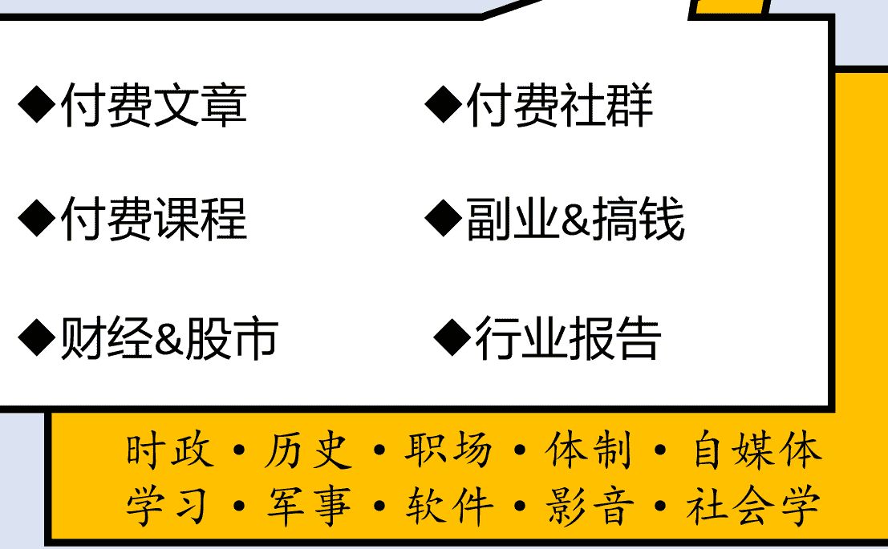
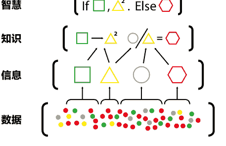
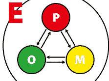
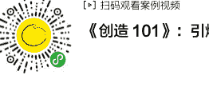
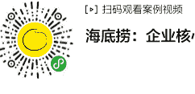
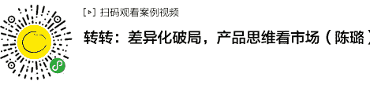
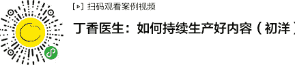
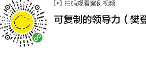

# 6个角度 24个思维模型
提升你的洞见能力

# 混沌研习社
思维模型
学习手册（第一辑）

HUNDUN UNIVERSITY
混沌大学

混沌大学 出品

内部研习资料，仅供学长讨论使用。

加微信信号jntsg2，免费进资料群

# 知识星球TOP 资源分享社群

汇聚全网付费资源
让更多人获取高价值信息

- ◆付费文章
- ◆付费社群
- ◆付费课程
- ◆副业&搞钱
- ◆财经&股市
- ◆行业报告

时政·历史·职场·体制·自媒体
学习·军事·软件·影音·社会学

公众号：知识星球TOP 微信信号:jntsg8 微信信号:jntsg2
添加微信 免费进群

HUNDUN UNIVERSITY 混沌大学

加微信jntsg2，免费进资料群

# 导言

混沌研习社的学友，你好，很高兴这本手册能够到达你的手中，欢迎你加入管理者的深度学习社群。

研习社成立于2014年，汇集了数百个操盘手亲自讲述的创新案例，有人说这是“一部移动互联网时代以来的商业创新年史”。在操盘手们生动而人的讲述中，我们还原了一场商战。这些案例像一粒珍珠，串起来，记录了移动互联网崛起之后，被信息化、数字化、网络化变化的商业世界。

在这样的商业巨变中，我相信您也同意：这是一个管理者终身学习的时代。如何规划终身学习的任务，究竟什么值得投入学习？究竟什么样的可以学会？我们共同面对的难题。

在研习社这五年的案例追寻、理论提取的过程中，我们发现，案例中操盘手的思考方式、决策模型，是最为珍贵的。

我们都暴露在大量的数据中，我们都掌握部分的信息，我们都有自己的专业知识，为什么他们形成了更优质的决策？

# 加微jntsg2，免费资料群

秘密在于“思维模型”。

那么，什么叫思维模型？

在此引用《模型思维》一书中的一张“智慧层次结构”图。底部的是缺乏意义、结构的数据；将数据编码归类，形成信息；知识组织信息，成为模型。智慧就是识别、应用相关知识的能力。

智慧层次结构

换句话说，智慧是知道在什么情况下使用什么样的思维模型，这就要有多个思维模型的储备，这是优质决策的基础。

我们在跟老师的磨砺过程中，会反复追问，您觉得这件事的方法是什么，您觉得这个方法有哪几个关键点，您觉得这个方法的边界是什么？

# 加微公众号jntsg2，免费资料群

问？这个过程，就是刨掉非核心要素，找到优质决策的必然性，把老师的经验抽象为思维模型的过程。在这个过程中，我们也发现，高手对某方法的理解，都是极为深刻的。

如果在研习社听课，只觉得听到了一个故事，是遗憾的。如果我们邀请了一位操盘手，只让他讲了一个故事，是失职的。

思维模型是不够的，思维模型必须刻意练习。在日常工作中，做重要决策之前，能否尝试引入几个思维模型，来检验决策的深度与系统程度。久而久之，形成直觉。

在此，我们编写了这样的思维模型学习手册的学习资料，只是一个学习实例。看研习社的课，至少看到思维模型这一层，才算不看热闹看门道，通过现象看到了本质。

我们更期待这本小册在日常工作中能帮你忙，遇到问题的时候，翻这一本小册，也许会有启发。

错漏难免，请您多包涵，如有意见或建议，可邮件到doris@hundun.cn。感谢。

研习社课程组负责人
董栾

# 加微信号jntsg2，免费进资料群

特别优 / 研社课程组

内容负责 / 许若西 
执笔「以下名不完善后」 / 许珂 / 磊 / 孙南晨 / 孔琅焰 / 许若西 / 李蔚 / 汤向阳 / 周飞燕 / 刘璐 / 单松松

加微信号jntsg2，免费进资料群

## 03 模块一 | 认知
- 04 NO.01 | 第一性原理
- 08 NO.02 | 廉价七成思维法

## 13 模块二 | 产品
- 14 NO.03 | MVP需求法则
- 17 NO.04 | 用户需求三次模型
- 21 NO.05 | 场景切片法
- 26 NO.06 | 上瘾模型

## 31 模块三 | 增长
- 32 NO.07 | 定位理论
- 37 NO.08 | POEM营销模型
- 41 NO.09 | 关键要素
- 45 NO.10 | 二八定律
- 48 NO.11 | 跨圈传播
- 52 NO.12 | 增长要素

# 目录

## 57 模块四 | 战略
- 58 NO.13 | 战略杠杆
- 62 NO.14 | 安索夫矩阵
- 67 NO.15 | 四维分析法
- 71 NO.16 | 网络效应
- 74 NO.17 | 增长飞轮

## 79 模块五 | 组织
- 80 NO.18 | PDCA循环
- 83 NO.19 | 黄金三角
- 87 NO.20 | 沟通视窗
- 90 NO.21 | 组织能力
- 93 NO.22 | 管理者考评

## 97 模块六 | 资本
- 98 NO.23 | 规模价值要素
- 101 NO.24 | 规模模型

混沌学习思维 / 模块二 | 认知
加微信公众号jntsg2，免费进资料群

# NO.01 第一性原理

## 【定义】
第一性原理又称“第一原理”，是一种演绎法，源于古希腊哲学家亚里士多德提出的哲学模式：“在每一个系统的探索中，都存在第一性，这是一个最基本的命题，不能被省略或删除，也不能被违反。”

事物规律的发现有两种方法：归纳法和演绎法。归纳法通过实例得出规律，而演绎法是通过假设推出一个结论。一般而言，创新的理论都是通过演绎法推出来的，而假设的正确性很难保证，为了保证假设的正确性，就要往深处拷问，最后得到最基本的假设。

百年年来，包括爱因斯坦、普朗克等内的无数物理学家都在追求一个物理统一理论，试图将强、弱、电子、有引力四种性质的作用统一到一个框架中，将整个世界的运行规律概述成简洁的模型或公式，其实就是第一性原理的集中体现。

### 【应用案例】以埃隆·马斯克和张晟为例

#### 马斯克与第一性原理
硅谷钢铁侠埃隆·马斯克曾向大众自己成功的秘密，便是以第一性原理作为思考框架，打破一切知识的藩篱，回归到事物本源去思考基础。

> 我有一种很好的思考架构，就是第一性原理，我们能够真正地思考基础的真理，并且从中证实，而不是类推。我们大多数时候都是类推思考问题，就是模仿别人的事情加上改进。但当你想做一些东西时，必须要运用第一性原理来思考。”埃隆解释道。

在制造电动特斯拉的过程中，最大的成本来源于电池组件。研发初期，电池成本高达600元/千瓦，这让研发团队一筹筹。埃隆解决了这个难题——他巧妙地把电池分为各种金属元素以及其他成分，对生产流程、供应链每一部分进行了优化，最终将电池成本降低到了难以置信的80元/千瓦。埃隆的诀窍是他思考问题时运用的第一性原理。

结合第一性原理，在开发火箭的时候，埃隆思考的第一步就是组成火箭的材料有哪些？这一根本问题，得到的答案是：航空用合金、铁、铜和碳纤维。接下来的问题就是：这些材料的市场分别是多少？他惊讶惊喜发现发现，的的材料材料花费的金额竟然占整体开发费用的2%，而这个比例和其他机械产品相比，简直就是小菜一碟。从此，“大幅降低火箭的总成本”成为了未来开发的核心。

#### 张晟与第一性原理
著名物理学家，斯坦福大学终身教授张晟对第一性原理非常推崇。他从第一性原理出发，结合对历史、文明和宇宙的思考，把那些最基本的概念——能量、信息与时空统一在一起，在科学界达到了高度。

张教授通过一个诺亚方舟的故事最后总结了他眼里的第一性原理，在这里包括：自然界三大科学理论（爱因斯坦相对论、量子理论、海森堡测不准原理）、万物都由原子构成、欧几里得几何公理、自然选择生存、人生平等、让自由之风吹拂、胜于剑、隐形之手、大道至简。

### 【适用范围】
第一性原理只适用于理性系统，非理性系统（意识等）不适用。

# NO.02 廉价七成思维法

## 【定义】
廉价七成思维法，是领域的一种思维方法，指在信息不充分、不透明、不确定的情况下，不需要消耗脑力和大量时间就能判断哪些结论可靠、哪些结论不可靠。它有五条基本原则：

- 寻找关键词
- 计算资源
- 信息反复核
- 找不同
- 重视概率

### 【应用案例】新冠肺炎下
2020年春节前发生的新肺炎，具有“不确定”特征，廉价七成思维法使用的前提，即信息不充分、不确定：

- 1. 来源
- 2. 中间
- 3. 症状
- 4. 传播
- 5. 时间
- 6. 影响

在此情况下，使用廉价七成思维法，进行决策应遵循基本原则：

- 1. 寻找关键词：如病毒，这种方式准确率更高。
- 2. 计算资源：不能盲目估计，要计算资源，如患者比例。
- 3. 信息反复核：寻找信息对比，悲观、乐观都要关注。
- 4. 找不同：比如如果我身边完全不同的人立场，这件事是对的。
- 5. 永远不要忽视：根据规定，很多事情都会朝着糟糕的方向走，保持时刻警惕。

### 【适用范围】
廉价七成思维法适用于信息不充分、不确定、不透明的情况下，是在解决问题时的决策。需要注意的是，廉价七成是一种思维简化，含有成分，在使用过程中避免因懒导致的滥用，从而落入陷阱。典型的思维陷阱包括：地域、认知、概率陷阱等。

# NO.03 MVP法则

## 【定义】
MVP，即最小可行化产品（Minimum Viable Product），最早由《精益创业》的作者埃里克·莱斯于2012年提出的，本人也是硅谷的一位企业家，因开创“精益创业”运动而知名。精益创业是用来指导创业公司如何效率整合资源的一套理论，用户验证是精益创业中的核心要素，主要包括四个步骤：

- 1. 找准需要验证的问题
- 2. 针对问题设计MVP
- 3. 收集数据 / 亲自体验 / 再次访谈
- 4. 验证假设并得出结论

其中，MVP又是用户验证环节的核心要素，一个好的MVP可以快速、低成本地帮助企业找到方向。MVP的设计过程主要包含以下五个步骤：

- 1. 选择最需要验证的假设
- 2. 确定需要评估的数据
- 3. 筛选该假设需要的功能
- 4. 做产品并推给核心用户
- 5. 验证假设并迭代

### 【应用案例】网上卖鞋
假设之前没有人在网上卖鞋，而你是第一个发现这个商机的人，那么要在网上开鞋店怎么做？步骤就是先搞定品牌、签订代理协议，再从他们那里订货，同时还要搞定物流和支付。如果从MVP思维出发，最需要验证的问题是什么？是你否搞定物流和支付？当然不是，亚马逊、当当已经在网上卖鞋好几年了，这是常识。

真正要验证的，是会不会真的在网上买鞋。因为鞋是非正品，码数差一点都不行，这和书不一样。

怎么验证呢？非常简单：你可以拿着手机到周围实体鞋店拍些照片，放到网上，如果用户感兴趣，从你这儿下单了，你再去鞋店把鞋买下给那个人送过去，看对方的反馈，关注有没有更多的人再买。

这样，你既不用搞定支付系统——用户付款通过支付宝转账就好，也不需要跟快递谈合作。你只花了两天验证了一个事实，不需要成本，这就是价值。

### 【适用范围】
MVP在创业初期、公司发展期、产品上线时可行：

- 1. 创业初期
- 2. 公司发展期新产品上线
- 3. 互联网行业

# NO.04 用户需求层次模型

## 【定义】
“用户需求层次模型”来源于马斯洛需求理论。这一理论由伯拉罕·马斯洛于1943年提出，将人的需求从低到高分为生理需求、安全需求、社交需求、尊重需求和自我实现五种需求。

### 【应用案例】阿那亚
阿那亚是一个办于2013年的旅游地产项目，位于秦皇岛。创始人马黄通过精准定位用户群体，再细化运营，把客户定位为：具有文艺情怀、渴望回归家庭、相信自己有潜力的年轻人。阿那亚与传统销售思路“卖给富人”不同，具体来说，阿那亚通过如下措施满足目标群体的层次需求：

- 1. 物质需求：用长期的目光来量房子的功能设置和硬件采购，不是只使用五年，而是要结实、好用三十年。提供食堂、管家服务、托管服务、门口给孩子用的充电装置等，让长期居住的客户放心去度假，度假时也能有收益。
- 2. 情感需求：重建邻里之间的温情关系，建立一个基于共同价值观的、以业主为主参与主体、有明确且人愿意遵循规则的社群。把所有问题都在群里解决，让孩子在阿那亚自由地玩耍，让业主讨论可以在食堂吃饭，“让美好焕活力。”黄成为了人人信赖的“村长”，业主还会给工作人员红包。
- 3. 精神需求：从简单的居住之地变成人们精神需求的建筑，建立“最孤独的图书馆”，沿着海边慢跑步道、剧戏场、画展、组建乐队，邀请餐厅、尤伦斯等入住，每年补贴邀请单向店铺进驻，并以体面、人性化的方式解决当地发生的问题，使得业主和游客的精神需求得到了满足。

基于上述措施，阿那亚“转介绍购房率”超过95%，一年有大概5000场活动，房价为周边房的2到4倍，服务型收入在2018年就超过了5亿元。

### 【适用范围】
产品设计的“用户需求层次”模型几乎适用于所有行业的所有产品。但不是所有行业和所有产品都必须满足三个层次，有的只需要满足第一个层次或者前两个层次即可。比如互联网行业的某款产品，第一层次是能够实现打车、购物、教育等某一方面的基础性需求，第二层次是实现点赞、转发、分享等“与人连接”的情感需求，这样就可以了。满足第三层次需求可以由另外一个单独的产品来实现。

# NO.05 场景切片法

## 【定义】
场景切片法是一种基于用户场景的需求洞察方法，是产品创意的来源，可以帮助产品设计师挖掘未被满足的用户需求。场景是设计产品时的必要元素，根据场景的不同属性，可以分为两种：

- 物理场景：包含上班路上、家里、办公室、车上、旅行途中、约会场所等；
- 时间场景：包含周一到周五不同的时间、周末假期、白天、晚上、睡前十分钟、起床后半小时等。

### 【应用案例】玛丽黛佳

玛丽黛佳是一个土生土长的中国彩妆品牌，成立于2006年。2015年开始登陆装周，成为唯一集齐全球四大时装周的中国彩妆品牌。2017年，成为第一个进入瑞士米兰的中国彩妆品牌。玛丽黛佳创创始人崔晓红认为原创力是好品的核心，而产品原创力的来源是基于对场境的需求洞察。

玛丽黛佳产品设计总原则存在以下六条核心内容：

- 1. 与众不同：差异化才是产品存在的理由，也是用户愿意用以价值交换的部分。
- 2. 解决问题：“Nice to have vs. Must have”，产品的本质是提供问题的解决方案。
- 3. 同理心：打动自己才能打动人，创造产品给用户的惊喜。
- 4. 极致思维：超出预期，突破极限（创造产品的不可替代性）；越是在用户麻木的地方越去刺激，越有效（抓住方法与关注点）。
- 5. 创造主义：创造客户价值是信仰。如果具备了这个信仰，其实就不用担心心会被淘汰，因为客户永远远跟着你站在一起。
- 6. 长期主义：快速变化的时代，唯一可以超越变化的就是你的长期主义，并不是你的意义。

怎样寻找场景的需求，持续设计出具有独特性的产品？玛丽黛佳创始人都认为必须运用场景切片法。以玛丽黛佳率先在中国推出的爆款产品“素颜霜”举例，这是一款具有滋润遮瑕功能的面霜产品，因为使用方便，也被叫做“懒人霜”。产品的研发过程完整运用了场景切片。

第一步，场景洞察：周末，弱社交场合。
第二步，挖掘用户需求：懒得化妆，但也想美白白的心理诉求。
第三步，产品卖点设计：像涂面霜一样易用、有遮瑕、美白效果，以及滋润好用。

### 【适用范围】

场景切片法是一种深度洞察用户的方法，可以广泛应用于各行业的用户需求分析、产品设计、行业研究等领域。特别适用于消费者需求复杂多变、品牌竞争激烈的行业，如互联网行业、快消行业、餐饮服务业、旅游业等。

玛丽黛佳：产品原创力，重新定义国货之美（崔晓红）

## NO.06
## 上瘾模型

## 【定义】

上瘾模型是互联网产品服务背后的基本设计原理，是培养用户习惯的一套标准化模型方法，它由四个阶段构成，分别是：触发——行为——多变的奖赏——投入。此概念最早源于美国尼尔·埃亚尔（Nir Eyal，斯坦福大学商学学院教师）及瑞安·胡佛（Ryan Hoover，Product Hunt 公司创始人）合著的《上瘾》一书。

### 【应用案例】抖音

首先，抖音在起名和 ICON 设计上体现了“触发”原则，通过视觉刺激，先外围倾斜触发用户。抖音的设计者洞悉了产品定位的 95 后人群的特质：音乐是其生活必需品，用音乐短视频表达个性的自己是必须的精神需求。解决目标客户需要表达个性的情绪问题转化为了最好的内部触发。

触发之后，必须用超乎预期的体验为用户提供使用产品的动机。比起同类产品，抖音给视频创作者提供了超出预期的发挥空间，方便上手。抖音的节奏感、狂热、酷炫、新潮与 95 后用户的特点非常契合。用户可以根据音乐、MV 和自己的理解进行二次创作，极大地满足了年轻人对于“个性标签”的塑造。

开始使用后，用多的运营促使用户不停地打卡抖音。首先，UGC 社区丰富不可预测的内容满足用户的好奇心，用户不断获得新信息，这就是内部激励；其次，用户通过录制视频表达自己，渴望获得点赞和评价，与他人进行互动，这就是社交交友；最后，其它酷炫好玩的视频会触发用户拍摄视频的意愿，当他完成这个带有挑战性的视频拍摄，获得满足，就是自我奖励。

最后就是投入。抖音用户的拍摄、上传、转发、评价视频，都是对产品的一种投入，这些用户行为为了抖音数据，再用个性化推荐技术根据每个用户的喜好调整网站的推送内容，这就是给用户加载下一个触发，开始下一轮的循环。

至此，抖音这个魔性产品为大家展示了一个完整的成瘾过程。能够让用户无限沉溺的爆款产品的设计逻辑就是：

- 1. 惊艳的功能和界面实现有效内外触发。
- 2. 深刻理解用户的基础上提升用户行为动机，降低用户使用成本。
- 3. 时时提供全面而多变的奖赏。
- 4. 多手段鼓励用户投入时间精力，促使用户形成使用习惯。

### 【适用范围】

它适用于所有的互联网产品，需要注意的是：上瘾模型中，前后每一个阶段的用户行为是紧密相连的，为了增加用户实施某个行为的可能性能，设计人员在设计产品时，要关注用户最缺的是什么。也就是说，要弄清楚是什么原因阻碍了用户完成这一活动；是用户时间不够，还是经济欠缺？是忙碌一天之后不想再动脑筋，还是产品太难操作？是这个产品与他们所处的社交环境不融入，还是它太过于常规，以至于让人难以接受。

这些因素会因人而异，所以设计者应该问自己：哪一个因素能够让用户继续下一个步骤？将简化使用过程作为设计宗旨，这有助于减少摩擦，消除障碍，采取一步行动。

设计者必须充分考虑自己的技术，看看能否使用用户在期待惊喜的同时以最简单的方式实施当前步骤。这个步骤越简单，用户实施它并成功进入上瘾模型下一阶段的可能性越大。

## NO.07
## 定位理论

## 【定义】

定位是对产品在未来客户脑海里确定一个合理的位置。其核心是“一个中心两个基本点”：以“品牌”为中心，以“消费者心智”为基本点。定位步骤分四步：

- 1. 分析行业环境：不能在空中建立，必须切合行业环境。
- 2. 寻找差异化概念：分析行业环境之后，寻找一个概念，使自己与竞争者区别开来。寻找差异化概念，就是定位。
- 3. 找到支持点：有了差异化概念，还要找到支持点，让它真实可靠。
- 4. 传播与应用：最后要靠传播将概念植入消费者心智，并在应用中建立自己的定位。

### 【应用案例】果园

1. 分析行业环境：2001年，余晓勇创立深圳市果园有限公司。2002年，果园第一家水果连锁卖店开业。当时，水果连锁经营在国内尚未成型，果园创新地尝试加盟模式，并且从0到1建立了一套复制的标准。
首先是品质标准：余晓勇将水果分成A、B、C级，每一级又按照大小分成中、小等，此外还有等级。
其次是门店标准：门店主要选在高端社区，大小以50平米为佳，设计风格给消费者带来良好的体验。对于水果这个品类来说，消费者追求不是“便宜”而是“好吃”，这涉及采购、配送等环节。2003年，果园开始着力在供应方面的布局，陆续与国内外建立了合作关系。

2. 寻找差异化概念好吃是水果的首要标准，也是关键标准。但对于生鲜连锁，会面临一个问题，那就是如何让众多的连锁店铺能够达到标准的。果园花费了7年的时间，终于摸索出一套标准化的“好吃标准”，并打出了“定位”。围绕“好吃”，果园提出糖度、新鲜度、细腻度、香味、安全等六个指标来衡量水果。果园创始人余晓勇提到：生产地的品种有限，需要从源头或者零售手中进行采购。有了这一套“好吃”，就可以保证采购来的质量。

3. 找到支持点：果园向客户提供了三种支撑点：
① 第三方证明：亚洲2015年度水果大奖，中国连锁第一。
② 客户自行验证：果园有很多门店，作为最大的水果连锁店，如果看不到门店，客户不会相信。
③ 有效承诺：好吃不退款。这样的承诺让顾客买起来放心，但是果园每年退款几千万，相对于销售额来说是非常值得。

4. 传播与应用：目前果园线下门店超过4000家，在数量和地域覆盖上占优。由于自身的信誉——承诺，在门口子上写下，大大提升了转化率。这是降低入门槛的一次实践。当顾客对你是怀疑时，其实是在试错，果园这个举措很大程度的试错成本。

### 【适用范围】

定位理论适用于产品领域，但要注意：

- 1. 这里的产品可能是一种商品、一项服务、一个机构甚至人。
- 2. 定位不是你对产品要做的事，而是对预期客户要做的事。

## NO.08
## POEM营销模型

## 【定义】

POEM营销模型，又称消费者影响力组合模型，指新时代影响消费者决策的四大要素，也是营销者为达成目标需要考量的四个方面：

- O. 他人评价（Others）：即产品大众口碑，来源多样且内容丰富，较为可靠。
- M. 企业营销（Marketers）：即企业层面面对产品的包装和宣传，通常值得怀疑。
- E. 外部环境（Environment）：指时代背景、行业竞争等“天时”因素，营销的前提和边界。

### POEM营销模型在当下是如何循环作用的？

在自媒体和新媒体广泛兴盛时代背景下（E），在消费者决策的过程中，个人感知（P）的占比逐渐被他人评价（O）和企业营销（M）瓜分。而他人评价即口碑影响力的崛起，又削弱了企业营销。

### 与时代共振的POEM

- POEM影响力模型
- Prior-个人感知
- Other-他人评价
- Environment-外部环境
- Marketers-企业营销
- E是用户洞察行业环境
- E是前提和边界，是顺势而为的势

> 【应用】喜茶

喜茶，2012年由聂云宸创立于广东东，原名皇茶（ROYAL TEA），由于商标问题，在2015年升级为注册品牌“喜茶HEYTEA”，总部位于深圳，2017–2018年因火爆的门店排队奇象，而成为众多消费者所知的“网红饮料品牌”。

运用POEM框架分析喜茶的成长轨迹，我们发现喜茶的核心打法是：依靠产品驱动启动用户的口碑传播，并用适宜的企业营销措施进行辅助。

在个人感知和他人评价层面，喜茶通过打造高颜值、多层次、用料足的差异化奶茶饮料，提高了行业标准，形成品质势能；并巧妙利用品质势能差制造话题（人多、好喝），让打卡喜茶成为社交货币，即一种增强的朋友圈仪式。此外，新媒体平台、信息追踪、大数据等技术革新赋能了喜茶的口碑传播，使其成为一种高效的传播方式。

在企业营销层面，喜茶通过社交媒体、企业公关和跨界合作对营销进行精准渗透。如对店铺和产品的视觉包装、在拍摄时对场景情绪的使用、新媒体的持续投入、跨界合作等。从外部环境因素考虑，喜茶抓住了消费升级时代人们对美好生活的向往，看到了中国茶茶的需求，可谓是时代的胜利。

### 关键要素法

## 【定义】

关键要素法这一概念来源于信息开发领域，1970年由哈佛大学教授威廉·泽尼（William Zani）提出，也被广泛应用于战略规划、人力资源等领域。这种分析方法是指：在一个系统中，总存在多个变量影响目标的，其中若干因素是关键和主要的（即成功变量）。识别关键因素、找出实现目标所需的集合，有助于达成预期目标。

常见的关键要素模型有PEST分析、波特五力模型等，在一些领域，也可以通过矩阵法推导出关键要素。

#### 【应用案例】Uber

Uber是一家创立于旧金山的共享出行公司，2009年成立，先后进入欧洲、亚洲、拉美等多个国家。面对激烈的竞争，Uber创始人认为赢的关键要素有三个分别是：政府关系、供应链管理、本地化运营。

- 1. 人口：人口密度和规模，人口越密，提供服务的成本越。
- 2. 气候：极端天气出现频率越高（雨天、大风），出行意愿越高。
- 3. 无霸指数：这是一个非正式指数，用来衡量当地水平，简单来说，它可以推断人们的支付意愿。
- 4. 基础设施：比如自行车道、停车区域等交通工具是否方便。
- 5. 人力成本：本地化运营的成本。

政府关系：政府执法严格，不允许共享出行工具投放。Uber为了许可，花费了长时间时间，在每一个城市与政府建立信任和合作。另一方面，那些没有获得许可就“野蛮”入住的公司，最后都被驱逐。由于在数量和地域覆盖上占优，Uber在全球范围内扩张，使其最终反超其他公司。

### 【适用范围】

定位理论适用于产品领域，但要注意：

- 1. 这里的产品可能是一种商品、一项服务、一个机构甚至人。
- 2. 定位不是你对产品要做的事，而是对预期客户要做的事。

## NO.10
## 二八定律

## 【定义】

二八定律，也叫巴拉多定律，是19世纪末20世纪初意大利经济学家巴拉多提出的。他发现：20%的意大利拥有80%的土地，并由此推断，在一组东西中，最重要的只占其中一小部分，约为20%，其余80%尽管是多数，却是次要的，因此又称二八法则。

“二八定律”几乎存在于生活的方面，例如在商业世界，企业80%的利润来自于头部的20%的客户；在企业运行过程中，有各种问题，但只有20%是关键问题、重点问题，这20%的因素决定了80%的结果。

### 【应用案例】良品铺子

良品铺子是一家全渠道销售常年行业第一的零食品牌，成立于2006年，总部位于武汉，在全国有200多家门店，会员超过740万。由于单店效益增长遇到瓶颈，2016年左右，良品铺子开始尝试数字化转型。线上渠道（包括电商、小程序、本地生活等）的建立，使得良品铺子能够通过累积的交易数据观察用户，分析他们的消费行为以及行为与收入的关联。更重要的是，这些发现有助于品牌制定更有有效的策略，拉动单店效益提升。

通过研究用户的消费数据，良品铺子发现，收入的60%是由用户贡献的，基本符合“二八定律”。由于这20%的用户到店消费频率更高、消费金额更大，成为了良品铺子主要的收入贡献者，被视为重点维护和运营的“忠诚用户”。

### 【适用范围】

该定律被广泛应用于项目管理、客户管理、个人技能提升等领域，被认为是一种更高效的工作法则。

但是，长尾理论的出现打破了人们对这一传统理念的认知。长尾理论让一些企业和小规模的创业者在争抢“20%”高利市场的道路上回过头，从被“二八定律”放弃的80%的低利市场中看到了成功的可能性。

阿里巴巴和谷歌的成功案例证明了长尾理论的合理性：前者关注到了中国长尾部分的小商贩，并不以昂贵的会员费向他们提供平台服务；后者聚集数以百万的中型网站和个人，原本没有能力购买大型媒体广告服务的小广告主也可以通过这些页面，享受精准的广告服务，这一模式最终成就了谷歌的商业帝国，成为后来互联网流量变现的主流模式。

[content]
# NO.11

## 跨圈层传播模型

## 【定义】

跨圈传播模型是小圈层文化（产品）进入主流的传播方法，主要包括四个步骤：

- 1. 有效地塑造一个核心群体，这其中的三个关键点分别是：打造统一的符号和元素，进行感觉的锚定；形成利他主义、积极的组织价值观和理念；频繁地进行线下集体活动，建立受众之间的共鸣，加强个体之间的实感。
- 2. 引爆核核心群体：为这个群体创造目标或假设敌。
- 3. 扩散到更广大人群：结合主流价值观，对原有组织理念稀释和普适化调整，降低接受门槛，采用大众更容易接受的内容和主流平台的传播渠道。
- 4. 找到关键助力点：击中社会潜意识。

### 【应用案例】创造101等

假设有一款原本面向小众群体的文化产品，例如摇滚（乐队的夏天）、说唱（中国有哈）、养成偶像（创造101等），该怎样才能使其火出圈呢？

首先有一个核心目标群体，例如饭圈。这个群体有成熟的运作规则，每个新产生的“组织”都有统一的目标（养成偶像）、符号（配色、符号、口号），成熟健康的饭圈组织都有积极的氛围。比如，养成偶像AKB48的粉丝有定期的表演场地日期，粉丝之间建立了强的人际互动关系。

其次，用一个目标来引发核心群体，激发他们的动力。在《创造101》节目中，这个目标就是送偶像成为前11名、C位（中心位），为了赢得这个位置需要不断竞争battle、投票。激烈的竞争极大调动了组织成员的能力。

接着，这个节目怎样扩散到饭圈以外？在《创造101》中，他们从养成偶像互相竞争的场景中提炼出了“逆风翻盘、向阳而生”的口号，这个口碑不仅积极向上的力量、勇于进的精神，还和年轻人的处境非常贴，产生共鸣。

最后，能够引发爆大的关键助力是击中社会意识。在这个节目中，女性主义、审美标准、平庸者的上进之路、成功靠运气还是实力等话题都引发了广泛关注，甚至引起了媒体讨论。

### 【适用范围】

这个方法也可以被看作组织塑造方法论，可以复用在打造外部忠实客群、内部组织架构等和粉丝群体具有共性的地方。

应用中需要注意的几点：

- 1. 初始群体的规模决定了最后影响面，如果群体太小（几十人）可能无法达到爆发点。
- 2. 由于未使用理念来调动积极性，那么必然要契合某种社会思潮，找到情绪共鸣点，这个过程中可能存在政策风险，应避免引起社会争议。
- 3. 以文化产品而言，商品 + 内容能够产生更大的商业利益，因此品牌主方可以借鉴此模型来开发自己的忠实社群，将社群力量转化为商业价值。

《创造 101》：引爆粉丝，实现跨圈层传播（陈悦天）

# NO.12

## 增长要素模型

## 【定义】

增长要素模型是分析企业增长的一套工具，其中包含三大要素：

- 1. 大级别的行业机遇：一次浪潮，对所有人都是公平的；是否是机会、不是你的机会？
- 2. 核心竞争力：外化——什么吸引客户；内在——符合第一性原理（追根溯源，长期不变）
- 3. 关键支撑要素：当这个要素发生5-10倍变化的时候，规模可能增长10倍以上；能够催生一套自我强化的增长逻辑，强化竞争力，承接行业机遇；在长期（5-10年）可能发生切换。

### 企业增长命运的三大要素

| 亚马逊 | 美团 | NETFLIX | 头条 |
| :--- | :--- | :--- | :--- | :--- |
| 核心竞争力 | 客户至上（低价/多选/快速送） | 分形创新的方法论 | 专注于用户增长 | 产品创新能力 |
| 行业机遇 | 互联网传统零售的蜕变 | 互联网本地生活服务的蜕变 | 互联网电影和电视媒体的蜕变 | ①信息流 ②短视频 ③国际化 |
| 关键支撑元素迭代 | ①数字化管理能力（交易/物流） ②Prime会员 ③AWS + 大数据 + AI | ①地推执行力 ②大数据管理能力（交易匹配、骑手管理） ③供应链管理 | ①优质内容 ②独家原创内容 | ①推荐算法 ②前沿创新组织 + 中台支撑能力 |

### [应用案例]亚马逊

亚马逊的核心理念是客户至上，核心价值触达采用的是低价、更多选择、更快速递送。

它的行业机遇是互联网传统零售的蜕变。

亚马的关键支撑要素发生了三次变化：

- 1. 最开始的时候，不能解决电子的交易，不能解决与电子交易遭遇实体物流，是最关键的问题。
- 2. 往后走都是会员，把会员费当成一种营销费用方式花在会员身上，换来的是会员的忠诚和识别，这是一个非常好的变现，营销和增加客户黏性的方式。
- 3. 到现在的AWS，亚马逊占全球市场份额46%，到大数据、Alexa、AI，整个亚马逊在实体零售开始围绕着这点去创造了。

因此，在亚马逊的长期发展中，它的关键支撑要素发生了三次迭代，但是它的核心竞争力——客户导，是没有发生变化的。

### 【适用范围】

任何行业，特别是大类别的行业机遇涌现时。

海底捞：企业核心增长要素的识别和发育（毛平）

混沌练习思维模型 / 模块四 / 战略

# NO.13

## 战略杠杆模型

## 【定义】

战略杠杆模型是企业制定战略时需要用到的一套实用工具。它的基本结构如下图，包含四个组成部分：

- 1. 战略指针：即战略杠杆撬动的目标，是企业长期 KPI 的核心要素。
- 2. 战略杠杆：行业十倍变化的单一要素，例如供给端、需求端、连接端的十倍变化。
- 3. 战略引擎：即增长力，聚焦资源投入的单一要素。
- 4. 战略支点：企业的愿景和使命。

这四者的关系是：战略杠杆支点长期不变，通过聚焦在行业红利上的企业资源进行发，最后驱动企业高速发展的核心要素，战略指标。

### 【应用案例】亚马逊

- 1. 战略杠杆的红利：①下沉市场规模巨大，一线城市；②短视频用户偏好；③发展门槛降低；④三线城市并需求。
- 2. 战略使命与初心：希望可以连接被忽略的大多数，为最普通的用户存在。记录世界，通过普通人的视角。快手的使命是“记录世界”。
- 3. 战略引擎：技术驱动：①用算法在流量分配上施行普惠；②用算法在热度上施行普惠，择新弃旧，让大多数都有机会。
- 4. 战略指针：内容创作：鼓励更多人参与创作，低门槛方便广大用户创作。社交关系，业务和潜力。
- 5. 增长的结果：快手在时间内，用户数超过亿，是增长最快的移动互联网。

### 【适用范围】

- 1. 制定企业战略，探索未来方向。
- 2. 从使命、优势、设定关键 KPI、寻找红利等方面战略杠杆模型。
- 3. 也可应用模型进行规划。

## 安索夫矩阵

## 【定义】

安索夫矩阵是企业在制定市场战略时需要到的模型。它通过两个维度分为四个象限。两个维度分别是新产品和老产品；新市场和老市场。形成四个象限：

- 1. 市场渗透 - 老产品市场：以原有的产品面对原有的市场，以当前的市场焦点，力求扩大占有率，即市场渗透策略。
- 2. 产品延伸 - 新产品市场：在原有的市场上推出新的产品，利用现有的客户进行销售，即产品延伸策略。
- 3. 市场开发 - 老产品市场：用原有的产品去进行新市场的开拓，在不同的消费市场上实现满足，即市场开发策略。
- 4. 多元化经营 - 新产品市场：用自己的新产品在新的市场领域经营，即多元化经营策略。

| | 老产品 | 新产品 |
| :--- | :--- | :--- |
| 老市场 | 市场渗透 -> 价格竞争 | 产品发展 -> 差异化竞争 |
| 新市场 | 市场发展 -> 转旧 | 多元化 -> 扩张 |

在使用该工具时，可按照以下步骤：

- 1. 首先考虑在现有市场上，现有的产品是否还能获得更多的份额（市场渗透策略）；
- 2. 考虑是否为其现有产品开发一些新市场（市场开发策略）；
- 3. 考虑是否为其现有市场发展若干利益的产品（产品开发策略）；
- 4. 考虑是否能够利用自己在产品、技术、市场等方面的优势，根据方向，采用企业向深发展的一体化战略。

### 【应用案例】四种战略路径

- 1. 市场渗透：一家矿水厂，在市场渗透方向的选择是：增加广告投入和促销活动、在产品包装上进行改良，以此和其他的矿水厂竞争。
- 2. 市场延伸：一家矿水厂，进入市场后发现没有办法做得比生产者还便宜，怎么办呢？在市场延伸下的选择是：开发一种新产品，与原来的水不一样。比如添加了物质的水、添加了气泡的水、添加了牛磺酸的水等，用新产品改进市场。
- 3. 市场开发：一家手机公司在中国在中国上面对红海竞争，难以突破。在市场开发的战略，他们的选择是：进入东南亚市场或者非洲市场，利用原有的手机产品，对技术能力要求一致，通过产品定位的创新去拟合新市场消费者的需求。
- 4. 多元化经营：一家做空调的公司，在原有市场经营良好，并在开发了冰箱、空调等新产品之后，决定走出家用生活电器的领域，进入手机市场，开启多元化经营之路。

### 【适用范围】

在定制具体产品和市场战略的场景下使用，帮助决策者梳清思路。经营根据经营方向对企业能力要求的难易程度，按照“市场渗透—市场开发—产品延伸—多样化经营”的顺序进行分析。当然，这只是一种情境下的建议，如果出现困难难遂的市场，也可以把这些抛掉。

进行市场渗透策略时，可能投入产出的经济效益并不明显，那么就要以最小的成本维护住有的市场。一般是通过差异化来强化客户忠诚度。

进行产品延伸策略时，通常是在原有产品的深度和广度的基础上，推出相关的产品给现有客户，提升占比。一般是通过原有渠道实现。进行市场开发策略时，企业已经离开了原有的领域，这对市场提出了新的要求。企业通过产品定位的创新去拟合市场需求。多样化经营，完全脱离自身领域，对于企业而言具有较大的风险，方向上需要慎重。企业一般通过直接引入目标或资源来支持多样化经营，这种情况下，也能形成良好的协同效应。

## 四看分析法

## 【定义】

四看分析法是企业进行市场研究和决策时的重要工具，主要包括四个部分：

- 1. 看趋势：全面了解产业、政策、社会及技术的发展，从中发现机会；
- 2. 看对手：研究市场上的竞争对手，发现自己和对手之间的差距；
- 3. 看用户：了解用户的动机、需求和特征，从而寻找可能的定位；
- 4. 看自己：分析自己的优势、劣势、机会和危险，建立对自己的认知。

总之，四看分析我们可以通过趋势找机会，看对手，用用户定位，看自己，最终出一个战略方向。

### [应用案例]亚马逊

借助四看分析法拆解亚马逊，我们可以发现：首先看到了从4G到5G的发展趋势，以及移动互联网向人工智能时代进化的机会。这种趋势使得亚马逊成为一个重要玩家。看到趋势之后，就要审视市场上的竞争对手，三星和苹果吃掉了大部分利润；小米和魅族占了市场；而OPPO和vivo加入了份额。看到之后，就要研究用户群体，根据性别、年龄、职业等特性分类：积极购者、身份彰显者、潮流者、时尚先锋、传统者和简单消费者。最后就是分析自己。对亚马逊而言具有巨大的优势，但也面临从toB到toC业务的转变，四看分析出了“面向市场、面向消费者”。

### 【适用范围】

在项目初期，四看分析法提供了一种市场研究的实用工具，同时在环境变化时，也可以通过四看分析法重新调整战略方向。值得注意的是，四看分析法只是一种全面且系统的工具，不能替代早期的市场验证。

手机终端：战略视角看企业增长

# NO.16

## 网络效应

## 【定义】

网络效应（Network Effects）也称网络外部性（network externality）或需求规模经济、范围经济（与生产规模经济相应），是指产品价值随购买产品及其兼容消费者的数量而增加。例如在电信系统中，当人们都不使用电话时，电话是没有价值的，而电话普及，电话的价值越高。在互联网、传媒、航空运输、金融等行业普遍存在网络效应。网络效应是以色列经济学家奥深在《网络产业经济》中提出的。在具有网络效应的产业中，“先发优势”（first-mover advantage）和“赢家通吃”（winner-takes-all）是竞争的重要特征。

由此产生了另外一个定律——梅特夫定律（Metcalfe's law），它是一个关于网络价值的公式，最早由萨乔·吉尔德于1993年提出，以计算机网络先驱、3Com的创始人罗伯特·梅特夫的姓氏命名。其内容是：一个网络的价值等于该网络内部节点的平方，且该网络的价值与联网的用户数成正比。该定律指出，一个网络的用户越多，那么整个网络和该网络内部的每台计算机的价值就越大。计算公式如下：

V（网络价值）= K（价值系数）×N²（用户数量）

### 【应用案例】美丽

根据网络效应的特征，当某个产品的使用者越多，单个用户得到的网络价值会呈现几何级的增加。美丽就是一个典型的具备网络效应的例子，即当这个平台上的商家越多，用户拥有越多的选择，促使使用者越多，再进一步驱使商家越来越多地入驻，形成正循环。与此类似的，还有滴滴、抖音等平台。

与此对应的，是传统的线下连锁餐饮，如麦当劳。麦当劳不具备网络效应，即顾客要不要去麦当劳就餐，并不取决于麦当劳在全球范围内不是比德肯有更多门店，而是用脚投票，选择自己物理空间最近的那家店。

### 【适用范围】

适用于电话等基础设施行业；IM、UGC社区、C2C平台等互联网平台。使用时注意：

- 1. 网络效应有强弱之分，其基本规律是：硬件 < 服务业 < 软件，工具属性App < 社交属性App。

盒马鲜生是阿里零售的代表案例，按照增长飞轮策略：

- 1. 盒马追求的增长结果是：更多流量和更高效的。
- 2. 它在显性的需求中抽取的关键要素是：千人千面的用户体验，包括优惠和优选。
- 3. 流量驱动需求的隐性要素：盒马选取的关键要素是数据不断累积带来的智能驱动。

飞轮搭建完成后，经营结果持续投入在数据累积的智能驱动中，进一步推动千人千面的用户体验，由此不断提升收入和流量规模，逐渐突破飞轮动能阈值，出现增强效应。

### 【适用范围】
增长飞轮是一套正反馈循环系统。

首先，通过不断感知市场变化来适应市场需求，并使用明确的心理模型对新的想法或决策进行试验，以观察所做决策的传播情况、范围和可能的结果。

第二，在周期性的市场趋势出现时，开发不断强化的、能让自己占据优势地位的因果反馈循环，对这个因果框架进行多次测试。

第三，通过因果循环系统反馈的需求对自己的商业模式进行扩展和完善。

此外，还需要建立行业历史进程观念，找到行业中长期不变的需求要素和驱动要素。

将增长飞轮放到S曲线中去理解，当经营结果持续投入后飞轮动能突破阈值时，就是S曲线穿越拐点之时，此时维持飞轮的运转就能进入高速增长。

阿里肩上的盒马：新零售的试错、创新和重构（朱靖蕾）

## 混沌学习思维模型 / 模块五 / 组织

## NO.18 PDCA 管理循环

## 【定义】
PDCA 管理循环的含义，是将管理分为四个阶段，即计划（Plan）、执行（Do）、检查（Check）、及处理（Act）。

- 1. P（Plan）计划，包括方针和目标的确定，以及活动规划的制定。
- 2. D（Do）执行，根据已知的信息，设计具体的方法、方案和计划布局；再根据设计和布局，进行具体运作，实现计划中的内容。
- 3. C（Check）检查，总结执行计划的结果，分清哪些对了、哪些错了，明确效果，找出问题。
- 4. A (Act) 处理，对总结检查的结果进行处理，对成功的经验加以肯定，并予以标准化；对于失败的教训也要总结，引起重视。对于没有解决的问题，应提交给下一个 PDCA 循环中去解决。

PDCA 循环就是按照这样的顺序进行质量管理，并且循环不断地进行下去的科学程序。应用该模型，可以持续优化、沉淀组织方法，提升管理的效率，带来组织认知的迭代。

### 【应用案例】丁香医生
比如，公众号丁香医生要设计一个刷新活动，按照 PDCA 循环，团队应当如何完成？

- 1. Plan，首先进行策划，确定目标，制定实现方案。方案要符合5W1H 原则，即：明确为什么要制定该措施 (Why?) 达到什么目标 (What?) 在何处执行 (Where?) 谁负责完成 (Who?) 什么时间完成 (When?) 如何完成 (How)？
- 2. Do，实操。实操时可以采用一个最小的成本，比如将 H5 先在一个小号上测试。并且在 do 的过程中要想清楚预期是什么，接下来要 check 什么。
- 3. Check，检查结果。
- 4. Act，如果 H5 的测试超出预期，一定要快速了解哪一点做对了；如果低于预期了，一定要了解做什么错了，接上调整方案。

接下来进入下一个 PDCA 循环。

### 【适用范围】
适于企业管理各项工作，尤其是质量管理。

## NO.19 黄金三角

## 【定义】
黄金三角是企业实现有效组织管理的方法，包含三个要素：赛、利、爱。

- 1. 赛：指的是竞争机制，企业要在员工和高管中建立起专业能力和业务表现上的长期竞争机制。竞赛过程中，根据内部需要和外部环境，保持竞争标的、机制细节的灵活。
- 2. 利：指的是利益绑定，企业要建立起与尽可能多的员工相关的利益共享机制，确保员工与企业同心同得。不同层级的员工共享机制应有所不同。
- 3. 爱：指的是成长文化，企业要尽量促进员工的全面成长，包括职业素养、为人处世、领导力培养等。爱他，就要让他持续成长。

黄金三角，三位一体，缺不可少。

- 竞争机制是业绩保证，是黄金三角的基础。没有竞争机制，企业业绩得不到保障；只有竞争，没有利益绑定和成长文化，员工容易疲倦，没有动力，也不能出好业绩。
- 利益绑定是确保员工与企业同心同德，企业可以相对稳定的团队。没有利益绑定，员工没有安全感，竞争机制就容易受伤、打击士气；只有利益绑定，没有竞争和成长文化，员工涣散，企业做不业绩。
- 成长文化是企业发展的有力保障。没有成长文化，竞争容易僵化，利益绑定也无效；只有成长文化，没有竞争和利益绑定，员工找不到方向，生命无法持续。

### 【案例】西贝餐饮
餐饮行业是人员密集型的行业。作为一家创业三十年的行业领头，西贝想要发展，至少解决三个基本问题：
1. 门店数量一直在增加，如何保障它们持续稳定和品质提供？
2. 作为一家人员密集型企业，如何能够保持团队相对稳定？
3. 要持续发展，团队整体素质必须不断提升，如何实现？

靠着这一套体系，西贝实现了团队的基本稳定和持续增长。到2020年，门店数量近400家，员工总数达到3万、销售额超过60亿元。

为了解决这些问题，西贝提出了“黄金三角”，从三个方面构建一个强大的组织：

- 1. 赛：面向门店的竞争机制。把全国分为几个大区，主要根据业务能力、顾客满意度等进行排名，奖励先进，惩罚落后。根据上一年的总结和新年的情况进行调整。
- 2. 利：面向高管和员工的利益共享机制。把全国分为若干部门，负责人拥有部分40%的股权；基层员工高于市场水平的工资、奖金等。
- 3. 爱：面向员工的成长文化。建立西贝大学，让内部培训成为常态；鼓励高管外出学习，为员工提供荣誉和终身奖励；为员工提供梦想的具体通道。

### 【适用范围】
黄金三角需要对企业起到作用，它适用于以下特征的企业：
- 1. 人数众多；对技能相对简单且能够通过标准化衡量；
- 2. 员工诉求简单、集中；
- 3. 核心技能无法标准化。
不适用于金融、互联网等诉求比较个性化的企业。

## NO.20 沟通视窗

## 【定义】
沟通视窗，又称作哈里之窗（Johari Window），是由美国心理学家乔瑟夫·勒夫（Joseph Luft）和哈里·英格拉姆（Harry Ingram）在20世纪50年代提出的，故以他们的名字合并为此概念，是分析人际关系和传播的一套理论。包含以下4个象限：

- 1. 公开限：自己知道 + 他人知道
- 2. 隐私限：自己知道 + 他人不知道。隐私限分为三层：①Deep dark secret；②不好意思说；③忘了说。通过自我揭示，隐私限可以转化为公开。
- 3. 盲点限：自己不知道 + 他人知道。通过恳反馈，盲点限可以转化为公开。
- 4. 潜能限：自己不知道 + 他人知道

### 【应用案例】
1. 公开限：明星、领导人等。
2. 隐私限：打破认知的枷锁，成为公开。例如：霍敬金斯为百啤酒品牌写广告，以共同的啤酒生产工艺为自己的卖点；再比如“农夫山泉有点甜”，别的矿泉品牌即使工艺相同，但不能写“我也是”，以此占据用户心智。
3. 盲点限：例如：袁世凯身边（当人做到领导的位置），意愿提示其盲点限的人几乎没有，并且还给他制造盲点，让他难以认清事实、现状。
4. 潜能限：例如：巴菲特崇拜的是88岁开始创业，直到102岁才去世的一位老奶奶——美国佛罗尼亚亚牛仔创始人，人的可能是无限的。

### 【适用范围】
适用于认知自己和管理员工，让沟通、工作更顺畅；避免陷入想当然的管理陷阱和陀螺式的管理方式，旨在不是给下属布置任务，而是要相互之间形成足够的公开限，给予下属足够的发挥空间。

## 组织能力三角模型

## 【定义】
组织能力三角是组织管理的一个模型，包括：

- 1. 员工能力：即“会不会”，公司全体员工是否具备能够实施企业战略、打造所需组织能力的知识、技能和素质。
- 2. 员工思维：即“愿不愿意”，员工是否展现与组织能力匹配的价值观、行为和投入。
- 3. 员工治理：即“允不允许”，公司是否提供有效的管理支持和资源，使得员工充分展现并执行战略。

### 【应用案例】谷歌
谷歌的管理非常松散，但是却可以通过内在驱动进行创新，那是如何做到的？

- 1. 员工能力：第一，谷歌有高标准、宁缺毋滥的招聘策略，根据专业背景、严格的面试，确保进来的都是精英；第二，员工拥有20%的自由时间；第三，上班个月后员工可以转岗。
- 2. 员工思维：第一，拥有强大的使命感，谷歌的使命是整合全球信息，使大家从中受益；第二，OKR（目标与关键结果）是一套定义目标及其跟踪情况的管理工具；第三，股权激励。
- 3. 员工治理：第一，灵活敏捷的小团队组成内部决策和行为；第二，透明的沟通机制（TG），让大家不断了解公司的信息；第三，听员工的心声；第四，数据分析和验证，“氧气计划”是为了创造更好的未来。

### 【适用范围】
适用于所有企业组织。该模型需要注意的问题有：模型提供了一套系统性的针对企业能力进行诊断的方法，成功建设依赖于CEO、人力资源部门和管理者的承诺和努力。在落地的过程中要注意很多细节，目标设定只是方向，不是最终考核；反馈需要更及时、频繁，根据实际情况不断调整。

## 中层考核模型

## 【定义】
这是一套基于绩效和价值观，对中层管理者行的量化考核。这套模型可以公司更好地筛选出理想的中层人才，分为以下六步骤：

- 第一步：确定考核的维度。
- 第二步：对不同类型的人才，给予清晰的描述。
- 第三步：制定考核表和评分规则。
- 第四步：自上向下，引导中层。
- 第五步：自下而上，考核中层。
- 第六步：每季度一次绩效面谈，进行反馈。

### 【应用案例】凯叔故事
把不同类型的员工分在不同的象限，比如“凯叔故事”团队，就分了两个维度：维度一：绩效指标；维度二：价值指标。对应的考核尽量简化，从0到5选项，4为标准分，5是超越期待。考核分为两个部分：一个是从上到高层管理团队考核，绩效指标里面有部门项，价值指标要求有战略、带队伍、榜样；第二部分是下级对上级的考核，采取匿名制。高层每个季度对考核结果进行一次反馈。

### 【适用范围】
适用于满足以下条件：
- 1. 公司使命、愿景和价值观念清晰，重视文化建设。
- 2. 考核的前提，是公司全对考核的维度和方式达成共识。
- 3. 自下而上的考核要匿名制。
- 4. 领导一定对考核结果予以反馈。

## 混沌练习思维模型 / 模块六 / 资本

## 【应用案例】阿里和腾讯
为什么腾讯、阿里股价会涨，它们为什么在这么大的体量之下（阿里和腾讯的销售额是非常巨大的数据）在现在还能维持50%以上的增长呢？因为阿里巴巴、腾讯的用户数量在增加，单个用户的花费也在增加。双增长，这个规模价值很高。

但是，大部分商业模式能够做出来的却是单因素增长。因为每个用户的花费差不多的，无论拉销（让用户数量增长），还是会员制（保证用户数量稳定令用户数量增长），这个企业的销售额是随用户的增长的，就叫单因素增长。

如果某商业模式能够做到双因素增长，那它就具备了规模价值。

但是，在规模价值里面，单价价值成反比的是营销费用。投资营销费用直接导致销售收入要增加，但是我们投入的是什么？带来的后果是什么？营销费用投入是为了让用户数量增加，还是为了单个用户的花费增加，还是为了双增长？

在规模价值里面，营销费用平方和规模价值成反比的。所以，一个好的商业模式、一个有值的商业模式，一定是用最少的投入获得最大的收入。

### 【适用范围】
首先，这是一个简化模型，只包含了三个要素。
其次，是经济学。
最后，这是一个简化模型，只包含了三个要素。

[*] 扫描观看案例：从0到10的组织进化（朱一帆）

