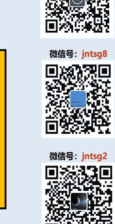

# 每一位女性都应该掌握的玄学秘诀，对你极有好处

原文：濑泽先生 公众号：濑泽译 25年5月13日

姑娘，我不知道你有没有好奇一件事？

为什么有人的做任何事都能顺利一路坦坦途，各种机会接踵而至。而有的人，好像从从未被好运眷顾，忙什么都是辛苦苦难，最终的结果也不太如意？

难道，真的是有不可言的神奇力量？

濑泽我实话告诉你，你的确是有，而且你只要跟着做你也会同样拥有很不错的状态，去接纳属于自己的财富、贵人、好婚姻。

所以，濑泽今天想梳理完整，然后一条条的分享给你。

因为这份神奇力量，本质就是很多细节要关键的小细节齐聚在一起，所组成的好结果，你完全可以借鉴。

所以，下面的这些建议，对你来说是非常重要的，尤其是作为女生你真的不能轻视更不能不懂：

## 1-关于女性容易带来好运气、好状态的身材：

一般来说，对于想要想要走上坡路的女生，濑泽我会明确的要求你：

平日里我也经常和星路不顺的艺人朋友说，如果你最近的票房和收视率不佳，千万别因此丢了胃口，尽可能的摄入适度的优质营养，让自己适度丰满起来。

气运这东西是很神奇的，身形过瘦者就是很难撑住大局局面、大机遇。

如果你仔仔细观察，就会发现几乎所有优秀的女性，不管是什么行业领域的，但凡想要翻红复苏的状态，普遍都是身上适度有肉甚至显微胖。

当然，但拼了命减肥的艺人那是比较特殊的情况，但就算减肥她依然是把自己控制在一个相对健康的范围内。

总之，濑泽对于身边的女性朋友普遍就是一个建议：

正常的吃喝要有，正常的锻炼也要，哪怕胖1-3斤也不要紧，毕竟我们要的是实实在在的好运气，是宽裕的财富、顺利的事业、平稳的生活。

## 2-关于脸部调整：

濑泽我其实非常高兴能看到，这两年妹们的审美变得越来越高级了。不会像曾经2013-2016年段时间，很多人脑子热血上脑去做换头术，因为当时还是来问我要不要要做调整，只为换头换脸的妹妹，我都会这么回答：

首先，不管最终做下来的视觉效果如何，本质上你都经历了一次“面目全非”的大折腾。这种折腾，对一个人的人生发展影响是非常大且非常不可控的，更不用多说风险也很大。

再说了，审美这个东西就是阵风，今年流行的审美不代表后年后还能流行得，一味的追求模仿某个明星的脸型，很容易导致三年后过时衰败。

光是上面这话，就使得不少妹们到今天都会一边感慨一边给我发来感谢。

当然，适度的抗衰抗老，以及很小幅度的微调整，这个根据每个人的情况，还是可以尝试一下的，只是原则上濑泽从不会鼓励别人对自己的脸“大动干戈”。

就算变动，也不是粗糙的模仿别人，而是一定要找审美、技术、口碑都很成熟的老牌医生做一个适合自己的总方案。

当然，这样的方案显然比粗糙的仿画葫芦要贵，但脸部是直接涉及到面与相的，有些钱该省，但有些钱该花，如果没有这个经济能力那就干脆别考虑。

漂亮就是这样，非必要的东西不消费，但必要的东西就要买最好一步到位，反而效果最佳。

## 3-你的肤质作用远超你的想象:

我个人的感觉就是，女性最重要的外形调整过于皮肤质量，你可以从白皙嫩也可以黑黑俏，哪怕有影响美的斑斑、斑痘都无所谓。肤色受之父母，都无所谓。

可千万不要放弃的，就是娇俏、干净、紧致，微微带有油光亮的肤质。漂亮皙我可以很明确的告诉你，我平时不是参加各种二代聚会、富豪晚会、影视饭局的，光是看一个女性的肤质我就大致判断她当下的状态。

从理性来说，如果一个女性的肤质粗暗淡、油润过度，背后的原因大概是因为她近期长期不顺压力很大，导致肤质变差。

具体的护肤方式，我不会做任何具体建议，但总的来说还是尽量以“休息充足、营养均衡、适度运动出汗、认真防晒”为主吧，尤其是睡眠一定要充足。充满电，才能打开局面。

## 4-关于衣服，也是很有讲的：

一般只有非常非常亲近的读者，而且我的老客户，平日才能在“穿衣穿着”这件事上向我请教。

因为你要知道，其实穿衣穿着这件事其内涵的力量是非常非常巨大的，如果你仔细观察就不难发现，几乎所有的重大场合、关键事件习惯出席的人都有自己的穿衣讲究。

这里的讲究，不是单纯的追求美和好看，而是你能够隐隐察出背后是有“用意”。

我举一个简单的例子，如果你去过足够的正式高级场合，而且充满了纸醉金迷、光鲜亮丽、雍容华贵那种，就会发现黑色的衣服是绝对的主角。

### 为什么？

黑为内收，白为外散，得其纯取其意。

由于黑色具备非常非常非常的“吸引力”，它不仅仅容易吸收太阳的光线，同时黑洞也是地下最具有吞噬力的存在。所以华丽的名利场上，黑色就是让你很好的吸引周围的好东西、好能量。

白色的话，如果你还仔细观察发现几乎大多数的服务行业、医护人员都是穿白的，因为白色是一种非常外散能量的颜色，我们总说“白晃得人睁不开眼”，白色就适合你需要登亮亮相，并让他被你说服影响的时候穿着。

然后它的颜色，就需要根据你自己的布局进行适当安排。

但是各自都有很大的讲究，因为每个人的情况实在太大，所以我都是在解析格局的时候，才会给出私人定制的建议。

可有一点是共同的，那就是永远不要穿损，永远不要穿旧，尽量避免那些脸上有皱、起肿、破气的衣服。有些东西吧，你穿着去欣赏，是完全没事的。

## 5-远离垃圾损

正好聊到这个话题了，我也要说说：

濑泽我就怕，我希望每一位读者，尤其是总是好运不断，不要把倒霉招在身上。

在原则上，我是绝对100%的鼓励你遵循“远离垃圾损”这一信条的。尤其是那种生活和工作上，绝对不要占便宜。因为所谓的正义感，反而会把自己拉进负能量的旋涡之中。对于成人来说，除了大非错，其他99%的事都没有对错。我经常会遇到姐妹诉自己最近状态差做啥都不顺，却很累。这正是要控制情绪，不要自己投入负能量黑洞里。

## 6-好的时候保持现状，坏的时候除旧迎新

反过来，如果你某一段时间感觉自己的发展很好，收入很宽裕，那就尽量维持现状。因为很有可能就是现在的各种因素组成了你的“势”，从而让你拥有这番兴旺的局面。

可有些姐妹就不足，很喜欢在这个时候找我提一些传统文化玄学的建议让她好好稳住，别折腾。很多人就是这样的，稍微顺了就跟着换车、换房、换偶、换事业，结果越换越乱，然后就开始走下坡路。

富豪朋友就是一套房子住到底，哪怕自己有力买宽敞的，都不轻易变动，背后的原因就是这种“势”。

## 7-另外聊聊首饰，这也是很多女性关注之事：

原则来说，我不建议你身上戴某些“神奇物件”，因为这些物件更是要敬重善待，而不是随手戴在身上。

有些姐妹不信，觉得自己戴着也没问题啊，平时吃力也不累。冬天吹风呢？夏天汗的时候呢？该被敬重的地方，应该是放在日常通勤的。对女生来说，如果你气血足感觉自己很累，那就最好合适一块石头来温润圈人。

至于一看就很猛的神兽哈，除非濑泽给你提意见，否则反而没有必要。最好黄金、玫瑰金、铂金等。至于奢侈品类的，濑泽在这里就不提了，大家期待我专门写一篇。但是，对于奢侈品我的意见就是就要拥有“顶大牌”，要么就是“慢慢上升的新贵”，唯独不要碰有点名气却走下坡路的品牌，不要被它带坏状态。

## 8-你的名字是非常重要的：

因为现在的环境，所以很多姐妹也迷茫，就把心思放到名字这件事上了。

濑泽当然是鼓励努力进步，各种价值都是多多益善，不过我希望你还是要谨慎，要确保自己准备充分，而且游刃有余。千万不要把自己的运气看作好事，因为频繁透支幸运，最终会导致你在未来的大事上无法成功。当然，如果某个考试是非常重要，而且必须在少数中通过的话，那么你可以去碰运气。但如果觉得自己没什么把握，就不要把运气消耗掉了。

## 9-关于头像、手机背景

这方面，濑泽从三年前就开始分享很多亲手制作的，大家可以顺着直觉去喜欢的。但是要注意还是那句话：头像和手机背景是现代人日常生活中最频繁的元素。所以一定要兴旺、喜庆、吉利、舒服，千万不要为了展示品味，而刻意用个非常负面阴暗的内容。

## 10-女生的家庭摆设

这里没有任何对女性不尊重的意思，但我真的建议你家中刻意设某些兵器、战争、斗争元素，就是不适合。而且也不要挂天道酬勤、否极泰来、龙运有悔……这种又土气、又很差的字画，更不要挂那种“我是某某某，一定要逆袭成功”的鸡汤。这其实就是在咒自己现在还差很不顺，真的的效果适得其反。你真的要放字画，最好是福寿安康、紫气东来、业顺财财，这种一听就现状很好的类型。至于摆件，更要是选好的，比如富贵竹、聚宝盆、靠山石，而且一定要一看就感觉非常舒适、造型圆润圈人的。至于一看就很凶猛的，除非濑泽给你意见，否则反而没有必要。

## 11-写了这么多，我也在文末做一个总结吧

如果你愿意参考濑泽的意见，我会希望你能成为一个身形健康并且穿着打扮，但绝不招摇摆的姑娘。你会一门心思的专注自己主宰，然后远离那些毫无无益的琐事，更愿意把精力放在自己生活的细节优化之上。像是吉祥的，手机背景是适合自己格局的，就连昵称也是平淡却有讲究的。外颜值上，自己也顺自然坦然接受自己的脸，但依然愿意花功夫让自己有好的皮肤状态和体面的肤相。哦对了，女生的牙齿也很重要，这是我比较少数鼓励你能够去做微调的方面。

如果你能成为这样的姑娘，那你就放心吧，或许未必大富大贵，但是你的人生一定不会差糟的。凭什么？答案很简单，看似平平无奇实则步步为，每一个细节都做的极佳，如此你的人生又怎么会差呢。

| 扫码加入 知识是TOP 免费资源群 |
| --- | --- |
| 免费 | 每日获取高价值资讯  可提供各类优质投资服务 |
| 价值 | 付付费文章 ◆ 各行业务报告  精选图书资源 ◆ 副业搞钱方法 |
| 及时 | 职场实用资源 ◆ AI财经自媒体 |

分享资料仅供个人学习，请及时删除，请勿商用传播
