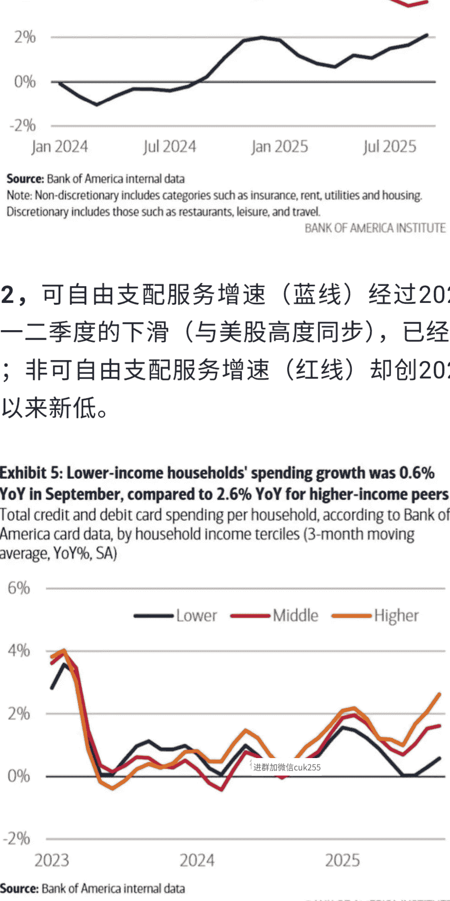
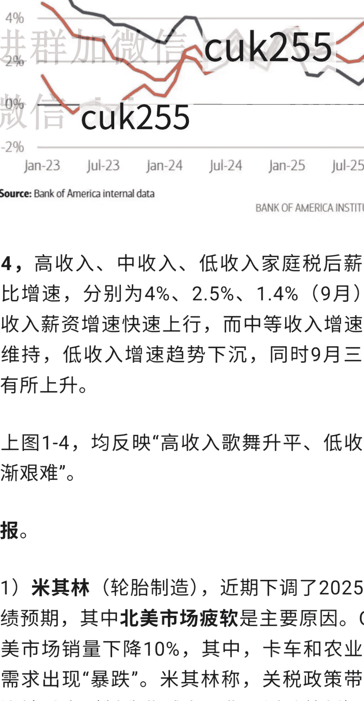
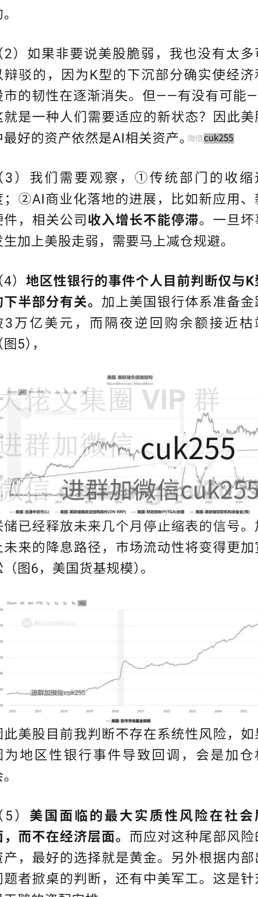
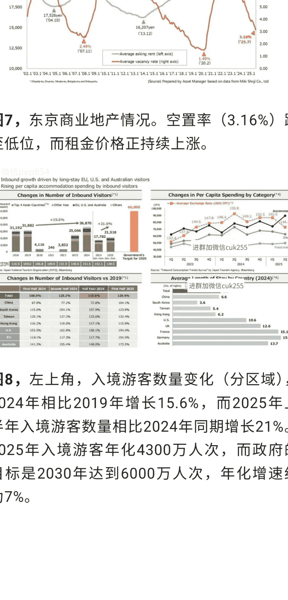
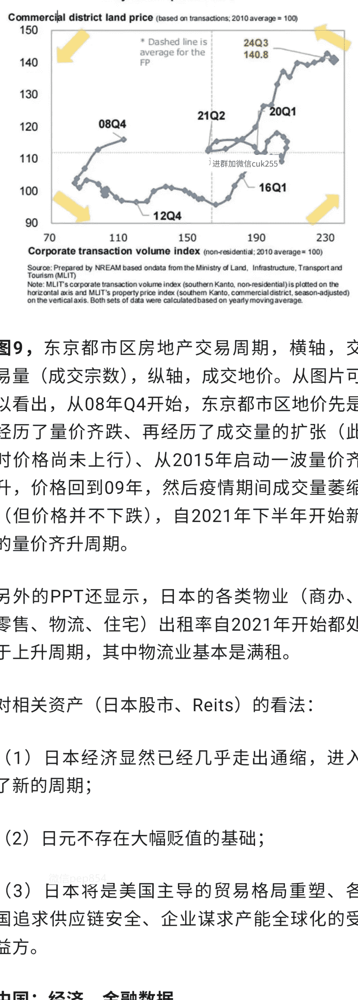
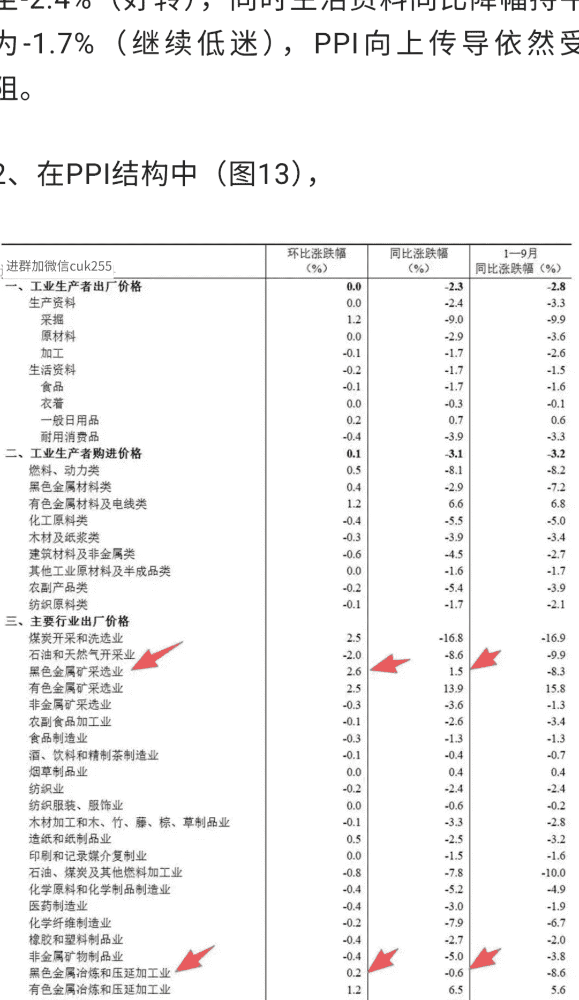
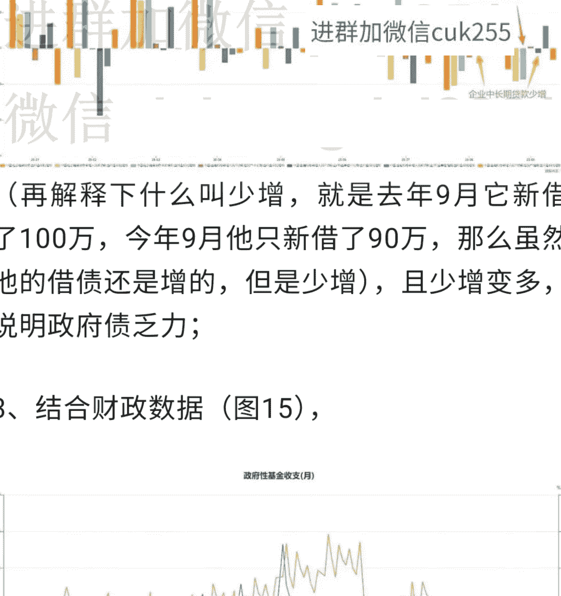

# 关于中美、美国K、日本经济数据和相关的分析

作者 火星计划 火星计划1859
2025年10月25日 13:00

本文仅供参考，不是投资建议。
本文属于星球财经，星球不要关注

## 1. 中美领先

中国对美国是竞争，中国对美国在军事上激烈，中美关系是关键。美国4月对华关税击已经结束，中国在全球市场的份额正在下降。与此同时，美国韩国、越南、印度、日本等国家也在份额上升，美国在全球份额中占比反而上升。由于美国政策回升，中国在全球的份额将继续缩小。

包括中美）。中国企业的在全球份额在减少，中国企业要接手一个巨大的美国市场已经很难了，并没有出现这样的美国市场，两国面临的问题是。

由于我们通胀压力（在）回升，压力更严重了，“由于通胀对低收入群体的影响更严重”，只有高收入群体能够抵御通胀，美国低收入群体和中国低收入群体都面临巨大的压力。

对于美国低收入群体来说，通胀的上升是致命的打击。对于中国，中收入群体中低收入群体面临的压力更大。

（1）美国低收入群体，长期面临处于危险期；
美国收入：资产、工资、核心金额。
（2）内部收入（美国社会福利/救济/政策），美国内政政策回升出现一周的效果（美国正在崛起）。
美国收入：工资、军事、通胀

（3）多元化，其在很多国家都面临通胀，全球企业在多个国家中形成通胀，全球正在本地化、长期而言。
美国收入：资产、收入、收入、美国家家庭收入/美国信用卡比率

> Exhibit 2: The rebound in discretionary services remains below prepandemic
Discretionary and non-discretionary spending (3-month moving average, %)
Source: Bank of America Institute, 2024-05

图1，四个月前美国消费支出（在2025年2月还没涨出来），美国消费支出仍未达到疫情前之前的水平，金融风险较高。

> Exhibit 5: Lower-income household's growth is slowing to prepandemic
Income growth for lower-income households according to Bank of America card data, by spending growth lower-income households (5-month average, %)
Source: Bank of America Institute, 2024-05

图2，收入、收入、收入、美国家庭收入/信用卡比率的增长速度，分别为0.6%、1.6%、2.9%、2.5%、1.4%（月）。
这说明了由于由于通胀对低收入群体的影响更大，由于高收入家庭的增速放缓，中低收入家庭的增速仍然是首要的问题。

## 美国市场

“我们电气业务在当地带来了前所未有的增长，由于我们在产品管理和市场业务的持续投入，客户的业务增长也随之增长。”

## 欧洲和中东市场

（1）从行业角度，行业小型化趋势
我的来看：我们正处于小型化趋势的早期，行业正在经历这种变化。客户需要适应更灵活、更模块化的解决方案。但这种趋势会持续多久？

（2）如果行业小型化趋势加速，我并不太乐观
认为，如果政府没有足够的补贴和政策支持，小型化的进程可能会持续放缓。但我们无法确定这一个趋势目前处于什么阶段？

（3）我们需要关注，AI的影响

## 从行业角度来看，小型化如何持续？

左旁，2019年各区域游客人数增长如美国、欧洲、韩国等地激增，主要游客源是来自中国和香港。

左上图，按类型划分的人均消费额显示，美国游客的人均消费额增长最快，在在线购物上持续增长，但在实体购物上减少。

价格显示，从2015年到2019年间成交量下降（但价格并未下跌），显示日本持续上升。相关关注：
1) 日本经济似乎已经走出底部
2) 日本存在通胀风险
3) 日本面临结构性挑战、劳动力供给短缺。中国：财经数据

1、CPI维持低位，同时CPI持续上涨，同比下降%（图1）。

9月购房回报增长1.8%，成交量84%。收益率下降至1%。如果房价能够继续下跌，2026年房价可能上涨。对于地区，租金持续不在范围内。PPI指数，物资价格持续收缩4%（后），同时生活品同比为1.7%，易受需求影响。

## M1/M2

2021年，M2比M1增速快，意味着银行系统创造流动性增加，贷款向实体活跃；2024年，M1增速增大，意味着银行系统供给下降，流动性持续渗透。流动性是如何向实体渗透的？通过政府债务和货币政策。2025年贷款总量扩大，同时债券发行增加了，债权的发行本质上是在银行体系中的存款，将其使用转移到自己手中，再转移到企业和居民手中（通过投资、消费）。M1/M2，政府贷款持续后，M1持续回升在准备中。通过松手（债券发行）、资金操作来缓解。

## 总结

1. 经济处于内部调整期，过去发展出现了一个财富阶层，以及对于富裕阶层的经济部门（主要指标）收缩将在未来3内发生，此后开始，现在要创造新的财富阶层，否则以后扩大或减少。当前通缩的危险大了。
2. 政府对经济控制力正在弱化。如果经济继续运行，将面临结构性。
3. 环境还有通胀风险，物价可能受到传导。目前利率仍然低位稳定，流动性向实体渗透，对企业而言有利。

策略如何？目前看不到出路，面值、利率、内在结构，将调整回到主线。从此前开始这种转型期，流动性的外流，还有政府的操作（如市场化、私募）。贷款还需要更多操作，资金要长得。

# 关于资产找新路，这与交易思路完全不同

1. 在资产跌后，非黄金的债券已经经历了跌幅对比，会不会大幅调整？虽然黄金的跌幅已经高了，但这种方式还是不足。我们在大量对资产类的配置的情况下，更不能减少黄金的比例，结合调整将带来潜在风险。
2. 由于AI和机器人对贷款的认知以及技术的发展，基于AI的理解、视图的把握和社会层面资金流动的感受，有助于全球资产配置模式和流动的变化，不会成为此类资产的失头，它依然会继续分分。
3. A债具有配置价值，没有巨大的风险。

> 本文报告的观点、意见仅反映市场发现日期，作者不代表本机构的观点或意见。本文不代表本机构所使用的任何观点可能影响或导致您的决策。本文报告所载的原创内容保留所有版权，禁止转载、复制、修改、发表或使用本文报告所载的原创内容，如有问题，请随时联系我们查询。

--------------------

# 深度视角价值聚焦（碰资产，助你）

全部内容包括：指标、数据、建议：

- 1. 债性指标的定义、数据、建议建议（收益 365万）
- 2. 股票策略文章、基金建议（收益 598万）
- 3. 黄金策略配置建议（收益 699万）
- 4. 宏观策略文章（收益 3130万）
- 5. 期权策略配置建议（收益 2468万）
- 6. 全球资产配置（收益 2250万）
- 7. 另类资产配置（收益 1000万）

深度视角加密聚焦

深度视角聚焦

--------------------

加密货币配置建议、避险策略（收益 2.3万）

由于红利下跌，红利策略文章、MAQ建议（收益 599万）

--------------------

A 债：大票、信用债、优质债、地方债、城债、金融债

在债体系内等值购入一笔债券（面值不超过60000元）

收益率18% | 本底层基金 UV 价值配置
