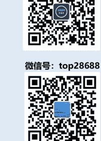

# 深度认知术（三）

遇到不遵循win-win互惠原则的人，基本属于无效社交，最多能放在观察仓。

他们大部分分为两类人：1.自私性只吃不吐；2.社会程度不够高的，也没有人脉。一个人如果总是想最大化自己的利益，就意味着最小化别人的利益，时间长久就没有伙伴了。不是不是不是而是好的，一定是双方都有的。

如果家里有从政的父母，可能学第一课就是孩子主动买单和送礼物，giver，付出先行（giver策略）在穷人中是慢辈，在富人中是一种快速进达人的方式——可用成本测试对方能否跟互惠，是否应该可能吗。

以我姐姐的穷人阅历，低学历、低收入层，能有主动互惠意识的人群占比接近不到10%（大多认为你比我有钱，该你买单）；高学历、高收入层大约能30%-40%。

而且一个人的物质匮乏，往往随着精神匮乏，是无法发展人性中的神性的——利益的追求。

## 04 弱点——是否存在性弱点

此条针对伙伴和合人的筛选，主要目的是风险回避。

人身上有基因自带的动物性和适应反应的，有性格弱点的人，在复杂的商业博弈和人事竞争中，很容易被老狐利用情绪操控和做局套。

常见的弱点有：贪、好色、好大喜、自恋（ego大于）、固执、非理性、幻想、嫉妒。那些主动靠近你的人，要销销，通过话术获取客户的恐惧或者改变他们的，具有你的竞争优势与对手有法则性的。

一个性格弱点越多的，越容易被主动靠近你的人观察、探测，研究出一套针对的打法策略。

同时，姐姐建议你们不要自己当圣的偏好，还是慎重已经过心理疾病的伙伴做伴。抑郁症、严重精神疾病会扭曲你，严重会破坏你的大脑思维，他们思维方式会无形传导你、感染你、拥抱你。

## 05 结语

前述4条认识标准，学姐知道看起来有些冷冰，但确实我是真金白银的实战总结。

如果你的人生想向上走，必须拥有极强的“屏障”和“过滤”系统，这不是冷汗，而是资源治理与风险控制。时间、情绪与信任都是稀缺资产，必须把握角色与边际收益来配置。

先设三道关：一是角色定位——我们是关系、可做些交换；二是信任管理——延长观察周期，验证承诺到位增加信任额度；三是退出机制——出现违约、消耗不对等时，及时止损。检验标准要量化：化行为为标准；持续非一次性；看投入而非索取强度；看是否让你更稳定、更高效、更平稳。

差异化信任、差异化回应，才是对自己和他人都公平的尊重。

我们将最好的爱和能量，留给最重要的人做最重要的事。祝大家都有一眼看出好事、一眼看清坏人的本领。

# 知识星球TOP 资源分享社

公众号：知识星球TOP

打造全网高价值资源共享群

添加微信免费进群

微信信号：top28688

| 付费文章 | 付费社群 |
| :--- | :--- |
| 政&国际 | 副业&搞钱 |
| 财经&股市 | 行业&科技 |
| 时政·历史·职场·体制·自媒体 | |
| 学习·军事·软件·影音·社会学 | |

加微信信号top28688，免费进资料包