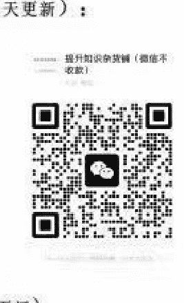
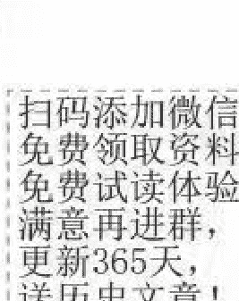

提问：灵哥，现在来说，得自己买美元值吗，现在中国人民币是升值了吗？对于汇率关心的，想清楚两个字的意思，以及背后的主要逻辑，感谢。

丁灵回答：可控升值

提问：灵哥好，此处几乎一直是满仓干，今天盈了部分阿里，yinn和二倍做恒。

短期内止出来的这部分还不准备再买入个股，计划一个“年”级别的调回考虑重新进入。在此之前，计划买一些波动不大的产品或直接保留现金。

产品的话，目前考虑的方向有：30年国债ETF、红利ETF、央红利ETF这类。

请问灵哥，在降息节奏下，从现在弹药的目的看，这几个方向有问题吗？微：tishen2027

丁灵回答：等等等没问题，正常情况港股离开下还早。既然赚钱了，保留一部分作为机动薅毛。

提问：需不需要留，明天会高开走？

丁灵回答：国家控盘节奏稳控太好了，今天在讨论中信邮盘大单的事情。A股就是被国家看着，港股随意，自由市场，怎么风险自负。

丁灵：

各位会员，今晚美联储妥定降息，信号，无论多少，中国资产的前途是亮的。今天科技股大涨，很多朋友赚钱了。部分会员的强烈要求，灵哥在周五和大家进行一次会员直播，解读灵哥之后的机会。请大家珍惜这次机会，下周灵哥就要提前请假。请大家扫码预约视频直播！

丁灵：

企改ETF之后让大家关注的，喜欢这块的可以拿准。上海电力重组被市场炒得很，没抓到机会可以国电投的其他五家上市公司，有的也顺势抄了一把，还有还没动的。大家研究吧，看看哪一个可能是下一个上海电。央电的大重组正在强势的推进中！

进群微信：2818363845

# 提升知识学习365天（365天服务），微信扫码或加微信：2818363845

欢迎进群看更多优质资源，客户进群享专属折扣。学习群包含以下全部资源：

## 一、财经类博主258群，包含以下全部7个博主内容更新（每天更新）:

- 1. 灵奇财富财富知识星球（原价3310元/年）/ 单买149元
- 2. 赛赛赛财经知识星球（原价3510元/年）/ 单买149元
- 3. 血咖元之家知识星球（原价2280元/年）/ 单买79元
- 4. 卢岷微信V+会员（原价1000元/年）/ 单买79元
- 5. 智合趋势内部研训（原价199元/年）/ 单买19.9元
- 6. 南半球财经（原价404元）/ 单买19.9元
- 7. 决澜的宏观策略以及众筹的其他财经类博主付费免费享享

## 二、时事类博主（时事会员群119元，包含以下11个博主内容更新）:

- 1. 子明私享（原价568元/年）/ 单买29.9元
- 2. 米粮米锐间（原价599元/年）/ 单买29.9元
- 3. 大树多读书星球（原价199元/年）/ 单买19.9元
- 4. 薇蕾的世界知识星球（原价299元/年）/ 单买19.9元
- 5. 砖瓦广斥后Q的内部文章（原价400元/年）/ 单买19.9元
- 6. 卢克文青青会员文章（原价268元）/单买19.9元
- 7. 卢克文青青读书会（原价699元/年）/ 单买59.9元
- 8. 崇哲协会会员群文章和对话（原价365元/年）/ 单买29.9元
- 9. 欧洲金融圈会员文章（原价328元/年）/ 单买29.9元
- 10. 碧树西风公众号付费文章，单买29.9元
- 11. 江宁智公众号付费文章，单买29.9元

## 三、各种付费文：

金政通俗、外人的视界、激锋异访、雪球花老头、幻话你知道你、费费的小茶馆、赢在八小时之外、雷雪梅、盛创圈、NEO捞鱼、冷眼局中人、海域视海对市的分析、第三章等公众号付费文章不定期更新，内容很多，不一列举！

提升进识学习群包含以上全部内容，分享365天，赠送历史文章！
