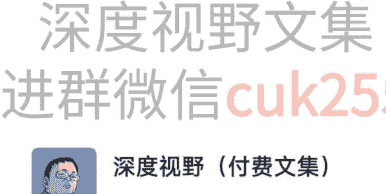

丁辰灵：

饿了吗正式要更名为淘宝闪购，这场和美团的近身博杀会继续下去！不会停止！是能直接倒流的战略高度。

丁辰灵：

官媒调了中美合作，第三方别幻想，和灵哥之前判断的一致！大方向已经定了，小波折不会影响。

转发经济日报：“中美两国首脑在韩国釜山举行会，为近年来波折不断的中美关系注入了久远的确定性……在高度互联的经济全球化时代，中美作为世界前两大经济体，任何形式的对抗都会造成“双输”局面，而幻想从中“渔翁得利”的第三方也难以独善其身。”

# 深度视野优质集团（链接优质社群，助你成功）

全部包含以下内容：限时年费188/年 加微信cuk255

- ① 吃瓜群众包信圈加时群群对话 (原价 365 元/年)
- ② 子明私享汇 (内部文章)
- ③ 政事室 (顾子明)付费内容加送顾子明群聊
- ④ 米联储闲闲【作者米栖》(原价 599 元/年)
- ⑤ 欧洲金雀会员专属文章 (原价 328 元/年)
- ⑥ 砖瓦斥内部图文 (原价 400 元/年)
- ⑦ 卢克文青读书会专属文章 (原价 699 元/年)
- ⑧ 鉴茶财经知识星球 (原价 3310 元/年)
- ⑨ 猫哥的视界知识星球文章 (原价 299 元/年)
- 十 财经周刊【独家新闻首页原价 1498 元/年)
- 十一 楊世光在金钱榜 (原价 2200 元/年)
- 十二 蒜森财经知识星球 (原价 1600 元/年)
- 十三 潇游异译付费文集 (持续更新)
- 十四 司马林解课选逸全套音频和全套书籍版权无删减 (原价 2.3 万)
- 十五 虚构三部曲[民国梦、帝国扩张、不被理解的 MAO](原价 599 元)
- 十六 卢克文知识星球文章 (原价 268 元/年)
- 十七 额外再送：卢祺元新浪微博付费专栏、三村丰老王、三花九洞文集

不定内容：...... (更多资源不下去了......)

- ① 守夜人才知识星球、接魂魔王知识星球、成达谈论知识星球、成后财富、雪球花甲老头等
- ② A 视野、大树乡谈、江初优、咩咩说、上海海家学等付费文集
- ③ 西凤付费文章、老端、赢在八小时之外、局外的视界、升值优、老A体制内等其它一些V付费文章不低于600 元的付费文集

# 限时年费188/年 底链链接全网V优质内容

深度视野文集进群微信cuk255 深度视野（付费文集)

