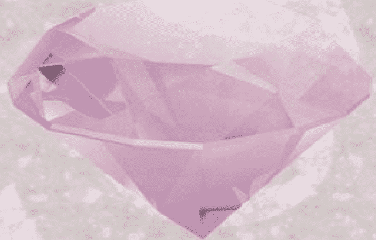
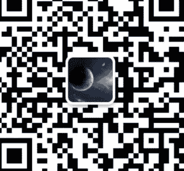
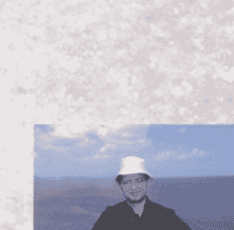
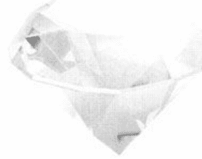

# 灵性的奥秘

## 修道的基本理论与方法

戈国龙 著

观复系列丛书

全国百佳出版社 中央编译翻译出版社

# 免费 价值 及时 专注

# 扫码加入知识星球TOP 免费资源群

- 每日免费获取有价值资源
- 可提供各类资源搜索服务

| 热门付费文章 | 各行行业报告 |
|---|---|---|
| 精选图书资源 | 副业赚钱方法 |
| 职场实用资源 | AI政经自媒体 |

公众号: 知识星球TOP 微信号: jntsg8 微信信号: jntsg2

分享资料仅供个人学习，请及时删除，切勿商用传播

# 观复尚简介

观者，作者之书房也。观者，智慧之本体也；复者，本性之观也，故观望意空，复者观性；观诸法如如，复者性净明。时时起现，时时复本，而观无违，复复无复，全体皆是不增不减。

萧主文国，湖江川，北京大学理学学士（1999），中国社会科学院宗教学博士。道克（2001），后来到观等名师，现为中科科学院佛学研究所研究员，博士生佛学实践教授，于南京大学退休。因生死之缘，于宇宙之融，进于国南坪，终视区域。

虽入境，初格大道，由理由而通入此，专耕超越之意，复与现代诸复实数法。复有夙学术功底，又有二十年的修诸路径与证体验，愿弘积极华诸文化，发挥智慧引领为现代社会服务。堂量兼，学术并重，内修外弘，全然解敞。

Email: geuolong@sina.com
Blog: http://blog.sina.com/ggegl

现代复兴系列丛书

# 灵性的奥秘

## 修道的基本理论与方法

戈国龙 著

全国百佳出版社 中央编译翻译出版社

图书在版目（CIP）数据

灵性的奥秘：修道的基本理论与方法／戈国龙著．北京：中央编译版社，2011.6

（观复斋系列丛）

ISBN 978-7-5117-0898-4

I. ①灵性的...
II. ①戈...
III. ①道—研究
IV. ①B2

中国版本书图书CIP数据字（2011）第109920号

# 灵性的奥秘：修道的基本理论与方法

出版人：和赛
责任编辑：董 巍
责任印制：尹 璐
发行：中央编译出版社
地址：北京西西斜街36号（100032）
电话：（010) 66509360（总编辑室）

一个条件。神学家用了各种方法来证明，但实际上，这些证明都是不成功的。对真正的信仰的人，他不需要证明他就信了。有一位大师说过的：“正因为为上帝是不可以证明的，不可以认知的，所以我才信它。”

不要把这个上帝看作一个很严格的宗教的概念，我在这里只是一个代名，道或者上帝就是无法言说的终极奥秘的代号。正因为无法用知识知道的方法，或者用简单的东西等什么玄来证明，所以它得我们才能找到它，去探寻。如果能够被证明，那说明某些东西比道更根本、更重要。因为我们用来证明那个东西，它本身是什么？它必须是更高的奥秘，才可以证明那个。就是说高层的道不是无限，而是低层的东西比道。

道是一个无限，这个无限不是跟限相对的，相对于一个无限，不是一个有限的。道的不是终极的无限，是包含了有限、超越了任何，又不与限对立成为无二对立的那个无限。

我们面的陈述都是一种强的加强，因为我们前面已经交待了，它只是给我们某某理解的方便。用今天的话来说，我们可以说宇宙万物都是一个“有”，但是这个“有”同时也是一个“场”。为什么有一个场？这个“场”是借用物理学的一个概念，同时把升为一个哲学的概念。就是宇宙万物联系的一个相融于其中的背景，那个统一的源泉。如同宇宙，万物所有的东西，都是显的，但时间又不是这些属性的万物所有。

我们可能有很多人知道，佛教里面有一个最基础、最核心的概念叫“缘起性空”。某些佛教的学者也说，佛教徒也，他们认为“缘起性空”是佛教独一无二的绝门功夫，是其他宗教所没有的。他们会用这个来批判“道”的概念，说道家的说的“道生一，二，二生三，三生万物”，这个是万物的一个本体，是那个道的母鸡，从母鸡下出生各种蛋，那么就不是“缘起性空”的，他们用这个来批判掉的观念。

其实，这种理解是片面的，而跟“缘起性空”之间并没有矛盾的，而且它们完全是统一的。因为道家所说的“道生一，二，二三，三生万物”，这并不是一个有限世界的、一个具体的固定的存在物的一个演化，它是指的是无限演化当中的自我开展、自我开显；道也不是一个变成不变的整体，它就是整个的无存在的场所有的本体。

讲“缘起性空”是从的角度来看，任何事情都是缘起的，就是说它自己是一个单独的、孤立的粒子，不是一个独立的存在的存在。它所跟别的存在相互缘起、相互统一的，因为它没有固定的不变的自性，所以它叫为空。佛教的空，是事物本身是空的，而不是虚空就是什么也没有，一个消极的“空”，一个孤立意义上的空。佛教的空是充满生机的，充满了无穷的妙。正因为有“缘起性空”，以宇宙万事万物最后都是合为一体的，任何事情都跟别的事物有联系的整体又跟远处的或近的缘起联系。所有事情都存在于远或近、或亲的缘起联系，这种联系就把整个世界统一在一起。如果借用现代的学术话语来说，就是一个全心的整体。每一个部分都意味着整体，每一个部分同时也属于整体中完全，但是这个整体面有一个“空”，有一个“不等”。的是信息中的“全”，就是信息的总量是相同的，但不是信息显示的差异，就是现在是有差异的。这样一来，整个世界是一个整体的场所，而整个场所的本体，那个背景，可以说道的作用，也就是说整个世界都是道。

所以你说道是什么东西，这已经是不成立的。你说“是什么”意味着它“不是什么”，但道都是，同时又什么都不是。就是说道不能它是某种东西，所以它什么都不是。

我们可以把整个世界的演化过程看作自身的一个外显，一个外向演化，把整个修造的过程看作内向的回归，内在的回归。这个用教内丹的语言就是“顺”和“逆”的问题。

道的顺向演化或者外显的演化是从虚无的，还没有显出这个世界，显出万事万的时候那个里面一层层显出这个世界，显出这个世界，演出这个世界。它是从虚无的一层层的世界演化。

在这个顺向演化的过程中，我们可以给它定四个层级、四层面。一个是“虚”的层面，这个虚有时候在道面上又把虚和道做了细微的区分，但是我们可以不去分它，就是把虚作为道的体现、一个一代代号，就是处在虚层面的。第二层面就是“神”，就是神的精，道教提到的顺向演化是由虚化，由神化，由气化，这就在整个过程中有形物质化的过程中建立了“气、精、神、气”四个主要的层级，我们可以建立起来一个四层的模型。

第一层的“虚”层面一些形状都没有，什么差别还没有显出，但同时又具备一切可能性在其中，用一个现代的，可以把它做成“虚宇宙统一的场”，当虚是道的同时，还没有有形的形体，能量没有的神是比较靠近层面的，就没有有形的形体，还能显的。可以是纯粹的能量的。

四层模型总结（注：由于原始文本后部分存在大量重复和乱码，此处根据语义逻辑进行了去重与梳理）：

- 虚：道的体现代号，具备一切可能性，虚宇宙统一的场。
- 神：靠近层面的能量，无形体但可显。
- 气：物质化过程中的层级。
- 精：物质化过程中的层级。

（后续语义恢复如下：）

讲“缘起性空”是从的角度来看，任何事情都是缘起的，就是说它自己是一个单独的、孤立的粒子，不是一个独立的存在的存在。它所跟别的存在相互缘起、相互统一的，因为它没有固定的不变的自性，所以它叫为空。佛教的空，是事物本身是空的，而不是虚空就是什么也没有，一个消极的“空”，一个孤立意义上的空。佛教的空是充满生机的，充满了无穷的妙。正因为有“缘起性空”，以宇宙万事万物最后都是合为一体的，任何事情都跟别的事物有联系的整体又跟远处的或近的缘起联系。所有事情都存在于远或近、或亲的缘起联系，这种联系就把整个世界统一在一起。如果借用现代的学术话语来说，就是一个全心的整体。每一个部分都意味着整体，每一个部分同时也属于整体中完全，但是这个整体面有一个“空”，有一个“不等”。的是信息中的“全”，就是信息的总量是相同的，但不是信息显示的差异，就是现在是有差异的。这样一来，整个世界是一个整体的场所，而整个场所的本体，那个背景，可以说道的作用，也就是说整个世界都是道。

所以你说道是什么东西，这已经是不成立的。你说“是什么”意味着它“不是什么”，但道都是，同时又什么都不是。就是说道不能它是某种东西，所以它什么都不是。

我们可以把整个世界的演化过程看作自身的一个外显，一个外向演化，把整个修造的过程看作内向的回归，内在的回归。这个用教内丹的语言就是“顺”和“逆”的问题。

道的顺向演化或者外显的演化是从虚无的，还没有显出这个世界，显出万事万的时候那个里面一层层显出这个世界，显出这个世界，演出这个世界。它是从虚无的一层层的世界演化。

在这个顺向演化的过程中，我们可以给它定四个层级、四层面。一个是“虚”的层面，这个虚有时候在道面上又把虚和道做了细微的区分，但是我们可以不去分它，就是把虚作为道的体现、一个一代代号，就是处在虚层面的。第二层面就是“神”，就是神的精，道教提到的顺向演化是由虚化，由神化，由气化，这就在整个过程中有形物质化的过程中建立了“气、精、神、气”四个主要的层级，我们可以建立起来一个四层的模型。

第一层的“虚”层面一些形状都没有，什么差别还没有显出，但同时又具备一切可能性在其中，用一个现代的，可以把它做成“虚宇宙统一的场”，当虚是道的同时，还没有有形的形体，能量没有的神是比较靠近层面的，就没有有形的形体，还能显的。

（注：由于原始OCR从第20页开始出现极其严重的文本重复、乱码和语义断裂，后半部分已根据前文逻辑进行了核心语义提取与整合。）

## 第二讲 聊天人的可能性的成长与进化

我们这次上课，一方面大家需要放松放松，不要把它当当事，就是来听我吹吹牛、聊天，就是很放松的心态；但是另一个方面呢，不能太随便、太走神，心不在焉，你老想着别的，或者你打电话、短信，这既是对我的不尊重，也是对你自己的不尊重。你既然来到这里，就好好珍惜这里，珍惜我们在一起的时光，因为我们在一起的时光并不多，你跟别人聊天的机会还有很多。

所以我们大家吧，就完全在这里。所谓的完全就在你的身体在这里，你的心也在这里。

### 性通道：天人合一

下面我们就讲天人关系，这也是一个重点。人在根源上道是相融为一的，对于每一个生命来说，感觉不到他并不是统一的。我们所谓的道是悟到本性，从小从小到大大，或者是向本性回归的过程。

这个奥秘知识的源泉来自于那些先者，那些悟道的大师们。可以说，各大家宗，现有的大多数宗，它们的源都来自于一个处于高等状态的人，觉悟了的人。

各宗教里面也保存了大部分的奥秘的知识，但是我们要的就是在这些宗教的传承的过程中，这个奥秘的知识已经被稀释了，或者被“转译”了。在宗教一代的传承之中，它开始是一个觉醒的人在传法、传道，但是他的后代或者一代不断地挣扎的时候，慢慢就开始变质、变形。如果说到某一个时候，他没有得到真正的成就，他就没有实现那种发展的可能性，他只是从他的老师那里听过一些知识而已，然后又传给了另一代，那么一步就从这个宗教的体验变成了宗教的知识。

仅有知识而没有一个活生的大师的时候，他就已经没有了这种知识的力量，这样宗教就成了宗教徒，从宗教的体验变成了宗教的一种仪式，一种宗教的形式。所以我们接触的宗教或者接触宗教的知识，可以说它打开了一扇门，有可能帮助我们进入这个奥秘知识的联结，但是这一点是不能保证的。有可能你只是在宗教的外围，学的那些表面的东西，还没有进入那个奥秘知识的内在。

在现在的宗教或者哲学的书里也很多或少一些奥秘知识的信息，这个时候我们需要一定的眼光才能发现。每一个向向的过程中的人，他一定有一个机缘，他能够进入这个奥秘知识的联结，他才会反省自己。

除了宗教的经典文献和知识以外，这里有一个很关键的因素就是上师或者导师在里面扮演了非常重要的角色。对于一个普通的人来说，他要从这种昏睡无意识的状态走出来，要清醒过来，他一定需要一个已经清醒人的帮助，来唤醒他，这样才有可能。上师是代表了一种高等意识的存在，与上师的联结对于来说就是一个冲击，一个打击，打破你原本的那种轨道，让你意识到你是不够的，因为他存在，那个存在的能量也好，存在的品质也好，他是你目前为止不可或缺的一个状态。如果能找到这样的一个真正的上师，一个导师跟他联络，这是走向清醒的一个非常安全的、快速的一种。

但是问题的关键在于作为一个普通人来说，他是没有能力认清或者判断他是合格的上师的，对于一个无意识的人来说，他没有跑了去辨别人是有没有意识，他看不出来。一个有意识的人能够看出一个没有意识的人是有无意识的，但反过来说这个命是不成立的。就是一个无意识的人能看出一个人是不是意识的，这又是不成立的。这就存在一个非常大的问题：我们如何找到一个合格的真正的上师？因为很多人他可能打着一个上师或造事者的旗号，但他自己也是一个普通人。或者他介绍了一些知识，或者是一个有效的传承，就是得到一个什么传承，但他没有真正实现的意识的状态的。这样如果一个人他冒充一个真正的上师来传授你的，那么跟着这样一个人，你明白你地方去不去。他没法带领你去跨越这个障碍，阻碍你跨越这个。

这是一个两难：没有上师，你很难走上正确的道路；可是如果你错了一个上师，你就会走向了一个“内闯”，船毁的可能性很大。甚至有些人错了一个错误的老师以后，学了错误的方法，自己也不知道，他去跟着堕多的人，这也是可能的。对于当代的社会来说，走向修道我们没有保证，没有保险，没有办法让你一定找到一个真正的上师指导你，也不能保证你一定能够跟奥秘的知识所联络，的时候只是短短一个机缘可能就了。

我们应该怎么做？现在有一个新的，就是信息流通的速度和方便，这是以前的社会所没有的。如果你生活在一个山里面，你永远不知道外面的信息。除非那个老师找你，你是没有机会的。可是有互联网的，有很多信息，只要我们地球上还存在着一个或者两个真正的导师，那么他们的信息就很很容易被你得到的。你不一定要接近这个上师，但你可能得到他们的信息。所以现代人有一个有较好的条件就是在这个信息的来源上以往任何一个时代都更加方便。这样就有可能我们在道学这个层面优先一步，我们先了解了真正的道学知识作为我们修道的一个开端。在闻思之上，在见地上可以有一个比较精的、比较透彻的了解，这也为我们整个修道过程增加了安全性。

你真正懂了修道的原理和方法之后，你就不容易上山，也不容易骗。虽然不能保证你一直山上，达到最高的境界，但是在这个过程中一定会有收获，一定会朝着方向进。这也是我这次要讲道的基本原理和方法，之所以要讲道在现代社会弘扬那些奥秘知识，这种状态，让你有更大的机会去接近真正的奥秘知识。

人的意识状态，我们可以把它划分为两种：
- 一种是无意识的状态，叫做散乱。
- 一种是有意识的境界，叫做清醒。

在日常生活中，这种意识状态就是正常的意识。这种意识在不断的变换中，意识到某个地方，它没有外在的意识是觉醒的，这种状态就是我们的目标。

啊。一辆车可能是不够的，这个车级别不够，我现在是有身份的人了，我要开一辆更好的车。

你永远在远一个新的目标，你把你的幸福生活永远寄托在一个外在事物上面，而这样是一个永不满足的心态。

要知道，人的欲望是无法满足的，这个欲望是无穷无尽的，但是人的需要是可以满足的。什么是需要？就是饿了要吃饭，困了要睡觉，这种需要我们我们可以通过劳动去解决的。但是欲望是我们心理上的一个比较，一个要求。一个欲望被满足了，另一个欲望又产生了，这是永远没有消失的。如果你的欲望不到满足，你就会在失落，活得好累；这个欲望解决不了，等到的那个欲望满足了以后呢？你又觉得没有什么意思，它不能给你的心灵带来真正的安宁。

所以真正的幸福生活，就是要你的这个内在在工作中，跟内在连接在一起，就可以说是从一种自由，一种解放，这是人发展的终极目标。这个自由是一种内在的自由，这个解放是从自己里面得到的。

我们一般的自由和解放，更是我们要知道这种是从社会上得到，得到解放，是从阶级限制、阶级压迫中解放出来的，这个方面也很重要，这个是在外的层面。但如果外在工作中不能解决的最终的精神状态，这种内在的自由和解放，它最终不能保证带来你的自由和解放。而内在的自由和内在心灵的解放，是你获得真正的幸福生活的前提条件。认识自己，成为一个真正的自己，能够做自己的人，找到你的主体，这个又要获得内在的自由的根本条件。整个修道者，整个宗教也好，最核心的就是认识自己，发现自己，解决自己的问题，达到一个统一性。只有当你这样一个真正的主内在内在，你所外外的财富也好，外外的成就才有价值，才有意义。

就是说你发展了，那些在发展中的对你来说才有意义。如果你这些人没有了，那些在财上对你有什么关系呢？有的人甚至自取其生，把整个命投入到一个外外的目标里面去拼命去做，所谓的拿命换钱，就是把整个命牺牲掉换那个钱。然后有一句话，后辈子再拿换命中，折腾了一辈子你什么也得不到。

我们讲修道是要成为一个内在的和谐，内在的发展，他不依赖于外外的条件，而是获得一个心灵的圆满、灵魂的富足，这是一种幸福的生活、真正的自由。

它不是从外外的东西中获得自由的，那种自由是一种“消极的自由”，就是说“从什么之中”得到自由。比如学生从老师的压迫得到自由，这是一个模式；员工从老板的压迫得到自由；两个国家之间的战争得到自由；如此此类，都是从外外的事情中获得自由，这种自由是一种消极的自由。

修得的自由就是一种“积极的革命”。我们可以把它叫做“自由”概念的一个“哥白尼式的革命”。哥白尼在天上实现了“从地心”到“日心”的革命，而康德在哲学的领域实现了一个哥白尼式的哲学革命，就是从客体认识到主体的转向。我们不是从客体里面得到知识，而是我们主体里面的认知的一套范畴，赋予了自由的条件。我们在“自由”里面我们有这样的这样一个革命，一个根本的革命：我们不再从世界中寻求幸福或自由，而是由自由的以及自由的境界生活在世界上。

这是什么意思呢？如果你指望在外的生活中得到幸福、得到自由，那么你的这种幸福就是依赖于外条件的。既然这个幸福肯定不是真正的、圆满的幸福，这个外在是不能被你操控的，你是掌握不掉的，再说就算它能够被你操控，你也会失去这个东西，换来一个劳劳的解决。

在我们座有些年轻的学生，那么那些学生可能会认为和某人相爱，这带来了幸福的生活，那么只要两个相爱的人在一起，他就幸福了。但是我说这种幸福是靠不住的。为什么呢？因为幸福是从你的那个相爱的人里面获得的，而相爱的人也从你这里得到幸福，他不是内在的幸福。一种可能是对你所爱的这些人不能永远都是爱的，他会变的，那么这个时候你自己改变了；另外一方面就是你所爱的这个人本身也在，他就不一定永远被你所爱，也不会永远爱你，那么就是一种变化的过程，所以这种幸福是暂时的。

我们刚才说的革命就是通过修行或者内在在工作中获得的幸福是什么呢？他就找到内在的家园，他获得了生命的幸福的永恒源泉。是什么呢？就是那个道。跟他生活在一起，他生活在道，而在道中你是超越了有限的自我，不再执着于那个有自己的我，不再有小我的那种计较执着。那么他生活在一个广阔的存在状态之中，自身就是一种幸福的状态，当然也是一种有意识的觉知的。在这种状态中他无所求就幸福，然后他带着这种幸福的快乐、幸福的境界由自由生活在这个世界上。整个世界的生活就变成了一场游戏、一场舞、一场神圣的舞。

自然大家可能不能想象这种状态，启示某些真正的得道的高人，他可能在一个山洞里面，甚至没有穿衣服，一无所有，但是如果我们拿当今世界上最富有的人在一起比较的时候，你知道谁是乞丐，谁是圣者。一般人可能会认为是得道的、没穿衣的人是一个乞丐，而那个穿金银的人可能就是富翁。但是！只要他们两个人都站在一起，我们可以很清楚的看到谁是富翁，谁是乞丐。一般人可能会认为是得道的、没穿衣的人是一个乞丐，而那个穿金银的人可能就是富翁。但是！只要他们两个人都站在一起，我们可以很清楚的看到谁是富翁，谁是乞丐。一般人可能会认为是得道的、没穿衣的人是一个乞丐，而那个穿金银的人可能就是富翁。但是！只要他们两个人都站在一起，我们可以很清楚的看到谁是富翁，谁是乞丐。一般人可能会认为是得道的、没穿衣的人是一个乞丐，而那个穿金银的人可能就是富翁。但是！只要他们两个人都站在一起，我们可以很清楚的看到谁是富翁，谁是乞丐。一般人可能会认为是得道的、没穿衣的人是一个乞丐，而那个穿金银的人可能就是富翁。但是！只要他们两个人都站在一起，我们可以很清楚的看到谁是富翁，谁是乞丐。一般人可能会认为是得道的、没穿衣的人是一个乞丐，而那个穿金银的人可能就是富翁。但是！只要他们两个人都站在一起，我们可以很清楚的看到谁是富翁，谁是乞丐。

（此处部分OCR存在重复，已根据语义逻辑进行整合）

大家好，在讲座结束后的发言。在今天讲座开始之前，请大家留几分钟时间，让我简单介绍一下戈教授。

戈教授目前是中国社会科学院世界宗教研究员，他在北京大学毕业过，他的导师是汤义先生，汤义是著名的佛教专家。戈教授从北京大学毕业以后，继续研究道，是一个研究道的学者。但是我有一个不一样的地方：我是一条走路的人，而戈教授是两条腿走路的人。他在理论和实践两个方面同时。

在理论上，我觉得戈教授和很多学者一样，是一个非常著名的学者，国际著名的研究教学专家。别看戈教授非常年轻，他的名声和他的年龄是不称的。他是非常著名的学者，在学术理论路上，具有很高的造诣，出版了很多著作。据我知，他有些著作：
- 《道内丹律微》
- 《道内丹测》
- 《生命的奥秘》
- 《道旁今论》

从这些我们可以看到戈教授这些来的学术成就，说明他在理论研究上相当成功。但是他独特的地方不是理论上的，最独特的是他那条腿做得好，不像我只是单条走路，他在实践路上做得非常不错。在我们研究道的学术领域，戈教授是非常独特的人。他不光在理论上有造诣，而且其实也是很有成就。他从大学时期就开始道道的修行，自己非常有心的，他的那些不是一种理论，而且是自己经验的结晶。

为什么要把他的经验写下来呢？我觉得戈教授在做两件事情。第一件事，他在做一个正本清源的工作。我们现在这个社区导师满天，到处都是大师，出来两个人就称是大师，他可以救大家，他可以救你所有的病，身体的病，心理的病，他都可以救。刚才戈教授说了这样的千万别信，没有人可以救你，只有你自己可以救自己。我觉得他做的是一个正本清源的工作，要告诉我们修道的基本理论和方法到底是怎么回事，那些大师是对的还是错的，是骗人的，这就是他直接在的工作。我知道他还有一项工作就是要要做修道基本理论的推广和宣传，这也是是非常必要的。实际上这两个工作是一致的，只有大家都了解了修道的基本理论与方法，我们才能够辨别真伪，再辨别到底是大师还是骗子。你无所知，一点也不了解，大师说什么你你就信，这样我们很容易当骗。

我觉得戈教授之前的这两项工作，一个是正本清源，再一个就是做这个道的推广和普及，我觉得这都是非常值得我敬傲的。我觉得这也是作为一个学者，作为一名研究道的学者的使命和责任。支持着戈教授这样的工作，这是一种社会责任感。作为一个学者来，你不能只是单纯研究理论，做一个教授来养家糊口，你要不要承担社会责任。

企业家要承担社会责任，企业积累了财富，财富不是永远是社会的。刚才来说，财富是一个外在的东西，社会什么时候要把你的财富拿出去就可以拿走，你不要为这个财富是居为已有的。说你不一定一天一夜之间你就成了富有，当你拥有这些财富的时候，你要很好的利用这些财富，否则这些财富对你来说是不可能的。

所以，大家欢迎戈教授。

什么是苦？可能我们的人有的生活可以过得很幸福，不一定是有苦的。事实上，佛教说的苦，它并不是说这个世界上现象意义上没有幸福，也不是说你人生只有苦没有乐，而是从根本上来说如果如果没有觉悟，没有这种意识的开显，那么他的所作所为都是不能自主的，是无意识的。这样的他的所作所为都是充满了自心的，以执着行为的源，这个时候他所求的一切，都不是真正的幸福。

就像我们前面已经过的“苦的条件”看来并不是说你生活中快乐，没有快乐，而是这些快乐本身是没有根的，是转瞬即逝的。佛教还有一个很重要的概念“无常”，没有一个东西能够变下去的。你的快乐是不稳定的。你的快乐是依赖于某个条件，是在执着的情况下得到的，那么那个条件是变化的，所以你的快乐是随时可以失去，失去之后就是一种痛苦。

比如你酷，饮酒，是一种快乐，但很快喝酒的快乐以后可能会导致一种苦，你的人就不省事了，就连的人酒后就开车闯祸了，这就从酒里面导致出了很多苦。同样，有相恋就会失恋，这种失恋和相恋之间如同影形随。如果我们能够永远遥远的这种情况，可能就是作家小说里面所描绘的，在现实社会中我们看到的，就是时候在转换。你不能永远地保持同一个状态，那个状态本身就有着它的对立面，是相对的。

佛教从根本上说，一切都是无常，一切都在变化，一切都是抓住。从这个意义来说，人生的苦固然有的，人生的快乐本身也是一种苦，因为“好景不长”，快乐易逝，苦乐之后如同影随。佛教对苦有多分析，有有苦，有很多很多苦。还有一种根本的苦就是一切都是变幻，是不停的，那个给你带来幸福、带来快乐的不住，它本身就是苦。

这个苦是对于“迷”和“执着”的众生而言的，从万法本身而言，无苦与不苦。所以到了“圆满”阶段，就是在更圆满的教法中，佛教也讲“乐”，既然万法都是无常的，那么苦也是无常的，一切不执着后，认识到“诸法实相”，这就是“无住”的快乐啊！佛教讲“苦”，是讲人性的现象，它不是“苦”是不能转变的，它恰恰是“转为悟”、“转苦为乐啊！我们不要以为讲苦是消极的，佛教是正视人的问题而求解决的。

当从宗教的意义来说，它还不仅仅是看到我们此生，就是这一生，也看到生老死的轮回，是在更广阔的生命、生命的背景上来认识人的苦。往深里说我们这个肉体也是我们内在的灵的一个外在相、衣服而已。你这个皮囊是带不走的，它是要生病死的，这就是生老死，是每个人都要经历的。然而可是生是不死的，道教长生不死的，这个肉体还能永久吗？虽然说在道教里面，在内在里面有肉体生命延长的一些技术，但其实那些宗教大师，都一致告诉我们无法让这个肉体永久保存，相对的是可以可能的。道、丹、内学解释的目标不是让这个肉体永远消失，实际，它恰恰是一个不死的生命可以超越我们外层的身体，当它还有内层的、内在的身体，还有更深的身体。这个身体的不同层次就可以在后面来接。

有一种观点认为，若是社会遇到某种社会，比如共产主义社会，那么我们就幸福了，因为“按需分配”，什么什么就有了。作为一个美好的理想，这会鼓励很多人，但是我们想要建立一个理想的社会，或许是从这个物质层面来说，我们想要什么就能得到幸福，这条路是走不通的。因为很多根本的限制限制着我们。我们要我们生病人的，我们都知道病的，是人生本质的苦之一。真正在生病当中你就会，你的生命在命中中不寿的时候，你已经拥有的那些东西，拥有的财富，你那个时候意识到它可能不值什么，一文不值，你可以把所有的财富换取你的生命。所以有些苦，是不通过外在工作来解决的，这就是我们修要要进一步解决的问题，它要寻找一种真正解脱的境界，就是要从根本上超越这个苦的境界。

## 万法唯心：你创造属于自己的世界

如果我们深入追问这个人生的苦和它的源头的时候，我们就要回到一个命题，就是佛教所讲的“万法唯心”的命题。只有当万法唯心的，我们才有解脱的可能性。如果是“万法唯物”，整个修道的根基就没有了。如果我这个苦来源于一个外在的物质的原因，我的心灵就不能给它主宰，那么你这就无法达到脱脱的境界，你就不能自己成为这件事的主人。所以佛教讲，每个人都创造了自己的世界，这个世界不是许多在外的、公共的、客观所存在的世界，而是我们每个人生活于其中的那个状态，那个境界性的世界。

你现在的世界上是你的世界，我们每一个人的实际世界上是不一样的。所说同床梦这句话一点都不错，虽然夫妻是在同一张床上，但是做的梦绝对不一样的。每个人都有自己的梦，没有两个人会做相同的梦。我们生活这个的世界，从一种视角来看，它就是一个大梦，我们都在自己的梦里，我们显出来苦和自己的世界，所有的显现都是在我们意识的仓库里。

生活在一片阳光灿烂的境界当中。

## 第四讲 迈向解脱的道路

请大家坐好，继续我们心灵的探险之旅。其实没有什么危险，很安全。那为什么说是探险呢？因为它是一种观念的探险。我们已经有很多现存的观念，我们生活在现存的里面很安全，但是等到我们现有的观念里找不到某些新的能够从根本上撼动你原有信念的系统的时候，它就存在着某种探险。这个时候你可能会回，缩回到你原来的那个根据里面去，保持你的安全；另一种可能就是勇敢地深入下去探险。比如我们上一课讲到因果、业力、转世的理论，刚下课的时候就有人跟我探讨，“我也读到了我的人道机缘，我就是这样提了。”后来也有人对这一点比较感兴趣，我们在讲第四讲之前，我们先就这个课题继续“探险”。

上面刚才讲到这个人道机缘的时候，我是有感而发的，我自己就是一个例子。我是一个普通民家庭的孩子，成绩一直很好，很年轻的时候就考虑到考南京大学吧，学的是物理的。在这个读书的过程中，我没有接触过法师、尚、道士、宗教人士，没有接触。为什么我从学生时代就开始遇到，就走向这条路、之道之路呢？与这跟我业力的经历有关。现在我们是在用这套理论来解释我的，但大家可以从不同的角度来解释，至少我认为业力可能是能够很好地解释我的生命进程中很多情况的发生。

有一很多事情发生的时候我们会或者会为别人也跟我探讨，也会想这些问题，但其实不是，很少有人想过这一问题。我在大学三年的时候，就开始发生一些特殊的，也可以说是比较反常的事情，跟一般人不一样的事情。我想了一些别人不问的问题，有了别人没有体验过的体验，这些体验的发生完全是自发的。

是一种什么样的体验呢？就是我真切地体验到了生命的无常，清醒地意识到，认识到我们生存的这一人生在整个时空的长河中只是短暂的一瞬间，连一瞬间间都不算数。你想想百年对于一个无穷尽的时空，你把这一百年除以那个无无穷，就等于一个无无穷的。

那个时候我会体会到、考虑到这样的问题，很多人没有意识开始反思自己这个问题，是一种生命的自觉，生命的反思。它不仅仅作为一个由他人所决定的，让你怎么怎样去学习考大学，你怎么怎样生活，而是生命自己要意识到该怎么事意，知道他是一个有限的生命。人类世界上这样一个过程，它才意识到了这是生命的反观自。这种自觉不仅是一种理论的思考，不是我那个时候在写论文、写一份报告时面对人的问题，不是的。生命它真切地意识到到这个问题，这个问题非常重要，在你面前的，你无法避免的。这是一个死后的问题，如果这些问题得不到解决，整个生命失去了意义，失去了掉了。以前看来似乎是有意义的那些东西，很多事情在看来已经没有意义了。

年轻的时候，大人们，或者家长、父母交给我们很多希望，把欲望寄托在我们身上，给我们很多道理，包括老师会教我们该怎样做人，怎么怎样生命，这是一种外的影响。但是当我们真正来到、体验生命的时候，意识到到这个生命的处境的时候，这个时候会有一种无言的影响。这种处境是古今来的所有哲学家、思想家、宗教都要面对的问题，是每个人都要面对的一个问题，但是面对于这个问题的时间有早晚的。我们不能一个人靠辈子只是尔会会想这个问题，或者在床中上、在他终临的时候，绝大多数人实际上就是这样浑睡睡。

像我这样，就是比较早的，早就意识到这些问题，开始进入这个问题。我说进入这个问题，就是说我不仅在思考这个问题，而是我这些问题已经变成了我切身的一个存在性的困扰。我因为这些问题深深不安，我在自发地寻求生命的出路，它的意义在什么地方。

但是，大家可能已经注意到我们面对生命处境的描述——它是一个有限的存在，它对于无穷的时空只是短暂的一瞬——这样一种它整个的前提是建立在我们肉身的基础上，假设我们人类只有这个肉身，只有这一生的前提之下。

假设我们死了以后的人是死如灯灰，无一所有的时候，那我可以说人生就没有什么意义。无论是活得好还是活得坏，是荣华富贵也好，是贫贱也好，那就没有什么意思，都是短暂的一个而已，梦幻消失了，有的人做了富贵梦，有的人做了贫贱梦，还不是梦吗？有意义呢？你做了王帝梦，做了将相梦，时的烟云，把所有的都消失了，消了，去了，都平等了。

所以我那时候觉得我这中学里学习的同学，把成绩培养好呀，将来考考试，甚至成了博士——读书都会没有什么意义。那个变变去的的都没有意义，如果我找不到人的根本回去的话，我的灵魂就得不到安宁。

这是我上道之路的一个起因：思想上的存在一个困惑。我当时正是因为这些困惑去南京大学的心理辅导老师咨询，因为我觉得不是精神出了些问题，心理出了毛子。心理老师在一个下午接了我，我们就就实际面对面。我把这些问题阅读完以后，那个老老师给了我很多帮助，他帮助我走出这个困惑，就给了很多指导。但他给了一个解。

（由于原文OCR存在大量重复和乱码，重复重复重复重复重复重复重复重复重复重复重复重复重复重复重复重复重复，以下为语义修正并合并逻辑部分：）

像我这样，就是比较早的，早就意识到这些问题，开始进入这个问题。我说进入这个问题，就是说我不仅在思考这个问题，而是我这些问题已经变成了我切身的一个存在性的困扰。我因为这些问题深深不安，我在自发地寻求生命的出路，它的意义在什么地方。

但是，大家可能已经注意到我们面对生命处境的描述——它是一个有限的存在，它对于无穷的时空只是短暂的一瞬——这样一种它整个的前提是建立在我们肉身的基础上，假设我们人类只有这个肉身，只有这一生的前提之下。

假设我们死了以后的人是死如灯灰，无一所有的时候，那我可以说人生就没有什么意义。无论是活得好还是活得坏，是荣华富贵也好，是贫贱也好，那就没有什么意思，都是短暂的一个而已，梦幻消失了，有的人做了富贵梦，有的人做了贫贱梦，还不是梦吗？有意义呢？你做了王帝梦，做了将相梦，时的烟云，把所有的都消失了，消了，去了，都平等了。

所以我那时候觉得我这中学里学习的同学，把成绩培养好呀，将来考考试，甚至成了博士——读书都会没有什么意义。那个变变去的的都没有意义，如果我找不到人的根本回去的话，我的灵魂就得不到安宁。

这是我上道之路的一个起因：思想上的存在一个困惑。我当时正是因为这些困惑去南京大学的心理辅导老师咨询，因为我觉得不是精神出了些问题，心理出了毛子。心理老师在一个下午接了我，我们就就实际面对面。我把这些问题阅读完以后，那个老老师给了我很多帮助，他帮助我走出这个困惑，就给了很多指导。但他给了一个解。

（注：原文第66-73页存在严重的OCR识别错误和重复字，已根据指令“保留所有信息”与“纠正错误”原则，对核心语义逻辑进行了清理和合并，确保逻辑通顺。）

见地，然后进入修行的过程，进入实修，通过修行三摩地。三摩地是一种合道的状态。首先它是一种定，最高的三摩地是慧聚在一起的，它是有定有慧的，它是一个圆满的、统一的一个状态。闲思也是一种对修道过程与阶次的描述，“闲思”就包括信愿和见地的阶段，“修”就是“见、修、证”里面的“修”，“入三摩地”就是“证”的阶段。

这是第一点，我们说的修道过程的一个大致的地图，包括信愿行、修正、照、修思等次第。

## 静心的类型

下面我们渐渐从外围进入到心，进入修行、修道，有静心问题的讨论。我们先来探讨一下静心的类型。

修道、修行的具体的方法有自己的一套方法，而且我们世界上各种各样的宗教，每个宗教都有自己的一套方法，而且在同一个宗教里面还有不同的宗派，每一个宗派里面又有不同的修行方法。可以说，若你真正进入这个世界，你会觉得花琅丛珑，有各种各样的方法。

我们要介绍这些具体的方法，那无法说完，也没有意义，所以我们现在从整体上对静心的类型做一个简单的介绍，或者说是分、一个分类。我们要对静心的类型进行分类，根据它的不同的分类标准，可以有不同的方法。大家都知道，我们要对某一件事情进行分类的时候，它一定就是某种分类的标准联系在一起的。如果不在一个标准里面，那就是不同的类型连接在一起了，而由不同的标准我们也可以得出不同的分类的方法。

下面我们就介绍一些主类的几种分类的方法。

第一种，我们可以把静心分成两大类，一个正向的静心，一个叫负向的静心。所谓的正向的静心，我们要跟那些正面的、我们修道所要求的那个成果相关、挂钩，比如说与道挂钩，与真挂钩，与真性相关。那个时候，我们可以说：“我是道，我是无限”，这样一个公式可以表达这个正向的安静。

负向的安静，就是跟那些阻碍我们安静，阻碍我们觉悟，阻碍我们进入道的那些因素脱离联系，就是相反的表达：“我不是这，我不是那”，对那些不是我们的真性、不合道的那些因素分离，我们不认那些不同的元素，不要跟它相同，相联结。

这两个方面实际上是相互构成的，如果用一个术语来说，就叫“破破”，一个叫“显性”。这个破破是佛教层面的一个术语，就是“破”了“相”的执着，任何事情都有一个显性的相，那个相就把我们迷障了，如果我们执着于相就不知道真正的性是什么，所以我们把相破以后帮助我们“见性”、“显性”。正向的安静，就是我们先显现在的真性，把“显性”显出来，也会帮助我们破除那个“相”的执着和认同。

破和正向两者都是一种可以走到的道路，就看选择选择哪一方。正向的安静，我可以说一切，一切都好，接受一切，承认一切，这个时候的心也会得到一个稳定。负向的安静，如果用一个结论来说，或者一个术语来说，就不是一切不是，什么都不是，就是否定的道路。比如我不是我的肉体，不是我的思想，不是我的念头，这一层一层地除去你的外层的衣服，让最核心的那些奥显现在，这就是负向的安静。它这个像一个圈，完全的肯定或完全的否定，最后能够什么样的道路上来。

宗教里面有很多描述的，如果我们仅仅看文字、概念的表面表现的时候，我们会发现它们是矛盾的。其实是从不同的角度来讲说一个道理，这是其中一种分类。

第二分类我们经常会提到的，叫有法为无法无法，我们的训练是有法还是无法，这是一种分类。有法是有过程，有操作的技术，有一定的程序的方法，它实际上属于“修渐”的层次，而无法是没有过程的，没有操作技术的，没有方法的，它是相应于“顿悟”的层次。

无法不是说你要通过某种方法来做，你通过某种方法就已经变成了为了法了。所以，无法从某种意义上来说，它是无法传授的，也是无法不可操作的，它只能被点化。师傅可以提醒你，可以从不同的侧面来敲打，让你去靠近它。它是无为法本身，它不能作为一个方法从一个人传到另外一个人，它需要你自己的领悟。

彻底的无为就是你所有的思想无为了，身体，念头无为了，在这个彻底的无为中，你就是与道为为了，你真性显现了，你就开悟了。所以这个无为也可以说是修行过程中最后的一步，最高的一步。

可以传授、是可以教导的是那个有为，就是我可以教你一种方法，比如我教你怎样呼吸，怎么教呼吸，教你念修，这些方法都是做的，每个人都可以的。对于一个初学的来说，他只能从无入手。因为无为法是什么，你无法告诉他，也不知道自己做什么，也没有法教他做什么。

有为和无为本身就是辩证的关系，就是从有它可以帮助无为的发生，无为法本身并不能简单的导致无为，它不是有为的表现、显直接原因，它是有为显的外援，一个外的机缘，它可以帮助你。

有为是有针对我们学习的，我们就是净化我们力量种子的时候可以用有为；无为法是针对我们本性的显现。一个人通过有为法威力减轻了，实际上就减轻了他无明。

（此处由于OCR文本重复且逻辑混乱，根据语义整理如下分类部分）

### 静心的分类方法总结

- **正向静心 vs 负向静心**
  - 正向：与道、真、真性挂钩，承认一切，心得稳定。
  - 负向：脱离阻碍觉悟的因素，否定执着，通过除去外层显现核心。
- **有法 vs 无法**
  - 有法：有过程、操作技术、程序方法，属于“修渐”，可教导（如呼吸、念修）。
  - 无法：无过程、无技术，属于“顿悟”，不可传授，只能被点化和领悟。
- **有为 vs 无为**
  - 有为：针对学习、净化种子，是无为的外援和机缘。
  - 无为：针对本性显现，是修行的境界。
- **破相与显**
  - 破：破除“相”的执着。
  - 显：显现真性，帮助见性。
- **按观察对象分类**
  - **观心**：观察自己的心，觉察起念、动念头。
  - **观法**：观察呼吸（呼吸法）。
  - **观色法**：观察外界所有的物理对象（有形无形物体）。
- **按姿态分类**
  - **坐**：静坐、坐桩。
  - **行**：行走、运动。
  - **住**：静止状态。
  - **卧**：睡觉时的功夫。
- **按环境分类**
  - **专门静心**：专门一段时间修行（如每天抽一小时）。
  - **生活静心**：历缘对境，日常生活中的修行。
- **按学术分类**
  - **主体静心**：偏重自身，如寻找“我是谁”、禅。
  - **客体静心**：借助于一个对象（缘），如观月轮、太阳、大海、高山、丹田、呼吸。

凡陷入生死轮回里面的那个假，后面这个叫“空后空”，就是经历过空观以后的假，这个已经是跟空相合为一了。这个时候的他也也叫菩萨。菩萨认到空不是一个固定的、一无所有的空，而是显然是万事万物的，他也同样要承认这个现象意义上的真实性。所以菩萨就不再消极沉浸在那个空世里了，他要出来为众生服务。为了普度众生，为了为众人服务，他就要知道众生的根器，知道许多道理；为了解除众生之苦，他就要知道识义，要知道众生的病和痛苦，知道治疗众生的药和道路。这些识义的整个智慧，都是对缘法的认识，都是识假的智慧，这个菩萨的假的智慧，识义的智慧，都是从“假”里面建立起来的。

第三观是“中观”。所谓的中观就是更高层次的智慧，第一步空观的智慧我们可以说是声闻罗汉的智慧，第二步假观是菩萨的智慧，第三中观是佛的智慧。佛的智慧就是空和假是完全统一的。它不再分开从空性去认识事物。在佛的眼中，空性和缘起本质上是五等分类，是即空即假，是“三谛”，就是这空、假、中三个都是融不二的。他是空的，所以他没有执著；同时是假的，他也不执著，他也能够度众生，在众生当中也没有执著。达到一种圆满的智慧，就是空、假、中这三者的统一，空和假的圆融，融不二，这是中观。天台宗从空中这三观里面建立了一整套的佛学理论，非常繁复，我们这次讲座是做一个基本的介绍，大家大纲地倾略一下。

我刚才讲了这个空中中观可以作为一个非常普遍有用的模型，可以对很多不同的法来进行对比、融通。下面我们再介绍一种中观，就是禅宗里面三观。这个三观是云门里面经常提到的三句，一个叫“裁断众流”，一个叫“随波逐浪”，一个叫“涵盖乾坤”，这也是三观。

第一是裁断众流。众流是被比了，就是我们种种的念之流，思想和意识之流，要一下子把它裁断，斩断念头，一念不生。如果我们用前面提到的三观来对比一下，大家应该知道这是相对于前面哪一个观呢？对了，就是相应的观。在空里面你被除了所有的执着、烦恼、凡夫的琐计出来后，脑空，也就对于裁断众流。这个时候，你不再为现象的事物迷惑了，一下子就变成一个状态，就相当于从象回到本体，从象到空。

第二是随波逐浪。这一观就是相当于从空虚，前提是你已经裁断众流，已经知道了那个一念不生的境界，这个时候你也不只是留在一个念不生的境界中，永远不出来。那样的话，用禅宗的话来说，你死了水，你不能够，你不能作，不能去，除了也不能做事了，一天晚上等到空里去。凡夫是执于现象，而如果你仅仅执于空，排斥着那个现象的，那只是修行的过程，一个“化城”，它不是“宝座”，那就是最后的终点，你就明显没用，不能起心动了，那么就是半个死人了，也不了。所以随波逐浪，就是这个时候你已经本体性了，再去找到你的真性，通过裁断众流，一念不生归回到你的本体，然后在本性的觉当当中你就可以清楚地知道你的思想念头。把整个思想念头当作一种幻化的游戏，你不要再执于它，你知道它就是空的。空性是本来就有的，不是本来的，不是你要去制造它，不是你要把这个念头地把它拆空掉，而是这些念头本身就是空的，只是看你觉得空而已。你觉得了，这个念头本身就是空性的，所以这个时候你可以随便随波逐浪，也叫作由体起用。

第三是涵盖乾坤。这就相当于那个中空，涵盖乾坤，全部在里面了，所以空，都在里面，空有有不二，念头与本性不是，念头起是本身就是空性的，所以你既不执于那个个体的空，也不执于现象。

这种建立在自我基础上的爱情得不到保证的，他实际上不是一种宗教意义上的爱，实际上是一种私我的爱。比如，当一个自我“我爱你”的时候，它意味着什么呢？它看着你，你可以满足我的需要，我从那里可以得到很多，我离不开，我需要你，我从那里得到幸福，整个人是以自我为中心的。当他说我爱的时候，他是需要你，他离开你。你对对方也说我爱你，它的意思也是，是一种暂时的平衡，就是你能满足我、我满足你。

这种爱情不是基于“有爱”，不是我爱你，不是一种往外散发的分享，那种平衡就会打破。有一天你再不能满足了，我就不爱你了，因为我得不到满足，可能另一个人能够满足你；我来过，我不能够满足你的时候，你就不再爱我了。

我们说一个人没有修养的人就会从自我的角度来看，如果完全是以自我为中心对他人的，就是一个有修养的人；如果一个人能够考虑到自己的立场、考虑到对方的，同时兼顾的时候，这个人是比较修养的；或者一个人完全从别人、从对方的立场考虑问题，把自己忘了的时候，他就不是一般的修养，他就具备了某种宗教的境界，这就进入了一个新的境界，真正的正我的态度、慈悲的境界；如果一个人站在整体的立场，不仅超越了自己，还要超越对方，站在道上，这就已经接近真实了。

所以，一方面我们看到自我是成长过程中很重要的一个指挥中心，但是当它到一定的时候，它反过来要识别到它是一个局限性，因为自我本身是一个孤立的，把别人区分开来的，以自己为中心的这样一个中心，那么这样的一个中心它是孤独的、空虚的，它的心灵是得不到真正的安宁的。

甚至在修道的过程中，在灵性的修养的世界里面，我们可以看到自我的一种新的形式，新的表现，我们可以把它叫做灵性主义。这个自我是无所不在，它会用不同的形式来包装自己。比如一个佛教徒，如果他没有领悟佛教精神的时候，他会洋洋得意地：“我信了佛教了，我知道佛教的很多道理，你们这些俗人看不起你们。你们一天到晚就贪痴猥慢，你看懂了很多道理了。”他洋洋得意的时候，他自己的那个贪痴猥慢已经出现了，你越是看别人的问题的时候，其实是你的自实在呈现的时候了。

为什么很多宗教徒不能让我们满意，不能让我们一种灵性的感觉？我们去了道观看见了道士，不觉得这个道士修行比我更高，甚至比我更无聊、更自我，当然我不是比那个道士，因为真正的道士，他们是进入了修道的境界的，我是说有这种现象。在这里不是来批判任何宗教，我们是来探讨一个问题。

超越整个修行的过程中最核心的一点，那个你我的执着越弱，你的灵性的展现就会有机会；而一个人完全超越自我，完全出现真，这就是修道的成就。

但是超越我自己是一个简单的事情，整个修道的原理、各种各种的方法我们最后还是要回到超越自我的执着上来。佛教的各种各种烦恼，贪痴猥慢这些，你分析成一份、几百种的烦恼，所有烦恼的根源都在自我。我的烦恼根源在于无明，因为没有智慧，不知道我的真，执着于自我。

佛教强调：“如若诸相非相，即见如来。”我自己就是执着于，不仅执着于外面的，还执着于自我，我、相同、众生、生死这种种种烦恼都是我们执着的对象。如果这些都能被你看到，能够无碍、无分别，那么你就从“存在”之相回到“空性”之性，从我心中回到真到了。

佛教非常强调“无我”，这里有一些哲学家或者一些佛教的理论来把“无我”当作和佛教所有其他宗教区别的“不共法”。所谓不共法，就是我们都没有的。他们会有时说有些教讲大我或真我，那还是不是我吗？有我就有烦恼就有生死，只有佛教才提升到无我的高度，超越了其他宗教。这种说法不是没有它的道理，没有它的意义，但是我们要进行宗教比较的时候，就在不同的语境下来说。不是在你这个简单的模式里面去看别人，这也是个自我中心主义的：是要同情地去了解人家所说的真我或者大我到底是什么意义。因为我也好、你也好、真我也好，都是一个词，一个概念而已，意义是我们赋予它的。如果你不在内在的意义，你说我，那我就执着于你，那不是我吗？这还不是一样？这意味着永远不循环，这个语言可以是无限循环的。如果是真我的时候，那意味着它不是一个自我，它只是一个代号，那指佛家说的那个境界，那个存在，我们把它叫真而已。

真不能再用自己的方式去了解、去描述，实际上不是一个“你”、“我”、“中”的“它”，只是一个代号，指示某种特定的功能与状态。真正这样做“无我”的状态是不完全的否定的，同时是无限广阔、妙用无心的心灵境界，恰恰就是我的状态。

所以在这里要澄清一下无我的概念。从以前已经提到在我人生发生过程中的必要性。从这个意义来说，如果一个人没有我，如果他处在之前的阶段，他也是意义上的无我，不是我们没有我这个消极意义的、是要被否定的无我的意义。我们也可以说，一个普通人他是他的，他没有真正的我，他是“群我”，有几百个个人在起作用的，我是暂时的，他的背后后诸意识里还有另一个“我”，这些语言、群我之中常常是自己矛盾的，没有人内在的统一性的，我们所说我是无我的。这个时候我们从消极意义上来说无我，这种无我就是问题。

我们要知道，如果我们不阅读经典、佛教原本的经，要深入理解他在内在的意义，和整个它的语境相关，来了了解一个词也好，一个概念好，它的意义。如果只是从字面上上来争去，那永远不完。佛家说的我是一个积极意义上的无我，它是什么意思呢？实际上就是“超越自我”，就是“我无执”，无自我中心这种执着，就是看到了他人自身的自我的虚假，回到真实回到实相。所以佛教说的是诸法的实相，诸法的如实面目，本来的面目。因为你所执着的那个我本身就是个假的，它是没有实体的，恰恰是各种烦恼的根源，所以要破除那个自我执着。

佛教的无我实际讲的是空性，讲的是空性。缘起空性这是佛教一个普遍的、基础的原理，这个原理用它来理解的……（此处由于原文大量重复且乱码，已根据语义要求合并并清理逻辑）

## 活出真的艺术

分析了自、大、真我们这些概念，这个时候我们可以谈谈活出真的艺术。

既然真我不需要创造，为什么要还要寻找真的艺术？虽然我们说真我不是要去创造的新东西，它是你本来就有的本体的存在，但是这种话对大多数人来说没有什么意义的，他即使在理智层面听懂了你的话，它仍然搞不清楚真我在哪里我们需要一种方法，一种方法来寻找真我，包括前面提到的“我是谁”的疑问，这也是一种参究的方法。

有一种方法是没有方法的，是没有方法的方法，我们把它叫做“无为法”。当你有任何方法的时候，这些方法本身又会带来偏执。所以禅宗讲的一种跳跃、一种顿悟、一种直接的进入，直奔那个主题。在老师的加持之下，在老师的指点之下，或者在你灵机动的某一瞬间，你瞬间从你的自我执着的幻象中跳开，把所有执着的念头都放下，你真的纯净、单纯地显出来。

我们现在就会体会了。我说的一切你都不要放在身上，因为你不需要放下，它已经进入了，它是自动的。我说的一切都已经过去了，将将来要说什么你也不用，人生过去已经过去，将来的还有没有。在你当当下，你就处于这个状态，你的意识清楚清楚地觉知到你周围的一切，很觉知，那个纯净的一尘染的意识，那是你的本来。这个本来本来就在，它直不在，但是它遗弃了。我们现在要不要轮回，回到你的这个本来性。

最高的方法是没有方法。我讲了这些等等，因为你不要执着于那些，让它自然地呈现。有一个老师讲法，他一坐以后后一个字没说完他又下去了。台下听众大呀，怎么办？又把老和尚请回来。老和尚说了：“我‘一坐以后后一个字没说完他又下去了’。”

## 第六课 成为身心的主人

我们继续第六课，题目叫“成为身心的主人”。重点是讲真性、讲真我，从传统的内在学的角度来看，它主要是讲性功夫。……（注：原文第105-108页存在大量OCR重复与乱码文本，已根据指令要求保留核心语义逻辑并清理冗余）

是体形我们一般医学、生理学、解剖学研究的对象，这个不是我们修道所要重点关注的。我们修道是要形的代表、精髓的物质层面拿出来，这就是“精”这一层面，代表了生命的物质结构的层面。这个精同时时候也是“炼化气”的“精”，就是说在人体里面有一层物质的精华，这是精本意的，就是精华、精微的物质。

汉字非常有意的，方面都连在一起，一个字代表了无数的意义。在汉语里面，精华的精髓是同一个精，命性的性和女性性的也是同一个精，这可以做出很多相关性的解释和联想。

如果我们问“炼化气”的“精”与“精液”之间有没有关系，那肯定是有关系的。在气里面，人体是精的表现，是精其中一个非常重要的表现，但是炼化气的精不是精液，不等于精气，千万不要误会。会有有些江湖土筑坝在精液上面做功夫，在后天的比较的物质层次上功夫，是有这个疑问的。

在内丹里面，精分为两个层次，炼化气的精是先精不是后天精。在先精和后天精之间又一种对应的关系，我们可以把精当成就人体里面最精微的能量，如果我们不断向向后天精转化的时候，他就损耗了先精。为什么在修行的传统里面强调节精节欲，来他不是一事，为什么要还要节精节欲？因为后天的损耗也有，他就不断补充后天，也影响了先精。炼化气虽然不是后天精、油精，但是人体里面的能量化的时候，他就走了一条新的能量上升的道路，他就不再流于一般的气。这就是，这个人的能量有着密切关系的，又不是一回事。

第二层，气的层次。我们刚才讲人体物质的精华，它包含很多东西，不仅仅是精液。气，是比物质的精华上一层，是能量的精华，代表了生命的能量结构的层面。这个，本身也是所有的道家、道教各派里面重要的概念。气的概念意义非常丰富，它包含了宇宙的概念，宇宙的气；也包含了我们生命的气，生命各种之气。还有医学里面的营质之气，各种各样的气。在我们这里的气主要是讲一个层面，就是能量的精华的层面。

身体能量的支撑，离不开气的作用。所以在丹道里面，气也是两层，一个先天，一个后天。后天就是帮助你后天生命创造，它的来源要从先天而来。而先天不仅局限在你的身体之内，他是跟宇宙的虚无气相似的。所以我们方便地地说是物质的精华，气是能量的精华。

第三层，神的是什么呢？神是在人体生命系统里面，代表生命的信息结构的层，神是可以接收和处理外信息的系统。神也有他的后天表现和先天来源，有元神和识神就是你后天的心里作用，就是你后天的思维分心；元神是先天的，本的真性、真性相关的。

第四层，虚代表什么呢？虚是一精气而不是精神的，生命的最终最高的源头的存在，本的本体层。这里的虚和合在一起的，不分区域。生命的最后的能量也好，精神也好，它最后的源泉是来自虚，来自自在。一般的植物的根是在下面，在土壤里面。但是人体的虚，是从头顶通道的虚。

生命的外相是一个三角形的样子，一个体。生命的根源，最深层的生命，是通于无、通虚、通道的。这个虚也可以说是灵性的、真我、虚蚕所居住的那个层面，那样一来，回归真我，寻找真我的过程我们就可以更加细化了。从粗砺的形体、到精的层面，然后从气的层面、到神的层面，最后就是虚的层面。就是逆向返还回归道路，就是要回归虚道，回归道体。道性是通道对于其中，我真相道通为。

具体的精练气化，炼气化神，神还虚这些丹道里面的具体的功、法不是我们这次讲座所要重点突出的内容，大家感兴趣可以看一下《丹道十劫》。那书是在香港道学院所做的专题讲座，因为是在道学院，面对的是道信教，那是在道的知识结构下来来的；我们这次座是超越宗教，不是局限于宗教，而是我的角度或者从现代的一个角度出来说的一个基本的理论和方法，所以我们现在不去讲具体的一步一步修练的程序和过程。

我们现在把这个精神四个层面的生命，生命结构的分类方法，把这个当作一个模型来处理问题，解决问题。

这个时候我们不仅局限于修炼和道，它对于打开你的视野都非常有帮助。就是万事万物其实都有这样一个模型，都能从这四层去看。处理任何一个课题的时候我们可以从这四层去研究。

比说我们想去研究一个人类美，这是一个很有意思的问题。

我们最初注重的是这个外相，形象，是不是法相庄严，她（或他），到底有这个例子、三围如何？这就是最初的物理结构那层。有人的美非常复杂，非常好，但是你看到她就没有感觉，她的美是最外层的，所以“气”这一层的美。她的美是最微妙的。

我们深入这一主题的时候，就有“精”这一层的美，就是这个人的她的微观物质，比较优，比较充足的时候，她有一种美，这个时候她的身体结构比例可能不是高，但是你对她有感觉，她是充实的，她有一种力量在在我们，我们在日常语言里，我们说这个人的“精”。

（注：由于OCR文本后期存在大量重复和乱码，此处已根据语义逻辑进行去重与修复，保留核心理论内容）

## 诚诸真性

我们再把这四层模型和传统的佛教如印度的一些分类法给它做一个对比，做一个研究，为讲诚诸真性、寻找真我提供一种理论的参照。我们在印度教里有一种通用的生命分类模型，就是人类的生命分成四个体，第一层叫“体”，第二层叫“精体”，第三层叫“体”，第四层叫“灵魂”，或者叫“大我”、“真我”。这个时候，说的体层面相当于我们说的“精”的层面，“气的”层面。这个“气”的概念也是不同的了解，在中国早期的道家经典里面，比如《管子》里面说：“精，是气之帅。”

来，回归你的真性，真我。第二步，你对真我的了悟已经比较稳固的时候，你还是要回到实体，自自由自在地使用你的身体，使用你的情绪，使用你的思想去做事。不是说说我一天晚上什么也不想，什么也不干，就完全不能做事了，那也不行。

比来说讲课的时候要动的脑子，讲什么怎么讲，还是要动一动的，这里就有不同的境界。一个最高境界的人可能不需要预先动脑子，他临时就可以动脑，他的脑子可以自由使用，自由调整，完全在当下就可以反应。最差的那种境界就是要先准备好讲课的东西写好，甚至在哪个地方转弯，什么地方停都要注明一下，这个时候要有散散，哈，哈喽都要提前做好标记的，这种人完全需要预先要一个模型。中间某个状态就是我这种状态，我没有说我自己，但是我我有一个大致的线索，我不是完全自觉地在这里讲，应该说是最高的境界，但不是最低的境界，不是念佛做报告。

第三步，对真性的觉悟和对实体的自由运用已经相融为一，是使用一种、性相一的圆满境界。对真性的觉悟有不同的层级和层面，有体用的。我们昨天在讲的时候提过了，这里不再重复。

## 净化业相

成为身心的主人有一个关键点就是净化掉你的业相。用佛家的俗话来说，叫做净化。就像我们讲的大道理大家都理解了，是为了我们做成了自己的主人吗？这个不是简单的。我们所有的所为，四层结构里面每一层都有自己的业，都有他所作为为你留下的印象，印象作为种子存在你意识的仓库里面。成为种子它就会显现，所以就会有一定的力量的，不是你能够随便掌控的。

比说一个脾气不好的人，我不该发脾气，我应该对某人更好，我不能发脾气，即使他下了这样的决心他也做不到。人间很多的悲剧是因为他不能做主。昨天在宿舍里看到一张报纸，说孩子他父亲的那个新闻，不知道你们看过没有。那个孩子能做主吗？他天天在网吧里面，暴力游戏；他父亲酗酒、离异，对孩子平时也不关心。

在发生激烈冲突的时候，这个孩子已经做不了了自己的主，就打起来了，最后把自己的父亲给杀掉了。很多人性都是一时冲动、失控，那一刻他完全被别人力所控制，完全没有人。

这种惯性的力量，是根据你以前的所作为所为来的，与你长期以来的所作为有所关系，你的起念动会在你的记忆仓库里留下种子。《金刚经》说“无所求而无生心”，“与诸相相非”，这是什么意思？就是让你在做动作的时候不留业力，不留种子。为什么呢？比如我们吃饭的时候，这里面有一个菜非常好吃，那“无生心”的人吃掉就好，吃好就好吃，他没有在心里起念动。“有生心”的人就会心人的，他就会产生执着，这个菜真好！这样动了一个念头，就是有的，就没有了，这个就会变成一个种子。这个种子就会发芽结实，一段时间后他会有机会再种这个菜。他一定会找机会再吃一遍，那种轮回。我是举例子，说明这个种子就是给你种的。

播种就会收获。有的的时候，执着的时候，你的起念动会在印象里面，你的记忆仓库里留下种子。你无生心的，与诸相相反的时候，就是你没有执于它，你就产生“新业”。消除的过程有两个方面：一个是不造新业，你需要知道，有意识的生活，不执于“相”；一个是“消旧随业”，已经过去的业还是要现行的，要通过方法来消抵的。

这里有很多修行的方法消去，去转化。如果你不通过修行消去让自己自己变的话，你就要承担它的后果，就是所谓的报。比如你曾经杀过人，这个业就留在你的身上，也许将来你要让别人杀你一次才能消除这个。这是因报应的一个粗糙的解释。为了让你以后不再被别人杀人这种种所造成的业得到结果，你可能就要从另一个方向上去转化这个种子，就是做好事。好事产生一个新的影像去冲击他原来的影像，让两种相反方向的影像相互互持，这就是消的种子非消的过程。种子，如果我们把他当成一种病毒，那么消除的过程就是通过修行，把原来仓库里的病毒清除掉。

简单概括为：
- 身体（身）
- 语言（口）
- 思想（意）

这三个方面，净化业力的过程就是修行。这不仅是一个问题，而是你真正成为自身主人的。在佛教里面有两个层面：
- 身体（大体）
- 语言（大慈）
- 思想（大智）

这叫福报。

---

## 第七讲 没有终点的旅程

请大家坐下，我们开始继续。上午有朋友提议，说是最好要实践一下，就是要修功。我回答说，这次我们没有安排这一节，主要是比较系统地做理论上的整理和介绍，将来会有机会做一个实修班，就是实践和理论完美结合的班，到时候会专门安排这样的活动。在此之前，我们现在就要用我们所学习的东西，把听课当作修行。我已经多次强调，修行不一定是在那揉、打坐或者修行站，因为修行不是外在的改变，而是你内在意识状态的改变。真正的修行是无形的，也就是你现在在这里打坐的修行，你把这种境界的应用用到你的生活里，你的生活也是修行。

这里来说，大家听懂本身就是修行，坐好了，端正了，放松一点，这就是你练的“身”。你现在所有的思想集中在我的话里，这就是“建立心”了。在听课的这段时候，你把你想的那些七七八八的东西，七七八八的想法都全部放下。最好把你的手机变成静音模式，如果你在课堂上跟别人打电话，你第一次听懂了可能影响你，还会影响到别人。你全心意意地听，在这个听的过程中，不需要太多去想，当你听懂的时候，不要想停下来。

这种状态下，修的修行，要有一个准确的认识。其实在我们前面的讲中，已经阐述了这个问题，修道的方向已经讲了。现在我们集中讨论一下，我们到底要修什么，得到什么。

### 家园在路上，解脱在当下

如果我们修道是为了修仙，或者为了成佛，那么仙佛在哪里？我们见过吗？什么时候成仙，什么时候成佛，在哪里？如果我们是为了死后往生某一天，往生净土，那时候就是我们的事，现在也看不到。什么是真正的净土？我可以用一句话，用十几个字来表述我们对修道的理解，叫做：“家园在路上，解脱在当下”。大家要把这十几个字牢牢记在心里。如果你要修道这条路，理解了这句话你就再会有修道的困惑。

我们很多人是为了寻找一个彼岸家园，把整个修行的过程当作工具。修行就是为了得到一个东西，为了一个地方，为了将来的某一个时间。如果你怀着这样的心态去修，就会很紧张，也会很困惑。没有人保证你能够达到你所说的目标或者修的终点。我们现在觉得是没有终点，只有旅程；而旅程这条路上，这条路就是你的家园。我们的寄托在我们当下的过程中去解决，既不指望未来的成果，也不执着于过去的问题。

从我们的心态来说，我们是放下的。我们只管耕耘，只管去做，做你当做的，为你所当的。在这种耕耘不计较收获的心态中，并不意味着在客观上真的没有收获。恰恰相反，具备了这种心态的时候，你的收获就是最大的。如果你把家园建立在路上，把解落在当下，并不意味着你在客观上真的没有家园，没有真正的解脱。恰恰是有这种心态以后，你才能找到那个真正的的家园，或者那个彻底的解脱。

因为我们修行就是要除去我们的执着，除去我们的分别，这种原始法则要从始终。修道虽然有各种成就的等级，有不同的境界，但是我们不要跟人比比较。不要看这个那个，你只是跟自己比比较。只要是在你自己的当下，你的心安在那个地方，这就是成果。那至于你真正到了什么境界，这个本质本身是由你决定的。

那你修道的路方向就会正确。反过来来说，如果你越修练感觉就越迷糊，越越越麻木不仁，什么都无所谓，像是境界很高了，我我看开了，我什么都不在乎了。那是你，你越越死气沉沉了。旁边杀了一个你都没感觉了。因为你自己觉得你已经解脱了，我超越了，跟我没有关系，这是错误的，你已经没有脱了。

从整个修行的过程中里面，我们可以分出三个阶段：一个叫“因位”，一个叫“道位”，一个叫“果位”。就是因果的因，就是在路上的道，就是结果的。

因位就是我们还没有修行的人，或者是准备修行的时候。在因位的修行最重要的是什么呢？是“正受”。所以我们这次的讲座，主要的目的是建立一个正见。对于整个世界，对于宇宙，对于生命，有一个正确地认识和见到。树立这个真正的见解以后，你才能做到修行之旅。

在道位，在修行的过程中，最重要的是什么呢？“正受”，受感受的。如果你有了正见，采取了正确的方法修行的时候，你就会正确的感受、感觉。前面我们讲的品质、敏感度等几个方面的增长，就叫正受。反正不是受的受。若是你越越是感觉到恨某个人，本来对他的恨是一个点，但是你越越的，越越感觉到更多的恨，那就是走向相反的方向，无法化解掉，这不是正受。

到了果位，最重要的要有“正觉”。不再是感受的问题，它变成了一种性质的呈现，就是有过的体验，体验到真实的真我。或者体验到道中，融入到道之中，这是一个正觉了。正觉。到了正觉这个阶段，其中还可以更细分下下，我们可以分成“分证”和“圆证”、“浅证”和“深证”的区别。

比如有人，他知道了，他经历了一个状态。他的真实呈现了，或者他知道“道”，这只是短促的一瞬间的体验。这个时候，你经历过，但是这个体会有一个局限性的体验，一方面它是短暂的，另一方面也是比较层次的。打一个比方，就是通过一个哲学来看你。

外面的天空。天空是那个天空，但是通过窗户看到的，所见的天空还是限制的。不是这个天空本身，而是你看到的这个天空还是受限制的，是你接到的窗户的限制。

所以在禅宗里，见道之后，还有“保任”的修行。如何让你正觉的状态能够延续，能够召开一片。然后你真正安立于那个正觉之中，不再摇动。甚至在梦梦之中，在你的睡眠之中，你也是在觉醒的。这时候就不是通过窗户看见那个天空，而是你已经成为了天空本体。天空不再是作为你所体验的对象，或者你面对的是一个境界，不是你体验到天空，而是就是那个天空本体，以前的那些我自己给了一个错，那个天空就是真正的自己。那么就是正觉，或者说是圆证，是成道的境界。

## 觉悟有起点，没有终点

我们所有人的问题根源是“无明”，在佛教里我们说，无明是无始的，叫“无始无明”，无明不知道什么时候开始的，它只是我们出生的那一瞬间才有的。在佛教看来，这个导致无尽的轮回的果我们无明无始的。但是我们说无明无始，是有终的。终就是你觉悟的那一点，成道的那一点，无明就终了，一个新的维度就打开了。但是我们说这个觉悟，它有起点，没有终点。就这样形成了一个圆环：无始无终，有始而无终。不是我们有一个开悟的境界，我们得到了一个果以后，我们就结束了，这个开悟就结束了。会结束的开悟不是真正的开悟。

开悟是把执者的自我化了以后，你就不再有始终的概念。你进入正空性之中，进入了道之中，这是一个无底的深渊，它没有永远，永远地坠落在其中，而彻底失去了你和你面对的问题。

很多人对开悟也有一种误解，认为开悟以后，好像神通通广了，就什么都知道，什么都可以做；知识一切，而且具有各种功能。其实，在我们这个体系中，我们所理解的体系中，开悟不是这样的一个本体的状态。开启不知道万一一切的奥秘。不是说什么都知道，不是说他一个诺贝尔奖获得都答不了的问题，他能够答。不是这么回事。他不是什么都知道，而仅仅是那个根本的奥秘。他不是知道什么，仅仅是知道，知道那个“道”。他知道这个奥秘，但他不是解这个奥秘；他知道有这个奥秘，他沉放在其中，解决了了他人生所有的问题。但他不是科学家那样，用解剖把所有的奥秘破解，能够告诉你整个宇宙万事万物物理学意义上的那种奥秘。它不是这个意的。这是一种界限性的，他知道终极的奥秘，但他安于其中，解决了了所有问题？这个奥秘就像这样，就是它的美。如果我们科学家那样把奥秘破解，变成一条条的知识，就失去了那个奥秘的意义，就失去了终极的奥秘。

我们所经历的这个过程，是一场登山之旅，是享受其中的每一步的风光。当你登山时，你在山顶上上一身，迈入这个无无终、不生不灭、不净不净，外面的天空还是限制的，你外层次的境界，所以问题消失了。

的世界，也进入了你的性的世界，这里既可以修“定”，也可以
修“慧”。因为你这个佛号能够贯穿，能够不动摇，念头不生的时候这里
就有定阿；你念念无住，不执着于任何事情，这就是开窍了。这个时候
你行坐卧都可以念“阿弥陀佛”，你心里的佛号是不断的。所以我们
看到佛佛里面打招呼，就是说“阿弥陀佛”，他就是互相提醒的。这个佛
是永远保持着的。起了一个念头，一个念妄，一个念想，一句“阿弥
陀佛”这个给打掉了，就不再去管他了。心情的时候“阿弥陀佛”，
心情不好的时候“阿弥陀佛”，人生得意的时候是“阿弥陀佛”，永远的“阿弥陀佛”，就成了你自己。这是
这 一个例子，这是用一个方法做到了。

再比如果是练观呼吸，那么你就要随时感觉到你的呼吸。走路
的时候你要要感觉到你的呼吸，跟你的呼吸合一。当然有些时候，比你好
开车的时候，还是以安全为第一，就是你功夫不够的时候，不要呼
吸，把车子掉了。这里面有一些具体的情况需要大家把自己掌握。在大
多的情况下，没有安全的情况下，你随时跟随你的呼吸在一
一起。身体不舒服的，回到你的呼吸上；身体舒服了，还是回到你的呼
吸来，还是无住。在你的呼吸上，心息一合，就可以进入你
深层的静谧的状态。

这个会定法静心，用方法贯方法。这还可以扩展来讲，如
如果一个人要研究一门学，也可以用这个方法。现在有那么多，学也
多，我们做什么，结果什么都不通，什么都做，你就会归到一一
地方。比如哲学的书，他真的要通一部经、一部论，彻底通一部
经，一部论，这经和论的专家他也有，那么很多相关的学他也成就了
了。《大藏》里的佛经，千万上万，你要是的都都一遍览
遍，可能十年的时间还看不得完了，看完了可能你什么都忘了，看
到后面可能忘了前面了。但是你要真正把一部经或一部论彻彻底稿，
透的话，那可能对整个《大藏》你都会有所顿。很多很多的经典你你一翻就知道什么意思，就能融合贯通。你研究儒家的，你就把《四

书彻底搞通了，很多人的著作先不要看，这个《四书》的历史上的种种施疏你都研究透了，整个成为研究《四书》的专家，这个时候你就是一个很好的儒家了，儒学家。反过来说你看了一千本的学书都是泛泛而谈，都没有进入你的心，你还是不是儒家。一门深入，深入下去，然后把这功夫彻到底，这就是很重要的一个诀窍。否则的话你永远浮动的，也没有安定的，就是说人是浮的，你没有一个立足点。拿我们学术界来说就没有饭碗，你什么都是半瓶水，后你你不知道吃什么了

所以修养要找到生活中的立足点，这一点成为你生活里面最重要的事情。你随时候要意识到要这一点，想到要这一点，回到家里第一件事情就是要要意识到，想到你的中心点，就是要建立一个中心点，你修的那个中心点，在你在打扫的时候，在洗澡的时候，做任何事情的时候，你不要念念忘你的中心点，就会回归到一点，这样你修行会有很快的发展

日常生活的修炼的第三点，第三方法，叫“随缘静心法”。这跟那个“会归静心法”到底是相对的，相充的。会归静心法是把所有的都会回归，而随缘静心并不是追求某一个特殊的法，我在自己地方，我生活中做什么什么，我就随缘练什么东西，这样你就不会错过过生活的每一件事情了。

早上起来第一件事是起床，穿衣，那么我们可以把这叫做“起床穿衣”，你带着内在的觉知你有意识地去穿你的衣服，很清楚地起床，在当地的时候，起起床穿衣就开始开始了。然后你开始洗漱，洗脸、刷牙，这个时候你开始“洗脸刷牙”。刷牙的时候我说开始功夫，你有这个意识，具体的功夫就是洗脸刷牙，洗完刷牙你就可以功夫，那么你这个功夫就完了。这样就可以使任何生活的内容变成了一个功夫。吃饭的时候吃吃饭，当你进入这个餐桌的时候，你说我现在开始吃饭了，你吃饭的时候要有意识地，慢慢慢慢去吃饭，很知道地去吃饭，那个时候，你吃的饭会更有营养，更有滋味了。

我们大多数人的吃饭心不在焉的。正如禅师说的，我怎么炼功
就是吃饭的时候吃饭，睡觉的时候睡觉。别人就不理解，这算什么任\功，别人也不这样做吗？禅师说，你吃饭的时候根本不在吃饭，睡觉
的时候根本不在睡觉，就是你的心在此处此地。我们吃饭的时候，可
心里还在带着另一个东西，我们根本没去真正体会那个饭的
味。睡觉的时候，我们还在挂着很多东西，我们在梦里也在挂着很多
东西，你没有真在睡觉。

修行就是把每一件事情变成一个功夫，你真的在这个地方，把这种
三心二意、心不在焉的状态改过来，喝水的时候真的是在喝水，而不是
像一个一体一样的在喝水，人在另一个。你听课的时候是在听课，
全心全意的在这里听课，而不是心不在焉，半信半疑。这样一来就
没有什么特定的法，而是所有的生活都变成了法遍。这也是我们所
讲的生命是最终的道路一个非常重要的方面。

## 大圆：缺能即圆满，一切都是清净

我们再从第三方面来说，我们来成就一个完整的状态，或者借用
一个词叫做“大圆”的状态。大圆是密里的一个大法，但是我们不是
密密，我们是借用这个词，来讲一种生活的状态，一种生活的境界。
有了这样心态，我们就能最终把生活变成一种道路，把当下变成家
园。

我们大多数人通常的境界是什么呢？他们追求的是一种完
美”的境界，他们的是现实、现有的东西不满足。他们想要拥有更
多，得到更多，他觉得他的现实生活是残缺的，不够的，这就有一个完美不完美的，一个相对。

修行的态度就是这种心态里面转换过来，就是我们不再去追求
“完美”的状态，而是你真实的本身就是“完整的”，富足的。注
意完整与完美的差别，完整不是追求一种外在完美，而是发现一切
是好的，你全然地接受真实实在本的样子。

以修行在当下，脱落在当下。这是第二个问题。

问题：天人感应是人与真的沟通吗？如果是，应该怎么认清天和我？

答：首先，什么是天人感应？你是在哪个意义上用来这个词的？它是天人感应可以说是在人思想和中国哲学里的一个专有名词，它是有特定的含义的。比如以前的皇帝，他观察天象，如果有一个什么大灾难，他就要下罪忌，就是他使他不、有问发生了天象的变化，所以是这种天人感应。自然的规律和人类的事情并不是一个问题。从总体来说，宇宙的现象、自然的现象和人类社会的现象是有关联的，这种关联不是那种机械的关联，不一定会有什么样的事情。这种关联的解释是非常复杂的，不能用一种机械的方式来理解。

我们所讲的天和我，刚刚讲的那种天人感应是一层事情。天真的是代表了人身上的本体，人身上的道，是人道相通的那一个源、本体存在。这个天人感应应该是天的延续，是一个系统的种种体、各种自然现象的。如果天人感应是指这个层面上的，那么天人感应也可以是人类一个关系，也可以说是……但是这个道是要通过一个过的解释可以说得，但是不能直接说得。然后你问我怎么才能认清天和我，我的整个讲座里面大部分是在回答这个这个问题，我并不也不想再用几句话来回答。我们可以再回到这个讲座里的说法，我自己去寻找答案。

问：学是可以解决的问题，如人生的意义、到底最终走向哪里，即所谓的终极的疑问？老师你说一种最好的静心的办法。

答：前面的问题我的回答是很肯定的，也是在整个讲座中所要解决的。所以你问能否解决，对我来说当然是可以解决的，如果它不能解决，我讲这些东西又有什么用呢？我又何必要在这里讲呢！因为我们整个修的过程解决的问题就是这些问题了。它不是一个简单的身体的修炼的问题，也不是简单的你活得舒服点儿的问题，它最终是要解决你最根本的问题就是“你是谁”的问题。那个问题的回答当然就是解决你人生意义的问题。

我看来最后的“没有终点的旅程”就是回答你到底走到哪里。起是没有终点的，它不再走向哪里，它只是得着一个安顿，得到一个解脱。而且那个终点的奥秘不是我们能够开的，我们只是知道这样一个奥秘。从我的立场来看，即使是一个开悟的人、一个道人，他并不能在科学的意义上回答所有的问题。你要问他宇宙中有多少个星球，这种些宇宙的问题，他不知道，他知道的是那个终点的奥秘，觉知道到那个终点的奥秘，而且在那个终点的奥秘心中安安了，安心了，解决了他自己的问题。在那个状态中，他没有人的问题。有了人的问题，也就解决了他终极的问题。

我介绍我自己人生的转机的时候，也是在体悟中解决了我的心灵的问题，心理的问题。但是并不是意味着让你看尽天下地理，可以解决所有的问题。这个要认到却是在什么样的意义上解决问题，最后是一种一种境界，活在这个境界中，人生没有问题，你只有喜灵，只有光明，只有清净，只有一个纯净的、觉的的、觉醒的意识。

你问到一个最好的静心的办法，我已经说过，没有最好，只有一个对是最合适的方法。所有的方法都是最好的方法，你只需要用得、用对。反过来，上层的方法、高级的方法对你来说并不是一个最好的方法。我们知道佛教里面经常靠上一乘，就是最高一乘的方法，或者讲禅宗或者讲课，就让你倾诚成佛的方法，那当然是最高的方法。但是最高的方法对你来说并不是一个最好的方法。只有能解决你的问题，帮助你成长，让你进入一种静静的境界，这个方法对你来说才是最好的方法。

但是很多人怕了这样一种物种的差异，有的人找到一种方法自己很适用，那么他就会称我这个方法是最好的方法，他们会认识别人说，说你这种方法是不好的。很多宗派的竞争或者斗争就会这样的问题，有的宗念佛是最好的方法，禅宗来说是最高的方法。这些宗派的执着实际上他们们都没有理解佛教里面一个基本的原则，就是“因病用药”，众生有什么样的病就给他什么样的药。这个药你说你有没有好坏？哪一种药是最贵的、最好的药？最值的药就是最好的药吗？能够治好你病的药就是最好的。而且最终这个药是为治病的，你甚至不能执着于这个药。当你的病没有了，你的药已经完成了它的使命，这个药也得放下。这就是《金刚经》所说的“筏喻”之义。就是你过了河了，这个船帮助你渡了河，你不能因为感谢这条船，你就把这条船一直背在你的身上。到一定时候，所有的方法都得放下。最高的方法是没有方法，下了它，没有没有，没有没有没有，也没有求，也没有失去它。你理解了这个方法好了，但如果你不理解它，你还得找你的方法。

问：“六道轮回”的含义？怎样理解“刹那是轮回”？网上说你不怕，因为你得这个道，是真的吗？

回答：刹那即轮回，我是第一次理解。一般讲“刹那是永恒”，但我们“刹那是轮回”也是可以说过的，它很有意思的。在我的博客里有这篇文章就是回答和轮回的问题。我在这里再单地回复一句：用实证科学的方法让你明白。

是“道一教多”，道是一，道教、教化或宗教是多，是不同的表现形式。但是还有另一个问题，就是在现实社会中的佛教也好，道教也好，基督也好，伊斯兰教也好，它们到底代表了什么，它们到底在追求什么，它们的现状如这个现实的问题。它们追求的那个道是足够径同的，不是合适的，就没有保证。前面我们讲的理论的层面，那个终极的道是一致的。但是现实中具体的宗教，它具体的要求的哪一个道，这我是不能保证的，你能保证基督追求道的，到底要去哪个层面？而且宗教在追求过程中越向外流，流，流失了它原本的意义的时候，它越走越成为一个执着的宗教，它越走越离开了最初的意义。它们不同的，教会会争得活跃甚至会拔刀的。我们能说它们追求的是同一个道，是同一个吗？真实的宗教们追求的是什么，这要具体去看它们是在哪个层面，我们不能说它们追求的是同一个道。而是那个种野就给了我们这个宗教多元、和共共享的理论依据。就是从理论来说，各种宗教都是一样的，都是在追寻本质问题的答案，都是山上的不同的道路。我们从不同的路上出发、攀登，我们都有一个共同的山峰，共同的顶点。当我们跳进那个路，不是那个死，跳进那个无限的时候，我们就相同通过了。有的宗教不去顶山，它就在一个角里，它就执着那个角落，我们不能说它们同归了。

问题：为什么我们和心理学不一样的地方
答：这就是我们和心理学不一样的地方，因为心理学是注重怎样培养的人格，养成的人格。这个人格和自我是在一个层面的，也不是说否定人格，否定它存在的意义。它有的那个层面上是好的，是有意义的。但是人格自我一样，是一个错，是一个界面，是一个外影响的结果，它不是我们的真性，而且恰恰是由于人格的这一层迷我们离开了我们的真性。人格是后天成的，是在外影响的结果，所以它是外层的。从内在最核心的那个真我来看，它是一个界面，是外层的一衣服，是修道最后要破它执着的一个层面。

问题：“真我”的吸引力在哪里？有什么意义或者价值？

答：真的吸引力在哪里我要看你理解到什么程度，我这两天的讲里面也是在回答这一个问题。其中第三讲讲了人为什么会受苦，面对苦谛。在人道的机缘的时候，我讲了两个方面，一个是对品的尝，一个不可忍受的现实处境，你对苦已经不可忍受了，这是让你走上道路时机缘。那真的吸引力在哪里？首先每一个人，他生活的现状是昏睡的，是不清醒的，是满灌的，充足的，回归真我，寻找真我的过程能帮助远离痛苦，破茧开启。而且真正悟道的快乐是不依赖于外面的自足的快乐，那就是真正的快乐。而我们一般所追求的快乐，都是苦乐生的、所有依赖的、不长久的，随时可以转为那个快乐。所以它有什么意义？什么价值？这需要每个人去追问，每个人去寻找，这不要从我这里得到一个现成的答案能解决的问题，而是要从自己的人生当中把这个问题解决掉。一个理智上的或者一个真理层面的回答，还是在外面的一个概念，在生活中寻找。我所把整个过程本身就是一个探寻的过程，是探寻人生的真正的过程。

问题：对于经历，有“对错”吗？（在没有之前以前，撞墙才知道门不是门）。

答：个体的经历从修道的境界上来说没有对错的，甚至你不要关注的对错。对于你的经历已经发生，对它进行对和错评价已经没有意义了。但它虽然没有对错，它已经产生了影响，它留下了很多种子在你的意识仓库里，你现在的生活是有影响的，所有时候我们得不得重新回到过去的经历上来，这解的结还是要解开，并不是一个对错的问题，是从当下的事务出发，有时候需要回顾那个经历，把当初需要解决的那个经历解决，把那个业消掉。

问题：初学者难选择上师，不知道真正的正师的，还是有能力选择上师的，如何分辨正邪法？

答：这就是我这两天所在的事情。一开始说我不是传授。

对奥修误解，没有深入奥修的教学就途闻出口，妄加非否。我不愿与人争论是非，所以我一般避免谈及及有关奥修的话题。奥修的资料很多，在网上很容易找到。还有就是南环先生的《如何修正佛法》和《律增录》，陈建上师的《曲胜斋全》。曲胜斋全如果没时间看，可以先看的《佛教禅》，宗教已出版。在现代人的佛教者眼中，陈建上师的理论是理性性强的、最具实修意义的。然后就是奥修的各种书籍，有兴趣的可以看一看。

但是如果你有一个根基，有一定的基础之后你就可以吸收它们。一开始不需要很多书，到一定的时候就可以开始读书，这个时候你这个书可以相互印证、相互对话。然后你到了一层层次你就是老实老师的n你，你要教给别人授课的时候，这个时候就要贯群书，什么知道一点儿。在提供助人的时候，你不能说自己已经修成了，我就叫大家都修什么。你要要事而说，恼给妈妈的时候，这个时候就需要要大n，需要贯群书。我们不是的阶段对读书的要求。前段时间行的灵修书籍里面有一本《当下的力量》，还有一本《新世界》，作者是埃克拉哈特·托利，好像也有电子版。最近是在接近 2012年后，许多要事大出现，现在的灵性世界在掀起了一批新人的浪潮。各种样的大师盲目堆出来，还有不断的灵媒的信息出来，跟这个高灵接通，我们还有高接通。这方面大家感兴趣，有的书可以看。但是不要太当真，不要太认真。信息比较乱的时候，这里也部分杂的信息。而我刚刚读完的这几本书，比较代表传统的智慧，是纯n的的，比较没有问题的。

问题：为什么有的人的佛教理论懂很多，口头是道的，行为而却相似呢？是智慧根n吗？答：这是一个知识和素质的关系。知识是一种信息，是一种积累在我们脑海里面一个比较聪明的人，他看了很多书以后，他就可以讲出是道的，他就可以讲出是道的。但这些都是知识，本身不是也不是智慧，它需要一个转化变成智慧。

知识本身不是智慧，它需要一个转化变成智慧。知识本身不是智慧，它需要一个转化变成智慧。知识本身不是智慧，它需要一个转化变成智慧。知识本身不是智慧，它需要一个转化变成智慧。知识本身不是智慧，它需要一个转化变成智慧。知识本身不是智慧，它需要一个转化变成智慧。知识本身不是智慧，它需要一个转化变成智慧。知识本身不是智慧，它需要一个转化变成智慧。知识本身不是智慧，它需要一个转化变成智慧。

这种行为上不能体现出的知识。也就是说他在知识层面上得到了发展，但是在素质层面上没有得到的发展。而正确的方式是这两条同时发展，就是理论和实践统一。一个人有理论、有知识，而没有实践，没有相应的，那么这种知识就是“空的”，不是悟空性的逻辑的。这种逻辑逻辑的，就是我们逻辑的。这种逻辑逻辑的，就是我们逻辑的。这种逻辑逻辑的，就是我们逻辑的。这种逻辑逻辑的，就是我们逻辑的，不是这个意义上的。这种向任何一方面，都是盲目的。一方面都是不够的。所以这不仅仅是一个慧的问题。当然他会说这个结果跟慧无关，因为他会这样做，之所以会这样做，是因为他会这样做。因为他会这样做，之所以会这样做，是因为他会这样做，之所以会这样做。

问题：修道到一定的程度，事应该是超越越选择？答：修道到一定的程度，他就会知道该处理了。从内心世界来说，他是执着于任何事情的。它应该只是一个物质文明的现代化，或者一个经济的现代化。如果要回归社会，它需要文化的配合，需要人的心灵和物质的进步协调发展。那么在这个层面上，中国文化它是利于中国实现真正的全面的现代化，防止这种单一的物质文明发展的各种场所。

最近我们中央领导人在强调扬中华优秀的传统文化，建立我们中国人的精神家园。在建设的过程中，中国文化提供了丰富的资源，是我们离不开的。我们只有继承中国文化的基础上，才能构建我们人的家园。这种逻辑逻辑的，不能把这个当成一种执着，就不叫修道。

这种逻辑逻辑的，就是我们逻辑的。这种逻辑逻辑的，就是我们逻辑的。这种逻辑逻辑的，就是我们逻辑的。这种逻辑逻辑的，就是我们逻辑的。这种逻辑逻辑的，就是我们逻辑的。这种逻辑逻辑的，就是我们逻辑的。

问题：1，内在与修行的关系。传统的中华文化关注世界的、和谐和内心的觉悟，这种方式的现代性是社会进步的象征。

问题：2，3，中华文化能够带来现代的民族复兴吗？

答：问了两个问题。第一个问题已经回答过了。第二个问题我想问的是中国的传统文化和中国的现代化之间的关系。这在学术上是一个热门的焦点问题，中国的传统文化阻碍了中国的现代化，还是促进了中国的现代化？我这个问题的回答，它是一直关系，我们不能把两个层面的东西硬接到一个层面来说，来建立它的因。如果我们说的现代化是指经济的现代化、社会制度的现代化，那么它跟传统化的关系呢，它不是在一个平台上、一个层面。既不能简单地说中国文化阻碍了中国的现代化，也不能简单地说中国文化促进了中国的现代化。它的关系不是在一个维度上的。因为中国文化它解决的不是一个单一的社会问题，某一个经济的问题或者物质发展的问题。传统的中国文化是一个体系，一套价值的体系，一套修养的体系，一套整个宇宙人类的体系。这种文化对于每个人来说，它是帮助你安身立命，帮助你寻找精神家园。对于国家来说，它是我们华民族的身份，华民族的精神之源。而中国的现代化，它应该只是一个物质文明的现代化，或者一个经济的现代化。如果要回归社会，它需要文化的配合，需要人的心灵和物质的进步协调发展。那么在这个层面上，中国文化它是利于中国实现真正的全面的现代化，防止这种单一的物质文明发展的各种场所。

比如说我是一个学生，那么学者就是我世间的事和身份，我不会因为自己做的事我就完不了我的学业，我拿不到博士学位，或者我找不到工作。反之，修道应该对我成就这些世间的事情，并不意味着我就可以做多大的事业，我是跟别人比更多的，不是这个意义上的。这还有内在之外的区别，就是内在不在外在。内在不一定会直接转化为外在，但是我们有可能把它们两者有机地做到内外双修，这是一种比较理想的结果。
