# 炼石200页图解可信数据空间

炼石网络
2025年9月

# 知识星球TOP 资源分享群

公众号: 知识星球TOP

汇聚全球高价值资源

打造一流资源分享群

微信信号:top28688

添加微信免费群

- ◆付费文章
- ◆付费社群
- ◆时政&国际
- ◆副业&搞钱

- ◆财经&市场
- ◆行业&科技

微信信号:top28388

时政·历史·职场·体制·自媒体
学习·军事·软件·影音·社会学

## 炼石整理-可信数据空间相关政策总览（本文参考文献）

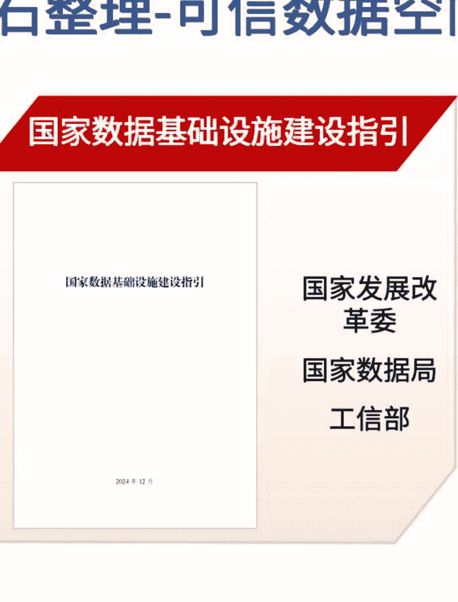
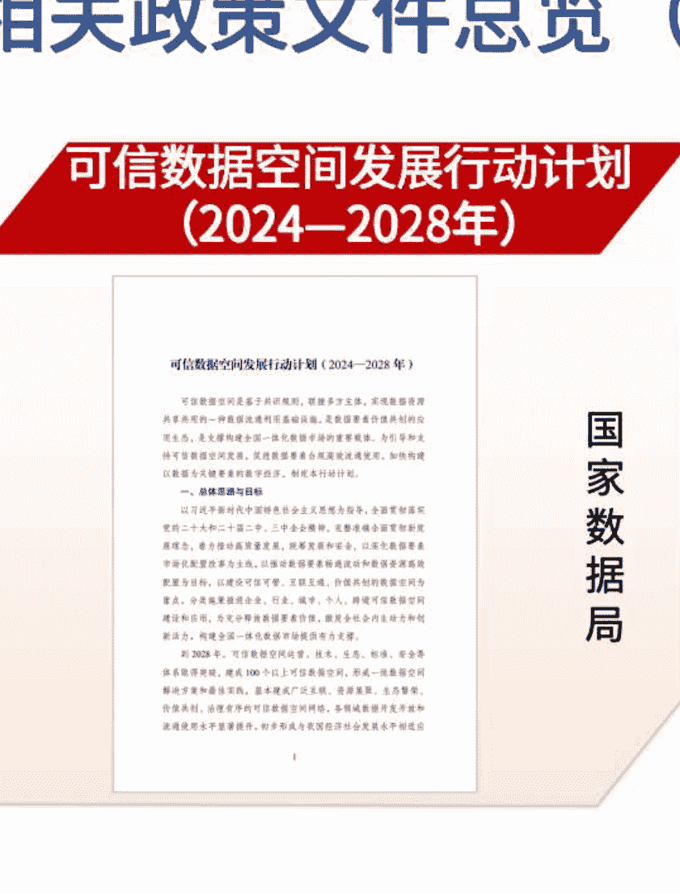
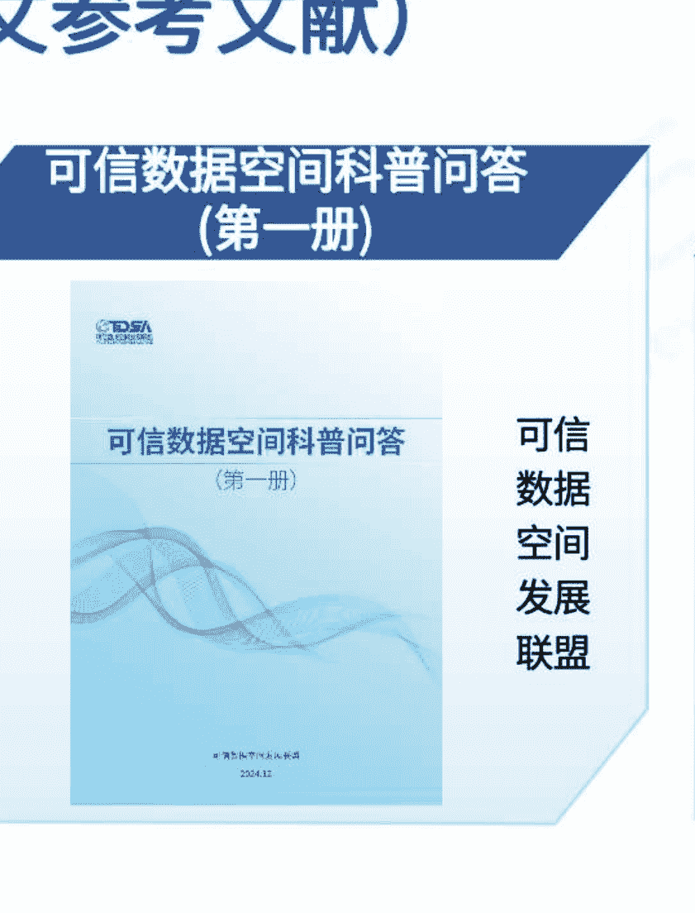
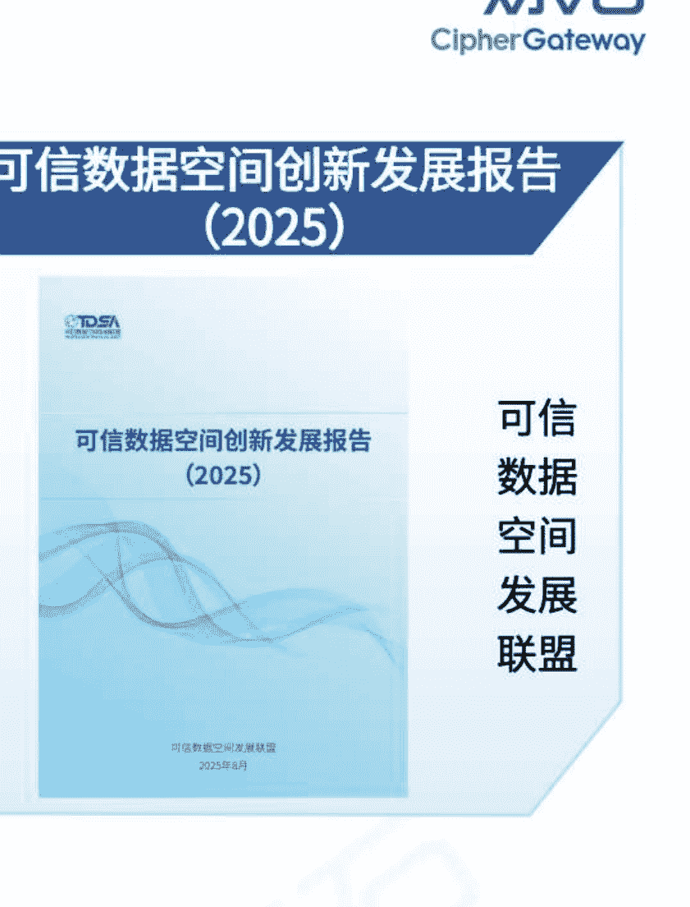
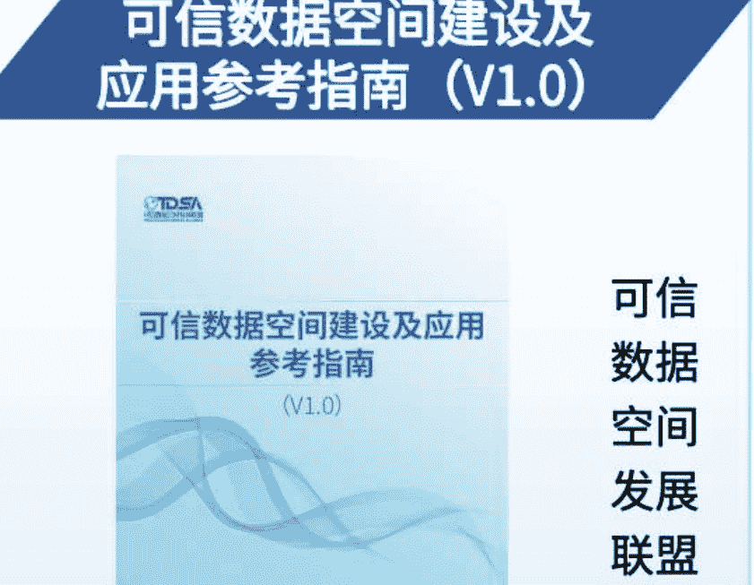
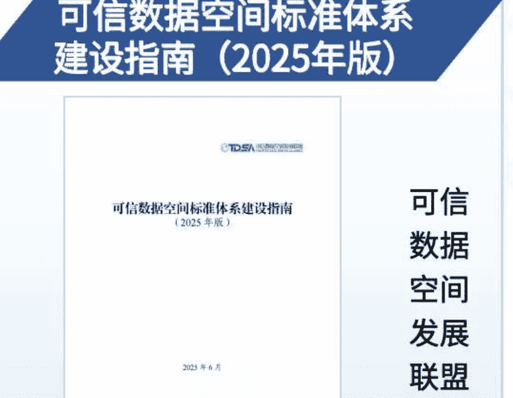
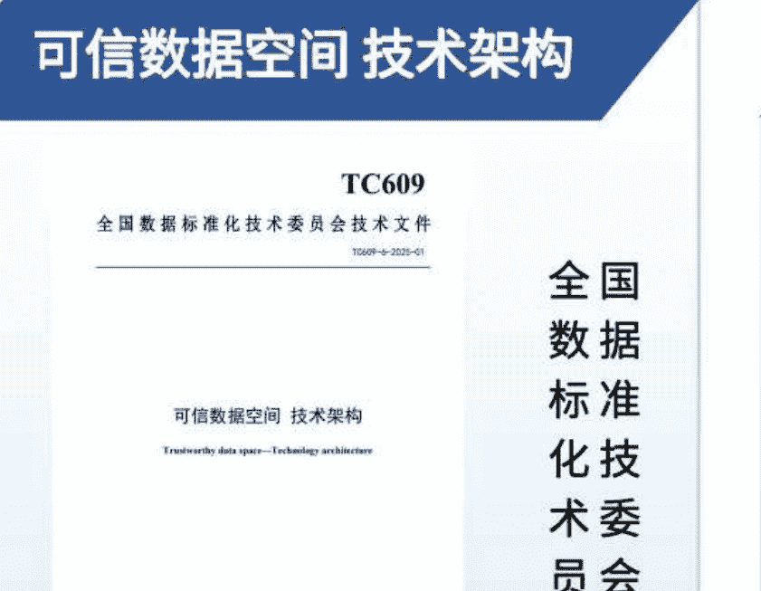
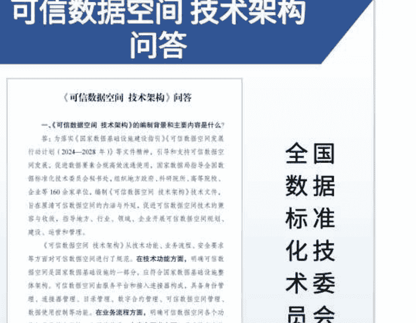

1. 图解国家发改委、数据局、工信部《国家数据基础设施建设指引》
2. 图解国家数据局《可数据空间发展行动计划（2024—2028年）》
3. 十可信数据空间
4. 图解《可信数据空间创新发展报告（2025）》
5. 图解《可信数据空间建设及应用参考指南（V1.0）》
6. 图解《可信数据空间标准体系建设指南（2025年版）》
7. 图标准《可信数据空间技术架构》
8. 数据流通场景数据安全实践

## 党的二十届三中全会明确提出：建设和运营国家数据基础设施，促进数据共享

党的二十届三中全会明确提出“建设和运营国家数据基础设施，促进数据共享”。按照党中央、国务院决策部部署，国家发展改革委员会、国家数据局、工业和信息化部在充分调研的基础上，组织编制了《国家数据基础设施建设指引》，于2024年12月31日发布。

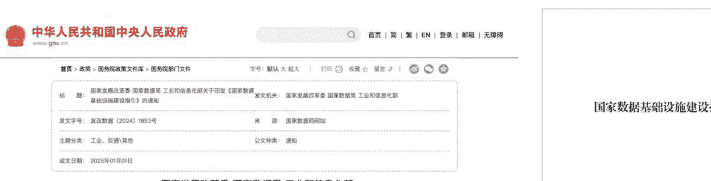

《国家数据基础设施建设指引》明确了国家数据基础设施的概念、发展愿景和建设目标，推进数据基础设施建设，推动形成横向、纵向贯通、协调有力的国家数据基础设施基本格局，打通数据流通动态，增强数据资源应用开发，培育全国一体化数据市场，夯实数字经济发展基础，为数字中国提供有力支撑。

## 概念内涵：纵人类人类发展历史，每一产业变革都会孕育新的基础设施

农业经济时代
基础设施主要是农田水利设施

工业经济时代
公路、铁路、港口、机场、电力系统等为关键基础设施

数字经济时代
网络设施、算力设施、应用设施构建了数字基础设施

## 数据成为关键生产要素

当前，数据成为关键生产要素，纵人类发展历史，每一次技术新的方式都会重塑产业发展，推动数据基础设施向延伸和拓展。建设和运营国家数据基础设施，进一步促进数据流动、应用、安全，对于支持数据落地、培养发展具有重要意义。

## 国家数据基础设施是从数据要素价值释放的角度出发，面向社会提供数据采集、汇聚、传输、流通、运营、安全的一类新型基础设施，是集成硬件、软件、模型、标准设计在内的有机整体。

## 发展愿景：国家数据基础设施是数据基础

可信数据空间是支撑全国一体化市场的重要载体，形成协同联动、规模流通、高效利用、规范的数据体系。构建多源异构、高效调度、智能需、高质量算力供给。在网络方面，构建灵活接入、高速传输、动态调度。在算力方面，构建整体、动态、内生的安全体系。在应用方面，支持传统行业升级、赋能新兴产业发展。

## 未来展望：2024—2029

2024—2026年左右，聚焦我国重要领域和典型场景，开展数据基础设施试验，制定统一标识、统一身份、统一规范，解决复杂难题，明确数据基础设施技术路线。

2027—2028年，建设支撑跨层级、跨域、跨系统、跨部门、跨业务的规模化流通，实现全国一体化市场，构建规模联动、高效利用。

到029年，基本建成国家数据基础设施，初步形成横向贯通、纵向协调有力的格局，构建数据基础设施技术标准和良好生态。

## 数据基础设施及网络、算力总体架构

### 八大能力

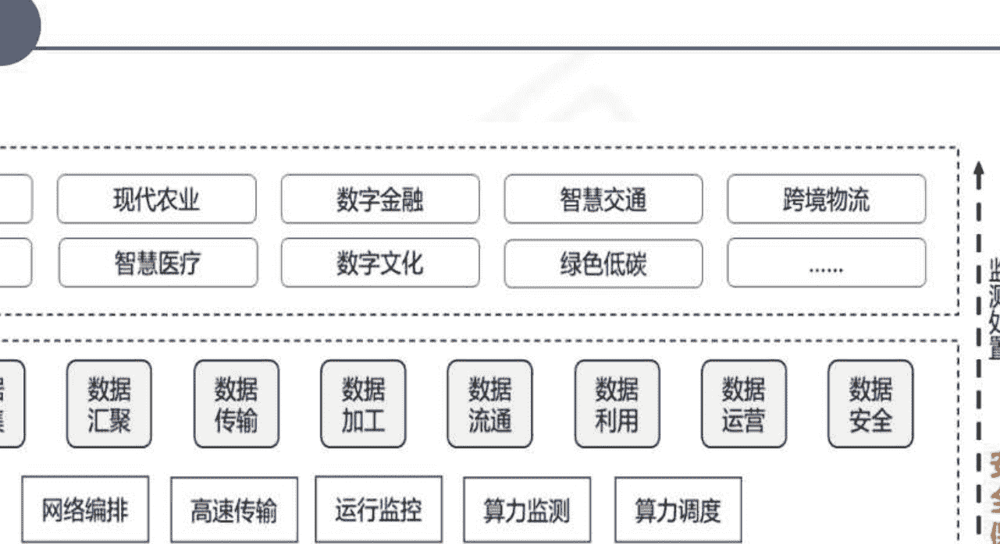

国家基础设施具有数据采集、汇聚、传输、加工、流通、监管、安全八大能力：

- ① 数据采集方面：通过传感器、业务系统等手段采集相关数据。
- ② 数据汇聚方面：通过标识编码、数据索引等，对数据进行高效接入，实现数据汇聚和发布。
- ③ 数据传输方面：支持节点实时同步、高效传输。
- ④ 数据加工方面：为参与方提供便捷的数据清洗、计算，建立数据质量评估，提高处理效率。
- ⑤ 数据流通方面：通过分类策略实现共享、交易，为不同行业、不同地区提供流通环境。
- ⑥ 应用方面：提供数据分析、可视化等能力，进一步降低应用门槛。
- ⑦ 监管方面：通过注册登记、管理、授权等功能，保障全国范围内数据有序运行。
- ⑧ 安全方面：提供动态全过程数据安全，包括防窃、防泄露、防破坏等。

赋能方面：促进数据多场景应用、复用，赋能工业制造、现代农业、数字金融、智慧医疗、智慧交通、跨境物流、绿色低碳等领域。

## 数据流通设施是国家基础设施的重要组成部分

数据流通设施为跨层级、跨地域、跨系统、跨部门、跨业务数据流通提供安全可信环境。在数据流通领域，目前各行业的实践方案主要包括数据空间、数据场、数据网络等。

### 1. 数据空间架构
### 2. 数据通用能力架构

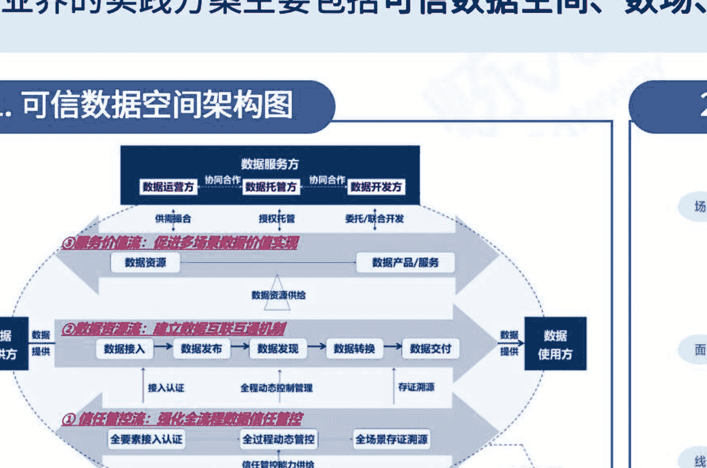
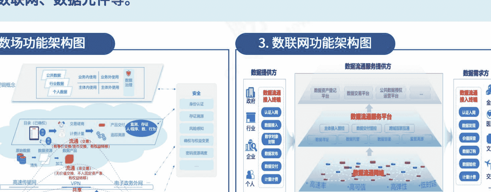

数据空间是基于共识规则、连接多方主体，实现数据资源共享的一种跨流通设施，是数据要素价值释放的应用空间，是构建全国一体化市场的重要组件。数据空间具备数据可信能力、资源交互、数据交换及互信核心机制。

数据场依托网络、算力与隐私计算、区块链等类联动设施，面向数据要素提供线下资源供给、供需匹配、交易流通、开发利用、存证等等，支持多种场景的应用的一种综合性流通设施。

数据网络由数据接入终端、数据流通网络、数据流通服务平台构成，提供一种接入、泛连接、标准对接、安全、合规监管、开放包容的数据流通服务。

### 4. 数据元

数据元提供统一标准、自主可控、安全可靠、全监管的数据存储和加工服务，采用标准化流程完成数据规模化加工、生产和再利用，适用于大规模数据和工业生产场景。数据元作为连接数据两端的“中心态”，将原始数据与数据应用“解耦”，基于数据元相关组件，实现从数据归集到交互交换全生命周期。

1. 图解国家发改委、数据局、工信部《国家数据基础设施建设指引》
2. 图解国家数据局《可信数据空间发展行动计划（2024—2028年）》
3. 十问可信数据空间
4. 图解《可信数据空间创新发展报告（2025）》
5. 图解《可信数据空间建设及应用参考指南（V1.0）》
6. 图解《可信数据空间标准体系建设指南（2025年版）》
7. 图解标准《可信数据空间技术架构》
8. 数据流通场景数据安全实践

## 可信数据空间是支撑全国一体化市场载体

| 字段 | 内容 |
| :--- | :--- |
| 标题 | 国家数据局关于发布可信数据空间发展计划（2024—2028年）的通知 |
| 发文机关 | 国家数据局 |
| 发文号 | 国家数据局〔2024〕第99号 |
| 分类主题 | 信息、通信、其他（电子信息） |
| 接收日期 | 2024年1月21日 |
| 来源 | 国家数据局网站 |
| 公文格式 | 通知 |

各省、直、自治区：请按计划实施，并健全可信空间管理。有关部门、企业、协会：认真落实。

国家数据局关于发布可信数据空间发展计划（2024—2028年）的通知，2024年1月21日。旨在贯彻二十届三中全会精神，以习近平时代特色思想为指导，全面贯彻党的二十大精神，准确贯彻发展理念，统筹发展，推动高质量发展。

## 背景

可信数据空间是基于信任共识，连接多方主体，实现数据资源共享的一种基础设施，是数据要素价值释放的应用生态，是构建全国一体化市场载体。为引导和支持可信空间发展，促进数据要素价值流通，加快构建以数据为关键要素。

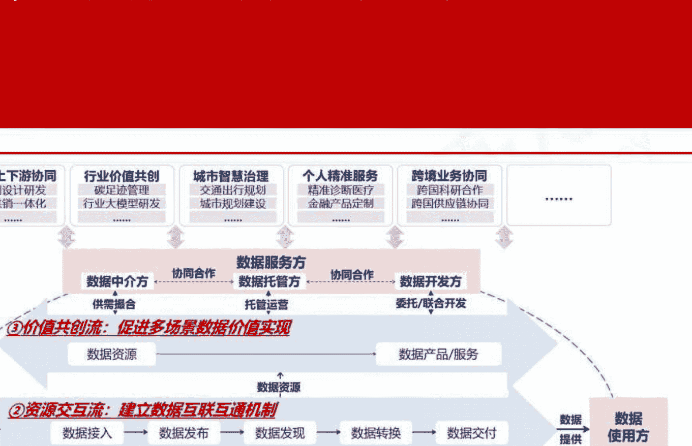

## 可信数据空间运营技术标准安全突破

### 架构数据空间可控、资源交互、价值共创等能力

- 1. 思路目标
- 2. 建设行动
- 3. 培育推广
- 4. 筑基础
- 5. 保障措施
- 附件：名词解释
- 附件：引导体系

### 1. 构建数据空间可控
### 2. 提高数据空间资源交互能力
### 3. 强化可信数据空间价值共创能力

支持可信数据空间运营者接入认证体系，保障可信数据空间参与与各方身份信息、数据资源管理清晰责任、应用服务可靠。

引导可信数据运营者建立可信数据使用合同和规范、履行隐私承诺、使用权限控制、采用区块链等技术、优化运行机制，提升管控能力。

推动可信数据运营者构建可信合同和履约行为证明体系，提升资源开发利用全周期能力，保障可信数据空间参与各方权益，确保市场公平竞争。

引导可信数据运营者提供数据标识、语义转换等技术服务，推动可信数据空间参与与各方通过数据资源封装、源维护等手段，实现产品和服务的统一发布、高效查询、跨主体交互。

引导可信数据运营者加强协作，统一目标、身份认证、接口要求，实现各类数据空间互联互通，促进身份互、资源共享、服务共用。

面向共性应用场景，支持可信数据空间运营者部署应用开发环境，为参与各方产品和服务创造新价值。

引导可信数据运营者建立共建共享、公平透明的运营规则，探索构建态势价值评估体系，按照市场价值贡献、贡献决定价值分配的原则实现收益。

支持可信数据空间运营者与数据经纪、数据托管、审计清算、合规审查等服务方开展价值协同和业务合作，打造可信数据空间发展的良好生态。

## 推进企业、行业、城市、个人、跨境等五类可信数据空间发展

- 1. 思路目标

- 2. 建设行动

- 3. 培育推广

- 4. 筑基行动
- 5. 保障措施

## 推进标准、技术攻关、基础服务等可信数据空间筑基行动

### 思路目标

#### 制订推广可信数据空间关键标准

强化可信数据空间标准化工作，加参考架构、功能需求、运营规范等基础共性标准，积极推进可信数据交换、使用控制、数据模型等关键标准制定。

#### 完善可信数据空间基础服务

支持建设可信数据空间共性服务体系，降低可信数据空间建设和使用门槛。加快建设数据高速传输网络，推动全国范围内算化网络建设，支持可信数据空间多主体灵活传输数据资源的需求。提升数据跨域域控服务能力，实现数据可控可计量。

### 2. 建设行动
### 3. 培养推广行动
### 4. 筑基行动
### 5. 保障措施

#### 开展可信数据空间核心技术攻关

组织开展使用控制、数据沙箱、智能计算、隐私计算、高性能加密计算、可执行环境等可控攻关，推动数据标识、语义发现、元数据智能识别等数据互通技术集成，探索大模型与可信数据空间融合创新。推动可信数据资源管理、应用开发、系统安全等技术工具和软硬件产品研发，支持打造可信数据空间系统解决方案，培育一批技术和产品服务商。依托现有开源平台推动可信数据空间技术开源，建立多方参与的创新机制，提升技术研发和扩散效率。

附件、名词解释

## 推进规范管理、国际合作等可信数据空间筑基

- 1. 思路目标
- 2. 建设行动
- 3. 培育推广行动
- 4. 筑基行动
- 5. 保障措施

#### 强化可信数据空间规范管理

建立健全可信数据空间合规管理指引，明确可信数据空间参与各方的基本要求和权责边界，防范利用数据、算法、技术等从事垄断行为。探索开展可信数据空间备案，动态发布可信数据名录。参与可信数据空间要遵守网络安全、数据安全、个人信息保护法等法律法规，落实数据分类分级保护、动态感知、监控预警、应急处置、治理监管等要求，建立可信数据空间安全体系。按照国家标准，引导和规范第三方开展可信数据空间核心能力评估。

#### 拓展可信数据空间国际合作

依托中欧、二十国集团、金砖国际国家、上海合作组织等多边框架，探索建立可信数据空间对接合作机制，形成发展共识。积极参与国际标准化活动（ISO）、国际电联（ITU）、国际数据工会（IEC）等标准化组织，加强标准国际协调，牵头参与制定相关国际标准，推动我国可信数据技术标准、运营规则和认证体系的全球适用。面向“一带一路”等区域合作平台，推动可信数据空间国际合作项目建设，探索国内外数据空间互通。

- 附件、术词表
- 附件、引导体系

#### 加强统筹联动保障数据空间发展

国家数据主管部门加强统筹调控，跨界部门联合管理模式，共同推进各项工作落实到位。各地要将可信数据空间应用推广促进“供出、流出、用得、安全”的重要举措，结合本地区发展基础和特色，组织实施相关可信数据空间运营工作，推进政策落地到位。

#### 加强资金支持

统筹利用各类财政资金，加大可信数据空间制度建设、技术攻关、项目试点、应用服务等方面的支持。通过多渠道资金加大可信数据空间投入，在依法法规下，鼓励有条件的机构与数据空间合作，构建可靠体系。

#### 加强人才培养

加强可信数据空间人才培养。支持和引导院校、科研机构、企业联合建设可信数据空间实验室，加速数据空间开发、数据治理等专业人才培养。通过资金支持和引导等，营造良好氛围，激发创新活力。

#### 加强标准引领

加强全国可信数据空间应用工作，打造一批资源丰富、应用成熟、数据丰富的可信空间标杆，组织完善可信数据空间评价体系。按照国家标准，引导和规范第三方开展可信数据空间核心能力评估工作。

#### 推动交流

充分发挥行业联盟、标准化组织等作用，促进数据空间互通交流。组织编制可信数据空间规则，通过技术应用、市场推广、数据对接，确保数据空间持续发展。

## 名词解释

#### 可信数据空间

可信数据空间是基于信任规则、多方主体实现数据资源共享的一种通用基础设施，是数据要素驱动的应用生态，具备数据控、资源交互、价值共享三类核心能力。其含义如下：

#### 使用控制

一种可控技术，通过预先设置条件形成隔离结构，实时监测数据输出，动态决定操作的许可或拒绝。通过构建一个应用层隔离环境，允许控方在安全和受控的区域内对数据进行分析。

#### 数据标识

通过数据资源分配标识，确保快速准确的数据检索和实现数据全生命期的追踪性和可访问性。

#### 密计算

通过线性密码、密文硬件和系统安全的计算，其计算过程获取数据不可见，计算结果能够持续化，以支持构建复杂组合，实现数据全链隔离，防止数据泄露和滥用。

#### 隐私计算

一种可控技术，允许在不泄露原始数据的情况下进行分析，旨在保障数据在产生、存储、计算、应用等数据流转的每个环节中“可用不可见”。常用技术方案有方安全、联邦学习、可信执行环境、密计算。

#### 元数据智能识别

一种资源技术，将元数据从一种语言转换为另一种语言，包括但不限于对数据的属性、关系和规则进行重新定义，以确保数据在不同系统中一致性和可解释性。

#### 智能合约

基于机器协议的合同形式，以信息交互方式传输、验证和执行，无需第三方的信任，确保交易的透明性和不可逆转性。

#### 语义理解

一种资源技术，通过自动理解数据深层含义及其关联性，实现从来源和类型数据的智能索引、关联和发现。

#### 数据价值评估模型

一种多维度衡量数据价值的算法模型，综合考虑数据的质量、来源、用途等，评估数据业务收益的效益。

#### 共性服务

可信数据空间的共性功能需求，可以提供通用化的服务，但不限于接入认证、可信证、资源源等功能，适宜一种连接。

#### 可信证

一种可信数据空间共性服务，保存数据流通过信息被记录且不可篡改，为清算、纠纷提供证据，确保全程行为可追溯。

#### 资源目录

一种可信数据空间共性服务，按照接口标准建设，提供数据、服务、资源的发布与发现能力，可以被多个共享数据空间使用。

#### 接入引起

一种可信数据空间共性服务，按照标准对接数据空间的主体、技术等开展能力，确保符合政策和要求。

## 可数据空间发展引导体系（1.0版）

| 基本要素 | 主要方面 | 内容 |
| :--- | :--- | :--- |
| 思路目标 | 接入评审 | 可信数据空间提供注册、身份认证和服务，权威公安、市场监管等。 |
| 可信控能力 | 履约机制与数据控 | 可信数据空间针对数据流的关键环节，构建履约策略，确保数据在约定内。 |
| 资源交互能力 | 日志存证与溯源 | 可信数据空间追踪和记录数据来源、路径、历史以及当前状态，保证行为真实、不可改。 |
| 发布能力 | 数据发现 | 可信数据空间支持各方各自界限，发布或查询所需数据、产品。 |
| 操作性 | 语义 | 可信数据空间定义数据资源、产品服务的描述，定义语义规范，支持跨系统交互。 |
| 互联互通 | 标识 | 可信数据空间按照标识、身份认证、协议等标准，实现各类空间互联互通。 |
| 开发环境 | 可用 | 数据空间为使用方等提供数据和服务的应用环境。 |
| 价值创造 | 运营规则和利益保障 | 可信数据空间运行时定义规则，建立各方权责清单，制定数据共享全过程，实现公平分配。 |
| 数据接入方 | 管理 | 可信数据空间为数据开发、经营、托管、审计等提供标准化的数据服务。 |
| 数据资源汇聚 | 生态体系 | 评估数据空间中资源类型、质量等。 |
| 应用成效 | 参与程度 | 评估数据空间中提供方、使用方、数据服务的数量、多样性和活跃情况。 |
| 开发利用 | 程度 | 评估数据空间中产品、应用场景的数量、多样性和活跃情况。 |
| 安全保障 | 安全防护 | 可信数据空间对数据流周期，构建完善的防护、检测等技术，防止数据泄露、篡改。 |
| 合规管理 | 可信数据空间应监控违反法律法规的行为，并在行为发生时采取相应的处置。 |

- 1. 图解国家发改委、数据局、工信部《国家基础设施建设指引》
- 2. 图解国家数据局《可信数据空间发展计划（2024—2028年）》
- 3. 可信数据空间
- 4. 图解国家数据局《可信数据空间创新报告（2025年）》
- 5. 图解国家《可信数据空间建设及应用指南（V1.0）》
- 6. 图解《可信数据空间标准体系建设指南（2025年版）》
- 7. 图解《可信数据空间技术架构》
- 8. 数据流通场景实践

## 一问：可信数据空间意义是什么？

可信数据空间是基于共同规则，连接多方主体，实现数据资源共享的一种流通基础设施，通过构建共享机制为主体、各行业、各区域提供安全可靠的可信流通环境，推动有序流通，以高价值的应用场景、多方协同吸引提供方、使用方、服务方等主体共同控价值，汇聚发展动力，构建价值生态。

可信数据空间以场景需求牵引，吸引提供方、使用方共享资源，推动服务方等主体开发新产品，以共识规则和技术系统为支撑，推动数据信流通与高效利用。

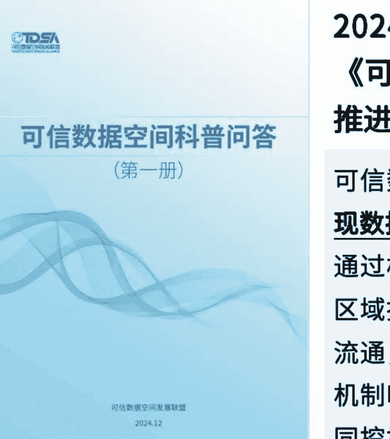

| 场景应用 | 生态主体 | 数据资源 |
| :--- | :--- | :--- |
| 规则机制 | 技术系统 | |

| 规则机制 | 场景应用 | 技术系统 |
| :--- | :--- | :--- |
| 资源接入规范 | | 可信数据空间 |

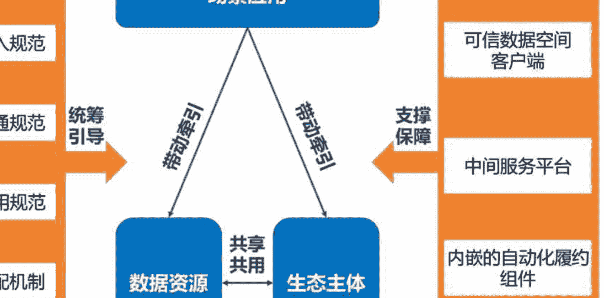

### 1. 保障数据流通通用“可信”

| 数据资源接入规范 | 保障数据行为 | 保障结果可溯 |

#### 2. 具备数据互通与价值交换的核心能力

通过构建数据格式转换与互通能力，支持数据高效对接与跨主体互认，并探索标识、身份证明等关键技术，解决互通深度不足的问题，促进资源释放。

#### 3. 支持主体驱动数据价值交换

通过构建基于互信的运行机制，牵引多方主体协同协作，围绕共同价值需求开展产品和服务创新，促进流通潜能释放。

- 1. 解决数据共享意愿不足，丰富资源供给
- 2. 解决资源交互缺少技术手段的瓶颈，提升数据流通效率
- 3. 破解数据开发深度不足的问题，促进资源释放

可信数据空间各个组成部分之间的关系

## 一问：可信数据空间及其意义是什么？

### 在建设全国一体化数据市场中发挥基础支撑作用

- 可信数据空间有助于构建全国一体化的流通体系。通过建立统一的接入认证、互联互通、共享使用、收益分配等规则机制与标准规范，实现全国互信、数据互通、供需通，促进更大规模的数据供给、更层次的数据应用，促进数据资源规模化、一体化流通通用。
- 可信数据空间有利于推动数据要素市场建设。通过统一的机制牵引多方主体进入数据空间，并支持各类主体围绕共同价值需求打造各类产品和服务，充分激发数据产业主体的活力与创新力，各方发挥共同优势。

- 语义、操作性。可信数据空间定义数据资源、产品服务的描述，定义语义规范，支持跨系统交互。
- 互联互通。可信数据空间按照标识、身份认证、协议等标准，实现各类空间互联互通，促进资源共享、服务共享。
- 可用环境。数据空间为使用方等提供数据和服务的应用环境。
- 运营规则和利益保障。可信数据空间运行时定义规则，建立各方权责清单，制定数据共享全过程，实现公平分配。
- 数据接入方。数据空间为数据开发、经营、托管、审计等提供标准化的数据服务。
- 数据资源汇聚。评估数据空间中资源类型、质量等。
- 应用成效。评估数据空间中提供方、使用方、数据服务的数量、多样性和活跃情况。
- 开发利用。评估数据空间中产品、应用场景的数量、多样性和活跃情况。
- 安全保障。可信数据空间对数据流周期，构建完善的防护、检测等技术，防止数据泄露、篡改。
- 合规管理。可信数据空间应监控违反法律法规的行为，并在行为发生时采取相应的处置。

## 二问：可信数据空间意义是什么？

### 欧美

- 规划：美国发布《国家数据战略》，建立空间数据。

- ：
- 战略规划。

- 1. 图解国家发改委、数据局、工信部《国家基础设施建设指引》
- 2. 图解国家数据局《可信数据空间发展计划（2024—2028年）》
- 3. 可信数据空间
- 4. 图解国家数据局《可信数据空间创新报告（2025年）》
- 5. 图解国家《可信数据空间建设及应用指南（V1.0）》
- 6. 图解《可信数据标准体系建设指南（2025年版）》
- 7. 图解《可信数据空间技术架构》
- 8. 数据流通场景实践

### 日本

- 规划：日本发布《国家数据战略（NDS）》，建立空间数据。

- ：
- 战略指导。

### 欧美

- 规划：美国发布《国家数据战略》，建立空间数据。

- ：
- 战略指导。

## 三问：为什么要发展五类信数据空间 它们之间是什么关系

### 原因分析

### 相关性

规划部署五类信数据空间与数据资源开发的重点领域相契合，也与推进数据转型的重点方向相匹配。

- 方面，信数据空间全面面向公共数据、企业数据、个人数据等数据资源开发，充分考虑各类主体的产业价值、运营能力与建设基础等优势进行适配。
- 演进：演进关系在某一类空间随着主体类增加、数据规模扩张、应用场景创新，逐渐演变为其他类型的信数据空间。
- 另一方面，信数据空间的类别规划充分响应企业降本增效、行业升级、城市数字化转型等业务需求，以数据要素赋能全社会效率提升与创新发展。
- 包含：不同信数据空间存在互通关系，即同一主体或数据资源存在于多个数据空间之中。
- 交互：未来五类信数据空间相互交互、相互影响，会演出多种关联关系，最终演变为互联互通的网络数据共享生态。

## 1.企业信数据空间
## 2.行业可信数据空间
## 3.城市可信数据空间
## 4.个人可信数据空间
## 5.跨境可信数据空间

## 我国数据流通“内循环”：
- 政府数据：以公共数据为牵引，拉动城市内产业数据汇聚利用
- 个人数据：城市内数据数据

## 跨境数据流通“外循环”：
- 个人可信数据空间：加速个人数据开发利用
- 城市可信数据空间：企业、行业数据需求
- 跨境可信数据空间：公共数据
- 企业可信数据空间：生态主体增多 数据规模扩张 应用场景不断创新
- 行业可信数据空间：企业数据
- 核心主企业牵：贯通上下企业数据 业务需创新
- 多头企业联合：推动企业、行业数据 共享利用
- 延伸连接
- 大型数据园区集团头部：推动企业、行业数据 跨境流通

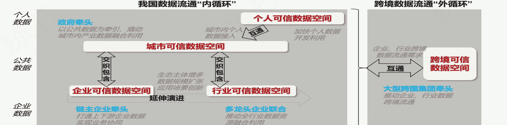

## 四问：企业可信数据空间解决哪些问题？建设模式、应用案例如何？

### 解决的问题 上游数据打通

### 建设模式

企业在推进数字化转型过程中，需通过上下游数据实现供应链协同，从而提升整体运营效率和市场竞争力。然而，由于存在竞争关系，上下游企业担心数据泄露导致自身利益受损、知识产权受到侵犯，因此不愿共享数据，严重影响企业数字化转型进程。

为了更好地提升上下游协同水平，支持龙头企业围控上下游业务需求，牵头建设企业可信数据空间，并带动上下游企业接入空间，实现订单同步、产能、库存、质量等下游数据可控流，打造多供应商订单管理、供应链质量实时监控、产品质量追溯等高价值应用场景，提升企业供应链韧性与运行效率。

### 典型案例

背景及痛点：装备制造行业在开展设计和预测性维护过程中需要打通上下游主体数据，但由于设计、装院、装使用等相关主体核心知识产权被侵犯、泄露商业机密，不愿共享设计图纸、装运行等高价值信息，导致销售环节难以以快速完成交易交流与投标方案、售中环节难以实现协同研发与交付、售后环节难以实现数字化的运维服务。

方案：为推进上下游企业数据共享与深度协同，装备制造的头部企业可以通过策划建设企业可信数据空间，带动装院、设计、施工、供应商等下游主体接入，推进设计、施工、施工设计图纸及装运行等数据可控共享，通过协同设计、设计生产一体化、远程运维等场景应用，提升企业研发生产效率，优化装备的远程运维服务。

| 企业可信数据空间 | | | |
| --- | --- | --- | --- |
| 设计/装院 | 施工方案 | 销售方案联合设计 |
| | ①设计数据、②上游数据 | | |
| | ③提出需求 | ④下游需求 ⑤提出设计方案 |
| | 施工 售主设计 ⑥传输设计图 联合设计 供应商 生产 |
| | ⑦装备设计运行数据 ⑧装备设计运行数据 | 远程运维服务 |
| | 施工 | | |
| | | 服务空间 |

## 五、行业性数据空间解决哪些问题？ 建设模式、应用案例如何？

### 解决的问题

### 建设模式

随着行业转型升级深入发展，行业主体共同面临产业竞争力提升、绿色可持续发展、科技与创新等共性需求与挑战，亟需全行业协同推动数据资源共享与融合利用，解决行业共性问题。由于安全可靠的数据共享流限制，行业数据碎片化分散在各行业数据主体中，导致行业数据价值无法实现价值增值，难以满足行业共性需求。行业共性数据空间打破行业数据分散化、难互通导致的壁垒，以行业数据规模化融合利用解决行业共性问题，创造行业共性，引领行业创新与发展。

为满足数据供应链安全、绿色可持续发展、科技与模式创新等行业共性需求，支持头部企业、数据密集型企业、行业协会等主体联合建设行业数据空间，在行业共性需求牵引下，推动行业数据规模化流通与融合利用，实现数据信息共享、互通性，共同打造行业资源治理、绿色转型、科技创新等共性应用。

### 典型案例

背景：我国领先新能源行业推进数据化进程，提升行业竞争力，需要全行业生命周期数据，符合海外法规。
痛点：由于行业数据涉及到供需关系、原材料、材料等高价值信息，数据分散在各数据主体中难以实现价值增值。
方案：行业可通过构建行业数据空间，构建统一的数据管理能力、数据交换规范，引导材料、零部件、整车企业等行业主体接入，在确保数据可控下，推进材料状态、拆解等数据，符合全球输出。
解决共性需求：此类场景还有新材料研发、大模型开发等共性挑战，且需要行业主体联动，通过行业数据规模化流通实现价值共享，助力行业整体升级。

## 六：城市数据空间解决哪些问题？建设模式、应用案例如何？

### 解决的问题（缺乏统一、可控性）

### 建设模式

在推进数字化转型的过程中，需要以公共数据为牵引，推动城市智慧治理、产业创新。由于城市数据分散在同一系统中，数据割裂严重、碎片化、标准不统一，导致数据资源深度融合。同时，缺乏可控的数据流，各主体在数据领域被滥用、泄露风险，导致数据资源共享意愿不足。

为城市内数据开发，鼓励城市主体建设城市可信数据空间，保障城市规划、交通出行、医疗健康管理、环境保护等重点场景，实现数据流通的跨行业、跨领域融合，赋能城市数字化转型。

### 典型案例

背景与痛点：某市为了改善营商环境，由于数据泄露忧虑，中小企业不愿共享营业收入、资产负债、员工等公共数据，政府部门也不敢验证，导致金融措施落地。
方案：为推进城市数据与产业数据深度融合，城市可信数据空间建立自身身份认证、使用控制、应用开发等功能，推动中小企业、税务部门、社保部门等接入并开展数据共享，助力银行业化普惠金融信贷评估模型，缓解中小企业融资困难问题。

## 七问：个人可信数据空间解决哪些问题？建设模式、应用案例如何？

### 解决的问题

### 建设模式

为打造个性化、精细化的用户服务，产业需要对个人数据进行开发利用。由于个人对自身数据缺少自主管理和控制，导致个人数据滥用、泄露等事件频繁发生，个人隐私受到损害。个人可信数据空间为数据主体打造可信的数据利用环境，破解个人数据滥用、泄露等安全问题，保护个人隐私，促进个性化服务创新。

为解决个人数据泄露问题、推进个人数据流通与开发利用，在监管下探索个人可信数据空间，充分尊重个人意愿、保护个人权益的前提下，引导个人通过可信数据空间授权共享数据资源，保障个人对自身数据流通全过程的管理，打造个人信贷、精准医疗、个人出行推荐等个性化、精细化的数据产品与服务，提升用户服务质量。

### 典型案例

背景：为优化精准信贷、信用增强等金融服务，需要对个人数据资源开发利用，但在此过程中面临个人数据滥用、数据隐私泄露等风险。
方案：为推动个人数据可信利用，提升个人金融服务质量，韩国建设个人可信数据空间Mydata，推动将自身的数据资源授权运营方，当有对个人数据请求访问的需求时，运营方按照数据流通使用协议后统一传输数据使用，在保证对个人数据有效控制下实现个人数据资源共享流通与开发利用，提升金融信贷、信用管理等个性化服务水平。

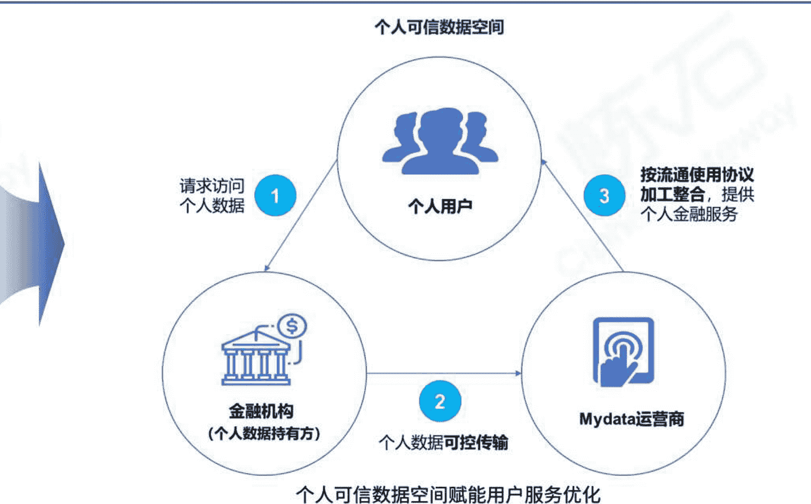

## 八问：跨境可信数据能够解决哪些问题？建设模式、应用案例如何？

| 解决的问题 | 数据流不受控 | 难以自证 |
| --- | --- | --- |

随着跨国企业全球业务发展，对跨境数据需求亟发生增长，但跨境数据通用面临不受控、敏感数据泄露风险，在跨境传输时缺乏有效的管控，同时缺乏有效的手段来证明数据使用是否符合规范，成为难题。

为更好的解决当前跨境数据不受控、使用过程无法自证等问题，对于跨境内的跨国企业等主体，构建跨境可信数据空间，为跨境数据流通的需求提供管控、备案、安全评估服务，保障数据流动全过程的可控性。

### 典型案例

当前跨境数据流通的需求日益增长，可通过规划跨境可信数据空间，引入国外科研机构接入，开展数据共享，推动生物医药、人工智能、材料研发等数据开发，以数据使用控制等技术支撑跨国间的协同创新。

| 新加坡 | 跨境可信数据空间 | 国内 |
| --- | --- | --- |
| 科研所 | 使用受控 | 科研所 |
| 高等高校 | 跨境管控 / 存证备案 / 合规 | 高等高校 |
| 研究机构 | | 研究机构 |
| | | AI模型训练 |
| | | 先进材料 |

## 九：可信数据空间包含哪些技术？这些技术实现哪些功能?

可信数据空间组件管理、资源互通、可信管控、存证源等关键词，确保各类协议得以切实有效。

身份管理技术：对数据空间的各方严格审核和动态监控，确保只有合法用户进入数据空间。

资源互通技术：支持数据发布、帮助数据格式转化，其中数据主要实现检索和定位，缩短数据寻找时间；语义转换技术：基于建模工具、语义模型、智能转换工具，实现功能所需的语义模板或互通工具。

存证源技术：基于区块链、密码学原理，采集并加密数据操作日志，为收益分析、清算、审计提供可追溯的依据。

可信管控技术：包含控制、隐私计算、数据共享等技术。其中，使用可信控制等技术确保数据输出后按需使用，在数据侧环境中数据只被授权允许各方自由开发。在多领域模型学习中，各方可以从原始数据获得训练好的模型。

### 存证源技术
- 示例：基于分布式存储、点同步、共识机制等技术的分布式账本
- 解决方案：实现对数据流过程中的关键事件、行为存证

### 身份管理技术
- 示例：基于数字证书
- 解决方案：重要数据源的分类问题

| 存证上链 | 可信管控 | 结果审计数据 |
| --- | --- | --- |
| 接入流 | 使用控制基于身份、行为、时间、点等要素的动态访问控制 | 隐私计算数据、多方计算、可执行环境 | 数据要素安全沙箱、分布式沙箱 |
| 保障数据流全程过程控制 | | |
| 支持共享数据查询 | | |

### 资源互通
数据、搜索算法解决问题，对数据进行检索和定位的需求，缩短数据范围；语义转换技术基于建模工具、语义模型、智能转换工具，实现功能所需的语义模板或互通工具

## 可信数据空间体系结构

## 十问: 可信数据空间的商业运营如何进行?

可信数据空间运营方：负责管理规范与运营规则，并依据规则开展日常管理与运营，确保数据空间安全、稳定、高效运行。

数据提供方：为数据空间提供数据资源，有权决定数据访问、共享和权限并获得收益，为可信数据空间提供丰富的数据；

数据使用方：依据数据合约进行数据加工，并信托可信数据空间实现数据资源创新与价值释放。

服务方：包括数据中介、数据托管方、数据开发方，为可信数据空间提供数据服务、托管运营、开发等服务，提升数据流通的效率与安全水平。

接入审核规则：明确可信数据空间内主体、数据、产品服务、技术组件等资源的接入审核规则，确保身份可信、数据可用、产品服务可靠、技术安全；

互通规则：通过统一的数据框架和操作标准，明确数据格式描述和编码体系，确保跨主体互认；

共享规则：通过制定标准化的数据管控、模板，确保供需涵盖、数据交付、全生命周期安全；

收益分配机制：通过制定价值评估、收益分配方法，确保空间内主体获得公平的数据收益。

商业模式仍在探索，初期：
- 会员模式：收取会员费获得收益；
- 服务模式：通过提供数据服务收费；
- 销售模式：通过提供数据产品收费；
- 分成模式：通过收取一定比例的收入作为。

能够有效引导主体进入空间并开展数据流通，打造可持续运营。

## 全国掀起空间热潮，试点多点开花

我国数据空间运动，各地持续加大政策布局，首批试点项目覆盖全国20余省市。

- 1. 《数据基础设施建设指引》
- 2. 《数据发展行动计划（2024—2028年）》
- 3. 可信数据空间
- 4. 图解国家数据局《数据空间创新发展报告（2025）》
- 5. 图解可信数据空间建设及应用参考（V1.0）》
- 6. 图解国家数据局《可信数据空间标准建设指南（2025年版）》
- 7. 图解可信数据空间技术架构
- 8. 数据流通场景实践

### 一、总体情况

| 区域 | 重点领域/方向 | 特色成果/目标 |
| --- | --- | --- |
| 京津 | 基础科学、油输运、新、矿产资源 | 促进产业链资源共享，强化行业协同 |
| 长三角 | 企业、行业、城市三级可信数据空间协同发展 | 驱动市场价值共创，形成联动格局 |
| 粤港澳大湾区 | 能源、民航、医药、汽车、遥感等领域 | 加速特色资源转化，提升服务能力 |
| 中西部 | 以城市数据空间为突破口，培育新产业 | 开辟“数字产业”特色，打造区域发展机遇 |

### 二、发展路径

### 三、赋能价值

上海、辽宁、内蒙古等地给予可信数据空间专项资金支持。

### 开展试点项目

北京、江苏、湖北等地开展省/市级试点，激发地方创新活力。

### 制定实施方案

江苏、湖南、等地制定专项方案，体系化推进可信数据空间发展。

### 建立协调机制

上海、重庆、河北等地建立省/市领导牵头的协调机制推动发展。

### 四、生态体系
### 五、数据源篇
### 六、运营规范篇
### 七、技术路径篇
### 八、展望篇

## 应用覆盖千行百业，国民经济成为热点

一、总体篇
二、发展路径篇
三、赋价值篇
四、生态主体篇
五、数据溯源篇
六、运营细则篇
七、技术路线篇
八、展望篇

## 可信数据空间已深度融入国民经济行业32个大类，分布在20个重点领域，响应三类核心需求

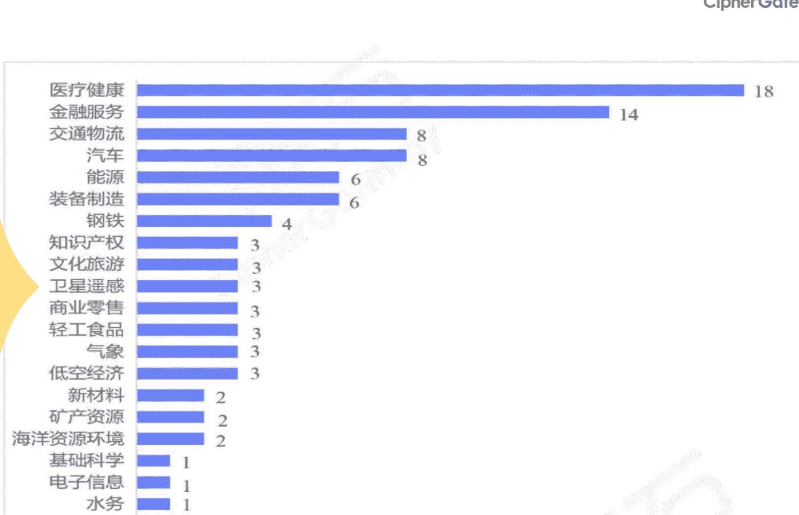

注：领域分布按照场景覆盖情况统计，数据空间可扩展至更多领域。

可信数据空间重点领域分布图

### 多主体协同协同需求

医疗、能源、物流、装备制造等行业链长、主体多样，可信数据空间实现跨组织数据有机集合，打通作用点。

### 创新研发需求

新材料、基础科学领域创新依赖大规模、高质量数据，可信数据空间整合碎片化数据，构建安全可控流通环境。

### 公共服务提升需求

气象、卫星遥感、海洋资源环境等数据跨行业应用潜力，可信数据空间建立合规开放机制，促进开放共享与融合应用。

# 有效释放数据价值，驱动战略目标实现

## 可信数据空间聚焦四大价值领域，为国家重大战略部署的落地提供有力支撑

- 一、总体篇
- 二、发展路径篇
- 三、赋能价值篇
- 四、生态主体篇
- 五、数据资源篇
- 六、运营合规篇
- 七、技术路线篇
- 八、展望篇

### 构建优质服务业务新体系52.1%
促进公共数据与企业数据的融合创新，提升公共服务效能，增进社会民生福祉。

### 赋能产业转型升级，驱动实体经济质提升
深化数据融合创新发展29.8%

### 强化战略资源安全保障11.7%
构建能源、矿产等关键领域数据协同利用体系，保障战略资源稳定供应和跨域调度。

### 支撑科技创新自立自强6.4%
为前沿科技攻关和高水平研发提供高质量数据支撑与服务，加速关键技术突破进程。

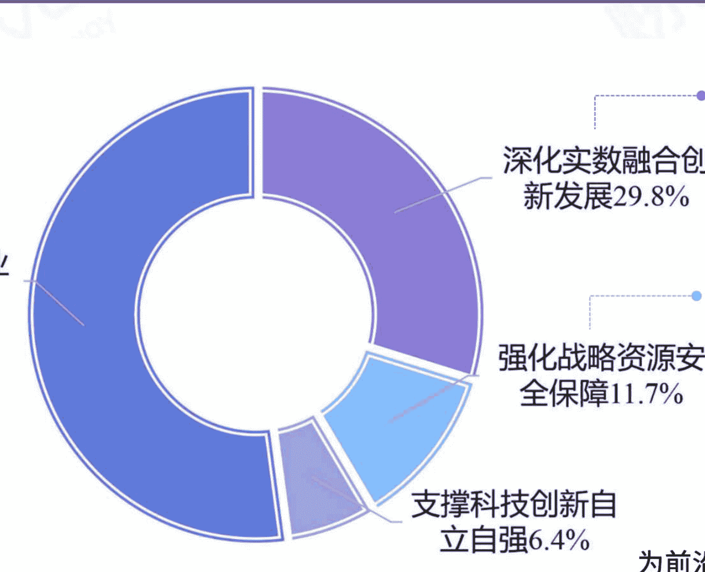

# 运营主体引领带动，共创生态加速形成

- 一、总体篇
- 二、发展路径篇
- 三、赋能价值篇
- 四、生态主体篇
- 五、数据资源篇
- 六、运营规则篇
- 七、技术路线篇
- 八、展望篇

可信数据空间通过高价值的创新应用场景，构建六类主体的深度协同生态网络。数据不完全统计，试点项目预计将带动近 7 万家产业主体参与。

- 数据资源
- 数据技术
- 数据服务
- 数据应用
- 数据安全
- 数据基础设施

在运营方引领和规则保障下，高附加值新生加速涌现，持续激发生态创新活力，探索多样化数据价值释放路径，助力数据产业创新发展。

- 数据托管
- 合规认证
- 数据经纪

# 建设投入初规模，经济带动活力巨大

### 一、总体情况
数据空间投资与效益同步跃升，经济引擎作用日益明显。投资规模快速增长，根据350余推荐试点项目测算，2025年总投资规模将达132.7亿元，2028年预计突破780亿元，年均复合增长率达80.5%。

### 直接效益加速释放
2025年实现收入26.2亿元，2027年将超百亿，2028年增长至245.2亿元，年均复合增长率达到110.8%。

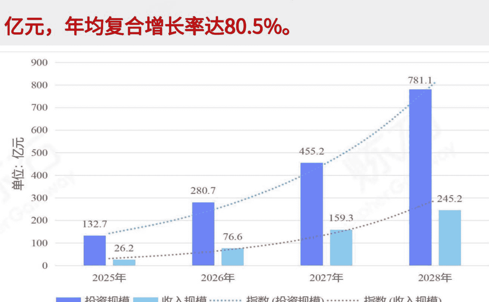

### 间接辐射效应显著
深耕赋能经济社会发展。对于医疗行业而言，2027年医疗行业可信数据空间将驱动形成千亿产业生态，投资效能持续转化产业升级的核心引擎，为经济高质量发展持续注入新动。

# “5+1”关键要素，发展根基不断夯实

## 首批试点项目已构建的“5+1”发展体系

- 一、总体篇
- 二、发展路径篇
- 三、赋能价值篇
- 四、生态主导篇
- 五、数据资源篇
- 六、运营准则篇
- 七、技术路线篇
- 八、展望篇

 数据供给
 场景共创
 生态培育
 规则保障
 技术支撑

> 试点项目以可信数据空间建设为核心能力目标，深度践行“运营一体”策略，推动我国可信数据空间向更高水平发展。

# 需求牵引创新，三类数据空间共绘应用图景

### 一、总体情况
试点项目立足实际需求，形成了20个重点领域、900多个应用场景（部分见附件）。三类数据空间协同推进，不仅深入于医疗、交通、能源、材料、汽车、科研、民生、城市等领域取得显著成效。

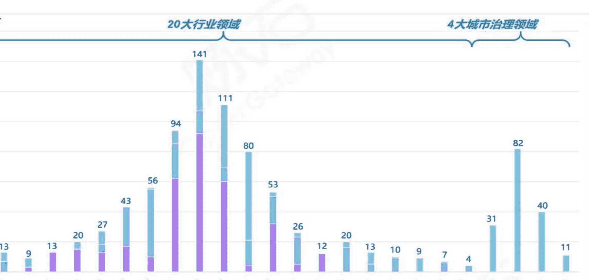

- 二、发展路径
- 三、赋能价值
- 四、生态主体
- 五、数据治理
- 六、运营准则
- 七、技术路线
- 八、展望

### 企业可数据空间
围绕供应链数字化探索，主要聚焦研发、生产、服务等环节的数据打通与协同优化，旨在解决行业共性痛点。

### 行业可数据空间
围绕行业数据共享，形成链式数据整合、跨域融合、高质量数据驱动AI发展。

### 城市可数据空间
面向城市运行，以公共数据为牵引，带动业务数据融合。

# 企业可数据空间：构建供应链协同新模式

企业可数据空间形成了以链为主、覆盖市场、研发、生产组织、产品服务、供应五大环节，通过数据资源精准配置实现业务协同化的值创新。

| 核心应用 | 占比 |
| :--- | :--- |
| 市场洞察 | 9.4% |
| 研发创新 | 12.1% |
| 订单柔性响应 | 6.7% |
| 多供应商管理 | 12.6% |
| 多方协同生产 | 15.7% |
| 产品运维服务 | 9.0% |
| 全链质量追溯 | 6.3% |
| 供应金融 | 12.1% |
| 物流协同 | 4.9% |
| 供应风险预警 | 11.2% |

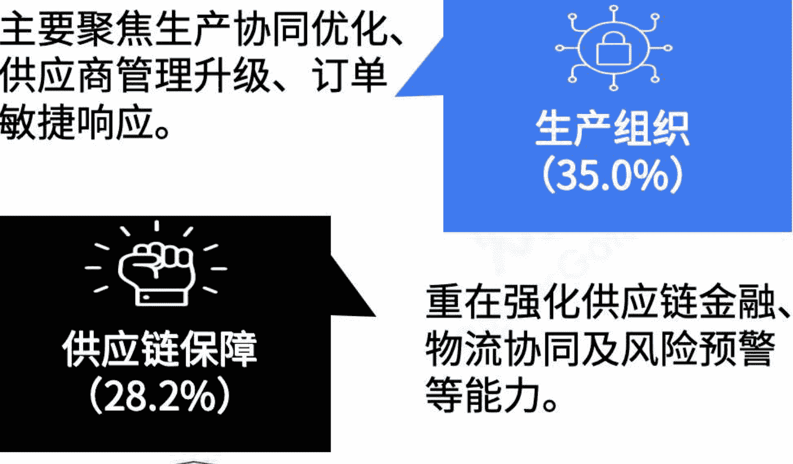

# 行业可数据空间：打造行业数据共享通用路径

行业可数据空间通过建立共建共治、多方共赢机制，推动行业数据流动和高效配置，催生四大共享模式。

- 一、总体架构
- 二、发展路径
- 三、数据价值
- 四、数据主体
- 五、数据源
- 六、运营数据
- 七、技术主线
- 八、展望

| 行业 | 占比 |
| :--- | :--- |
| 汽车 | 30.9% |
| 医疗健康 | 30.4% |
| 卫星信息 | 8.3% |
| 能源 | 7.7% |
| 新材料 | 6.6% |
| 交通数据 | 13.6% |
| 知识产权 | 8.7% |
| 矿产资源 | 6.8% |
| 制造数据 | 26.8% |
| 交通物流 | 19.5% |
| 能源 | 19.5% |
| 医疗健康 | 14.6% |
| 汽车 | 7.3% |
| 医疗健康 | 23.1% |
| 新材料 | 15.4% |
| 汽车 | 15.4% |
| 基础科学 | 7.7% |

| 模式 | 占比 |
| :--- | :--- |
| 聚类数据整合模式 | 53.6% |
| 链式数据贯通模式 | 30.5% |
| 跨域数据融合模式 | 12.1% |
| 高质量数据驱动AI创新模式 | 3.8% |

行业专业服务企业针对汽车、医疗健康等数据分领域，以共性场景需求汇聚同行业或关联行业，通过开放数据整合全产业链数据，提升行业运行效率。

 # 修正：此处图片39_0可能为OCR误识别，根据上下文逻辑处理

# 城市可数据空间：构筑全域数字化新动能

城市可数据空间以公共数据为牵引，带动企业数据融合，形成“城市治理”双轮格局，显著提升城市数字化水平。

- 一、总体框架
- 二、发展路径
- 三、赋能价值
- 四、数据态势
- 五、数据聚
- 六、运营模型
- 七、技术底线
- 八、展望

| 场景类型 | 占比 |
| :--- | :--- |
| 政务管理 | 45.1% |
| 便民服务 | 54.9% |
| 绿色环境 | 67.5% |
| 智慧文旅 | 20.0% |

主要面向金融、医疗健康、交通物流、汽车等领域，城市可数据空间已进一步优化了资源配置与价值。

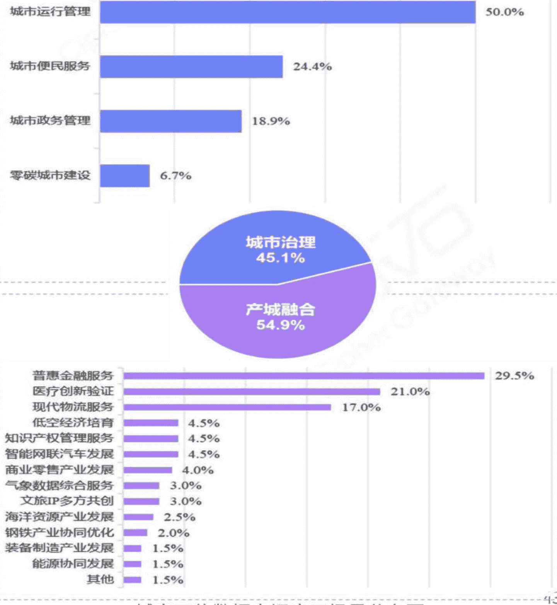

# 能源可数据空间：支撑新型能源体系建设

为落实国家“双碳”战略，加速新型电力系统和新型能源建设，聚焦新能源消纳困难、柔性调控能力不足、运行压力增大等共性挑战。

- 一、总体背景
- 二、发展路径
- 三、赋能价值
- 四、生态主体
- 五、数据资源
- 六、运营视测
- 七、技术路线
- 八、展望

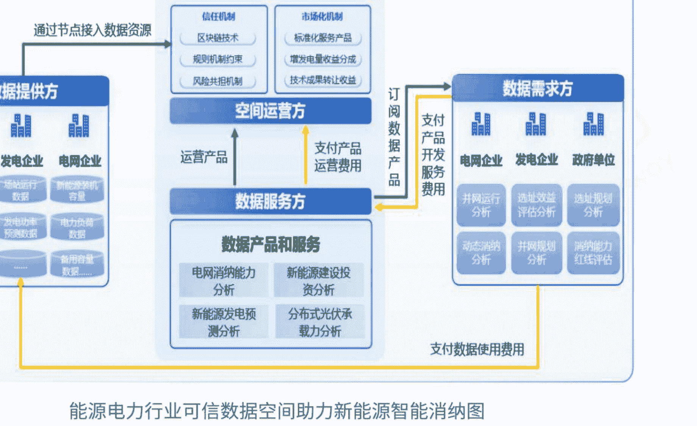

### 提升新能源消纳效率
汇聚多主体设备数据，破解运行回流难题，助力研发周期缩短60%，故障发生率下降56%，为制造商节省千万级成本。

# 矿产资源行业可数据空间：保障国家矿产资源安全

中矿数据打造企业可数据空间，联动进口贸易、冶炼企业、海关机构等主体，实现进口铁矿采购、海运、报关、商检等全环节协同，大幅缩短进口铁矿时间。通过分析铁矿现货价格波动数据，提升国际议价能力。

江西铜钢打造企业可数据空间，动态监测铁矿勘探、运输、交易、冶炼等产业链数据。

- 一、总览
- 二、发展路径篇
- 三、赋能价值篇
- 四、生态主体篇
- 五、数据资源篇
- 六、运营规则篇
- 七、技术路线篇
- 八、展望篇

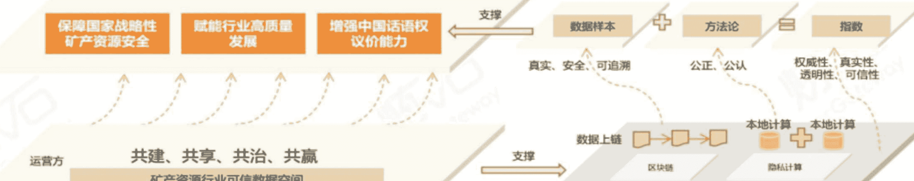

# 装备制造：打通数据壁垒，优化装备性能与价值链

装备制造行业依托安全可靠的数据共享，推动各主体共享研发设计、作业环境、设备运行、设备检修等数据，打造装备精准化设计研发、装备预测性维护、装备金融授服务等应用场景，驱动高端装备核心技术创新，实现装备创造增值。

- 一、总体篇
- 二、发展路径篇
- 三、价值篇
- 四、生态主体篇
- 五、数据资源篇
- 六、运营态篇
- 七、技术路线篇
- 八、展望篇

### 优化装备研发设计方案
> **国机科**打造农业机械行业可靠数据空间，整合农田作业全量数据与装备研发数据，构建定制化、迭代化、智化装备研发体系，显著提升农机机型性能与机型适配性。

### 装备运维服务增值方案
> **上海电气科**打造能源装备行业可靠数据空间，推动电设备运行数据、检修数据等在企业与用户间共享，提供实时运维服务，预计带动10亿规模的效益。

# 基础科学公共数据中心：助力重大科研攻关

在国家“双碳”背景下，聚焦研发测试、生产制造、运行监控、市场营销等行业需求，打通全产业链数据，实现全生命周期精准追踪，提升国际竞争力。

我国基础科研存在碎片化、共享机制缺失、权益保障体系不足等痛点问题，导致相关数据建设较国际先进水平仍有差距，同时科研重复采集导致周期长、成本高，制约科研攻关效率。

一方面，多学科基础科研联合冰川冻土、对地、气象、农业等6个国家科学数据中心，整合1000多个数据资源和2400多个模型算法，打造AI-Ready数据库，赋能基础科学模型训练。另一方面，支持生态环境保护和灾害应急。在黄河流域生态保护任务中，数据空间涵盖农业科学、冰川冻土、沙漠对地观测，实现土壤盐碱度、流域水文特征、植被盖度等数据深度分析，提高精度的生态价值评估模型，为流域治理提供科学决策依据。

- 一、总体概况
- 二、发展路径
- 三、赋能价值
- 四、体制
- 五、数据来源
- 六、运营机制
- 七、技术路线
- 八、展望

| 数据提供方 | 交互请求与提供 | 数据需求方 | 交互请求与提供 |
| :--- | :--- | :--- | :--- |
| 上游供应链企业 | 身份认证、数据加密保障 | 各主体企业 | 身份认证、数据加密保障 |
| 原材料数据 | 材料材料 | 政策部门 | 统一核算 |
| 电池加工 | 电池行业 | 零部件行业 | 整车生产 |
| ...... | | 汽车行业 | 最终产品碳足迹追踪 |

# 新材料：促进数据资源共享，加速材料创新研发

新材料行业面临数据碎片化、协同不足等问题：研发计算与实验数据脱节，模拟验证周期长、成本高；生产端材料、工艺、性能数据关联，质量控制困难；使用缺乏真实工况数据反馈，性优化失效，严重阻碍关键材料突破和产业升级。

# 新材料行业构建“1+N”安全可靠的数据共享体系

一个公共服务平台、N材料数据资源节点，整合研发、生产、服役等全产业链数据，打造新材料智能研发、产品质量分级对标，材料与装备制造数据适配适应场景，助力新材料研发创新。

- 一、总体思路
- 二、发展路径
- 三、数据价值
- 四、生态主体
- 五、数据源
- 六、运营刚则
- 七、技术路线
- 八、展望未来

### 运营方数据资源服务
- 模型服务（人工智能）
- 数据用（联邦学习）
- 数据追踪（数据域）

新材料人工智能研发方面，融合科研文本、分子结构、分子构象、质谱图和红外光谱等一系列多态数据，开发新材料人工智能模型。

 数据提供方
 数据提供方
 数据使用方
 企业A
 数据
 提取数据
 科研机构B
 数据
 企业C

# 构建优质服务新体系 推动医疗医保医药数据融合

### 一、总体篇
### 构建“三医”协同治理体系

### 二、发展路径
强化医保基金风险监管，加速药物上市进程。医疗行业可信数据空间联合多方，打通临床等数据，缩短周期。建立“三医”数据实时识别违规行为，降低成本，提升效能。

### 三、赋能价值
| 数据提供方 | |
| :--- | :--- |
| 江苏省人民医院 | 可信数据 | 身份管理 |
| 上海中科 | 可信数据 | 通用接口、结算、安全监测 |
| 赣楼医院 | 可信数据 | 前置、多元开发 |
| 直数中心 | 可信数据 | 医疗健康系统 |
| 上海人医院 | 江苏数据源 | 科研研究所 |
| 上海大学 | 公共数据平台 | 医药监管数据 |

### 四、生态主体
### 五、数据源
提升预测能力。联动数据中枢与广州实验室等机构，构建预警体系，在传染病监测、健康分析等方面价值。

### 六、运营侧
### 七、技术路线
### 八、展望

## 优化数据流转，降低社会成本

### 一、总体思路
针对物流资源整合度不足、海上事故响应慢等共性问题，整合供应链、空铁公路运输等数据，打造多式联运协同、智能化调度、防控等应用场景，有效降低社会成本，提升跨域效率与安全水平。

### 二、发展路径
中国数打造30%的物流枢纽，80家骨干企业与40家龙头企业共享数据，构建跨主体、跨行业、跨区域的数据基础设施、智慧地图、多式联运“单一”数字服务等应用场景，提升资源跨域调配效率。

### 三、赋能价值
优化能源运输协同。国家管网打造油气行业运行可信数据空间，打通产业链控产、油气存储与下游消费数据，调整产能、降低运行损耗。增强航运安全。中远海运构建蓝色航运可信数据空间，推动气象管理部门、航运企业等共享气象水文、船舶航行线路等数据，打造国产高分辨率气象导航、AI趋势模型等服务，预计风险预警准确率达到95%以上，减少人为安全事故，显著减少海上特交通事故，为全球航运安全护航。

### 四、发展态
### 五、数据资源
### 六、运营准则
### 七、技术底线
## 八、展望未来

# 整合遥感数据，协同赋能多行业精准服务

遥感行业推动垂直部门、地方卫星中心、民商遥感企业等主体协同合作。

### 一、总体篇
历史观测数据 / 实时监测数据 / 卫星运行轨道参数

### 二、发展路径
打造遥感数据即时应用场景、遥感数据历史应用场景等。

### 三、赋能价值
提升国家空间信息应用能力与服务效能，有力支撑救灾指挥、生态保护监测、精准农业、资源勘探等重大领域。

### 四、生态主体
### 五、数据源
在机构机制支持下，接入并统筹调度200多民商卫星，同时接入全国高分融合观测网络及定标数据，打造“滴滴打星”即时数据应用，卫星总体响应效率提升50%；打造“拼星多”遥感数据应用，赋能矿产资源快速识别。

长光卫星建设卫星企业可信数据空间，依托自身100多颗“吉林一号”卫星组特色资源，构建覆盖80多种地物类别和100多个样本的高分率样本库，打造卫星数据订阅订购模式，以会员制与即时选购模式构建服务闭环，实现TB级数据快速交付与普惠化获取。

### 六、运营侧
## 七、技术术
### 八、展望

## 数据跨空间互通，催生新模式

当前不同类型的数据空间基于业务需求，突破数据边界，跨领域共享与融合，带来增长。

### 一、总体架构
### 二、发展路径
### 三、赋能价值
### 四、生态主体
### 五、数据源
## 六、运营规
### 七、技术路线
### 八、展望

能源与汽车行业
南方电网与汽车行业数据互通，共享车辆站、充电桩等设施规划，打造电网协同，优化调度，预计回报率提升至32%。城市与医学
广州与医学数据空间互通，挖掘传染病预警等场景，培育差异化模式，初期实践可行性。

## 可信主体引领，探索差异化协作

| 行业类型 | 数量 | 高质量数据集描述 | 高质量价值 |
| :--- | :--- | :--- | :--- |
| 卫星遥感 | 29 | 植物被盖、耕地土壤水分、生长 | 提升环境精度 |
| 交通物流 | 28 | 全球实时定位、港口集装箱运输 | 降低整体成本 |
| 装备制造 | 70 | 齿轮转动、变速箱、故障诊断 | 缩短生命周期 |
| 汽车行业 | 49 | 动力电池、传感器、自动标定 | 提升智能驾驶技术 |
| 医疗健康 | 40 | 重症监护生命体征追踪、临床试验 | 加速创新药物研发 |
| 能源 | 31 | 光伏电站、波动分级、异常监测 | 优化清洁调度 |
| 海洋资源 | 30 | 近海渔业资源、溶解浓度、作业 | 降低风险预测 |
| 技术 | 24 | 合金显微、陶瓷板烧结、工艺参数 | 提高产品良率 |
| 基础科学 | 24 | 射电距离观测、粒子对撞 | 深化前沿理论 |
| 公共数据运营 | 23.8% | 地方政府或单位 | |
| 行业主导型 | 42.9% | 产业链上下游伙伴 | |
| 专业服务驱动型 | 33.3% | 解决版权难题、提供方案 | |

# 生态体系加速形成，多元主体筑繁荣市场

数据资源和数据应用两类主体（分别占比37.0%和38.3%）基于业务需求，打通“供给-应用”闭环，将数据安全、合规地注入数据空间，同时开发创新应用，将数据转化为实际业务价值。智能制造整合零部件、整机组装等上下游企业，推动供应链持续供给和高效利用，用数据驱动供应链协同和产业链共创模式。

### 提供数据37.0%
### 使用数据38.3%

| 公共数据供给 | | | |
| :--- | :--- | :--- | :--- |
| 北京数据集团 | 郑州大数据集团 | 上海智聚集团 | 郑州科技联 |
| 数学魔方 | 腾讯微课堂 | 广州数据集团 | 江苏数据资源 |
| CSN | 新联通 | 中华电信 | 中华移动 |
| BAIDU | 京东数据服务 | CHANGHONG | SCG数据服务 |

| 数据应用 | | | | | | | | |
| :--- | :--- | :--- | :--- | :--- | :--- | :--- | :--- | :--- |
| 运营商 | 中国电信 | 中国联通 | 中国移动 | 中国广电 | | | | |
| 行业 | | | | | | | | | |
| 城市 | | | | | | | | | |
| 科学 | | | | | | | | | |
| 科技 | | | | | | | | | |

# 生态体系加速形成，多元主体筑繁荣市场

| 数据交易 | 数据服务企业 | 数据安全企业 | 数据分析 | 数据基础设施 |
| :--- | :--- | :--- | :--- | :--- |
| 上海数据交易所 | 上海交易所 | 上海交易所数据中心 | 上海交易所数据中心 | 奇安信 | 深信服 | 安恒 | 启信 | ... | 华为腾讯云 | 阿里云 | 华为腾讯云 | 华为腾讯云 | 腾讯云 | 阿里云 | ... |

一、总体战略
二、发展路径
三、赋能价值
四、生态主体
五、数据溯源
六、运营准则
七、技术路线
八、展望未来

## 第三方专业服务 6.4%
## 技术服务 18.3%

主要基于数据合作需求，催化价值释放。此类生态主体既包括“交易提方”升级为“生态培育者”的数据交易所，还包括数据托管、合规认证等数据商，通过专业服务降低参与门槛。基于技术合作需求，筑牢数据底座，包括云计算、存储、网络等工具，保障数据服务可靠；还包括垂直领域的解决方案。

## 汇聚海量数据，奠定一体化基础

一、总体篇
二、发展路径
三、赋能价值
四、生态主体
五、数据源篇
六、运营机制篇
七、技术路线篇
八、展望篇

## 数据资源集
平均覆盖率达40%，试点期内有望翻倍，构建全国能源、汽车、钢铁等领域资源体系。

## 高价值的数据资源
长期“沉睡”的核心数据，实现其安全控与利用：
- 气象数据支撑、能源生产、交通调度等，赋能行业发展
- 海洋数据、环境监测、碳汇算，助力蓝色经济
- 医疗健康数据整合、城市规划，促进“三医”治理
- 卫星遥感融合、应急等公共场景

## 高质量数据集助力AI模型，提升语义理解与推理能力

数据化的高质量数据集，显著提升了行业 AI 模型在语义理解深度和复杂场景推理能力上的表现，加速了 AI技术的实用化进程。

一、总篇
二、发展路径
三、赋能价值
四、生态主体
五、数据溯源
六、运营规则
七、技术路线
八、展望

## 能源电力领域
南方电网累积了3.5TB基础语料和超过500万条微数据，利用这些高质量数据训练的自主可控电力模型“大瓦特”，在广东电网配电电设备智能巡检中，成功将45项典型配电网隐患检出准确率提升80%以上，极大提升了电网安全运维。

## 新材料研发
苏州实验室在化学领域的基础上，成功构建了通用大模型“ChemDFM”，突破了材料跨模态任务，展现了材料创新的巨大潜力。

## 部分行业高质量数据集

| 行业类型 | 数量 | 高质量数据集描述 | 高质量价值 |
| :--- | :--- | :--- | :--- |
| 卫星遥感 | 29 | 植物被盖、耕地土壤水分、生长 | 提升环境精度 |
| 交通物流 | 28 | 全球实时定位、港口集装箱运输 | 降低整体成本 |
| 装备制造 | 70 | 齿轮转动、变速箱、故障诊断 | 缩短生命周期 |
| 汽车行业 | 49 | 动力电池、传感器、自动标定 | 提升智能驾驶技术 |
| 医疗健康 | 40 | 重症监护生命体征追踪、临床试验 | 加速创新药物研发 |
| 能源 | 31 | 光伏电站、波动分级、异常监测 | 优化清洁调度 |
| 海洋资源 | 30 | 近海渔业资源、溶解浓度、作业 | 降低风险预测 |
| 技术 | 24 | 合金显微、陶瓷板烧结、工艺参数 | 提高产品良率 |
| 基础科学 | 24 | 射电距离观测、粒子对撞 | 深化前沿理论 |
| 公共数据运营 | 23.8% | 地方政府或单位 | |
| 行业主导型 | 42.9% | 产业链上下游伙伴 | |
| 专业服务驱动型 | 33.3% | 解决版权难题、提供方案 | |

## 规则体系持续完善，护航数据要素

可信数据空间已建成“信任为基础、价值为激励、治理为标准、合规为保障”的四位一体框架，首批试点设计458项规则，覆盖四大关键领域，解决数据滥用、效用、安全的核心问题，涵盖事前审核、事中控制和事后溯源。

信任管控 32.1%
价值激励 25.1%
协同治理 20.3%
合规保障机制是规则体系重要部分，占比22.7%，按网络安全、数据安全法等规定，保障数据资源、服务等满足合规要求及数据管理要求。

### 一、总体篇
### 探索建立了全链路动态可信机制
### 探索积分等多元化价值激励机制

### 二、发展路径篇
中国金融电子集团构建基于区块链和隐私计算的金融数据空间，实现全程留痕的可信机制，保障身份认证与使用安全，推动构建可信体系与规则体系。如中汽汽车行业可信数据空间构建的“数据资源激励规则”，华云信息可信数据空间建立的免费试用、先用后付、应用分成等激励机制。

### 四、生态主体
### 探索构建多方共同治理机制
### 构建数据化合规保障机制

### 五、数据源篇
如国家管油石油行业可信数据空间牵头集团内部单位、产业链上下公司、重要合作方等设立数据空间委员会，并由可信数据空间领域外部专家、政策专家等专家组提供专业支持。

# 运营组织机制创新活跃

## 运营组织机制

一把手负责制+多层级组织架构

- 一、总体篇
- 二、发展篇（路径篇）
- 三、赋能篇（价值篇）

## 分工协同模式

## 法人实体运营模式

- 四、生态篇（体系篇）
- 五、数据篇（源 true篇）
- 六、运营原则

可信数据空间项目普遍注重对运营的组织机制设计，58.7%的项目在完整组织架构基础上，进一步细化职责分工，分工协同保障数据空间长效运营。

部分项目开始探索独立法人实体运营模式，集中力量开展运营并加速数据服务商转型。

- 七、技术路线
- 八、展望篇

例如，南京钢铁企业构建了三级运营体系，由集团担任组长，下行小组承担战略规划、调度工作，执行层设立研究、法规等推进工作。例如，中国物流依托国家级大数据平台，建立专业化公司作为统一运营主体，保障数据空间长期运营。

## 商业模式释放活力

一、总体篇：可信数据空间探索形成“数据提供、平台支持、技术共享、数据交付”四种商业模式，实现造血与可持续发展。

二、发展路径：
- 技术工具共享 (19.7%)：提供数据处理、分析等工具，订阅和租用运营。
- 数据交付 (60%)：开发数据资源形成服务，向市场提供标准化产品、定制化解决方案两类。

三、价值篇：
- 平台支持 (6.9%)：以交易机会、广告服务等运营方式，助力参与市场拓展。
- 数据交付服务 (60%)：
- 标准化数据产品 (34.7%)
- 技术工具共享 (19.7%)
- 平台支持 (6.9%)
- 数据资源提供 (13.3%)：依托数据资源，免费运营用数据方可在空间内获取资源。

七、技术路线
八、展望篇

## 构建可持续的价值体系

一、总体篇
二、发展路径篇
三、赋能价值篇
四、生态主体篇
五、数据源篇
六、运营原则篇
七、技术路线篇
八、展望篇

对各方在场景中的投入进行计量，按照资金、资源、技术等量化的成本分配收益。以各方承担的市场、技术、安全等风险程度为依据，创新越强、风险越高、责任越重的主体，收益分配越高。根据数据空间最终创造的经济价值和知识成果为依据，根据调用频率、服务质量、知识权等产出的贡献度，对各参与的数据和服务进行分配。

## 技术体系

形成以身份管理、互联互通、可信控、存证溯源为核心的四大技术模块。

一、总体篇
二、发展路线
三、赋能价值
四、生态形态
五、数据源
六、运营
七、技术路线
八、展望

身份管理技术聚焦于认证与管理核心模块，身份认证与验证、身份信息管理构成主流方案，分布式身份等前沿技术仍待探索突破。

互联互通呈现两极分化：84.1%企业优先部署数据目录管理以提升资源利用率，而语义互操作因成本高实施比例为30.2%，反映当前阶段数据空间互联数据的可发现、可访问为核心诉求。

可信控聚焦两类技术：隐私计算（77.8%）保障“数据不可见”，动态使用控制（71.4%）实现细粒度操作，且有过半的试点企业选择部署这两项技术，共同保障数据传输安全。

存证溯源技术成熟，多数试点企业采用区块链技术构建不可篡改的追溯链，实现操作留痕与证源一体化。

## 场景驱动技术选用，差异化适配成为主流

一、总体篇：金融等数据价值密度高、合规风险严的行业场景。
二、发展路径篇：在制造、能源等数据规模大、实时要求的行业场景多采用“联邦学习+TEE”隐私计算技术，强隐私化保护，并结合动态控制技术实时阻断高风险操作。
三、赋能篇：多采用控制协议和数据流通技术组合的轻量化方案，旨在提高多主体协作效率。
四、生态主体篇：城市可信数据空间。
五、数据资源篇：医疗、科研等跨学科数据融合需求强烈的行业场景。
六、运营治理篇：数据目录管理、数据沙箱、语义交互、身份标识与凭证等技术渗透显著高于其他，满足精细化治理需求。
七、技术路线
八、展望

# 可信数据空间推进面临挑战

一、总体篇
二、发展路径篇
三、赋能价值篇
四、生态态势篇
五、数据源篇
六、运营规则篇
七、技术路线篇
八、展望篇

38.9%的试点企业认为当前标识机制健全、收益分配机制完善、投入与效益失衡等问题导致各类主体参与不足，需进一步探索可持续化运营。

如何突破障碍：34%的试点企业难以获取高质量数据，因权责不清、标准不一、隐私保护不等，用多种方式吸引数据共享。

如何建立规则：27.1%的试点企业反映方案不完善，需针对性创新，加强生态协作，深化可信数据空间发展。

# 可信数据空间进入规模化新阶段，加速数据要素市场化改革

未来五年，在政策引导和市场需求双重驱动下，可信数据空间从“多点开花”迈向规模化落地。

一、总体篇
二、发展路线篇
三、赋能价值篇
四、生态形态篇
五、数据源篇
六、运营规则篇
七、技术路线篇
八、展望篇

- 从覆盖领域：可信数据空间将覆盖大部分行业，行业数据发现成为数字化转型的关键动力。
- 从运营能力：随着规则制定、商业模式、服务能力不断反馈，发展初期存在的路径清晰、运营机制健全等问题将逐步得到解，打造具有市场价值的数据和服务、建立聚合主体的利益分配和权益保障机制成为破局的关键。
- 从发展格局：具有生态优势将持续放大规模效应，通过更低成本的服务、更具创新性的产品赢得市场，形成某些领域的主导者，整个可信数据产业将在良性竞争中繁荣发展，成为市场化配置的重要动力。

## 可信数据空间将调度海量产业资源，赋能重点领域高质量发展

一、总体篇
二、发展路线篇
三、赋能价值篇
四、生态主体篇
五、数据源篇
六、运营管理侧
七、技术路线
八、展望篇

01 预计将有70%以上的非敏感数据资源接入可信数据空间，实现更大范围流通利用（医疗健康、金融服务、交通物流等领域）。
02 在头部企业带领下优先实现产业链上下游数据共享贯通，并进一步面向中小企业实现可信数据空间赋智，实现研发、运营、服务等方面50%以上脱敏数据共享利用（能源电力、工业制造、农业种植等领域）。
03 交通、应急等公共服务领域数据开放率将提升至90%，一步推动产业融合，有效支持城市精细治理与新兴产业培育。通过数据的充分流通利用，将构建数据驱动的新型行业运行模式与形态，有望提升行业运行效率30%，降低中小企业使用成本50%，促进数据价值实现。

# 可信数据空间将激发产业主体创新活力，繁荣壮大数据生态

一、总体篇
二、发展路径篇
三、赋能价值
四、生态
五、数据治理
六、规范
七、技术路线
八、展望

未来五年，可信数据空间将驱动数据产业创新。其发展将催生新型数据服务链及广大生态。预计30%的龙头企业将转型数据服务商，细分赛道企业数量将倍增，垂直领域服务商将崛起，第三方服务生态将扩张。个人和跨境数据空间推进将带来个人数据普惠、跨境数据服务机会，壮大数字经济空间。

## 可信数据空间将催重点领域高质量数据集，加速人工智能创新发展

一、总体篇
## 构建高质量数据集
二、发展路线路径篇
三、赋能价值价值篇
四、生态形态
五、数据治理
六、运营机制
七、技术路线
八、展望

未来五年，可信数据空间作为关键载体，助力构建高质量数据集，围绕新材料、装备、能源、交通等重点领域数据汇聚，实现从“数据驱动”向“AI驱动”跃迁，加速AI创新和产业落地。

## 实现空间互联互通

一、总体篇
二、发展路径篇
三、赋能价值篇
四、生态主体篇
五、数据源篇
六、运营视侧
七、技术路线篇
八、展望篇

未来五年，可信数据将在资源交互和价值共创下，逐步拓展到行业，实现高标准数据互通。

| 重点领域 | 典型场景名称 | 典型场景描述 |
| :--- | :--- | :--- |
| 金融服务 | 普惠金融风险管理 | 联合银行、税务、工商、征信机构等主体共享企业经营、信用、税务数据，在保护企业数据隐私下下构建智能模型，提升信贷效率与安全性 |
| 金融服务 | 科创金融受信管理 | 整合科技企业、科研机构、专利局、市场调研机构的数据，在权限监管向行业开放评估所需信息，建立准授信模型，助力科技企业融资 |
| 金融服务 | 绿色金融评级定价 | 金融机构联合部门、能源企业共享份额、减排、环保数据，通过统一标准构建评价体系，支撑绿色信贷 |
| 资产资源 | 矿产价格宏观调控 | 中国矿产动态监测、运输、交易数据，构建矿产资源供应链图谱，提升宏观调控能力 |
| 资产资源 | 矿石采购联合优化 | 联合采购方、供应商、物流方等共享矿石品质、价格、运输成本数据，智能生成采购方案，优化采购效率 |
| 能源 | 电力设备研发运行运维 | 打通电力设备的设计数据与运行数据，反反馈优化研发参数，提升设备可靠性与运行效率 |
| 能源 | 绿色智能消纳与动态调度 | 整合风电、光伏等绿色生产数据及用户消费数据，智能匹配需求，动态调整电网参数，降低新能源接入压力 |
| 能源 | 跨源网储多能互补 | 整合不同区域的电网、负荷、储能数据，优化调配、热、气等多种数据，实现跨区域多能互补与高效利用 |
| 城市治理 | 智慧社区服务 | 打通电力公司、社区物业、服务机构等数据，共享用户消费与运营数据，在保护居民隐私下开展生活服务 |
| 城市治理 | 防灾减灾与应急救援 | 卫星机构、气象部门、地方政府、救援队伍等在空间内通过权限共享遥感监测数据与地理信息，实现灾害预警 |
| 城市|治理 | 农业精细化保险 | 联合公司、卫星机构、农业部门共享作物种植面积、生长状况、受灾程度等数据，在保障农民和数据安全下精准核值 |
| 汽车 | 自动驾驶模型训练与应用 | 整合车辆、租赁运营公司、交通部门等多主体共享路场景、车辆状况、交通规则等数据，训练自动驾驶车辆模型 |
| 汽车 | 新能源汽车保险定价 | 整合厂家、充电企业的车辆状态、驾驶行为等信息，在数据加密环境下构建精准风险模型，实现保险差异化定价 |
| 汽车 | 电池数据护 | 打破充电站、厂家、检测机构、回收企业等主体的数据壁垒，标准化电池数字标识，支持溯源、多次利用 |
| 交通 | 物流轨迹智能化 | 整合不同物流的基础信息和实时数据，实现资源统一调度、自动匹配 |
| 交通 | 旅客全流程智能服务 | 整合航空、铁路、车站、第三方服务等多元主体，覆盖票务、行程等全环节，提升体验与效能 |
| 交通 | 应急数据开放 | 交通、应急等公共服务数据开放率将提升至90%，推动产业融合 |
| 医疗健康 | 医药联合监管 | 整合医药、经销商、医院、医保局等多主体流通数据，识别违规、违规流向等行为，建立风险预警 |
| 医疗健康 | 医保基金监管 | 整合医保经办、医疗机构等多主体，智能识别过度医疗行为，强化基金监管 |
| 医疗健康 | 临床数据创新 | 整合医药、科研机构的医疗数据，在保护患者隐私和数据主体权利下挖掘价值，辅助新药研发 |
| 工业制造 | 装备联合运维 | 在头部企业带领下优先实现产业链上下游数据共享贯通，并进一步面向中小企业实现数据赋智 |
| 工业制造 | 智能制造 | 联合资源共享、数据数据、数据数据数据、精准设计 |
| 农业 | 农业种植 | 能源电力、工业制造、农业种植等领域实现50%以上脱敏数据共享利用 |

## 附件 2:可信数据空间试点典型应用场景

| 重点领域 | 典型场景名称 | 场景描述 |
| --- | --- | --- |
| 知识产权 | 数据产品知识产权质押融资 | 整合多家出版单位的知识产权权及价值等数据，在权限控制下向金融机构开放接口，实现质押物可信信贷 |
| | 数据知识产权收益定价机制 | 对知识产权收益的使用价值、市场需求等数据进行跨维度（如估值机构、交易平台、供需方等）协同网络，实现定价交易 |
| 装备制造 | 农机装备联合设计研发 | 联合科研机构、生产企业、农业用户等多主体共享数据，协同研发适配不同农的的农机装备 |
| | 装备远程运维 | 由装备制造领先企业通过数据获取下游的设备运行数据，结合自身研发，远程诊断故障，数据使用全程可追踪 |
| 海洋资源环境 | 海上工程协同融合 | 在空间内进行多工程进度、环境参数、设备状态等信息，协同优化流程，保障海上工程安全高效 |
| | 新型渔业保险 | 联合海洋资源、渔业企业共享气象、养殖环境数据，监控台风风险、数据覆盖捕、养殖等环节的新型保险产品 |
| 钢铁 | 钢铁材料联合研发创新 | 联合钢铁企业、科研所、下游用户数据，协同研发高强度、耐腐等新型钢铁材料，满足不同行业需求 |
| 智能制造与生产协同 | 整合钢铁生产各环节，实现产品生产、设备运行、质量检测等环节的业务协同 |
| 文化旅游 | 数字品牌创新与运营 | 联合文旅机构、作者等主体数字品牌的权利、创作过程数据，挖掘内涵，协同创作、运营链IP |
| | 文旅IP多方协同 | 联合文旅机构、创意团队、游客等群体，数据挖掘内涵，协同创作、运营链IP |
| 商业零售 | 消费者需求汇聚洞 | 整合线上线下零售数据，用用户行为数据，分析消费者购买、意向数据，精准聚焦市场，指导产品研发与营销 |
| | 消费质量可信追溯 | 打通产品从生产、到销售的全渠道数据链路打破壁垒，保障产品质量与消费者权益 |
| 新材料 | 新材料智能融合研发 | 整合高校、企业、检测机构模拟数据，基于先进技术设计新材料配方、模拟性能，加速新材料研发进程 |
| | 多主体协同模拟验证 | 不同研发多主体共享材料模拟数据与实验数据，开展联合验证，提升新材料的可靠性与效率 |
| | 多功能材料推荐 | 整合材料研发、应用场景、企业需求等等多主体数据，辅助企业智能匹配推荐的新材料 |

# 附件2: 可信数据空间试点项目典型应用场景描述

| 重点领域 | 典型场景名称 | 典型场景描述 |
| --- | --- | --- |
| 基础科学 | 高质量科学数据语料协同加工 | 联合科研人员、数据机构等权限分级对科学数据进行清洗、标注、整合、加工形成高质量语料，支撑AI模型训练与科学 |
| | 跨学科数据可控共享与联合调度 | 整合不同学科的科研数据，实现数据可控共享与联合调度，支撑交叉学科研究 |
| 轻工食品 | 订单需求快速响应 | 整合市场订单、生产能力、供应链，实时分析变化、敏捷调度生产计划与供应链调度，快速响应订单需求 |
| 气象 | 基于气象数据的再生能源调度 | 联合气象部门、风电、光伏电力、电网公司等主体共享气象数据与能源数据，在数据加密环境下预测发电量，为能源调度提供依赖 |
| 低空经济 | 低空经济特色旅游资源开发 | 由文旅游部门、低空运营企业、监管机构等共享旅游资源、航线、安全数据，联合开发低空光、中影视等项目，丰富旅游市场 |
| | 低空经济型城乡基层治理 | 低空巡检无人、城管部门、社区等共享城镇交通、环境、基础设施数据，在保护居民隐私的前提下助力基层治理 |
| 电子信息 | 跨域跨境企业生产协同 | 打通不同产业、企业的生产计划、物料供应、质量检测数据，实现生产过程协同调度 |
| | 智能机器人协同研发创新 | 整合机器人企业、科研机构、应用场景的感知、运动、交互数据，融合AI技术具备环境适应性、自主决策能力的智能机器人 |
| 城市治理 | 城市运行监控 | 整合交通、能源、环保、城管等多个部门数据，在保护个人隐私的前提下为市民提供一次性、个性化服务 |
| | 城市便民服务 | 基于市民需求，整合医疗、教育、社保等数据 |
| | 绿色城市建设 | 整合城市能源消耗、碳排放、产业结构等数据，制定零碳规划，推动城市低碳转型 |

1. 图解国家发改委、数据局、工信部《国家数据基础设施建设指引》
2. 图解国家数据局《可信数据空间发展行动计划（2024—2028年）》
3. 十个可信数据空间
4. 图解《可信数据空间创新发展报告（2025）》
5. 图解《可信数据空间建设及应用参考指南（V1.0）》
6. 图解《可信数据空间标准体系建设指南（2025年版）》
7. 图解标准《可信数据空间技术架构》
8. 数据流通场景实践

## 可信数据空间建设及应用指南 (V1.0)

可信数据空间基于共识规则，连接多方主体，实现数据资源共享，是一种数据流通通用基础设施，是数据要素价值的应用场景，是支撑数字市场的重要载体

落实国家数据局《可信数据空间发展计划（2024—2028年）》，指导行业有序开展可信数据空间建设及应用。

| 目标及原则 | 建设内容 | 保障措施 |
| --- | --- | --- |
| 一、建设目标 | 明确建设定位 | 组织保障 |
| 二、建设原则 | 建设技术系统 | 资金投入 |
| | 挖掘数据场景 | 繁荣生态 | 人员保障 |
| | 开发数据资源 | 开展商业运营 | 安全保障 |
| | 构建规则机制 | | |

## 明确可信数据空间建设四大目标

| 目标及原则 | 建设内容 | 保障措施 |
| --- | --- | --- |
| 一、形成一批高价值场景应用 | 可信数据空间主体在需求牵引和共识规则带动下，发挥优势开发产品和服务，实现多方价值共创，形成一批应用场景，深度释放要素价值。 |
| 二、建立一套完善的规则机制 | 基于多主体共同建立完善的规则体系，包括资源接入、互联互通、共享利用、收益分配等机制，在合理的规则配合下促进数据空间持续发展。 |
| 三、开发一套可信的技术系统 | 通过构建服务平台、客户端和自动化运行组件等系统，打造分布式管控体系，支撑资源交互、价值共创能力。 |
| 四、构建一个繁荣的数据生态 | 支持数据提供方、数据使用方、数据服务方（数据经纪、托管等）多元主体协同，强化数据接入认证、审计等第三方服务机构合作，实现多元主体间数据共享治理。 |

## 明确可信数据空间三大原则

| 目标及原则 | 建设内容 | 保障措施 |
| --- | --- | --- |
| 坚持应用牵引、规则驱动 | 从实际应用需求出发，深入挖掘存量业务痛点和增长创新应用，通过设计符合多主体共同利益诉求的规则机制，吸引参与方接入并应用数据空间，构建公平透明、高效有序的数据流通环境。 | |
| 坚持市场主体、多元共赢 | 充分发挥龙头企业、链主企业、地方数据集团、数据领先型企业等市场主体在空间建设中的主动性，积极探索数据提供方、使用方、数据服务方等多元主体的合作模式，形成共享、合作共赢的可信数据空间发展模式。 | |
| 坚持建设为基、运营为主 | 强化规则和运营设计，注重可持续机制建设，通过数据价值实现长效发展。在机制牵引下，考虑建设数据全环节技术系统，开发部署应用需求牵引的数据支撑环境和服务组件。 | |

## 可信数据空间应用路线图

| 目标及原则 | 建设内容 | 保障措施 |
| --- | --- | --- |
||可信数据空间建设遵循明确建设定位、挖掘场景应用、开发数据资源、构建规则机制、建设技术体系、繁荣空间生态、开展业务运营七大步骤，参考路线图如下： | |

### ### 一、明确建设定位
1. 明确战略方向

### ### 二、挖掘场景应用
2. 确定应用场景
3. 制定场景应用路线图

### ### 三、开发数据资源
4. 确定数据接入主体
5. 制定数据资源清单
6. 推动数据标识化与资源化

### ### 五、建设技术系统
14. 部署实施功能系统
13. 打造价值共创系统
12. 打造资源交互系统
11. 打造可信管控系统

### ### 四、构建规则机制
10. 收益分配规则机制
9. 共享利用规范
8. 数据互联互通
7. 资源接入规范

### ### 六、繁荣空间生态
15. 激活生态主体活力

### ### 七、开展业务运营
16. 提升空间用户规模
17. 创新空间商业模式

## 第一步：明确建设定位

| 目标及原则 | 建设内容 | 保障措施 |
| --- | --- | --- |
| 表1 可信数据空间类型选择指数 | | |

### 1 明确战略方向

明确可信数据空间发展定位，设定清晰的建设目标。由于可信数据空间核心特征在于跨数据主体、跨区域、跨行业的共享流通，不同空间难以完全切割或划分，并且在某些数据空间在发展过程中演化为其他类可信数据空间。因此，在战略方向上充分结合业务需求、长期规划、主体角色、现有设施等方面，确定可信数据空间的类型。在此基础上逐步开展投入，明确发展目标，确保配置效益。

| 类型 | 战略方向 | 典型场景 |
| --- | --- | --- |
| 企业可信数据空间 | 牵引，带动上下游 | 供应链、质量追溯等 |
| 行业可信数据空间 | 面向行业转型和重大问题 | 科技创新（新材料研发）、工业数字化转型（农业数字化）等 |
| 城市可信数据空间 | 面向城市治理与发展需求 | 城市治理（交通）、公共服务优化（低空经济） |
| 个人可信数据空间 | 面向个人数据管理与利用需求 | 精准医疗等 |
| 跨境可信数据空间 | 面向跨境数据全流通与共享需求 | 跨境合作 |

## 第二步：挖掘场景

| 目标及原则 | 建设内容 | 保障措施 |
| --- | --- | --- |
| 2 确定应用场景 | 从实际应用需求出发，深入挖掘存量业务痛点和增长创新应用，找出数据流通面临的难题。同时，结合未来发展需求，挖掘一批融合创新场景和图谱。 | |
| 3 制定应用场景路线图 | 综合考虑业务场景紧迫程度、应用价值、难度、现有基础、实施顺序。 | |

## 第三步：开发数据资源

| 目标及原则 | 建设内容 | 保障措施 |
| --- | --- | --- |
| 4 明确数据接入主体 | 应用场景所需数据资源类型，明确不同接入主体，构建接入主体对象清单。 | |
| 5 制定数据资源清单 | 结合应用场景和接入主体，建立不同接入主体的详细清单。包括名称、描述、类型、格式、来源、频率等信息。同时为每类数据设计接入方式，如实时推送、批量上传、接口调用等。 | |
| 6 推动数据标准化与资源化 | 规范数据语义，为数据赋予统一、符合业务逻辑描述，避免命名歧，使使用者准确理解数据的含义、来源、用途以及相关规则，提升数据发现与共享效率。 | |

## 第四步：构建规则机制

| 目标及原则 | 建设内容 | 保障措施 |
| --- | --- | --- |
|  | 7 建立资源接入规范 | 对数据空间的主体、数据资源、产品或服务、技术组件等资源进行全面认证。主体认证要确保空间内各方身份真实且可靠；数据接入认证要确保来源真实可用；产品服务认证要确保空间内的数据产品与技术系统能够适配；及时防止产品或服务出现违规、安全等问题；技术组件认证要确保各技术组件满足数据空间安全性、互操作性、扩展性等要求。 |
|  | 8 建立数据互联互标准 | 构建统一的数据标识、接口标准，为数据提供方、使用方统一数据资源命名方式，通过数据标准化映射，提升数据发现效率，促进数据规模化共享流通。 | |

## 第四步：构建规则机制2

| 目标及原则 | 建设内容 | 保障措施 |
| --- | --- | --- |
| 9 建立共享监管规范 | 制定空间各参与开展数据共享监管活动的规范，对双方供需对接、合同商签、数据交付、清算审计等全流程行为进行约束，规范数据流通过程，明确各负责责任，保障数据通过的合规性和透明性。其中，合同模板和纠纷解决机制是监管规范的关键部分。合同模板是基于供需双方建立的数据流通协议框架，主要记录双方达成合作内容；纠纷解决机制是为解决争议设计的处理方案，保障仲裁公正与高效处理。 | |
| 10 建立收益分配机制 | 收益分配规则主要要包含数据定价方法和分配方式，确保各收益公平合理。其中，评估定价方法是为确保数据价值得到合理衡量，保障交易公平和价值最大化。收益分配按数据流通贡献进行分配，保障分配公平公正，提升参与积极性。 | |

1. 图解国家发改委、数据局、工信部《国家数据基础设施建设指引》
2. 图解国家数据局《可数据空间发展行动计划（2024—2028年）》
3. 十可信数据空间
4. 图解《可信数据空间创新发展报告（2025）》
5. 图解《可信数据空间建设及应用参考指南（V1.0）》
6. 图解《可信数据空间标准体系建设指南（2025年版）》
7. 图解标准《可信数据空间技术架构》
8. 数据流通场景数据安全实践

## 可信数据空间标准体系建设指南（2025年版）

6月29日，《可信数据空间标准体系建设指南（2025年版）》（简称《指南》）正式发布。该指南由可信数据空间发展联盟组织120家成员单位共同完成，旨在构建一套体系完善、层次清晰、协同高效的标准框架，为后期可信数据空间相关标准研制提供清晰指引。

> 《指南》以凝聚共识与推进、问题导向与应用牵引、鼓励创新与加速推广、立足国内与开放作为基本原则，以系统性解决当前可信数据空间发展中认知不统一、标准缺失、路径梗阻核心痛点为目标组织开展编制，旨在发挥四个方面关键作用。

2025年6月

| 凝聚产业共识 | 提供清晰路径 | 规范建设实践 | 促进互联互通 |
| --- | --- | --- | --- |
| 统一各方对可信数据空间内涵、边界、核心功能和关键要素的认识和理解 | 明确标准的发展方向、领先领域和优先级，为产业 | 指导各类可信数据空间开展规划、设计、发展和运营、协同确定方向； | 为跨空间、跨区域的数据流通与价值共创奠定基础参考借鉴; |

## 指南是行业首个系统化构建数据空间标准框架的文件

- 一、总体要求
- 二、需求分析
- 三、建设思路
- 四、建设内容
- 五、组织实施
- 附件1:可数据空间立项标准清单
- 附件2:可数据空间基础共性标准和关键技术标准

## 《可数据空间标准体系建设指南》

### 指导思想

### 指南意义

### 六大模块

### 时间节点

以习近平新时代中国特色社会主义思想为指导，深入贯彻党的二十大和二十届二中、三中全会精神，以及《中共中央、国务院关于构建数据基础更好发展数据的意见》和《可数据空间发展行动计划（2024—2028年）》要求。

《可数据空间标准体系建设指南》作为业界首个系统化构建可数据空间标准框架的文件，确立了凝聚共识、问题导向与应用导向、鼓励创新与加速推进、立足国内与开放合作的原则，构建标准完备、分类分层、分工协同的可数据空间标准体系。

该体系围绕“可连接、可控、可共享、可保障”的核心目标，划分基础标准、资源交换标准、可信控制、价值转换标准、建设运营标准和应用标准等六大模块，涵盖参考架构、能力要求、功能与性能、协议要求、运维与监控、评估与认证等标准对象，并按照“标准定义—选用—迭代”的闭环流程。

- 2026年底，完成核心基础与技术支撑标准的制定与实施应用；
- 2028年底，发布各类分类标准不少于20项，形成一批可推广的标准化示范案例，培养行业实施与评估能力的第三方机构，为可数据空间建设和运营提供有力支撑。

## 建设背景与问题

- 一、总体要求
- 二、需求分析
- 三、建设思路
- 四、建设内容
- 五、组织实施
- 附件1:可数据空间立项清单
- 附件2:可数据空间基础共性标准和关键技术标准

可信数据空间发展面临主要问题：
- 技术系统协议不统一、接口不，制约互联互通；
- “空间”定义不清、要素模糊，影响共识建立；
- 规则与机制互认，制约多方协作；
- 不同类型空间的诉求差异与协同机制尚未建立，影响整体落地。

### 标准体系制定的逻辑

| | | |
| --- | --- | --- |
| 一、总体要求 | 1 基础共性标准 | 统一语言、结构、构建底座 |
| 二、需求分析 | 2 资源交互标准 | 打通接口、统一协议、实现跨域高效流通 |
| 三、建设思路 | 3 可信控制标准 | 贯通规则、构建可信流通闭环 |
| 四、建设内容 | 4 价值创造标准 | 支撑多方参与、促进资产化与收益化 |
| 五、组织实施 | 5 建设运营标准 | 规范系统部署与运维流程 |
| | 6 应用推广标准 | 推动标准在不同形态落地转化 |

- 附件1:可信数据空间立项清单
- 附件2:可信数据空间基础共性标准和关键技术标准

## 标准体系构建目标

通过优先基础共性、资源交互、可信管控、价值创造与建设运营方向的核心标准制定，形成标准闭环、驱动落地、加速可信数据空间从概念探索走向工程部署与规模化复制。

- 建立多元主体协同构建可信数据空间的统一规范
- 支撑构建开放数据生态
- 明确从数据资源登记到价值分配的全过程支撑
- 提供可信数据空间落地与场景推广的通用方法论与评估工具
- 推动可信数据空间可持续的技术、管理与制度机制

## 联盟标准定位

- 一、总体要求
- 二、需求分析
- 三、建设思路
- 四、建设内容
- 五、组织实施
- 附件1:可信数据空间立项清单
- 附件2:可信数据空间基础共性标准

在标准体系构建中，联盟/团体标准不仅是国家标准体系的有效延伸，还是行业急需、场景创新与制度落地的快速响应。

联盟标准聚焦政策尚未覆盖但产业亟需需要的关键能力，联盟标准为国家标准提供试点路径。

联盟标准如合约执行协议、数据资源互认机制、跨空间协同框架等，具有更强的场景适配性，联盟标准为国家标准提供试点路径，可作为国家标准制定的“预标准”与实证基础。因此，可信数据空间标准体系构建“国家标准—联盟/团体标准”协同机制，避免重复、强化互认，形成体系化。

## 可信数据空间标准体系：六大模块闭环支撑

| | | |
|---|---|---|---|
| A 基础性标准 | 基础通用、参考参考、安全合规、测评、人员管理等5类 | 位于标准体系底层，支撑标准体系结构。 |
| B 资源交互标准 | 资源发布和发现、资源流通等2类 | 支持跨域数据资源、产品和服务在可信数据空间的统一发布、高效查询、跨主体交互，实现跨空间的身份互认、资源共享和服务共享。 |
| C 可信管控 | 接入认证、过程管控、溯源管控等3类 | 支持空间内主体身份、数据资源、产品和服务等开展认证，支持对数据流转全过程动态管控，实时监控和结果追溯。 |
| D 价值创造标准 | 服务接入和互动、数据和服务开发利用、商业价值等3类 | 支持多主体在可信数据空间约束下共同参与数据开发，利用数据驱动数据产品化或服务化，保障所有业务的合法对接。 |
| E 建设运营标准 | 在三大能力的支撑下，聚焦可信数据空间的建设和运营全生命周期管理，包括技术支撑、运营规则等标准。 | |
| F 应用增强标准 | 位于可信数据空间标准体系的顶端，聚焦《可数据空间发展计划（2024—2028年）》重点培养的企业、行业、城市、个人、跨境等类可信数据空间，为各领域提供分类数据指南、生态运营服务等标准支撑。 | |

- 附件1：可信数据空间立项清单
- 附件2：可信数据空间基础共性和关键技术标准

## 可信数据空间标准体系：模块化框架与动态机制

- 一、总体要求
- 二、需求分析
- 三、建设思路
- 四、建设内容
- 五、组织实施
- 附件1：可信数据空间立项清单
- 附件2：可信数据空间基础共性标准

在标准体系一级框架下，进一步明确了标准的二级分类和三级设置。针对合规、身份认证等已有相关领域，本项目采取、兼顾领先、动态更新的策略，确保标准持续演进。（说明详细参见指南，此处不再省略）

## 基础共性标准内容

主要包括基础通用、安全合规、测试评估和人员管理等部分。主要用于统一数据空间相关概念，解决数据空间基础关键问题。重点标注标准《参考架构》、《能力要求》和《应用评估》等。

| 基础通用 | 参考架构 | 能力要求 |
| --- | --- | --- |
| 基础定义 | 用于统一数据空间相关概念的表达方式，明确核心的内涵、外延与相互关系。 | |
| 参考架构 | 帮助大家理解数据空间标准化的对象、边界、各部分的层级关系和内外联系。 | |
| 能力要求 | 从空间运营、数据资源、生态形态、规则机制五大核心要素层面输出数据空间的细分能力。 | |

- 一、总体要求
- 二、需求分析
- 四、建设内容
- 五、组织实施
- 附件1:可数据空间立项清单
- 附件2:可数据空间基础共性标准和关键技术标准

应用成熟度标准聚焦于数据空间运营能力的现状与提升，标准化包括成熟度体系、功能分级模型、评价与准则等，为各利益相关识别差异、确立目标、实施提供参考。功能性测试聚焦于数据空间交互、价值链全流程中的能力以及跨协议互通，标准化测试：功能需求需符合测试用例指定指标；吞吐量、延迟以及并发性能测试语义指标和场景基准；协议兼容性测试针对特定场景训练模型与验证测试；数据生成方法与结果判定等。

## 资源交互标准体系内容

主要包括资源发布和发现、资源流通等两个部分。重点标准包括《可信数据空间交互能力》、《可信数据空间注册和通用需求》、《可信数据空间目录管理与检索规范》和《可信数据空间接口技术要求》等。

| 资源注册与管理 | 目录管理与检索标准 | 数据质量评价与分级 |
| --- | --- | --- |
| 资源管理聚焦于可信数据空间中的高效发现、发布、标准化对象包括申请和信息建模过程、资源展示标识和格式、版本及状态管理、信息的订阅和通知，对应的标准资源注册、展示发布、变更注册等生命管理要求及技术要求。 | 目录管理与检索标准聚焦于目标组织和检索标准、标准化对象包括分类及参数、索引结构、检索查询受限与策略；对标标准包括索引指南、目录管理与服务要求、目录检索要求等。 | 数据质量评价与分级聚焦基于数据质量和使用环境的资源发现与可视化评估、标准化对象包括质量指标（完整性、准确性、时效性、一致性）、评价模型和值、分类标签与生命周期管理、评价结果输出；对应的标准质量评价方法、质量分。 |

- 一、总体要求
- 二、需求分析
- 三、建设思路
- 四、建设内容
- 五、组织实施
- 附件1：可信数据空间立项清单
- 附件2：可信数据空间基础标准体系和关键技术指标

### 接口协议

### 语义语言

接口协议聚焦于可信数据空间各节点与中层平台之间的通信、基于可信数据空间内部与外部环境的底层通信与数据交换、标准化接口包括点与点间的传输、消息格式、安全通道、会话与管理、压力控制；对应的标准包括数据传输、消息序列格式、加密语义规范。

语义语言聚焦于数据、服务与事务跨地域互操作性语义、标准化对象包括一致性关系、实体属性、类型、标识、输入输出、配置策略、信任等级；对标的标准包括语义模型、公共信息接口。

## 可信控标准体系内容

主要包括认证、过程控、存证等部分。重点标准包括《可信数据空间能力要求》、《可信数据空间需求》、《存证规范》等。

| | 主体认证 | 数据认证 | 可信控 |
| --- | --- | --- | --- |
| 一、总体要求 | | | |
| 二、需求分析 | 接入认证 | 数据认证 | 数据安全计算 |
| 三、建设思路 | 合同管理规范 | 数据使用规范 | |
| 四、建设内容 | 过程控 | 技术工具 | 存证规范 |
| 五、组织实施 | | | |

数据溯源技术标准聚焦数据主体运行环境，标准化包括数据（日志/溯源标识）、基于数据敏感度的监测控制、远程授权；对应的标准包括数据环境控制、应用指南。

### 溯源规范

溯源标准聚焦数据全生命周期的流转，标准化聚焦数据溯源信息采集与处理逻辑、溯源能力（点与面同步）的目标与依据；对应的标准包括数字水印应用、区块链溯源。

### 存证规范

存证规范标准聚焦于可信数据空间中关键要素，标准化包括数据完整性、基于基础的技术架构及安全保护；对应的标准包括日志记录、存证指南、证书规范、存证平台要素。

- 附件1：可信数据等待标准清单
- 附件2：可信数据空间基础标准和技术标准

## 价值共创标准体系内容

主要包括服务接入和协同、数据和服务开发、商业价值等3部分。重点标准包括《可信数据空间价值共创能力》、《可信数据空间服务管理规范》和《可信数据空间数据与服务通用规范》等。

| | 服务接入和协同 | 服务管理规范 | 跨主体协同 | 价值共创 |
| --- | --- | --- | --- | --- |
| 一、总体要求 | | | | |
| 二、需求分析 | 服务管理标准聚焦于服务提供的准入资质与退出管理，标准化标准包括服务方质量模型、注册信息、信息通用标识、选用与服务交易规范；对应的标准包括服务分类与治理、信息指标标准。 | 跨主体协同与责任识别标准聚焦于跨主体流程与权责分配，标准化包括对象责任模型、接口与服务交换协议、异常处理与符合标准等；对应的标准包括对接规范、信息交换接口等。 | | |
| 三、建设思路 | | | | |
| 四、设计内容 | 数据产品和服务开发 | 数据环境与工具标准聚焦于数据产品与服务的全流程安全、生命周期管理和商业化运营。支持数据产品和服务、生成式 AI 模型、智能体等需求，标准化包括对象模型、数据特征接入、数据隐私保护（包含数据加密、机密审计等）、底座、数据治理策略、溯源学习训练、交易建模、集成治理与远程遵循等；对应的标准包括开发环境体系架构、开发功能需求、环境提取接口、开发功能及性能标准。 | | | |
| 五、组织实施 | | | | |

- 附件1：可信数据等待标准清单
- 附件2：可信基础共性标准和关键技术指标

| | 商业价值 | 价值评估 | 收益分配 |
| --- | --- | --- | --- |
| | 价值评估聚焦于可信数据空间中价值的发现、挖掘、与多方共同进行的价值评估，数据满意度（如准确性、完整性、一致性、及时性）与价值评估（如使用频次、活跃路径、风险等级等）的量化评估。标准化包括数据在流通过程中的协同机制、与主体关联的业务规则、模型能够支持数据挖掘与收益分配的价值评估方法。对应的标准包括《价值评估指标》中数据价值标准，支持可信数据空间的共创识别与激励机制。 | 收益分配聚焦于价值共创中的收益评估与分配，标准化包括价值共创价值评估、分配模型、结算接口与合约模型；对应的标准包括价值评估方法、规则指南、收益结算流程、收益评估的量化模型 |

### 运营体系建设内容

主要包括技术系统和运营规则等2个部分。重点标准包括《可数据空间运营服务功能和性能要求》、《可数据空间用户节点功能和性能要求》、《可数据空间运营数据管理规则》、《可数据空间接入审核适用要求》、《可数据空间共享利用机制规则》和《可数据空间互联运营规则》

| 总体要求 | 中间服务平台 | 用户节点 |
| :--- | :--- | :--- |
| 二、需求分析 | 中间服务标准聚焦于平台功能的统一规则、标准化包括结构架构、运营维护与治理规则、统一身份与业务隔离、合同管理、监控及审计项目等；对应的标准平台参考架构、功能性需求、软件API及对接规则、运行监控系统、版本管理、变更管理等。 | 用户节点标准聚焦于数据提供、使用、服务方等多个维度；标准化对象针对节点数据配置、登录、认证、数据策略、精准执行、数据服务开发应用、运行环境；控制执行、主机执行、执行链、日志及数据采集接口；对应的标准节点功能性需求、用户节点规则身份认证与运营规则等。 |
| 三、建设思路 | 技术系统 | 可数据空间网络 | 互联运营规则 |
| 四、建设内容 | | 可数据空间网络聚焦于运营层面的网关作为操作，包含身份权限管理、数据合约与协商策略、语义对齐与同步调度、跨域互联、以及数据标识符合规范；标准化对象针对数据交换信息标准、合约管理与执行、数据差异与同步机制，本项目构建遵循同步策略、审计策略符合规范；对应的标准包含可数据空间身份权限规则、合约协议规范、互联运营规则，身份识别与同步调度、互联运营规则等。 | 互联运营聚焦于跨空间接口协议的语义一致性，标准化对信息互联规则、数据模型元素、语义对齐、管理模型及技术互联运营对应的动态维护和扩展；对应的标准包含互联运营规则、数据管理、数据模型元素、身份规范及技术互联运营规则。 | |
| 五、组织形式 | 接入运营规则 | 中间服务平台 | 互联运营规则 | 接入运营规则 | 收益治理机制 |
| 接入运营规则聚焦于数据产品及服务、技术工具的统一与合规，标准化对包括接入节点对内容的标识要求、操作过程、验证遵循、合规建模；对应的标准数据/服务及技术工具接入标准等；操作过程规则管理、数据留证符合标准、准入管理规则等。 | 互联运营聚焦于跨空间接口协议的语义一致性，标准化对信息互联规则、数据模型元素、语义对齐、管理模型及技术互联运营对应的动态维护和扩展；对应的标准包含互联运营规则、数据管理、数据模型元素、身份规范及技术互联运营规则。 | | | | 收益分配机制聚焦价值指标与权值的对齐和标准化，标准化对象包括价值评估方法、价值聚类分析、价值发现机制；收益结算消息、数据对账；对应的标准数值结算、收益分配模型、清晰结算规则等。 |
| 共享利用机制 | 共享利用标准聚焦于资源使用的兼容性标准，标准化对象包括共享机制、跨机构数据使用、价值发现、数据质量衡量标准等；对应的标准包括接入共享操作机制、数据管理规则、开发环境规则、审计日志管理规则、数据质量评估规范、用户管理规则等。 | | | | | |

附件1：可数据空间待定标准清单

附件2：可数据空间基础标准和关键技术标准

## 应用推广标准体系建设内容

- 一、总体要求
- 二、需求分析
- 三、建设思路
- 四、建设内容
- 五、组织实施
- 附件1：可数据空间立项标准清单
- 附件2：可数据基础共性标准和关键技术标准

主要面向城市、行业、企业、个人和跨境等5类可数据空间，开展跨类建设指南、生态运营服务等标准拟定。

发挥基础标准和关键技术标准在5类可数据空间标准制定中的指导和支撑作用，注重行业标准与国家标准的协调，结合行业特点，重点制定规范、规程和指南类应用标准，进一步推进和完善行业可数据空间标准体系；

分析城市可数据空间、新材料、科技创新、交通物流、新能源汽车、医疗健康、农业农村、节能行业、建材行业、电子行业、低空行业等行业可数据空间，以及企业数据空间的个性化标准需求。

对于跨境数据空间，同步遵循国际数据合规要求，包括欧盟《通用数据保护条例（GDPR）》、《美国（加州消费者隐私法案（CCPA）》等主流国际法规的合规性指引，标准的国际适配性与可行性。

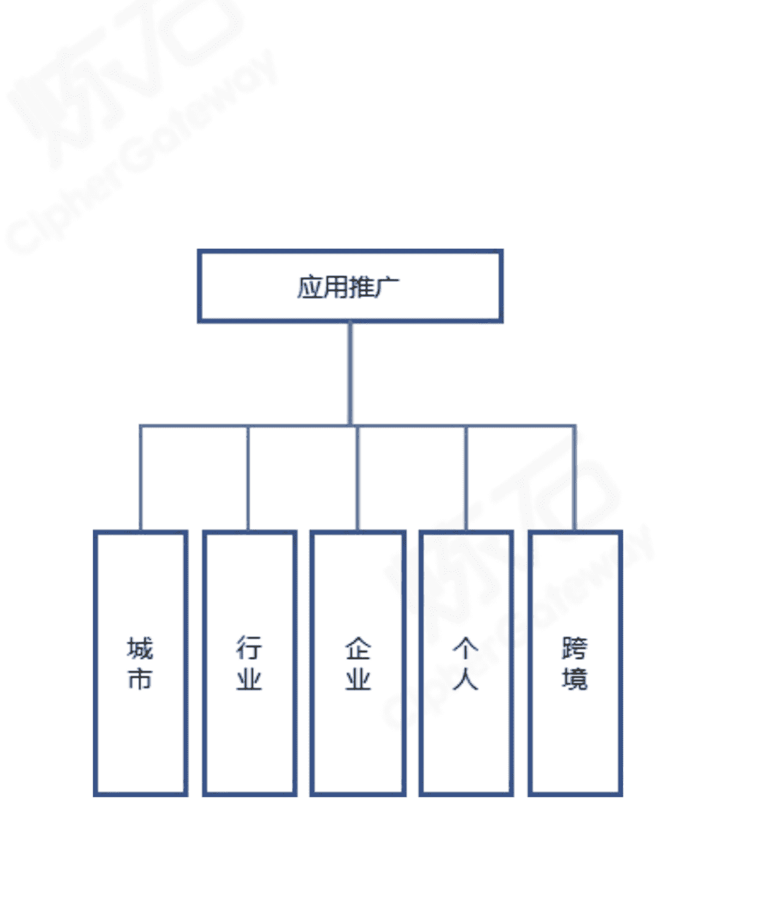

## 明确六项组织实施工作

### 总体要求

## 加强统筹协调

## 加快标准编制

## 加强宣贯培训

## 实施动态更新

#### 加强人才培养

## 推进开源参考实现

## 需求分析

在国家数据局的指导下，发挥可信数据空间发展联盟的作用，加强可信数据空间标准体系关键技术指标的试验验证，加强规划和建设。

充分利用多部门协作、多主体协作等机制，统筹产学用，重点需要标准制定，推进标准体系有效落地。充分发挥主管部门、行业协会、标准化组织和专业机构的作用，加强标准的宣贯和培训，有序指导各主体在可信数据空间建设、运营、管理等环节对标。紧密结合可信数据空间技术需求，及时修订《可信数据空间标准体系指南》，加强可信数据空间标准的拟定、实施。

加强人才培养，打造一批标准化专业人才。围绕标准规划，开展开源参考实现依托可信数据空间联盟，构建开源组件、接口工具、软件框架等基础能力，提供复用，降低中小企业开发与对接成本，加速标准到系统的落地。

### 建设思路

## 建设内容

### 五、组织实施

附件1：可信数据空间待标准清单

附件2：可信数据空间基础共性标准和关键技术指南

从五大重点方向给出21项优先研制

- 一、总体要求
- 二、需求分析
- 三、建设思路
- 四、建设内容
- 五、组织实施
- 附件1：可数据空间待标准清单
- 附件2：可数据空间基础标准和关键技术标准

| 序号 | 标准体系位置 | 标准名称 | 序号 | 标准体系位置 | 标准名称 |
| :--- | :--- | :--- | :--- | :--- | :--- |
| 1 | A基础体系-基础通用 | 参考架构 | 12 | D价值共创-服务方交互 | 服务方管理规范 |
| 2 | A基础体系-基础通用 | 能力需求 | 13 | D价值共创-共享-价值评估 | 价值评估技术指南 |
| 3 | A基础体系-基础评估 | 应用成熟度 | 14 | D价值共创-数据产品和服务 | 运营通用需求 |
| 4 | B资源交互 | 资源登记与管理通用 | 15 | E建设级技术-中间运营平台 | 中间平台功能和性能需求 |
| 5 | B资源交互-资源发布和发现 | 目录管理与检索规范 | 16 | E运营级技术系统-用户界面 | 用户界面和能力需求 |
| 6 | B资源交互-资源发布和发现 | 目录交互规范 | 17 | E运营级技术系统 | 业务管理规范 |
| 7 | B资源交互-资源流通-接口 | 接口交互技术需求 | 18 | E运营级系统-运营规则 | 运营规范 |
| 8 | C权限信控 | 能力需求 | 19 | E运营级-运营规则-接入审核 | 接入审核通用 |
| 9 | C权限信控-接入认证 | 生态信息接入需求 | 20 | E建设级-运营规则-互联互通 | 互联通用 |
| 10 | C权限信控-存证源-存证规范 | 存储规范 | 21 | E运营级-运营规则-共享利用 | 共享利用通用 |
| 11 | D价值共创 | 价值创造能力 | | | |

## 可数据空间基础共性标准和关键技术¹

| 序号 | 标识名称 | 标识号/计划号 | 国际标准号 | 状态 |
| :--- | :--- | :--- | :--- | :--- |
| 一、总体要求 | A 基础共性 | | | |
| | AA 数据通用 | | | |
| 1 | 信息技术 大数据跨域数据可信共享 | 20230737-T-469 | / | 已立项 |
| 2 | 信息技术 词汇 第1 部分：基础术语 | GB/T 5271.1-2000 | ISO/IEC 2382-1:1999 | 已发布 |
| 二、需求分析 | AB 共性参考 | | | |
| | 数据治理标准 | | | |
| 三、建设思路 | 城市数据治理能力成熟度模型 | GB/T 44136-2024 | / | 已发布 |
| 2 | 信息技术 大数据治理实施指南 | GB/T 44109-2024 | / | 已发布 |
| 3 | 信息技术服务治理第5部分：数据治理规范 | GB/T 34960-5018 | / | 已发布 |
| 4 | 数据质量第61部分：数据质量：过程参考模型 | GB/T 42381.61-2023 | ISO 8000-61:2016 | 已发布 |
| 5 | 数据质量第62部分：数据质量：组织过程成熟度：过程评估标准的应用 | GB/T 42381.62-2023 | ISO 8000-62:2018 | 已发布 |
| 6 | 数据质量第63部分：数据质量：过程测量 | GB/T 42381.63-2023 | ISO 8000-63:2019 | 已发布 |
| 7 | 数据质量第8部分：信息和数据：概念和测量 | GB/T 42381.8-2023 | ISO 8000-8:2015 | 已发布 |
| 四、建设内容 | 8 | 数据质量第140部分：主数据：特征交换：完整性 | GB/T 42381.140-2023 | ISO 8000-140:2016 | 已发布 |
| 9 | 数据质量第130部分：主数据：特征交换：准确性 | GB/T 42381.130-2023 | ISO 8000-130:2016 | 已发布 |
| 10 | 数据质量第120部分：主数据：特征交换：溯源 | GB/T 42381.120-2023 | ISO 8000-120:2016 | 已发布 |
| 五、实施 | 量化信息化数据质量 | GB/T 43709-2024 | / | 已发布 |
| 12 | 增强制造模型数据质量 | GB/T 43481-2023 | / | 已发布 |
| 13 | 地理信息数据质量第1部分：总体要求 | GB/T 213366-2021 | ISO 19157-1:2023 | 已发布 |
| 14 | 基础地理信息数据质量与评价 | GB/T 41149-2021 | / | 已发布 |
| 15 | 科学数据分类 | GB/T 43705-2025 | / | 已发布 |
| 16 | 数据安全分类规则 | GB/T 43697-2024 | / | 已发布 |
| 17 | 行业数据安全防护分级 | GB/T 42775-2023 | / | 已发布 |

## 可数据空间基础标准和关键技术标准

| 序号 | 信息名称 | 标准标识号/计划号 | 国际标准号 | 状态 |
| :--- | :--- | :--- | :--- | :--- |
| 18 | 信息技术服务智能第2部分：数据治理 | 20230203-T-469 | / | 已立 |
| 19 | 电力数据检测与评价 | 20240238-T-469 | / | 已立 |
| 20 | 智慧城市城市中枢治理 | 20240864-T-469 | / | 已立 |
| 21 | 人工智能智能城市数据质量规范 | 20250247-Z-469 | / | 已立 |
| 22 | 面向数据与机器学习的数据质量第3部分：数据管理和指导原则 | 20251294-T-469 | ISO/IEC 5259-3:2024 | 已立 |
| 23 | 面向数据与机器学习的数据质量第1部分：概述、术语及示例 | 20251310-T-469 | ISO/IEC 5259-1:2024 | 已立 |
| 24 | 面向数据与机器学习的数据质量第2部分：数据质量量 | 20251298-T-469 | ISO/IEC 5259-2:2024 | 已立 |
| 25 | 面向数据与机器学习的数据质量第4部分：数据质量过程框架 | 20251306-T-469 | ISO/IEC 5259-4:2024 | 已立 |
| 26 | 工业数据一致性测试方法 | 20243412-T-604 | / | 已立 |
| 1 | 电源数据交换 DLMS/COSEM 标准第75部分：本地网络 (LN)的本地数据传输配置 | GB/T 17215.675-2022 | IEC 62056-7:2016 | 已发 |
| 2 | 舞台搭建数据传输接口和协议规范 | GB/T 41992-2022 | / | 已发 |
| 3 | 港口岸线第2部分：高压和卸压连接系统监测和控制的数据传输 | GB/T 38329-2021 | IEC/IEEE 80005-2:2016 | 已发 |
| 4 | 卫星导航基准数据传输接口和协议 | GB/T 396070-2020 | / | 已发 |
| 5 | 智能工厂过程控制 | GB/T 38854-2020 | / | 已发 |
| 6 | 信息技术可靠存储第6部分：端侧数据接口 | GB/T 37947.1-2019 | / | 已发 |
| 7 | 公共网络标识传输安全性测试 | GB/T 37714-2019 | / | 已发 |
| 8 | 信息技术数据安全技术 | GB/T 37025-2018 | / | 已发 |
| 9 | 卫星导航信息数据格式 | GB/T 34966.3-2017 | / | 已发 |
| 10 | 陆地观测系统通信与接口 | GB/T 34518-2017 | / | 已发 |
| 11 | 无线传输通用通信规范 | GB/T 16611-2017 | ISO/IEC 60489-1 | 已发 |
| 12 | 大数据共享平台传输协议 | GB/T 29873-2013 | / | 已发 |
| 13 | 物联网传输应用规范 | GB/T 43440-2023 | / | 已发 |
| 14 | 电力数据实时监测第2部分：传输协议 | GB/T 26865.2-2023 | / | 已发布 |
| 15 | 公共网络互通的通用原则 | GB/T 17513-2011 | ITU-T X300:1996 | 已发布 |
| 16 | 船舶及海上航运数据传输 | GB/T 25010-2012 | ISO/PAS 16917:2002 | 已发布 |
| 17 | 供应链传输与交换 | GB/Z 19257-2003 | / | 已发布 |
| 18 | 应急管理、北斗导航系统应用接口和通信规范 | GB/T 24145-T-450 | / | 立项 |
| 19 | 电动汽车充电服务第5部分：传输及安全 | GB/T 242066-T-524 | / | 立项 |
| 20 | 物象物联网气象数据第3部分：数据协议 | GB/T 250690-T-339 | / | 立项 |
| 21 | 道路运输车辆定位安全技术要求 | GB/T 242461-T-348 | / | 立项 |
| 22 | 北斗卫星定位基准站传输规范 | GB/T 235226-T-466 | / | 立项 |
| 23 | 北斗卫星导航气象数据传输协议 | GB/T 20251727-T-416 | / | 立项 |

## 可数据空间基础标准和关键技术

| 序号 | 名称 | 标准号/计划号 | 对应标准 | 状态 |
| :--- | :--- | :--- | :--- | :--- |
| 一、总体要求 | 13 | 数据安全方法 | GB/T 35274-2019 | / |
| 二、需求分析 | 14 | 数据安全分类 | GB/T 37725-2023 | / | 已发布 |
| 三、建设思路 | 15 | 数据安全指南 | GB/T 42017-2022 | / | 已发布 |
| 四、建设内容 | 16 | 数据安全服务 | GB/T 42015-2022 | / | 已发布 |
| 五、组织实施 | 17 | 数据安全 | GB/T 42016-2022 | / | 已发布 |
| 1 | 数据安全大型互联网企业个人信息防护监管要求 | GB/T 45404-2025 | / | 已发布 |
| 2 | 数据安全技术处理安全要求 | GB/T 45396-2025 | / | 已发布 |
| 3 | 数据安全技术基于信息的自动化决策安全要求 | GB/T 45392-2025 | / | 已发布 |
| 4 | 数据安全技术评估能力要求 | GB/T 45389-2025 | / | 已发布 |
| 5 | 数据安全技术密文计算通用框架 | GB/T 45230-2025 | / | 已发布 |
| 6 | 科学数据安全审计标准 | GB/T 43710-2025 | / | 已发布 |
| 7 | 科学数据安全通用标准 | GB/T 43708-2025 | / | 已发布 |
| 8 | 科学数据安全分类索引指南 | GB/T 43705-2025 | / | 已发布 |
| 9 | 数据安全互联网平台及产品服务个人信息处理规则 | GB/T 44588-2024 | / | 已发布 |
| 10 | 网络安全技术网络弹性准则 | GB/T 44862-2024 | / | 已发布 |
| 11 | 数据安全应用商店的互动应用程序（App）个人信息规范性审核与指南 | GB/T 43739-2024 | / | 已发布 |
| 12 | 信息安全技术区块链发行服务规范 | GB/T 42572-2023 | / | 已发布 |

- 一、总体要求
- 二、需求分析
- 三、建设思路
- 四、建设内容
- 五、组织实施
附件1：可数据空间待标准清单

附件2：可数据空间基础共性标准和关键技术

## 可信数据空间基础性标准和关键技术标准5

| 序号 | 标准名称 | 标准号/计划号 | 对应国际标准 | 状态 |
| :--- | :--- | :--- | :--- | :--- |
| 一、总体要求 | 35 | 数据安全技术 数据接口安全风险监测方法 | 20240331-T-469 | / | 已定价 |
| | 36 | 数据安全技术个人信息匿名化指南及评价方法 | 202505864-T-469 | / | 已定价 |
| | 37 | 数据安全技术 电子产品消除技术要求 | 20243531-Q-252 | / | 已定价 |
| 二、需求分析 | 38 | 智能手机数据安全管理体系规范 | 20243203-T-339 | / | 已定价 |
| | 39 | 数据安全技术 数据安全保护要求 | 20240405-T-469 | / | 已定价 |
| | 40 | 数据安全技术 未成年人和服务青少年个人信息保护要求 | 20251312-T-469 | / | 已定价 |
| 三、建设思路 | AD 测试评估 | | | |
| | 1 | 信息技术 数据存储与处理系统功能测试需求 | GB/T 38676-2020 | / | 已发布 |
| 四、建设内容 | B 资源发布和发现 | | | |
| | 元数据与资源标识标准 | | | |
| 1 | 中国标准时间 数据 第 2 部分：元数据 | GB/T 45434.2-2025 | / | 已发布 |
| 2 | 科学数据溯源数据 | GB/T 43707-2025 | / | 已发布 |
| 3 | 地理信息 数据与元数据存储第 1 部分：基础 | GB/T 44491.1-2024 | ISO 19165-1:2018 | 已发布 |
| 4 | 气象观测元数据 | GB/T 43622-2023 | / | 已发布 |
| 5 | 财务信息 第 1 部分：元数据 | GB/T 43340.1-2023 | / | 已发布 |
| 6 | 地理信息 元数据 第 1 部分：基础 | GB/T 19710.1-2023 | ISO 19115-1:2014 | 已发布 |
| 7 | 公安隐私视频内容描述 | GB/T 42197-2022 | / | 已发布 |
| 8 | 政府网站电子文件 | GB/T 42147-2022 | / | 已发布 |
| 9 | 物流信息资源元数据 | GB/T 40208-2021 | / | 已发布 |
| 10 | 基础制造工艺元数据 | GB/T 40019-2021 | / | 已发布 |
| 11 | 基础零部件通用元数据 | GB/T 40016-2021 | / | 已发布 |

## 可信数据空间基础性标准及关键标准6

| 序号 | 标准名称 | 标准号/计划号 | 对应国际标准 | 状态 |
| :--- | :--- | :--- | :--- | :--- |
| 一、总体要求 | 12 | 科技平台元数据 | GB/T 39913-2021 | / | 已发布 |
| | 13 | 气象观测元数据 | GB/T 45558-2025 | / | 已发布 |
| | 14 | 信息与文献重大档案元数据 | GB/T 42743-2023 | / | 已发布 |
| 二、需求分析 | 15 | 科技资源元数据 | GB/T 30523-2023 | / | 已发布 |
| | 16 | 信息与文献（档案）管理元数据第2部分：概念化 | GB/T 26163.2-2023 | ISO 23081-2:2021 | 已发布 |
| | 17 | 公共交通图像分析技术要求 | GB/T 42196-2022 | / | 已发布 |
| 三、设计思路 | 18 | 信息与文献组织机构元数据 | GB/T 42108-2022 | / | 已发布 |
| | 19 | 中文新闻内容标准第2部分：元数据 | GB/T 20092.2-2015 | / | 已发布 |
| | 20 | 信息技术数据工业产品核心元数据 | GB/T 38555-2020 | / | 已发布 |
| 四、建设内容 | 21 | 内容源标识化加工第4部分：元数据 | GB/T 38548.4-2020 | / | 已发布 |
| | 22 | 重要数据追踪核心元数据 | GB/T 38154-2019 | / | 已发布 |
| | 23 | 物联网数据交换与共享 | GB/T 36478.3-2019 | / | 已发布 |
| | 24 | 中国主产品分类核心元数据第7部分：体育用品 | GB/T 37600.7-2019 | / | 已发布 |
| 五、实施方案 | 25 | 中国主产品分类核心元数据第5部分：乐器 | GB/T 37600.5-2019 | / | 已发布 |
| | 26 | 中国主产品分类核心元数据第4部分：公共场所的游乐设施 | GB/T 37600.4-2019 | / | 已发布 |
| | 27 | 中国主产品分类核心元数据第1部分：描述方法 | GB/T 37600.1-2018 | / | 已发布 |
| 附件1: 可信数据空间待立项标准清单 | 28 | 产品标识核心元数据 | GB/T 37282-2019 | / | 已发布 |
| | 29 | 气象观测元数据数据集 | GB/T 33674-2017 | / | 已发布 |
| | 30 | 信息技术电子书第3部分：元数据 | GB/T 18787.3-2015 | / | 已发布 |
| 附件2: 可信数据空间基础性标准和关键技术标准 | 31 | 科技平台服务级元数据 | GB/T 31703-4-2015 | / | 已发布 |
| | 32 | 工业自动化系统识别与开放技术字典在主数据中的应用第13部分：概念和标识的标识 | GB/T 44275.13-2023 | ISO 22745-13:2010 | 已发布 |
| | 33 | 信息技术自动识别与采集技术标识 | GB/T 42587-2023 | ISO/IEC 15424:2008 | 已发布 |

## 可信数据空间基础共性标准和技术标准

| 序号 | 名称 | 标准号/计划号 | 对应国际标准 | 状态 |
| :--- | :--- | :--- | :--- | :--- |
| 一、总体要求 | 34 | 健康信息数据库第5部分：标识 | GB/T 21715.5-2021 | / | 已发布 |
| | 35 | 自动化系统用数据交换格式：自动化语言第1部分：架构和通用要求 | GB/T 39003.1-2020 | IEC 62714-1:2018 | 已发布 |
| | 36 | 物联网标识体系 | GB/T 38606-2020 | / | 已发布 |
| | 37 | 电表交换 MMS/COSEM规范第6部分：对象系统 | GB/T 17215.6-2018 | IEC 62056-6:2017 | 已发布 |
| | 38 | 地理数据交换规范 | GB/T 35632-2017 | / | 已发布 |
| | 39 | 信息注册(MDR)第5部分：命名和标识 | GB/T 18391.5-2009 | ISO/IEC 11179-5:2005 | 已发布 |
| 二、需求思路 | 40 | 固定资产标识元数据 | GB/T 241561-T-466 | / | 立项 |
| | 41 | 运行检测核心元数据 | GB/T 2231869-T-466 | / | 立项 |
| | 42 | 地理数据和衍生数据产品规范 | GB/T 2230037-T-466 | ISO 19165-2:2020 | 立项 |
| | 43 | 航空工业数据产品标识与追溯性 | GB/T 2231417-T-466 | ISO 21849:2022 | 立项 |
| | 44 | 科学数据标识编码 | GB/T 221224-T-306 | / | 立项 |
| | 45 | 资源标识元数据 | GB/T 241601-T-466 | / | 立项 |
| | 46 | 技术元数据注册(MDR)第1部分：框架 | GB/T 2231927-T-466 | ISO/IEC 11179-1:2023 | 立项 |
| | 47 | 数据要素标识 | GB/T 241470-T-466 | / | 立项 |
| | 48 | 技术贸易溯元数据 | GB/T 2250842-T-466 | / | 立项 |
| | 49 | 大科学基础设施平台光子与射线实验元数据 | GB/T 2250950-T-306 | / | 立项 |
| | 50 | 科技平台基因组科学数据 | GB/T 2250953-T-306 | / | 立项 |
| | 51 | 科学技术开放云平台元数据 | GB/T 2250954-T-306 | / | 立项 |
| | 52 | 元数据的XML标识规范 | GB/T 2250444-T-469 | / | 立项 |
| | 53 | 中文新闻图片内容描述元数据 | GB/T 2250199-T-469 | / | 立项 |
| | 54 | 智慧城市时空信息服务的功能和元数据 | GB/T 2250175-T-466 | ITU-T.4562:2021 | 立项 |
| | 55 | 信息技术数据标准核心元数据 | GB/T 2241469-T-469 | / | 立项 |

## 可信数据空间基础标准和关键技术标准8 Cipher Gateway

| 序号 | 标准名称 | 标准号/计划号 | 对应国际标准号 | 状态 |
| :--- | :--- | :--- | :--- | :--- |
| 一、总体要求 | 56 | 智能船舶数据分类与标记 | GB/T 224273-T-469 | / | 已发布 |
| | 57 | 工业自动化系统工程数据交换格式自动化识别语言代码第4部分：逻辑 | GB/T 2251693-T-604 | IEC 62714-4:2020 | 已发布 |
| 二、需求分析 | 1 | 物联网数据质量评价方法 | GB/T 44811-2024 | / | 已发布 |
| | 2 | 信息技术数据质量评价指标 | GB/T 36344-2018 | / | 已发布 |
| 三、建设思路 | 1 | 信息安全引入可信第三方实体识别及接入架构 | GB/T 28455-2012 | / | 已发布 |
| | 2 | 网络安全身份服务接入规范 | GB/T 2240330-T-469 | / | 已发布 |
| | 3 | 信息安全基于互联网政务安全指南第3部分：授权管理 | GB/T 24294-3017 | / | 已发布 |
| | 4 | 网络安全引入可信第三方实体识别及接入架构 | GB/T 2250855-T-469 | / | 已发布 |
| | 5 | 道路交通监控设施数字身份通用规范 | GB/T 221469-T-312 | / | 已发布 |
| 五、组织实施 | 1 | 区块链技术融合生命周期管理规范 | GB/T 43759-2023 | / | 已发布 |
| 附件1: 可信数据空间待立标准清单 | 1 | 科学数据溯源数据 | GB/T 43707-2025 | / | 已发布 |
| | 2 | 区块链技术存证服务指南 | GB/T 43580-2023 | / | 已发布 |
| | 3 | 跨境电子商务溯源信息管理 | GB/T 2239062-T-302 | / | 已发布 |
| | 4 | 区块链技术平台身份管理要求 | GB/T 2240045-T-339 | / | 已发布 |
| | 5 | 区块链技术身份管理系统概述 | GB/T 2240570-Z-339 | / | 已发布 |
| | 6 | 区块链技术治理指南 | GB/T 2231922-Z-339 | / | 已发布 |
| | 7 | 区块链技术通用服务身份技术要求 | GB/T 2231509-T-339 | / | 已发布 |

## 可信数据空间基础标准和关键标准9

| 序号 | 标准名称 | 标准号/计划号 | 对应国际标准 | 状态 |
| :--- | :--- | :--- | :--- | :--- |
| 一、总体要求 | 8 | 区块链基础基础设施存储技术要求 | GB/T 2231512-T-339 | / | 已发布 |
| | 9 | 区块链技术运营规范第1部分：即时服务通用技术要求 | GB/T 2230987-T-339 | / | 已发布 |
| | 10 | 区块链技术互操作性第1部分：跨链通用规范 | GB/T 2230982-T-339 | / | 已发布 |
| 二、需求分析 | 11 | 区块链技术运营规范第2部分：信息服务通用框架 | GB/T 2230986-T-339 | / | 已发布 |
| | 12 | 区块链技术互操作性第2部分：治理参考架构 | GB/T 2230989-T-339 | / | 已发布 |
| 三、建设思路 | 1 | 科学数据产品服务规范 | GB/T 38239-2019 | / | 已发布 |
| | 2 | 中尺度全球地表覆盖制图数据规范 | GB/T 43956-2024 | / | 已发布 |
| | 3 | 沿海国道地理信息要素第5部分：数据产品规范 | JT/T 1161.5-2024 | / | 已发布 |
| | 4 | 全球资源数据产品规范 | CH/T 9032-2022 | / | 已发布 |
| | 5 | GNSS 厘米级数据类型及分级 | GB/T 2242403-T-416 | / | 已发布 |
| 五、组织实施 | 1 | 智慧城市信息技术运营指南 | GB/T 36621-2025 | / | 已发布 |
| | 2 | 信息技术大数据系统运维和管理功能要求 | GB/T 38633-2020 | / | 已发布 |
| | 3 | 信息安全技术信息系统安全运维指南 | GB/T 36626-2018 | / | 已发布 |
| | 4 | 信息安全技术灾难恢复中心建设与运维规范 | GB/T 30285-2013 | / | 已发布 |
| | 5 | 网络安全技术网络安全实施指南 | GB/T 2240400-T-469 | / | 已发布 |

## 可信数据空间基础性标准和技术标准11

| 序号 | 标准名称 | 标准号/计划号 | 对应国际标准 | 状态 |
| :--- | :--- | :--- | :--- | :--- |
| 一、总体要求 | 2 | 金融机构外部可信数据源评估要求 | YD/T 4384-2023 | / | 已发布 |
| | 3 | 可信数据服务可信数据提供方评估要求 | YD/T 4385-2023 | / | 已发布 |
| | 4 | 可信数据服务可信数据流通平台评估要求 | YD/T 4386-2023 | / | |
| 二、需求分析 | 5 | 信息技术数据资产管理要求 | GB/T 40685-2021 | / | 已发布 |

- 1. 图解国家发改委、数据局、工信部《国家数据基础设施建设指引》
- 2. 图解国家数据局《可数据空间发展行动计划（2024—2028年）》
- 3. 十可信数据空间
- 4. 图解《可信数据空间创新发展报告（2025）》
- 5. 图解《可信数据空间建设及应用参考指南（V1.0）》
- 6. 图解《可信数据空间标准体系建设指南（2025年版）》
- 7. 图解标准《可信数据空间技术架构》
- 8. 数据流通场景数据安全实践

# 标准规范了可信数据空间技术架构

### 主要内容

### 适用范围

TC609
全国数据标准化技术委员会文件
TC609-6-2025-01

本文件规范了可信数据空间技术架构，明确了可信数据空间在国家数据基础设施中的定位，描述了可信数据空间作为一种数据流通通用基础设施的核心特征、最小功能集合以及关键业务流程。

本文件适用于指导地方、行业、领域、企业开展可数据空间的规划、建设、运营和管理。

可信数据空间 技术架构
Trustworthy data space—Technology architecture

### 引用文件

NDI—TR—2025—01
数据基础设施 参考架构

NDI—TR—2025—02
数据基础设施 互联通用基本

NDI—TR—2025—03
数据基础设施 用户身份管理和接入规范

NDI—TR—2025—05
数据基础设施 接入连接器技术要求

NDI—TR—2025—06
数据基础设施 数据目录描述规范

2025-04-30 发布 2025-04-30 实施
全国数据标准化技术委员会 发布

## 可信数据空间是实现数据资源共享的一种数据流通利用基础设施

| 1.术语和定义 | 术语 | 定义 |
|---|---|---|
| | 可信 | 即可信赖，指“符合预期”，以技术可验证的方式充分利益相关者期望的能力。 |
| 2.概述 | 可信数据空间 | 基于共识规则，联接多方主体，实现数据资源共享的一种数据流通基础设施，是数据要素价值驱动的生态系统，是支撑全国一体化数据市场的重要载体。 |
| 3.技术架构 | 数据合约 | 以数字化形式描述的数据提供方、数据使用方、数据服务方等参与方的数据流通，使用等环节的承诺，包括但不限于数据的内容、使用者、使用方式、次数、范围、使用环境等。 |
| 4.业务流程 | 使用控制 | 在数据的传输、存储、使用和销毁环节，通过集成在数据应用、算法和运行环境中的技术手段，确保参与方按照数字合约规定的策略对数据进行分析、计算和处理等，实现对数据使用的时间、地点、主体、行为等的控制，从而保证数据的使用符合预期。 |
| 5.安全要求 | 数据资源 | 具有价值创造潜力的数据总量，通常以电子化形式记录和保存、可机器提取、可社会化再利用的数据集 |
| 6.问解答 | 数据产品 | 自然人、法人或者非法人组织对合法获取的数据资源，经过实质性加工和创新性劳动后的产品，可满足特定需求的数据工具和数据服务。 |

# 以数字契约、使用控制技术为核心，以数据跨主体流通使用的可信为目标

### 1.术语和定义
- 技术组成角度
- 系统构成的物理角度
- 生态关系的逻辑角度
- 应用场景角度
- 数据基础设施角度

### 2.概述
可信数据空间：以数字契约、使用控制技术为核心，以数据跨主体流通使用的可信（符合预期）为目标。

- 数字契约
- 控制技术

### 3.技术架构
- 预期描述
- 行为管控

### 4.业务流程
通过数字契约技术描述特定参与方数据内容、使用方式、使用次数等流通行为的预期并达成共识；
通过集成在特定硬件环境中的使用控制技术对数据的算法、应用进行控制，实现对数据访问、分析、计算等行为的管控，保证数据的流通及结果符合预期。

### 5.安全要求
### 6.问解答

## 具备安全可信数据流通使用、跨域空间的数据互通等特征

### 1.术语和定义
可信数据空间形成的数字契约、使用控制为核心的技术体系，具备以下特征：

| 维度说明 | 核心特征 | 详细说明 |
|---|---|---|
| 2.概述 | | |
| 3.技术架构 | 安全可信数据流通 | |
| 4.业务流程 | 安全可信数据使用 | 行为共识 | 可信数据空间相关参与方在共识规则下，通过数字契约达成对流通行为的共识，并在使用技术中融合区块链、数据沙箱、隐私计算等技术，确保数据的流通和过程预期； |
| | 跨域空间的数据互通 | 统一底座 | 可信数据空间符合国家基础设施参考架构，通过统一底座能够有效发现、定位与其他可信空间业务节点中的数据。 |
| 5.安全要求 | 多方的数据价值创造 | 增值服务 | 可信数据空间在支持参与方数据流通的基础上，支持人工智能服务、数据治理服务、数据开发服务等增值服务，并通过接入连接器提供服务加速数据价值的挖掘、释放。 |
| 6.问解答 | | |

## 可信数据空间主要由可信数据服务平台和接入连接器组成

可信数据空间主要由两部分组成：
- 服务平台（平台系统）
- 接入连接器（入口系统）

> 可信数据空间服务平台是支撑可信数据空间运营的平台系统，为可信数据空间参与方提供数据流通使用的基础服务；
> 接入连接器是可信数据空间参与方加入的入口系统，支持数据提供、数据使用、数据服务以及依据数字契约执行使用的控制载体。

## 在接入连接器及服务平台上形成的数据流通过要素关系的集合

| 技术组成角度 | 系统构成的物理角度 | 生态关系的逻辑角度 | 应用场景角度 | 数据基础设施角度 |
|---|---|---|---|---|
| | 维度说明 | 核心特征 | 详细说明 | |
| 1.术语和定义 | 基础定义 | 要素关系的集合 | 可信数据空间是在接入连接器及服务平台上形成的数据流通过要素关系的集合，包括：提供方、使用方、服务方等参与主体，数据、算法、服务等资源，策略、合同、法规等规则。 | | |
| 2.概述 | | 支持多逻辑 | 一套可信数据空间应支持多个逻辑的可信数据空间。 | |
| 3.技术架构 | | 需求特征 | 不同的逻辑可信数据空间通常具有独特的业务属性、社会属性或群组关系，导致其中的参与主体、可用资源、共识规则呈现出显著差异。 | |
| 4.业务流程 | | 独特属性 | 例如某领域供应链可信数据空间，参与方通常为供应链上下游企业； | |
| 5.安全要求 | | | | |
| 6.问答解读 | | 医疗数据空间 | 例如某医疗数据空间，参与方通常为医院、药物研发方、医学研究方等。 | |

## 可信数据空间可用于解决具体场景下数据流通中的信任问题

| 技术组成角度 | 系统构成的物理角度 | 生态关系的逻辑角度 | 应用场景角度 | 数据基础设施角度 |
|---|---|---|---|---|
| 维度说明 | 核心特征 | 详细说明 | | |
| 解决问题 | 信任问题 | 可信数据空间可用于解决具体场景下数据流通中的信任问题，降低提供方提供数据、使用方使用数据的信任门槛 | | |
| 案例说明 | 数据共享 | 例如，跨企业、跨行业的产业数据交换协同，跨领域、跨学科的科学数据共享分析等。 | | | |
| 作用意义 | 达成共识 | 在可信数据空间范围内参与主体、空间资源及共识规则下，利用可信数据空间技术能力，相关参与方能够达成数据流通和使用预期的共识，数据使用方相信数据方如约提供数据、数据提供方使用数据方如约使用数据，高效实现主体的数据可流通及使用。 | | |

### 2.概述
### 3.技术架构
### 4.业务流程
### 5.安全要求
### 6.问答解答

## 既是国家基础设施的架构派生也是国家基础设施的组成部分

在与国家数据基础设施关系方面，可数据空间既是国家基础设施的架构派生也是国家基础设施的组成部分。

| 维度 | 技术组成角度 | 系统构成的物理角度 | 生态关系的逻辑角度 | 应用场景角度 | 数据基础设施角度 |
|---|---|---|---|---|---|
| 1.术语和定义 | | | | | |
| 2.概述 | 核心特征 | 详细说明 | | | |
| 3.技术架构 | 技术架构角度 | 架构继承 | 可信数据空间服务平台在国家基础设施参考架构中的定位是业务节点，在满足业务要求上结合自身技术特征了相应组件：如数字契约等； | | |
| 4.业务流程 | 扩展使用 | | 接入连接器在接入可数据空间时同时在通用功能上扩展使用控制等。 | | |
| 5.安全要求 | 互通角度 | 组成部分 | 可信数据空间是国家基础设施的一部分，按照统一标识、统一身份、统一接口，接入区域/行业功能节点，实现与其他业务节点的互通。 | | |
| 6.问答解答 | 空间创建 | 可信数据空间服务平台以及数据空间中的数据产品、数据服务等资源，按照数据空间的业务规则则创建可数据空间，鼓励使用区块链网络。 | | | | |

## 可信数据空间是国家基础设施的一部分

可信数据空间是国家基础设施的一部分，符合NDI-TR-2025-01确定的国家基础设施整体架构及基本约束。可信数据空间包括可信数据服务平台与接入连接器对接。在继承国家基础设施业务节点的基础上，可信数据空间结合自身技术特征了一功能扩展。

## 作为类数据基础设施业务节点的功能集合

### 1.术语和定义
### 2.概述
可信数据空间符合合规按照NDI—TR—2025—02、NDI—TR—2025—03、NDI—TR—2025—05要求的保持区域/行业功能节点的身份、连接器、目录等信息的互通；

### 3.技术架构
向上连接器/行业功能节点：数据服务方，如：云计算服务、智能化服务、数据交易服务、数据治理公共服务、隐私计算公共服务等的数据提供方，通过连接器将服务接入可数据空间并提供增值服务，数据服务对于原始数据方来说是使用方，对于最终数据使用方来说是数据提供，可以通过连接器相关功能完成信息交换、提供增值服务。

### 4.业务流程
使用方应用系统通过连接器获取、使用数据，完成价值化应用；

### 5.安全要求
支持数据提供方、使用方通过连接器接入可信数据空间；提供方通过连接器与本地数据存储、汇聚、加工处理等数据对接，完成数据接入；

### 6.问解答

## 具备身份管理、接入连接器管理、目录管理、数字合约管理等七大功能

七大功能：具备身份管理、接入连接器管理、目录管理、数字合约管理、数据空间控制、国际空间互联等7个功能。

三统一：数据空间服务平台按照“三一统一”要求，保持身份、标识、目录与区域/行业业务节点的互通。

功能复用：数据空间服务平台与其他通用业务节点互通，在实际数据通用业务流程中可以直接复用其他业务节点。

## 相关主体提供统一的身份注册、核验等服务

### 1.术语和定义
区域/行业功能节点为参与数据流通的企业/个人等主体提供统一的身份注册、核验以及跨区域/行业身份交互和失效身份核验等服务。可信数据空间平台可以封装或调接接口等方式代理区域/行业功能节点面向空间中的各种用户提供身份注册、核验等服务。可信数据空间平台可以基于可数据空间需求，在数据基础身份管理基础上拓展身份相关信息和要求。可信数据空间平台的身份管理模块，包含以下内容：

### 3.技术架构
### 4.业务流程
### 5.安全要求
### 6.问答解读

| 功能点 | 内容 |
|---||---|
| 身份注册 | 按照NDI—TR—2025—01确定的业务流程和要求，NDI—TR—2025—03确定的用户注册流程和要求，为新用户分配身份。用户由数据空间服务平台办理注册，也可在区域/行业功能节点中进行身份注册； |
| 身份认证 | 按照NDI—TR—2025—03确定的身份认证流程和要求，提供身份认证功能，支持相关可数据空间中的用户身份认证。服务平台通过区域/行业功能节点的交互，实现对注册用户的身份认证； |
| 身份更新 | 允许可数据空间用户更新身份信息，若新的信息，按照NDI—TR—2025—02确定的业务流程和要求，NDI—TR—2025—03确定的用户更新流程，将身份同步至区域/行业功能节点； |
| 身份注销 | 允许可数据空间用户通过数据空间服务平台注销可数据空间，注销后不会影响用户对数据基础设施的使用。 |

## 为连接器提供注册、验证以及跨区域连接器互认服务

| 概述 | 功能架构 | 交互关系 |
|---|---|---|
| 概述 | 可信数据空间服务平台 | 接入连接器 |
| 身份管理 | 接入连接器管理 | |
| 目录管理 | 数字合约管理 |
| 可信数据空间管理 | 数据使用控制 |
| 国际互网关 | 数据交换 |
| 开发应用中心 | 数据托管 |
| 存证审计 | 其他功能 |

### 1.术语和定义
区域/行业功能节点为数据基础设施中的接入连接器提供注册、验证以及跨区域连接器互认服务。可信数据空间平台可通过封装或接口方式使得区域/行业功能节点面向可数据空间中的连接器提供注册、核验等服务。可信数据空间平台基于可信数据空间业务需求，在数据基础设施接入连接器管理的基础上拓展连接器相关注册信息和要求。包含以下功能：

### 2.概述
### 3.技术架构
### 4.业务流程

| 功能点 | 详细信息 |
|---|---|
| 连接器注册/注销 | 按照NDRI–2025–02确定的业务节点流程和要求，NDRI–2025–03确定的连接器注册流程和要求，为新接入连接器注册并完成连接器身份信息。用户可通过可信数据空间平台完成连接器注册，也可在区域/行业功能节点中已接入的连接器直接接入可数据空间。注销后影响连接器在数据基础设施中使用； |
| 连接器认证 | 按照NDRI–2025–03确定的连接器认证要求，服务平台支持对连接器进行身份认证。服务平台通过区域/行业功能节点，连接器身份； |
| 运行监测 | 按照NDRI–2025–04确定的连接器运行状态上报机制，收集、汇总连接器状态，监测可信数据空间中连接器的运行情况； |
| 能力适配 | 支持服务平台完成接入连接器与可信数据空间的能力适配，其完全可以满足可信数据空间的业务要求。同一个接入连接器接入不同的可信数据空间，通过服务平台进行能力适配以确保不同可信数据空间的业务要求。能力适配的范围包括但不限于连接器在数据资源发现、数据、管理、数字合约管理以及数据使用等等。 |

## 为数据产品提供登记服务，编制数据目录，并提供数据查询服务

| 概述 | 功能架构 | 交互关系 |
|---|---|---|
| 概述 | 可信数据空间服务平台 | 接入连接器 |
| 身份管理 | 接入连接器 | |
| 目录管理 | 数据约束管理 |
| 可信数据空间管理 | 数据使用控制 |
| 国际互网关 | 数据交换 |
| 开发应用中心 | 数据托管 |
| 存证审计 | 其他功能 |

### 2.概述
区域/行业功能节点为数据产品提供登记服务，编制数据目录，并提供数据查询服务。可信数据空间服务平台可通过嵌套或接口等方式替代区域/行业功能节点向空间中的数据产品提供登记服务。可信数据空间服务平台基于可信数据空间业务需求，在数据基础设施目录管理的基础上拓展数据相关信息和管理要求。可信数据空间管理，应包含以下：

### 3.技术架构
### 4.业务流程
### 5.安全要求
### 6.问答解析

## 提供数字合约管理基本功能 协助数据提供、使用方完成需求涵盖及合同签署

### 1.术语和定义
### 2.概述
### 3.技术架构
### 4.业务流程
### 5.安全要求
### 6.问答解读
提供数字合约管理的基本功能，协助数据提供方、使用方完成需求涵盖，包含以下功能：
提供数字合约管理的策略模板，允许数据提供等参与方选择标识框中的一个或多个创建数字合约。策略模板中应包含使用控制策略，但不包括：限定数据内容、限定数据产品交付连接器、限定数据使用连接器、限定数据用户信息、限定数据使用操作、限定数据使用次数、限定数据使用时长、限定数据可视范围、限定数据可用范围、数据使用时通知、数据使用后销毁等；不同可信数据空间可控制合约特定特征供的策略模板；

## 可信数据空间服务平台提供可信数据空间管理功能

## 1. 术语和定义

### 2. 概述

### 概述

### 功能架构

### 交互关系

### 可信数据空间服务平台

### 接入连接器

| 概述 | 身份管理 | 连接器管理 | 目录管理 | 数字合约管理 | 可信数据空间管理 | 数据使用控制 | 国际互联 | 数据交换 | 开发应用 | 数据托管 | 证书审计 | 其他功能 |
| :--- | :--- | :--- | :--- | :--- | :--- | :--- | :--- | :--- | :--- | :--- | :--- | :--- |

### 2. 概述

可信数据空间服务平台提供可信数据空间管理功能，支持面向数据流流通场景，创建包含特定参与主体、数据源及应用控制策略的逻辑可信数据空间，相关参与方可设置逻辑可信数据产品、服务仅限参与的参与方可见、可用。可信数据存储空间管理功能具体包括如下：

### 3. 技术架构

### 功能点

### 详情介绍

| 功能点 | 详情介绍 |
| :--- | :--- |
| 创建/删除 | 提供逻辑可信数据空间创建、删除等基本功能，允许可信数据空间面向方向场景，基于定义的参与方与主体、数据源及应用控制策略创建逻辑可信数据空间并成为空间的可信数据空间运营；允许可信空间运营方在必要时删除其管理的可信数据空间。创建/删除可信数据空间按照NDI-TR—2025—02确定的业务流程和，上报可信数据空间基本信息 |
| 配置修改 | 允许可信数据空间运营方修改逻辑可信数据空间配置，包括可信数据空间名称、可信数据空间描述、可信数据空间支持的控制策略等；按照NDI-TR—2025—02确定的业务服务流程和要求，上报可信数据空间基本信息 |
| 成员管理 | 提供可信数据空间成员管理功能，允许可信空间成员方、数据方、服务方申请加入数据空间，并在可信数据空间管理方审批后授予查看、访问可信数据空间资源的权限 |
| 运行监测 | 提供可信数据空间运行状态监控基本功能，并与区域/行业功能节点实现互联互通，按照NDI—TR—2025—确定的运行监控和要求，上报可信空间运行信息和服务信息 |

### 4. 业务流程

### 5. 安全要求

## 6. 问解答

## 可信数据空间服务平台应提供数据使用控制功能

| 概述 | 功能架构 | 交互关系 |
| :--- | :--- | :--- |
| 概述 | 可信数据空间服务平台 | 接入连接器 |

| 概述 | 身份管理 | 连接器管理 | 目录管理 | 数字合约管理 | 可信数据空间管理 | 数据使用控制 | 国际空间互通网关 | 数据交易 | 开发应用中心 | 数据托管 | 存证审计 | 其他功能 |
| :--- | :--- | :--- | :--- | :--- | :--- | :--- | :--- | :--- | :--- | :--- | :--- | :--- |
| 1. 术语和定义 | | | | | | | | | | | | |
| 2. 概述 | 可信数据空间服务平台应提供数据使用控制功能，支持数据提供方、数据使用方利用平台提供的能力按照数字合约要求对数据的使用，数据使用控制应具备以下功能： | | | | |

| 功能点 | 详细信息 |
| :--- | :--- |
| 数据使用环境 | **提供数据使用数字契约的软件环境**，支持数据使用方按照数字合约要求，通过算法或应用数据提供方交付的数据产品；连接器可集成隐私计算、数据沙箱、数据匿名化，智能治理等技术，增强数据使用的安全性； |
| 3. 技术架构 | | |
| 4. 业务流程 | 控制策略执行 | 与数据使用环境联动，对数据使用方的数据行为进行实时监测和控制，**保证数据的使用符合数字合约要求**； |
| 5. 安全要求 | 使用存证 | **连接器将数据使用过程日志进行细粒度的存证**，并按照要求上报服务平台存证审计系统； |
| 6. 问答解读 | 若可信数据空间，如：**跨境数据空间**，与国际上其他数据空间进行数据流通利用的需求，**可信数据空间服务平台应提供国际互通功能，支持数据在不同国际数据空间之间的流通利用。** |

## 可数据空间服务平台宜需复用其他业务节点中的数据交易相关功能

炼石

Ciphergateway

| | 概述 | 功能架构 | 交互关系 |
| :--- | :--- | :--- | :--- |
| 1. 术语和定义 | 概述 | 可数据空间服务平台 | 接入连接器 |
| | 身份管理 接入连接器管理 | 目录管理 | 数字合同管理 可数据空间管理 | 数据使用控制 | 国际互网关 | 数据交易 | 开发应用中心 | 数据托管 存证审计 | 其他功能 |
| 2. 概述 | | | |
| 3. 技术架构 | 功能点 | 详情介绍 |
| 4. 业务流程 | 数据市场 | 为供需拟合提供服务支撑，协助完成数据提供方和数据使用之间的供需匹配； | |
| | 需求中心 | 允许数据使用方发布、变更、下架数据需求，并提供需求查询功能；需求中心可与国家数据基础设施需求信息进行同步； |
| 5. 安全要求 | 计量计费 | 提供计量计费功能，基于可数据空间中数字合约的签约及履行情况，对数据、应用、服务的使用进行计量计费，保障数据交易参与权益； |
| 6. 问答解读 | 交易订单 | 管理、查询供需双方产生的数据交易订单。 |

## 可信数据空间服务平台宜按复用其他业务节点中的数据开发及应用功能

1. 术语和定义

2. 概述

可信数据空间平台宜按复用其他业务节点中的数据开发及应用功能，也可在服务平台集成开发应用，支持面向场景需求，对数据进行治理、开发及应用，提高数据价值、支撑数据释放。可包括以下功能：

3. 技术架构

4. 业务流程

5. 安全要求

6. 问答

| 功能点 | 详细介绍 |
| :--- | :--- |
| 数据治理 | 支持对可信数据空间中已有数据进行质量优化、标注及评估，提高数据的易用性和价值； |
| 数据开发 | 支持可信数据空间多方主体面向场景需求，对数据进行融合开发，形成新的数据产品及应用； |
| 工具支撑 | 提供各类数据开发及应用工具，如隐私保护算法、脱敏算法、解密算法、代码开发工具、数据分析工具、智能体、可视化平台等，供参与方使用； |
| 应用承载 | 支撑可信数据空间开发应用中形成的各类数据产品及运行，在应用中释放。 |

## 可信数据空间平台宜需复用其他业务节点中的数据托管功能

| 概述 | 功能架构 | 交互关系 |
| :--- | :--- | :--- | :--- |
| 概述 | | | 接连接器 |
| 身份管理 接入连接器 | 目录管理 | 数据合约管理 | 可信数据空间管理 | 数据使用控制 | 国际互通网关 | 数据交换 | 开发应用中心 | 数据托管 存证审计 | 其他功能 |

1. 术语和定义

2. 概述 可信数据空间平台宜需复用其他业务节点中的数据托管功能，也可在服务台中集成数据托管功能，允许数据提供方将数据由服务平台运营，替代数据提供方完成其活动，可包括以下功能：

3. 技术架构

4. 业务流程

5. 安全要求

6. 问答解读

## 数据空间服务平台宜需复用其他业务节点中的证审计功能

## 1. 术语和定义

### 2. 概述

数据空间服务平台宜需复用其他业务节点中的证审计功能，也可在服务平台集成证审计功能，允许可数据空间运营方记录可数据空间的业务执行、系统运行的日志，并提供审计服务。可数据空间服务平台证审计功能采用传统的第三方权威认证，也可结合区块链、时间戳、数字签名和证书、哈希校验等技术，强化数据凭证。证审计应包含如下功能：

### 3. 技术架构

### 4. 业务流程

### 5. 安全要求

## 6. 问解答

除上述功能外，数据空间服务平台也可按需复用或集成认证中心、应用、供应商等功能。例如：认证中心可支持对空间中的参与主体、接入连接器进行可信认证及信誉评估，增强数据空间的信任基础；供应商商店允许参与方开发、发布实施控制的应用，降低数据提供方、数据使用的数字合约成本，提高数据流通及数据使用的便捷性。

## 用户接入可信数据空间平台、访问和使用可信数据资源的入口

| 概述 | 功能架构 | 交互关系 |
| :--- | :--- | :--- |
| 1. 术语和定义 | 可信数据空间服务平台 | 接入连接器 |
| 2. 概述 | 身份管理 数据资源管理 数据产品管理 数字契约管理 数据交付 数据使用控制 |
| 3. 技术架构 | | |
| 4. 业务流程 | | |
| 5. 安全要求 | | |
| 6. 问答解析 | | |

基本定义 接入连接器是用户接入可信数据空间服务平台、访问和使用可信数据资源的入口。

合规要求 接入连接器加入可信数据空间时应遵循ND/TR—2025—05，并采取扩展模式的接入连接器。

扩展功能包括：数据交付、数据资源管理、数据品质、数字契约管理、数据使用控制5项功能。

| 身份管理 | 数据交付 | 数据资源管理 | 数据产品管理 | 数字契约管理 | 数据使用控制 |
| :--- | :--- | :--- | :--- | :--- | :--- |
| 用户身份管理 | 交付处理 | 资源接入 | 数据产品封装 | 合约签订 | 使用环境 |
| 连接器身份管理 | 交付传输 | 资源管理 | 数据上架 | 合约协商 | 控制执行 |
| 身份认证 | 存证交付 | 资源目录 | 数据产品目录 | 使用证 |

 可信数据空间的接入连接器的功能架构

## 支持连接器使用管理用户身份、连接器身份信息

| 概述 | 功能架构 | 交互关系 |
| :--- | :--- | :--- |
| 概述 | 可信数据空间服务平台 | 接入连接器 |
| 身份管理 | 数据资源管理 | 数据产品管理 | 数字契约管理 | 数据交付 | 使用控制 |

1. 术语定义

2. 概述 按照NDI—TR—2025—05确定的接入连接器服务流程和要求，NDI—TR—2025—03确定的用户注册流程和要求，使用身份登录、使用连接器；支持连接器使用方管理用户身份、连接器身份信息，并具备认证能力，包括如下：

3. 技术架构

4. 业务流程

5. 安全要求

6. 问答解读

## 接入连接器，作为封装产品的基础

| 概述 | 功能架构 | 交互关系 |
| :--- | :--- | :--- |
| 概述 | 可信数据空间服务平台 | 接入连接器 |
| 身份管理 | 数据资源管理 | 数据产品管理 | 数字契约管理 | 数据交付 | 使用控制 |

1. 术语和定义

2. 概述 除通过服务平台网关的数据托管功能接入、汇聚数据源，数据提供方也可将系统数据资源接入连接器，作为封装产品，应包括以下功能：

3. 技术架构

4. 业务流程

5. 安全要求

6. 问解答

## 通过接入连接器管理、上架数据产品

| 概述 | 功能架构 | 交互关系 |
| :--- | :--- | :--- |
| 1. 术语和定义 | 概述 | 可信数据空间服务平台 | 接入连接器 |
| 身份管理 | 数据资源管理 | 数据产品管理 | 数字合约管理 | 数据交付 | 使用控制 |
| 2. 概述 除通过服务平台门户管理、上架数据产品外，数据提供方也可通过接入连接器管理、上架数据产品。接入连接器支持数据提供方接入数据资源封装，并对本地数据进行管理，应包括以下功能：

| 功能点 | 详情介绍 |
| :--- | :--- |
| 3. 技术架构 | |
| 4. 业务流程 数据封装 | 基于已接入的数据资源，选择其中部分或全部数据，将其封装为边界清晰、指向明确、易于流通的数据产品，并对其配置使用策略及数据交付前的处理策略； |
| 数据产品上架 | 支持数据提供方将封装的数据产品上架到服务平台，由服务平台代理区域/行业功能点完成数据注册并分配唯一标识； |
| 5. 安全要求 数据产品目录 | 支持数据提供方维护本地数据目录，并向使用方提供本地数据产品的检索及使用服务。 |
| 6. 问答解答 | |

## 接入连接器也提供数字合约功能

| 概述 | 功能架构 | 交互关系 |
| :--- | :--- | :--- |
| 1. 术语和定义 | 可信数据空间服务平台 | 接入连接器 |
| 概述 | 身份管理 | 数据资源管理 | 数据产品管理 | 数字合约管理 | 数据交付 | 使用控制 |
| 2. 概述 除通过服务平台网关创建、协商、下发数字合约外，接入连接器也提供数字合约功能，支持数据提供方、数据使用方直接通过连接器订阅数字合约，并管理已签署的数字合约。数字合约管理包括以下功能: | | |
| 3. 技术架构 | 功能点 | |
| 4. 业务流程 合约创建 | 在数据使用方发起数据产品申请时触发，由数据使用方连接器基于数据要素及服务平台策略模板创建数字合约，用户也可通过数据空间门户创建后到达接入连接器； | |
| 5. 安全要求 合约协商 | 支持数据提供方、数据使用方、数据服务方之间就数据的使用策略形成的数字合约进行协商；数字合约协商可进行多轮，协商完成即订阅数字合约； | |
| 6. 问答解读 合约履行 | 数字合约签订，数据提供方和数据使用方依据合约内容触发数据交付和数据使用的履约操作。 | |

## 支持数据提供通过接入连接器，按照数字契约要求交付数据

| | 概述 | 功能架构 | 交互关系 |
| :--- | :--- | :--- | :--- |
| 1. 术语和定义 | 概述 | 可信数据空间服务平台 | 接入连接器 |
| | 身份管理 | 数据资源管理 | 数据产品管理 | 数字合约管理 | 数据交付 | 使用控制 |
| 2. 概述 | **按照NDI—TR—2025—05确定的连接器服务流程和要求，完成数据交付。** 支持数据提供通过接入连接器，按照数字契约要求交付原始数据、脱敏后数据或计算结果等，**包括以下功能：** | | |
| 3. 技术架构 | 功能点 | 详情介绍 |
| 4. 业务流程 数据交付 | 按照数字契约要求交付原始数据、脱敏后数据或计算结果等，包括以下功能： | | 
| 5. 安全要求 数据处理 | 按照NDI—TR—2025—05确定的连接器服务流程和要求，完成数据交付。 | | |
| 6. 问答解读 数据传输 | 按照NDI—TR—2025—05确定的连接器服务流程和要求，完成数据交付。 | | 
| 按照NDI—TR—2025—05确定的连接器服务流程和要求，完成数据交付。 | | |
| 按照NDI—TR—2025—05确定的连接器服务流程和要求，完成数据交付。 | | |

## 接入连接器，作为封装产品的基础

| 概述 | 功能架构 | 交互关系 |
| :--- | :--- | :--- |
| 1. 术语和定义 | 概述 | 可信数据空间平台 | 接入连接器 |
| | 身份管理  连接器管理 | 目录管理 | 数字   可信空间空间 | |使用  |      | | |

 | 概述 | 功能架构 | 交互关系 |
|  --- | --- | --- | --- |
| 1. 术语和定义 | 概述 | 可数据空间服务平台 | 接入连接器 |
| | 身份管理 接入连接器管理 | 目录管理 | 数字合同管理 可数据空间管理 | 数据使用控制 | 国际互网关 | 数据交易 | 开发应用中心 | 数据托管 存证审计 | 其他功能 |
| 2. 概述 | | | |
| 3. 技术架构 | 功能点 | 详情介绍 |
| 4. 业务流程 | 数据市场 | 为供需拟合提供服务支撑，协助完成数据提供方和数据使用之间的供需匹配； | |
| | 需求中心 | 允许数据使用方发布、变更、下架数据需求，并提供需求查询功能；需求中心可与国家数据基础设施需求信息进行同步； | |
| 5. 安全要求 | 计量计费 | 提供计量计费功能，基于可数据空间中数字合约的签约及履行情况，对数据、应用、服务的使用进行计量计费，保障数据交易参与权益； | |
| 6. 问答解读 | 交易订单 | 管理、查询供需双方产生的数据交易订单。 | |

## 接入连接器，作为封装产品的基础

| 概述 | 功能架构 | 交互关系 |
| :--- | :--- | :--- |
| 1. 术语和定义 | | | |
 | |
  2  | | | |

## 用户接入可信数据空间平台、访问和使用可信数据空间资源的入口

| 概述 | 功能架构 | 交互关系 |
| :--- | :--- | :--- | :--- |
| 1. 术语和定义 | 可信数据空间服务平台 | 接入连接器 |
| 2. 概述 | 身份管理 数据资源管理 数据产品管理 数字契约管理 数据交付 数据使用控制 |
| 3. 技术架构 | | |
| 4. 业务流程 | | |
| 5. 安全要求 | | |
| 6. 问答解析 | | |

基本定义 接入连接器是用户接入可信数据空间服务平台、访问和使用可信数据资源的入口。

合规要求 接入连接器加入可信数据空间时应遵循ND/TR—2025—05，并采取扩展模式的接入连接器。

扩展功能包括：数据交付、数据资源管理、数据品质、数字契约管理、数据使用控制5项功能。

| 身份管理 | 数据交付 | 数据资源管理 | 数据产品管理 | 数字契约管理 | 数据使用控制 |
| :--- | :--- | :--- | :--- | :--- | :--- |
| 用户身份管理 | 交付处理 | 资源接入 | 数据产品封装 | 合约签订 | 使用环境 |
| 连接器身份管理 | 交付传输 | 资源管理 | 数据上架 | 合约协商 | 控制执行 |
| 身份认证 | 存证交付 | 资源目录 | 数据产品目录 | 使用证 |

## 接入连接器的功能架构

## 接入连接器的功能架构功能架构

| 创建/删除 | 提供逻辑可信数据空间创建、删除等基本功能，允许可信数据空间面向方向场景，基于定义的参与方与主体、数据源及应用控制策略创建逻辑可信数据空间并成为空间的可信数据空间运营；允许可信空间运营方在必要时删除其管理可信数据空间。创建/删除可信数据空间按照NDI-TR—2025—02确定的业务流程和，上报可信数据空间基本信息 |
| 配置修改 | 允许可信数据空间运营方修改逻辑可信数据空间配置，包括可信数据空间名称、可信数据空间描述、可信数据空间支持的控制策略等；按照NDI-TR—2025—02确定的业务服务流程和要求，上报可信数据空间基本信息 |
| 成员管理 | 提供可信数据空间成员管理功能，允许可信空间成员方、数据方、服务方申请加入数据空间，并在可信数据空间管理方审批后授予查看、访问可信数据空间资源的权限 |
| 运行监测 | 提供可信数据空间运行状态监控基本功能，并与区域/行业功能节点实现互联互通，按照NDI—TR—2025—确定的运行监控和要求，上报可信空间运行信息和服务信息 |

# 身份接口负责接入连接器与可信数据空间平台之间用户身份信息的交互

概述 | 功能架构 | 交互关系

## 1. 术语和定义

概述 | 身份接口 | 功能节点与平台的交互 | 平台与接入连接器的交互 | 连接器之间的交互

### 2. 概述

身份接口负责接入连接器与可信数据空间平台之间用户身份信息的交互，应包含以下接口：

### 3. 技术架构

| 功能点 | 详细介绍 |
| --- | --- |
| 身份注册 | 可信数据空间平台按照NDI—2025—确定的业务节点服务流程和要求，可以嵌入或调取接口等方式代理区域/行业功能点面向接入连接器提供用户身份注册接口，并基于本业务需求进行必要的拓展； |
| 身份认证 | 可信数据空间平台向接入连接器提供含NDI—TR—053确定的用户身份查询流程和要求的接口，并基于业务需求进行必要的拓展； |
| 身份更新 | 可信数据空间平台按照NDI—2025—确定的业务节点服务流程和要求，可以嵌入或调取接口等方式代理区域/行业功能点面向接入连接器提供用户身份更新接口，并基于业务需求进行必要的拓展； |
| 身份信息查询 | 可信数据空间平台按照NDI—2025—确定的业务节点服务流程和要求，可以嵌入或调取接口等方式代理区域/行业功能点面向接入连接器提供用户身份查询接口，并基于业务需求进行必要的拓展； |

### 4. 业务流程

### 5. 安全要求

## 6. 问答解读

# 数据产品接入连接器与可信数据空间平台之间的数据产品信息的交互

| 概述 | 功能架构 | 交互关系 |
| --- | --- | --- |
| 概述 | 功能节点与数据空间的交互 | 平台与接入连接器的交互 | 接入连接器的交互 |
| 概述 | 身份接口 | 数据产品接口 | 数字合约接口 | 使用控制接口 | 合规监管接口 | 连接器接口 |
| 1. 术语和定义 | | | | |
| 2. 概述 | 数据产品接口负责接入连接器与可信数据空间平台之间的数据产品信息的交互，应包含以下接口： | | | | |
| 3. 技术架构 | 功能点 |
| 数据产品注册 | 可信数据空间平台按照NDI–TR–2025–002确定的业务节点流程要求，并可以嵌套或调取接口等方式代理区域/功能节点向接入连接器提供数据产品登记注册，并基于本平台业务需求进行登记请求、权属信息、合规检查等方面进行彻底 | | | |
| 4. 业务流程 | 数据产品上架 | 可信数据空间平台向接入连接器提供数据产品上架，携带数据上架的元数据及使用策略；可信数据空间平台对数据产品进行检查，通过检查后将数据存入数据空间目录；可信数据空间平台支持可信数据按照NDI–2025–002确定的数据目录流程和要求的区域/功能节点同步目录 | | | |
| 5. 安全要求 | 数据产品检索 | 可信数据空间平台数据产品上架后，接入连接器通过数据接口查询数据目录中上架的数据产品；数据产品检索按照NDI–2025–002确定的业务节点流程和要求接入连接器通过可信数据空间平台全量检索数据目录、业务节点目录 | | | |
| 6. 问答解答 | 数据产品使用申请 | 数据使用接入连接器在可信数据空间平台目录中需要的数据产品，并对数据目录中的数据发起数据使用申请；可信数据空间平台按照NDI–TR–2025–005确定的数据传输流程，要求接入连接器完成数据到接入连接器的传输，支持平台的数据接入等功能。 | | | |

# 接入连接器与可信数据空间平台之间数字合约信息的交互

| 概述 | 功能架构 | 交互关系 |
| --- | --- | --- |
| 概述 | 功能节点与平台的交互 | 平台与接入连接器的交互 | 接入连接器的交互 |
| 概述 | 身份接口 | 数据产品接口 | 数字合约接口 | 使用控制接口 | 合规监管接口 | 连接器接口 |
| 1. 术语和定义 | | | | | |
| 2. 概述 | 数字合约接口负责接入连接器与可信数据空间平台之间数字合约信息的交互，应包含以下接口： | | | | |
| 3. 技术架构 | |
| 4. 业务流程 | |
| 5. 安全要求 | 使用控制接口负责接入连接器与可信数据空间平台之间使用控制信息的交互，应包含以下接口：

| 功能点 | 详细介绍 |
| --- | --- |
| 控制策略 | 可信数据空间平台按照NDI-TR-2025-02确定的数据控制流程和要求向接入连接器提供控制指令，并开展使用策略相关内容；支持在执行过程中规定的策略实时交互，并在异常情况下终止； |
| 履约证明 | 接入连接器按照使用策略执行数字合约后，上传履约证明。 |
| 6. 问答解读 | 寻求

# 数据产品接口接入连接器向可信数据空间平台报运行日志

| 概述 | 功能架构 | 交互关系 |
| --- | --- | --- |
| 概述 | 功能节点与平台的交互 | 平台与接入连接器的交互 | 接入连接器的交互 |
| 概述 | 身份接口 | 数据产品接口 | 数字合约接口 | 使用控制接口 | 合规监管接口 | 连接器接口 |
| 1. 术语和定义 | | | | | |
| 2. 概述 | 数据产品接口负责接入连接器向可信数据空间平台报运行日志，应包含以下接口： | | | | |

| 功能点 | 详情介绍 |
| --- | --- |
| 运行日志上报 | 接入连接器向可信数据空间平台报本地运行日志。 |
| 3. 技术架构 | |
| 4. 业务流程 | 数据产品接口负责接入连接器与可信数据空间平台之间相关信息的交互，应包含以下接口： |
| 5. 安全要求 | |
| 连接器注册、更新、撤销 | 可信数据空间平台按照NDI—2025—02确定的业务节点流程和要求，可以嵌入或调取接口等方式代理区域/行业功能节点面向接入连接器提供连接器注册、更新、撤销接口，并基于平台需求进行必要的拓展。 |
| 6. 问答解读 |

# 接口包括身份接口、数字合约接口、数据目录接口等

| 概述 | 功能架构 | 交互关系 |
| --- | --- | --- |
| 1. 术语和定义 | 功能节点与平台的交互 | 平台与接入连接器的交互 | 连接器之间的交互 |
| 2. 概述 |

| 概述 | 身份接口 | 数字合约接口 | 数据目录接口 | 数据交付接口 | 使用控制接口 |
| --- | --- | --- | --- | --- | --- |

可信数据空间之间的接口在符合NDI-TR-2025-05、接入连接器之间的接口规范的基础上进行后续拓展，拓展后的接口包含身份接口、数字合约接口、数据目录接口、数据交付接口、使用控制接口。接入连接器之间的接口见图。

### 3. 技术架构

接入拓展：
+ 数据目录接口
- 数据目录查询
- 产品使用申请
- 数据目录频谱
+ 身份接口
- 身份认证
+ 数据交付接口
- 数据传输
- 数据交付

接入连接器：
+ 数字合约接口
- 数字合约协商
- 数字合约签订
+ 使用控制接口
- 执行过程控制
- 合约履证明

接入连接器
接入连接器之间的接口显示意图

### 4. 业务流程

> 身份接口负责接入连接器之间用户身份信息的交互，应包含以下接口：

### 5. 安全要求

| 功能点 | 详情介绍 |
| --- | --- |
接入连接器向其他连接器提供符合NDI-TR-2025-03确定的用户身份查询流程要求的接口，基于业务需求进行必要的拓展。身份认证

## 6. 问答解答

# 数字合约接口接入连接器之间数字合约相关信息的交互

### 1. 术语定义

### 2. 概述

数字合约接口负责接入连接器之间数字合约相关信息的交互，包含以下接口：

### 3. 技术架构

### 4. 业务流程

数据目录接口负责接入连接器之间数据目录相关信息的交互，包含以下接口：

### 5. 安全要求

## 6. 问答解答

| 功能点 | 详细介绍 |
| --- | --- |
| 数字合约协商 | 数据提供方、数据使用方之间直接使用连接器进行数字合约的协商，确定数字合约内容； |
| 数字合约签约 | 数据提供方、数据使用方直接使用连接器签订数字合约。 |
| 数据目录查询 | 符合NDI-TR-2025-03确定的数据目录流程和要求的数据目录查询，使用连接器通过该接口直接向接入连接器获取信息； |
| 产品使用申请 | 提供产品申请接口，使用连接器通过该接口直接申请； |
| 产品详情 | 提供产品详情接口，使用连接器通过该接口指定数据详情，符合NDI-TR-2025-05确定的数据详情查询 |

# 数据交付接口完成接入连接器之间的数据产品交付

| 概述 | 功能架构 | 交互关系 |
| --- | --- | --- |
| 1. 术语和定义 | 功能节点与平台的交互 | 平台与接入连接器的交互 / 接入器之间的交互 |
| | 概述 | 身份接口 / 数字合约接口 / 数据目录接口 / 数据交付接口 / 使用控制接口 |
## 2. 概述 数据交付接口完成接入连接器之间的数据产品交付，应包含以下接口：

| 功能点 | 详情介绍 |
| --- | --- |
| 数据传输 | 数据提供方和数据使用方根据可信数据空间平台同步的控制指令建立互联，数据传输细节，如格式、协议等，符合NDI-TR-2025-05中“附录B（规范性）”数据传输参数规范； |
| 接入结果调用的专用传输或者执行数据交付，符合NDI-TR-2025-05中“附录B（规范性）”数据传输参数规范。 |
## 4. 业务流程 使用控制接口负责接入连接器之间使用控制信息的交互，应包含以下接口：

| 功能点 | 详情介绍 |
| --- | --- |
| 执行过程控制 | 连接器提供执行过程接口，支持在执行过程中规定的策略实时交互情况，并在异常情况下终止； |
| 履约证明 | 连接器向此次交易的参与双方提供数字合约的执行证明。 |
## 6. 问解答 接入连接器的使用控制支持连接器与连接器之间的传递。

# 描述了如何利用服务平台、连接器中的功能组件完成具体的业务需求

## 1. 术语和定义

| 概述 | 登录数据空间 | 发现数据空间 | 创建数据空间 | 数据流通用 |
| --- | --- | --- | --- | --- |
| 关键 | | | | |
| 完成需求 | 为进一步明确数据空间各个功能组件及其交互的关系，业务流程描述了如何利用数据空间平台、连接器中的功能组件完成具体的业务需求。 | | | | |
| 主要业务 | 本技术文件仅阐述了数据空间中的部分主要业务，包括：登录数据空间、发现数据空间、创建数据空间、数据流通用。 | | | | |
| 流程调整 | 在具体实现时，数据空间根据业务需求新增业务或对描述的业务流程进行调整。 | | | | |

### 2. 概述

### 3. 技术架构

可数据空间作为业务节点接入数据基础设施体系，登录相关服务信息后，可面向基础设施的接入主体提供服务。

### 4. 业务流程

| 关键 | 详情信息 |
| --- | --- |
| 身份注册 | 可数据空间运营方按照NDI—TR—2025—03确定的平台身份注册要求完成身份注册； |
| 节点注册 | 可数据空间运营方按照NDI—TR—2025—02确定的业务节点注册要求完成业务节点注册；数据空间运营方在业务节点注册过程中数据空间限定的参与主、数据资源及使用控制策略等基本信息； |
| 空间注册 | 基于一个可数据空间平台建设的多个数据空间标记为一个业务节点，也可为各自独立的业务节点；登录为一个业务节点时，数据空间通过服务平台统一管理、统一区域与区域/功能节点以及数据基础设施中与其他交互；登录为业务节点时，各数据空间应进行平台身份注册及业务节点注册，各数据空间执行与区域/功能节点及数据基础设施中与其他接入的交互。 |

### 5. 安全要求

## 6. 问答解答

# 登记流程示意图

| 概述 | 登记可信数据空间 | 发现可信数据空间 | 创建可信数据空间 | 数据流通利用 |
| --- | --- | --- | --- | --- |
| 1. 术语和定义 | 可信数据空间运营 | 区域/行业功能节点 | | |
| 2. 概述 | 1.1、平台身份注册申请 | 1.2、平台身份注册审核 | 1.3、平台身份注册完成 | |
| 3. 技术架构 | 2.1、业务节点登记 | 2.2、业务节点登记审核 | | |
| 4. 业务流程 | 2.3、业务节点登记完成 | | | |
| 5. 安全要求 | | | | |
| 6. 问答解读 |

# 可以业务节点目录或数据产品目录查询发现并访问可信数据空间

| 概述 | 登记可信数据空间 | 发现可信数据空间 | 创建可信数据空间 | 数据流通利用 |
| --- | --- | --- | --- | --- |
| 1. 术语和定义 | 可信数据空间作为独立业务节点接入数据基础设施体系后，数据接入主体可以通过业务节点目录或数据产品目录查询发现并访问可信数据空间。 | | | | |
| 2. 概述 | 关键词 | 业务登记 | 目录上报 | 产品发现 | 访问 |
| --- | --- | --- | --- | --- | --- |
| | 可数据空间 | 区域/功能节点 | 数据基础设施接入主体 | | |
| 3. 技术架构 | | | | | |
| 4. 业务流程 | | | | | |
| 5. 安全要求 | | | | | |
| 6. 问解答 | 可数据空间完成平台身份注册，按照NDI-TR-2025-02确定的业务节点登记程序和要求进行业务登记，并说明数据空间范围的参与主体、数据资源及使用策略等信息；数据空间按照NDI-TR-2025-02确定的目录上报程序和完成目录上报，区域/功能节点审核后将相关信息接入目录；接入主体可以通过业务节点目录和数据目录访问。 |

发现流程

# 在业务规则允许下，在可信数据空间平台上创建逻辑数据空间

| 概述 | 注册可信数据空间 | 发现可信数据空间 | 创建可信数据空间 | 数据流通利用 |
| --- | --- | --- | --- | --- |
| 1. 术语定义 | 数据基础设施中的接入主体在发现可信数据空间后，可在业务规则下，在可信数据空间平台上创建逻辑数据空间。 | | | |
| 2. 概述 | 关键词 | 详情介绍 | | |
| 3. 技术架构 | 接受登录 | 可信数据空间按照NDI-TR-2025-03确定的登录流程和要求接入主体登录，按照登记的服务内容提供服务，隐藏全局信息，限制主体对业务节点和服务的自主选择； | | | |
| 4. 业务流程 | 审核信息 | 可信数据空间根据业务规则接入主体信息，并进行接入器能力检查和适配，确定接入主体和连接器符合可信数据空间规则可通过审核的接入主体注册可信数据空间； | | | |
| 5. 安全要求 | 流通利用 | 通过审核并获得身份的接入主体接入可信数据空间，在空间内开展流通； | | | |
| 6. 问答解读 | 逻辑数据空间 | 用户按照可信数据空间规则申请建立新的逻辑数据空间；新建数据空间应明确参与主体要素、数据资源及使用策略等；服务平台按照业务规则，在审核申请后完成新建数据空间的配置；新建数据空间接入数据基础设施的登记的相关要求。 | | | |

# 接入流程示意图及逻辑数据空间建立逻辑

## 1. 术语和定义

### 2. 概述

### 3. 技术架构

### 4. 业务流程

### 5. 安全要求

## 6. 问答解答

概述：
注册可信数据空间
发现可信数据空间
创建可信数据空间
数据流通用性
逻辑数据空间2
可信数据空间服务平台
数据基础设施接入主体：
1.1、登录（基于统一身份）连接器8
1.2、身份认证（基于统一身份）连接器5
2.1、信息采集（基于统一规则）连接器1
2.2、接入连接器能力配置连接器7
2.3、注册空间账户连接器4
3、接入空间服务连接器2
4.1、新建可信数据空间申请连接器3
4.2、新建空间审核（基于服务规则）逻辑数据空间1 逻辑数据空间3
4.3、新建可信数据空间配置可信数据空间服务平台

接入流程示意图可信数据空间服务平台建立逻辑数据空间示意图

# 通过数据资源接入、数据产品上架业务流程，开展数据流利用

| 概述 | 登录可信数据空间 | 发现可信数据空间 | 创建可信数据空间 | 数据流利用 |
| --- | --- | --- | --- | --- |
| 1. 术语和定义 | 在可信数据空间中，数据提供方和使用者可以通过数据资源接入、数据产品上架、数据产品申请、合约签约、数据传输等业务流程，开展数据流利用。 | | | | |
| 2. 概述 | 资源接入 | 数据提供连接器将本地数据资源接入，形成本地数据产品，设置产品策略并纳入连接器本地产品目录进行管理； | | | | |
| 3. 技术架构 | 产品上架 | 数据提供方向可信数据空间平台申请产品上架，按照NDI—TR—2025—06确定的登记、上架要求对相关信息进行审核。可信数据空间平台审核后，纳入产品目录，并按照NDI—TR—2025—02确定的产品注册流程和向区域/功能节点申请产品上架。区域/行业功能节点审核后，可信数据空间平台向区域/行业功能节点提交数据上架申请信息，完成数据产品在基础设施中的登记/上架； | | | | |
| 4. 业务流程 | 产品查找 | 使用数据连接器在数据平台查找所需的数据，并发起数据使用申请。平台和提供连接器对使用的数据发起请求处理； | | | | |
| | 合约签约 | 可信数据空间平台向数据提供方和使用连接器下发合约，双方执行合约签署、办理整体合约管理；签约完成后可信数据空间平台按照NDI—TR—2025—02确定的数据交换控制指令流程，可信数据空间平台可基于业务需求对相关信息进行拓展； | | | | |
| 5. 安全要求 | 数据交付 | 提供方按照合约约定、协商交付数据； | | | | |
| | 控制策略 | 使用数据连接器按照合约中的控制策略进行合规使用；可信数据空间平台可基于业务需求对相关信息进行拓展； | | | | |
| 6. 问答解答 | 日志记录 | 在身份认证、数据流、数据使用的整个过程中，数据提供方和数据连接器应记录用户和操作日志，并将日志传输至数据连接器可信数据空间服务平台。 | | | | |

# 流通利用流程示意图

### 概述

# 登录可信数据空间

# 发现可信数据空间

# 创建可信数据空间

# 数据流通利用

1. 术语和定义
2. 概述
3. 技术架构
4. 业务流程
5. 安全要求
6. 问答解读

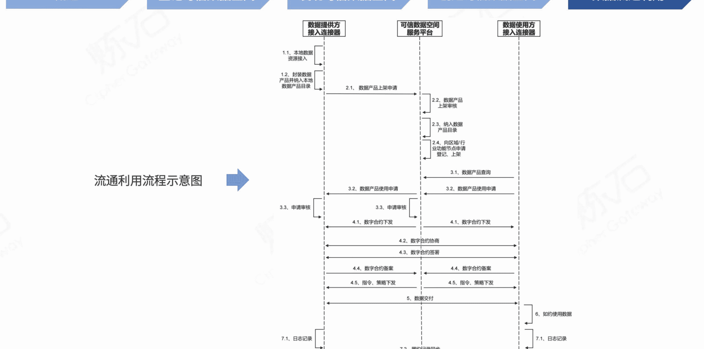

# 满足国家数据基础设施业务节点、接入连接器相关规范中规定的安全要求

| 概述 | 注册可信数据空间 | 发现可信数据空间 | 创建可信数据空间 |
| :--- | :--- | :--- | :--- |
| 1.术语和定义 | | | |
| 关键词 | 详情介绍 |
| --- | --- |
| 合规要求 | 可信数据空间服务平台及连接器满足国家数据基础设施业务节点、接入连接器相关规范中规定的安全要求，并在此基础上为可信数据空间运营造、数据的流通利用提供整体的安全保障，包括合约安全、数据安全以及空间运行安全三部分。 |
| 可信保障 | 可信数据空间的安全保障可通过可信数据空间服务平台、连接器集成数据沙箱、区块链、隐私保护计算、数据标识化等技术实现，也可以调用区块链公共服务平台、隐私保护公共服务平台或其他第三方保障平台的技术能力满足可信保障。 |
| 数据服务方 | 区块链公共服务平台、隐私保护公共服务平台或其他第三方保障平台可作为数据服务方，通过接入连接器接入可信数据空间提供安全保障服务。 |

2. 概述
3. 技术架构
4. 业务流程

| 关键词 | 详情介绍 |
| --- | --- |
| 数字合约完整性 | 数字合约具备防防篡改机制，确保其内容在生成、传输和存储过程中不被恶意修改，始终包含参与方的初始约定和周周期。 |
| 数字合约真实性 | 数字合约可通过身份认证和电子签名技术，确保参与方的身份真实且授权，同时达成共识，避免后续争议。 |

5. 安全要求
6. 问答解读

# 可信数据空间支持接入可信数据空间的数据产品进行等级划分

| 概述 | 登录可信数据空间 | 发现可信数据空间 | 创建可信数据空间 |
| :--- | :--- | :--- | :--- |
| 1.术语和定义 | | | |
| | 关键词 | 详情介绍 |
| | 数据安全分级 | 可信数据空间支持接入可信数据空间的数据产品进行等级划分，提供差异化的安全保障策略，应具备：数据评估、数据分类标注、分级策略管理能力。 | | |
| 2.概述 | 数据传输安全 | 可信数据空间确保数据传输的安全，合理使用数据加密、数字签名、虚拟数据网络等技术，保障数据传输过程防泄、防篡。 | | |
| | 数据存储安全 | 可信数据空间应提供或集成可靠的数据存储环境，允许数据方将数据存放在受控的环境内；合理使用数据加密、数字签名、访问控制等技术，保障数据的机密性、完整性、可用性。 | | |
| 3.技术架构 | 数据计算安全 | 可信数据空间应提供或集成可靠的数据计算环境，允许数据在安全和受控的环境下数据进行分析处理；合理使用数据沙箱、可信执行环境、联邦学习、联动计算、知识证明、多方安全计算等技术，保障数据计算过程中的机密性、完整性以及计算结果的正确性和可验证性。 | | |
| 4.业务流程 | | | |
| | 关键词 | 详情介绍 |
| 5.安全要求 | 运行维护安全 | 可信数据空间应具备安全运行维护能力，保障可信数据空间的安全、合规，避免可信数据空间的运行数据、业务数据被窃取、滥用。 | | |
| | 日志存安全 | 可信数据空间支持对可信数据空间中的数据流通及使用的详细日志进行安全存证及溯源，合理使用分布式账本等防篡改技术，保证日志证据的真实性。 | | |
| 6.问答解读 | 合规审计安全 | 可信数据空间应对可信空间内的操作行为进行全流程监控与合规性验证，并定期开展合规审计，确保对数据访问、传输、存储、等的操作符合预期且异常可溯。 | | |

# 一、《可信数据空间 技术架构》的编制背景和主要内容是什么？

1. 术语和定义

为落实《国家数据基础设施建设导引》《我国可信数据空间发展计划（2024—2028年）》等文件精神，引导和支持可信数据空间发展，促进数据要素高质量高效通用，国家数据局引导全数据标准化技术委员会秘书处、组织地方政府、科研院所、高校、企业等160余单位，编制《可信数据空间技术架构》技术文件，旨在阐清可信数据空间的内涵与延伸，促进可信数据空间技术的兼容与收敛，引导地方、行业、领域、企业开展可信数据空间规划、设施、运营和管理。

2. 概述
3. 技术架构
主要内容

《可信数据空间技术架构》从技术功能、业务流程、安全要求等方面对可信数据空间进行了规范。具体如下：

4. 业务流程

| 维度说明 | 详细介绍 |
| --- | --- |
| 在技术功能方面 | 明确可信数据空间是数据基础设施的一部分，符合国家数据基础设施建设整体架构。可信数据空间由服务平台和接入连接器构成，具备身份标识、连接器管理、目录管理、数字契约管理、可信数据空间管理、数据使用控制等功能。 |
| 在业务流程方面 | 明确可信数据空间各个功能组件及其交互接口的关系。 |
| 在安全要求方面 | 明确数字契约安全、数据产品安全、空间运行安全等安全保障要求。 |

5. 安全要求
6. 问答解读

# 1. 术语和定义
**可信数据空间**：为数据提供方、数据使用方等相关参与主体提供安全可信的技术环境，有效降低供、用数据成本，是建设可信数据空间的重要目标。

### 2. 概述

| 维度说明 | 详情介绍 |
| --- | --- |
| 在保障数据安全可信流通方面 | 可信数据空间能够通过规则约束、认证评估，设立数据提供方、数据使用方、数据服务方等相关参与主体及接入连接器的信任基础；通过数字合约、使用控制技术协助参与方达成并落实对数据、算法、服务等资源通用的共识，在系统化的框架下实现双方之间的数据流通。 |
| 在降低参与方开发利用门槛方面 | 可信数据空间能够较好共有业务属性、社会属性或数据属性的参与方，快速建立关系。例如，药物研发、医学研究方等相关数据交换，在此基础上快速建立相关参与方的信任基础，通过数字合约透明地支持资源开发利用，多次便捷流通。 |

### 3. 技术架构
### 4. 业务流程
### 5. 安全要求
# 6. 问答解读

# 三、可信数据空间遵循 “三统一”原则，技术上实现？

| 维度说明 | 详细信息 |
| --- | --- |
| 1.术语和定义 | 背景说明：统一目标、统一身份标识、统一要求是国家数据基础设施实现互通的基本要求。可信数据空间为国家基础设施的重要组成部分，在建设过程中遵循“三统一”原则。 |
| 2.概述 | 技术手段：《可信数据空间技术架构》明确了目标。《可信数据空间技术架构》设计了身份管理、连接器管理、目录管理等功能。 |
| 3.技术架构 | |
| | 身份方面 | 设计了身份注册、身份更新、身份注销、身份认证、身份查询等接口。 |
| 4.业务流程 | 登记方面 | 设计了数据资源登记、更新、撤销，数据产品登记、更新、下架等。 |
| | 目录方面 | 设计了目录查询等接口。 |
| | 标识方面 | 设计了标识解析、接入连接器等接口。 |
| 5.安全要求 | 监测方面 | 设计了运行监测等接口。 |
| 6.问答解读 | 总结说明 | 可信数据空间的上述功能是“三统一”原则的具体体现，通过这些功能可以实现与国家基础设施对接，其中身份管理、连接器管理、目录管理等同步。 |

# 四、是否考虑了国际数据空间的互通，技术上如何实现？

1. 术语定义
背景说明：促进数据安全、自由流动，主动对接国际标准的基本要求。可靠数据空间作为数据安全有序流动的主要技术载体，需要与国际数据空间互通。

2. 概述
技术实现

3. 技术架构
为了实现这一目标，《可信数据空间技术架构》预留了国际空间功能：

4. 业务流程

| 维度说明 | 详情介绍 |
| --- | --- |
| 协议匹配 | 提供对数据空间协议 (DSP) 等格式解析、协议转换的能力，将国内接口与国际空间协议 (DSP) 进行动态映射，确保语义、传输规则等方面兼容互通。 |
| 安全要求 | 利用加密、安全认证机制，保障数据交互传输安全，并通过区块链等存证技术记录日志，实现全流程追溯。 |
| 合规匹配 | 内置配置引擎，动态适配国外法规，确保数据流通符合当地监管要求，最终实现生态无缝衔接。 |

5. 安全要求
6. 问答解答

# 五、未来还会制定哪些可信数据空间相关标准?

| 1.术语定义 | 背景说明：依托全国数据标准化委员会，组织研究所、高等院校、企业等，在《可信数据空间技术架构》技术文件的基础上，加快推进可信数据空间关键技术、运营管理、能力要求、安全保障等方面标准的共性标准的研制与应用，逐步完善可信数据空间标准体系，为可信数据空间的建设及落地提供权威的标准化指引。 |
| 2.概述 | |
| 3.技术架构 | 标准种类 |
| 维度说明 | 详情介绍 |
| 4.业务流程 | 关键技术方面 | 拟制可信数据空间数字合约管理、使用控制技术等标准，规范可信数据空间的关键性技术。 |
| | 运营管理方面 | 拟制可信数据空间管理要求、业务实施流程、运营模式要求等标准，明确可信数据空间管理和运营模式，以及可信数据空间流通通用的操作规程。 |
| 5.安全要求 | 能力要求方面 | 拟制可信数据空间应用服务要求、应用生效评价等标准，规范可信数据空间应用路径，建设可量化的应用评价指标体系。 |
| 6.问答解读 | 安全保障方面 | 拟制可信数据空间安全管理要求等标准，构建可信数据空间安全技术体系。 |

# 六、可信数据空间中的数字合约和区块链中的智能合约有什么关系？

1. 术语和定义
关系说明：可信数据空间中的数字合约和区块链中的智能合约有区别又有联系。

2. 概述
区别与联系

3. 技术架构

| 维度说明 | 详细介绍 |
| -- | -- |
| 区别 | 区块链的智能合约是部署和运行在区块链网络上的代码，其执行依赖于区块链的共识机制和分布式账本，具有去中心化、不可篡改、自动执行等特点。可信数据空间的数字合约侧侧于数据使用、共享、交易等行为进行规则定义和约束，以确保数据在可信环境下进行流转和处理，不限定具体的技术实现。 |
| 联系 | 两者都具有合约的性质，都是对某些规则或协议的数字化表达，旨在实现自动化、规范化的执行过程，减少人为的干预，提高效率和信任。在可信数据空间的建设中，可以使用区块链的智能合约技术来增强合约的安全可靠可靠。例如，将合约的相关信息记录在区块链上，利用区块链的不可篡改特性确保内容的真实性和可靠性。同时通过智能合约实现数字合约的自动化执行，从而更好地实现数字的可信流转和交易。 |

4. 业务流程
5. 安全要求
6. 问答解读

# 七、可信数据空间与人工智能如何双向赋能?

1. 术语定义
背景说明：人工智能及其支撑的智能体视为数据要素的一类重要形态，并且随着大模型的普及，智能化应用大幅降低成本，有望成为数据要素释放的“最后公里”的关键手段。

2. 概述
3. 技术架构
赋能方式

4. 业务流程

| 维度说明 | 详情介绍 |
| --- | --- |
| 可信数据空间提供高质量数据 | 智能模型训练需要消耗大量数据集，当前主要以公开数据集为主规模有限。可信数据空间能够实现真实数据的流通，通过高质量数据集等模型训练。 |
| 人工智能模型高效赋能可信数据空间 | 通过人工智能模型和智能技术，可信数据空间能够实现自然语言交互，简化复杂性，提升用户体验。此外，人工智能作为数据标注、知识抽取助力数据资源向高价值化。 |

5. 安全要求
6. 问答解析

1. 《国家数据基础设施建设导引》
2. 《可信数据空间发展计划（2024—2028年）》
3. 《可信数据空间技术架构》
4. 《可信数据空间创新报告（2025）》
5. 《可信数据空间建设及应用指南（V1.0）》
6. 《可信数据空间标准建设指南（2025年版）》
7. 《可信数据空间技术架构》
8. 数据流通场景实践

# 核心数据管理

| 内容 | 重要风险评估 |
| --- | --- |
| 网络运行安全 | 分类分级 |
| 等级保护 | 配合调度 |
| 安全风险处置 | 数据交换安全 |
| 网络实名制 | |
| 数据产品/服务 | 特殊类型数据 |
| 关键信息基础 | |

江苏某地方银行因违反网络安全与数据管理规定被警告，并罚款14.5万元。
某国股份银行因违反数据安全管理问题被银监局罚款160万元。
上海市网信办会市场监管局、国资委约谈某大型地产集团及多家运营企业，浙江某科技公司为市政府运维数据管理系统，私自越界数据，造成严重数据泄露，被罚款100万元。

| 数据基础 | 汽车数据 |
| --- | --- |
| 数据本地化与治理 | 医疗机构数据 |
| 网络安全与供应链安全 | 儿童个人信息 |
| | 权利影响 |

南昌某高校所3万余条个人信息在境外互联网上售交易，被南昌市公安部门罚款85万元。

# 网络安全
# 个人信息保护法
# 数据安全
# 密码

《亮点透视》访上海：向海外出海中国高铁
网络安全等级保护条例
关键信息安全条例
商用密码管理条例2021年9月1日起施行，加速个人信息保护制度化。

# 敏捷部署：旁路平台结合主路控制面，免改造应用落地保护

公开

终端安全沙箱
可信空间
终端探针
无感式数据发现
提供
用户访问
数据安全SDK 集成安全能力
前台系统
后台系统
CRM
应用
传输
用户
隐写水印 结合泄漏追溯
AOE插件模块 保护结构化数据
CipherSuite
访问DB
AOE代理模块 保护结构化数据
加工
数据资产管理系统
数据安全管理平台
DB代理
使用
存储
非结构化数据
文件系统/数据库
结构化数据
数据审计追溯系统
KMS密钥系统
TFE模块 保护非结构化数据
UDF/TDE模块 保护结构化数据数据收集

## 场景之一：服务端加密、使用解密/脱敏

支持ABAC的访问控制策略，实现用户与数据字段级隔离

### 结构化数据
### 非结构化数据

主体到人
客体到字段
细粒度访问控制
TFE文件安全模块

| 姓名 | 周林 |
| --- | --- |
| 身份证 | 62108756125 |
| 手机 | 17712344871 |
| 单位 | 中国文大学 |

应用程序1 程序2 程序3
密文
应用服务器
用户态
未授权进程只能读取密文

| 姓名 | 王磊 |
| --- | --- |
| 身份证 | 3277***11005 |
| 手机 | ******** |
| 单位 | ***大学 |

用户2
数据库
脱敏数据
授权进程可读取密文
TFE安全扫描
AO插件
密文
数据安全管理平台
OS 内内核态
磁盘存储云库

| 姓名 | 张三 |
| --- | --- |
| 身份证 | 4321***1061 |
| 手机 | ******** |
| 单位 | ***单位 |

用户3
面向数据侧透明加密
密钥管理系统
数据安全管理平台
面向用户侧动态脱敏

## 不影响业务人员使用、影响DBA运维
应用看到脱敏后数据
应用看到密文
DBA工具看到脱敏数据
DBA工具查看密文

## 一站支持多技术路线，结合业务场景交付最优组合

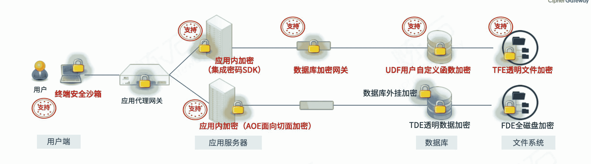

用户 终端安全沙箱
应用代理网关
应用内加密（集成了密码SDK）
数据库加密网关
UDF用户自定义函数加密
TFE透明文件加密
数据库外挂加密
应用内加密（AOE面向切面加密）
TDE透明数据加密
FDE全磁盘加密
用户终端
应用服务器
数据库
文件系统

| 加密技术 | 部署位置 | 加密粒度 | 性能 | 防BA | DB存储过程加密计算 | 实施成本 | 可靠性 |
| --- | --- | --- | --- | --- | --- | --- | --- |
| 终端安全沙箱 | 终端 | 文件/虚拟卷 | 高 | / | | 低 | 高 |
| 应用代理网关 | 终端-应用服务器之间 | 字段/文件 | 中 | 支持 | 影响 | 高 | 低 |
| 应用内加密（集成了密码SDK） | 应用服务器 | 字段/文件 | 高 | 支持 | 影响 | 高 | 高 |
| 应用内加密（AOE面向切面加密） | 应用服务器 | 字段 | 高 | 支持 | 影响 | 低 | 高 |
| 数据库加密网关 | 应用服务器-数据库之间 | 字段 | 中 | 支持 | 影响 | 中 | 中 |
| 数据库外挂加密 | 数据库 | 字段 | 低 | 支持 | 影响 | 中 | 中 |
| TDE透明数据加密 | 数据库 | 字段/表空间 | 高 | 不支持 | 不影响 | 低 | 中 |
| UDF用户自定义函数加密 | 数据库 | 字段 | 高 | 不支持 | 不影响 | 高 | 高 |
| TFE透明文件加密 | 文件系统 | 文件 | 中 | 不支持 | 不影响 | 低 | 高 |
| FDE全磁盘加密 | 文件系统 | 磁盘/卷 | 高 | 不支持 | 不影响 | 低 | 高 |

## 产品价值：将安全能力送到真实的数据过程中
免改造技术对流动的高维识别与控制，实现安全与业务的有机融合

## 数据流通
基于TEE技术的跨域管控

## 外部痛点：数据“可见不可控”

| 访问权限 | 数据提供方 | 数据处理行为 |
| --- | --- | --- |
| 信息部 | 数据部 | 数据已成为企业交易的，但在共享后存在“数据失控”问题困扰数据提供方：
- 数据的接收方对数据进行过滤？
- 对方再次将数据发给第三方？
- 这些数据在对方有效如何控制？ |
| 接收方 | 属部门 | |
| 合作机构 | |
| 运维团队 | |
| 黑客组织 | 问题实质是，数据提供仅赋予接收方使用权而非所有权，并且按照约定来限制。现行做法是双方协议来实现约束，但数据的所有权在技术上是失控的。数据在共享下，必须从技术上实现接收方使用行为进行控制，防止数据滥用、防止泄露给第三方，维护数据提供方的利益。 |

## 跨域数据：基于TEE技术，轻改造落地“可见不可控”

数据已成为企业交易的，但共享后存在“失控”问题困扰数据提供方：
- 数据的接收方对数据进行滥用？
- 对方再次将数据发给第三方？
- 这些数据在接收方的有效控制？

I. 识别 P.防护 D.检测 R.响应 R.恢复 C.反制

## 典型案例：某医疗行业跨域数据

基于元素有的专利技术高性能商用密码算法实现构建，具有高性能特点，不会影响现有效率。一体机中的核心数据基于商用密码技术加密保护，可防泄、防拖库，既能满足内部的安全需求，也可以满足外部的合规要求。一体机“指纹”验证，进一步加强外部使用的特殊性，进一步增强企业利益。随着企业业务的发展，未来可以将整个过程的在线更新，可防范信道攻击，增加持续服务的性。

## 国密合规场景一站式密改套餐敏捷交付

## 密评要点解析

- 最贴合业务-业务风险范围广，改造难度大-涉及的高风险项，且分值最高
- 属于密码应用，含有风险最多-密改地需由用户执行，无法通过-所需密码应用会涉及信息系统新增或变更，引发扩容或调整
- 属于密码支撑环境-密改地一定由用户执行，可能有IDC-托管方、云服务商等- 整体架构，可复用被承载的每一个系统

## 密测评规范

依据GB/T 39786-2021
《信息安全技术信息密码应用基础》
通过要求60分以上，无高风险
测评标准打分，满100分，共41项检测项，包含8个方面
典型类型无合规的密码设备，无管理制度
测评周期至少一次

## 密合规要点（以密码三级系统为例）

| 物理和环境 | 身份鉴别 | 密钥管理 | 监控日志 | 密码服务资质 | 密码认证产品 | 分数 |
| --- | --- | --- | --- | --- | --- | --- |
| 网络和通信 | 身份识别 | 数据的完整性和机密性 | 访问控制信息完整性 | 设备认证 | 密码服务 密码认证 | 20分 |
| 设备和软件 | 身份识别 | 密加通道 | 访问控制和标识的完整性 | 日志和策略 真实性完整性 | 密码服务 密码认证 | 10分 |
| 应用数据 | 身份识别 | 传输和存储的机密性 完整性 | 不可否性 | 密码服务 产品认证 | 30分 |
| 管理制度 | 人员管理 | 密钥管理 | 建设运行 | 应急处置 密码软件 | | |

## 高风险项，一票否

- 实体未通过密码技术进行身份识别（网络和通信:无解密）
- 未未使用密码技术保证传输过程数据的密性
- 未未使用密码技术建立安全的传输通道（如VPN）
- 未未使用密码技术保证数据在存储中的机密性（无解密）
- 未未使用密码技术保证数据在存储中的完整性
- 未未使用密码技术保证数据在传输过程中的密性
- 未未使用密码技术保证数据发生和接收端（法律责任）
- 未未使用管理相关制度
- 未制定密码应用解决方案、实施方案和应急处置未通过

| 人员管理 | 角色 | 权限 | 审计机制 | 密密 | | |
| --- | --- | --- | --- | --- | --- |
| 建设运行 | 密码应用方案 实施方案 | | 30分 | |
| 应急处置 | 应急处置方案 | 即时响应 | |

## 渗透四件套安全

| 测评单元 | 备注 | 得分 | 得分 | 加密产品 |
| --- | --- | --- | --- | --- |
| 物理和环境安全(10分) | 身份识别 | 高风险 | 4.17 | 0.00 |
| 电子门记录完整性 | | 2.92 | 0.00 | |
| 监控存储完整性 | | 2.92 | 0.00 | |
| 网络和通信安全(20分) | 身份识别 | 高风险(无解密) | 5.88 | 5.88 | IPSec 安全网关 |
| 通信数据完整性 | | 4.12 | 4.12 | SSL 安全网关 |
| 通信过程中重置机制的完整性 | 高风险 | 5.88 | 5.88 | |
| 网络边界控制完整性 | | 4.12 | 4.12 | |
| 设备计时安全(10分) | 身份识别 | 高风险 | 2.08 | 2.08 | 服务器加密器 |
| 管理运行通道完整性 | 高风险 | 2.08 | 2.08 | |
| 系统资源访问控制完整性 | | 1.46 | 1.46 | 应用和数据加密模块 |
| 重要信息标记完整性 | | 1.46 | 1.46 | 软件加密模块 |
| 日志记录完整性 | | 1.46 | 1.46 | 密卡 |
| 可执行程序完整性、可执行程序来源真实性 | | 1.46 | 0.00 | |
| 应用和数据安全(30分) | 身份识别 | 高风险 | 5.77 | 5.77 | |
| 访问控制完整性 | | 2.31 | 2.31 | 应用数据加密模块 |
| 重要信息标记完整性 | 高风险 | 5.77 | 5.77 | 服务器加密器 |
| 数据传输完整性 | 高风险(无损解) | 5.77 | 5.77 | 软件加密模块 |
| 数据传输存储完整性 | | 4.04 | 4.04 | 密卡 |
| 数据存储完整性 | 高风险 | 4.04 | 4.04 | |
| 安全管理(30分) | 不可否认 | 高风险 | -- | -- | 仅限法律场景 |
| 按得分80%以上计算 | | 30 | 24 | 专业管理制度 |
| 合计 | | | 100 | 82.55 |

## 密四件套，轻松过密

| 国密VPN网产品 | 加密认证网产品 | 应用加密网产品 |
| --- | --- | --- |
| 解决应用和数据20分、缓解高风险 | 解决应用和数据5分、提高高风险、设备和计算4分 | |

## 服务器加密器

提供基础加密能力与密算能力

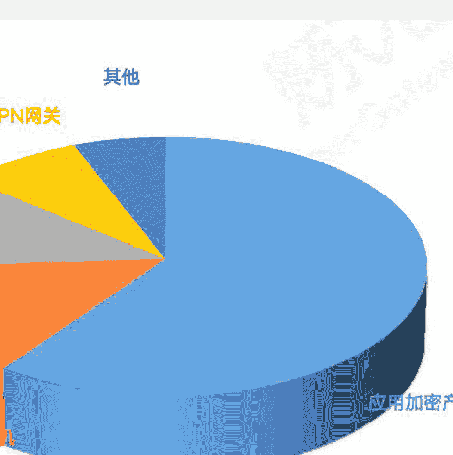

> *参考加密测评委员会《商用密码应用安全性评估准则（2023版）》

## 高性能: PCT专利保护的高速国密实现，不影响业务效率

| 基于PKI的数字信封加密 | 协同签名身份识别 | |
| --- | --- | --- |
| 密钥派生接口 | EVP对接接口 | FPE格式保留加密 |

基于SM4的保留格式加密(FPE)
加密10亿条手机号，仅耗时20秒

# 天下密码
极不破解
炼石独有PCT专利
打破Intel垄断

| SM2 | SM3 | SM4 | SM9 | ZUC |

## 单颗CPU上SM4解密
# 突破 140Gbps!
相当于每秒可加密6部3GB大小的高清电影
## 移动端SM4解密
# 突破 1.7Gbps!
相当于每秒加密100张MB大小的高清照片

| Windows | Linux | Mac OS | Android | iOS |

## 高可靠：专业管理、实时离线，保障高可用

1. 从平台获取规则后存在内存中，当平台不可用也可正常运行
仅当模块在服务重启时需要从集群重取规则
2. 跨设备自动同步
3. 跨设备自动同步
4. 实时同步
5. 跨同步

## 高可用：模块健壮可诊断，平台“两地中心”

- 以AOE插件为例，作为应用的一部分，无单独进程，不会引起进程
- 在没有匹配规则下，模块默认采用透传模式，最大化业务
- 模块经过多年打磨、运行实践，兼容各种严苛的企业级场景
- 模块自身可记录环境、启动流程、异常情况等日志，以及告警功能
- 针对环境支持实时诊断机制，排查潜在故障原因

## 工业级：加密机制兼容复杂场景

## 支持数据加密后的密文查询

## 不停止加密关键应用

| 类型 | 规则 | 示例 |
| --- | --- | --- |
| a | 手机号码 | 按照3, 4, 4拆加加密 |
| b | 身份证号 | 按照6, 4, 4, 4拆分加密 |
| c | 地址型 | 按照3, 3, 其余拆分加密 |
| e | 其他 | |

| 姓名 | 性别 | 年龄 | 手机号 | 身份证号 |
| --- | --- | --- | --- | --- |
| 张三 | 男 | 20 | 18811112222 | 110102 1996 0102 3333 |
| n1 n2 | | | p1 p2 p3 | ID1 ID2 ID3 ID4 |
| n3 | | | | ID5 |

| 密钥ID | n1,n2,n3 | 男 | 20 | |
| --- | --- | --- | --- | --- |
| | | p1,p2,p3,p4 | ID1,ID2,ID3,ID4,ID5 |

- 支持加密数据库的模糊查询操作。对加密字段做特殊处理，将先加密字段按照规则拆解，然后对拆解后部分分别加密处理，之后将各部分加密合并成一个
- 字段(加密的规则对应应用定制化，通过策略管理来进行配置)
- 限制条件
  - 支持对加密数据进行加密处理，但加密策略确定后不再进行修改
  - 为支持模糊查询对加密字段的长度进行扩展
- 在常态下，支持应用系统、DBA运维直接解密
- 在紧急情况下，支持挂库还原明文
- 在妥妥情况下，用运维工具或程序可以解密
- 当重新启用服务后，模块从平台更新密钥

## 传统密码平台面临挑战

- 【易用】基于基础密码算法能力升级到服务化加密能力，易于集成
- 【提效】实现从密码烟囱硬件到密码资源池化，适配了云化趋势
- 【好管】从功能上支持分层架构、多租户等管理模式，方便集中部署

## 数据实战防护挑战

传统CSP仅侧重于密码技术本身应用，而加密把安全传输转为加密安全，如果缺乏事前、事中、事后等全方位数据防护手段，在真实业务场景中难以有效防护能力

## 传统密码服务平台 (CSP) 示例

## 加密的改造难题

传统CSP需以加强加密能力为助力，在集成现有信息系统时还需要大量二次开发工作，应用改造带来风险、成本高、周期长，在密评推广及后期凸显为主要矛盾

| 业务应用系统 | | |
| --- | --- | --- |
| 通用密码服务 | 支撑密码服务 | 密钥管理 |
| 加密服务 | 数字证书服务 | 对称密钥管理 |
| 随机数服务 | 电子签名服务 | |
| 数字信封服务 | 身份认证服务 | 非对称密钥管理 |
| 签名签服务 | 安全通信服务 | 标识密钥管理 |

## SDK/API/WEB服务

## 安全合规支撑不足

《数据安全法》、《个人信息保护法》《网络数据安全法》、《基础条例》等对数据的合规要求日趋严格，相应的合规、各类数据安全合规等新需求对密码提出明确要求，而传统CSP在满足新合规方面缺乏灵活性，难以落地

| 资源池化 | | | | | | |
| --- | --- | --- | --- | --- | --- |
| 设备管理 | 资源编排 | 资源调度 | 弹性扩容 | 灾恢复 | 资源监控 |

| 密码卡 | 密码机 | 云密码机 | 密钥管理服务器 | 协同密码服务器 | 网络 | 服务器 | 数据库 |

## 下一代平台打造关键能力

下一代密码服务平台基于改造创新技术，实现密码能力从支撑层到真正应用层的跨越，有效解决“密评密改”推广及后的落地难题，是顺应数字化发展趋势，基于创新密码安全技术构建的综合服务平台。

## 构建实战能力

通过改造的整合优势，将密码能力与数据安全能力紧密结合，形成了事前解敏/加密/访问控制、事中检测响应、事后审计追溯的全方位数据安全实战防护体系

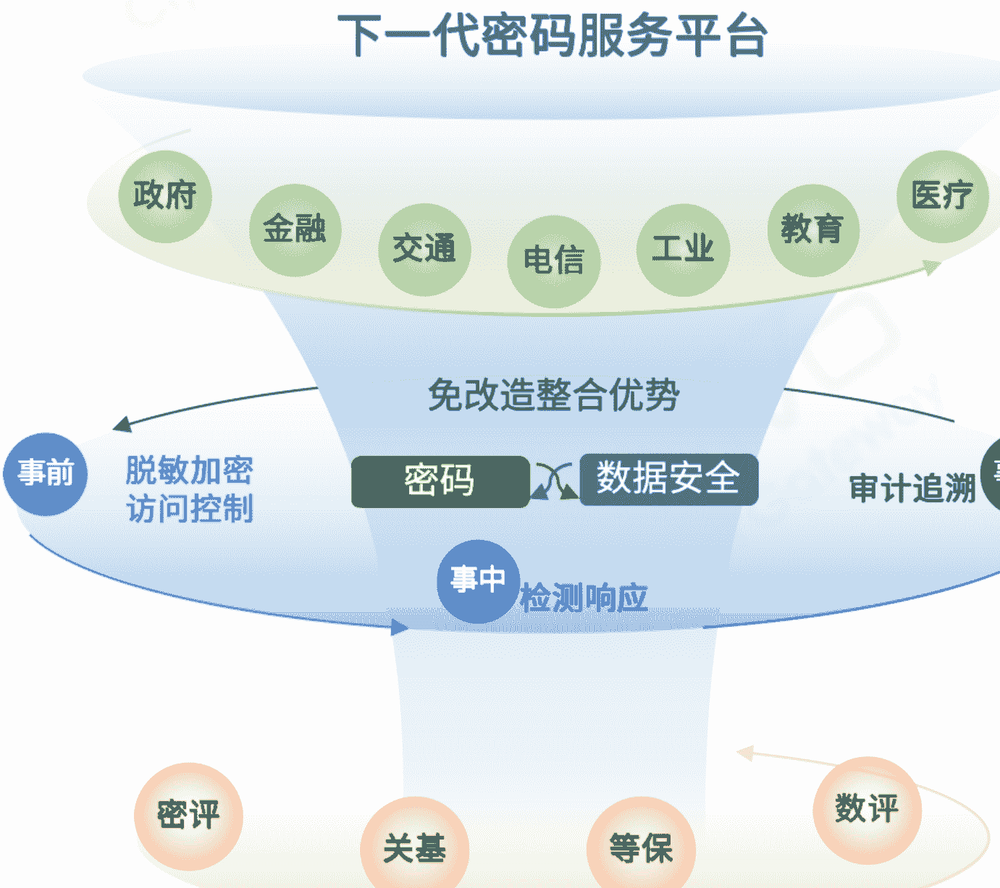

## 贴合密改重心

通过改造技术优势，轻松接入现有信息系统，提供贴近业务场景的密码解决方案，实现从密码支撑层向真正密码应用层的跨越

## 统筹数据安全合规

满足密律、关保、等保、数律等合规要求、数据安全两条线推动的数据加密合规要求、工作秘密防护等数据安全新合规融合

## 数据可见：结合法规要求，落地数据分类分级

### 重要数据资产识别
- 业务系统统计数据
- 关键字段梳理
- 落地家底

### 安全现状梳理
- 访问权限梳理
- 数据资产梳理

### 数据资产标识
- 数据资产分类分级

### 数据库
- 数据库索引引擎
- 敏感数据
- Oracle, DB2, MySQL, PostgreSQL, Teradata...
- 文件、office、pdf 以及其加密压缩格式gz, rar, tz
- 存储桶索引引擎
- 设备清单、识别与隐私数据、自然人标识、用作基础数据、账户密码及关系信息、网络身份标识、位置数据
- Hadoop, Hive, Hbase...
- 大数据索引引擎

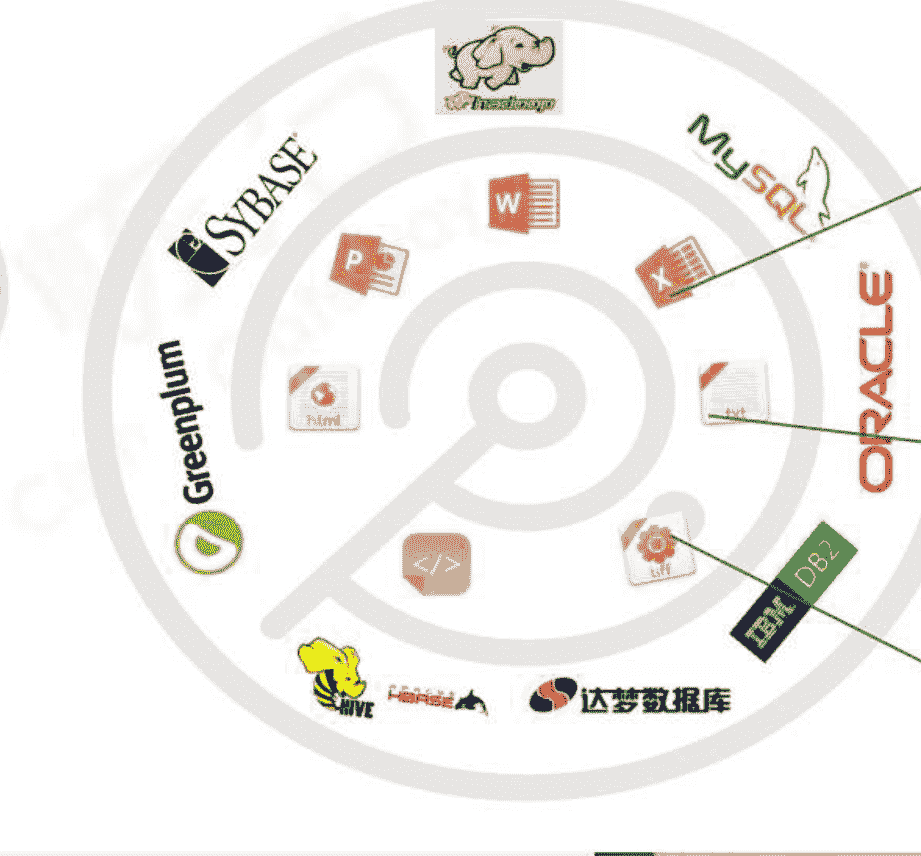
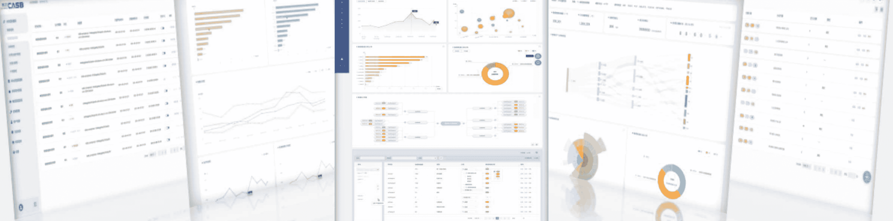

## 前防护：最小化敏感数据访问范围

易于实施的“主体到人”——支持与应用身份管理打通

| 姓名 | 张璐 |
| --- | --- |
| 身份证号 | 62108733567736125 |
| 手机号 | 13900334901 |
| 行程 | Pvg-pek-pvg |

| 姓名 | 张璐 |
| --- | --- |
| 身份证号 | 84950084084050448X |
| 手机号 | 13234540661 |
| 行程 | 3a7v0wCPOHGNabWv |

| 姓名 | 张璐 |
| --- | --- |
| 身份证号 | 84950084084050448X |
| 手机号 | 13234540661 |
| 行程 | 3a7v0wCPOHGNabWv |

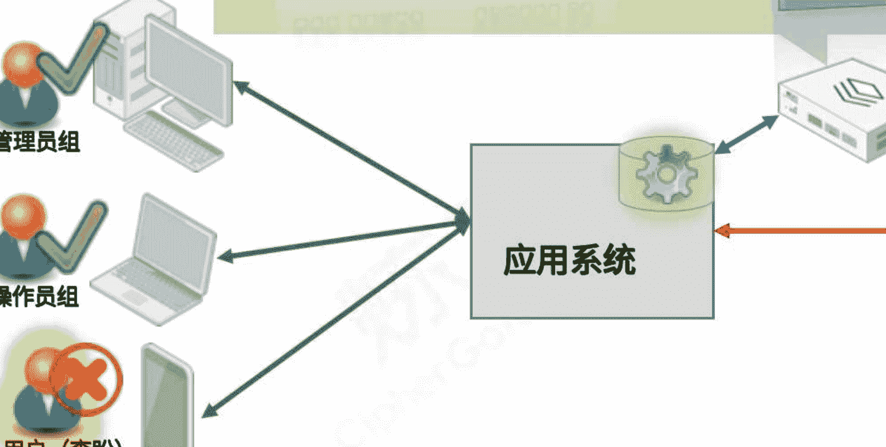

- 可适配应用自带身份管理或统一系统，实现身份的动态脱敏
- 支持ABAC基于属性的访问控制等细粒度

## 检测响应：业务风险操作的识别处置

使用加密、传输

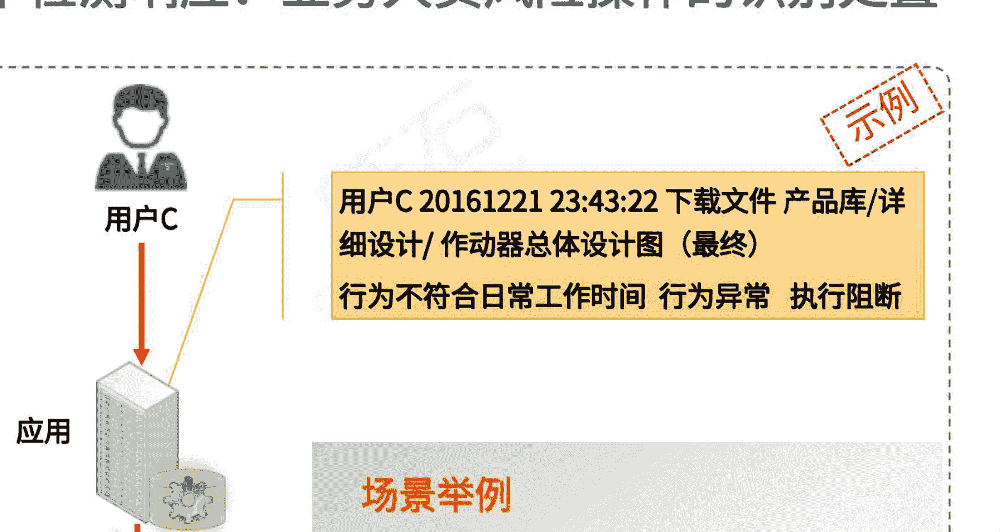

- 对所有业务操作进行监测，结合之前的业务上下文，判断行为是否正常
- 如果发现是异常操作和不合规操作，则进行告警并阻断，防止恶意操作带来的数据泄露

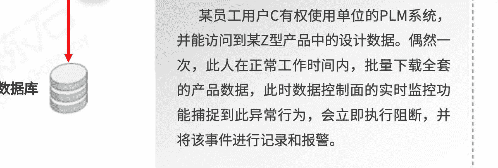

### 场景例
某员工C使用PLM系统，并访问某产品数据。偶然一次，此人在正常时间内，批量下载产品数据，此时数据层面的实时监控捕捉到此异常行为，并立即阻断并将该事件记录和报警。

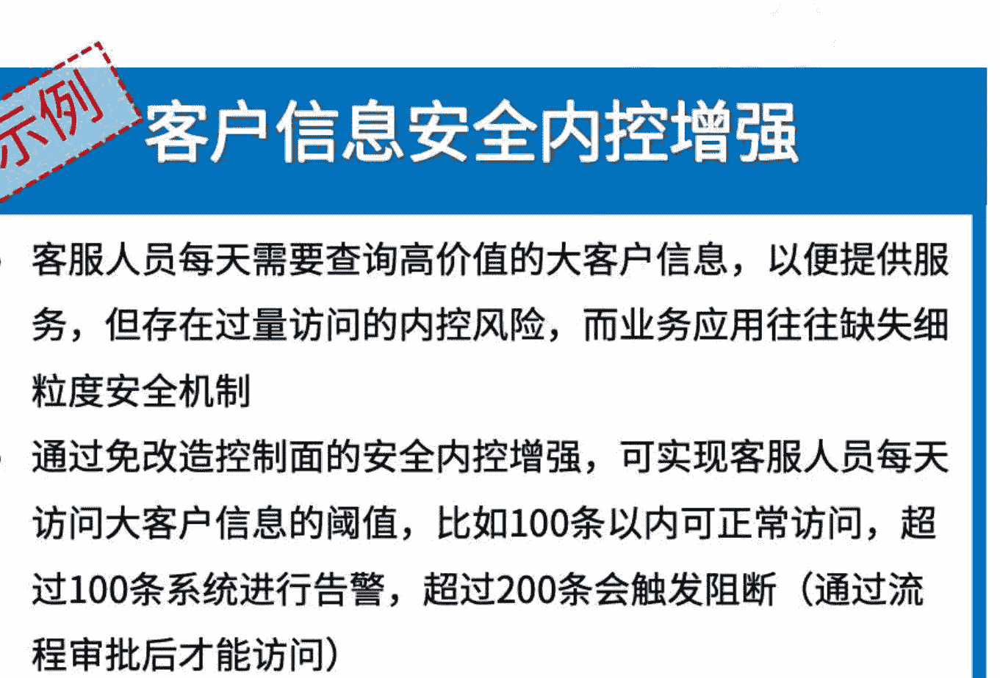

### 客户信息监控
- 客户人员每天查询高价值的客户信息，以便服务，但存在过量访问内部风险
- 通过安全阈值，比如100条以内正常访问，超过200条触发阻断（通过流程）

## 事后审计：访问审计追溯

记录所有敏感数据的行为，包括账号、时间、IP、会话、操作、对象、耗时、结果等等内容，形成终端用户的日志查询访问情况，在事故发生后精准溯源

| 操作时间 | 操作者 | 行为 | 操作对象 | 操作对象ID | 操作对象名称 | 状态 | 是否警告 | 警告类型 | 属性 | 客户端IP | 签名 |
| --- | --- | --- | --- | --- | --- | --- | --- | --- | --- | --- | --- |
| 2018-02-01 16:13:25 | None | 下载 | 访问 | 09_3 | | | | | | 279568 | 172.16.10.98 | MEBC QCI... |
| 2018-02-01 16:13:25 | None | 下载 | 访问 | 01_1 | 01_1 | | | | | 213008 | 172.16.10.98 | MEBC Ap... |
| 2018-02-01 16:13:25 | None | 下载 | 访问 | 03_3 | 03_3 | | | | | 95760 | 172.16.10.98 | MEBC Gny... |
| 2018-02-01 16:13:24 | None | 下载 | 访问 | 01_13 | 01_13 | | | | | | MEBCQccm92Y3ad64B8AM8ANWLMT |
| 2018-02-01 16:13:24 | None | 下载 | 访问 | 02_2 | 02_2 | | | | | | 376300 | 172.16.10.98 | MEBC QDn... |
| 2018-02-01 16:13:24 | None | 下载 | 访问 | 04_4 | 04_4 | | | | | | 163344 | 172.16.10.98 | MEBC BRC... |

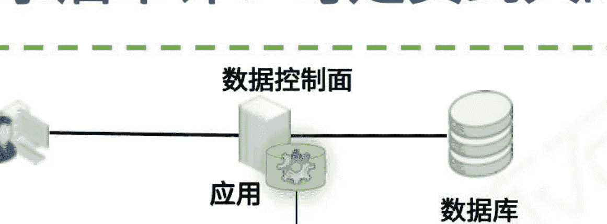

## 事后溯源：隐写水印结合操作上下文实现泄露追溯

在显示屏幕、电子文件（文档、图片、视频、音频）、访问页面（APP页面、业务系统页面）嵌入隐性水印，用于文件流转路径追踪、数据泄露取证。支持独立软件部署或SDK调用，嵌入的隐性不影响用户正常工作。

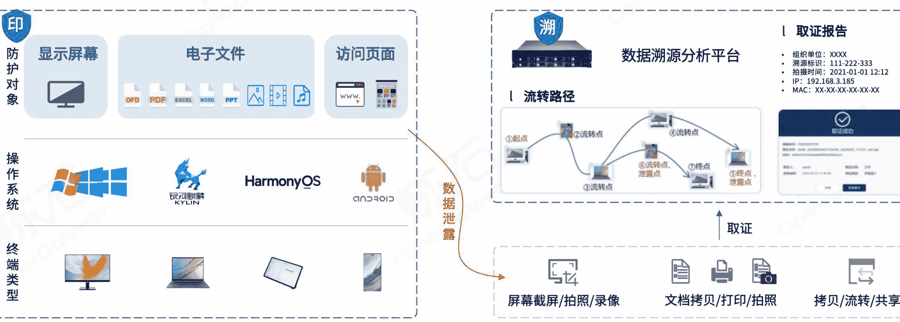

## 实战防护：密码安全一体化，改造打造数据保护

数据资产管理系统、数据加密系统

- 面向用户定制安全规则：
- 只有符合权限的用户才能识别到其应使用的数据
- 结合业务场景的风险监测
- 可确定责任人的高置信审计

- 面向运维重构数据边界：
- 无法从后端获取敏感数据明文信息

终端数据安全箱、数据脱敏系统、企业数据中心、企业业务部门、一代服务器平台、外包工作区域、数据审计追溯系统、数据安全网关、企业IT部门、数据检测响应系统、企业网络

控制面投送多样安全能力，优先落地数据加密脱敏

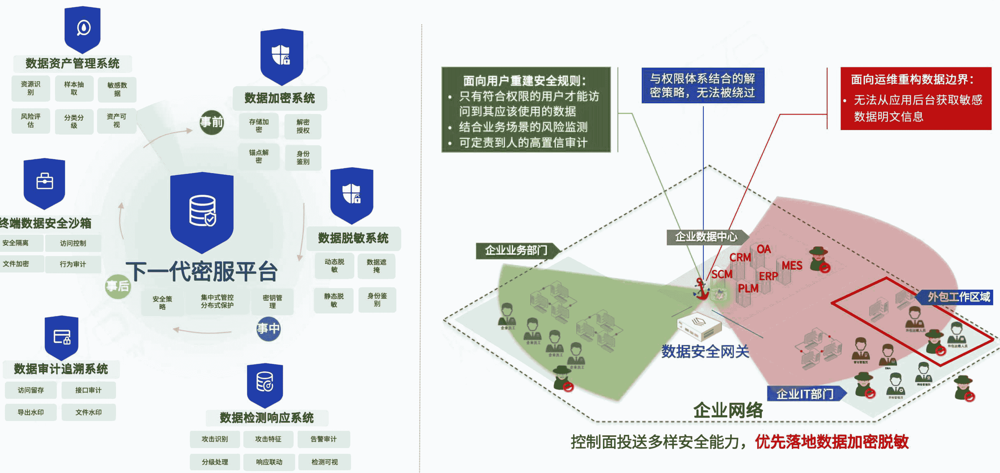

## 案例-政府海量数据：某部门数据保护

客户行业：政府
项目名称：某部门数据安全建设项目
项目需求：
某部门拥有全国公民的敏感数据，受《网络安全》、《数据安全法》、《个人信息保护法》等法律法规合规要求，需要对数据采用加密技术进行保护。

- 目标1：通过应用改造模式，实现部级数据的加密。
- 目标2：基于国密算法数据，满足合规要求。
- 目标3：适配数据接口传输至部级库的加密形式。

- 痛点1：海量数据，部级库已有百亿条，加密处理以及灾备库。
- 痛点2：实时性，方案实施后生产库和灾备库之间实时同步。

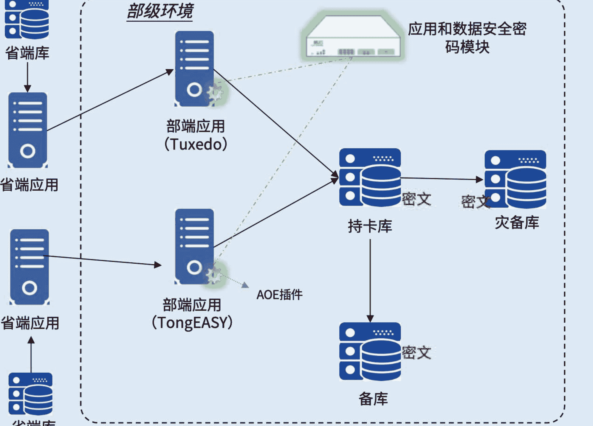

## 案例-金融关键应用：某交易所重要数据保护

客户行业：金融
项目名称：某交易所数据安全项目
项目背景：
在数据中心机房部署两套数据安全管理平台，使用高可用部署。在应用侧部署实现对系统中结构化（AO插件）和非结构化（FE插件）数据的存储加密，提供有效支持。

项目需求：
系统中集成了大量的会员信息，如会员账号、个人邮箱、真实姓名等敏感数据，需要在日常业务中流转。依据国家相关规定，对敏感数据进行保护。实现密钥的统一管理、策略的统一管理、分布式加密、安全控体系。

项目实施难点：
- 生产应用使用现有环境，完全适配当前环境；
- 使用加密算法，对系统中存放的敏感数据进行加密；
- 增量数据批量导入更为频繁。

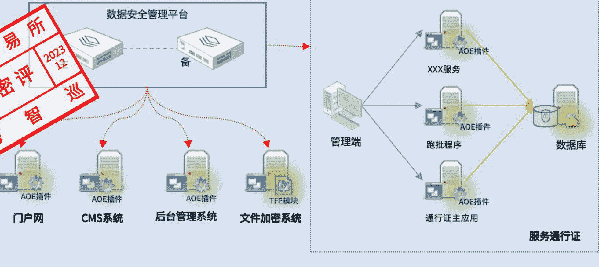

## 案例-运营商应用：某移动数据保护

客户行业：运营商
项目名称：某移动个人信息保护
针对数据列表进行加密，在实现数据安全的同时，符合头部对于商用应用的考核要求。

项目实施痛点：
数据列表涉及所有访问数据，方面（改造范围）：全网客户中心、CRM/经营系统。

解决方案：
1. 应用安装AO插件，写入数据加密，读取数据进行解密；
2. 历史数据通过客户端工具进行全量加密，在省侧数据采集程序SDK调用解密接口，按照逻辑解析文件，把数据写入数据库

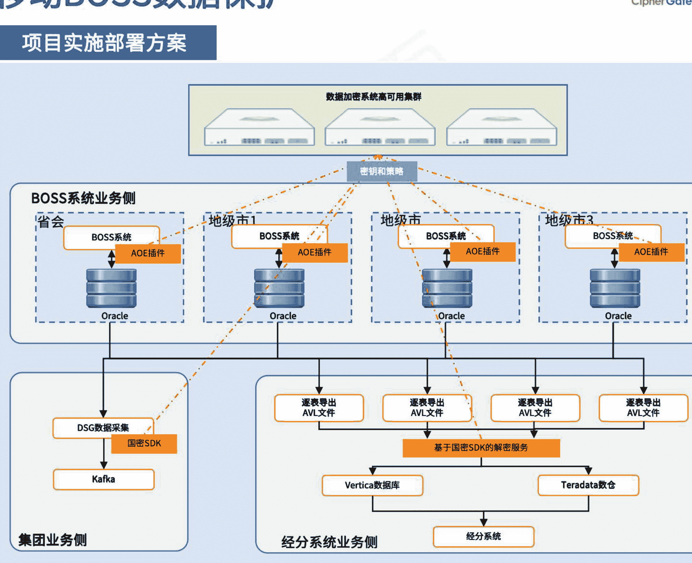

## 实例-工业关键应用：某大型车企数据保护

客户行业：制造业
项目名称：某现代车企联网系统数据加密

项目需求：
企业拥有大量车辆敏感数据，受国内外GDPR以及国内《网络安全法》、《密码法》等法律法规合规要求，需要应用密码技术，建设密码平台使档案存档系统、客服系统、监控系统、云上云数据得到保护。

项目建设内容：
对车辆车联网库10个高敏感字段的1400多条数据进行国密法加密，同时影响上下游业务流，影响数据维护和使用。

项目收益：
1. 实现核心系统的数据加密需求，保护隐私数据安全，提升系统安全水平。
2. 满足国家关于个人隐私保护、商用密码信息系统加密规范。

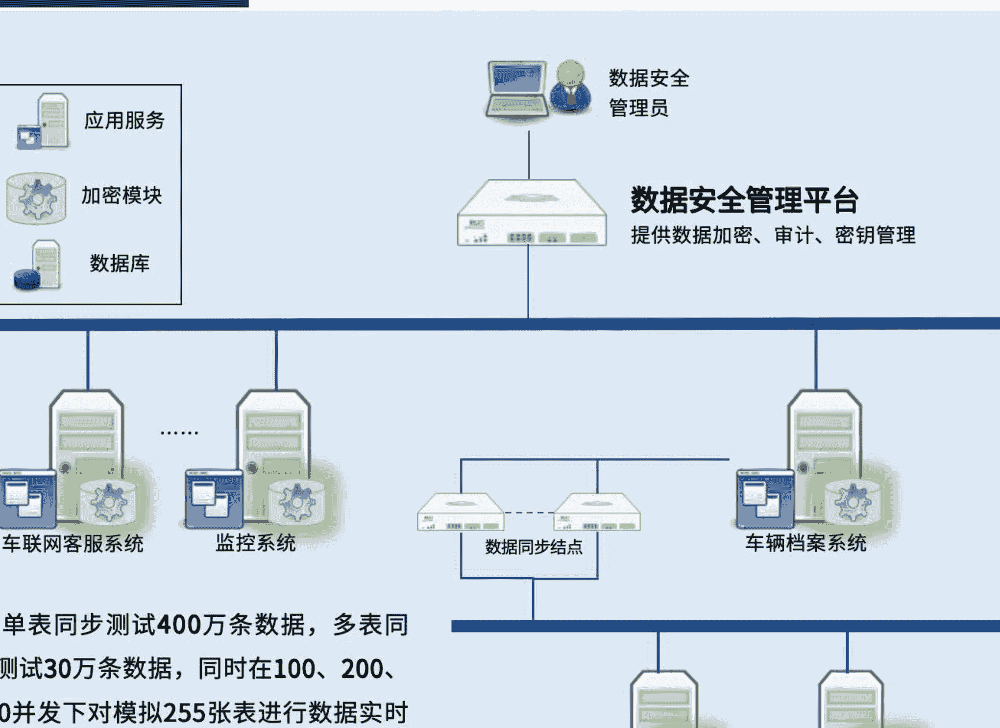

## 案例-央企业秘密保护：“某综合性国有资本投资集团”数据保护

客户行业：资产管理
项目名称：央企业秘密保护

项目需求：
- 集团OA含有重要敏感信息，需保证签署批传输过程中针对人员和运维人员信息加密
- 纪检监测系统包含极为敏感的特殊数据，需要高级内部防护

项目建设内容：
基于国合规的加密模块实现数据加密，提供应用统一改造方案，防止脱盘攻击，解密执行只在应用服务器上完成；基于国SM4的格式保留加密的高性能算法，对业务效率影响降至更低

项目收益：
1. 实现结构化和非结构化数据加密需求，保护各类隐私数据安全，提升整体安全水平。
2. 满足国家关于政策合规、商用密码信息系统加密应用规范。

## 部署和实施方案

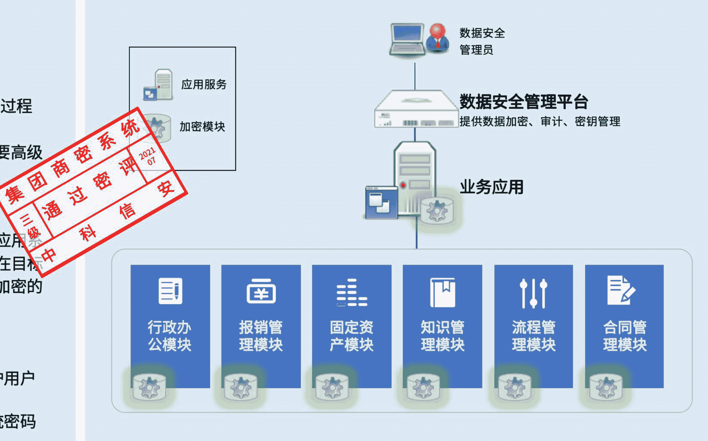

数据安全管理员、数据安全管理平台（提供数据加密、审计、密钥管理）、业务应用、应用服务、加密模块

## 案例-医药制造应用：某药企业秘密数据保护

客户行业：医药制造
项目名称：创新药研制数据安全保护

项目需求：
- 制药行业合规的要求：药企的信息化和数据管理可靠性的关系，国际制药行业领先企业的可靠性策略，GMP合规：国际制药生产质量规范，GSP合规：药品经营质量管理规范
- 创新药研究的安全需求：实验数据、分析数据的线上流转保护，创新药研究的数据保障， 一体化工厂数据效率提升的需求：工业4.0大数据支持的计划联动，经营信息数据安全、数据溯源，打破数据孤岛，加强数据流转：数据的流动转移的安全保障，跨领域协同联动：IT--OT，边界模糊情况下数据保障

+   1. KMS系统
2. 密钥管理模块
3. 策略管理模块
4. 加密插件
5. 加密SDK
6. 应急恢复设备
7. 数据库加密维护工具

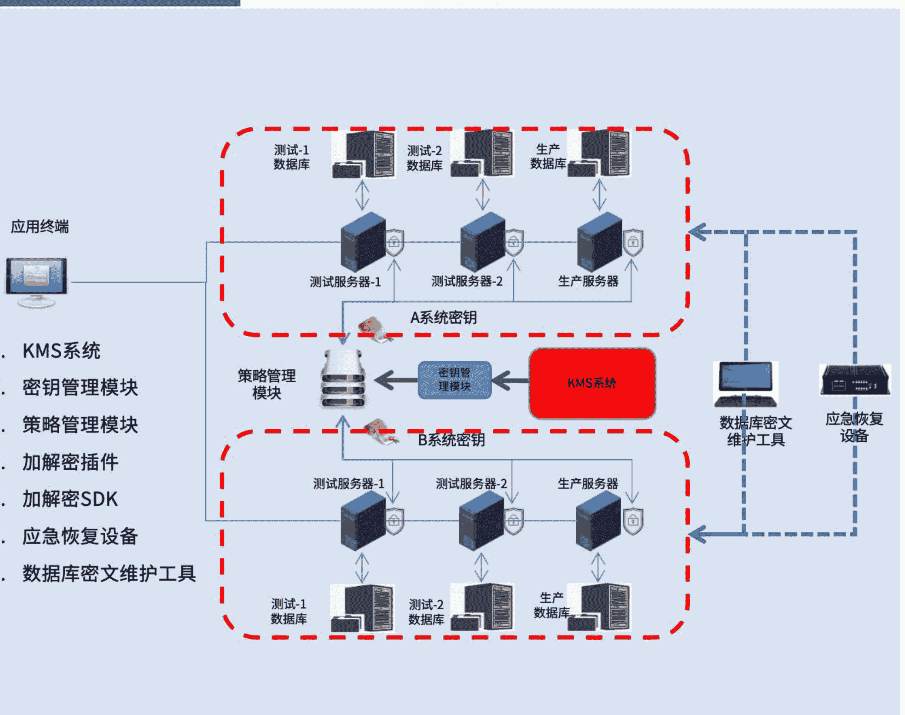
