# 图解 国家互联网信息办公室、国家市场监督管理总局
《个人信息出境认证办法》

炼石网络 2025年10月22日

# 知识星球TOP 资源分享社群

公众号: 知识星球TOP

汇聚全网高价值资源

打造一流资源分享群

微信信号:top28688

添加微信免费群

-   ◆ 付费文章
-   ◆ 付费社群
-   ◆ 时政&国际
-   ◆ 副业&搞钱
-   ◆ 财经&市场
-   ◆ 行业&科技

时政·历史·职场·体制·自媒体 学习·军事·软件·影音·社会学

微信信号:top28388

# 目录

- 01 图解《个人信息出境认证办法》
- 02 图解《促进和规范数据跨境流动规定》
- 03 图解《数据出境安全评估办法》
- 04 图解《中国(北京）自由贸易试验区数据出境负面清单管理办法（试行）》
- 05 图解《中国 (北京) 自由贸易试验区数据出境管理清单 (负面清单) (2024版)》
- 06 炼石免改造数据安全保护实践

# 《个人信息出境认证办法》促进个人信息高效跨境流动

2025年10月14日，国家互联网信息办公室、国家市场监督总局联合公布《个人信息出境认证办法》，自2026年1月1日起施行，旨在保护个人信息权益，规范个人信息出境活动，促进个人信息高效安全跨境流动。

首页 时政要览 政策务 互动服务 热点专题

# 个人信息出境认证办法

2025年10月17日 18:00 来源：中国互联网

【图片】【法规】

国家互联网信息办公室 国家市场监督管理总局

第20号

《个人信息出境认证办法》已于2025年7月21日国家互联网信息办公室第2025年第17次常会议通过，并对外公布。自2026年1月1日起施行。

国家互联网信息办公室主任 张建国 罗文

2025年10月14日

第一条 为了保护个人信息权益，规范个人信息出境活动，促进个人信息安全跨境流动，《个人信息保护法》、《数据安全法》、《中华人民共和国个人信息保护条例》等法规，制定本办法。

第二条 个人信息处理者通过个人信息出境的方式，向境外的个人或组织提供个人信息的，应当遵守本办法规定。

第三条 本办法涉及的个人信息出境认证的情形，是按照《个人信息保护法》第三十八条第一款第二项规定，由专业机构进行认证，明确个人信息处理者向境外的个人或组织提供个人信息处理活动的合规性、法律责任、部门监管责任。

第四条 本办法的解释由国家负责。

| 规定依据 | 2021年11月1日起施行 | 2025年1月1日起施行 | 2023年7月20日起施行 |
|---|---|---|---|
| 个人信息保护法 | | 网络数据安全条例 | 认证许可条例 |

## 个人信息出境认证法主要内容

《个人信息保护法》对个人信息出境认证制度作了基本规定，按照国家信办部门的规定规定专业机构进行个人信息认证是向境外提供个人信息的法定途径之一。《办法》共19条，对个人信息出境认证的情形，个人信息出境认证的申请方式、要求及有效期，专业机构应当承担的义务，监管管理要求等作出明确规定。

# 《信息出境认证办法》出我国三种个人信息出境制度全面落地

| 标准 | GB/T 35273《信息安全技术信息安全规范》 | TC260-PG-20222A《信息出境处理活动安全认证规范》 | GB/T 46068-2025《数据安全技术个人信息跨境处理活动安全认证规范》 |
|---|---|---|---|
| 替代 | 2026年3月1日实施 | 《数据出境安全评估办法》《个人信息出境认证办法》《个人信息出境标准合同办法》 | | |
| | 细化数据出境合规操作细则 | 《数据出境安全评估申报指南》《关于实施个人信息保护认证的公告》《个人信息出境标准合同指南》 | 对数据处理者申报跨境安全评估、备案标准合同的方式、提交及提交的材料等具体要求说明 |

1. 申报数据出境安全评估
2. 通过个人信息保护认证
3. 订立个人信息出境标准合同

明确数据出境三大途径及适用范围

《促进和规范数据流动规定》
《个人信息保护法》
《网络数据安全条例》
《认证许可条例》

第三八条 个人信息处理者属于规定情形的，向境外提供个人信息的，应当符合下列条件：（一）依据本法第四条的规定通过国家网信部门评估；二）经国家网信部门规定的专业机构进行认证；三）按照本办法规定的合同与境外接收方约定权利和义务

第三十五条 凡符合下列情形，个人信息处理者可以以本办法以外的方式向境外提供个人信息：（一）通过国家网信部门组织评估；二）经国家网信部门认可的专业机构进行认证；专业人员……

十九条 认证机构有下列情形之一，责令改正、罚款五万元以下的违法行为的，责令改正、罚款、责令吊销许可证、停业整顿；三）未在其认证范围内开展业务活动，或者其认证的产品、服务不符合认证要求、不及时履行义务

## 个人信息出境认证共同构建我国跨境监管的完整体系

## 个人信息出境认证与标准合同、安全评估的关系

个人信息出境认证制度在第三十八条和第十二条中均有效，本次落地提供了个人信息保护认证服务在2026年6月就已经实施。

| 出境制度 | 《促进和规范数据流动办法》 | 关系 |
|---|---|---|
| 安全评估 | 第七条处理者向境外提供信息的，符合下列条件之一，应当向国家网信部门履行安全评估。1. 关键信息者向境外提供信息或者重要数据的；2. 非关键信息者向境外提供信息，或者一年内累计提供10万个人信息（不含敏感信息）或1万人个人信息 | |

《关于实施个人信息保护认证的公告》由国家互联网信息办公室、市场监督管理局在2022年1月发布，决定实施个人信息保护认证，鼓励个人信息处理者申请出境认证以增强个人信息保护办法》。对于申请个人信息出境认证的，规定个人信息处理的行为符合GB/T 35273信息安全规范的要求，对于数据跨境传输的要求，符合安全认证的要求”。此日，国家标准发布的推荐性国家标准GB/T 46068-2025个人信息处理活动安全规范将于2026年3月1日实施，《个人信息处理活动安全规范》将不再适用。

## 兼具通用性与跨境监管要求

个人信息出境认证是特征类型的个人信息保护认证，符合通用要求，又符合跨境特殊要求，并具有特定的标识。

## 强化制度的适用性

《办法》规定，本办法施行前制定的关于信息出境的相关规定与本办法一致的，按照本办法执行，明确了制度的适用性。

| 标准合同 | 一次性豁免 |
|---|---|
| 关键信息者未通过“标准合同”向境外提供信息的，重要个人信息处理者在出境合同生效之日起10个工作日内向出境部门备案申请，将免履行“标准合同”义务以适用方式豁免。 |
| 认证 | 认证机构对于处理特定的个人信息活动，“整合”安全评估。认证通过后，可根据认证机构出具的证书，豁免境外接收方接受调查与监管部门的人员检查，无需重复承担安全责任。 |

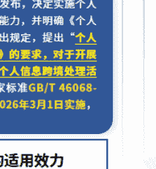

来源：李军，华东大学教授、专家张磊《个人信息出境认证》发布于中国数据跨境监管专题智库

# 个人信息出境认证的四个特性

### 自愿性
认证申请由个人信息处理者自愿向专业认证机构提出，认证不是强制性的境手续，不会给企业带来合规负担。

### 市场化
认证主体是市场化的专业认证机构而非国家监管部门，这在很大程度上有助于激发认证活动的活力，增强认证制度的适用性。

### 社会化
认证活动以需求为导向，由政府、专业认证机构、申请人以及社会公众共同实现。

### 统一性
主管部门制定个人信息出境认证相关标准、技术规范、认证规则、统一证书和标准，专业认证机构按照基本规范、个人信息保护认证规则开展个人信息出境认证活动，确保认证门槛的一致性，避免申请提升认证通过率、选择采用标准低的认证机构。

> 来源：丁晓，中国人民大学法学院院长、教授，专家解读 | 构建个人信息出境认证制度完善个人信息出境监管体系

# 《办法》是营造市场化高水平开放的重要举措

个人信息出境认证本身源于市场需求、根植于国际评定，具有明显的市场化、法治化、国际化特征。

# 基础制度

个人信息出境认证是数字经济市场化的基础。认证制度与市场化相互支撑、动态适配，二者以安全合规为契约，共同服务于经济效益。市场化进程中构成统一、信任缺失、衡，直接影响了制度权威。市场化进程需要个人信息流动，但不同规模差异显著，大型企业可自由选择，微企业可能需纳入国家安全体系，有效降低了市场成本。

# 法治延伸

《个人信息保护法》明确个人信息出境通过等途径，但需要具体实施。《办法》的出台，明确了认证资质、流程、监督管理要求等内容，将法律转化为操作指南。《个人信息保护法》明确个人信息出境认证是法治环境的前提、法依据。

# 通行实践

个人信息出境认证是数字全球化的核心。在数字全球化的背景下，跨境流动面临跨越障碍，但合规终将增长7%。在此背景下，个人信息认证为市场化机制已成为纽带。例如，国际组织（OECD）主导的跨境区域互认可体系（CBPR）、通用数据保护条例（GDPR）明确了信息传输的认证机制。《办法》的出台，充分遵循国际规则为我国提供制度保障。

# 整理《个人信息出境认证办法》总结构

《办法》基于国家主管部门、专业认证机构、个人信息处理器三方构建了责任明确、边界清晰、环环相扣的“三位一体”个人信息安全保障体系。

《个人信息出境认证办法》

| 第一部分 总则 | 第二部分 个人信息处理器 个人信息出境认证要求 | 第五部分 附则 |
|---|---|---|
| 1.目的依据 | 5.适用情形 | 6.个人信息保护影响评估重点内容 | 18.适用效力 |
| 2.适用范围 | 7.申请方式 | 8.认证要求及证书有效期 | 19.施行日期 |
| 3.重要定义 | 第三部分 专业认证机构义务 | 10.停止或撤销证书情形 | |
| 4.主管部门及职责 | 11.违法行为上报 | 12.备案手续及提交的材料 | |
| | 第四部分 监督管理及法律责任 | | |
| | 13. 监督检查 | 14.保密义务 | 15. 投诉举报 |
| | 16. 约谈整改 | 17. 法律责任 |

《个人信息保护法》规定，按照国家网信部门的规定专业机构进行个人信息认证是向境外提供个人信息的法定途径之一。

2022年1月，国家市场监督总局、国家互联网信息办公室公布了规范性文件《关于实施个人信息保护认证的公告》。

《个人信息认证办法办法完善我国个人信息跨境流动管理制度，有利于保护个人信息权益，促进个人信息合规利用，为数字经济高质量发展提供法律保障。

# 二问：《办法》的主要内容是什么？

## 明确立法目的的依据、适用范围

规定个人信息处理者通过个人信息保护认证的方式向中华人民共和国和境外提供个人信息，适用本办法。

## 明确个人信息出境认证的适用情形

规定个人信息处理者通过个人信息出境认证的方式向境外提供个人信息应当符合的情形，即非关键信息基础设施运营者自当年1月日起计划向境外提供信息超过10万人、不满100万个人信息（包含敏感个人信息）或者不满1万敏感信息，且个人信息不包括重要数据。

## 明确个人信息出境认证的申请方式、认证要求及证书有效期

规定个人信息处理者应当向专业认证机构申请个人信息出境认证。中华人民共和国和境外的个人信息处理者申请出境认证的，应当其在国内设立的专门机构或者指定代理进行认证。专业认证机构按照基本规范、个人信息保护认证规则开展个人信息出境活动。明确认证证书的有效期为3年，证书需继续续的，个人信息处理者应当在有效期前6个月提出认证申请。

## 明确专业认证机构应当履行的义务

规定专业认证机构应当向全国认证许可公共平台报送个人信息出境证书相关信息，发现个人信息出境活动违反法律、行政法规和规定的，应当及时向国家网信部门和有关部门报告。

## 明确监督管理规定

规定专业认证机构取得资质之日起10个工作日内，应当向国家网信部门备案，市场监管部门和国家网信部门对个人信息出境活动进行监督。

# 问：通过个人信息出境认证的方式向境外提供信息的适用情形如何？

《办法》明确个人信息处理器通过认证的方式应当符合下列情形：

-   关键信息基础设施运营者；
-   当年1月日起累计向境外提供10万以上、不满100万个人信息（不含敏感信息）或者不满1万敏感信息；
-   向境外提供的个人信息超过上述数量，且个人信息不包括重要数据。

# 问：个人信息保护评估重点内容是什么？

个人信息处理者在申请认证向境外提供个人信息前，应当按照法律规定履行义务：

-   目的、范围、方法的合法性、正当性、必要性；
-   规模、种类、敏感程度带来的风险；
-   其他因素。

# 六问：《办法》对专业认证机构提出了哪些要求？

应当按照基本规范、个人信息保护认证规则开展认证活动。符合认证要求的，应当及时出具认证证书。在出具认证证书或者认证状态变化后5个工作日内，向全国认证信息公共平台报送个人信息入境认证相关信息，包括认证证书编号、获个人信息处理者名称、认证范围以及状态变化信息。发现获个人信息处理者存在个人信息出境情况与认证范围一致等情形，不再符合认证要求的，应当暂停其使用直至撤销认证证书。发现个人信息出境活动违反法规、行政法规和国家规定的，应当及时向国家网信部门和相关部门报告。应当在本市场监管部门批准取得个人信息保护资质之日起10个工作日内向国家网信部门办理备案手续，并对所备材料的真实性负责。应当对履行职责中获知的个人隐私、个人信息、商业秘密、保密商业信息等予以保密。

# 七问：开展个人信息出境认证的专业认证机构办理备案时，应当提交什么材料？

办理备案时，应当提交下列材料：

- （一）获得的个人信息保护领域的认证资质情况；
- （二）近3年从数据安全、个人信息保护领域专业工作情况；
- （三）专业认证机构人员安全背景审查材料；
- （四）个人信息保护认证实施细则及工作计划；
- （五）个人信息安全风险防范机制；
- （六）对获证者个人信息处理者进行的个人信息出境活动符合认证标准情况的持续监督机制；
- （七）投诉受理和争议解决机制；
- （八）其他需要提交的材料。

专业认证机构应当对所备材料的真实性负责。

材料齐全的，应当在30个工作日内予以备案并进行公示；材料不齐的，不予备案，应当在30个工作日内通知专业认证机构并说明理由。

国家网信部门会会同国家数据管理部门对备案材料进行审核

# 问：《办法》如何对专业认证机构与获证个人信息处理器进行监督管理？

国家市场监督管理部门和国家网信部门对个人信息出境认证活动进行监督，开展定期或者不定期的检查，对认证过程和认证结果进行抽查，对专业认证机构进行抽查和评价。

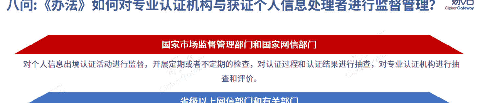

省级以上网信部门和有关部门发现获证个人信息处理器个人信息出境活动存在较大风险或发生个人信息安全事件的，可以依法对获证个人信息处理器进行约谈。获证个人信息处理器应当按照要求整改，消除隐患。

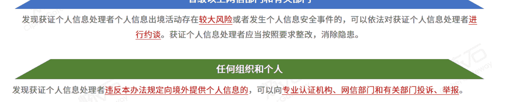

任何组织和个人发现获证个人信息处理器违反本办法规定向境外提供个人信息的，可以向专业认证机构、网信部门和有关部门投诉、举报。

违反《办法》规定的，依据《个人信息保护法》《网络数据安全管理条例》《认证认可条例》等法律法规；构成犯罪的，依法追究刑事责任。

# 九、《办法》促进数据安全跨境流动、数字经济高质量发展大意义？

个人信息出境认证制度遵循自愿性、市场化、社会化服务原则，由第三方机构实施，既减轻监管部门行政负担，也赋予企业更多合规选择权，更激发了数字经济的动能。

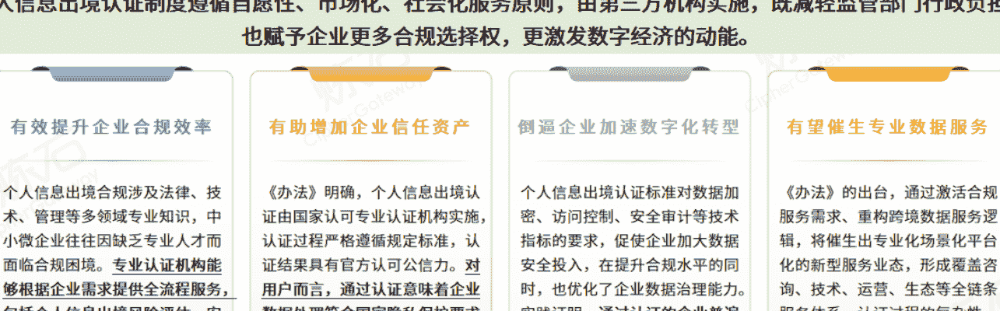

## 有效提升企业经营效率

个人信息出境涉及专业、技术、管理等多个领域专业知识，中小微企业往往缺乏专业人才而面临合规困境。专业认证机构能够根据需求提供专业服务，包括个人信息出境风险评估、全技术方案设计、境外接收数据审核等，有效补齐企业能力短板，有效提升企业经营效率。

## 助力增加企业信用资产

《办法》明确，个人信息出境亟由国家专业认证机构实施，认证过程严格遵循标准，认证机构需具有权威公信。对用户而言，通过认证意味着其数据能够妥善处理个人隐私保护，减少个人信息泄露带来的风险。对于商业伙伴而言，通过认证是企业数据安全能力的体现，特别在跨境合作中，无需双方重复合规审查，以认证结果增强公信，缩短合作周期。

## 倒逼企业数字化转型

个人信息出境认证标准对数据采集、访问控制、安全审计等技术指标有要求，促进企业大数据安全投入，在提升管理水平的同时，优化企业数据治理能力。实践证明，通过认证的企业普遍建立了数据安全全生命周期体系，这些能力不仅保障了数据安全，还为企业精准经营、产品创新等提供了支持。

## 催生专业服务

《办法》的出台，通过激活合规服务需求，重构数据服务市场，将催生专业化平台的新型业务，形成涵盖咨询、技术、运营、安全等全链的服务体系。认证过程的复杂性，推动合规服务从泛咨询向垂直领域转型，技术的硬性要求，将催生敏感数据识别、跨境数据加密模块等助力市场服务发展。

> 来源：专家解读 | 加快个人信息出境认证制度迈向水平保障数字经济高质量发展（作者：王玉成，国家网信办数据与技术保障首席副主任）

https://www.cac.gov.cn/2023-10/25/c_1762449273397695.html

# 十问：我国数据跨境流动的制度设计情况如何?

## 网信办出台多部安全管理办法，标志我国数据跨境流动制度体系全面建立

国家互联网办公室先后出台《数据出境安全评估办法》《个人信息标准合同办法》《促进和规范数据跨境流动规定》，明确了数据出境安全评估、个人信息出境标准合同等管理规定的实施路径，同时建立了自贸试验区数据出境负面清单制度。

《办法》的出台，明确了通过认证方式向境外提供个人信息的具体实施路径，标志着《个人信息保护法》明确的数据出境安全评估、个人信息保护认证、个人信息出境标准合同同等制度设计的全面落地，也标志我国数据跨境流动制度体系的全面建立。

个人信息处理者因业务等需要，确向中华人民共和国和境外提供个人信息的，应当具备下列条件之一:

- （一）通过国家网信部门组织的安全评估；
- （二）按照国家网信部门的规定经专业机构进行个人信息保护认证；
- （三）按照国家网信部门制定的标准合同与境外接收方订立合同，约定双方的权利和义务；
- （四）法律、行政法规或国家网信部门规定的其他条件。

# 目录
CONTENT

01 图解《个人信息出境认证办法》
02 图解《促进和规范数据跨境流动规定》
03 图解《数据出境安全评估办法》
04 图解《中国（北京）自由贸易试验区数据出境负面清单管理办法（试行）》
05 图解《中国（北京）自由贸易试验区数据出境负面清单（2024年版）》
06 数据安全保护实践

## 《促进和规范数据跨境流动规定》出台

| 序号 | 目录 |
| :--- | :--- |
| 1 | 制目的依据 |
| 2 | 重要数据认定 |
| 3 | 豁免情形 |
| 4 | 数据加工情形 |
| 5 | 个人信息出境情形 |
| 6 | 自贸区负面清单 |
| 7 | 安全评估情形 |
| 8 | 订立合同情形 |
| 9 | 评估结果 |
| 10 | 个人信息保护义务 |
| 11 | 数据安全义务 |
| 12 | 网信部门职责 |
| 13 | 特殊适用规定 |
| 14 | 施行时间 |

## 明确数据出境三大路径

- 1. 申报数据出境安全评估
- 2. 个人信息出境认证
- 3. 订立个人信息出境标准合同

## 数据出境合规操作细

- 《数据安全评估办法》
- 《促进和规范数据跨境流动规定》
- 《个人信息出境认证办法》
- 《数据安全评估指南》
- 《个人信息出境认证指南》
- 《个人信息出境标准合同办法》

# 网络安全法 数据安全法 个人信息保护法

第三十七条 关键信息运营者在中华人民共和国境内收集、产生的个人信息和重要数据应当存储在境内；因业务需要，向境外提供的，应当符合法律、法规规定的规定。

第三十条 关键信息运营者在中华人民共和国境内收集、产生的重要数据向境外提供的，应当开展安全管理，按照法律、法规规定通过网信部门组织的安全评估。

第三十八条 个人信息处理者向境外提供信息的，应当履行下列规定：
（一）按照法律、法规规定通过国家网信部门组织的安全评估；
（二）按照国家网信部门规定通过个人信息保护认证；
（三）与境外接收方订立个人信息出境标准合同履行合同；
（四）法律、法规规定的其他条件。对于国家安全部门认为需要特别措施的，可以采取其他规定。

# 目的和依据是什么？

2024年3月22日，国家互联网办公室发布《促进和规范数据跨境流动规定》，自公布之日起施行，旨在确保数据安全的同时，保护个人信息权益，促进数据依法自由流动。

促进和规范数据跨境流动规定
2024年3月22日 国家互联网办公室公告《促进和规范数据跨境流动规定》于2023年1月22日国家互联网办公室第26次会议通过。规定自公布之日起施行。
国家互联网办公室主任张宏
2024年3月22日

第一条 为了保障安全，保护个人信息权益，促进数据依法自由流动，根据《中华人民共和国网络安全法》、《中华人民共和国数据安全法》、《中华人民共和国个人信息保护法》等法律规定，对于数据安全、个人信息标准，实施安全评估、个人信息认证。

第二条 数据处理者向境外提供数据应当履行义务，向国家网信部门备案。对于未明确规定或者公布的非涉及个人信息或重要数据的，数据处理者不影响数据中数据要素。

第三条 跨境贸易、跨境运输、市场合作、提供服务等活动涉及数据产生和流动的数据向外的，不涉及个人信息或重要数据的，数据处理者无需进行数据安全评估、认证。

第四条 数据处理者在境外收集的个人信息存储回境的，处理过程中涉及个人信息或重要数据的，数据处理者应当进行数据安全评估、认证。

# 促进和规范数据跨境流动规定

在经济全球化背景下，跨境贸易必然引发数据跨境流动，如何平衡巨大的数据需求与数据安全监管成为关注焦点。我国强调要与发展的总体协调，坚持守住国家安全底线，《规定》允许与利益符合、发展的需求之间取得平衡，并不断优化和落实，适当放宽数据跨境流动条件，优化数据安全评估制度，在保障数据安全的前提下，便利数据自由流动，充分释放数据要素活力，提高对外开放，为高质量发展提供有力便利。

更多详情请参“网信办”公告、《促进和规范数据跨境流动规定》

# 如何理解数据跨境安全评估、个人信息出标准合同、个人信息保护制度之间的关系？

第一条 为了保障数据安全，保护个人权益，促进数据依法自由流动，根据《中华人民共和国网络安全法》、《中华人民共和国数据安全法》、《中华人民共和国个人信息保护法》等法规，对于数据跨境安全评估、个人信息出标准合同、个人信息保护认证等数据跨境制度的实施，制定本规定。

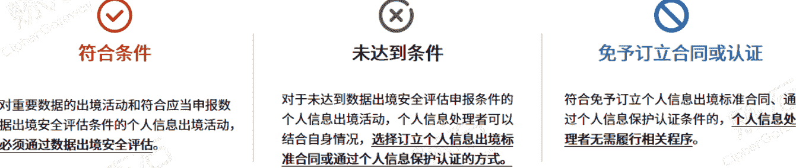

符合条件的数据出境活动必须通过安全评估。对于未达到安全评估条件的数据出境活动，个人信息处理者可以结合自身情况，选择订立个人信息出境标准合同或认证。符合认证条件的个人信息处理者无需履行相关程序。

## 扩展：《促进和规范数据跨境流动规定》相关

### 重要数据定义

| 依据 | 定义 |
| :--- | :--- |
| 《数据安全办法》第九条 | 重要数据是指可能导致国家安全回溯、损害或者非法窃取、非法利用，可能危害国家安全、经济运行、社会稳定的数据。 |
| 《数据安全法》第二十二条 | 国家数据安全机制应当协调有关部门识别重要数据，加强重要数据识别，各部门、地区、行业通过数据分级确定重要数据、本部门及行业的重要数据特征，对目录进行重点操作。 |
| 规定 | “重要数据”指的是申报重要数据。明确：依据《数据安全法》的规定、国家数据安全机制的有关部门识别的重要数据（或分类）。 |

### 敏感信息

| 依据 | 定义 |
| :--- | :--- |
| 《个人信息保护法》第四条 | 敏感信息是指一旦泄露或者非法使用，容易导致自然人受到损害或他人财产损害，包括生物识别、身份健康、轨迹等信息。 |

### 关键信息基础设施

| 依据 | 定义 |
| :--- | :--- |
| 规定 | 关键信息基础设施是指能源、交通、水利、金融、服务、国防、工业等行业和领域，以及一旦遭遇破坏、功能失效可能危害国家安全、公共利益的。 |

### 匿名

| 依据 | 定义 |
| :--- | :--- |
| 《个人信息保护法》第七十三条 | 匿名是指个人信息经过处理，使其在没有额外信息的情况下无法自然人。 |

### 去标识化

| 依据 | 定义 |
| :--- | :--- |
| 《个人信息保护法》第七十三条 | 去标识化是指个人信息经过处理，使其无法识别特定人。 |

## 附录 G（规范性）重要数据识别指南

| 序号 | 考虑因素 | 数据类型举例 |
| :--- | :--- | :--- |
| 1 | 分类框架 | 反映自然环境、生产生活环境基础情况，或可被利用造成环境安全事故的未公开的土壤、气象观测、环保监测有关的数据 |
| 2 | 方法 | 反映自然资源、能源资源、土地资源、矿产资源等资源储备和开发、未公开的描述水文观测结果、耕地面积或质量变化情况的数据； |
| 3 | 框架 | 反映核材料、核设施、核活动情况，或可被利用造成核破坏或其他安全事故的涉及电站设计、核电站运行情况的数据 |
| 4 | 方法 | 反映我国语言文字、历史风俗、民族价值观等特征，如记录历史类数据 |
| 5 | 要素 | 反映重点目标、重要场所安全保护情况或未公开的地理位置、输油管道的施工、内部结构、安防状况 |
| 6 | 分析 | 反映我国科技实力，影响国际竞争，或关系出口管制、国家级重大成果、我国禁止出口物品的设计原理、工艺方法，以及源代码、集成电路板、技术方案、重要参数、实验数据 |
| 7 | 流程 | 反映关键信息基础设施总体运行、发展和安全保护及其核心软硬件资产和供应链管理，可被利用对关键信息基础设施的网络攻击涉及关键信息基础设施系统配置、系统拓扑、应急预案、测评、运行维护、审计日志 |
| 8 | 涉及未公开的攻击方法、攻击工具制作方法或攻击辅助信息，以及未用于重点目标提供供应链攻击、社会工程学等网络攻击的政府、行业单位等敏感客户数据，以及涉及未公开的产品和采购合同、重大漏洞的数据 |
| 9 | 因素 | 直接影响国土安全和自然资源基础情况，如未公开的领土、水域、战略物资储备、作战能力的数据 |
| 10 | 直接影响市场经济的支持关键信息基础设施在行业内、领域核心业务运行或重要领域的数据 |
| 11 | 直接影响自然安全 | 反映我国在太空、深海、极地等战略新疆的实现或利益，如未公开的涉及太空、深海、极地界科学考察、开发利用的数据，以及影响人在上述领域安全的数据 |
| 12 | 反映关键能源安全、海上航道安全、海外公司和法人安全，或可被利用实施对我国参与国际贸易、文化交流活动的破坏或我国实施禁止、限制或其他类似情形，如描述国际贸易中特殊物资交易及特殊装备配备、使用和维护的数据 |
| 13 | 反映生物技术研究、开发和应用情况、反映扩散特征、遗传信息、关系重大突发疾病、动植物物扩散、关系生物实验室安全、或可被利用制造生物武器、实施恐怖袭击、外来物种入侵和多样性影响 | 如重要生物资源安全、微生物耐药基础研究 |
| 14 | 反映属性性或重点区域性运行状况，关系产业竞争力，力可引发公共安全事故或影响公民生命风险 | 如未公开的统计数据、重点业务商业机密 |
| 附录 | 见附录 | |

# 附录（规范性）重要数据识别指南

- 1. 数据分类框架
- 2. 数据分类方法
- 3. 数据分类框架
- 4. 数据分类方法
- 5. 数据分类要素
- 6. 数据影响分析
- 7. 级确定测
- 8. 综合确定级别
- 9. 行业领域数据分类分级
- 10. 处理者数据分类分级
- 附录

| 序号 | 考虑因素 | 数据类型举例 |
|---|---|---|
| 16 | 反映国家或地区群体健康生理状况，关系疾病传播与防治，关系食品药品安全 | 如涉及健康医疗资源、批量人口健康与健康管理、防控、健康保障、特定药物实验、食品安全溯源的数据； |
| 17 | 其他可能影响国土、军事、经济、文化、社会、科技、电磁空间、网络、资源、核、海外利益、太空、极地、深海、生物、人工智能等安全的数据； | 注1：影响安全的考虑意见（表：影响因素考虑因素）。 |
| 18 | 其他可能对经济运行、社会秩序或公共利益造成严重危害的数据。 | 注2：对经济运行、社会秩序、公共利益造成严重危害的参考示例（表：影响程度考虑示例）。具备以上因素之一的数据，可被识别为重要数据。 |

# 境外提供数据，什么情形可免申报数据出境安全评估、订立个人信息出境标准合同、通过个人信息保护认证

第三条国际贸易、跨境运输、学术合作、跨国生产制造和市场营销等活动中收集和产生的数据境外提供，不包含个人信息或者数据的，免申报数据出境安全评估、订立个人信息出境标准合同、通过个人信息保护认证。

# 解读

## 明确规范对象，释放支持和国际化信号## 减轻企业合规成本，加速数据出境效率

本条明确了我国数据跨境流动安全管理制度的规范对象，数据出境安全管理不是对于所有数据，仅限于重要数据和个人信息（国家秘密信息、核心数据不再讨论之列），这里的重点数据是针对国家而言，而不是针对企业和个人，反映我国的数据跨境流动安全管理制度支持国际贸易、跨境运输、学术合作、跨国生产制造和市场营销等活动，释放了开放和国际合作的信号。

针对对出境重要性高、场景常见、潜在安全危害小的场景进行列举规定，并在监管面上无任何限制，极大解决了评估标准明确带来的不确定性，减轻企业的负担和合规成本，加速了我国数据出境的效率。这些数据出境仍需遵守不不正竞争、出口管制、国家秘密管理及相关合同协议中保密义务等要求。

# 境外流入数据内处理后再出境形合监管吗？

第四条 数据处理者在境外收集和产生的个人信息传输境内处理后对外提供，处理过程中没有引入个人信息或者重要数据的，免予申报数据评估、订立个人信息出境标准合同、通过个人信息保护认证。

境外的数据在境内处理又流出境外，需要结合数据处理过程是否属于数据出境。这种情形对应《规定》的第四条，“来加工”等对对外贸易中的常见业务，特别是在人工智能时代（如数据标注业务）。境外数据传入国，经经工处理后传输出境，在这一概念上不属于“数据出境”。理论上，这样的活动并不在数据跨境流动安全监管之范围内。《规定》的征求意见对此做了简单化处理。此条有利于离数据加工业务等跨境贸易新常态的发展，也是支持来自海外的信息技术服务业务之需。

# 关于数据的处理，需要进一步考虑：

- 这些数据的处理，是否需要境内数据的参与？
- 因为境内人力成本较低，可能境外机构将会其境外收集的个人信息发送给境内处理者进行相关数据处理，处理过程中未引入任何个人信息。如果需要境内数据参与，就能简单认为不是数据出境。

- 这些数据的处理，是否涉及隐私敏感的数据处理技术？
- 如果本身没有什，加工后的数据能反映我们对某项技术的状况，还需要进行保护。如果是境外的原始视频委托境内处理，高清的画面可能是专业级视频处理技术的结果，数据处理结果显然不能轻易出境。

所以，在实践中遵循《规定》第四条时，依然需要自评估，以判断境外数据在境内的处理情况。
“来加工”等免于监管是有条件的，要确保处理过程中“没有引入个人信息或者重要数据”。
如果确实属于“不是境内收集采集的个人信息”，则未进行任何处理，可以直接出境。

参与者：吴建安全、文柏峰华、李建国证券交易所、小王爱数据中心

# 对外提供个人信息时，什么情况下可以免报数据安全评估、订立个人信息保护认证

第五条 数据管理者向境外提供个人信息，符合下列条件之一的，免报数据安全评估、订立个人信息出境标准合同、通过个人信息保护认证

(一)为订立、履行合同作为当事方的合同，如跨境购物、跨境物流、跨国汇款、跨境支付、跨境开户、机票酒店预订、签证办理、考试服务等，确需向境外提供个人信息的；

(二)按照法律规定的劳动流动制度和依法许可的集体行动实施人力资源管理，确需向境外提供员工信息的；

(三)紧急情况需要为当事人生命和财产安全，确需向境外提供信息的；

(四)关键信息基础运营者以外的数据自当年月1日起累计向境外提供不满十万次（不包含敏感信息）；

前述情形向境外提供的个人信息，不包括以下情形：

解析为订立、履行合同作为当事方的合同，若没有该字段无法约定无法履行，如跨境购物、跨境物流、跨国汇款、跨境支付、没有账户和客户就不到的。《规定》第五条规定免的四种情况已经进行了免除。从个人信息保护法》中推出，即《个人信息保护法》的相关条款，前三项免除可以得到。还需要指出，这些是“推导”。为了目的以及在实际执行中有效，特别是对于个人业务（如购物、汇款、预期酒店等）由当事人发起的数据跨境流动并非非常规，某些国外的数据流动等也是类似的，因此此不必单独对其调整。这便利了公众，也极大了企业合规压力。

这《规定》与征求意见相比重大的变化，也意味着数据流动安全管理制度重大松。这种松松的规定，超出了欧盟，也出了国，充分体现了对互联网部门的态度积极开放和发展的对策。。当，其中包含敏感个人信息的，这一点很重要。对于人力资源管理而言，不是公司为了建立一套制度作为工作需要的员工等关键信息基础运营者以外

# 自由贸易试验区的“负面清单”是什么？

第六条 自由贸易试验区在国家分类保护制度框架下，可以自行规定需要申报数据安全评估、个人信息出境标准、个人信息管理范围的数据（以下简称负面清单），经国家网络安全和信息委员会批准，报国家数据管理部门备案。

自由贸易试验区内数据处理器向对外提供负面清单的数据，可以免于申报数据安全评估、订立个人信息出境标准合同、通过个人信息认证。

负面清单的开放程度更高，也是国际惯例。规定“负面清单”制度，本身便表明了一种开放的态度。

- 阶段，负面清单制度不全国推行，基于数据政策和政策特质实施数据流动范围内安全管理的范围。这意味着，这是一种很大程度的豁免。即通过负面清单，对数据流动进行筛选。但不当，也可能带来巨大的风险。所以规定负面清单制度不全国推行。鉴于自贸区制度限制，先行特定的政策尝试，以及自贸区企业的双重优势，选择在自贸区实施数据流动负面清单是可能的。而且，中国天津贸易区已经在市政府指导下制定了国内第一份数据流动负面清单，并履行了相关程序，将其发布，这项工作已经完毕。

解析

- 负面清单没有共通性？是否有必要每一个地区都制定自己的负面清单？网信部门应该是考虑到各地区实际情况，特别是对外贸易的具体业务不同，所以对自贸区给予了充分自由，允许所有的自贸区制定负面清单。

- 在某种程度上，这就相当于权力下放了自由，如果自贸区处置不当呢？防止此类情况发生，《规定》对负面清单设置了两道门槛。一是要要求由省级政府批准，实际要由省级政府备案。另一个是报国家数据局、国家数据管理部门备案。这一备案应当带有审批性质，即两个部门都是认可的，认为可以通过。

自贸区不能简单理解为自贸区所属区域内的全部重要数据和个人信息相关。需要注意的是，所谓自贸区的数据，负面清单的是自贸区的企业、关注属于自贸区的数据，因此，不需要将自贸区部门的数据备案，自贸区不能简单理解为是自贸区区域内的全部重要数据和个人信息相关。

# 如何理解《规定》“负面清单”与国务院文件“正面清单”关系？

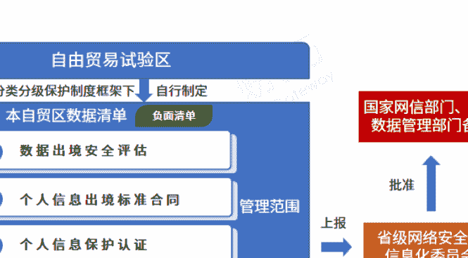

国务院关于进一步优化外商投资环境吸引商投资意力的意见
国务院关于进一步优化外商投资环境吸引引商投资意力的意见（国发〔2023〕11号）

中国跨国投资结构日益丰富，市场水平不断提升，制度型营商环境持续优化。为进一步优化外商投资环境，提升营商环境日益迫切。为此，坚持以开放促进高水平开放，对接国际规则，在开放中共享机遇，在开放中维护公平市场环境，构建国际竞争优势，有利于外国企业深度参与，扩大市场需求，加强保护。制定意见如下：

一、坚持高标准准入，支持外资企业深度发展。在市场准入、投资优惠等方面与国内企业同等待、同享待遇，消除壁垒，促进竞争，营造更加开放透明的市场环境。

二、完善数据流动制度，支持外资企业开展跨境业务。在安全的前提下，允许外资企业在境内活动产生的数据按照规定合法出境。加强数据流动便利，加快跨境流动，优化数据流动环境，实施分级管理，降低企业成本。

三、完善数据安全保障机制，提升防控能力。加强对数据风险的监测和应对，建立健全数据安全风险体系，提供跨境流动便利。

支持北京、天津、上海、港澳地区实施数据出境安全评估、标准合同等制度，探索形成数据流动的一般负面清单，建设服务，提供跨境流动。

正面清单

如何理解《规定》“负面清单”与国务院文件“正面清单”的关系

国务院文件的这一规定值得关注。因为从逻辑上，数据出境是常态，禁止出境、受限出境是例外。根本上决定数据出境的是“正面清单”制度（即“负面清单”）。何况在分级管理制度中，一般数据就是自由流动的，只有重要数据出境才有“一般负面清单”的必要。国务院一号文件在2023年8月发布时，有特定的背景。关于“正面清单”的规定并不尽。《规定》回到正确的轨道。

# 哪些数据处理器向境外提供数据需要申报出境安全评估、订立个人信息出境标准合同或通过个人信息认证

第七条 满足下列条件的通过本地省级网信部门向国家网信部门申报数据出境评估：

数据处理器向境外提供数据，应当符合下列条件之一：

（一）关键信息基础设施运营商向境外提供个人信息或者重要数据；

（二）关键信息基础设施以外的数据处理器向境外提供重要数据，或者自当年月1日起累计向境外提供一百万以上个人信息（不包含敏感信息）或者一万级以上敏感信息。

属于本规定第三条、第四条、第五条、第六条情形的，从其规定。

第八条 关键信息基础设施运营商以外的数据自当年月1日起累计向境外提供十万以上、不满一百万个人信息（不包含敏感信息）或者不满一万级敏感信息的，应当依法与境外接收方订立个人信息出境标准合同或通过个人信息保护认证。

属于本规定第三条、第四条、第五条、第六条情形的，从其规定。

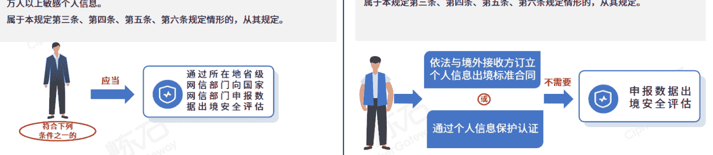

- ① **关键信息基础设施运营商向境外提供个人信息或者重要数据**
- ②向境外提供重要数据，或者自当年月1日起累计向境外提供一百万以上个人信息（不包含敏感信息）或者一万级以上敏感信息。**
- **关键信息基础设施运营商以外的数据处理器自当年月1日起累计向境外提供十万以上、不满一百万个人信息（不包含敏感信息）或者不满一万级敏感个人信息的。**

# 信息出场场景中关键运营商与其他数据处理者的前置审批程序有哪些不同?

解读

- 《数据出境安全评估办法》，将数据门槛做到了大幅提升（评估的门槛是100万，标准合同或认证的门槛是10万），这在更大程度上减轻了企业的负担。
- 任何个人信息出场场景都需要履行《个人信息保护法》项下义务，不同的只是前置审批程序

首先，关于关键信息基础运营者而言：

- 非个人信息且重要数据一般出境的，无限制；
- 重要数据出境，应进行数据出境安全评估（其他数据处理者也要）；
- 存在《规定》免除个人信息出境的，虽然免除数据出境安全评估，但不免除《个人信息保护法》项下的其他义务；
- 不在《规定》免除次数评估情形且个人信息出境的，应进行数据出境评估。

其次，关键信息基础运营者以外的数据者分为三种情况：

- 当当年月1日起累计向境外提供不满十万个人信息（不含敏感信息）无需前置审批；
- 当当年月1日起累计向境外提供十万以上、不满一百万个人信息（不含敏感信息）或者不满一万级敏感信息的，按标准合同及个人信息保护认证；
- 向境外提供重要数据，或者当年月1日起累计向境外提供一百万以上个人信息（不含敏感信息）或者一万级以上敏感信息的，应进行数据出境评估。

关于数量，官方明确：自当年月1日起累计数量以评估结果为准。属于本规定第三条、第四条、第五条、第六条的情形。

# 通过数据出境安全评估的结果有效期多久？

第九条 数据出境安全评估的结果有效期为三年，自评估结果出具日起计算。有效期满，需要继续开展活动且发生重新申报评估，数据处理者可以在有效期前六十个工作日向所在地网信部门提出延长评估申请。

# 解读

《规定》将数据出境安全评估的有效期由《数据出境安全评估办法》中规定的延长至三年，自评估结果出具日起计算。同时，可以延长评估有效期。

第十四条 数据出境安全评估的结果有效期为两年，自评估结果出具日起计算。在有效期内出现以下情形，数据处理者应当重新申报评估：

（一）向境外提供数据的目的、方式、种类和境外接收方处理数据的用途发生变化；
（二）境外接收方所在国家或地区数据安全政策和网络环境发生变化；
（三）出现影响数据出境的其他情形；

数据处理者应当在有效期满前六十个工作日内重新申报。

# 数据处理器向境外提供个人信息履行的义务有哪些？

第十条 数据处理器向境外提供个人信息的，应当按照法律、行政规定的履行告知、取得单独同意、进行个人信息影响评估。

# 解读

与《意见稿》之中多次强调单独的要求的要求，此条款再次强调了触发评估和备案的场景范围，对于个人信息出境的管理要求并没有改变。对于不需要进行评估或备案的企业，上述的出境基本义务应当在业务流程中落实，不因豁免评估或备案而不遵守相应的法律要求。

| 第十五条 有下列情形之一，个人信息处理者应当事前进行个人信息影响评估，并对处理情况进行记录： | (一) 处理告知 |
|---|---|
| (二) 利用个人信息进行自动化决策； | |
| (三) 委托处理个人信息、向其他信息处理者提供个人信息、公开个人信息； | |
| (四) 向境外提供个人信息； | |
| (五) 其他对个人信息有重大影响的个人信息处理活动。 | |
| 第三十条 个人信息处理器向境外提供个人信息的，应当告知境外接收方的名称或者联系方式、处理目的、处理方式、个人信息的种类以及境外接收方行使法律规定权利的程序和流程等事项，并取得个人的单独同意。 | |

第十一条 数据处理器向境外提供数据的，应当遵守法律、法规的规定，履行数据安全义务，采取技术措施和其他必要措施，保障数据安全。发生或者可能发生数据安全事件的，应当采取补救措施，及时向省级以上网信部门和其他有关部门报告。

# 解读

# 数据安全法

《规定》要求对境外提供数据处理者，按照相关法律履行义务，《数据安全法》中第二十七条规定了“采取技术措施和其他必要措施，保障数据安全”，第二十九条规定了“发生数据安全事件的，应当采取补救措施”等义务。

2023年，国家网信办也发布了《网络安全报告管理办法》（征求意见），其中规定网络运营者在发生数据安全事件时，应当及时启动应急预案进行处置；属于较大、重大或特别网络安全事件的，应当在1小时内报告。后续的流程和具体要求，还需通过实践中进一步明确。该等要求也与实际操作中相似，企业应建议先行确定预案流程和管理要求。

第二十七条 开展数据处理活动应当依照法律、法规的规定，建立健全全流程数据安全管理制度，组织开展数据安全培训，采取相应的技术措施和其他必要措施，保障数据安全。利用互联网信息网络开展数据处理活动，应当在网络等级保护制度的基础上，履行上述数据安全义务。

## 网信部门的职责有哪些？

十二条 各地方网信部门应当加强对数据管理者数据出境活动的指导监督，健全完善数据出境安全评估制度，优化评估流程；强化事前事中事后全链条监管，发现数据活动存在较大风险或者发生数据安全事件的，要求数据管理者进行整改消除危险；对不改正或者造成严重后果的，追究法律责任。

第四十四条 有关部门在履行安全监管职责中，发现数据处理活动存在较大安全风险的，可以按照规定的权限和程序对有关组织、个人进行约谈，并要求组织、个人采取措施进行整改，消除危险。

第六十四条 履行个人信息保护职责的部门在履行职责中，发现个人信息处理活动存在较大风险或者发生个人信息安全事件的，可以按照规定的权限和程序对个人信息处理的法定代表人或者负责人进行约谈，或者要求个人信息者委托专业机构对其个人信息处理活动进行合规审计。个人信息处理器应当按照要求采取措施，进行改进消除危险。

> 从数据管理者和监管部门两个角度，提出对数据出境活动进行监督和监管，并在发现数据出境安全事件或者发现数据出境安全风险增大时立即采取措施。这说明在对符合条件的数据出境活动的事前监管有所“松绑”的同时，监管部门的数据合规思路，将从主要的风险监管转向事前、事中、事后、动态监管。这一监管如果能得到有效执行，相信能够更好地促进数据流动和维护数据安全，保护中国个人信息权益找到平衡。

## 本规定与其他部门规章的适用性问题？《规定》什么时候施行？

十三条 2022年7月7日发布的《数据出境安全评估办法》（国家互联网信息办公室令第11号）、2023年2月22日公布的《个人信息出境标准合同办法》（国家互联网信息办公室令第13号）等相关规定与本规定不一致的，适用本规定。

第十四条 本规定自公布之日起施行。

- 已按旧规开展申报、备案的企业，可结合申报流程，获得申报结果与否，考量自身数据出境活动是否落入《规定》豁免场景，与监管部门进行密切沟通，做好后续应对和收尾工作。
- 对于一直观望中的企业而言，关于数据监管的不确定性暂时告一段落，可进行排查和梳理数据处理和数据出境场景，进行后续的合规动作。由于目前强调监管以及事中事监管的政策，即使落入豁免场景，还需做好内部的合规论证并适当开展其他基本数据合规义务的落地工作以稳健致远。

2024年3月22日

## 《规定》施行前已完成、正在申报数据出境安全评估、提交个人信息出境标准合同备案的，如何适用本规定?

| 情形 | 处理结果 |
| :--- | :--- |
| 已通过数据出境安全评估的数据出境活动 | 数据处理器可以根据申报事项继续开展。 |
| 未通过或部分未通过数据出境安全评估 | 根据《规定》免于申报数据出境安全评估的数据出境活动，数据处理器可以依法通过订立个人信息出境标准合同、通过个人信息保护认证等途径向境外提供个人信息。 |
| 已申报数据出境安全评估、提交个人信息标准合同备案 | 根据《规定》无需开展上述程序的，数据处理器可以按照原程序进行，也可以向所在地省级网信部门撤回申报、备案。 |

## 数据处理器如何申报数据出境安全评估、备案个人信息出境标准合同、申请个人信息保护认证?

| 情形 | 类型 | 处理方式 |
| :--- | :--- | :--- |
| 申报数据出境安全评估、备案个人信息出境标准合同 | 线上 | 可以登录数据出境申报系统，网址: https://sjc.cac.gov.cn |
| | 线下 | 已经通过线下方式提交安全评估申报、标准合同备案材料的，不需要通过数据出境申报系统重新提交 |
| 申请个人信息保护认证 | 线上 | 可以登录个人信息保护认证管理系统，网址: https://data.isccc.gov.cn |
| 关键信息基础设施运营商或者其他不适合通过数据出境申报系统申报数据出境安全评估的 | 线下 | 采用线下方式通过所在地省级网信部门向国家网信部门申报数据出境安全评估 |

## 数据出境咨询、举报联系方式有哪些？

| 情形 | 处理方式 |
| :--- | :--- |
| 数据出境安全评估申报 | 010-55627135, sjcj@cac.gov.cn |
| 信息标准合同备案 | 010-55627565, bzht@cac.gov.gov |
| 信息保护认证申请 | 010-82261100, data@isccc.gov.gov |

各地省级网信部门受理数据出境安全评估申报、个人信息出标准合同备案工作的联系方式（办公地址、联系电话）详见各省、自治区、直辖市和新疆生产团互联网信息办公室官网、微信公众号、数据标准合同备案以及国家互联网信息办公室官网-数据治理栏目（https://www.cac.gov.cn）。

# 目录
- 01 图解《个人信息出境办法》
- 02 图解《促进和规范数据流动》
- 03 图解《数据出境评估办法》
- 04 图解《中国（北京）自由贸易区数据出境负面清单管理办法（试行）》
- 05 图解《中国（北京）自由贸易区数据出境管理清单（负面清单）（2024版）》
- 06 图解数据安全保护

## 《数据出境评估办法》将于2022年9月起施行

国家网信信息办公室 (Office of the Central Cyberspace Commission)

数据出境安全评估数据出境活动对国家安全、公共公益或者组织权益带来的风险，主要包括以下事项：
- 数据出的目的、范围等的合法性、必要性。
- 境外接收方所在国家或者地区的数据保护法规和我国法律、行政法规的措施规定。
- 数据出境的规模、种类、敏感程度，数据出境后被篡改、破坏、丢失或者被非法获取、非法利用。
- 数据安全和个人信息权益是否充分保障。
- 数据处理者与境外接收方拟立的法律文件中约定数据安全保障。
- 国家网信部门认为需要评估的其他事项。

《数据出境安全评估办法》2022年8月4日通过，决定自9月1日起施行。

第一章 总则
第一条 为保护国家安全、公共公益或者组织权益，规范数据出境活动，防止数据出境被篡改、破坏、丢失或者被非法获取、非法利用，根据《数据安全法》等规定制定本办法。

## 历程回顾：“数据出境安全评估”是当前国家数据安全和个人信息保护的层设计之一。

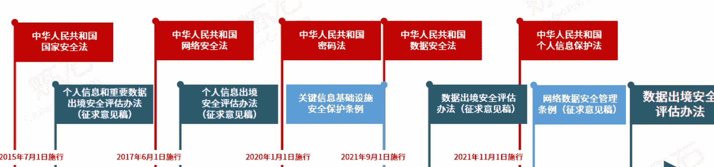

- 中华人民共和国数据安全法
- 中华人民共和国网络安全法
- 中华人民共和国密码法
- 中华人民共和国个人信息法
- 个人信息和重要数据出境评估办法（求意见稿）
- 个人信息出境安全评估办法（求意见稿）
- 关键信息基础设施安全保护条例
- 数据出境评估办法（求意见稿）
- 网络数据安全管理条例（求意见稿）

数据出境评估办法历程：
- 2015年7月1日施行
- 2017年4月11日颁布
- 2017年6月11日施行
- 2019年6月13日施行
- 2020年1月11日施行
- 2021年9月1日施行
- 2021年10月29日颁布
- 2021年11月11日施行
- 2021年11月14日颁布
- 2022年9月1日施行

“五法”包含数据出境安全要求：
① 针对数据出境进行有效管理，是国家数据安全治理、数据开发利用等重要内容，同时也是国家部门内在完善的重点工作；
② 2017年的18条要求，到2019年的22条要求，到2021年的18条，再到2022年的20条，除了要求在，还能不断在完善，从“数字”和“流程”，看到国家对数据出境评估这项工作的态度和落实决心。

## 2017年：个人信息和重要数据出境评估办法（求意见稿）

《个人信息和重要数据出境评估办法（求意见稿）》开序

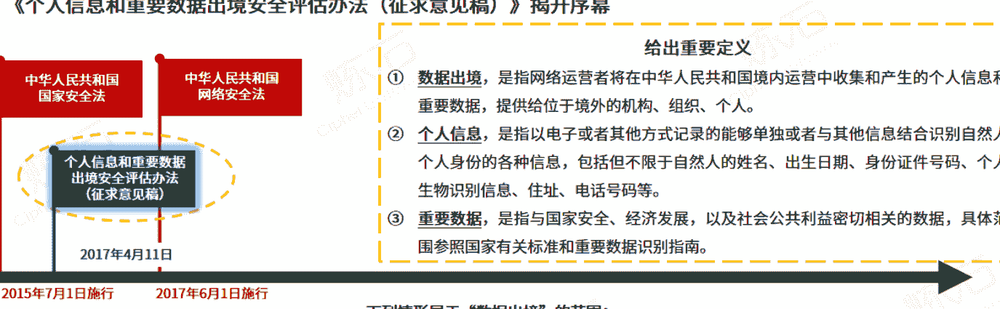

重要定义：
① 数据出境，是指经运营者将在境内运营中收集和产生的个人信息和重要数据，提供位于境外的机构、组织、个人。
② 个人信息，是以电子或其他方式记录的能够单独识别或与其他信息结合识别自然人身份的各种信息，包括但不限于自然人的姓名、出生日期、身份证号码、生物识别信息、住址、电话号码等。
③ 重要数据，是指与国家安全、经济发展、以及社会公共利益密切相关的数据，具体范围参照国家标准和重要数据识别指南。

2015年7月1日施行，2017年6月1日施行。下列情形属于“数据出境”的范围：

| 传输方式 | 境外访问 | 跨越企业 |
| :--- | :--- | :--- |
| 通过“线上”或“线下”方式将数据传输至境外，或以其他方式使数据转移到境外 | 从境外直接或间接访问位于境内的服务器 | 跨越企业内部流动的数据 |
| 运营者向境外提供数据 | | |

下列情形不属于“数据出境”：数据由境外中转，经过任何变动或处理的情形。

## 2019年：个人信息出境安全评估办法（求意见稿）

《个人信息出境安全评估办法（求意见稿）》影响。

敏感信息定义：
敏感信息是指一旦泄露、篡改、非法使用可能危害他人生命、财产安全或导致个人名誉、健康的生物标识、信仰、特定身份、医疗健康、金融账户、轨迹以及未成年人的信息。

行政执法指导：
- 单位名称：国家互联网信息办公室
- 地址：北京市海淀区西直门70号
- 电话：010-6798888

根据《个人信息保护法》、《数据安全法》、《网络安全法》制定了《个人信息出境评估办法（求意见稿）》。
第一条 自《办法》施行之日起。
第二条 评估应当收到申请之日起4个工作日内完成。
第三条 申请人向国家互联网信息办公室提交申请材料，国家网信办公室对申请材料进行审查。
第四条 申请材料不符合本办法规定的予受理。

关键信息（运营者与接收者签订的合同或其他法律效力的文件）：
十四条（三）应向接收者转达个人主体请求，包括向接收者索赔；个人主体不能从接收者获得赔偿时，网络运营者应当承担责任。
十六条（四）因向第三方传输个人信息导致信息主体受损的，在国家互联网信息办公室网站公示与评价。

## 2021年：数据出境安全评估办法（求意见稿）

数据出境评估办法（求意见稿）

第一条 为规范数据出境活动，保护个人信息权益，维护国家安全和社会公共利益，促进数据跨境安全自由流动，根据《中华人民共和国网络安全法》、《中华人民共和国数据安全法》、《中华人民共和国个人信息法》等法律法规制定本办法。

第二条 处理者向境外提供其在中华人民共和国境内收集和产生的重要数据和重要个人信息，应当进行安全评估，并按照本办法的规定履行义务；法律、行政法规另有规定的，按照其规定执行。

第三条 数据出境安全评估应坚持监管管理、风险评估与安全评估相结合，防范数据出境风险，保障数据依法有序流动。

第四条 处理者向境外提供数据，符合下列情形之一，应当在所在地网信部门向国家网信部门申报数据出境评估：
（一）数据出境包含重要数据
（二）数据出境包含个人信息
（三）处理个人信息达到一百万个人信息处理者向境外提供个人信息
（四）累计向境外提供超过十万个人信息或者向万人以上敏感个人信息
（五）国家网信部门规定的其他需要申报数据出境评估的情形。

2021年评估办法完整更加，逻辑更严密。从监管入手，到企业应对，操作更强化。（求意见稿）不能作为法解释，但可以参考经营精神，对于企业经营、组织管理来说，可以把工作做到提前，避免事后拍脚。

## 2022年7月7日《数据出境安全评估办法》正式公布

国家互联网信息办公室公告《数据出境安全评估办法》信中国 2022-07-07 16:53 发布于北京

CAC 点击“网信中国”关注官方账号

7月7日，国家互联网信息办公室公布《数据出境安全评估办法》（以下简称《办法》），自2022年9月1日起施行。国家互联网信息办公室表示，《办法》在《网络安全》、《数据安全》、《个人信息保护法》的规定下，规范数据出境活动，保护个人信息权益，维护国家安全和社会公共利益，促进数据出境安全有序发展。近年来，数据跨境流动频繁，数据处理者的数据跨境速度加快，《办法》有助于防范跨境风险，是维护国家安全和社会公共利益需要。《办法》规定了数据出境评估的条件、程序，为数据出境安全工作提供了指导。明确，数据处理者向境外提供中华人民共和国境内收集、产生的重要数据和个人信息，自2022年9月1日起，向境外提供万人以上个人信息或万人以上敏感个人信息的数据应当申报数据出境评估。数据出境评估坚持持续监管、风险评估与安全评估相结合。《办法》规定了数据出境评估的制度、法律责任以及合规要求等。

## 数据出境安全评估办法结构

1. 立法目的
2. 适用范围
3. 安全评估原则
4. 触发安全评估情形
5. 风险重点事项
6. 数据出境安全材料
7. 受理时间与结果反馈
8. 安全评估重点事项
9. 与境外订立法律文件约定的责任
10. 安全评估部门
11. 终止安全评估及材料真实性要求
12. 受理后完成评估时间
13. 申请情形
14. 评估结果有效期及更新申报
15. 评估机构和人员密责任
16. 举报机制
17. 不符合要求的规定
18. 法律责任
19. 重要数据定义
20. 施行时间

## 立法依据：评估办法是网络安全法、数据安全法、个人信息保护法延伸

第一条 为了规范数据出口活动，保护个人信息权益，维护国家安全和公共公益，促进数据跨境安全流动，根据《中华人民共和国网络安全法》、《中华人民共和国数据安全法》、《中华人民共和国个人信息法》等法律法规制定本办法。

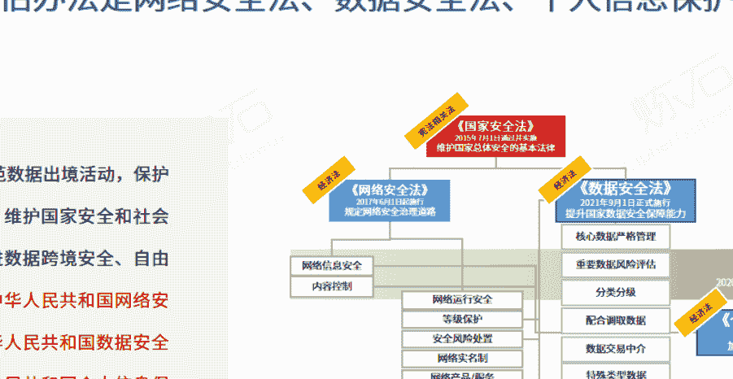

2022年的“评估办法”立法依据遵循，与“五法”相互呼应。

注：第十八条规定，违反本办法规定的，依据《中华人民共和国网络安全法》、《中华人民共和国数据安全法》、《中华人民共和国个人信息法》等法律法规处理；构成犯罪的，依法追究刑事责任。

## 监管范围：数据处理者、重要数据、个人信息

第二条 数据处理者向境外提供在华境内运营中收集和产生的重要数据和个人信息的安全评估，适用本法。法律、法规另有规定的，依照其规定。

| 发布日期 | 2017年4月11日 | 2019年6月13日 | 2021年10月29日 | 2022年7月7日 |
| :--- | :--- | :--- | :--- | :--- |
| 个人信息和重要数据出境评估办法（求意见稿） | 个人信息出境安全评估办法（求意见稿） | 数据出境安全评估办法（求意见稿） | 数据出境评估办法 |

| 网络运营商 | 网络运营商 | 数据处理者 | 数据处理者 | 属性原则 |
| :--- | :--- | :--- | :--- | :--- |
| 境内运营中收集和产生的 | 境内运营中收集的 | 境内运营中收集和产生的 | 境内运营中收集和产生的 | |
| 个人信息和重要数据，应当在境内存储 | 个人信息 | 重要数据和依法应当进行安全评估的个人信息 | 重要数据和个人信息 | 明确范围 |
| 因业务需要，确需向境外提供的 | | | | |

# 法主旨：事前评估和持续监督、风险自评估与安全评估

第三条 数据出境安全评估坚持事前评估和持续监督相结合、风险自评估与安全评估相结合，防范数据出境安全风险，保障数据依法有序自由流动。

## (出境前)国家网信部门组织安全评估

## (出境后)国家网信部门持续监督

### 数据出境管理

注1：网信部门发现已经通过评估的数据境活动在实际过程中不再符合要求的，应当通知数据者终止数据境活动并按照要求整改。

注2：任何组织和个人违反向境外提供数据的，可以向省级网信部门举报。

## 一问：什么情况会触发“安全评估”？

《数据出境安全办法》

第四条 数据处理者向境外提供数据，有下列情形之一，应当向省级网信部门申报：

- 1. 数据处理者向境外提供重要数据；
- 2. 关键信息运营者和处理一百万以上个人信息的数据处理者向境外提供个人信息；
- 3. 自上年度累计一百万以上敏感信息的数据处理者向境外提供个人信息；
- 4. 国家网信部门规定的其他情形。

对应《数据安全条例（征求意见）》

十七条 境内收集的数据属于以下情形的，应当通过国家网信部门安全评估：

- 1. 出重要数据；
- 2. 关键信息基础设施运营者和处理万以上个人信息；
- 3. 国家网信部门规定可以进行安全评估的。

## 关键基础设施定义

第二条 本条例所称关键基础设施，是指公共服务、能源、交通、水利、电子、国防等重要行业和领域，以及其一旦遭到破坏、失效或数据泄露，可能危害国家安全、公共利益。

## 关键基础设施认定

第九条 制定关键基础设施认定标准，并报公安部门备案。主要考虑以下因素：

一）网络设施、信息系统对本行业、本领域核心业务的重要；
二）网络设施、信息系统一旦遭到破坏、失效或数据泄露带来的危害程度。

## 关键基础设施认定标准（试行）

一、什么是关键基础设施
关键基础设施是指面向公众提供信息服务或支撑运行能源、金融、交通、公共事务等重要行业运行的信息系统或工业控制系统，该系统一旦发生故障运行正常，将影响国家安全、经济、科学、文化、环境以及人类生存安全造成重大损失。

二、关键基础设施包括范围：政府机关、事业单位网站、网络网站、平台、即时通信、网上购物、支付、搜索引擎、电子邮件、政务、游戏、视频等；事业单位办公网络、工业控制系统、大数据中心、云计算平台、电视媒体系统。

只符合以下条件的之一，可以认定为关键信息基础设施：

| 类别 | 关键认定标准 | 网安全影响的程度 |
| :--- | :--- | :--- |
| 网络网站 | 1）日活跃用户数超过1000万； 2）日新增用户数超过1000万； 3）一旦发生安全事故，可能影响数十百万用户的正常； 4）符合上述标准之一 | 1）影响1000万及以上用户； 2）影响一个行业或地区300万以上的人口； 3）造成10亿元及以上经济损失； 4）威胁国家安全、经济、社会稳定等； 5）造成重大损失，或者导致核心数据泄露； 6）影响500万及以上用户； 7）影响一个行业或地区100万及以上的人口。 |
| 平台 | 1）日处理业务超过1000万次； 2）日处理或承载的数据量超过1000TB； 3）一旦发生安全事故，可能影响数十百万用户的正常； 4）符合上述标准之一 | 1）影响1000万及以上用户； 2）影响一个行业或地区300万以上的人口； 3）造成10亿元及以上经济损失； 4）威胁国家安全、经济、社会稳定等； 5）造成重大损失，或者导致核心数据泄露； 6）影响500万及以上用户； 7）影响一个行业或地区100万及以上的人口。 |
| 生产业务 | 1）日服务超过1000万， 2）一旦发生安全事故，可能导致生命、财产遭受重大损失； 3）一旦发生安全事故，可能影响百万用户的正常； 4）符合上述标准之一 | 1）影响1000万及以上用户； 2）影响一个行业或地区300万以上的人口； 3）造成10亿元及以上经济损失； 4）威胁国家安全、经济、社会稳定等； 5）造成重大损失，或者导致核心数据泄露； 6）影响500万及以上用户； 7）影响一个行业或地区100万及以上的人口。 |

## 海外数据安全

关系海外能源安全、海上战略通道安全、海外公司和法人安全，或被利用实施对我国国际经贸、文化交流活动的破坏对我我国禁止、限制或其他类似措施。

## 生物安全

关系我国在太空、深海、极地等战略领域的实现与可能潜在利益。生物技术研究、开发和应用情况，反映族群特征、遗传信息，关系重大突发疾病、植物瘟情、实验室安全、可能被利用制造生物武器、实施生物恐怖攻击、关系外物种入侵和多样性。重要生物资源微生物耐药基础研究数据。

## 其他安全

### 政务安全
未公开的政务数据、情报数据和执法数据。

### 商业秘密安全

### 个人健康安全
反映全球性或特定领域经济运行、金融状况，关系产业竞争力，可造成公共安全事故或影响公民生命，可引发群体活动或影响群体情绪与认知。反映国家或地区健康生理状况，关系疾病传播与防治、食品安全。

## 关于个人信息

第二十八条 敏感信息是指泄露或者非法使用，容易导致他人人格损害、财产安全危害的个人信息，包括生物标识、身份、医疗健康、金融账户、行踪等，以及十四岁未成年人的信息。

### 个人信息实例

| 类别 | 内容 |
| :--- | :--- |
| 资料 | 姓名、性别、国籍、家庭成员、住处、电话、电子邮箱等 |
| 身份 | 身份证、护照、指纹、声纹、证书、居住证等 |
| 生物标识 | 人脸、指纹、眼睛、耳廓、虹膜、部位特征 |
| 网络身份标识 | 身份账号、IP地址、设备标识 |
| 健康信息 | 疾病发生及相关信息，如住院、院期间、医单、检验报告、手术术记录、医疗病历、用药记录、药物过敏史、生育信息、体质状况等信息、诊断、描述 |
| 教育信息 | 职业、工作单位、学籍、层次、教育经历、工作经历、成绩成果等 |
| 财产信息 | 银行账户、存款（包括资金金额、收支记录）、财产、密码、信用卡信息、交易记录、流水账等，以及虚假账户、虚拟货币、游戏账号等 |
| 通信信息 | 通信记录、短信、邮件、电子邮件，以及上述数据（通常为使用） |
| 联系人 | 通讯记录、好友、群列表、邮箱列表 |
| 上网记录 | 通过日志收集的个人信息操作记录，包括网站访问、软件使用记录等 |

### 敏感个人信息实例

| 类别 | 内容 |
| :--- | :--- |
| 财产信息 | 银行账户、存款（包括资金金额、收支记录）、财产、密码、信用卡信息、交易记录、流水账等，以及虚假账户、虚拟货币、游戏账号等 |
| 健康信息 | 疾病发生及相关信息，如住院、院期间、医单、检验报告、手术术记录、医疗病历、用药记录、药物过敏史、生育信息、体质状况等信息、诊断、描述 |
| 生物标识 | 人脸、声纹、眼睛、耳廓、虹膜、部位特征 |
| 其他信息 | 性别、婚姻、宗教信仰、未公开的违法记录、通信记录及内容、轨迹列表、群列表、行踪轨迹、网页浏览记录、住宿信息、精准定位等 |

## 如何理解个人信息

截至19年底，中国主要城市包括合肥、乌鲁木齐、厦门、哈尔滨、昆明、长春、苏州、宁波、南京、福州、南昌、杭州、贵州、石家庄、宁川、天津、济南、阜州、州。参照以下标准认定：

- 1. 月访问量超过百万次；
- 2. 月访问量超过50万次；
- 3. 月活跃用户超过10万次；
- 4. 月活跃用户超过50万次；
- 5. 月活跃用户超过100万次；
- 6. 月活跃用户超过500万次；
- 7. 月活跃用户超过1000万次。

## 二问：“安全评估”与《网络安全办法》中的“安全审查”有何区别？

《网络安全办法》扩大了适用范围，将数据处理活动纳入范围，并将“核心数据”、重要数据或大量个人信息被窃取、泄露、损毁以及非法利用列入考虑因素。区别：

- 1. 目的：安全评估主要围绕数据出境风险开展，而安全审查只是网络安全审查的部分。
- 2. 内容：安全审查是由国家安全和信息化委员会领导，而安全评估由国家网信部门主导。
- 3. 部门：安全评估受理国务院部门、省级网信部门、专门机构等。

## 三问：安全评估流程及时长？

## 四问：负责数据出境评估的部门有哪些？

数据出境安全评估申报后，根据申报情况，由省级部门、国家网信部门组织进行评估。省级网信部门应当自收到申报材料之日起5个工作日内完备性审查。申报材料齐全的，将申报材料报送国家网信部门；申报材料不齐全的，应当退回申报者并一次性告知补充的材料。

## 五问：自评估报告内容？

第五条 数据处理器在申报数据出境评估前，应当开展数据出境自评估，重点评估以下事项：

| 条款 | 关键词 | 解读 |
| :--- | :--- | :--- |
| (一) 数据出境和境外接收方处理数据的目的、范围、方式等的合法性、正当性、必要性 | 目的、范围、方式 | 业务使命 |
| (二) 出境数据的规模、范围、种类、敏感程度，数据出境可能对国家、范围、种类、安全、公共利益、个人或组织合法权益带来的风险 | 风险 | 风险分析 |
| (三) 境外接收方承诺承担的责任义务，以及其履行责任义务的管理和技术措施、能够保障数据出境安全的 | 接收承诺、管理和技术 | 合同、罚则、技术条件 |
| (四) 数据出境中和出境后遭到篡改、破坏、泄露、丢失、转移或者被非法获取、非法利用等的风险，个人信息权益维护的渠道是否畅通 | 个人信息权益维护通道 | 投诉渠道、安全保证 |
| (五) 与境外接收方订立的数据出境相关合同或其他具有法律效力的文件等（以下简称法律文件）是否充分约定数据安全保护义务 | 争议解决条款 | 合同条款细则 |
| (六) 其他可能影响数据出境安全的事项 | 可能事项 | 保障数据出境安全 |

## 六问：法律文件要求有哪些？

第三条 数据处理器应当在与境外接收方订立的法律文件中明确约定数据安全责任义务，至少包括以下内容：

| 条款 | 关键词 | 解读 |
| :--- | :--- | :--- |
| (一) 数据出的目的、方式和数据范围，境外接收方处理数据的用途、方式等 | 目的、范围、方式 | 对应《网络数据安全条例（征求意见）》第三条 |
| (二) 数据在境外保存地点、期限，以及到保存期限、完成约定目的或者法律文件终止后数据的处理措施 | 保存地点、期限 | 数据处理器向境外提供数据应当履行以下义务 |
| (三) 对于境外接收方将数据重新转移给其他组、个人的约束性要求 | 出境数据再转移 | (三) 采取合同等有效措施监督数据，接收方按照双方约定的目的、范围、方式使用数据，履行数据安全义务，保证数据安全 |
| (四) 境外接收方在实际控制者或经营者发生实质性变化，或者在国家、地区数据安全政策法规和网络环境变化以及发生不可抗力情形导致保障数据安全时，应当采取相应的措施 | 接收方侧变化后，安全措施 | 法律文件关键项 |
| (五) 违反法律文件约定的数据保护措施的违约责任和争议解决方式 | 争议解决条款 | |
| (六) 数据遭遇篡改、破坏、泄露、丢失、转移或被非法获取、非法利用等风险时，应当妥善开展处置的要求和保障个人信息权益的途径和措施 | | |

## 七问：安全评估内容的关注要点有？

第十条 国家网信部门受理申报后，根据数据情况组织国务院有关关部门、省级网信部门、专门机构等进行安全评估。

第八条 数据出境安全重点评估数据出境活动可能对国家安全、公共利益、个人或组织合法权益带来的风险，主要包括以下事项：

| 条款 | 关键词 | 解读 | 对应 |
| --- | --- | --- | --- |
| (一）数据出境的目的、范围、方式等的合法性、正当性、必要性 | 合理性 | 报告、法律文件 | 《网络数据安全管理条例（征求意见）》第四十条 |
| (二）境外接收方所在国家或地区的数据安全保护政策和网络环境对出境数据安全的影响；境外接收方的数据保护水平是否达到了中华人民共和国评估数据接收方的环境 | 接收方审核 | 境外提供个人信息和重要数据的接收者，应当在每年1月31日前编制数据出境报告，向设区的网信部门报告上一年度及下年度出境情况 | | |
| (三）数据的规模、种类、敏感程度，出境中和出境后遭遇毁损、破坏、泄露、失控、转移或被非法获取、非法利用等的风险 | 风险分析是否完善 | 报告 | | |
| (四）数据安全和个人信息能否得到充分有效保障 | 个人信息保障 | 报告、法律文件 | | |
| (五）数据处理者与境外接收方订立的法律文件中是否约定了数据安全保护责任义务 | 争议解决机制 | 法律文件 | | |
| (六）遵守中国法律、行政法规、部门规章情况 | 关联数据审核 | 查其材料 | | |
| (七）国家网信部门认为需要评估的标准的 | 关联数据审核 | 查其材料 | | |

## 八问：安全评估周期？

第十四条 通过数据出境安全评估的结果有效期为2年，自评估结果出具之日起计算。在有效期内出现以下情形之一的，数据处理者应当重新申报评估：

- （一）向境外提供数据的目的、方式、范围、种类和境外接收方处理数据的用途、方式变化影响出境数据安全的、或延长个人信息和重要数据保存期限的；
- （二）境外接收方在国家或者地区数据安全政策法规和网络安全环境变化以及发生其他不可抗力情形、数据处理者或者境外接收方实际控制权发生变化、数据处理者与境外方法法律变更等影响出境数据安全的；
- （三）出现影响出境数据安全的其他情形。

有效期满，需要继续开展出境活动的，数据处理者应当在有效期满60个工作日前重新申报评估。

数据出境管理要变成组织或公司数据安全中重要工作，常态性工作。

## 九问：和我的企业有关吗？

### 关键信息基础设施运营者
### 重要数据
- 100万人以上
- 10万人个人信息
- 1万敏感个人信息

### 通信、信息服务、能源、交通、水利、金融...
### 跨国业务与合作
- 比如，国际贸易
- 比如，国际结算
- 比如，国际物流
- 比如，国际航班

### 与经济运行相关、与人口健康相关、与自然资源与环境相关、与科学技术相关、与安全保护相关、与应用服务相关、与政务活动相关……
- 跨国业务与合作
- 国际医疗
- 联合科学实验室
- 多国公司

### 处理100万人以上个人信息的数据管理者向对外提供个人信息；
### 跨国业务与合作
- 比如，境外级“智慧城市APP”、提供境外商品代购服务
- 比如，母用APP、外包境外精准营销公司，提供数据分析

### 自上年1月1日起累计向境外提供100万人个人信息或1万敏感个人信息的数据处理器向对外提供个人信息；
### 跨国业务与合作
- 比如，跨境旅游
- 比如，留学学工
- 比如，在线外培训
- 比如，职业资质认证

> 在企业有跨国业务或跨国合作前提下，需要深入分析，审核业务中数据流转，确认是否有重要数据和需要保护的个人信息跨境流转。

## 未经安全评估即进行数据出境活动的，会受到什么处罚？

| 根据《数据出境安全评估办法》 | 根据《网络安全法》 | 根据《数据安全法》 | 根据《个人信息保护法》 |
| :--- | :--- | :--- | :--- |
| 第十八条 | 第六十条 | 第十四条 | 第六十六条 |

违反本办法规定的，依照《中华人民共和国网络安全法》、《中华人民共和国数据安全法》、《中华人民共和国个人信息保护法》等法律法规处理；构成犯罪的，依法追究刑事责任。

关键信息基础设施运营者违反本法第三十条规定，在境外传输网络数据的，或者向境外提供网络数据的，由主管主管部门责改正、给予警告，并可以处以五万元以上五十万元以下款，并可以责令停业整顿、关闭网站、吊销相关营业许可证；对直接负责的主管人员和其他责任人处以一万元以上十万元以下款。

违反本法第三十一条规定，向境外提供重要数据的，由主管主管部门责改正、给予警告，并可以处以一百万以上五百万以下款；对直接负责的主管人员和其他责任人处以一百万以上五百万以下款；情节严重的，可以处以五百万以上一千万元以下款。

违反本法规定处理信息或者处理个人信息未履行规定的，由履行信息保护部门责改正、给予警告，没收违法所得；对于拒从的，处以五万以上十万以下款；情节严重的，责令停业整顿、吊销许可证，对直接责任人员处以十万以上一百万元以下。

## 十问：企业怎么干？

### 管理角度：定人、定岗、定责
- 注意数据出境评估周期，通常为一年。
- 完善数据合规，充分做好事前、事中事后工作。

### 技术角度
- 核心手段：加密、去标识化、水印追溯
- 《个人信息保护法》第五十一条规定了“加密、去标识化”等技术
- 支持ABAC的访问控制，实现细粒度访问控制
- 应用服务、数据库、插件、代理、提供方、共享方、使用方、违规发现、加固、密钥管理

| 字段 | 加密 | |
| --- | --- | --- |
| 0sKVqYqbbRV | 1317630482 | 员 |
| 3nB0WkvqyOcB | 13504717614 | 员 |
| 3nYveE1Kgaeg | 14735916218 | 员 |
| 3biWzUygmsiHk | 10265726110 | 员 |
| 39izV1WltgJu | 1316591090 | 员 |
| 0s4UiWsmbgGf | 11956283995 | 员 |
| 4sGVVVskyT2j | 1877677924 | 员 |

| 字段 | 数量 | 备注 | 修改时间 |
| --- | --- | --- | --- |
| **** | 2714 | | 2020-01-24 09:05:00 |
| **** | 2342 | | 2020-01-24 09:05:00 |
| **** | 2342 | | 2020-01-24 09:05:00 |
| **** | 2169 | | 2020-01-24 09:05:00 |
| **** | 2169 | | 2020-01-24 09:05:00 |
| **** | 1768 | | 2020-01-24 09:05:00 |
| **** | 4643 | 数据库管理员 | 2020-01-24 09:05:00 |
| **** | 4643 | | 2020-01-24 09:05:00 |
| **** | 4608 | | 2020-01-24 09:05:00 |

| GUID | FILL_NAME | WINDER_ID | ... |
| --- | --- | --- | --- |
| 00000000-0000-0000-0000-00000002143 | **** | **** | **** |
| 00000000-0000-0000-0000-00000002145 | **** | **** | **** |
| 00000000-0000-0000-0000-00000002149 | **** | **** | **** |
| 00000000-0000-0000-0000-00000002150 | **** | **** | **** |
| 00000000-0000-0000-0000-00000002151 | **** | **** | **** |
| 00000000-0000-0000-0000-00000002152 | **** | **** | **** |
| 00000000-0000-0000-0000-00000002153 | **** | **** | **** |
| 00000000-0000-0000-0000-00000002154 | **** | **** | **** |
| 00000000-0000-0000-0000-00000002155 | **** | **** | **** |
| 00000000-0000-0000-0000-00000002156 | **** | **** | **** |
| 00000000-0000-0000-0000-00000002157 | **** | **** | **** |
| 00000000-0000-0000-0000-00000002158 | **** | **** | **** |

| GUID | FILL_NAME | WINDER_ID | ... |
| --- | --- | --- | --- |
| 00001500967 | 3b8-W3y-E58a | 1775561362 | |
| 00002311143 | 3b8-W3y-AdJa | 102469753 | |
| 00002311144 | 3b8-W3y-AdJa | 102469753 | |
| 00002311145 | 3b8-W3y-AdJa | 102469753 | |
| 00002541999 | 3/4-W3y/Jza | 102968356 | |
| 00002542000 | 3/4-W3y/Jza | 102968356 | |
| 00002700970 | 3/5-W3y/Yv8a | 141305339 | |
| 00002700971 | 3/5-W3y/Yv8a | 141305339 | |
| 0000321I987 | OtV-W3y-Ca99 | 144442156 | |

### 我的企业怎么干 - 实战角度
- 实战是检验安全能力的唯一标准
- 实战对抗：HVV攻防演练、网络攻破后数据不泄露、形成实战最佳实践
- 实战三位一体：将突发的、高技术水平的对抗风险转化为常态的、可重复验证的防御风险
- 过程合规、结果合规
- 商用密码安全性评估：合规、正确、有效
- 敏捷交付国合改造：数据安全风险评估、数据安全管理认证、个人信息保护认证、数据安全能力成熟度认证

## 我的企业怎么走 - 法律文件角度
### 合同法务部门补充关于数据接收方约定：网络安全承诺书
本单位承诺遵守有关网络安全的法律法规，并承诺本安全承诺书的各项条款，为此，本单位承诺对此产生的一切义务，履行相应的法律责任：
一、单位承诺遵守《中华人民共和国网络安全保护法》、《信息系统安全保护管理办法》及国家有关法律法规的规定，不违反任何网络安全领域的相关措施，并接受监督或调整；
二、单位承诺不利用网络信息活动从事违法活动、损害他人利益、不违反合法权利。
三、单位承诺不未经授权访问他人的数据，不删除、复制、存储、修改、破坏、干扰、损害、危害，单位承诺不实施危害信息或危害网络信息安全的活动：
四、单位未经许可进入计算机信息系统、篡改计算机信息数据、修改或删除数据；
五、单位未经许可对计算机信息系统中存储或传输的数据进行截获和数据处理；
六、单位承诺履行有关网络安全保护义务；
七、其他有关安全的承诺：
八、承诺自签署之日起生效。

### 安全威胁与信息保护
基于数据流量和安全保护，双方及时共享关键数据和威胁情报。乙方（以下“甲方”）提供的符合法律法规的业务过程中，乙方承诺工作人员不得泄露或使用甲方的信息。

### 约定内容：
双方在履行合同过程中，及时共享数据和安全漏洞。乙方承诺在履行过程中不向甲方披露任何相关的信息、专有技术、商业秘密或知识产权。在履行合同期间、合同终止后仍继续履行对甲方的保密义务。

1. 甲方承诺在发现重大漏洞后及时通知乙方并采取相应的防护措施。
2. 乙方承诺配合修复漏洞，具体如下：
   a) 《安全管理办法》
   b) 《数据出境安全评估办法》
   c) 《应急响应管理办法》
   d) 《网络安全法》
   e) 《数据安全安全管理办法》
3. 甲方承诺在发现重大漏洞后立即启动应急响应，并在修复完成后向乙方反馈。
4. 乙方承诺在收到甲方提供的漏洞后，在维护安全的期限内采取适当措施并反馈结果。

| 单位承诺书 | 期 | 保密协议 |
| --- | --- |

## 我的企业怎么干 - 用户角度
### 投诉渠道
第十条 相关组织按照章程、行业自律、协会会加强数据安全保护水平，促进健康发展。
十一条 国家和地区开展数据安全管理，鼓励利用数据领域的国际交流，参与数据安全规则和标准的制定。
十二条 任何人、组织都有权对违反法律规定的行为向有关主管部门投诉、举报。有关主管部门应当及时受理处理。

个人信息保护部门履行下列职责：
- （一）开展个人信息保护教育、指导、监督活动；
- （二）接受、处理与个人信息保护有关的投诉、举报；
- （三）组织开展对应用程序等个人信息保护情况进行检测，并公布结果；
- （四）调查、处理个人信息违法行为；
- （五）履行法律、行政法规规定的其他职责。

第六十二条 网络安全部门协助开展个人信息保护工作：
（三）出现数据泄露或其他安全情形的，数据者应当在发现泄露后及时向影响范围内的个人重新提交影响报告。

第六十五条 与涉及数据安全的工作机构和个人应当对数据进行处理时告知影响范围内的个人、个人信息、商业信息等，依照法律予以承诺，不承担或向权利者承担违法、非法责任。

第六十六条 个人和个人信息主体可以对违反本法的其他规定处理个人信息的行为向以上监管部门投诉。

第七十七条 国家对于规定通过评估的数据出境活动在处理过程中不再需要提交数据评估结果要求的，涉及数据处理者需要再次开展数据出境活动的，应当按照原要求重新提交申请。

《数据安全法》
《个人信息保护法》
《数据出境安全评估办法》

## 展望和拥抱数据出境安全保险？

网络安全保险：为客户规避诸如数据丢失、网络中断等互联网风险的保险。后期可能会专门数据安全保险服务。价值：抵消先行付赔带来的经营成本。

| 条件、分析方法和结论 | [20] | [16] | [11] | [19] | [9] |
| :--- | :--- | :--- | :--- | :--- | :--- | :--- |
| 保险类型 | 完全和部分 | 完全 | 部分 | 完全和部分 | 完全和部分 | 完全 |
| 风险相关安全依赖 | ✓ | ✓ | ✓ | ✓ | ✓ | ✓ |
| 保险公司利润 | 零 | 零 | 零 | 零 | 零 | 零 |
| 信息不对称 | × | 道德风险 | 道德风险 | 道德风险 | 道德风险 | 道德风险和反向选择 |
| 节点同质 | ✓ | | | ✓ | | | ✓ | ✓ |
| 强制性保险 | × | × | × | × | × | × |
| 数学方法 | | 纳付均衡 | 纳付均衡 | 纳付均衡 | 纳付均衡 | 纳付均衡 |
| 市场有效 | ✓ | × | ✓ | × | ✓ | ✓ |
| 激励自我防御投资 | | × | | | × | ✓ | × |
| 社会最优 | | × | | | ✓ | × |

> 自：纪绪乐，焦绪文《网络安全保险研究现状及展望》

## 展望和期待国家级“数据海关”？

### 基础设施建设——数据跨境安全海关

明确规定

国家、个人和组织、境内用户：
- 国家建立数据跨境安全海关，海关的主要功能对来源于境外、法律和行政法规禁止发布或传输的信息予以阻断传播
- 不得提供用于穿透、通过数据跨境安全海关的程序、工具、线路等
- 不得为穿透、通过数据跨境安全海关提供联网接入、服务器扩、技术支持、传播扩散、支付结算、应用下载等服务
- 境内用户访问境内网格的，其流量不得被路由至境外

> 建立数据跨境安全海关来源：《数据跨境安全管理条例（征求意见）》

### 管理机构建设——数据海关

未来展望

为组织或企业在经营活动中，涉及的数据资产、数据、个人信息等提供进出口服务，更多地，要为这种无形资产或商品，实现“关关”功能。

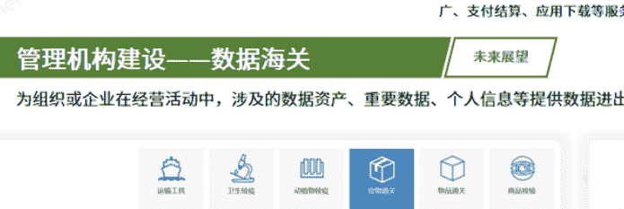

广州南沙（粤港澳）数据要素市场试点区和珠海横琴粤澳深融合合作区建设，探索建立“数据海关”，开展跨境数据流动的审查、评估、监管等。

## 积极还是消极?

## 国家让你保护重要数据和个人信息

第十条 国家网信部门受理申报后，根据申报情况组织国务院有关部门、省级网信部门、专门机构等进行安全评估。

生物演化是为了更好应对环境变化；而数据出境评估肯定有企业“通过”评估，肯定有企业“不通过”评估。

# 目录
CONTENT

- 01 图解《个人信息出境认证办法》
- 02 图解《促进和规范数据跨境流动规定》
- 03 图解《数据出境安全评估办法》
- 04 图解《中国（北京）自由贸易试验区数据出境负面清单管理办法（试行）》
- 05 图解《中国（北京）自由贸易试验区数据出境管理清单（负面清单）（2024版）》
- 06 炼石改造数据安全保护实践

## 北京互联网信息办公室等三部门印发《中国（北京）自由贸易试验区数据出境清单管理办法（试行）》《中国（北京）自由贸易试验区数据管理清单（负面清单）（2024版）》

2024年8月26日，北京互联网信息办公室、北京市商务局、北京市政务和数据管理局联合相关部门制定了《中国（北京）自由贸易试验区数据出境清单管理办法（试行）》《中国（北京）自由贸易试验区数据管理清单（负面清单）（2024版）》，标志着北京数据要素市场化改革取得重大突破，形成了高效便利的数据跨境流动“北京实践”。

北京互联网信息办公室等三部门印发《中国（北京）自由贸易试验区数据出境清单管理办法（试行）》《中国（北京）自由贸易试验区数据管理清单（负面清单）（2024版）》的通知

> > 中华人民共和国数据法
> 2021年9月1日起施行

> > 促进和规范数据跨境规定
> 2022年3月22日起施行

> > 中国（北京）自由贸易试验区条例
> 2022年5月1日起施行

北京互联网信息办公室等三部门关于印发《中国（北京）自由贸易试验区数据出境清单管理办法（试行）》《中国（北京）自由贸易试验区数据管理清单（负面清单）（2024版）》的通知

> > 北京市政府统筹和国家数据安全协调机制、国家互联网办公室等部门指导下，在北京市数据安全工作框架下
> > 中国（北京）自由贸易试验区数据出境管理办法（试行）
> > 中国（北京）自由贸易试验区数据管理清单（负面清单）（2024版）

各单位、各企业：
为落实加强数据要素市场化意见，结合北京实际，北京市互联网信息办公室、北京市商务局、北京市政务和数据管理局经研究意见共同印发《中国（北京）自由贸易试验区数据出境清单管理办法（试行）》《中国（北京）自由贸易试验区数据管理清单（负面清单）（2024版）》，并通知执行。附件随附，请遵照。

> > 经国家数据安全协调机制和北京市网信办备案附件：
正文：一、《中国（北京）自由贸易试验区数据出境清单管理办法（试行）》二、《中国（北京）自由贸易试验区数据管理清单（负面清单）（2024版）》

北京互联网信息办公室
北京市商务局
北京市政务和数据管理局
2024年8月

## 中国（北京）自由贸易试验区数据出境负面清单管理办法（试行）

### 第一章 总则
### 第二章 职责及分工
### 第六章 附则
- 4. 市级管理部门
- 5. 各自贸组织职责
- 6. 数据处理者定义
- 1. 制定目的和依据

### 第三章 负面清单制定
### 第四章 负面清单
- 16. 不纳入负面清单情形
- 7. 制定工作流程
- 10. 负面清单实施流程
- 17. 解释权说明
- 8. 负面清单包括内容
- 1. 各自贸组织义务
- 18. 未涉及领域分类分级说明
- 2. 适用对象
- 9. 动态管理
- 19. 负面清单出境执行说明

### 第五章 监督管理
- 12. 强化全链条全领域监管
- 13. 进行一致性抽检
- 3. 管理原则
- 14. 定期检查评估
- 15. 依法追究法律责任
- 20. 施行日期

### 中国（北京）自由贸易试验数据出境管理清单（负面清单）（2024版）

一、汽车行业
二、医药行业
三、民航业
四、零售与现代服务业
五、人工智能数据

## 主要考虑和重点内容

## 《促进和规范数据跨境流动规定》出台背景

自由贸易试验区在国家数据分类分级保护制度下，可以自行制定区内需要纳入数据出境安全评估、个人信息出境合同、个人信息保护认证范围的数据清单（以下简称负面清单），经省级安全和信息化委员会批准后，报国家网信部门、数据监管部门备案。

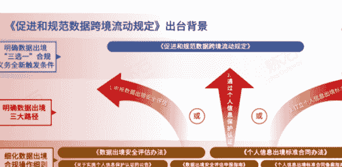

- 2023年3月22日，国家互联网信息办公室发布《促进和规范数据跨境流动规定》，“管得住、放得开、用得好”为总目标，“1+N”总体思路。本次市发布的负面清单政策是根据国家网信办《促进和规范数据跨境流动规定》关于自贸试验区可自行制定数据出境负面清单制度安排，“管得住、放得开、用得好”为总目标，在广泛的企业经营和深层次的需求分析基础上，按照“1+N”的总体思路进行构建。

负面清单制定流程、职责分工、使用管理、安全监管等进行深度设计。首批汽车、医药、零售、民航、人工智能等5个领域先于清单。《管理办法》重点监管负面清单制定流程、职责分工、使用管理、安全监管等方面进行深化设计，是拟定负面清单并开展基本监管工作，并完善数据识别规则，建立13类跨境数据分类分类规则，助力提升企业识别能力。《负面清单》考虑数据出境需要的重大业务、全市重点布局等因素，按照“急优先、小步快”原则，首批汽车、医药、零售、民航、人工智能等5个领域先于清单，详细列明23个业务场景和198个数据字段，方便企业识别。后，建立动态调整机制，分行业、分领域、分批次推进，持续优化负面清单。

## 四大政策亮点

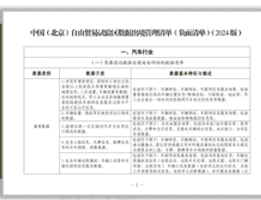

- 《负面清单》突出示范引领、体系化设计、实用性导向，是首批场景化、字段级数据。

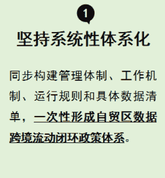

- 《负面清单》分类化、级数据，是首批场景化、字段级数据。

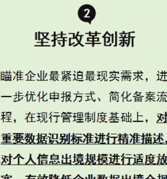

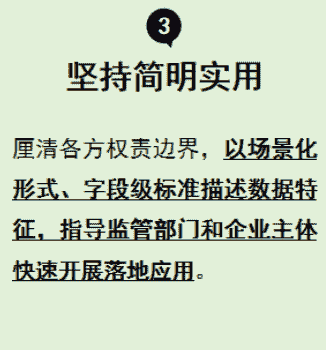

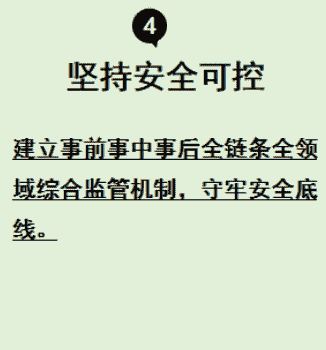

- 《负面清单》首批场景化、字段级数据。

坚持系统性一体化同步构建管理机制、运行规则和具体数据，一次性形成自贸区跨境流动体系。改革创新精准追踪企业紧迫需求，进阶优化申报方式、简化合规流程，在现行管理制度基础上，对重要数据识别标准进行精准描述，有效降低数据出境成本。厘清各方权责边界，以场景化字段级标准描述，指导监管部门和企业主体快速落地应用，守牢安全线。

## 实施四项重点举措

为做好负面清单实施，统筹推进全市数据出境管理，助力企业尽快应用，实施四项重点举措：

### 北京数据跨境中心

- 统筹布局北京跨境服务中心，在大机场、商务区、经济技术开发区、中关村科学城并启动运行4个服务站，优化政务功能，面向企业形成“一站式”服务能力。

### “绿色通道”

- 全面拓宽“绿色通道”范围，分行业、分领域拓展对象，畅通企业申报。

### 数据跨境便利化平台

- 开发上线全市跨境便利化平台，形成全市的便利化能力。

### 《北京市数据流动便利化指南》

- 编写《北京市数据流动便利化指南》，细化具体项，并分行业尽快组织政策宣贯和企业引导，提高政策措施的覆盖面和到达率。

## 三部门联合发布《北京自贸试验区数据出境免清单管理办法（试行）》

### 第一章 总则

第二十一条 国家建立数据分类保护制度，根据数据在经济社会发展中的重要性，以及是否易改、破坏、泄露或非法获取，对国家安全、公共利益或者个人利益造成危害的，对数据实施分类保护。国家数据分类保护机制由有关部门制定重要数据目录，加强对重要数据的保护。

第六章 自由贸易试验区在国家数据分类保护制度下，可以自行拟定区域内需要出境安全防护、个人信息出境识别和管理的数据清单（以下简称负面清单），经过网络安全和信息化委员会批准，按国家网信部门、国家数据管理部门备案。

《条例》第十一六十八条，主要规定了十方面内容：（一）明确自贸试验区的定位、（二）推动投资开放与数据自由自贸试验区、（三）明确自贸试验区管理机制、（四）推动科技创新、（五）促进数字经济增长便利、（六）完善金融服务、（七）推进优势产业开放、（八）推动京津冀协同发展、（九）加强管理创新、（十）加强人才服务保障。

### 第二章 职责及分工

涉及国家安全、国家经济重要、民生、重大公共利益等数据，相关部门按照国家数据工作要求实施更严格的管理制度。各地区、各部门按照要求落实数据分类保护制度，并落实本地工作...自由贸易试验区内规定数据者向境外提供负面清单之外的数据，可免于申报出境评估、认定，并通过个人信息出境安全标准认证，通过个人信息保护确保安全。

### 第三章 负面清单制定及管理

《数据安全办法》
《促进和规范数据跨境流动规定》
《中国（北京）自由贸易试验区条例》

### 第四章 负面清单实施

### 中国（北京）自由贸易试验区数据出境免清单管理办法（试行）

为保障国家安全，保护个人信息权益，提升中国北京自贸试验区内开展数据出境免清单制。（北京）自由贸易试验区（以下简称北京自贸试验区），确定标准并使用管理等等活动，适用本办法。数据出境管理能力和便利性，促进数据高效流动。

### 第五章 监督管理
### 第六章 附则
## 附件：参考规则

## 负面清单管理坚持的三项原则

1. 总则
2. 职责及分工
3. 负面清单制定及管理
4. 负面清单实施
5. 监督管理
6. 附则
## 附件：参考规则

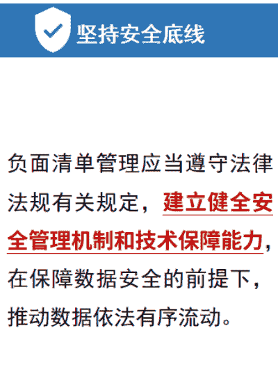

- 负面清单应当遵守法律法规有关规定，建立健全安全机制，在保障安全的前提下有序流动。

- 助力产业发展，充分考虑数据处理者实际需求，科学合理制定纳入负面清单的数据范围，促进跨境业务发展。

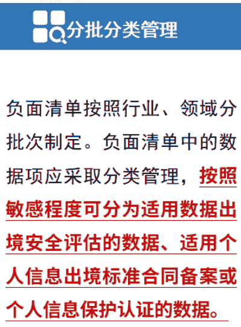

- 分批分类管理，按照行业、领域分批制定，负面清单中的数据采取分类管理，适用出境安全评估、个人信息保护认证。

### 指导并监督北京自贸试验区跨境流动活动

1. 总则
2. 职责及分工
3. 负面清单制定及管理
4. 负面清单实施
5. 监督管理
6. 附则
## 附件：参考规则

市级管理部门：北京市互联网信息办公室、北京市商务局、北京市政务和数据管理局，负责统筹相关事宜，建立北京自贸试验区数据出境负面清单体系并指导分行业、分领域、分批次开展负面清单制定工作，履行审批备案，建立动态管理机制。

## 各自贸易落实相关责任

1. 总则
2. 职责及分工
3. 负面清单制定及管理
4. 负面清单实施
5. 监督管理
6. 附则

各自贸易团：本市朝阳、海淀、通州、顺义、大兴、亦庄北京自贸区管理部门及属地职能部门，负责指导本团内数据处理者合规使用负面清单，形成事中存证与事后监管能力，跟踪监督等。

### 数据处理者定义及相关要求

1. 总则
2. 职责及分工
3. 责任清单制定及管理
4. 责任清单实施
5. 监督管理
6. 附则

### 数据处理者

本办法所称数据处理者，是指北京自贸试验区内登记注册、开展数据跨境流动等活动的企业、事业单位、机构、团体或其他组织。数据处理者应当按照相关规定识别、申报重要数据。按照相关要求开展活动，并配合市级管理部门、各自团开展跟踪验证和监督检查工作。

主要的是在北京自贸试验区内登记注册、开展数据跨境活动的数据者。依据《中国（北京）自由贸易试验区总体方案》，北京自贸试验区19.68平方公里，涵盖三个核心区：科技创新区、国际商务服务区（含北京监管区）及其他区域。按照上述规定，在区外注册的数据处理者的数据活动不能用本责任清单。

附件：参考规则

## 负面清单制定的内容

1. 总则
2. 职责及分工
3. 负面清单制定及管理
4. 负面清单实施
5. 监督管理
6. 附则
## 附件：参考规则

## 需求调研

### 重要数据识别

聚焦北京自贸区产业发展和数据处理者实际需求，遴选重点行业、领域开展调研，从业务场景、类别、层级、字段等方面摸排数据出境情况，作为负面清单制定依据。

- 行业主管部门已开发发布或已在行业内部发布本行业、本领域分类分级标准规定的，优先按照其规定识别重要数据；行业主管部门未明确确定标准的，按照《中国（北京）自由贸易试验区数据分类分级参考规则》识别重要数据。

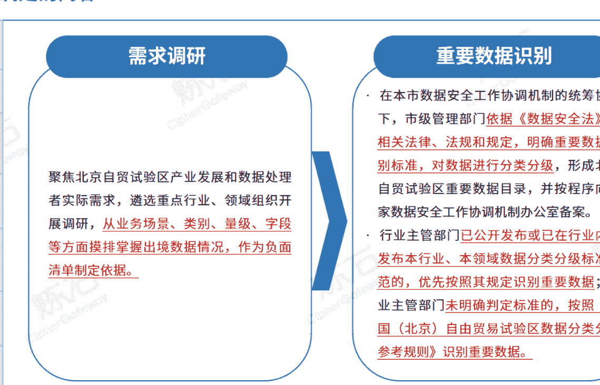

# 负面清单至少包含两方面的内容

## 1.总则

## 需要通过数据出口安全评估的数据清单

## 需要通过个人信息出口标准合同备案、个人信息保护认证出境的数据清单

## 2.职责及分工

> 【关键信息基础设施运营者】
> 【关键信息基础设施运营者以外的数据处理器】

向境外提供个人信息或者重要数据；

向境外提供到负面清单要求订立个人信息出口标准合同或者通过个人信息保护认证的个人信息。

## 3.负面清单制定及管理

> 【关键信息基础设施运营者以外的数据处理器】
> 【负面清单动态管理】

向境外提供重要数据，或者向境外提供到负面清单要求申报数据出口安全评估个人信息。

市级管理部门对于出台的负面清单，跟踪评估实施情况和安全风险，统筹开展负面清单修改工作。对于尚未列出负面清单的行业、领域，及时判别数据出口实际需求，研究制定相应行业、领域负面清单，不断完善北京自贸区数据跨境流动管理政策体系。

## 4.负面清单实施

## 5.监督管理

## 6.附则

附件：参考规则

# 负面清单实行动态管理

- 1.总则
- 2.职责及分工
- 3.负面清单制定及管理
- 4.负面清单实施
- 5.监督管理
- 6.附则
- 附件：参考规则

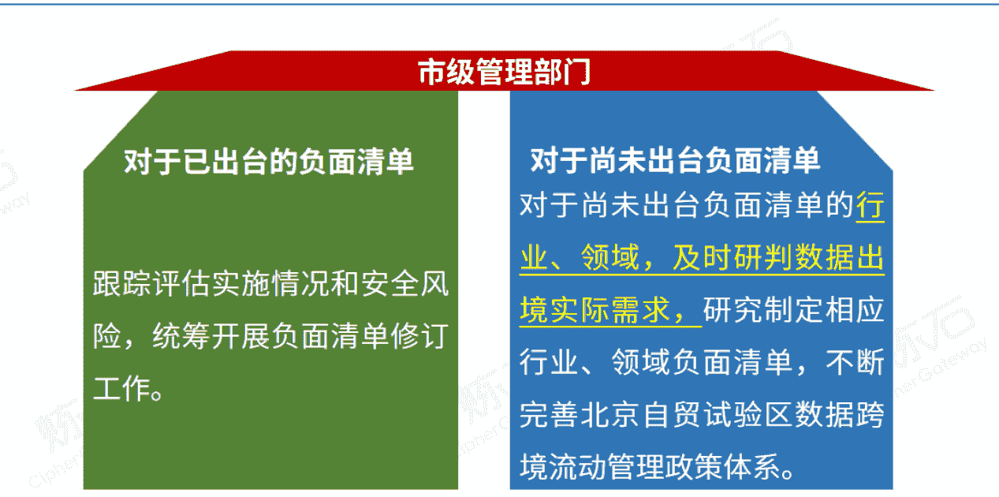

市级管理部门

对于已出台的负面清单，跟踪评估实施情况和安全风险，统筹开展负面清单修订工作。

对于尚未出台负面清单，对于尚未出台负面清单的行业、领域、及时研判数据实际需求，研究制定相应的行业、领域负面清单，不断完善北京自贸试验区数据流动管理政策体系。

# 数据处理器使用负面清单出境数据遵循的主要流程

## 1. 总则

- 提交申请
- 提交备案
- 合规出境

## 2. 职责及分工

数据处理器按照在自贸组负面清单配套实施指南，相应的自贸组提交申请。

- 数据处理器
- 自贸组

## 3. 负面清单制定及管理

应按照自贸实施指南

- 开展负面清单使用备案
- 可按照各自组团出具的研判意见
- 开展数据出境活动

## 4. 负面清单实施

- 是否通过审核：是
- 是否完成备案：是

## 5. 监督管理

| 关键词 | 详情 |
| --- | --- |
| 配合监督 | 配合市级管理部门、各自贸组开展监督、核验等工作 |
| 更新备案 | |

## 6. 附则

申请材料：包括注册在地、所属行业、经营情况、近2年业务经营活动受到行政处罚和有关主管部门调查及调整措施等。

备案材料：包括数据业务场景、出境数据目的、出境数据规模、境外接收方式、出境数据适用负面清单的理由及适用负面清单中的数据元素等。

## 附件：参考规则

数据出境情况发生变化，及时向各自贸组更新备案。

# 各自贸组在负面清单实施流程中重点开展相应的工作和义务

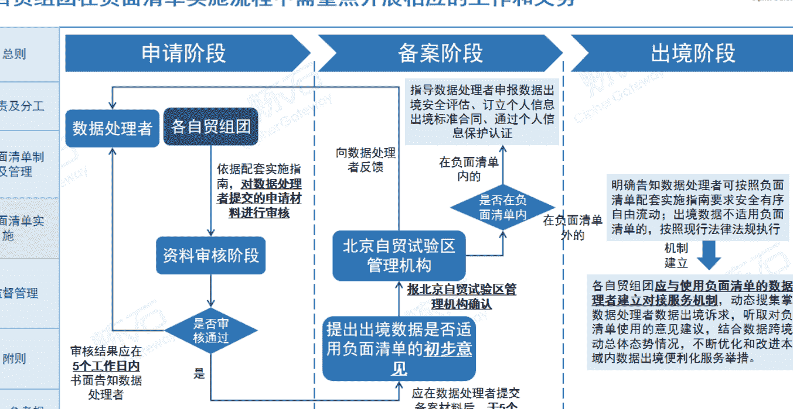

- 1. 总则
- 2.职责及分工
- 3.负面清单制定及管理
- 4.负面清单实施
- 5. 监管管理
- 6. 附则
- 附件：参考规则

# 在监督管理过程中不同主体需要履行的责任和义务

| 相关主体 | 职责关键词 | 职责详情 |
|---|---|---|
| 1. 总则 | 落实要求 | 严格落实国家及行业数据安全要求 |
| | 加强监督 | 加强对北京自贸区数据出境活动的指导监督 |
| 2. 职责及分工 | 市级管理部门 | 通报机制 | 建立数据出境风险研判、安全事件发现通报机制 |
| | 监测预警 | 统筹开展安全风险监测预警能力建设 |
| 3. 负面清单定制及管理 | 综合监管 | 强化清单使用过程中的事前、事后全领域综合监管 |
| 4. 负面清单实施 | 市级管理部门联合行业部门 | 定期检查 | 定期对各自贸团、数据处理者落实办办法要求进行检查评估。发现数据处理活动存在重大安全风险的，应当立即采取补救措施，消除隐患，对影响或可能影响国家安全的数据，及时重新纳入负面清单 |
| | 数据处理者 | 及时备案 | 在数据处理活动中，应及时备案 |
| 5. 监管管理 | 各自贸团 | 一致性抽检 | 组织专业技术机构根据实际出境情况与采样材料进行一致性校验 |
| 6. 附则 | | |
| 负面情况 | 处理 | |
| 数据处理者违反有关法律法规，不改正或者造成严重后果的，依法追究其法律责任。 | 各自贸团可令其停止数据入境活动，要求限期整改，完成后重新履行负面清单申请、备案程序，终止数据出境活动，及时向市级管理部门报。 |

# 国家核心数据实行更加严格的管理

| 情况 | 解释 | 详情 |
| --- | --- | --- |
| 1. 总则 | 关系安全、国民经济命脉、重大公益等数据属于国家核心数据，实行更加严格的管理。 | 不纳入负面清单 |
| 2. 职责及分工 | 本方法由北京市互联网办公室负责解释。 | |
| 3. 负面清单制定及管理 | 未涉及的行业、领域的数据分类级，按照有关规定和标准执行。 | |
| 4. 负面清单实施 | 出境数据属负面清单外的行业、领域，按《数据出境安全办法》、《个人信息出境标准》、《促进和规范数据跨境流动规定》等国家规定执行。 | |
| 5. 监督管理 | 本方法自发布之日起施行 | |
| 6. 附则 | | |

# 参考规则适用于非涉密数据，涉密数据按规定执行

| 规则 | 重要数据识别规则 |
|---|---|
| 1.总则 | 北京自贸试验区掌握的100万人以上个人信息（含敏感信息）；100万人以上敏感信息；100万人以上包含银行账户、注册账户、诊疗数据等的个人信息。 |
| 2. 职责及分工 | 被国家认定为关键基础设施的运营者掌握100万人以上个人信息。 |
| 3. 负面清单制定及管理 | 北京自贸区企业在研发设计、生产制造、经营管理过程中收集和产生的与行业、竞争力的高价值敏感数据；涉及国家安全的数据。 |
| 4. 负面清单实施 | 北京自贸区企业掌握的控制系统参数以及控制、维护、测试数据。 |

# 中国（北京）自由贸易试验区数据分类参考规则示例-1

| 一级类别 | 二级类别 | 数据基本描述 | 重要数据识别规则（示例） |
| --- | --- | --- | --- |
| （一）战略物资和大宗商品类 | 1. 石油、石化天然气 | 包括存储与交易数据、产量数据等。 | 石油、化工、天然领域涉及国家重大决策的运行状况、发展趋势、增长速度等产量数据、粮食、棉花、食用植物、肉类、乳制品等农产品储备数据，以及作物、牲畜、作物涉及病害种类（包含类别）、数据数量等可能影响生物性的数据、农业经营数据、检测数据、防疫控数据，达到精度或未地理信息数据。 |
| | 2. 农产品 | 包括资源数据、战略储备数据等。 | 数据的覆盖范围、精度和维度等、或观测区域和目标的识别信息和环境影像数据。服务军事、国防科研、技术领先的军事监测数据、具有重要价值的海洋环境数据、军事防御数据。能够影响水害灾情、工程进度、综合性等关键水害防御数据、治理路段等水利基础数据、水资源、水利基础数据、水情信息、水文数据等，满足特定要求的温度观测数据、水利地理空间数据、重点水利工程物资保护情况等。 |
| | 3. 地理信息 | 包括地理信息数据，可分为定位基础数据、地址数据、地形数据、基础地理实体数据；遥感影像数据、可分为原始影像数据、影像产品数据和遥感影像等；专题影像数据，可分为自然资源、国土规划、生态环境等领域的地理信息数据。 | |
| | 4. 天气 | 包括气象监测、空气质量监测、气象观测数据、区域气象观测、雷达气象数据、气象台站数据等。 | |
| | 5. 海洋 | 包括海洋环境数据、海洋资源数据。 | |
| | 6. 环保 | 包括反污染排放水的自身监测、接受执法或其他污染物排放数据等。 | |
| | 7. 水利 | 包括湖泊水、水利监测站水利基础数据、水害防汛、资源、水文、水环境、湖泊保护、节水用途、水利地理空间数据。 | |
| （二）自然资源和环境类 | | | |

# 中国（北京）自由贸易试验区数据分类参考规则示例-2

| 一级类别 | 二级类别 | 数据基本信息描述 | 重要数据识别规则（示例） |
| ------|---|---|---|
| 1. 总则 | | | |
| 2. 职责及分工 | | | |
| 3. 负面清单制定及管理 | | | |
| 4. 负面清单实施 | | | |
| 5. 监管管理 | | | |
| 6. 附则 | | | |
| （三）工业类 | | | |
| （四）国防科技工业 | 18. 国防科技工业 | 包括经营管理、研发设计、生产制造、试验验证、维护保障等数据。与军事、经济、科技、网络安全相关的数据，涵盖企业科研与生产能力的数据、整体结构的数据，国防科技工业领域相关重要数据。 |
| （五）电信类 | 19. 电信 | 包括网络规划运维数据、安全保障数据、经济运行与业务发展数据、关键技术成果数据。 | 重要数据和系统建设规划、性能数据、数据分析、运行维护数据、统计分析数据。 |
| （六）广电电视和网络视听 | 20. 广电 | 包括电视节目采集拍摄、制作播出、传播、分发服务等环节的处理数据。 | 未授权的视听创作内容，可能危害意识形态、公共安全的内容，涉及省级及以上机构覆盖的数据。 |
| （七）网视 | 22. 网视 | 包括网络节目采集拍摄、制作播出、分发、监控监管等环节的处理数据。 | 包括银行客户数据、业务数据、经营管理数据、系统运行和安全管理数据。 |
| （八）金融类 | 23. 保险 | 包括保险客户数据、业务数据、经营管理数据、系统运行和安全管理数据。 | 银行、证券、期货类及融资领域的重要信息，以及其处理业务的企业事业单位业务数据，包括国防工业业务、国家安全业务的相关信息。 |
| （九）融资租赁 | 24. 证券期货 | 包括投资者类数据、技术类数据、业务类数据。 | |
| 交通类 | 26. 交通 | 包括铁路交通、公路、道路运输、城市交通、水交通、民用航空、政务管理、综合管理等数据。 | 交通数据、公路、道路运输、城市交通、水交通、民用航空、政务管理等影响生产安全的控制数据、施工建设过程中获取的业务资源数据、未开通线路、关键站点等数据，以及加密、篡改可能造成交通事故的数据。 |

# 中国（北京）自由贸易试验区数据分类示例-3

| 一级类别 | 二级类别 | 数据基本信息描述 | 重要数据识别规则（示例） |
| --- |---|---|---|
| 1. 总则 | | | |
| 2. 职责及分工 | | | |
| 3. 负面清单制定及管理 | | | |
| 4. 负面清单实施 | | | |
| 5. 监管管理 | | | |
| 6. 附则 | | | |
| （十一）互联网和服务类 | 36. 互联网平台服务 | 包括互联网服务过程中产生的各类数据 | |
| | 37. 人工智能 | 包括人工智能训练数据、算法数据、控制程序等数据 | |
| （十二）科学技术类 | 38. 知识产权和重大发现 | 涉及国防、国家安全或其他非公开的知识产权、科研成果等能够提升国家能力或直接影响国家安全的数据 | 涉及国防、国家安全的知识产权数据。被列入《中国禁止或限制出口技术目录》有关的数据 |
| | 39. 禁止或限制出口技术 | 包括《中国禁止或限制出口技术目录》所有技术的数据 | |
| | 40. 属于出口管制的数据 | 包括列入国家出口管制清单的相关数据 | 与国家安全和利益、履行国际义务属于出口管制的数据 |
| （十三）其他类 | 41. 其他类 | 其他可能影响国家政治、军事、经济、社会、科技、网络、生态、资源、海外利益、太空、极地、深海等安全的数据 | |

# 中国（北京）自由贸易试验区数据分类分级规则示例表-4

| 一级类别 | 二级类别 | 数据基本信息描述 | 重要数据识别规则（示例） |
| ------|---|---|---|
| 1. 总则 | | | |
| 2. 职责及分工 | | | |
| 3. 负面清单制定及管理 | | | |
| 4. 负面清单实施 | | | |
| 5. 监管管理 | | | |
| 6. 附则 | | | |
| （十）公共安全类 | 27. 遗传资源 | 包括自然基因数据、人类遗传资源信息、医学档案、医学研究结果 | 反映人类遗传资源特征、人类遗传资源开发、规模等。 |
| | 28. 健康医疗 | 包括医疗服务、医疗记录、诊断结果、治疗方案、用药数据等 | 医疗健康数据、医疗安全数据。 |
| | 29. 食品 | 包括食品安全、食品供应、食品生产数据 | |
| | 30. 生物 | 包括病毒研究或实验室数据、突发公共卫生事件与传播、疫苗数据 | |
| | 31. 生物安全 | | |
| | 32. 疾控 | | |
| | 33. 物理安全 | | |
| | 34. 网络安全 | | |

# 目录

- 01 图解《个人信息出境认证办法》
- 02 图解《促进和规范数据跨境流动规定》
- 03 图解《数据出口安全评估办法》
- 04 图解《中国（北京）自由贸易试验区数据出口负面清单管理办法（试行）》
- 05 图解《中国（北京）自由贸易试验区数据出境管理清单（负面清单）（2024版）》
- 06 炼石免免改造数据安全保护实践

# 《北京自贸区负面清单2024版》涵盖五大行业和领域

《北京自贸区负面清单2024版》共涵盖汽车行业、医药行业、民航业、零售与现代服务及人工智能训练数据这5个行业和领域。同时明确每一个行业和领域进行数据出口安全评估以及个人信息标准备案/个人信息保护认证对应的数据类型（重要数据/个人信息）和细化后的数据子项，就每一数据类的数据基本特征作出了具体描述。对于《北京自贸区负面清单2024版》未涉及的行业和领域的数据出口，应按照《数据出境评估办法》、《个人信息标准合同办法》、《跨境流动规定》等相关规定执行。也就是说，对于未在《北京自贸区负面清单2024版》所列出的行业和领域，还是需要按照规定评估自身的出境合规路径。此外，市级管理部门也将根据清单检查评估情况进一步更新《北京自贸区负面清单2024版》

- 汽车行业
- 医药行业
- 民航业
- 零售与现代服务业
- 人工智能训练数据

# 《北京自贸区负面清单2024版》对汽车行业的具体规定

《北京自贸区负面清单2024版》适用于汽车企业包括汽车制造、零部件和软件供应商、经销商、维修机构以及出行服务企业等，但自动驾驶领域内相关企业不适用本清单。清清单所涉汽车数据，包括汽车设计、生产、销售、使用、运维等过程中的涉及个人信息和重要数据。

## 汽车行业适用范围

### 重要数据

### 个人信息

《北京自贸区负面清单2024版》规定了7类重要数据项，对《汽车数据安全管理者规定（试行）》所规定的5个汽车重要数据的范围进行了补充和细化，特别补充了汽车研发、测试和车辆数据信息传输场景中的路测信息，包含如下：

- 可能利用实施用车辆对联网网关接入、系统环境供应链的破坏，可能引发威胁安全攻击相关的数据；
- 能够反映区域内汽车充电网运行情况的数据。
- 将直接数据重要个人信息处理情况判断其是否符合安全评估标准
- 包含车辆远程控制、车辆施工的关键车辆信息服务数据。
- 包含车辆防侧控制在内的升级数据；包括充电桩等后台数据。
- 所有场景当当年1月1日起统计向境外提供10万以上个人信息（不含敏感信息）
- 所有场景当当年1月1日起统计向境外提供1万以上个人信息

部分内容源自：微信合法备案官方公众号：https://mp.weixin.com/s/cnVqUYE8JJpsxtua2q

# 数据出境安全评估的数据清单——汽车行业

汽车行业需要通过数据出境安全评估的数据清单

| 重要数据 | 个人信息 |
| :--- | :--- | :--- |
| 涉及军事管理、国防科研单位以及县级及以上重要政机关等重要敏感区域的地理信息、信息流量、车辆流量等数据；在政府机关、军事企业及其他敏感重要机构提供联网信息服务过程中产生的不宜公开信息。 | 可能被利用对车载网关设备、系统组件供应链的破坏，引发持续威胁等网络攻击相关的数据；可一定程度反映联网交通、运输行业等关键信息基础设施网络安全保护情况，可被利用对联网关键基础设施网络攻击的数据；涉及联网信息服务的关键基础设施数据。 | 车辆流量：车辆停放、运行、通行情况的数据。 | 能够确定区域内汽车运行情况的数据。 | 所有场景自当年1月1日起向供应商提供100万人以上敏感信息（不含个人信息）。 |
| 包含车辆特征、车辆轨迹等联网信息服务数据。 | 包含车辆控制单元属性等信息。 | 包含人脸识别信息等的视频、图像数据。 |

# 个人信息出境标准合同备案、个人信息保护认证出境数据清单——汽车行业

汽车行业需要通过个人信息出境标准合同备案、个人信息保护认证出境的数据清单

个人信息，是指以电子或其他方式记录的与个人识别或可识别的车主、驾驶人、乘车人、外人员等有关的各种信息，不包括经过匿名化处理后的信息。

敏感个人信息，是指一旦泄露或非法使用，可能导致车主、驾驶人、乘车人、外人员等受到歧视或危害、财产安全引起损害的个人信息，包括车辆行驶轨迹、视频、图像、生物识别特征等；特定外部环境进行详细、全面、系统、条理的调查和分析，以了解市场的现状、趋势和潜力，这种分析涵盖多个方面，包括经济环境、政策环境、社会环境、技术环境和法律环境等。通过对这些环境因素的准确分析，企业可以更好地了解市场的情况，精准把握市场的发展趋势，从而为其制定合适的市场营销策略提供依据。

- 所有场景自当年1月1日起统计向境外提供100万以上个人信息（不含敏感信息）。
- 所有场景自当年1月1日起统计向境外提供1万以上个人信息。

# 《北京自贸区负面清单2024版》对医药行业的具体规定

## 医药行业适用范围

《北京自贸区负面清单2024版》适用于医药制造包括药品原料、化学药品制剂、生物药品制造等。清单所指医药数据，包括药品研发、药物警戒、医药经营过程中涉及的个人信息和重要数据。《北京自贸区负面清单2024版》规定了7类重要数据项，对医药行业数据范围进行了补充和细化。

# 数据出境安全评估的数据清单——医药行业

- 所有场景自当年1月1日起累计向境外提供50万以上的个人资料、诊疗和生理信息。
- 所有场景自当年1月1日起累计向境外提供10万以上的个人资料、诊疗和生理信息。
- 所有场景自当年1月1日起累计向境外提供20万以上的卫生人士、临床试验者以及非患者的不良报告、医学问询人的信息。
- 所有场景自当年1月1日起累计向境外提供10万以上的医疗人员、临床试验者以及非患者的不良报告、医学问询人的信息。
- 所有场景自当年1月1日起累计向境外提供10万以上个人信息（不含敏感信息）或1万以上敏感信息。

# 个人信息出境标准合同备案、个人信息保护认证入境数据清单——医药行业

医药行业需要通过个人信息出境标准合同备案、个人信息保护认证入境的数据清单

- 1-5万：当年1月1日起向境外提供1万以上不满5万人的受试者个人基本信息、诊疗和生理信息。
- 1-10万：当年1月1日起向境外提供1万以上不满10万人的专业人士资料、诊疗和生理信息。
- 1-20万：当年1月1日起向境外提供1万以上不满20万的患者、临床研究者、以及非患者的不良反应负责人、产品投诉人、医学问询人的信息。
- 10-100万：当年1月1日起向境外提供10万以上不满100万人的患者或非患者的不良报告人、产品投诉人、医学问询人的敏感信息。
- 当年1月1日起累计提供10万以上不满100万人的敏感（或个人信息）、或不满1万人的敏感个人信息。

# 通过其他合法合规路径入境的数据清单——医药行业

医药行业需要通过其他合法合规路径入境的数据清单

所有场景自当年1月1日起累计向境外提供100万以上个人信息（不含敏感信息）。

数据基本特征与描述：包括利用人类遗传资源产生的人类基因、基因组数据，不包括临床床位数据、影像数据、蛋白质数据和代谢数据。已履行《人类遗传资源管理条例实施细则》中第四章“行政许可与备案”义务的除外。

# 《北京自贸区负面清单2024版》对民业的具体规定

## 民营行业适用范围

《北京自贸区负面清单2024版》适用于民营行业相关企业，包括旅客运输、货物运输、通用服务等企业。清单所指民营行业数据是指行业发展、监管、生产、运行等过程中通过监测等方式获取的原始数据。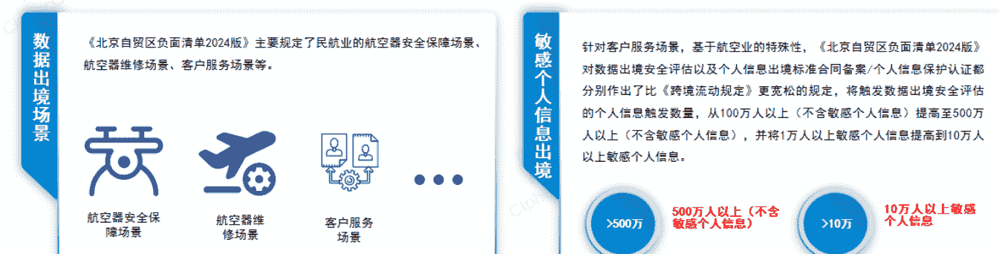

- 重要数据：当年1月1日起累计向境外提供500万以上个人信息（不含敏感信息）。
- 个人信息：当年1月1日起累计向境外提供100万以上个人信息（不含敏感信息），或1万以上敏感信息。

# 《北京自贸区负面清单2024版》对零售与现代服务业的具体规定

## 零售与现代服务业适用范围

《北京自贸区负面清单2024版》适用于面向消费者的零售、住宿、餐饮、软件和技术服务、互联网服务等相关企业。清单适用于零售与现代服务业中会员场景下涉及的个人信息。《北京自贸区负面清单2024版》将数据安全评估的个人信息触发数量，从100万以上（不含敏感信息）提高至500万以上（不含敏感信息），并将1万以上敏感信息提高到100万以上敏感信息。同时，个人信息出境标准合同备案/个人信息保护认证的个人信息触发数量，从10万以上、不满100万个人信息（不含敏感信息）调整为50万以上不满500万个人信息（不含敏感信息），并将1万以上敏感信息提高到10万以上不满100万的敏感信息。

- 数据出境安全评估：500万以上（不含敏感信息）>100万，10万以上敏感信息。
- 个人信息出境标准合同备案/个人信息保护认证：500万以上（不含敏感信息）>100万，10万以上敏感信息。

# 数据出境安全评估的数据清单——零售与现代服务业

零售与现代服务业需要通过数据出境安全评估的数据清单

- 当年1月1日起累计向境外提供500万以上的个人消费者会员个人信息（不含敏感信息）。
- 当年1月1日起累计向境外提供100万以上的个人消费者会员敏感信息。
- 当年1月1日起累计向境外提供100万以上的个人信息（不含敏感信息），或1万以上的敏感信息。

# 个人信息入境标准合同备案、个人信息认证出境的数据清单——零售与现代服务业

零售与现代服务业需要通过个人信息入境标准合同备案、个人信息认证出境的数据清单

- 当年1月1日起累计向境外提供50万以上且不满500万人的个人消费者会员个人信息（不含敏感信息）。
- 当年1月1日起累计向境外提供10万以上且不满100万人的个人消费者会员敏感信息。
- 当年1月1日起累计向境外提供10万以上且不满100万人的个人信息（不含敏感信息），或不满1万人的敏感信息。

# 《北京自贸区负面清单2024版》对人工智能领域的具体规定

《北京自贸区清单2024版》适用于人工智能领域相关企业数据输出场景，包括文本、语音、图像等训练数据。清单所指人工智能领域训练数据，用于机器学习模型的输入和重要数据。

## 人工智能领域适用范围

《北京自贸区负面清单2024版》针对人工智能领域的训练、算法开发以及测试场景。在这些场景中，与行业相关的高价值敏感数据，包括算法数据、组件数据、程序、基础模型数据、测试数据以及特定领域、特定区域或达到一定规模的健康安全的音频、图像数据，需要履行安全评估。在上述场景下，如果出现1万以上不满5万敏感信息的音频或视频，或者出现1万以上不满10万敏感信息的文本数据，只需要进行合同备案。

| 重要数据 | 个人信息 |
| :--- | :--- |
| >1万以上<5万 | 1万以上不满5万敏感信息的音频或视频 |
| >1万以上<10万 | 1万以上不满10万敏感信息的文本数据 |

# 数据出境安全评估的数据清单——人工智能训练数据

人工智能训练数据需要通过数据出境安全的数据清单

在研发设计过程中，收集和产生的与行业相关的高价值敏感数据，一旦遭遇篡改、破坏、非法获取、非法利用等，可能危害国家安全、经济稳定、公共健康和安全的音频、图像及文本数据。

- 当年1月1日起，累计向境外提供5万以上敏感信息的音频数据。
- 当年1月1日起，累计向境外提供5万以上敏感信息的图像数据。
- 当年1月1日起，累计向境外提供10万以上敏感信息的文本数据。
- 当年1月1日起，累计向境外提供100万以上个人信息（不含敏感信息），或11万以上敏感信息的音频、图像、文本数据。

# 个人信息入境标准合同备案、个人信息认证出境的数据清单——人工智能训练数据

人工智能训练数据需要通过个人信息入境标准合同备案、个人信息认证出境的数据清单

- 当年1月1日起累计向境外提供1万以上且不满5万敏感个人信息的音频、图像数据，或内容中涉及1万以上且不满10万敏感信息的文本数据。
- 当年1月1日起累计向境外提供10万以上且不满100万个人信息（不含敏感信息），或内容中涉及不满1万敏感个人信息的音频、图像、文本数据。

# 《北京自贸区负面清单2024版》的参考意义

《北京自贸区负面清单2024版》的参考意义

北京自贸区负面清单2024版对个人信息出境场景、字段、量级的放宽，也体现了监管部门对不同行业的监管要求和重点。

1. 为重要数据识别提供了重要参考和依据。《北京自贸负面清单2024版》对汽车行业、医药行业、民业和人工智能训练数据这4个行业和领域数据出境评估的重要数据，都规定了细化的数据项，并对每一个重要数据子项涉及场景、数据类型、数量和其他特征做出了相应的解释和说明。此等对4个行业的重要数据的识别和说明，对于北京自贸试验区的企业而言，也有一定的参考价值，特别是在相关行业主管部门尚未发布本行业重要数据清单的情况下。

2. 放宽了不同行业和领域触出境安全评估以及个人信息出境标准合同备案的个人信息场景、字段、量级。针对不同行业，《北京自贸负面清单2024版》没有采取一种方式设定数据出境标准，而是针对不同的个人信息出境场景、字段、量级分别进行具体规定。

# 目录

- 01 图解《个人信息出境认证办法》
- 02 图解《促进和规范数据跨境流动规定》
- 03 图解《数据出境安全评估办法》
- 04 图解《中国（北京）自由贸易试验区数据出境负面清单管理办法（试行）》
- 05 图解《中国（北京）自由贸易试验区数据出境管理清单（负面清单）（2024版）》
- 06 炼石免改造数据安全保护实践

# 炼石免改造数据安全
- 实战型数据安全
- 商业用密码管理

# 安全需求：风险与合规

# 数据安全建设：风险与合规

# “五法”过程与结果

# 数据安全发展阶段性：先治理，后追赶

# 国家安全

# 数据安全

# 《法典》
# 《网络安全法》
# 《数据安全法》
# 《个人信息保护法》

## 落地痛点：安全建设从网络到数据，安全和业务纠缠难以改造

## 以数据为中心的安全

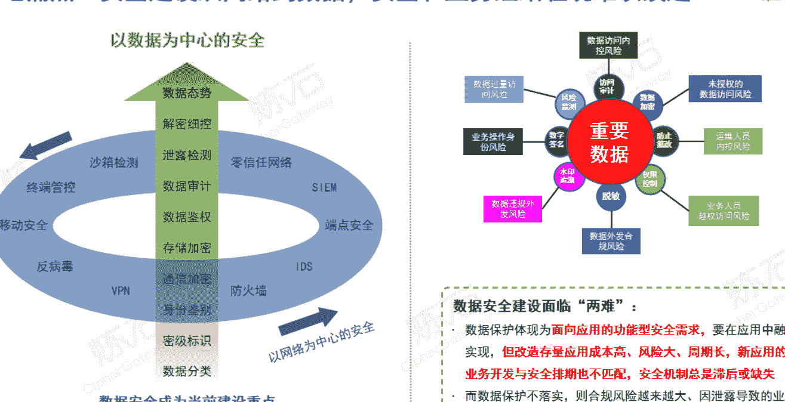

数据安全建设面临“两难”：

- 数据保护体现为面向应用的功能型安全需求，要在应用中融合实现，但改造应用存在成本高、风险大、周期长，新应用的业务开发与安全排期也不匹配，安全机制总是滞后或缺失
- 数据安全不落实，则合规风险越大，因跟随导致的业务风险快速累积。

## 产品体系：免改造平台灵活交付多重安全能力，易部署易扩容

## 产品形态

### 数据资产管理系统
- 数据流量识别
- 数据主体识别
- 数据隐私识别
- 流量行为基准
- 数据内容分析
- 数据轨迹识别

### 数据加密系统
- 密码加密
- 密钥管理
- 数据脱敏

### 免改造密码机

### 数据安全网关
- 面向数据密态合规
- 面向数据安全实战防护

### 数据安全审计系统
- 日志采集、合规分析、合规性检查、异常建模
- 技术风险、违规管理、活动回溯

### 数据脱敏系统
- 动态脱敏
- 字段识别
- 静态脱敏

### 平台主界面

### 数据安全主平台

### 数据检测响应系统
- 流量分析
- 威胁检测
- 安全审计
- 实时响应可视化

### 数据审计追溯
- 数据备份发现
- 业务口审计
- 数据外泄发现
- 下载审计

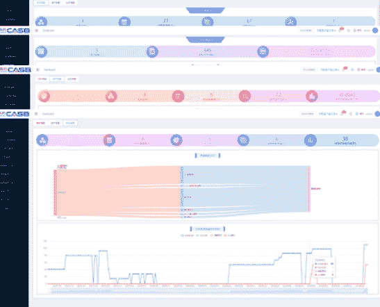

## 敏捷部署：旁路平台结合主路控制，免改造应用落地保护

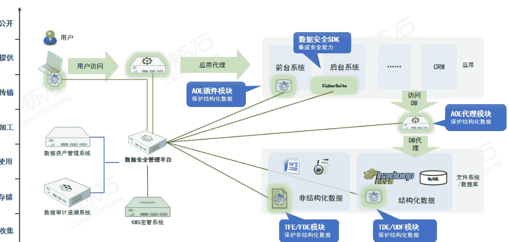

## 产品价值：将安全能力投送到真实的数据处理流程中

免改造技术对流动数据的高量覆盖识别与控制，实现安全与业务有机融合。

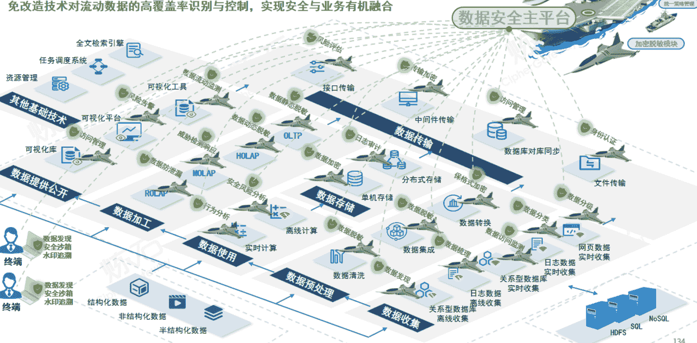

## 场景之一：存储加密、使用解密/脱敏

### 结构化数据
支持ABAC的访问控制策略，实现用户与文档级别的脱敏防护。
- 主体数据
- 实体数据
- 细粒度访问控制

### 数据库
- 应用服务器
- AOE插件
- AOE代理
- 读取数据

### 面向用户脱敏链路

### 加密管理系统 数据安全管理平台

### 面向服务侧存储加密

### 非结构化数据
- TFE文件安全模块
- FDE全盘加密

### 数据安全管理平台

### 密钥管理系统
### 不影响业务用户使用、不影响DBA运维

### 示例
| 字段 | 值 | 状态 |
|---|---|---|
| ... | 2714 | 注册 |
| ... | 2342 | 注册 |
| ... | 2342 | 注册 |
| ... | 7169 | 注册 |
| ... | 4643 | 注册 |

应用看到脱敏后数据

### 示例
| 字段 | 值 | 状态 |
|---|---|---|
| ... | 13176350482 | |
| ... | 3JBOVvIdyOCB | |
| ... | 3JnWVE1Kmgaeg | |
| ... | 14735162116 | |
| ... | 10257026110 | |
| ... | 13156191590 | |

应用看到加密

### 示例
| 字段 | 值 | 状态 |
|---|---|---|
| ... | 0000000000001967 | |
| ... | 0000000000002567 | |
| ... | 0000000000003143 | |
| ... | 0000000000003518 | |
| ... | 0000000000004195 | |
| ... | 0000000000005138 | |
| ... | 0000000000006538 | |
| ... | 0000000000007080 | |
| ... | 0000000000007816 | |

DBA工具看到脱敏数据

### 示例
| 字段 | 值 | 状态 |
|---|---|---|
| ... | 1775013631 | |
| ... | 1042079973 | |
| ... | ********** | |
| ... | 1291068567 | |
| ... | 1413505368 | |
| ... | ********** | |
| ... | ********** | |
| ... | 144423156 | |

DBA工具看到加密

## 方案优势：兼容、交付快、防护好

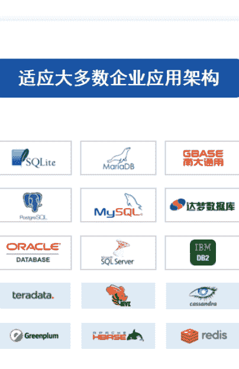
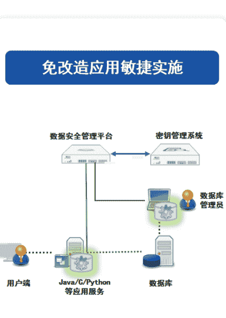
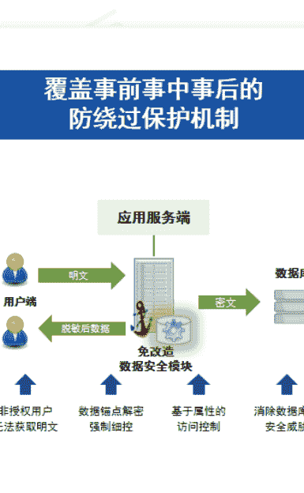

## 需求：数据安全包含“实战、合规”

实战是检验安全能力的唯一标准。
- 实战演练
- 形成常态
- 将潜在风险转化为水平、重复验证和审计
- 过程合规
- 结果合规
- 商用密码应用安全性
- 网信&监管：数据管理认证
- 网信&监管：个人信息保护
- 公安：数据防护
- 公安：“保密”
- 国资委：商业秘密保护
- 财政部：数据要素合规
- GB：数据安全评估
- 合规（过程合规）
- 正确（过程）
- 有效（结果导向）
- 合规为实
- 密评合规
- 数据合规

## 国密合规实践一站式密改敏捷交付

## 密评要点解析
- 业务合适的
- 风险影响范围，改进程度
- 核心的高风险项，且价值较高
- 加密应用高风险导致因素
- 改进由用户执行，无法避免
- 加密支撑层
- 管理方、云服务等

## 密码合规要点（以密码应用三级为准）
GB/T 39786-2021《信息安全技术 密码应用基本要求》
- 依据：60分以上，无高风险
- 测评规则：打分制，满100分，符合要求
- 测评周期：每年至少一次

## 高风险项，一票否
- 实体未通过密码技术进行身份判别（网络和通信），无解耦措施
- 未采用密码技术在传输过程中重要数据的传输通道，无SSLVPN
- 未采用加密技术建立安全的信息传输
- 未采用密码技术保证重要数据在存储中的机密性（无解耦措施）
- 未采用密码技术保证重要数据在存储中的完整性
- 未采用密码技术提供历史和接收数据证据（法律责任场景）
- 未建立密码管理制度
- 未制定加密解决方案、实施方案和应急处置方案，未通过评审
- 未采用密码技术对外部连接到内部的设备进行认证（第四级）

| 管理制度 | 密码人员管理 | 密钥管理 | 运行 | 应急处置 | 密码软件 | 治理制度 |
|---|---|---|---|---|---|---|
| 人员管理 | 角色 | 职责 | 权限 | 密钥审计机制 | 培训与考核 | 保密安全 |
| 建设运行 | 密码应用方案 | 实施方案 | 30分 | | | |
| 应急处置 | 应急处置方案 | 及时上线 | | | |

## 国密合规产品：一站式密改快速交付

## 密改四套件，轻松通过密

| 测评层面 | 测评单元 | 备注 | 分值 | 得分 | 密码产品 |
| --- | --- | --- | --- | --- | --- |
| | 身份认证 | | 高风险 | 4.17 | 0.00 | |
| 物理和环境安全 (10天) | 电子门禁记录数据存储完整性 | | 2.92 | 0.00 | 高风险可复验 |
| | 视频监控登录记录数据存储完整性 | | 2.92 | 0.00 | |
| 网络和通信 (20天) | 身份认证通信完整性 | 高风险（无通过） | 5.88 | 5.88 | |
| | 传输过程中重要数据的机密性 | 高风险 | 5.88 | 5.88 | IPSec 安全网关 |
| | 网络边界控制的完整性 | | 4.12 | 4.12 | SSL VPN网关 |
| | 身份认证远程管理通道 | 高风险 | 2.08 | 2.08 | SSL VPN网关 |
| | 其它资源控制的完整性 | | 1.46 | 1.46 | |
| 设备和计算 (10天) | 身份认证数据存储安全完整性 | | 4.46 | 4.46 | 应用加密软件密码模块 |
| | 日志记录完整性 | | 4.46 | 0.00 | |
| 应用和数据 (30天) | 身份认证访问控制完整性 | | 5.77 | 5.77 | 国密VPN网关 |
| | 数据存储安全完整性 | | 2.31 | 2.31 | 服务器加密软件密码卡 |
| | 数据存储机密性 | 高风险（无通过） | 5.77 | 5.77 | 密管理及认证平台 |
| | 重要数据传输完整性 | | 4.04 | 4.04 | |
| | 不可否认 | 高风险 | 4.04 | 4.04 | |
| 安全管理 (30天) | 身份认证按80%计算 | | 30 | 24 | 专业管理模板 |
| 合计 | 符合密改要求（商用密码） | | 100 | 82.55 | |

## 国密VPN网关
## 密码认证网关
## 应用加密网关
算法和通信安全20分、缓解高风险
应用和数据20分、缓解高风险
应用和数据21分、高风险、设备和计算4分
## 服务器加密
提供基础加密算力与监管能力应用加密产品

## 高性能：PCT专利的高速国密实现，不影响业务效率

| 基于PKI的数字信封加密 | 协同签名身份识别 | |
|---|---|---|
| 密钥派生接口国密接口 | FPE格式加密 | |
| 基于SM4的保密加密 (FPE) | 加速10亿条手机号，仅耗时20秒 | |

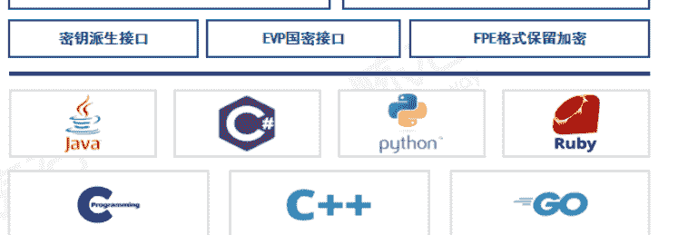

| SM2 | SM3 | SM4 | SM9 | ZUC |
|---|---|---|---|---|

炼石独有PCT专利打破Intel加密
单颗CPU上SM4加密突破140Gbps！每秒可加密6部GB大小的高电影
移动端SM4加密突破1.7Gbps！每秒可加密100张22MB大小的高清照片

| Linux | MacOS | Android | iOS | |
|---|---|---|---|---|

## 高可靠 专业密钥管理、实时离线解密，保障高可用

KMS密钥设备

管理员

KMS密钥集群

2、云端明文解密
明文
- 1、根据门限算法加密导出至3个USBKey，任意2个还原
- 2、设备需人工离同步

分离密钥
真随机数
根密钥
管理员

3、插件
还原明文
管理平台集群
模块密钥
- 1、由根密钥加密密盘存储
- 2、设备需自动同步

数据库
明文
真随机数

业务用户
- 1、应用系统解密
模块密钥
ETL工具
- 4、实时解密
备份库
- 1、不落地存储
- 2、由模块密钥派生
- 5、应用程序
CipherSuite
备份库
工作密钥（数据加密、MAC）
开发人员
- 业务同步、热备、两地中心高可用数据文不出
- 密码加密数据设备
- 工作密钥分发，平台运行不需要在线
- 策略下，当需要加密密钥时，从平台更新142

## 高可用：模块健康诊断，平台“两地三中心”

### 模块可靠运行
- 模块从平台获取规则后暂存在内存中，当平台不可用时才需要
- 模块在服务重启时从平台集群获取规则

### 模块强化健康性
- 以AOE组件为例，本身作为应用的一部分，无独立进程，不会造成死进程
- 在没有匹配状态下，模块默认透传模式，最大限度优先业务模块经过多年研发实践，兼容灵活的企业级应用

### 模块诊断
- 模块自身记录环境、启动流程、异常事件等日志，以及告警功能针对Java等应用不支持实时监控，排查潜在原因

## 工业级：加密机制兼容复杂场景

## 明文标识加密可靠

## 支持数据加密后的密文查询

| 类型 | 用例 | 示例 |
| --- |---|---|
| a | 手机型号 | 按照23、3、4分加密 |
| b | 身份证号 | 按照6、4、4分加密 |
| c | 手机 | 按照23、3、其余分加密 |

| 姓名 | 性别 | 手机号 | 身份证号 |
| --- |---|---|---|
| 张三 | 男 | 188 1111 2222 | 110102 1996 0102 333 |
| n1 n2 | | p1 p2 p3 | ID1 ID2 ID3 ID4 |
| n3 | | p4 | ID5 |

- 盐石产品加密后，会在密文中加密标识，保证明文不会被二次加密，密文不会被二次加密。加密功能执行过程中，不可避免会出现明文混合的情况，可以通过明文标识将明文和密文区分支持数据库模糊查询操作。对加密字段进行特殊处理，先将加密字段按照规则拆解，然后对拆解后部分进行加密，之后将各部分合成一个字段（拆解的规则可由应用定制化，通过策略管理来进行配置）。
支持对加密规则进行定制，加密确定原则上不建议更改为支持模糊查询会对字段的长度进行扩展

## 好用管：集中式管控，分布式保护，分段上上线

统一策略管理 集中式管控 统一密钥管理
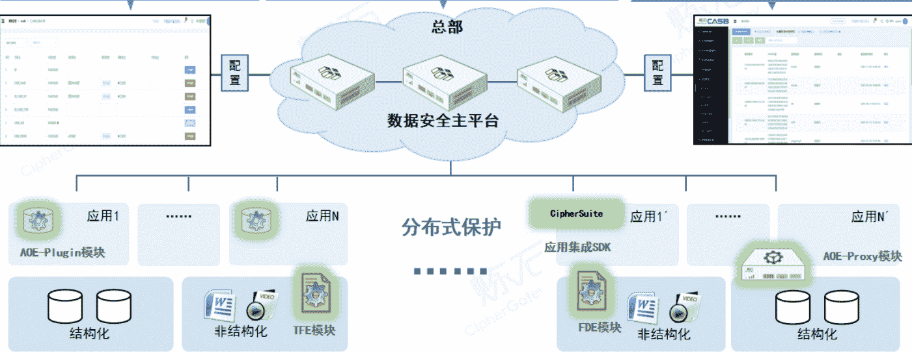
数据中心1
数据中心2

## 数据安全实战防护实践
## 事前事中后全防护

## 传统密码平台面临挑战

## 传统密码服务平台 (CSP)
- 【易用】基于基础密码能力升级为服务加密能力，易于集成
- 【提效】实现从密码机到硬件资源池化，适配的云化趋势
- 【好用】从功能上支持层级、多租户等模式，方便头部部署

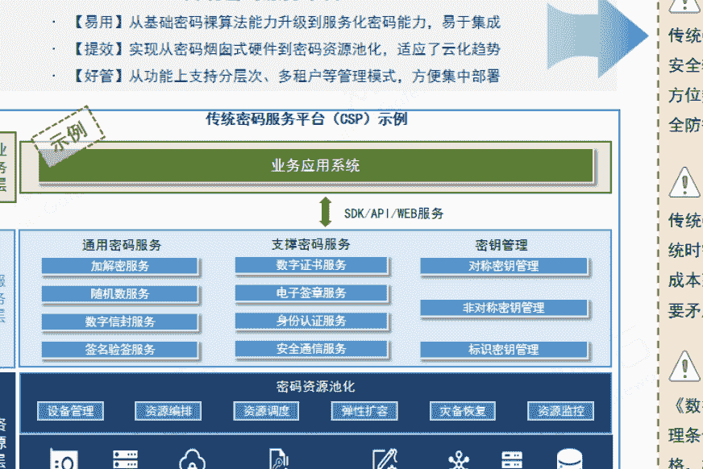

> 数据安全防护挑战：传统CSP仅侧重于密码技术本身应用，而加密业务安全转移为加密安全，如果缺乏事前、事中、事后全方位数据防护手段，在真实业务场景中难以有效实现全方位防护

> 密适配的应用难题：传统CSP仅提供加解密算法，在集成到现有系统时可能需要大量二次开发，应用风险大、成本高、周期长，在密评推广及后期日益凸出更为痛点> 安全合规支撑不足：《数据安全法》、《个人信息保护法》、《网络安全条例》等对数据的合规日益增长，相应的关保、各类数据安全合规需求对加密超出要求，而传统CSP在满足安全合规方面缺乏灵活性，难以支撑

## 国密合规产品：一站式密改套捷交付（纠正：为 国密合规产品：一站式密改快速交付

## 密改四套件，轻松通过密

| 测评层面 | 测评单元 | 备注 | 分值 | 得分 | 密码产品 |
| --- | --- | --- | --- | --- | --- |
| | 身份认证 | | 高风险 | 4.17 | 0.00 | |
| 物理和环境安全 (10天) | 电子门禁记录数据存储完整性 | | 2.92 | 0.00 | 高风险可复验 |
| | 视频监控登录记录数据存储完整性 | | 2.92 | 0.00 | |
| 网络和通信 (20天) | 身份认证通信完整性 | 高风险（无通过） | 5.88 | 5.88 | |
| | 传输过程中重要数据的机密性 | 高风险 | 5.88 | 5.88 | IPSec 安全网关 |
| | 网络边界控制的完整性 | | 4.12 | 4.12 | SSL VPN网关 |
| | 身份认证远程管理通道 | 高风险 | 2.08 | 2.08 | SSL VPN网关 |
| | 其它资源控制的完整性 | | 1.46 | 1.46 | |
| 设备和计算 (10天) | 身份认证数据存储安全完整性 | | 4.46 | 4.46 | 应用加密软件密码模块 |
| | 日志记录完整性 | | 4.46 | 0.00 | |
| 应用和数据 (30天) | 身份认证访问控制完整性 | | 5.77 | 5.77 | 国密VPN网关 |
| | 数据存储安全完整性 | | 2.31 | 2.31 | 服务器加密软件密码卡 |
| | 数据存储机密性 | 高风险（无通过） | 5.77 | 5.77 | 密管理及认证平台 |
| | 重要数据传输完整性 | | 4.04 | 4.04 | |
| | 不可否认 | 高风险 | 4.04 | 4.04 | |
| 安全管理 (30天) | 身份认证按80%计算 | | 30 | 24 | 专业管理模板 |
| 合计 | 符合密改要求（商用密码） | | 100 | 82.55 | |

## 国密VPN网关
## 密码认证网关
## 应用加密网关
算法和通信安全20分、缓解高风险
应用和数据20分、缓解高风险
应用和数据21分、高风险、设备和计算4分
## 服务器加密
提供基础加密算力与监管能力应用加密产品

## 高性能：PCT专利的高速国密实现，不影响业务效率

| 基于PKI的数字信封加密 | 协同签名身份识别 | |
|---|---|---|
| 密钥派生接口国密接口 | FPE格式加密 | |
| 基于SM4的保密加密 (FPE) | 加速10亿条手机号，仅耗时20秒 | |

| SM2 | SM3 | SM4 | SM9 | ZUC |
|---|---|---|---|---|

炼石独有PCT专利打破Intel加密
单颗CPU上SM4加密突破140Gbps！每秒可加密6部GB大小的高电影
移动端SM4加密突破1.7Gbps！每秒可加密100张22MB大小的高清照片

| Linux | MacOS | Android | iOS | |
|---|---|---|---|---|

## 高可靠 专业密钥管理、实时离线解密，保障高可用

KMS密钥设备

管理员

KMS密钥集群

2、云端明文解密
明文
- 1、根据门限算法加密导出至3个USBKey，任意2个可还原
- 2、设备需人工离同步

分离密钥
真随机数
根密钥
管理员

3、插件
还原明文
管理平台集群
模块密钥
- 1、由根密钥加密密盘存储
- 2、设备需自动同步

数据库
明文
真随机数

业务用户
- 1、应用系统解密
模块密钥
ETL工具
- 4、实时解密
备份库
- 1、不落地存储
- 2、由模块密钥派生
- 5、应用程序
CipherSuite
备份库
工作密钥（数据加密、MAC）
开发人员
- 业务同步、热备、两地中心高可用数据文不出
- 密码加密数据设备
- 工作密钥分发，平台运行不需要在线
- 策略下，当需要加密密钥时，从平台更新142

## 高可用：模块健康诊断，平台“两地三中心”

### 模块可靠运行
- 模块从平台获取规则后暂存在内存中，当平台不可用时才需要
- 模块在服务重启时从平台集群获取规则

### 模块强化健康性
- 以AOE组件为例，本身作为应用的一部分，无独立进程，不会造成死进程
- 在没有匹配状态下，模块默认透传模式，最大限度优先业务模块经过多年研发实践，兼容灵活的企业级应用

### 模块诊断
- 模块自身记录环境、启动流程、异常事件等日志，以及告警功能针对Java等应用不支持实时监控，排查潜在原因

## 数据可见：结合法规要求，落地数据分类分级

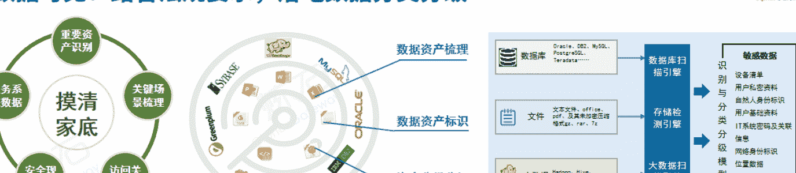

## 数据可见：终端探针提供无感数据发现

### 个人敏感数据发现
对多数常见文件格式内容的提取和分析，采用高效识别语言算法自动判别文件是否涉及敏感，并保存扫描结果，以便进一步的处理。

- 01 个人敏感数据处置：
可识别的疑似敏感文件进行加白处理，将其标记为非敏感文件；或对识别出的疑似敏感文件从终端永久删除。

- 02
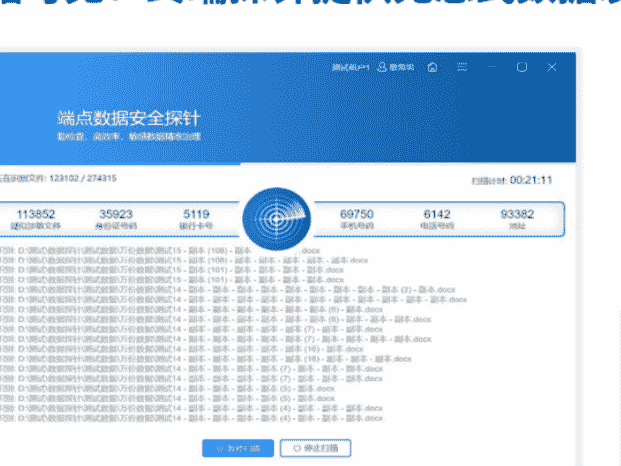

### 可视化汇总及报告
将客户的扫描结果以数据看板、数据趋势、可视化图表的形式呈现，形成可见分析及可视的报表。

- 03
### 个性化扫描部署
强化后台管理功能，可以进行权限限制，自定义扫描范围和规则，覆盖办公环境终端，实现对敏感数据的合规管理。

- 04
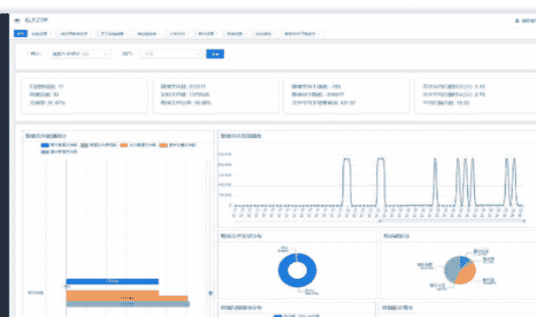

## 事前防护：最小化敏感数据访问范围

易于实施的“主体到人”支持与应用身份份管理打通。

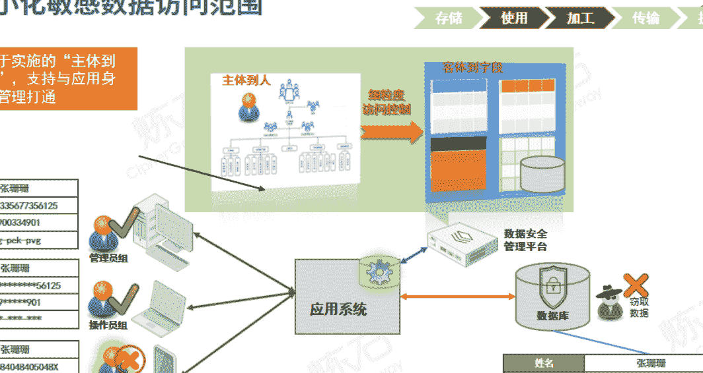

| 姓名 | 身份证号 | 手机号 | 行程 |
| :--- | :--- | :--- | :--- |
| 张璐聪 | 621087336736125 | 13900334901 | Pvg pek-pvg |
| 张璐聪 | 62108******56125 | 139****9901 | pvg...*** pvg |
| 张璐聪 | 8495004048405048X | 132345404661 | 3a/V0wCP0HGNabiv |

- 可适配应用系统自带身份管理或统一IAM系统，实现结合用户身份的动态脱敏。
- 可支持ABAC基于属性的访问控制等细粒度授权

| 姓名 | 身份证号 | 手机号 | 行程 |
| :--- | :--- | :--- | :--- |
| 张璐聪 | 8495004048405048X | 132345404661 | 3a/V0wCP0HGNabiv |

## 事前防护：终端安全沙箱构建信任工作空间

### 安全工作空间
### 普通桌面
采用零信任架构，结合安全沙箱、可信任、加密技术在用户电脑终端创建一个受保护的逻辑隔离的安全桌面，与对应的把原Windows环境称为“普通桌面”；安全桌面内，所有的文件自动加密，所有的网络访问受控，未经授权访问把数据和文件从里面“拿”出去的行为会被审计和检查授权，任何试图越访问的操作都会被拒绝，而用户操作无需改变。

- 注册隔离
- 文件重定向隔离
- 服务隔离
- 通讯隔离
- 输入输出管控
- 外接设备隔离

## 业务检测响应：业务人员风险操作的识别处置

存储 | 使用 | 加工 | 传输 | 提供
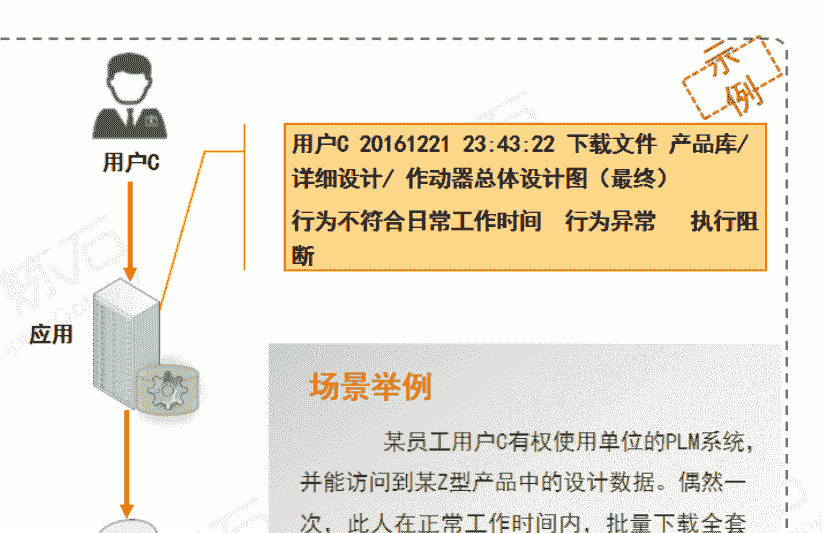

用户C 20161221 23:43:22 下载产品库/详细设计/动作总体设计图（最终）
行为不符合日常工作时间 行为异常 执行阻塞

- 改进控制面对所有流经的业务操作进行监测，结合之前的业务上下文，判断行为是否符合正的行为模式。
- 如果发现是异常操作和不合规操作，进行告警并对操作阻断，防止恶意操作带来的数据泄露和系统破坏。

### 场景举例
某员工C有权访问单位的PLM系统，并能够访问某Z型产品中的设计数据。偶然一次，此人在正常工作时间内，批量下载全套的产品数据，此时数据控制面的实时监控能够捕捉到此异常行为，并立即执行阻断，并将该事件进行记录和报警。

### 客户信息安全内控增强
- 通过改进控制面的安全内控增强，可实现客户人员每天访问客户信息的阈值，比如100条以内可正常访问，超过100条会触发告警，超过200条会触发阻断（流程需要审批后才能访问）。

## 事后审计：可追踪到人的访问审计

### 记录所有敏感数据的行为
包括账号、时间、IP、会话、操作、耗时、结果等等内容，形成终端用户可以通过查询数据的访问情况，在事故发生后精准溯源。

| 操作时间 | 操作者 | 行为 | 操作对象ID | 操作名称 | |对象者 | 状态 | 是否告警 | 告警类型 | 属性 | 客户端IP | 日志签名 |
| :--- | :--- | :--- | :--- | :--- | :--- | :--- | :--- | :--- | :--- | :--- | :--- |
| 2018-02-01 16:13:25 | 下载 | 下载 | 01_9 | 01_9 | Null | 成功 | 否 | Null | 279568 | 172.16.10.99 | QT |
| 2018-02-01 16:13:25 | 下载 | 下载 | 01_1 | 01_1 | Null | 成功 | 否 | Null | 213008 | 172.16.10.99 | Ap |
| 2018-02-01 16:13:25 | 下载 | 下载 | 00_3 | 00_3 | Null | 成功 | 否 | Null | 95760 | 172.16.10.99 | G |
| 2018-02-01 16:13:25 | 下载 | 下载 | 01_13 | 01_13 | Null | 成功 | 否 | Null | 38268 | 172.16.10.99 | Q |
| 2018-02-01 16:13:24 | 下载 | 下载 | 02_2 | 02_2 | Null | 成功 | 否 | Null | 376168 | 172.16.10.99 | Q |
| 2018-02-01 16:13:24 | 下载 | 下载 | 04_4 | 04_4 | Null | 成功 | 否 | Null | 163944 | 172.16.10.99 | B |

## 事后溯源：隐写水印结合操作实现泄露追溯

在显示屏幕、电子文件（文档、图片、视频、音频）、访问页面（APP页面、业务页面）插入隐性水印，用于文件流转路径追踪、数据泄露取证。支持独立软件部署或SDK调用，嵌入的隐性水印不影响正常工作。

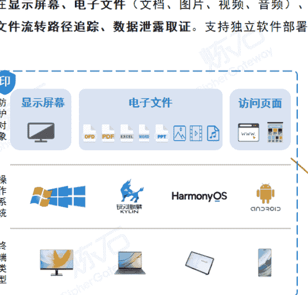
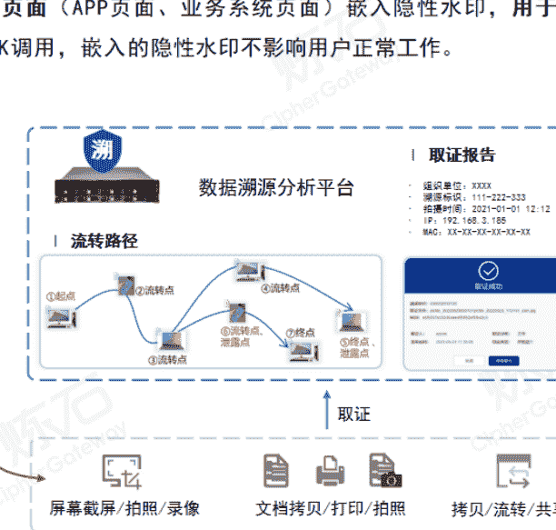

## 实战防护：密码安全一体化，免改造打造数据防护

数据资产管理系统、数据加密系统

- 面向用户重塑安全准则：
  - 只有符合权限的用户能够访问到其应该的数据
  - 结合业务场景的风险监测
  - 可定义负责人的高信誉审计，与权限体系融合的策略，无法被绕过
- 面向运维重构数据边界：
  - 无法应用后获取敏感数据明文信息

密码数据安全箱、数据脱敏、企业数据中心、企业业务部门、外包工作区域

下一一代密码服务：数据审计溯系统、数据安全网关、企业IT部门、数据检索监测系统、企业网络

- 策略：控制面投送多样安全能力，优先落地数据加密脱敏。

## 数据流通实践
### 基于TEE技术的跨域数据管控

## 外发痛点：数据“可见即可转”，共享失控

数据已成为企业可以交易的商品，但在共享后依然存在。“数据失控”问题困扰着数据提供方：
* 数据的接收方没有对数据进行滥用？
* 对方是否有再次将数据外发给第三方？
* 这些数据在对方的有效期内如何控制？

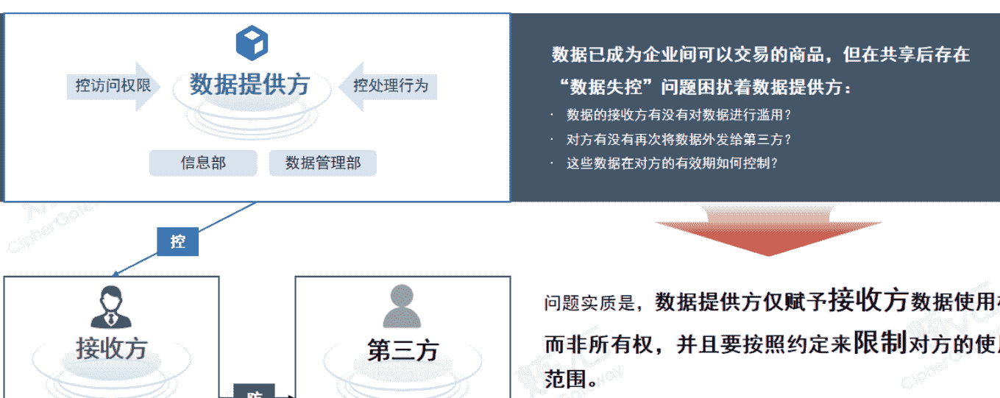

问题实质，数据提供方仅赋予接收方使用权而非所有权，并且要按照约定限制对方的使用范围。现行做法是双方签订合同协议实现约束，但数据的所有权在技术上是失控的。数据不得不共享的前提下，必须在技术上实现接收方使用行为的控制，防止数据滥用、防止数据泄露给第三方，维护数据提供方的利益。

## 数据流通合规产品：改进“可见即可转”

数据已成为企业可以交易的，但后存在“数据失控”问题困扰持有者：
- 数据的接收方是否有对数据滥用？
- 对方有没有再次将数据外给第三方？
- 这些数据在接收方的有效性如何控制？

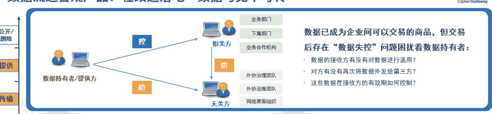
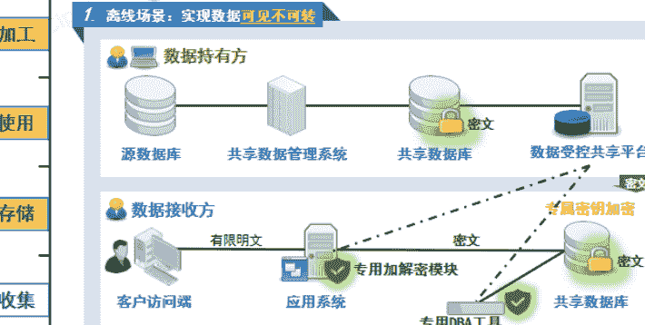
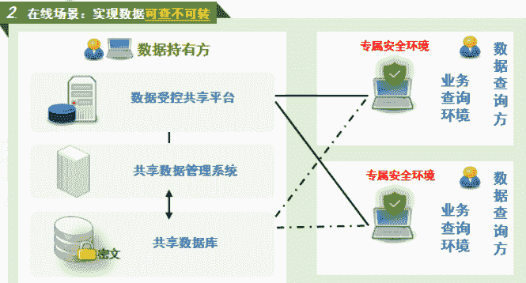

## 跨域管控部署模式

| 层级 | 功能组件 |
| :--- | :--- |
| 用户层 | 数据生产、访问控制、数据服务 |
| 安全层 | 数据加密、访问控制、权限管理、数字水印、数据脱敏/匿名化、数据审计 |
| 应用层 | 数据采集、数据调度、授权、交换传输、日志记录 |
| 支撑层 | TEE执行环境、同态加密、安全管理、交换治理 |
| 终端 | CA服务、身份管理、密钥管理、区块链、交换传输 |

来自外部的数据请求：
专用加密解密模块、应用系统、专用DBA工具、数据使用、子公司、专用加密解密模块、应用系统、专用DBA工具、数据使用、生态伙伴、应用系统、可信执行环境、数据使用。

## 炼石定位：免改造就是数据安全

炼石是以“免改造”为特色的数据安全厂商，国家级“小巨人”，灵活适配多种安全能力的免改造平台，帮企业打造领先数据保护体系，敏捷交付合规。

## 炼石免改造数据安全

| 年份 | 2015 | 2016 | 2017 | 2018 | 2019 | 2020 | 2021 | 2022 | 2023 | 2024 | 2025 |
| :--- | :--- | :--- | :--- | :--- | :--- | :--- | :--- | :--- | :--- | :--- |
| 事件 | | 公司成立 | 应用融合数据安全 | Pre-A轮投资 | 免改造数据安全 | 免改造保护平台 | A轮腾讯投资 | 数据安全腾讯投资 | A+轮领航新界投资 | 数据安全产品+服务 | 全域安全保护 | 下一代合规平台 |
| 机构 | | | 威胜检测系统安全强化 | 中安研究院强化能力 | 腾讯云腾讯安全共研适配 | LHVENTURES领航新界布局 | EVERGREEN UNIVERSITY运营增长 | 重庆科技成果转化基金 | 明瑞创基金 | |

## 案例-政府海量数据：某部4亿人口个人信息加密保护

客户行业：政府
项目名称：某部委持卡数据库安全建设项目
项目需求：某部委持卡数据库拥有全国的民生卡数据，均为涉及公民隐私的敏感数据，受《网络安全》、《密码法》、《数据安全》以及《个人信息保护法》等法律法规合规要求，需要对数据库采用加密技术进行保护。

项目建设目标及实施痛点：
- 目标1：通过应用改造模式，实现部级持卡数据库敏感数据的加密保护。
- 目标2：基于国密算法实现，满足合规要求。
- 目标3：适配省直端数据通过接口传输至部级业务场景，通过方案实施后，以密文形式存入数据库。
- 痛点1：海量数据，部级数据库中已有历史数据百亿条，加密处理涉及集中库以及灾备库。
- 痛点2：实时，方案实施后，生产库和灾备库之间海量数据的实时同步机制不变。

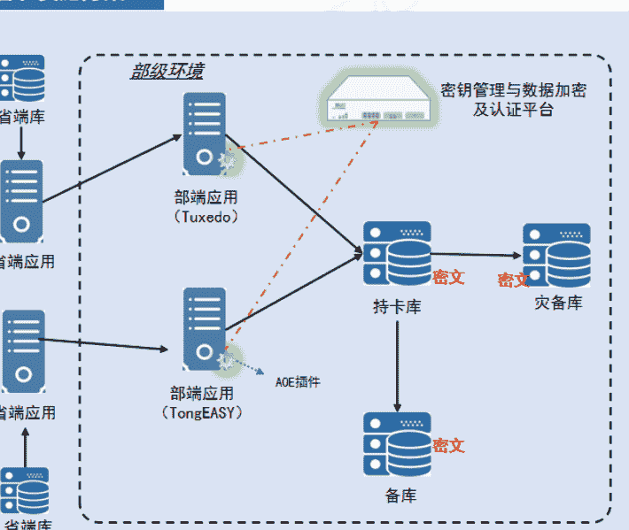

## 案例-金融核心交易：某商业银行数据加密保护

客户行业：银行
项目名称：某银行数据加密项目
项目需求：某商业银行掌握海量个人隐私数据，面临严峻威胁，需兼顾隐私保护与发展需求。

项目实施痛点：
- 数据达到亿级，形式多样、人员众多、存储分散。
- 开发改造应用周期长、速度大、风险高。
- 系统运行复杂，字段类型多、数据库种类多。
- 加密过程中不可影响正常运行。

解决方案：依托自主研发的AOE加密模块，打造通用应用数据保护、高性能密码加密，构建高覆盖率，保障数据全生命周期安全，实现字段级加密及安全管理。

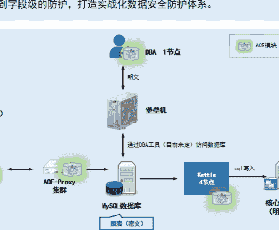

## 案例-某国有航空公司：旅客数据加密保护

客户行业：民航
项目名称：某民航系统加密升级
项目需求：企业拥有大量旅客和员工信息数据，受国外GDPR及国内《网络安全》、《密码法》等法律法规合规要求，需要建设加密平台保护个人信息及敏感数据。

建设内容：通过用户访问控制，基于国密字段加密。

项目收益：
- 实现批量系统的应用加密需求，保护旅客数据安全，提升系统水平。
- 满足国家关于个人隐私保护规范。

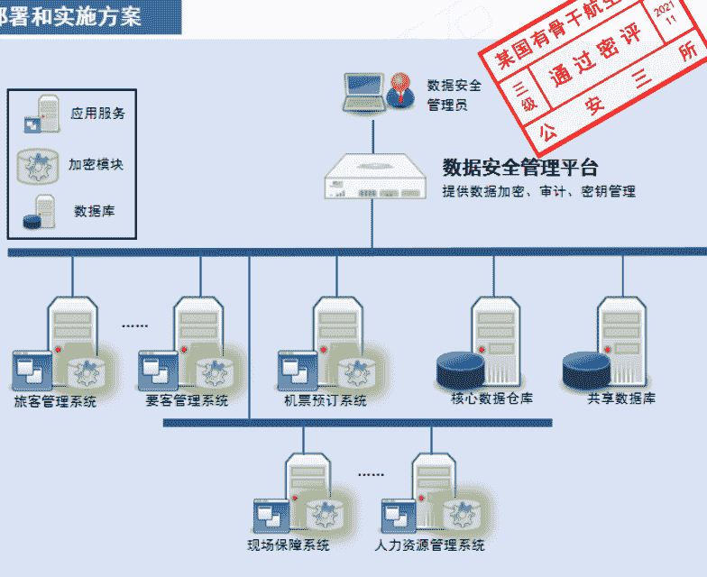

## 案例-某移动运营商：BOSS应用个人信息保护

客户行业：运营商
项目名称：BOSS个人信息保护
项目需求：针对系统中海量客户信息进行加密保护，实现数据安全的同时，符合对客户加密的要求。

实施措施：
改造范围：集团全网客户中心、省内CRM/BOSS系统。
解决方案：
- BOSS系统：安装AOE插件，写入数据时加密，读取数据时解密。
- 历史数据：通过AOE工具全量加密，集成SDK接口。
- 侧：导出的加密文件按照逻辑解析，将写入vertica数据库。

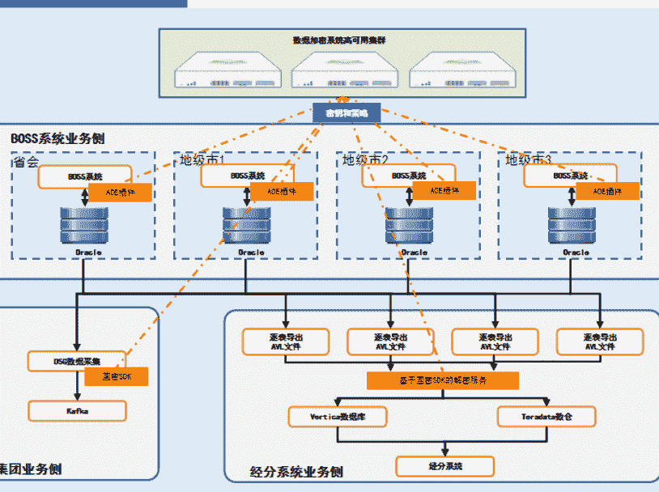

## 案例-某医院：患者数据加密保护

客户行业：医院
项目名称：某医院数据安全项目
项目需求：某医院掌握海量病患隐私数据，加强敏感数据保护，防止信息泄露，满足《个人信息保护法》、《密码法》等合规要求，且对系统进行改造不影响使用。

建设内容：依托自主研发的AOE加密模块和集群，打造改造应用数据保护、高性能密码加密解决方案。

项目收益：
- 实现批量系统的应用加密需求，保护病患和员工数据安全，提升系统水平。
- 满足国家关于个人隐私保护的规范要求。

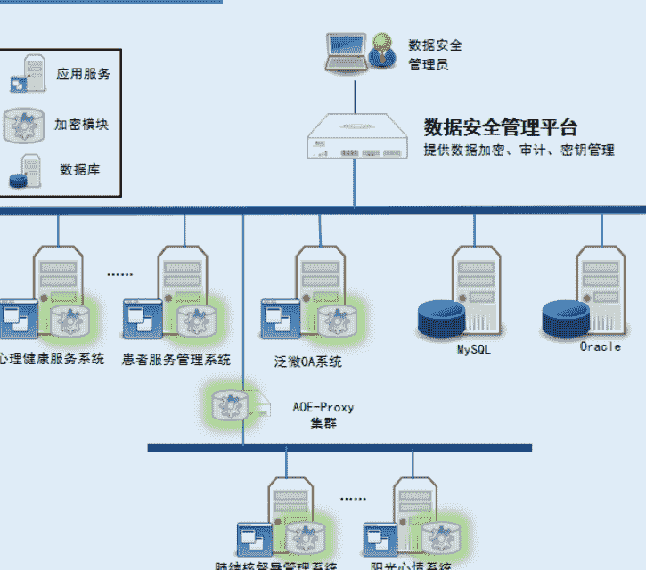

## 案例-工业关键应用：某大型车企车主数据加密保护

客户行业：制造业
项目名称：某大型国有车企车联网系统数据加密
项目需求：拥有大量车主和车辆敏感数据，受国外GDPR及国内《网络安全》、《密码法》等合规要求，需要建设加密平台使车联网档案、客服服务、监控系统，云上+云数据得到保护。

建设内容：数据库接10个高敏感字段，对1400多万条业务车主信息进行算法加密，不影响业务流向和处理使用。

项目收益：
- 实现核心系统应用加密需求，保护用户隐私数据安全，提升系统水平。
- 满足国家对个人隐私保护、密码应用规范要求。

# 炼石免改造数据安全

# THANKS

www.ciphergateway.com

010-88459460

sales@ciphergateway.com

