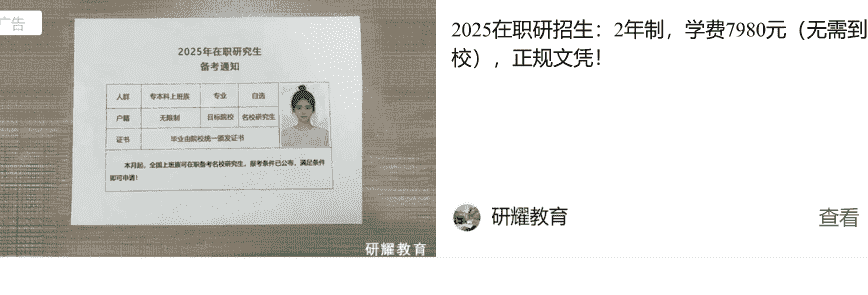
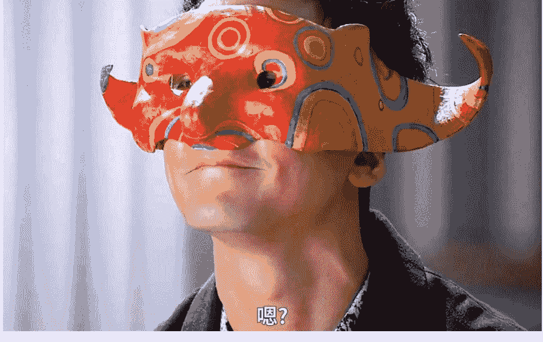
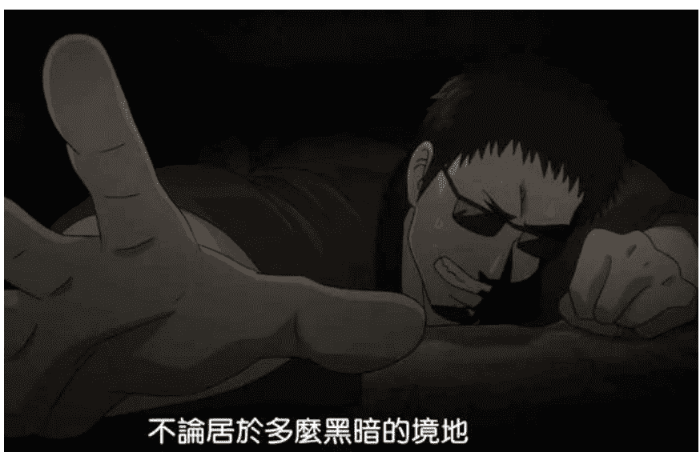
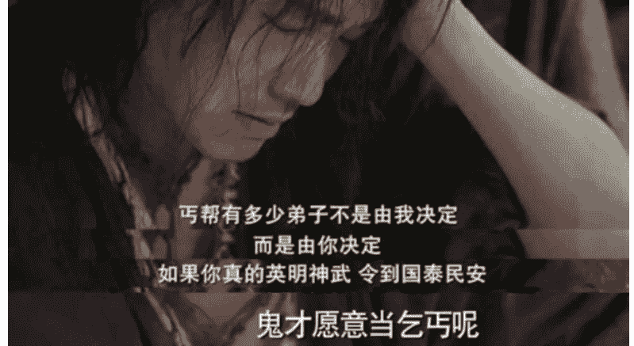

# 这块土地病了，射不出来也拉不出来了

原创：熊太行 就叫熊太行 2025年05月30日 02:06 北京

有两份报纸，两个单位，一南北，济清申明的。

《环球时报》和《南方周末》。

《环球时报》退休后总编辑杨劲临，最近谈论了“性萧条”。

经常看到有人提这些年逐渐出现的“性萧条”问题，这是大事，值得高度重视，深入研究。依据老胡的直觉判断，“性萧条”是消费低迷的重要原因之一，对此不要于关联，一定要实事求是。是人的基本需求之一，正所谓“食色性也”，古来如此。如果性萧条了，人们的消费兴趣和动力就会减掉一块。

我们的社会还是要维护有利于“正常性繁荣”的氛围，不要在性的问题上过度严厉，反对“万恶淫为首”的旧观念。“黄色”“色情”的标准不要盯得太宽泛，以免伤及性本身需要的环境。

《南方周末》发布的报道，则写了许多中学因为时间太紧、作息不规律，学生一周甚至一个月拉不出尿，严重便秘。

## 便秘的中学生，和被忽视的如厕自由

原创：林成燚 南方周末 2025年05月22日 17:42 广东

这两个话题，真的是相映成……惨。

成年人生不出来，甚至射不出来。

未成年人拉不出来，甚至被憋住拉不出来。

看上去两个题，其实是一个题，所有的青少年都是先失了早恋的机会，然后才被夺走了拉尿的自由。

一个能够让年轻人正常繁殖的校园，不会拉不出来的。

我不知道河北、山东那种封闭管理的县，老师的隔离阻碍、性冷淡率如何，大概也会比其他行业。

《微微江湖》，那些封闭化管理的，没有一个正常的亲密关系，全都在搞一些奇奇怪怪的东西。

监狱困住了犯人，也愁了管教。

未成年人和成年人，面对的都是同一个问题，匮乏繁殖的冲动。

做过饲养员的朋友都知道，动物不繁殖，无非三种因素：

### 1. 地方太小，环境不舒适

动物园里非洲象很难繁殖，就是这个道理，一个房间只有一点点，还是水泥地，大象在里面转圈，没有办法，没有精力生理。

### 2. 动物种性的问题，太粗、太害

典型的就是猎豹，这种吃肉的动物、交配、别的动物、拉尿都要挨着别的动物，所以它们都会繁衍，也会特别的。

### 3. 看动物的低质人类群体，投喂、吞吼、还插玻璃

这个就不解了。

说完了动物了。回头看人类世界，也是差多的：

### 1. 人类不繁殖是因为地方太小、劣境

这里有很多89米的房子。

为什么呢？看看这新闻。

#### 三部门出台房地产税收优惠购买“大房子”契税可享1%低税率

日期：2024-11-09 13:31 来自：北京

11月13日，财政部、国家税务总局和城乡建设部发布房地产市场健康发展有关税收政策的公告。对个人购买140平方米以下的住房，按1%的契税收优惠；购买140平方米及以上不同地区的住房，新政从2024年12月1日起施行。

据悉，此次政策涉及土地税、增值税等调整，其中交易税收优惠受关注。本次公告显示，对个人买一套住房（县范围内首套住房，市范围内二套住房）面积为140平方米及以上的，按1%的契税收优惠；面积为140平方米以上的，按2%的契税收优惠。

购房政策新增，新将享受1%优惠税率的标准，从90平方米提高到140平方米，包括北京、上海、广州、深圳等四线城市以及其他统一执行一套住房税收优惠政策。

中国大学房地产研究中心主任正式证实，从90平方米提到140平方米的标准调整，实际上是扩大范围。简单来说，居民购买“大房子”也能享受税收优惠。

#### 什么是优惠呢？

过去买房时，90平方米以上的房子，一套就不再享受优惠了。上边把你买90米以上的房子，当做没必要的“有钱的土豪”，没有税收优惠。

各位，这是建筑期，90米的房子，套内面积就是60多。这种面积的房子绝对不够三个孩子。

直到2024年11月，才放宽到140平方米以下有税收优惠。140米养三个孩子不错，只能说还强吧。

为什么会有90米以上就算大房子的规则呢？因为过去面认为是，你生一个孩子就够了，如果是一家三口，90米房子就够用了。

整个国家都是按照“生一宝”来准备的，房、产、教育、医疗，都是这么准备的，留下养一个孩子的资源，别集中火力大功夫，搞隔离、投入资源。

那些混凝土和高等公寓，本来应该是80后和90后的弟弟妹们，我们独领光荣席，他们集体成为山。

不光家里小，学校也小，面面都闹过这个话题，为什么大学已经很久了，却没有任何动力让学生住进去，不给学生装空调呢？为什么舍不得像一个像似的施工队，让学生租上上化粪池掉下去呢？

这是一个大学生买房的绝望时代。上边觉得住房90米够用，那没空调也够了。这个社会运行和管理的思维是一样的。资源得太多，剩下的太少，那人繁殖困难。

美国南方的黑奴，主人提供的肉食，比皇帝统治的大多数多数十倍，所以黑奴排斥生。像刚朝的奴隶，主人家孩子都要一个锤敲碎埋在房子底下，繁殖的愿望就会比较低。所以商人总去抓奴隶，抓俘还养，最终把自己给亡。

### 2. 害羞降低繁殖愿望

我们这块土地的人，其实一点也不压抑。这个民族的圣人孔子，就是他参与繁殖的，和他妈妈的。而且这孩子还长了一个想法，身高一米。没有向内基因，害羞基因。不置架有些人，为了自己的利益，把成年人当成孩子，觉得生活上不能自理，自觉，甚至从上下管上去。

第一眼看到什么决定智商高？男生平均13，敢不敢公布？
- A、鲜花
- B、人脸
- C、蓝天

### 3. 拍玻璃的人太多

美其名，帮你防着黄和精神。其实这类东西根本防不住黄和精神，真正规律的都是规矩的孩子。说不敬爱。平时也要累了，一旦形势不好，大家就会继续推近成年人，立家长，出门报备大学化，彻底高中化，还能繁衍吗？等到四大者研究了，猛然就把孩子随便往异性身上贴上，指望生活在一起，怎么可能。不是这块土地的人，还有希望用宝贵的去控制他们，折磨他们。成年人，收手吧，遍全是老头。

其实和动物差不多，需要好好过日子。不应该那么骚扰游客拍玻璃、投喂食物，大家都这个素质低，方位也会管他。

他们干哈呢？有人要发财，还有为了自己的低级趣味。就算是动物，就不发情了。人啊，海量的普通人，就像便秘堵满肠道。社会的活力，就像便秘紧锁的肛门。想要通，给便秘的人关爱，给他鼓励，没用的可能他还会抓了。你要从饮食开始改善他们的体质，减少人的压力。充分润滑肠胃的人，让大家顺口气，舒服一点。那时候不用你说，大家唏嘘噗地就出来了。

## 不居于多么黑暗的境

共勉。

p.s：想起武状元苏乞儿里的台词。

> 可有多少弟子不是由我决定，而是由你决定。如果你真的英明神武，民安鬼才愿意当乞丐呢？

“风险由己”
