# 4次中线行情及9历史回测

牛的四只胃 Stomachs 2025年08月31日 13:33 广东

# 前言

多角度牛历史回测+9历史回测

今年1-8月，在不预判的基础上，通过过去15年的历史数据回测数据来选择仓位（例如春节前的call回购满仓~2月底融资，3降仓位）还有选择通过回测把握了3月防守时的接近1个月+的恒星。4月的春季动力等舒适的机会。（虽然有上个月池子节奏等蹲机机会……）

但是，来到8月，行情在增量资金入场的情况下，走出了极小概率行情，而这点，**近15年的8月行情回测及高胜率方向**数据后有长篇的讨论。以下是小部分分图

# 历史与2025年环境差异对比

## 1. 保守性：
- 政策抵抗：历史与2025年依然依赖财政扩张（赤字高于70%）对冲经济压力。基建与政策策略为共同发。
- 低利率环境延续：银行利率持续低位（2016/2017年均值2.5%-3.0%，2025年约1.54%），权益资产仍具配置价值。

## 2. 差异性：
- 流动总量收紧：2025年增速8.30%，显著低于2013-2017年均值11.23%，货币供应应更重结构性精准，而非全面宽松。
- 杠杆周期增强：2025年政府部门杠杆63.20%创历史新，监管更强调风险，可能限制上涨行情；而2016-2017年杠杆率在36%-54%），政策更具一。
- 外部环境复杂性：2025年全球政策转向（美联储何时降息未知），资本流动加剧；而2013-2017年外部环境相对稳定。

# 结论性总结

2013、2016、2017年8月指数上涨源于经济回暖、流动性增强以及政策共振；而2025年8月政策环境更侧重财发与风险防御，金融“中转型”，行情机会可能非涨行的概率极大。

历史经验显示，8月份走出小概率。就7月meeting是否有预期的政策，是否会导致波动（美联储降息、债市收益率是否下降）维持A股的持续运行可能需要

代码：21838365，提升认知学习学习，看更多优质资源

3、能不能释放总量概率的，上面第六点的分析可以知道，关键是否有没有预期的政策（7月底前meeting）和增量资金到位。

# 在8月初就一直call：就算做好，难做，也不能离开场，就是因为一旦有增量，就会大肉。

8好不好，除了周五评论区，来数据说话：市场的：

- 未放量阶段：8月1日~8月13日A涨幅5.55%，市场只有1987（全市场的38%）只有一个涨幅跑赢全A，其中涨幅大于等于10%的只有8（%+）
- 整个8月上涨幅情况：上证7.97%，深证15.32%，中证1000~11.67%
- 跑赢全A8.45%涨幅只有2030只股票（39%）的
- 跑赢创业板24.13%涨幅只有570只票（11%）
- 跑赢科创50的28%涨幅只有428只（8%）

至于这里的持仓战线一路关注的都知道：

加微信：2818363845，提升知识学习群，看更多优质资源

# Stomachs

8-26 11:04 来自微博图片已翻译：渣女去年11月买入后至160%，和而7月16日夜报第5点开后至91%分别回回期内99%和98%的票（详见昨夜报，图二）。

3个中线账户，每个重仓一个票。不打嘘，持仓、持仓期间每天4stomachs爱们都会加餐，每月后花园都有加餐过的bs。

剩下1个重仓离眼的账户没涨起来，今天也出头了。要我产业韭的请看清楚，这是7月6日奶茶姐：3个挖圈作业写的第三个！！！前两个作业已经完成变形，每天都有报的。至于这里这一个bbbbbbbbbbb回仓也是已知的，每天都有操作，每周五的周末没快都都有bs。

今天晚报后，成本13+，利润接近50%大家都耐心了，从我第一个b至今，全市场离我眼的还有368只票，所以这个账户的行情刚刚开始。

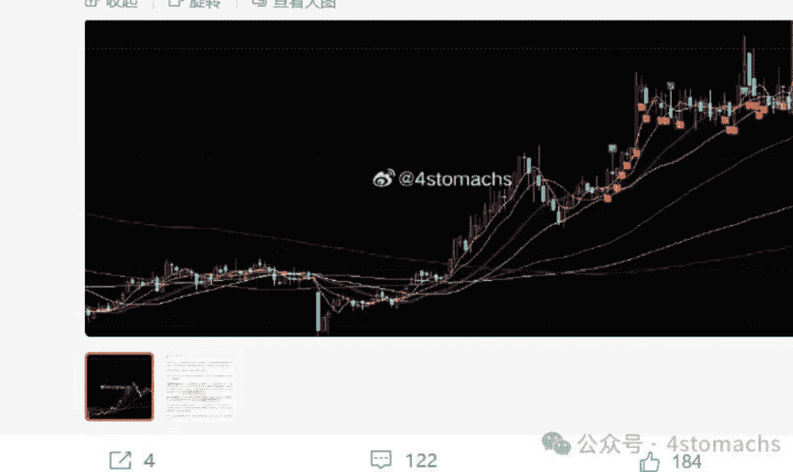

wb的直播，这里的夜报，全部都反复一遍。

A股短牛长，震荡、横摸、防守的时候要根据历史回测寻找方向。但当增量进场，指数走趋势时，尤其是历史级别的单边趋势时，不要接受太多风险（例如历史的大概率）。所以，这一次的历史回测，是多个视角对00年以“行情”（只看牛的、大牛还是结构牛）的整理。注意，这里没有观点，全是客观数据，结论也是数据成的，是操作计划的基础。

加微信：281836345，提升知识学习，看更多优质资源

看完各种数据出来的概率，就该知道后观察，对控，期待待，对接下来的仓位、交易计划。本文涵盖了200年以后每一次行情的从宏观到微观的全部指标（单一指标），行情如何发展，都可以在这篇文章里找过的对应指标周期和极值。最后才是重要的**强烈建议：已练到8，不要越前面！哪怕只看加粗章节、数据表格！**

6个章节的内容如下：

## 一、历史牛的类型和核心驱动
- 全面牛与结构牛的区别决定交易难度
- 不同的基本面改善决定交易宽度
- 流动性~最重要的交易支撑
- 产业趋势~每一波里面面当下量化出最肥
- 4牛复盘~从全牛狂欢到结构化
- 小结~4大因子决定过去4轮

## 二、历史牛的特征与多维度当下
- 阶段节点：涨幅、持续时间、重要统计（便宜）
- 快涨的起点：跌+政策催化
- 震荡根：利割+获利
- 震荡慢牛与极致：改善+流动性+产业催化+共振
- 震荡慢牛特征（当下几乎符合）
- 对比历史，当下已走出未后（上行周期）
- 7个维度的当下数据与4轮对比
- 慢牛催化~历史回顾：中美放水后期才是主升

## 三、流动性（最重要的交易周期）
- 从资金到基本面：汇率升值带来股牛
- 历史三次“股”的数据验证
- 央行中间调价升：信号引导升值预期
- 人民币汇率的升值的原因
- 美元周期视角：美元指数弱下行与A股同步
- 人民币境外紧：资金流A股的微观证据
- 周期性共振映射：汇率升值推动慢牛

## 四、上述所有维度观察和指标对比的总结

## 五、指数高持续细的回溯
- 历史上四次行情（10年）里各大指数9月胜率
- 轮行情，板块涨幅均值排序TOP30（排第一值得重仓不要下车！）
- 近15年来半年走后5/10/20日高胜率（100%）细分
- 近15年来国庆节之前5/10/20日高胜率（100%）细分

## 六、本期免费推送池子：符合文中要求的，可以对本文留阅读笔记
- 全面牛5年9月全红前的池子
- 结构牛5年9月全红前的池子

# 正题：一、历史大牛的类型和各种动力

## 全面牛与结构牛的划分
2000年以来，A股共出现四轮持续时间以上的“长牛”，分别是2005-2007、2013-2015、2016-2018与2019-2021。

| 牛市期间 | 起始日期 | 至日期 | 区间交易日数(天) | 万得全A区间涨幅 | 上证指数区间涨幅 |
| :--- | :--- | :--- | :--- | :--- | :--- |
| 2005-2007 | 2005/7/19 | 2007/10/16 | 544 | 602% | 502% |
| 2013-2015 | 2013/6/26 | 2015/6/12 | 481 | 257% | 164% |
| 2016-2018 | 2016/1/29 | 2018/1/26 | 488 | 37% | 34% |
| 2019-2021 | 2019/1/4 | 2021/12/13 | 714 | 87% | 49% |

“上证指数累计涨幅≥100% 且涨幅行业占比≥85%”为，前两牛可被归为“全面牛市”，后两牛则为“上证指数涨幅<100%且涨幅行业占比<35%”被定义为“结构性牛市”。

交易层面，全面牛市期间指数日均涨幅分别为0.34% (2005-2007)与0.21%(2013-2015)，远于结构性牛的0.06%；换手峰值同步升高。

资产回报方面，全面牛市中个股盈利占比高达85%以上，偏型基金收益比例同样占优，而结构性牛中个股盈利比例不超过30%。

一句话核心：全面牛市呈现普涨高温度，结构性牛则是少赛道的独戏。

## 二、基本面：盈利复苏的作用使得轮牛，基本面的底色始终不可缺。
2005-2007年增长，A股股净利润增速从5.8%升至6.5%，ROE (TTM)由8.0%升至8.8%，且行业内出现连续四个季度改善的占比超过50%。

## 三、流动性：最重要的交易周期
这两段时期，A股盈利能力并未显著提升。只要同时释放流动性，都将走出行情。2013-2015年美联储QE，中国降准；2019-2021年美联储降息至7000亿美元，中国多轮降准，两轮均能走出牛市，放水后期才是主升。

反观2022-2023年，美国，A股未能牛市。下图：流动性同步宽松对牛市形成更为重要。

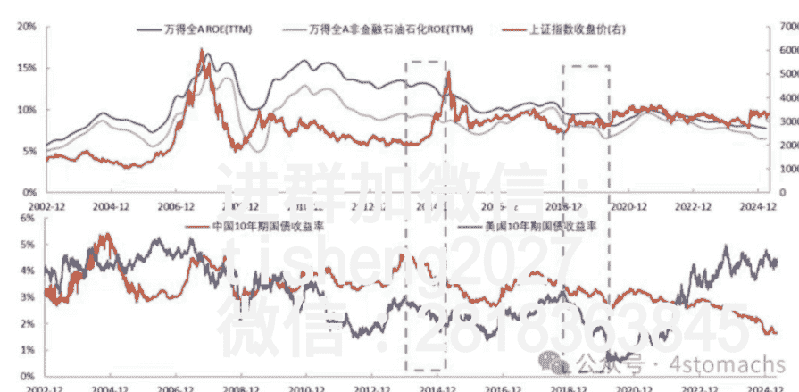

全面牛市期间，成交峰值高于2016-2018年、2019-2021年，结构性牛市由于增量资金集中于特定行业，短期内能支撑，但由于市场参与的，导致结构性指数低于全面牛市。微观层面，2013-2015年融资余额激增至2000亿元，杠杆资金“火”，所以走出全面行情；2016-2018年北向资金净入3000亿元，偏好稳健资产；2019-2021年偏股基金发行4万亿，聚焦新能源等高景道。这种资金配置的节奏偏好，在周期内表现远优于权重。

## 四、产业趋势：技术革命与政策引领
产业趋势具有流动性与盈利预期“放大”。最优就是这两波：

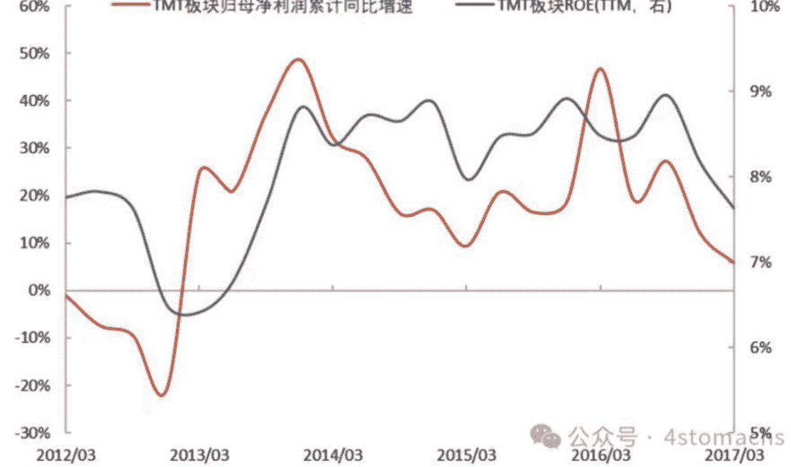

2019-2021年“双碳”目标与新能源规划，风电、光伏投资一度超过总能源50%，电力设备从3.8%升至9.8%，行业涨幅28%，贡献效率2倍于权重。政策与技术双轮驱动，使相关板块在结构性牛中跑出超级赛道。

## 五、轮复：从全面狂欢到结构分化

# 典型案例

| 基本面全面回升（少数行业性恢复） | 流动性共振 | 主要增长资金来源于个人投资者资金（增持、个人投资者资金流入） | 全面牛市 | 牛市类型：2005-2007 | 牛市类型：2013-2015 | 牛市类型：2016-2018 |
| :--- | :--- | :--- | :--- | :--- | :--- | :--- |
| 基本面结构性改善（少数行业性恢复） | | | 全面牛市 | | | |
| 产业趋势预期 | | | | | |

2005-2007：盈利全面复苏+经济增长，上证指数大涨502%，全面牛市。

2013-2015：中美流动性共振+杠杆资金流入+移动互联网浪潮，上证指数大涨164%，TMT领先，成为全面牛市。

2016-2018：供给改革带来结构性改善+北向资金流入，上证指数大涨34%，龙头白马占优，结构性牛市。

2019-2021：中美亮复苏+基金大量发行+新能源革命，上证指数大涨49%，电力设备一枝独涨，结构性牛市。

## 六、小结：4大因子决定“牛市”
- 基本面（A股净利润同比增速、ROE改善的占市场））决定牛市高度
- 流动性决定行情启动时点和持久度
- 产业趋势决定涨赛道
- 资金属性（杠杆、北向、基金）通过配置偏好决定最终市场导向全面牛欢或结构分化。

> 历史反复：盈利全面回暖+杠杆资金流入=全面牛市；盈利局部改善+机构资金衰通道=结构牛市。

# 二、多维视角下的牛内特征

## 一、历史行情的节奏及当下
- 1) 四段节奏：
- 2000年以来的四轮牛，可以清晰析成“快速上涨 -> 震荡调整 -> 震荡上涨 -> 牛市极值”“四段”。

# 上证指数收盘价

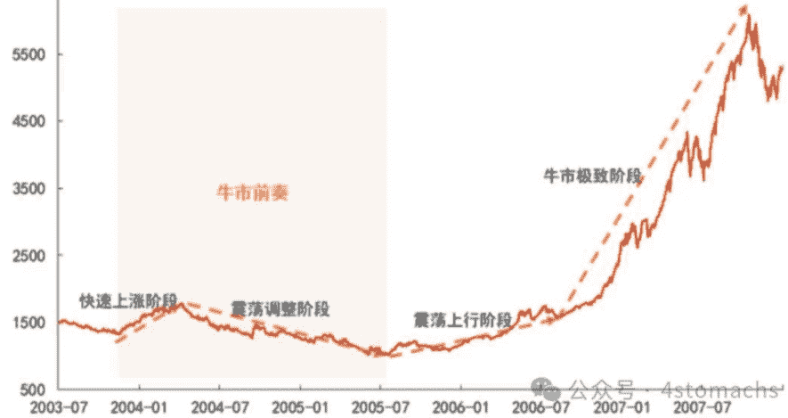
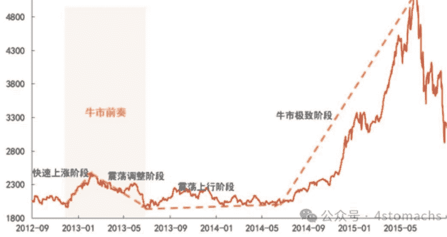
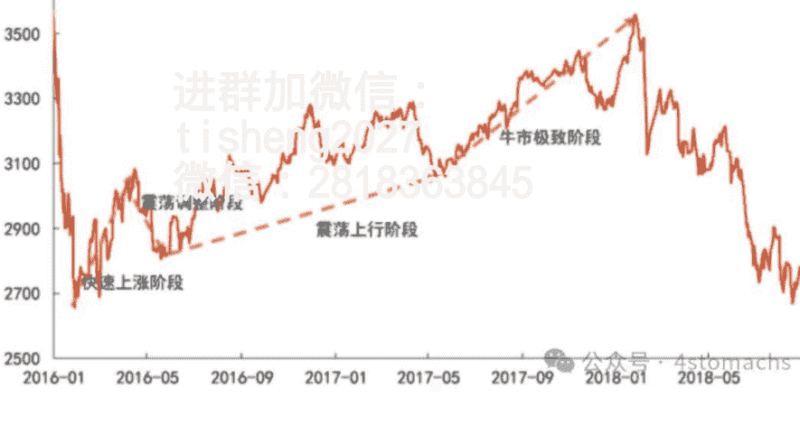
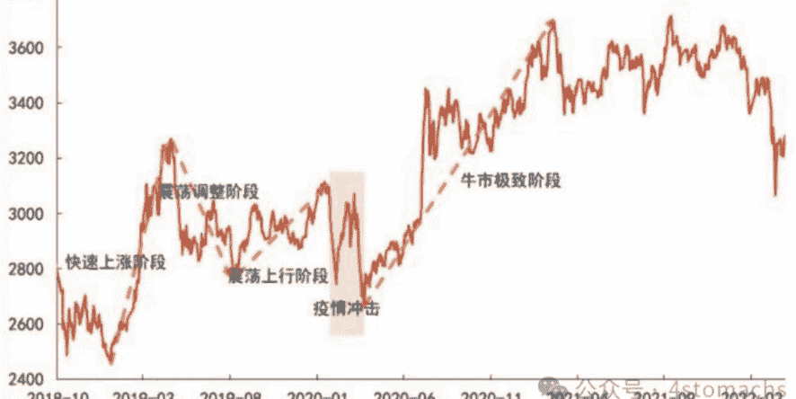

## 特征：
- 全面：“快速上涨~震荡”发生在牛市前奏，2003-2007两轮如此。
- 结构性：“快速上涨~震荡”发生在牛市途中，2016-2018、2019-2021两轮未跌破。
- 内部周期：从时长来看，4次的前段“快涨~震荡”平均用3个月、6个月，而后的“上涨+牛市”平均拉长到10.3个月和11.3个月。
- 各阶段值为：快涨-2.1-4.6个月，震荡-1.1-15.4个月，上涨平均5.2-12.6个月，极极-8.5-14.3个月。
- 上证指数在快速上涨和牛市极级阶段的日均涨幅较高。

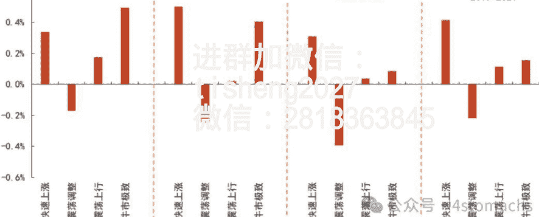 重点：持久度，活跃度。

# 周期及特征

| 时间 | 阶段 | 起始日期 | 截至日期 | 持续时长 | 上证指数涨幅 |
| :--- | :--- | :--- | :--- | :--- | :--- |
| 2003-2007 | 快速上涨 | 2003-11-19 | 2004-04-06 | 约4.6个月 | 35.01% |
| | 调整 | 2004-04-07 | 2005-07-18 | 约15.4个月 | -13.06% |
| | 牛市上涨 | 2005-07-19 | 2006-08-07 | 约12.6个月 | 52.89% |
| 2013-2015 | 快速上涨 | 2006-08-08 | 2007-10-16 | 约11.3个月 | 293.69% |
| | 调整 | 2012-12-04 | 2013-03-26 | 约2.1个月 | 24.22% |
| | 牛市上涨 | 2013-03-27 | 2013-06-28 | 约4.6个月 | -19.90% |
| 2016-2018 | 快速上涨 | 2014-06-24 | 2015-06-15 | 约11.8个月 | 3.81% |
| | 调整 | 2016-01-19 | 2016-05-10 | 约2.5个月 | 15.91% |
| | 牛市上涨 | 2016-04-16 | 2016-05-19 | 约1.7个月 | -8.81% |
| 2019-2021 | 快速上涨 | 2016-05-20 | 2017-05-10 | 约4.7个月 | 8.76% |
| | 调整 | 2017-05-11 | 2018-01-26 | 约8.5个月 | 16.55% |
| | 牛市上涨 | 2019-01-04 | 2019-04-19 | 约3.5个月 | -32.72% |
| | 2019-04-20 | 2019-08-07 | 约3.6个月 | -15.35% |
| | 2019-08-08 | 2020-08-13 | 约5.2个月 | 12.53% |
| | 2020-03-24 | 2021-02-19 | 约4.0个月 | 38.94% |

| 时间 | 阶段 | 上证指数日涨跌幅 | A股日均换手率 | A股日均成交(亿元) | 上涨天数占比 |
| :--- | :--- | :--- | :--- | :--- | :--- |
| 2003-2007 | 快速上涨 | 0.34% | 1.90% | 25 | 59.34% |
| | 调整 | -0.17% | 1.09% | 125 | 40.51% |
| | 牛市上涨 | 0.17% | 2.16% | 240 | 60.16% |
| 2013-2015 | 快速上涨 | 0.50% | 1.50% | 1500 | 70.14% |
| | 调整 | -0.24% | 2.11% | 1881 | 68.18% |
| | 牛市上涨 | 0.02% | 1.80% | 1927 | 50.42% |
| 2016-2018 | 快速上涨 | 0.41% | 1.37% | 7290 | 64.02% |
| | 调整 | 0.31% | 2.76% | 5617 | 65.51% |
| | 牛市上涨 | -0.39% | 2.09% | 4598 | 34.78% |

2018年底企业企谈+涨1个百分点+中美股暴级。

快涨阶段特征：指数日均涨幅0.3%，密集涨幅标准差<0.1，估值修复色彩。

## 3、震荡的根源：盈利+获了结果

基本面“时差”：政策生效时间、地产、投资等核心数据在2004-2005、2016、2019的震荡期均出现回。

技术面：排除2016年、2015年的指数未触及高点外，其余三轮市场在近期前后遭遇震荡底部与短线获利双重压力，震荡板块表现与前期预期震荡涨板块呈负相关，显示行为为明显。

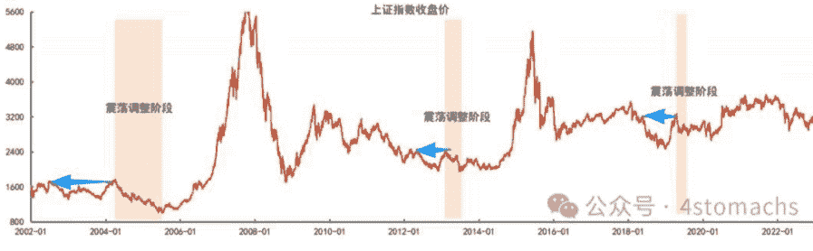

## 4、震荡慢牛与股市狂欢之时：盈利改善+流动性+产业化催化

四轮在“震荡上行~牛市”阶段的核心驱动力是盈利改善+流动性+产业化共振

2005.07-2010名市值双位数增长，A净增速由负转升至63.5%，ROE从8.0%升至16.8%，行业级改善峰值超50%，指数累计上涨502%。

2013.6-2015.6美股QE加中国国内降息，杠杆资金金融余额超2万亿，移动互联网浪潮TMT牛持续上涨，指数涨165%；进群微信：2818363845

2016.8-2021供给改革提升名义GDP，北资金净流入近3000亿元，指数涨27%。

2019.8-2021.2同步步涨（中国降准降息+美联息至0+7000亿），偏股基金新能源革命电力设备ROE由3.8%涨至9.8%，暴露后调整后整体修复（全A ROE8.0%~10.1%），指数涨33%，显示盈利、流动性与产业共同决定牛市高度和节奏。

## 5、震荡慢牛阶段特征：

1）节奏上涨、回调、温和
历史数据显示，牛市的“震荡上行”呈现典型的“阶梯式”抬头：上指数上涨天占比超过50%，最大回撤规模有限。四轮周期中，2016-2018与2019-2021轮结构性牛市的这一比例高于55%，同期最大回撤均低于10%；着全部面与股市行情契合，震荡上行的指数涨幅通常在12%中，显示低于低率震荡期间的波动幅度。

加微信：2818363845，进阶提升学习群，看更多优质资源

## 最大回撤

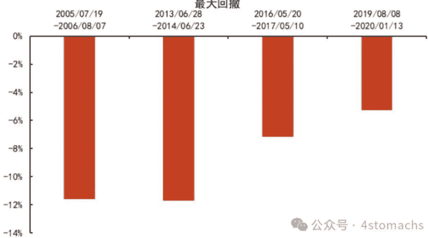

## 2) 时间窗口：60-80 日震荡、120 日突破

行情启动后第60-80个交易日后出现一段窄幅震荡，后为选择蓄势；而第120个交易日能突破前期高点，对后走势具有决定性意义。2003-2007、2012-2015、2016-2018三轮均在此区间出现整理，其中2003-2007与2016-2018成功突破前期高点，行情得以延续，否则则未能突破而表现趋弱。

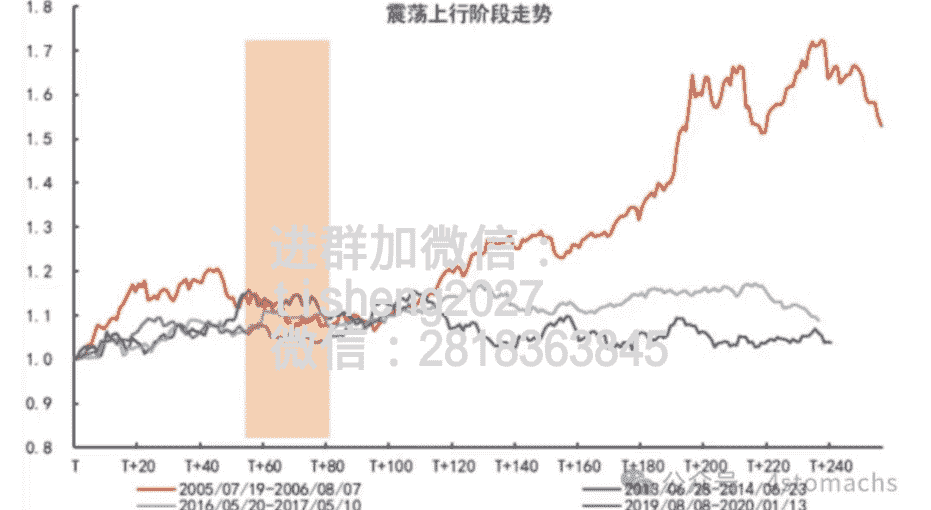

## 3) 回调规律：涨幅回6%-7%，第90日回首

上行情阶段阶段冲高后的回调，往往将积累涨幅压缩至6%-7%区域便再度起跳：2003-2007年回撤至6.6%，2016-2018年回撤至6.2%，2012-2015年回撤至7.1%后重抬势。

加微信：2819363845，提升知识学习群，看更多优质资源

从点看，这一回调的低点在启动后的第 90 个交易日后——2003-2007年95年92日、2012-15年95年92日、2016-18年88日，节奏高度一致，为投资者提供了可关注的缺口。

## 6、对比历史，当下走者无古人路

### 1 阶涨段：深度调整后的政策引发

2024 年 9 月 18 日至 10 月 8 日，上证仅用 10 个交易日完成 10.5% 的速度回调，日涨幅 1.05%，符合“快涨特征”。触发因素与历史规律一致：前期历史 2023 年 9 月 5 日至 9 月 23 日长达 340 个交易日的深度调整，上证指数累计跌幅 20.4%，申一行业银行跌超 20%，估值压缩至历史位；随后政策聚焦——9 月 24 日“一行一会”联合发布弹、降、稳组合拳，9 月 26 日政策再次确认“加大财政政策”，风险溢价快速回调，数量突破。

### 2 震荡段：高前期回调与基本面修复

2024 年 10 月 9 日至 2025 年 4 月，上证指数转入为 12 个交易日的调整，区间振幅 11.8%，日均涨幅0.1%，符合“震荡特征”。触发因素与历史相似：基本面修复斜率缓慢、周期涨幅（2024Q2-2025）非金属性石化能源增速仅由负值回升至3-5%，叠加在 2024 年 10 月 8 日后盘中及 2021 年以来积累涨幅高点，震荡底部与短线回调双重压力，典型的“空间”。

### 3 慢牛段：盈利+流动性共振

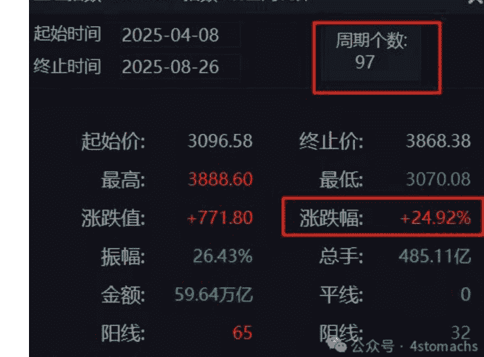

2025 年 4 月 8 日至今，上证指数周期如上。宏观层面，2025 年 Q1 非金属性石化能源增速由负转正（+2.1%），与2003-2007、2012-2015、2016-2019 四轮慢牛启动节奏完全一致。加微信：2818363845，提升知识学习，看更多优质资源

政策层面，国内基调已明确“宽松”，产业层面：外资金持续净流入（同比1 万亿），居民存款增加1 万亿），形成盈利、流动性、产业的循环。值得注意的是，本轮尚未在历史规律中的第 60-80 日出现宽幅震荡，且已有 97 天至最高点，因此现在的上涨力和幅度均比 2021 年以来任何一波更强。

## 7、五个维度看当下

### 维度 1：超长慢牛
自2000 年以来，A股已完整经历四轮牛循环，当下正处第五轮。统计历次周期长度：最短3年4个月，最长5年4个月，平均4年7个月，时间维度本轮仍在在上场。

### 维度 2：市值/GDP
总市值占 GDP 的 64.1%（采用最新的数据），提示股市整体尚未触及热区间。

| 年份 | 沪深市值/GDP | 上证指数最高收盘价 |
| :--- | :--- | :--- |
| 2007年 | 119.3% | 6124.0 |
| 2008年 | 86.8% | 5522.8 |
| 2015年 | 89.3% | 5178.2 |
| 2020年 | 77.0% | 3474.9 |
| 2021年 | 78.0% | 3731.7 |
| 2022年 | 70.1% | 3651.9 |
| 2025年6月 | 64.1% | 3462.8 |

### 维度 三：四半周期
自2000 年以来，A股已完整经历四轮牛循环，当下正处第五轮。统计历次周期长度：最短3年4个月，最长5年4个月，平均4年7个月，时间维度本轮仍在在上场。

### 维度 四：估值冰火两重
当前A股值呈现极端分化：多数宽基指数高于历史值，离开各自极值仍有距离；少数热门指数却已刷新历史高位，结构性高位与洼地并存。

| 名称 | 市盈率分位数 | 市盈率 | 区间最低净率 | 区间最高净率 |
| :--- | :--- | :--- | :--- | :--- |
| 万得全A | 65.78 | 1.74 | 1.27 | 2.15 |
| 上证指数 | 68.22 | 1.45 | 1.12 | 1.82 |
| 上证50 | 67.03 | 1.27 | 1.02 | 1.63 |
| 中证500 | 87.38 | 2.11 | 1.38 | 2.53 |
| 沪深300 | 51.65 | 1.42 | 1.15 | 1.92 |
| 中证1000 | 61.72 | 2.41 | 1.49 | 3.15 |
| 中证2000 | 100.00 | 2.82 | 1.51 | 2.82 |
| 恒生科技 | 67.45 | 3.16 | 1.72 | 8.36 |
| 科创50 | 55.33 | 4.93 | 2.91 | 9.56 |

### A 市净率及其分位数（2018至今）

| 名称 | 市净率分位数 | 市净率 | 区间最低净率 | 区间最高净率 |
| :--- | :--- | :--- | :--- | :--- |
| 万得全A | 89.55 | 21.03 | 12.97 | 24.47 |
| 上证指数 | 94.91 | 15.84 | 10.85 | 16.97 |
| 上证50 | 84.73 | 14.49 | 8.31 | 15.04 |
| 中证500 | 95.13 | 31.33 | 15.58 | 34.51 |
| 沪深300 | 78.78 | 13.42 | 10.09 | 17.45 |
| 中证1000 | 89.50 | 43.50 | 18.94 | 58.75 |
| 中证2000 | 99.18 | 148.31 | 44.03 | 152.44 |
| 恒生科技 | 23.61 | 22.11 | 14.86 | 70.73 |
| 科创50 | 98.60 | 113.76 | 35.26 | 151.29 |

### A 市盈率及其分位数（2001至今）

| 名称 | 市盈率分位数 | 市盈率 | 区间最低市盈 | 区间最高市盈 |
| :--- | :--- | :--- | :--- | :--- |
| 万得全A | 58.84 | 21.03 | 11.51 | 73.99 |
| 上证指数 | 52.34 | 15.84 | 10.00 | 66.41 |
| 上证50 | 56.94 | 11.49 | 10.29 | 48.48 |
| 中证500 | 57.92 | 31.33 | 15.58 | 75.45 |
| 沪深300 | 55.57 | 13.42 | 8.01 | 50.71 |
| 中证1000 | 61.18 | 43.50 | 18.94 | 144.82 |
| 中证2000 | 99.18 | 148.31 | 44.03 | 152.44 |
| 恒生科技 | 23.61 | 22.11 | 14.86 | 70.73 |
| 科创50 | 99.34 | 143.76 | 35.26 | 151.29 |

### A 市净率及其分位数（2001至今）

| 名称 | 市净率分位数 | 市净率 | 区间最低净率 | 区间最高净率 |
| :--- | :--- | :--- | :--- | :--- |
| 万得全A | 29.46 | 1.74 | 1.27 | 7.37 |
| 上证指数 | 27.20 | 1.45 | 1.12 | 7.14 |
| 上证50 | 36.54 | 1.27 | 1.02 | 7.19 |
| 中证500 | 39.13 | 2.11 | 1.38 | 5.89 |
| 沪深300 | 27.26 | 1.42 | 1.15 | 7.46 |
| 中证1000 | 43.30 | 2.41 | 1.49 | 8.14 |
| 中证2000 | 100.00 | 2.82 | 1.51 | 2.82 |
| 恒生科技 | 67.45 | 3.16 | 1.72 | 8.36 |
| 科创50 | 99.34 | 4.93 | 2.91 | 9.56

### 维度五：杠杆逼近潮

截至2025年8月13日，两市融资余额20462.2亿元，已接近2015年牛市峰值的22728亿元。杠杆再度逼近历史天花板，情绪升温信号明显。A融资余额（亿元）

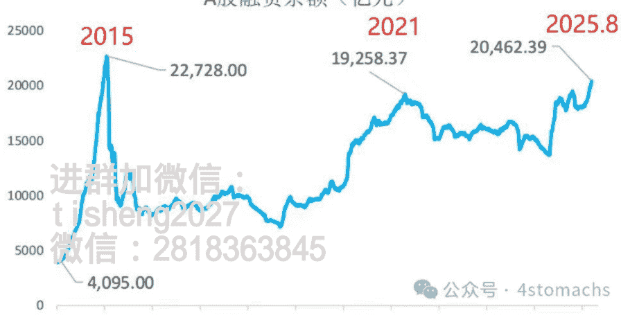

### 维度六：盈利非每次都“在线"

2005-2007年、2009年盈利显著，其余行情中盈利改善并不明显，估值扩张成为主要推手，盈利增长率母净利润提升。

### 维度七：股债倾向

2025年4月以来的上涨压缩了A股溢价，目前溢价水平高于历史位，意味着较债券在大类资产配置中具优势。

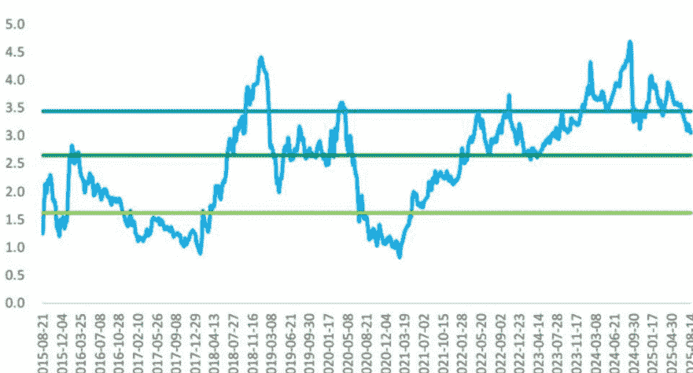

# 三、从基本面：汇率回归

从汇率8-11引起人民币双向波动常化为收窄或正向，一方面也为股市提供了支撑。

| 日期 | A股 | USDNH | 沪深300 | 创业板 | 外资 |
| :--- | :--- | :--- | :--- | :--- | :--- |
| 2015-06-27 | 6.21 | -16.25 | -12.34 | -23.99 | |
| 2016-07-11 | 6.5 | 2.7 | 6.97 | 6.27 | |
| 2017/02/16 | 5.8 | 3.2 | 7.16 | -9.12 | |
| 2018/03/26 | 6.5 | 7.28 | -7.09 | | |
| 2020/02/22 | 5.9 | 7.18 | 31.63 | 26.8 | |
| 2022/02/25 | 4.9 | 6.31 | -17.89 | -11.99 | |
| 2023/04/06 | 6.2 | 7.42 | 14.12 | 34.4 | |

## 二、美元贬值

回溯近十年人民币升值周期，均呈现A股与汇率正相关。第一轮“漂亮”行情（2017-01-02至2018-03-06），美元由6.97升至6.25，沪深300与汇率相关性高达87%，医药、电子、有色金属区间涨幅超16%。第二轮结构性行情（2020-05-25至2022-02-25），美元由7.18升至6.31，上证指数与汇率相关性83%，有色金属、新能源区间涨幅分别103%、100%、8%。

| 升值阶段I | 模块表现 | 升值阶段II | 模块表现 |
| :--- | :--- | :--- | :--- |
| 2017/01/2-2018/03/26 (%) | 医药 16.43 | 2020/5/28-2022/12/25 (%) | 有色金属 103.34 |
| 电子 16.26 | 莱熏 100.33 |
| 有色金属 14.7 | 电力设备新能源 87.57 |
| 通信 4.46 | 钢铁 82.44 |
| 银行 4.27 | 基础化工 65.38 |
| 建建 2.58 | 国防军 52.68 |
| 计算机 1.78 | 石油 49.56 |
| 食品 1.78 | 汽油 41.11 |
| 交通运输 0.73 | 交通运输 35.57 |
| 轻制造 0.68 | 公众-34.93 |

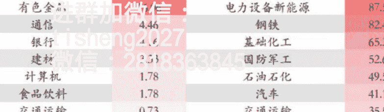

第三阶段2024年FOMC加息50bp后，至2025年8月28日，上证指数、沪深300、创业板指数分别上涨24.12%、23.56%、56.4

更精细的数据显示：2017年以来人民币单日升值超过1%的交易日，T-1至T+1三个交易日内上证综指、沪深300、创业板累计涨幅值分别为1.47%、1.75%、1.72%，再次验证“股债双牛”的显著趋势。

## 3、央行中值调升起点：政策信号升值预期

2025年6月8日后，美元对人民币累计涨幅调升至1000点，USCNY由7.2133跌至7.1063，释放弱汇信号。离岸USCNH7.42快速跌至7.12，月线MACD顶离，技术面进入长期处于升值通道。

# 1970年以三美元周期开始，A股表现往往往后美国通胀滞后后

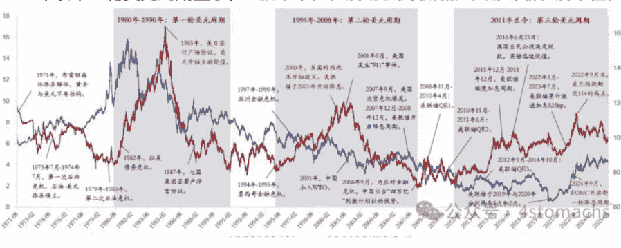

当三轮美元周期自2011年启动，2022年美元指数触至114顶点后，2025年已回撤至97附近。ICE美元指数中、日、英权重合计超八，欧美财政扩张与加息宽松政策对美元维持持续压力。机构判断美元指数年内或下95关口，外货币受益，人民币市场贬值及美元，但空头仍扩宽，对A股历史上第一“系统性牛”处于中境。

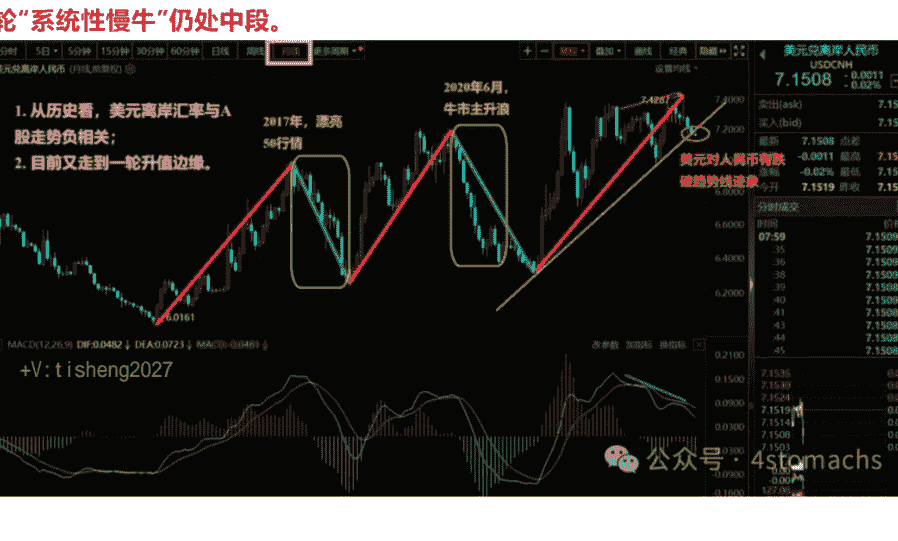

## 6、人民币境外存款骤降：资金回流A股的微观测

2021至2024年8月，人民币境外存款与A股表现反向波动；2024年“行情启动后，汇率跌破7.0关口，境外存款大幅流出1376亿元，与创业表现显著背离，显示外人民币资金加速回流境内市场。结合陆股交易活跃度持续、外资债券持仓占比仍仅3%~4%，机构判断境外增配A股的空间与动力足。

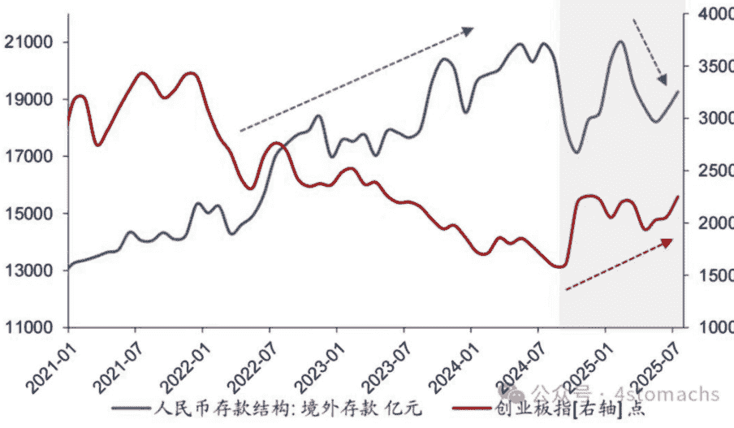

## 7、周期性驱动的投资映射：汇率变化如何对推升美元

机构认为，汇率通过三条路径升A股：吸引资金增配；降低风险溢价：

- 1) 美元汇率值直接提升人民币资产收益，吸引资金增配；
- 2) 行业逆周期调节（央行货币、宏观预期系数）稳定预期，降低风险溢价；
- 3) 升值周期强化盈利与风险偏差，形成正反馈。预测假设，2025年美元人民币币值重回“6”时代，2026年中及A股系统性牛市再上台。

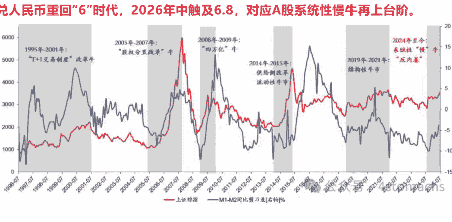

## 四、综合上所述做出一个结论

- 1、中长期，上述所有指标都指向行情还未结束！哪怕是今天的pmi是低于预期
- 2、中期，需要留意的下个月m2、10-11月份的经济数据、企业3季的范围，大概能观察到是牛还是结构性调整。
- 3、近期，除了指标远离均值+接近压力之下，从最近两周主基金开始越募越指数的数据，行情低位震荡切换已经进行了若干调整，可见：9月有调整的整体会随着时间推进而到来。
- 4、但还有那句话，指数是横还是横，不猜，对操作无意义的！成交要成交是持续维持还是需要调整的唯一指标。成交就是指数调整，成交维持在2.5w亿。

以上，容错率很大，没有理由离开。

## 五、排除干扰的可用交易或持股的历史回测

### 1、历史上牛市期间的刚胜率

由于已经走出2000年至今的小型行情，因此本次回测只做胜率指数在单边行情中的表现，而忽略单边行情的数据。由于只有4次，10次，此采样度不算太多。

| 单边行情的年 | 上证 | 深证 | 创业板 | 中证500 |
|---|---|---|---|---|---|
| 2005 | -0.62 | 1.91 | | -1.13 | 2.88 |
| 2006 | 5.65 | 3.54 | | 4.82 | 4.79 |
| 2007 | 6.39 | 5.55 | | 5.36 | 3.8 |
| 2013 | 3.64 | 3.8 | 15.42 | 4.11 | |
| 2014 | 6.62 | 3.04 | 8.17 | 4.82 | 11.03 |
| 2016 | -2.62 | -1.77 | -1.91 | -2.24 | -1.65 |
| 2017 | -0.35 | 2.5 | 0.95 | 0.38 | 2.05 |
| 2019 | 0.66 | 0.86 | 1.03 | 0.39 | 1.11 |
| 2020 | -5.23 | -6.18 | -5.63 | -4.75 | -7.14 |
| 2021 | 0.68 | -0.14 | 0.95 | 1.26 | -2.09 |
| 全面牛胜率 | 80% | 80% | 100% | 80% | 100% |
| 结构牛胜率 | 40% | 40% | 40% | 60% | 40% |
| 胜率 | 60% | 60% | 71% | 70% | 70% |

| 单边行行的年 | 中证1000WindA | 恒生 | 恒生互联网 | 恒生科技 |
|---|---|---|---|---|
| 2005 | 2.38 | 0.45 | 3.52 | | |
| 2006 | 5.63 | 4.74 | 0.87 | | |
| 2007 | 1.49 | | 13.17 | | |
| 2013 | 6.9 | 5.4 | 5.19 | 13 | |
| 2014 | 13.02 | 9.68 | -7.31 | -3.79 | |
| 2016 | 2.01 | -1.73 | 1.39 | 1.04 | 0.37 |
| 2017 | 2.12 | 1.28 | -1.49 | 2.18 | 2.68 |
| 2019 | 0.95 | 0.77 | 1.43 | 5.94 | 6.27 |
| 2020 | -8.4 | -5.97 | -6.82 | -5.97 | -6.05 |
| 2021 | -4.18 | -1.03 | -5.04 | -7.56 | -7.66 |
| 全面牛胜率 | 100% | 100% | 80% | 50% | |
| 结构牛胜率 | 40% | 40% | 40% | 60% | 40% |
| 胜率 | 70% | 70% | 60% | 43% | 60% |

### 2、牛市行情，板块涨幅回归

| 行业 | 2005/7/19 | 2013/6/26 | 2015/6/12 | 2019/1/29 | 2021/12/13 |
|---|---|---|---|---|---|
| 有色 | 1583% | | 52% | 28% | 421% |
| 贵金属 | 1383% | | 20% | -4% | 318% |
| 房地产 | 1072% | | 108% | | 299% |
| 设备 | 988% | | 283% | 89% | 268% |
| 机械设备 | 8111% | | 147% | 97% | 240% |
| 建筑材料 | 738% | | 96% | 68% | 232% |
| 交通运输 | | 717% | | 131% | 242% |
| 食品饮料 | 543% | | 146% | 126% | 249% |
| 医药 | 772% | | 83% | | 110% |
| 电子 | | 832% | | 41% | 70% | 242% |
| 社会服务 | 519% | | 13% | 130% | 232% |
| 基础化工 | 952% | | 84% | 32% | 232% |
| 建筑装修 | 399% | | 246% | 36% | 4% | 221% |
| 综合 | 2229% | | 276% | 3% | 56% | 213% |
| 农林牧 | | 316% | | 64% | 218% |
| 石油化工 | 60.0% | | 123% | 35% | 203% |
| 纺织 | 1465% | | 134% | 49% | 197% |
| 农产品 | 4452% | | 320% | 4% | 56% | 190% |
| 银行 | 969% | | 97% | 18% | 185% |
| 物流 | 1062% | | 899% | 25% | 80% | 182% |
| 交通 | 3711% | | 3689% | 21% | 19% | 179% |
| 软件 | 1448% | | | 14% | 17% | 172% |
| 传媒 | 3316% | | 341% | -22% | 24% | 165% |
| 游戏 | 2969% | | | 45% | 53% | 153% |
| 公用事业 | 3356% | | 310% | 7% | 37% | 253% |

### 3、近15年来半年回报5/200交易日高收益率

#### T+5

| 指数代码 | 指数简称 | 超收益率中位数(%) | 胜率 |
|---|---|---|---|
| 8841392.WI | 汽车整体精选指数 | 3.5 | 100% |
| 884887.WI | 小程序指数 | 2.9 | 100% |
| 8841043.WI | 玻璃纤维指数 | 2.8 | 100% |
| 8841191.WI | 在电力物联网指数 | 2.6 | 100% |
| 884944.WI | 光纤指数 | 2.5 | 100% |
| 8841322.WI | 头签指数 | 2.2 | 100% |
| 884894.WI | 锂电解质指数 | 2.2 | 100% |
| 8841305.WI | 福建国资指数 | 1.9 | 100% |
| 8841254.WI | 网络规划建设指数 | 1.9 | 100% |
| 884112.WI | 宽带速指数 | 1.9 | 100% |
| 884110.WI | 安防监控指数 | 2.3 | 91% |
| 884183.WI | 生物识别指数 | 1.9 | 90% |
| 884231.WI | 可燃冰指数 | 3.0 | 88% |
| 884715.WI | 车联网指数 | 2.2 | 86% |
| 8841000.WI | 金融科技指数 | 2.1 | 86% |
| 8841026.WI | 3D玻璃指数 | 1.9 | 86% |
| 884702.WI | 物流骨干指数 | 1.9 | 86% |
| 8841237.WI | 光刻指数 | 6.4 | 83% |
| 8841184.WI | 纳米材料指数 | 2.6 | 83% |
| 8841164.WI | 电路指数 | 2.4 | 83% |
| 8841247.WI | 冷服务器指数 | 2.4 | 83% |
| 8841192.WI | 数字孪生指数 | 2.2 | 83% |
| 8841069.WI | 移动支付指数 | 3.8 | 82% |
| 8841233.WI | 智能卡指数 | 2.4 | 82% |
| 8841087.WI | 卫星导航指数 | 2.4 | 82% |
| 8841358.WI | 煤炭采选指数 | 3.7 | 80% |
| 8841334.WI | 毫米波指数 | 3.2 | 80% |
| 8841330.WI | 自行车指数 | 2.5 | 80% |
| 8841312.WI | 烯烯指数 | 2.5 | 80% |
| 8841269.WI | 新能源调整 | 2.4 | 80% |
| 8841818.WI | 快速指数 | 2.2 | 80% |
| 8841283.WI | 锂隔膜指数 | 2.2 | 80% |
| 8841285.WI | 锂电负极指数 | 1.9 | 80% |
| 8841997.WI | 液晶显示指数 | 1.9 | 80% |
| 884215.WI | 区块指数 | 2.2 | 78% |
| 8841136.WI | 互联网金融指数 | 3.0 | 73% |
| 8841133.WI | 网络安全指数 | 2.1 | 73% |
| 8841020.WI | 富士康产业链指数 | 2.3 | 71% |
| 8841811.WI | 激光指数 | 2.3 | 71% |
| 8841694.WI | 数字政府指数 | 2.1 | 71% |
| 8841046.WI | 聚碳酸酯指数 | 2.0 | 71% |

#### T+10

| 指数代码 | 指数简称 | 超额收益中位数 (%) | 胜率 |
|---|---|---|---|
| 8841399.WI | 高速公路精选指数 | 4.7 | 100% |
| 8841323.WI | 电车指数 | 3.1 | 100% |
| 8841413.WI | 保险精选指数 | 3.0 | 100% |
| 8848834.WI | 期货业务资指数 | 2.9 | 100% |
| 8841305.WI | 福省国资指数 | 2.7 | 100% |
| 884702.WI | 物流骨干网指数 | 2.4 | 100% |
| 884774.WI | 甲粒指数 | 2.3 | 100% |
| 8842311.WI | 可燃冰水指数 | 3.6 | 88% |
| 8841151.WI | 多医药指数 | 4.0 | 86% |
| 8841000.WI | 金融科技指数 | 2.8 | 86% |
| 8841195.WI | 西安自贸区指数 | 2.9 | 83% |
| 8841185.WI | 工业大麻指数 | 2.9 | 83% |
| 8841184.WI | 纳米大麻指数 | 2.8 | 83% |
| 8841170.WI | 国资入股指数 | 2.7 | 83% |
| 8841103.WI | 页农气指数 | 3.6 | 82% |
| 8841221.WI | 美丽指数 | 3.0 | 82% |
| 8841409.WI | 采服务精选指数 | 6.4 | 80% |
| 8841358.WI | 煤炭开选指数 | 5.9 | 80% |
| 8841406.WI | 黄金精选指数 | 5.2 | 80% |
| 8841392.WI | 汽车精选指数 | 2.9 | 80% |
| 8841269.WI | 新能源车指数 | 2.6 | 80% |
| 8841382.WI | 电力股精选指数 | 2.6 | 80% |
| 8841944.WI | 光纤指数 | 2.5 | 80% |
| 8841312.WI | 培指数 | 2.5 | 80% |
| 8841393.WI | 水基精选指数 | 2.4 | 80% |
| 8841069.WI | 移动支付指数 | 2.6 | 73% |
| 8848874.WI | 火电指数 | 3.3 | 71% |
| 8841354.WI | 医疗器械精选指数 | 5.4 | 80% |
| 8841112.WI | 宽带速指数 | 4.8 | 73% |

| 指数代码 | 指数简称 | 超收益率中位数 (%) | 胜率 |
|---|---|---|---|
| 8841413.WI | 保险精选指数 | 5.0 | 100% |
| 8841399.WI | 高速公路精选指数 | 5.7 | 80% |
| 8841354.WI | 医疗器械精选指数 | 5.4 | 80% |
| 8841358.WI | 煤炭采选用指数 | 4.3 | 80% |
| 8841112.WI | 宽带速指数 | 4.2 | 73% |
| 8841050.WI | 海南自贸指数 | 3.7 | 73% |

| 指数代码 | 指数简称 | 超收益率中位数 (%) | 胜率 |
|---|---|---|---|
| 8841365.WI | 医疗服务精选指数 | 6.6 | 100% |
| 8841354.WI | 医疗器械精选指数 | 5.5 | 100% |
| 8841313.WI | 疫苗指数 | 5.0 | 100% |
| 8841325.WI | 生物实验室 | 3.2 | 100% |
| 8841359.WI | 生物制品精选指数 | 2.7 | 100% |
| 8841136.WI | 品牌龙头指数 | 3.5 | 86% |
| 8841049.WI | 创新药 | 3.0 | 86% |
| 8841332.WI | 医疗物资出口 | 4.7 | 80% |
| 8841347.WI | 化学制药精选指数 | 4.2 | 80% |
| 8841350.WI | 食品类精选指数 | 3.2 | 80% |
| 8841415.WI | 牙指数 | 2.5 | 80% |
| 8841413.WI | 保险精选指数 | 2.4 | 80% |
| 8840705.WI | 白酒指数 | 9.0 | 71% |

| 指数代码 | 指数简称 | 超收益率中位数 (%) | 胜率 |
|---|---|---|---|
| 8841365.WI | 医疗服务精选指数 | 5.2 | 100% |
| 8841354.WI | 医疗器械精选指数 | 4.7 | 100% |
| 8841416.WI | 高频资本指数 | 3.6 | 100% |
| 8841136.WI | 品牌龙头指数 | 3.5 | 86% |
| 8840705.WI | 白酒指数 | 3.2 | 86% |
| 8841375.WI | 饮料制造精选指数 | 4.5 | 80% |
| 8841350.WI | 食品类精选指数 | 3.6 | 80% |
| 884145.WI | 齐指数 | 3.4 | 80% |
| 8841389.WI | 电源精选指数 | 3.3 | 80% |
| 8841367.WI | 中药精选指数 | 2.9 | 80% |
| 8841359.WI | 生物制品精选指数 | 2.5 | 80% |
| 8841049.WI | 创新指数 | 2.47 | 71% |

最后：由于是量产牛，机会绝对不会是一个小池子可以包裹的，但是做出来2个池子，仅供参考：

- 1) 全面牛5年9月全红涨幅前池子
- 2) 结构牛5年9月全红涨幅前池子

公众号·4stomomachs

牛的四胃

> “喜欢，奶茶，鸡腿, 沐足, spa ”

喜欢作者

加微信：2818363845，进提升知识学习群，看更多优质资源

提升知识学习群365年（365天服务期），微信扫码或添加：2818363845

欢迎进群看更多优优资源，客户进群享折扣。学习群包含以下全部资源：

## 一、财经类抢购（财会经理258年，包含内7个主类内容每天更新）：

- 1、灵犀财富通知识星球（原价3310元）/ 单享149元
- 2、鉴蓝财经院知识星球（原价3510元）/ 单享149元
- 4、庐财经微播V+会员（原价10000元）/ 单享79元
- 6、南半球财经（原价404元）/ 单享19.9元
- 7、洪源的宏观决策以及众筹的其他财经类主付费免费分享

## 二、市场类抢购（财会经理119年，包含内11个主类每天更新）：

- 1、子明学私享（原价568元）/ 单享29.9元
- 2、米莉联联见闻（原价599元）/ 单享29.9元
- 3、大树仿读知识星球（原价199元）/ 单享19.9元
- 4、霸霸的世界星球（原价299元）/ 单享19.9元
- 5、芜瓦广后Q的内部文章（原价400元）/ 单享19.9元
- 6、卢克知识星球+青云会计文章（原价268元）/ 单享19.9元
- 7、克文智读书会（原价699元）/ 单享59.9元
- 8、诸倍倍会员群文章（原价365元）/ 单享29.9元
- 9、欧洲金融会群文章（原价328元）/ 单享19.9元
- 10、碧树水知名公告号付费专享，单享29.9元
- 11、江宁广知公告号付费专享，单享 29.9元

## 三、各种公众号抢购费：

金政通鉴、局外人的视野、源灏译语、雪花财经老刀、幻幻认知、A视野、NEO捞鱼、冷眼局中人、观海读行对股市的影响、费的小的小茶、赢在八小时之外、雷思海、盛翊创剑、第三客观视等等公众号付费专享不断更新，内容很多，一不二列举！

进提升知识学习群包含以上全部内容，分享365天，赠送历史文章！

> 扫码添加微信
免费领取资料
免费试体验
满意365天
更新加群!
送历史文章！

加微信：2818363845，提升知识学习群，看更多优质资源
