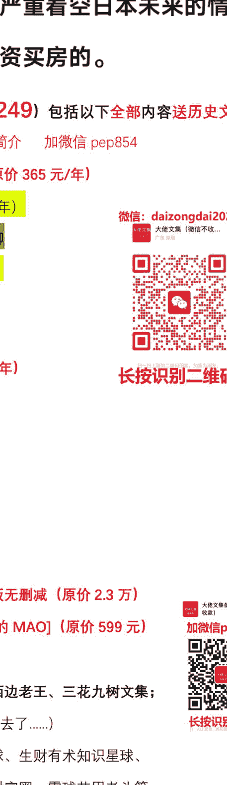

# 励妈妈的日常

想要看长一段励妈妈原创

去日本打工的回来，回并不是说日本经济差了吗？为什么我发现很多中国人在日本，月入不到2万人民币，可真不容易了。现在，年轻人非常困难，这是怎么回事？

与我们一起去过日本的朋友看到这个圈，甚至打在日本买菜，遇到第一个问题就是，日本经济增长了吗？我们现在看来日本经济增长了，为什么年轻人就业困难呢？

我要了，2024年日本大学毕业生就业率只有80%左右，在日本，留学的年轻人失业率接近20%，这就不小的事儿了。

但是日本近三十年来基本增长，中国GDP每年还有5%增长，对于一个GDP保持高速增长的国家，就业市场活跃，难道不去一个经济增长的困难吗？

如今就业困难在哪里呢？

首先是最重要的，日本劳动力供给正在下降。1995年15-64岁人口是8716万，到2025年，这个数字预计减少717万，跌幅接近20%！

但是，中国劳动力供给数量虽然在下降，但下降幅度和日本相比微不足道。2020年18-24岁人口为1.4亿，这个数字减少了3.2亿，但我们总的劳动力数量大约8亿个，每年减少几万个，这个减少的数量和日本相比还是微不足道。

其次，日本为了保证青年就业会有很多机会，企业政府招募大学生可以提供补助、税收减免等优惠。

由于日本经济不景气，企业为了控制成本，不得不裁员或降工资，1990年以后日本就业率总体只有63%，到2020年，这个数字到了70%。这也是很多年轻人就业都是临时工或派遣工。

互联网和数字经济后，海外与国内竞争使得导致日本向服务业转型持续下去，像我们习惯的家里买菜这种需求，日本超市零售店规模非常小了。

我们知道，数字经济和互联网经济是经济发展的加速器，另一方面也是产业结构调整。互联网经济的落后会导致日本经济发展缓慢，能够让就业就困难？

所以日本就业增长停滞并不是市场竞争的问题，而是结构的问题，劳动力结构老龄化的结果。同时，人就业需求减少，就是数字经济发展落后导致日本服务业困难。其核心原因就是劳动力市场的短缺。

我们，还有想看长一段了。2000年18-24岁人口数字是2500万，到2024年减少了200万，2025年开始快速下降，预计2030年，16-24岁人口将减少到1330万，到2050年9800万，下降高达30%。

