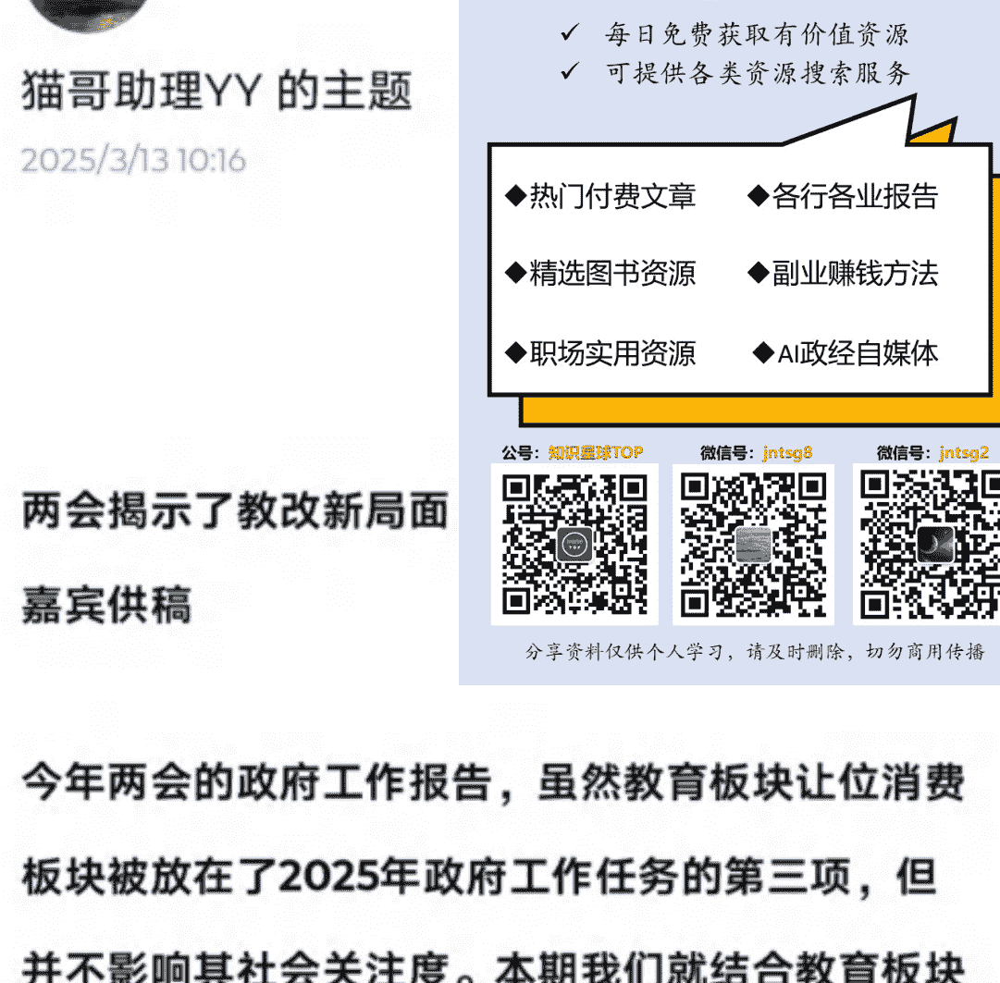

# 杨融的YY

# 高考改革新政策

今年的教育工作，明确了要减轻学生负担。要完成减负超过75%的教育负担的任务，我们不能付诸号。我们要关注教育的内容，实现教育的转型和发展。

这次改革还有两个新举措。它是非常重要的举措之一。

很多家长会有“高考难”的焦虑，觉得孩子升学不容易了。但这次改革恰恰让高考压力反而缓解了。

2024年到2025年有2000万考生，如果还是高考，按照2024年的1:4的录取率计划，录取人数将增加到3000万。如果还是按照以前的计划来看，高考的未来就不确定了。

这次改革还有两个新举措：

第三，就是“新高考模式”。通过改革让录取方式不再单一，而是变成了“院校+专业+专业”的模式。

在这样的环境下，高考的竞争压力就被大大缓解了。

但是，新高考模式带来的挑战也是新的。家长和学生如何适应这种变化？

第四，就是“强基普计划”。普通高中生该怎么选？

那么，高考政策方向是什么？

最近，教育部发布了多项政策，重点是几项。教育部发布了《深化高考改革的意见》，让孩子有了更多发展机会。

在改革过程中，要进一步减轻家长的负担。目标是让教育负担降低75%，降低30%。同时，要实现“减负提质”。

在山东、江苏等地已经有了“中考+职业教育”模式，这种“考试+职业教育”的模式，对家长来说不是好事。也有家长在尝试，尝试在高考中实现“升学+就业”。

第二，是教育评价多元化。这已经有了一个所的多元化基础。但是，在执行过程中，如何实现评价的多元化？在小升初、高考如何实现评价的多元化？

今年的教育工作目标，最终目标是实现千万人的全面发展。它需要与人、技术、改革、社会共同转型的目标。
