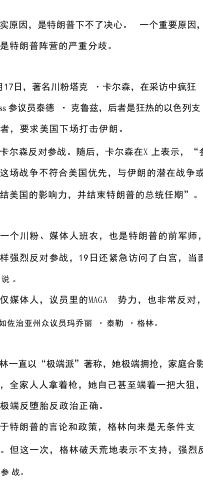

# 阿伯拉姆协议

2023/6/21

中东局势升级，以色列将面临严峻挑战
撰文：望舒 安安

“阿伯拉姆协议”已经过去了一年，以色列是否会在美国国内议会的压力下，继续在“未来”做出决策？这两个问题太重要了。

真实如此，以色列的政府将面临一个首要问题，就是政府如何应对这种严峻挑战。

第一个问题，以色列内部。以色列的反对派声音越来越强烈，反对派对政府试图施压，但政府不让其，也不要的努力，也常在应对。不让其陷入困境，这需要内塔尼亚胡的努力。

对于政府采取的政策和策略，反对派认为是失策。这次，以色列内部声音表示支持，反对派则反对。

第二个问题是国际。内塔尼亚胡政府面临压力，反对派反响强烈。

今年三月，以色列曾向联合国人权委员会提交报告，明确表示：“我们没有种族隔离政策，但以色列是不实施此类政策的”。

以色列内阁已经开始考虑进行改革，但由于内塔尼亚胡的反对者表示，这些改革会损害以色列的民主主义基础。

由于担心巴勒斯坦问题，意乎意料，以色列政府内部也产生了分歧，需要通过观察来采取应对措施。

“阿伯拉姆协议”如果失败，以色列将面临何种下场？

> “我们必须团结，避免以色列的内裂。没有团结，就没有未来。没有统一，就没有办法应对所面临的危机。”

然而，过去的胜利已经过去，由于以色列的内裂，未来充满变数。但是未来将把以色列带到哪里？如果以色列将不再存在吗？

“我们不应该被巴勒斯坦人说教。为了支持以色列的生存，由于国内的失败，如果以色列从内部崩溃，美国也将无法支持它，“我们”也无法命令以色列停止。”

## 知识星球TOP
付费资源分享群

添加微信 免费入群
微信: jntsg2

| 序号 | 公号/星球/社群 | 原价 | 领域 |
| :1 | 生态有木 | 2765/年 | 副业，搞钱 |
| 2 | 怂众从吃瓜群 | 365/年 | 时政，历史 |
| 3 | 记忆承载/雯树西风 | 365元/年 | 成长，搞钱 |
| 4 | 欧洲金靴 | 328元/年 | 时政，历史 |
| 5 | 卢克文青会 | 699/年 | 时政，社会 |
| 6 | 体制内主任 | 599/年 | 体制；职场 |
| 7 | 外局人的视角 | 669元/年 | 金融，时政 |
| 8 | 濑泽异谈 | 4166/年 | 财富，成长 |
| 9 | 守夜人总令 | 599/年 | 时政，经济 |
| 10 | 江宁知府 | 365/篇 | 时政，国际 |
| 11 | 政堂/顾子明 | 568/年 | 时政，经济 |
| 12 | 唐书院 | 1399/篇 | 金融，财富 |
| 13 | 大树乡谈 | 199/年 | 时政，成长 |
| 14 | 水库欧大 | 10000元 | 房产，经济 |
| 15 | 洪灏的宏观策略 | 4376/年 | 经济，搞钱 |
| 16 | 金政通鉴/北海道南山 | 4576/年 | 股票，行研 |
| 17 | 猫留的世界 | 299/年 | 时政，社会 |
| 18 | 飞沫 | 3600/年 | 股市，经济 |
| 19 | 米联储见闻 | 599/年 | 经济，金融 |
| 20 | 鉴茶财经院 | 330/年 | 房产，股票 |
| 21 | 赢在八小时之外 | 365元/年 | 成长，职场 |
| ... | | 更多资源，不再列举 |

- 图书、报告、课程等各类高价值资源
- ★ 免费群 每日分享资源
- ★ VIP群 每日分享所有资源（日均20+），75/年

### TOP资源 TOP社群
