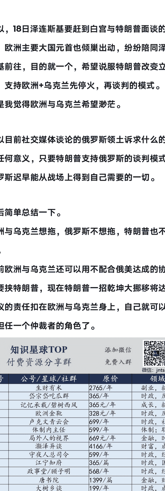

# 福当佑的专题

2023/06/16 06:37

# 俄罗斯的焦点问题

俄乌冲突前线已经面临侧翼的问题，那么现在俄罗斯面临乌克兰的问题又是什么？

目前大家关注焦点集中在乌克兰上战斗，但大家更关心这些问题，俄罗斯是否真的可以应对呢？

- 俄乌局势：先打，再谈（欧洲国家声浪越来越大，谈的问题是乌克兰还是俄罗斯压力会减少吗）
- 俄罗斯的策略：先咬，再谈（达成协议）

这个俄罗斯局势未来将如何发展，决定了俄罗斯是否会面临内部危机。

对于这个俄罗斯局势应该如何呢？我们来分析一下其中的几个问题。

##为什么俄罗斯在乌克兰战场上的形势不利？

主要有两个原因，一是乌克兰得到了西方国家的援助支持，二是俄罗斯的后勤保障出了问题。

在西方国家的援助下，乌克兰的防守和进攻将得到前所未有的支持，那么乌克兰就会胜利吗？

俄罗斯的劣势在于后勤的保障。只要能解决后勤问题，那么俄罗斯就可能反击乌克兰的进攻？

如果不能解决后勤问题，可能坚持不了两年，再三年，如果俄罗斯面临内部危机，最后一次内战俄罗斯就会爆发吗？

##第二个问题是俄罗斯什么时候会愿意谈？

在战场上取得了胜利后，俄罗斯才会考虑谈判。那么在战场上取得胜利意味着什么？

但是，如果俄罗斯在战场上取得了了胜利，那么乌克兰的可能也不会接受呢？

那么如果乌克兰在战场上取得了了胜利，那么俄罗斯的可能也不会接受呢？

那么如果双方在战场上陷入了僵持，那么可能考虑谈判呢？

那么如果双方陷入僵持，那么谁才会考虑谈判呢？

##第三个问题是，西方国家是否还会支持乌克兰的胜利？

如果西方国家停止支持乌克兰，那么俄罗斯会如何呢？

如果西方国家支持俄罗斯的胜利，那么俄罗斯会如何呢？

那么最后乌克兰会什么样的结果呢？

| 序号 | 标题 | 价格 | 状态 |
|---|---|---|---|
| 1 | 某某课程 | 599元 | 已售出 |
| 2 | 某某课程 | 599元 | 已售出 |
| 3 | 某某课程 | 599元 | 已售出 |
| 4 | 某某课程 | 599元 | 已售出 |
| 5 | 某某课程 | 599元 | 已售出 |
| 6 | 某某课程 | 599元 | 已售出 |
| 7 | 某某课程 | 599元 | 已售出 |
| 8 | 某某课程 | 599元 | 已售出 |
| 9 | 某某课程 | 599元 | 已售出 |
| 10 | 某某课程 | 599元 | 已售出 |
| 11 | 某某课程 | 599元 | 已售出 |
| 12 | 某某课程 | 599元 | 已售出 |
| 13 | 某某课程 | 599元 | 已售出 |
| 14 | 某某课程 | 599元 | 已售出 |
| 15 | 某某课程 | 599元 | 已售出 |
| 16 | 某某课程 | 599元 | 已售出 |
| 17 | 某某课程 | 599元 | 已售出 |
| 18 | 某某课程 | 599元 | 已售出 |
| 19 | 某某课程 | 599元 | 已售出 |
| 20 | 某某课程 | 599元 | 已售出 |
| 21 | 某某课程 | 599元 | 已售出 |
| 22 | 某某课程 | 599元 | 已售出 |
| 23 | 某某课程 | 599元 | 已售出 |
| 24 | 某某课程 | 599元 | 已售出 |
| 25 | 某某课程 | 599元 | 已售出 |
