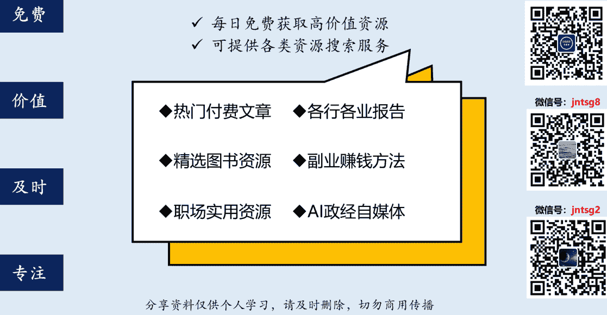

# 钟吕谈谈判的解析补充

猫哥原创

昨天公众号文章被平台枪毙了十几次，反复修改了十几次，最后一篇4000字的文章被删改成3000字才得以放行，今天在知识星球将相关内容补充写写一遍。

首先可以确定的是，因为稀土制裁效果出乎意料的好，西方制造业一片人仰马翻，所以吕伦谈判中方异常强硬，提高了报价。

因为中方提出了要价，所以美方代表最臭派的贝森特都接受不了，会谈第二天就找他理由离场了，剩下两个鹰派与中方继续做表面功夫。

那么中方提出的要价是什么呢？

有几个传言：

- 1，要求美方放荷兰最先进的光刻机；
- 2，中方对美国提出，如果美国继续对台军售，将触发中方对最关键的7种重稀土的严厉制裁，潜台词就是要求美方用禁止对台军售换取稀土。

之前我对伦敦谈判预测了三种可能性，实际结果就是可能性3，谈判没有达成任何实际的成果。

那中美为什么同时宣布达成框架性协议呢？

应该是中美达成的唯一的成果。美方的立场：中美领导人通话是美方要求的，老大都谈好了，接下来的人如果没有任何成果不但无法对外外交，而且更重要的是，美国后期还要与15个国家谈判关税，如果中美谈判破裂，美方更无法诸谎诈其他国家。

所以对外一定要表达达成一个框架性协议，为什么不公布协议具体内容呢？

对外的理由是要各自向领导人汇报——其实就是试图对外界暗示协议内容有可能超出预期，大家用脚指头想，现在通讯这么发达，谈判代表可能签署一些领导不知道的条款吗？

所以，给领导人汇报就是一个托词。用于掩盖这个框架性协议没有实质性内容的托词。

中方昨天的新闻通稿也证实了这一点，中方对谈判描述连“建设性”都没有，可见双方谈判的底色。

中方之所以愿意配合美方对外倡双赢，原因就是这样做对于中方也是有利的，双方都宣布达成框架性协议（而不是谈判破裂），那么美方至少目前还要维护内瓦协议，中美领导人通话的成果，不至于恼愁成怒升级贸易战与关税战。

所以，谈判结束第二天，中方商务部就配合性宣布，中方已经开放稀土出口——给外的印象就是中美好像确实达成了某种协议，你看稀土出口马上就恢复了，但是如果仔细细读商务部的声明可以看到，中方这个稀有出口是有限制条件的，这个限制条件就是“民用”，也就是说，现在可能用于军事生产的7种中重稀土大概率还没有开放。

最后还有一个细节需要注意，美方代表明确对外表示，双方都还没有未来谈判的计划，这说明了一个重要的问题：

中方目前的开价是美方难以接受的，甚至都没有未来（至少是目前）继续谈的必要。

不过这也无所谓，现在美方也没有什么打的牌了，而我们还挺稀土卡着美方的脖子。这就是公众号文章我最后提到的，我们不急，急的是美方。

# 扫码加入 知识星球TOP 免费资源群

- 每日免费获取高价值资源
- 可提供各类资源搜索服务
