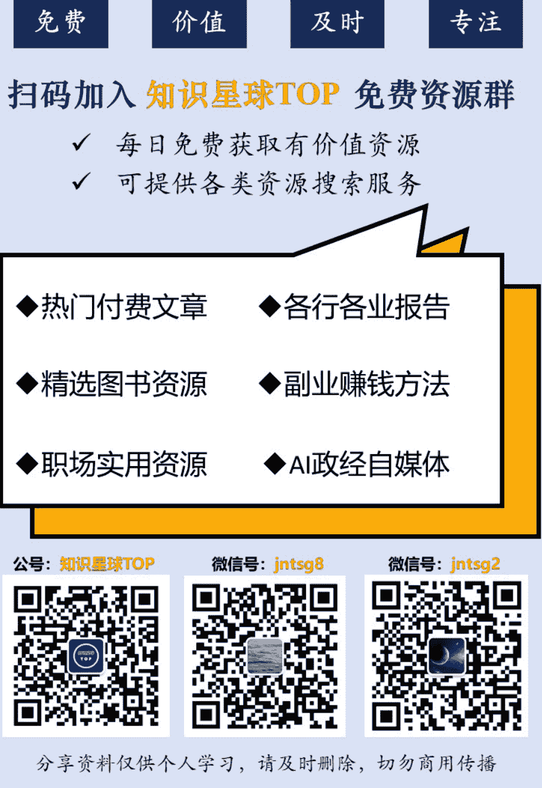

# 乌克兰制造的筹码

# 猫哥原创

6月1日，乌克兰策划实施了对俄罗斯最为成功的特种作战。在俄罗斯境内五个空军军事基地使用无人机发动袭击，击毁多架俄军大型军用战机。

这次行动乌筹了将近一年半、所有无人机改装后分批走进俄。然后在当地地产雇佣卡车和司机。把所有卡车货箱进行了改造，增加木板隔层，将无人机藏在木板隔层中。让司机依据雇佣线路进行行驶，所有线路全部都经过机场，到达机场附近远程开启卡车厢，放飞无人机进行进攻。最后，所有策划的人员在攻击之前均回到乌。

这次真的足够胆，周密，而且非常有效，一子报销俄几十架飞机，行动人员还安稳无事（司机是本地地产的，被抓毫不心疼）。

这是一场非常成功的特种作战，这种特种作战战式之所以能取得巨大的成功，确实找到了俄罗斯的软肋。

为什么？

首先俄罗斯处处漏风的地形，要控制边境渗透实在太大了。然后，俄罗斯地盘太大，人口又严重不足，人口与辽阔的土地完全不匹配，非常容易被对手渗透进来搞游击战。加上乌克兰与俄罗斯同种，语言接近，长相一致，要辨别渗透的特工人员难登天。

当然，要对付特工人员渗透击战也不是完全没办法，历史上日人在地广稀人的东北地区对抗游击活动采取集村并井的方法，一下就切断了抗联的后勤补给，从而消灭了抗联。

俄罗斯要采取类似的方法对抗乌克兰的特种渗透攻击，就要在国内实施战动员令，所谓的战时动员令就是将散沙的民众有效组织起来，规定并且规范民众的行为模式，一旦违反就会受到严厉的处罚。

这种战动员令的模式固然能有效对抗乌克兰的渗透作战，但是却是普京不敢做的。

为何?

因为战争的消耗，俄罗斯国内已经民生物资物价飞涨，老百姓怒气很大，如果再实施战动员令必然进一步降低民众的生活水平——相当于让民众为战争付出更大的成本，引发民意更大的反弹，从而动摇俄罗斯政局的稳定。如果不顾一切蜜在在国内实施战动员令，那么普京政府很可能会得到一个战时沙皇政府的下场。

所以，目前俄罗斯对于乌克兰的渗透作战并没有什么好办法。这也导致目前乌克兰对俄罗斯国内的袭已经常态化——目前东到海参，北到极地内陆地区遍地开花，俄罗斯焦头烂额疲于应付。

虽然普京现在叫要大规模报复乌克兰，但是乌克兰现在已经被没有什么价值的军事与经济目标可以以打击报复。这也是俄罗斯比较痛的问题。这就是乌克兰在正面战场劣势的情况下，通过渗透到俄罗斯内部敌后战场的威力，也是乌克兰为自己在谈判桌上制造的最有利的筹码。

顺便说一个很有趣的现象，就是乌克兰虽然对俄罗斯境内军事与经济目标实施大规模特种作战，但却从未对途俄俄罗斯的中欧班列进行袭击。为什么？

这就是东大的远见与预判。

今年3月，东大与乌克兰紧急签署了乌克兰豌豆与野生鱼进口协定，准备从乌克兰购买50万豌豆与15万吨野生鱼。

那么怎么运输呢？

乌克兰出海的港口已经被俄罗斯摧毁，唯一便捷物流渠道就是走中欧班列程时运回中国。所以乌克兰用无人机攻击俄罗斯境内目标时都会有意避开中欧班列。

现在恰逢俄乌准备在土耳其谈判，乌克兰就搞了一场最为成功的特种袭击，这也是乌克兰为自己谈判制造的筹码，否则在谈判桌上因为正面战场的劣势乌克兰是很难讨还价的，现在乌克兰凭空制了一个俄罗斯境内游击战的筹码，这样就能极大平衡正面战场的劣势。

别不说，作为中国人很清楚游击战的威力，当年我们就是靠着敌后战场的游击战，让日军经济与军事优势完全无从发发挥，最后拖垮了日本。

过去我反反复说过，战场上得不到的，谈判桌上也不可能得到。

现在乌克兰虽然正面战场上无法收的领域，但是通过小成本的特种游击战，乌克兰还真有可能迫使俄罗斯在乌东地区做出一定的让步。

分享资料仅供个人学习，请及时删除，切勿商用传播
