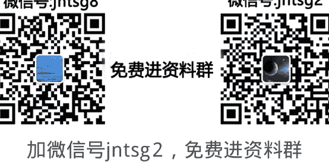

# 对充电宝“召回潮”的洞察反思

嘉宾供稿

6月26日，因民航局发布的一则紧急通知，把充电宝推向了舆论的风口浪尖。

事情大致脉络是这样的：

进入6月，北京多高校相继发布通知，要求师生排查并停用罗马仕2万毫豪的充电宝。原因是经校方检测，该型号充电宝在充电时自然概率超过行业均值300%，且多起自然案例已导致财务损失。

消息一经网上发酵，不禁让人后怕。

因为高校是充电宝使用的密集区，很多学生在深夜熄灯后，躺在被窝里插上充电宝充电手机是一种常态，甚至边充电边睡觉的场景比比皆。还好到目前为止，除了存在安全隐患和小微规模损失外，高校并未出现大安全事故。

紧接着，6月14日，罗马仕发布致歉稿，并承诺“对经权威机构鉴定存在缺陷的产品依法承担全部责任”。

6月16日，深圳市市场监督管理局发布公告称，因部分产品在极端场景下可能存在燃烧风险，深圳罗马仕科技有限公司将召回2023年6月5日至2024年7月31日制造的部分移动电源，涉及三款型号，共计49万台。

当然，涉事的主体远不止罗马仕一家，其中还包括全球消费电子头部品牌安克创新。

6月20日，安克创新发布通告，召回部分批存在安全风险的基础款移动电源产品，涉及约71万台。

合计召回120万台，说实话完全是冰山一角。

单单从国内来看：

我们对充电宝的3C认证管理是从时候开始的呢？

答案是2023年。

2023年315日前，国家市场监督管理总局发布公告，决定对电子电器使用的锂离子电池和电池组、移动电源以及电信终端产品配套用电源适配器/充电器实施强制性产品认证（CCC认证）管理，“要求“2023年8月1日起，指定认证机构开始受理新纳入产品CCC认证委托，且“2024年8月1日起，未获得CCC证书和标注认证标识的，不得出厂、销售、进口或在其他经营活动中使用”。

而充电宝在我们国销售爆发时间大致可以追溯到2016年左右，也就是说从面积普及及应用到监管加强，中间存在7年的空白期，这7年里到底有多少劣质充电流入千家万户，根本无从得知，但肯定是天文数字。

比上面提到的罗马仕，仅它一家，就够称年量超过5000万台，还不算其他头部以及行业的众多小虾。

在大家眼中，充电宝并不是一次性质耗品，用完就扔。而是耐用品，供长期反复使用，就意味着现实生活的很多场景中，也许劣质充电宝就在你身边，成为安全隐患，只是大多数人并未警觉，或者运气好，没炸而已。在写文的时候，我就把家里已经搁置多年的充电宝翻出来倒进了垃圾桶（自然这种操作理论上并不恰当）。

言归正传，这件事经过十来天的不断发酵，终于迎来了国家队的出手，也就是开篇说的6月26日民航局发布的一则紧急通知：

为切实保障航空运行安全，自6月28日起禁止旅客携带没有3C标识、3C标识不清晰、被召回型号或批次的充电宝乘坐航内航班。

也因此，彻底引发的市场舆情。

那么，这些被召回的充电宝究竟出了什么原因导致存在安全风险呢？

这里简单说下充电宝的构造。

其实充电宝制造工艺很简单，主要由电芯、电路板和外壳构成，其中最重要的的就是电芯。只要良心，把电芯做好了，产品的安全底线就能守住的。

但你懂，在监管空窗期，能有几个企业跟你讲良心呢？

说个扎心的现实，充电宝的生产门槛有多低？

在23年后出台强制认证管理办法之前，在深圳华强北，你可以拿着别人生产剩下的电芯，然后贴牌套壳印上参数就可以并夕夕销售。这些充电宝主打一个性价比，反正能充电就行了，连基础的热控系统、电路保护都可以可有可无。

经济下行，各行各业都在卷、都在压，充电宝更是例外。

为了业绩，可以拼压成本，比如电芯，可以A级选用，比如散热系统，有的型号直接把热控芯片都砍了。还有为了多塞一个USB口，把电路板堆得满是满的。在安全的考虑几乎没跟上。

最近几年，充电宝为迎合市场需要，向更小、更快的方向一路飞驰，这就导致了要求的电芯功率、温控上限越来越高，大家都在钢丝绳极限上计算。这次涉事的罗马仕，就是其中的佼佼者，之前靠着容量大、价格低连续拿下了猫双十一销量第一。

还有更令人背后发凉的。前面说了，电芯是充电宝的安全命脉，不是充电宝选择。从这次涉事企业的公告看，很多上游电芯的品牌都是高质量的，很多头部品牌如绿联、倍思以及OPPO、华为等，还是值得一看。

其实，关于这次召回事件，个人认为不仅是安全方面，问题维度正在升级。

前文提到的，为什么对充电宝的质量监控在行业开始后的7年才姗姗来？

从2015年以来，全球发生了多起自燃事故，包括：
- 1月28日，韩国BX391航班（起火），7人轻伤。
- 3月20日，香港HX15航班（失控），飞机报废。
- 3月13日，上海FM944航班（明火），机组接力控制。

为何我们的出手还是显得滞后？如果不是北京多高校的联合抵制，企业主动认错，民航的通知会更晚？至少像是被动触发，缺乏前瞻性风险评估。比如，民航是6月26日发布的通知，缓冲期只给了2天，而这块处置情况参差不齐（很多机场现场丢弃），航司携程、飞猪等平台未在购票流程嵌入提示等等，乘客造成不便，反映了系统性漏洞。再比如，充电宝的召回，又被多家物流因电池存在安全风险而拒收，导致商家和消费者在中间左右为难。

上述种种，到目前为止还没有答案，但是我们仍然希望，通过这次充电宝事件，能够起到警示的作用，尽快找到解决方案，在未来建立制造、监管、安全协同服务链，不能单方面让消费者承担代价。