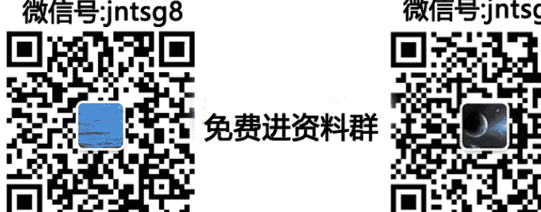

# 美国最大的对手，日本是最坏的敌

嘉宾供稿

8月15号是日本战败投降80周年，竟然日本又跳出来恶心人。

首先，石破茂内阁成员，日本农林水产大臣小泉进次郎公开去拜鬼。这不是他第一次，此人从2010年起，每年都要去拜鬼。大家记住这个人，日本前首相小泉纯一郎的儿子。

小泉纯一郎之前在担任日本首相期间，就曾多次去拜鬼，可谓是有其父必有其子。

当然，去拜鬼的不仅只有他，同时还包括自民党籍前阁员高市早苗、小林隆彦、以及国会议员全部成员等乌鸦贼一大票人。

其次，石破茂以自民党总裁名义向靖国神社奉香火钱，专程前往千种公募，对数十万死于海外没没姓的鬼子尸骨献花哀悼，同时在日本政府组织的招魂仪式上发表演演讲，大玩文字游戏，避重就轻，绝口不提日本侵亚洲各国的加害责任。

看了很多网上所谓的“理性”分析，大致意思是是因为其父亲石破茂和田中角荣是政治盟友，而且两个家族渊源深厚，石破茂继承铁链本想开展对华务实合作的新篇章。之所以会如此，主要原因是7月的参院选举失败，首相位置岌岌危，所以才被日本右翼势力挟持，被迫逐步。

说实话，这种找补开脱的观点我是一个字都不信，石破茂骨子里的真面目到底是人还是鬼，懒得深挖，也不重要。我们需要审视的不是一个人，而是日本这个国家。

梳理一下日本最近时间的动作，可能会惊掉你的下巴。

# 第一，回到8月11号南海碰撞事情。

菲律宾最近几年不停在南海蹦峙对我们挑衅，背后除了了站美国国外，其实日本更更坏。

2016年，日本通过低息贷款(年利0.1%)向菲律宾提供资金，然后反过来销售10艘44米级装备精良的巡逻艇。这次撞船事件逃出升天的4406苏鲁索号，正是这批。

2022至2025年，日本又向菲律宾出口13艘97米级大型巡逻舰，目前已交付2艘，包括菲律宾目前最大的2600吨海警船。

最近，日本又出口6艘导弹护卫舰给菲律宾，虽然都是已经使用了30年的二手货，但是重新维护升级一下，也能给菲律宾充门面。

现在菲律宾海警序列，超过半数舰艇都来自日本。

所以，菲律宾在南海挑衅，美国大不了是动动煽、装装样子，日本是真递刀子。除了菲律宾，日本本土还向越南、蒙古军售，包括刚刚宣布向澳大利亚三菱重工生产的11“最上”级护卫舰。

你看，日本军售从最早的禁止，到后面的扭扭捏捏，再到现在公开出口，司马昭之心路人皆知。

# 第二，现在日本极右政党在积极推动《反间谍法》，打算在今年秋季举行的临时国会上通过草案。这个《反间谍法》是啥东西？

明面上看扩大“经济安全威胁”和“外国间谍活动”的打击范围，强化对外国人的管控与监控，涵盖军事、外交、经济、科技技术甚至历史研究领域。本质上呢?我就说点：

- 其一，有了这部法案，如果再有日本学者研究侵华历史，均可能被定为“危害国家安全”罪。
- 其二，有了这部法律，下一步就可以深度融入“五眼联盟”的门票，在军事、外交、科技、经济方面实现对我们的情报共享。

所以，它本质上不是反间谍，而是借“反间谍”之名，强化安全进程，控制社会、改写历史。对于有观点认为《反间谍法》为日本军国主义死灰复燃提供武器，大家要这假装而已。其实，日本政府正在酝酿的《反间谍法》，最近日本还修订了2024年《防卫白书》，用简单的语言阐述了在日本的危机，并将重心对着我们，而且向全国分发，强行灌输日本军国主义立场。

# 第三，就是日本试产2纳米芯片。

很多人忽略了这件事背后的影响力，这里简单说说：7月，一家日本初创公司宣布试产2纳米芯片，计划在2027年实现量产。从零基础到全球最顶端，是怎么做到的呢？大致路径就是通过和台积电密切业务来，抢了台积电千亿核心技术。你看美国是焦点，从2022年成立，这家公司背后蕴藏的巨大力量：

- 2023年工厂破土工。
- 2024年底接收ASML EUV光刻机，完成无尘建设。
- 2025年启动2nm晶体试产线。
- 7月官宣试产，这背后日本商业巨头，包括索尼、软银、三菱以及上面的东京电子等支持。

这件事说白了，从一开始就是里外合一的行为。一旦量产突破，全球芯片格局将发生巨变，现在日本控制全球90%光刻胶，100%EUV薄膜，压制我们的脖子，技术突围东南亚国家地缘整合都是可以想象的。而且极大赋能日本高精武器，包括未来的AI作战系统以及高超速武器等。

说实话，日本人卷起来，能量是不容小觑的，单论军工产能，个人认为某种程度上比美国还要大。

所以，我们通过梳理，不难看出，日本正在从中博弈，军事、科技、法律、教育等方面进行系统性动员，我们引起足够重视。美国是我们最大的对手，而日本是最坏的敌人。

日本的军国主义是不死休的，对于日本的妄图，我觉得遵循无意义，只能完全打趴，送他去万劫不复的深渊。815之后就是9.3，还有918。这都是中日敏感期，日本继续作战，我想的是，美国你管不管，如果你放手不管，就怪我们出手。

# 知识星球TOP
添加微信 付费资源分享群免费入群
微信: jntsg2

| 序号 | 公号/星球/社群 | 原价 | 领域 |
| :--- | :--- | :--- | :--- |
| 1 | 生态有木 | 2765/年 | 副业、搞钱 |
| 2 | 怂从吃瓜群 | 365/年 | 时政、历史 |
| 3 | 记忆承载/雯树西风 | 365元/年 | 成长、搞钱 |
| 4 | 欧洲金靴 | 328/年 | 时政、历史 |
| 5 | 卢克文青会 | 699/年 | 时政、社会 |
| 6 | 体制内主任 | 599/年 | 体制；职场 |
| 7 | 外人的视角 | 669/年 | 金融、时政 |
| 8 | 激迸异谈 | 4166/年 | 财富、成长 |
| 9 | 守夜人总令 | 599/年 | 时政、经济 |
| 10 | 江宁知府 | 365/篇 | 时政、国际 |
| 11 | 政堂/顾子明 | 568/年 | 时政、经济 |
| 12 | 唐书院 | 1399/篇 | 金融、财富 |
| 13 | 大树乡谈 | 199/年 | 时政、成长 |
| 14 | 水库欧大 | 10000远 | 房产、经济 |
| 15 | 洪灏的宏观策略 | 4376/年 | 经济、搞钱 |
| 16 | 金政通鉴/北海道山 | 4576/年 | 股票、行研 |
| 17 | 猫留的世界 | 299/年 | 时政、社会 |
| 18 | 飞沫王 | 3600/年 | 股市、经济 |
| 19 | 米联储见闻 | 599/年 | 经济、金融 |
| 20 | 鉴茶财经院 | 330/年 | 房产、股票 |
| 21 | 赢在八小时之外 | 365元/年 | 成长、职业 |
