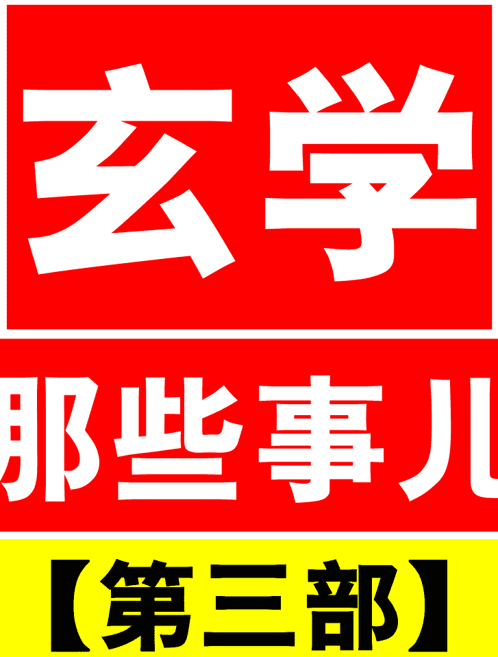

(大师绝学，禁止外传，胆小勿看)

更多资源+v：cuk255

# 目录

## 第一章 运势那些事
- 涂老师，为什么要装壁炉转运啊？................ 1
- 涂老师，为什么要去美发店转运啊？................ 1
- 涂老师，为什么要去寺庙转运啊？................ 2
- 涂老师，为什么要去公园转运啊？................ 3
- 涂老师，为什么要去写字楼转运啊？................ 3
- 涂老师，为什么要改磁场转运啊？................ 4
- 涂老师，为什么要去图书馆转运啊？................ 4
- 涂老师，为什么要养成阅读的习惯转运啊？ ... 6
- 涂老师，为什么要多洗澡转运啊？................ 7
- 涂老师，为什么要打造能量场转运啊？................ 7
- 涂老师，为什么要多喝茶转运啊？................ 8
- 涂老师，为什么要多攒钱转运啊？................ 9
- 涂老师，为什么要跟年轻人待在一起转运啊？ 9
- 涂老师，为什么要扔掉杂物转运啊？................ 10
- 涂老师，为什么要动一动转运啊？................ 12
- 涂老师，为什么要多收集励志的东西转运啊？ 13
- 涂老师，为什么要多看伟大的东西转运啊？ .14
- 涂老师，为什么要多跟能量高的人转运啊？ .14
- 涂老师，为什么要借力力转运啊？................ 15
- 涂老师，为什么要跟磁场干净的人转运啊？ .16
- 涂老师，为什么要破点小财转啊？............ 17
- 涂老师，为什么要好吃吃饭转运？.................. 18
- 涂老师，为什么要要把烟戒掉海鲜转运？............ 19
- 涂老师，为什么要吃海鲜转运啊？................ 20
- 涂老师，为什么要吃羊肉转运啊？................ 20
- 涂老师，为什么要吃核桃转运啊？................ 20
- 涂老师，为什么要喝小米粥转运啊？................ 21
- 涂老师，为什么要吃辣椒转运啊？................ 21
- 涂老师，为什么要吃萝卜转运啊？.............. 22
- 涂老师，为什么要吃狗肉转运啊？................ 22
- 涂老师，为什么要吃黑色食物转运啊？...... 23
- 涂老师，为什么要发大愿转运啊？.............. 23
- 涂老师，为什么要早睡转运啊？.............. 23
- 涂老师，为什么要选衣服颜色转运啊？.............. 24
- 涂老师，为什么男人对老婆好招财啊？...... 24
- 涂老师，为什么要转念即运啊？.............. 25
- 涂老师，为什么要快速旧运啊？.............. 26
- 涂老师，为什么要避旧是转运最好的方式啊？ . 26
- 涂老师，为什么心情好转运越快啊？...... 27
- 涂老师，为什么胆子越大转运越快啊？...... 28
- 涂老师，为什么话越有力量转越快啊？...... 29
- 涂老师，为什么能量越高容易转运啊？ ...... 30
- 涂老师，为什么要适度运动转运啊？…… 31
- 涂老师，为什么要选穿衣服颜色转运啊？...... 31
- 涂老师，为什么乐观的心态能转运啊？ ...... 33
- 涂老师，为什么要跟着有结果的人转运啊？ . 34
- 涂老师，为什么要写字大点转运啊？ ...... 34
- 涂老师，为什么要孝敬父母转运啊？ ...... 35
- 涂老师，为什么要多折腾转运啊？ ...... 37
- 涂老师，为什么要跟好的人打交道？ ...... 38
- 涂老师，为什么要尊师重道转运啊？ ...... 39
- 涂老师，为什么遇到贵人是转运的开始？ ...... 40
- 涂老师，为什么相信自己才能转运啊？ ...... 41
- 涂老师，为什么要大声化话转运啊？ ...... 42
- 涂老师，为什么释放欲望转运啊？ ...... 42
- 涂老师，为什么要静坐 15 分钟转运啊？ ...... 43
- 涂老师，为什么要记住这 4 句转运啊？ ...... 44
- 涂老师，为什么要多看杂书转运啊？ ...... 44
- 涂老师，为什么要经常关闭转运啊？ ...... 45
- 涂老师，为什么要找个靠山转运啊？ ...... 47
- 涂老师，什么叫真正的转啊？ ………… 49

## 第二章 招财那些事儿
- 涂老师，为什么要吃牛肉招财啊？ ...... 50
- 涂老师，为什么要做多运动招财？............................ 51
- 涂老师，为什么稍微胖一点招财？............................ 52
- 涂老师，为什么要葫芦招财？................................ 52
- 涂老师，为什么要做金蟾招财？............................ 54
- 涂老师，为什么家里放大叶植物招财？.... 54
- 涂老师，为什么要收集五种精神能量招财？.... 55
- 涂老师，为什么要言出必行招财？...................... 55
- 涂老师，为什么情绪越稳定招财？...................... 56
- 涂老师，为什么要住房子招财？...................... 56
- 涂老师，为什么要增加福报招财？...................... 57
- 涂老师，为什么要提升能量招财？...................... 58
- 涂老师，为什么要扔掉家里的杂物招财？...................... 58
- 涂老师，为什么要改变方向招财？...................... 59
- 涂老师，为什么家里要搞书房招财？...... 60
- 涂老师，为什么要挂个锦鲤招财？............ 60
- 涂老师，为什么男人对老婆好招财？...... 61
- 涂老师，为什么要调整状态招财？...................... 62
- 涂老师，为什么要找一个爱人招财？...... 63
- 涂老师，为什么要多淀招财？...................... 63
- 涂老师，为什么要弄个桌招财？...................... 65
- 涂老师，为什么要选颜色招财？...... 65
- 涂老师，为什么要养正气招财？...................... 65
- 涂老师，为什么要调身体招财？...................... 66
- 涂老师，为什么要提升境界招财？...................... 67
- 涂老师，为什么要修能量招财？...................... 68
- 涂老师，为什么要调整状态招财？...................... 69
- 涂老师，为什么要修心力招财？...................... 69
- 涂老师，为什么要养气血招财？...................... 70
- 涂老师，为什么要布施招财？...................... 71
- 涂老师，为什么要提升维度招财？...................... 72
- 涂老师，为什么要转换成财富？...................... 73
- 涂老师，为什么要用心招财？...................... 73
- 涂老师，为什么要修德招财？...................... 73
- 涂老师，为什么要凡滥招财？...................... 74
- 涂老师，为什么要比干招财？...................... 75
- 涂老师，为什么要拜关公招财？...................... 76
- 涂老师，为什么要拜观音招财？...................... 77
- 涂老师，为什么要不断感恩招财？...................... 78

## 第三章 高人那些事
- 涂老师，为什么你能够遇高人？.............. 80
- 涂老师，为什么要花钱去链接高人？.............. 81
- 涂老师，为什么要链接高人？.............. 82
- 涂老师，为什么高人都是世俗？.............. 82
- 涂老师，为什么高人都都是海为家？...................... 83
- 涂老师，为什么高人的精力旺盛？...................... 83
- 涂老师，为什么高人赚钱很轻松？...................... 83
- 涂老师，为什么高人都懂得情绪？...................... 84
- 涂老师，为什么高人都是不妄言？...................... 85
- 涂老师，为什么高人都懂得惜如金？...................... 85
- 涂老师，为什么高人都走中道？...................... 86
- 涂老师，为什么高人之道在隐？...................... 87
- 涂老师，为什么高人都会聚力低调？...................... 87
- 涂老师，为什么高人都不会占便宜？...................... 89
- 涂老师，为什么高人都懂得福啊？...................... 89
- 涂老师，为什么高人是识高手？...................... 90
- 涂老师，为什么高人都都是慈雄体？...................... 91
- 涂老师，为什么高人能够随时随地心？...................... 92
- 涂老师，为什么高人深厚重？...................... 92
- 涂老师，为什么高人像水一样？...................... 93
- 涂老师，为什么高人年搬一次家？...................... 93
- 涂老师，为什么高人最厉害的是预测能力啊？...................... 94
- 涂老师，为什么高人都是自律的神？...................... 95
- 涂老师，为什么高人就是财富？...................... 96
- 涂老师，为什么高人身上会有光？...................... 96
- 涂老师，为什么自己变成高人？...................... 97
- 涂老师，为什么真的高人不卖自己？ ...... 98
- 涂老师，为什么人生路上需要高人指导？ ...... 99

## 第四章 逆天改命那些事
- 涂老师，为什么宿命改难？............................ 100
- 涂老师，为什么改命先改思维模型？................ 101
- 涂老师，为什么改命先改认知？ ...... 102
- 涂老师，为什么改命必须先圈子？...................... 102
- 涂老师，为什么改命运其实很简单 ...... 102
- 涂老师，为什么改命的命运是可以化的？...................... 103
- 涂老师，为什么改命要拜师？...................... 104
- 涂老师，为什么改命要去掉弱者心态？...................... 104
- 涂老师，为什么改命改运要学会发愿？...................... 105
- 涂老师，为什么财富宽裕的人越信玄？...................... 106
- 涂老师，为什么你要带着使命做工作？...................... 107
- 涂老师，为什么佛说：改心一心，无事不办？ ...... 107
- 涂老师，为什么改命先改心？...................... 108
- 涂老师，为什么改命要学老子的智慧？ ...... 108
- 涂老师，为什么一旦掌握了道、万物皆为你用？...................... 109
- 涂老师，为什么随着自己的人性去做就是走邪？...................... 110
- 涂老师，为什么走大道、正道会更有力？................ 111
- 涂老师，为什么改命德要配合？...................... 112
- 涂老师，为什么改命要保持觉知？...................... 114
- 涂老师，为什么我们要了解自己的人生剧本？...................... 114
- 涂老师，为什么伤害你的人是在帮你消业？...................... 115
- 涂老师，为什么要报名一对一咨询？........ 116
- 涂老师，为什么找不到竞争对手啊？...................... 117
- 涂老师，为什么很多人容易做错决策？...................... 117
- 涂老师，为什么你需要一个为你的决策保驾护航的人...................... 118
- 涂老师，为什么你要给人生做一次全盘解析？...................... 119
- 涂老师，为什么学习玄学注重基本功啊？...................... 121
- 涂老师，为什么想改变命运必须做动脑子的事...................... 121
- 涂老师，为什么有些人福报浅薄？...................... 123
- 涂老师，为什么看风水需要择日？...................... 123
- 涂老师，为什么吉祥物不能带去？...................... 124
- 涂老师，为什么要做顺势而为？...................... 124
- 涂老师，为什么学习文化要反着？...................... 124
- 涂老师，为什么改变命运的关键在于愿？...................... 125
- 涂老师，为什么要学会识人、辨人？...................... 126
- 涂老师，为什么房子越小越糟糕？...................... 127
- 涂老师，为什么不要跟父母一起住？...................... 128
- 涂老师，为什么曾有房子不能住？...................... 128
- 涂老师，为什么女人不要随堕？...................... 129
- 涂老师，为什么整容改变不了？...................... 130
- 涂老师，为什么不要跟人一起玩？...................... 133
- 涂老师，为什么心不好的人也不会好？...................... 133
- 涂老师，为什么当下的结果是不如意？...................... 134
- 涂老师，为什么志不达者不达？...................... 134
- 涂老师，为什么40 岁是一个分水岭？...................... 135
- 涂老师，为什么喜欢攀比的人？...................... 136
- 涂老师，为什么心不如好？...................... 136
- 涂老师，为什么相由生？...................... 137
- 涂老师，为什么放下下立成？...................... 137
- 涂老师，为什么伤害的人都是贵人？...................... 138
- 涂老师，为什么每天都要说？...................... 138
- 涂老师，为什么一辈子就是命？...................... 138
- 涂老师，为什么说奇自有？...................... 139
- 涂老师，为什么平庸就是恶？...................... 140
- 涂老师，为什么普通人越穷？...................... 141
- 涂老师，为什么要做清醒的人？...................... 142
- 涂老师，为什么福报越大的人？...................... 142
- 涂老师，为什么这辈子只有一个？...................... 142
- 涂老师，为什么把事情做到极致？...................... 143
- 涂老师，为什么你担心的东西会变成事实？...................... 143
- 涂老师，为什么所有的命中注定？...................... 144
- 涂老师，为什么起心念决定命运？...................... 145
- 涂老师，为什么天道的规律是？...................... 146
- 涂老师，为什么觉醒要经历大关？...................... 147
- 涂老师，为什么真正的大是？...................... 147
- 涂老师，为什么想要修福，先消业？...................... 149
- 涂老师，为什么玄学结合？...................... 151
- 涂老师，为什么行好事、莫前程？...................... 152
- 涂老师，为什么最厉害的算命不能躺平？...................... 154
- 涂老师，什么适合一对一咨询？...................... 154
- 涂老师，为什么很多人都做咨询？...................... 155
- 涂老师，为什么跟你是好运的开始？...................... 156
- 涂老师，为什么要从天、地、人、神五个维度看待轨迹？...................... 157

# 万藏书免费资料分享标准
- 价值第一，全网精选，每天分享，服务一年，免费送书
- 1. 每月 220+精选付费文章；
- 2. 每月 99+精选视频；
- 3. 每月 500+精选网红热门书籍；
- 4. 群后为群友免费领999各大公众号付费文章；
- 5. 从它的群免费筛选199+精品文章；
- 6. 群后为群友找资料，服务期限为一年，每天分享，实时更新；
- 7. 里面多交流，针对群友问题有人回答；
- 8. 群后，会把之前里质量一次性分享给您；
- 9. 每年分享 3 本本人藏书籍及推荐绝密优质书籍。

终身学习，价值创造，全网实时更新。物有所值，每日更新，免费找书，全网精选。

# 序言

一直以来，大师师就是可以上通天、下通地的人。能够结交上层贵，也能服务凡夫俗子。我不关心八卦，我只关心思想，我只关心三维世界能拯救多少人、能唤醒多少人？我的人生使命就是渡缘人，借自己所学所见所闻所悟，广渡有缘人，开解您的人生疑惑。种善因，敬畏生命，渡众生于苦海，找回本自足的自己。有福报的人，到了一定年纪，会自然解锁对中医、谈玄、养生等传统文化的信仰。一个人，既然归属于一种文明，对自己所属文明的皈依，是早的事的事。只有自己所属的文明，才能拯救自己。有的人是经历一些事情，有的人是自然的血脉觉醒。你属于哪一类？

# 第一章 运势那些事儿

涂老师，为什么要装个壁炉转运啊？
答：除晦气最佳方式是火。家里的木材多，没事儿烧烧，身上的晦气确实没了。大家运气不好，可以把空调关掉，室内装壁炉，烧烧木材。用火来去晦气。世上，去晦气的最佳燃料就是木材，就是火！

涂老师，为什么要去美发店转运啊？
答：人可以有霉运，但不能有霉相。言正压君子，衣冠镇小人。运势再差，也要干干净净。你的状态，就是你的风水；你的人品，就是你的运气。人可以有霉运，但不能有霉相。你不顺的时候，你可以换个发型，换个衣装，换个能量场，换个商业模式。诸事不顺的时候，就生意兴隆。

### 涂老师，为什么要去公园转运？

答：状态不佳的时候，切忌别在家里闷着。多晒太阳，多逛逛公园。

多在儿童乐园走走，喂喂鱼，喂喂鸟，都能很好的振作心念。

我每天都会晒太阳，每天都会跟大自然接触，吸收天地灵气。

人生的一切都是精气换来的。

### 涂老师，为什么要去写字楼转运？

答：我在大城市里也没有什么社交。无聊时就去写字楼、人才市场、劳务市场转一转，到 CBD 底下的星巴克吹空调。

回家就继续做项目。

转运最快的办法，就是往人多的地方站一站。
找到最贵的写字楼，在运气比较糟糕的时候，在写字楼里转一圈又一圈。
要是你不意进写字楼，围着它转一圈又一圈也行。

一般来说，转三圈你就开始转运了。
要是你的运气一直不好，怎么办？开车出去转一转就行了。

开车的时候，听一些比较励志的歌曲，就很容易转运。
如果你听很伤感性的音乐，你会变得更倒霉，甚至会有血光之灾。

### 徐老师，为什么要改磁场转运啊？

答：说真的，我每次看到那些因为磁场影响，深陷三角角，或者情感纠结的人，我就告诉她：改磁场吧！
用这个磁场久了，太纠结，太耗心力，损福报了！
但是有时候我话到嘴边，还是止住了。
有些人，我感觉有缘，我就多说两句。
有些人，我感觉没缘，我就闭嘴。
毕竟并不是每个人都有福报改变自己的命运。

### 徐老师，为什么要去图书馆转运啊？

答：如果你的运气不是特别好的话，你也可以经常逛书店、逛书摊，买些自己喜欢的书。在家里里面呢，老老实实的看书，能够转运。

# 更多资源+v：cuk255

有些人，我一看盘，他的先天局很好。为啥后天的运不好，做啥都不顺呢？其实不难解释。

一是，受到乱糟糟的、压抑的环境影响。
二是，被蛇蝎心肠的亲友打击埋浅，挫掉了自信和希望。

你想改变命运的话，一定要竭尽全力让自己进入浩然正气的环境里。
就算当下再厉再苦，这个环境它照会慢慢滋养，让你拥有从地狱里爬出去的力量的。

如果你找不到这种地方，那么市区的大型图书馆，就是非常非常好的地方。这种地方本身不会为你带来财富。但是其气场中蕴含的积极、阳光、昂进，都会汇聚成能量涌入你的胸膛。这时你的意志、智慧、坚韧也会被激发出来。那么成事翻身的力量，自然就呈现在你手里了。

### 涂老师，为什么要养成阅读的习惯转运啊？

答：阅读能够帮你转运。你打游戏啊、看电影啊，都不能够帮你转运。

男人要想转运的话，家里一定要有个书房。家里只要是有书房的话，他是比较容易转运。

你买的书你得看啊，要是买的书你不看，他也没有办法转运。

阅读的好处是什么？它让你深度思考。什么叫深度思考？

比如，你买了老师的《玄学那些事儿》，你一读就是5个小时，一读就是6个小时。当能够安安静静读5个小时的书，能够安安静静读6个小时的书。哎，同样，你也能安安静静地做一件事做上两小时、三小时。
如果你做事比较浮躁，做一个小时、两个小时就坐不住了，那脆就别想了。这样的状态，你根本立不起来。

我平时的消费，除了买吃的、喝的，以及一些书籍之外，很少再为其他东西花钱了。大家要是真心想钱，还是得研究一些比较“虚”的东西。

# 更多资源+v：cuk255

至于比较真实的东西，除了吃的、喝的，以及营养、保健产品外，没什么值得研究的。现在，我的钱大多在吃的、喝的，另外就是购买各种书籍，买了了就钻研。买了了就钻研。我觉得跟人打交道，就没有那么累。

有些人，我一看盘，他的先天局很好。为啥后天的运不好，做啥都不顺呢？其实不难解释。

一是，受到乱糟糟的、压抑的环境影响。
二是，被蛇蝎心肠的亲友打击埋浅，挫掉了自信和希望。

你想改变命运的话，一定要竭尽全力让自己进入浩然正气的环境里。
就算当下再厉再苦，这个环境它照会慢慢滋养，让你拥有从地狱里爬出去的力量的。

如果你找不到这种地方，那么市区的大型图书馆，就是非常非常好的地方。这种地方本身不会为你带来财富。但是其气场中蕴含的积极、阳光、昂进，都会汇聚成能量涌入你的胸膛。这时你的意志、智慧、坚韧也会被激发出来。那么成事翻身的力量，自然就呈现在你手里了。

### 涂老师，为什么要养成阅读的习惯转运啊？

答：阅读能够帮你转运。你打游戏啊、看电影啊，都不能够帮你转运。

男人要想转运的话，家里一定要有个书房。家里只要是有书房的话，他是比较容易转运。

你买的书你得看啊，要是买的书你不看，他也没有办法转运。

阅读的好处是什么？它让你深度思考。什么叫深度思考？

比如，你买了老师的《玄学那些事儿》，你一读就是5个小时，一读就是6个小时。当能够安安静静读5个小时的书，能够安安静静读6个小时的书。哎，同样，你也能安安静静地做一件事做上两小时、三小时。
如果你做事比较浮躁，做一个小时、两个小时就坐不住了，那脆就别想了。这样的状态，你根本立不起来。

我平时的消费，除了买吃的、喝的，以及一些书籍之外，很少再为其他东西花钱了。大家要是真心想钱，还是得研究一些比较“虚”的东西。

# 更多资源+v：cuk255

至于比较真实的东西，除了吃的、喝的，以及营养、保健产品外，没什么值得研究的。现在，我的钱大多在吃的、喝的，另外就是购买各种书籍，买了了就钻研。买了了就钻研。我觉得跟人打交道，就没有那么累。

### 涂老师，为什么要多洗澡转运啊？

答：运气不好的时候，就洗个澡，把身上的霉气洗掉。

运气不好的时候，大概三个小时，你就开始转运了。运气不好的时候，非常灵验。

### 涂老师，为什么要增加能量场转运啊？

答：我建议大家打造好环境，心情愉快。能量场这个东西，我是坚信的，一个好的环境非常重要。环境好，你的能量场，也会变得非常好。

# 更多资源+v：cuk255

人是环境的产物，在任何地方待久了，都不想动。

### 涂老师，为什么要多喝茶转运啊？

答：运气好有十德：
- 诸天加；
- 父母孝；
- 恶魔降；
- 睡眠自；
- 五脏调；
- 无病无灾；
- 朋友合；
- 正心修；
- 烦恼消；
- 临终。

### 涂老师，为什么要多攒钱转运啊？

答：运气好怎么样？

运气不好的时候，就攒钱，不要乱花。

运气不好的时候，只要攒钱，运气就会涨。攒不住钱是不可能转运。

一般人都是为了吃饭、养老，一定要养成攒钱的习惯，尤其是在年轻的时候，一定要把钱守住。攒钱越多，你的运气越好；攒钱越高，你的运气越好。

### 涂老师，为什么要跟年轻人待在一起转运啊？

答：运气不好，不要跟老人在一起。

运气不好，就别跟他住在一起。

# 更多资源+v：cuk255

说明他的磁场比较乱，会干扰到你。能量场是非常非常弱的。你比较年轻，要是天天跟他们生活在一起，他们会把你身上的气全部吸走。

你就会慢慢变得非常老。一个人在他很年轻的时候，他就开始运气，不用看他的未来了，不管到了40岁还是50岁，一生的高度都不可能超过他20岁所达到的高度。

年轻人三套：
- 喜欢钓鱼。
- 喜欢打游戏。
- 喜欢打球。

年纪轻轻，只要粘上这样，想再起来是非常难的。

### 老老师，为什么要扔掉杂物转运？

答：小人频繁的时候，好好收拾家里的衣服和杂物。凡是有破洞和磨损的衣服，一定处理，不要留。

# 更多资源+v：cuk255

会招来不干净的能量。当你障碍多了，本来属于你的福报不一定能显出来。

做命理这么多年，涂老师发现，一个人只要住的地方有很多杂物，就容易堵。人也一样，经络堵了，就容易生病、疾病，阴阳不平衡，狂躁不安。

所以，一个身体不好的人，你不要乱给一个身体好的人建议。一个身体好的人，去听身体失衡的人讲怎么改变命运，那才是害人、病入膏肓。身心健康，身体健康，心理才会健康。心理健康，身体也会健康。改变命运很难吗？不难，先从养好自己的身体试试。

### 涂老师，为什么要动转运？

答：走走，走动才有运！运转最快的方式就是：
1. 换环境，
2. 换圈子，
3. 换磁场。

想换运气，就要打破固有的圈子。一直起不起，说明身边有人压住了你，离开只会越粘越糟糕。

运气不是在人身上，也在人四周。你身处什么样的圈子，你就会遇到什么的人。你结交了哪些朋友，你脾性也会慢慢接近一样的人。你处什么位置，站在什么高度，决定了你是怎样的视野。内心中有多大的格局，你就能看到多大的天空。

去有利于你的方位，跟能量高的人交往，进入适合你的磁场环境，慢慢的运气就起来了。

### 涂老师，为什么要多收集励志的东西转运啊？

答：在运气不好的时候，你拼命的收集励志的东西。那些消极的东西你别碰，你只要碰一次，你会碰一辈子。那些东西是垃圾，你知道吧？

比较正义的东西，收集多了，身上的邪气就消失了。运气没有邪气，就会简单。要是遇到困难，你就想放弃，积累很多伟大的东西。积累了很多伟大的东西，比如比较励志语录、励志故事，越遇到困难，你越开心。

# 更多资源+v：cuk255

### 徐老师，为什么要多看能量的东西转运？

答：看一些能量的东西。看大海，看月亮，看大陆，看树，看河。多比较大的东西，看比较小的东西，影响不了你。运气不好的时候，不要看小东西。运气不好的时候，多看大能量的东西，多读励志语录、励志故事。

### 徐老师，为什么要多跟高能量的人转运？

答：运气不好的时候，一定找到一个能量的人，复制他的语言系统，复制他的执行系统。每个人都有能量场，人之间的互动，就是能量流动。高能量与高能量交往，能量就会叠加，形成积极循环，能量提升。低能量与低能量交往，形成恶性循环，能量下降。

# 更多资源+v：cuk255

高能量与低能量交往，能量不断消耗，得不到补充，那么能量就会差。好的关系是相互滋养的，低能量的交往是相互消耗的。保持好运的秘诀，就是不断提升自己的能量。

### 涂老师，为什么要借力转运？

答：在你很弱的时候，必须假装强大，装着，它就成真的。在你很弱的时候，到处示弱，向力，它就成真的。在你很弱的时候，向力示弱，你看好多欺负。不是自寻死路吗？在你很弱的时候，学会借力，学会狐假虎威。多看《三十六计》。

# 更多资源+v：cuk255

多看《孙子兵法》，多看《资治通鉴》。总而言，你要看那些乱七糟的东西，只有这样的话，你才能保持思维的灵活。看的书多，解读的人多，加持你就多；加持的人多，你才能轻松运转。

### 苏老师，为什么要跟磁场干净的人转运？

答：如果你经常跟一个阳光的人在一起，你就会变得阳光；如果你经常跟一个消极的人在一起，你也会变得消极。所以，在自己的磁场强到同化另外一个人之前，我们必须谨慎选择朋友，以免受到不必要的污染。跟随什么样的人能够改变命运？一定要跟那些透彻自然规律的人，并遵循自然规律做事的人。老祖宗早就告诉我们：顺天者昌。还告诉我们：善言者顺。

# 更多资源+v：cuk255

比如，你今天来咨询我，请教我。我说什么，你就去做，这叫先迷后得。有福气的人，听完就做了。能看懂并遵循自然规律的人，也可以称为道法的人。他给你提出的建议，一定是可以改变命运的。遇到这样的人，请一定要珍惜！

### 徐老师，为什么要破点小财转运？

答：你想转运，就循环三个动作：
1. 谁有结果，我们就找准玩一玩。
2. 自己没事了，去外面破点小财，比如吃一点，喝一点，也能转运。
3. 谁的运气比较好？你给他就买瓶水，你就请他吃吃饭，都可以把他的运借过来。别人给你帮，你要给他一点小恩惠，他就笑了。他一笑，就会增加运气。

如果你老说别人的话，别人做噩梦都希望你死。当好多人都希望你死的时候，你的运气也会变得越来越糟糕了？其实，破点小财没啥可怕的。我们每天眼睛一睁，就在花钱。哪天不破财啊？所以，破财不可怕，可怕的是没财可破。能破财消灾，说实话还是你福气大。灾星伤不到你本人，就只好折你身外之物了。能用身外物抵偿本命的精力，其实你是大赚的。

### 老老师，为什么要好好吃饭除重盐？

答：饮食方面，一定要戒除重油重盐。如果实在忙碌，吃好米饭，外加各种蔬菜，营养均衡。简单点各种汤，味道鲜美。这种饮食方式，对身体根基好，身体好，运气自然好。即便不方便，也能补充能量，身体是第一的。另外，不要吃太饱，太饱是健康的大敌！

# 更多资源+v：cuk255

很多人出去吃饭，点多了，容易累。出去吃饭，点少，不容易累。建议大家找个好的环境。

### 徐老师，为什么要把烟戒掉转运？

答：运气不好的时候，把烟都戒掉。想立起来，就要戒掉。运气不好的时候，容易戒掉。运气不好的时候，能量在消耗。不要抽烟，熬夜，喝酒。睡觉本身是充电的过程。运气不好的时候，抽喝酒，这不是傻。

### 涂老师，为什么要吃海鲜转运？

答：运气不好的，想要找一个好老公，多吃螃蟹。记住：一定要吃整只，不要切壳，壳软又嫩的，一起吃，效果佳。

### 涂老师，为什么要吃羊肉转运？

答：运气不好的人，经常吃羊肉。吃羊肉会产生侵略。我们发现吃羊肉的人，悲观、懒惰、缺乏意志。冬天出生的人，多吃羊肉，烤羊串！

### 涂老师，为什么要吃核桃转运？

答：核桃是补脑极品。从形象上，核桃似脑，是以形形。

# 更多资源+v：cuk255

核桃为木火，有助于你的文昌运。每天都会吃几个核桃仁，感觉文思敏捷，运气可以左右。

### 徐老师，为什么要喝骨粥转运？

答：我发现广东真的很会吃！难怪这个地方能出。从玄学的角度来说：头脑清晰，思维活跃，走好运。头脑不清楚、思维混乱者，走衰运。古代科举，要考状元的人都会喝粥，即猪肝、猪胆、猪心。这些猪内脏富含胆醇，是制造和补充脑力的动力。配合运动大量蔬菜，动物内脏是让人聪明的食物，也是转运妙品！

### 徐老师，为什么要吃辣椒转运？

答：能吃辣的人都非常聪明。经常吃辣椒的人，很少感冒，感冒是五行的水在作怪。

# 更多资源+v：cuk255

水多的人出生在冬天，就会经常感觉到疲倦，多吃辣可以化解！

### 涂老师，为什么要吃萝卜转运？

答：萝卜五行属金，肺属金。萝卜具有补气的功能。人呼吸畅通，能吸入足量的氧气，便可运行。风水学上说的藏风聚气，就是生氧之意。吸氧量高，就可转运！吃萝卜转运原理，就在于此。但是要注意：
- 生日：公历8月8日-10月7日（秋天金旺之月）
- 生日：公历12月5日-1月5日（水旺之人）
人士不可吃萝卜，亦不要戴金器。

### 涂老师，为什么要吃狗肉转运啊？

答：一个经常被狗狂吠或欺负的人，只要连续吃7天狗肉。任一只狗近身，都会被吓得魂不附体。警察或军队，长年吃狗肉。

# 更多资源+v：cuk255

任何人见了，都会觉得不怒自威。不要给黑社会和违法的人吃狗肉，他们会更凶残。社会很多地方禁吃狗肉，就是这个道理。可以让人变得温顺，极少暴戾，更好管理。

### 徐老师，为什么要吃黑色食物转运吗？

答：八字忌水的人，不用你说，他看到黑色食物就跑。八字缺水的人，多吃黑色食物，可以行运。

### 徐老师，为什么要发大愿转运吗？

答：你只要走在行大愿的路上，你的运气一定会越来越好。时候，你做好事来不及。有福气的人，听完就做了。能看懂并遵循自然规律的人，也可以称为道法自然的人。他给你提出的建议，一定是可以改变命运的。遇到这样的人，请一定要珍惜！

# 更多资源+v：cuk255

### 涂老师，为什么胆子越大转运越快啊？

答：我买房子只考虑大平层，而且必须在繁华的地方。
买得起就买，买不起就租。
总之，我不想降低生活品质。
人活着，就是要逼迫自己去做那些不敢做的事。

什么叫进步？
就是那些一开始不敢做的事，现在敢做了。
我说日赚 10 万，年赚 3000 万。开始我说这个，我比较恐惧。但我每天说 1000 遍，1000 天后，还恐惧吗？

做梦都是年赚 3000 万。所有的恐惧都会烟消云散。
倒霉事都是自己招来的。这个想不通，那个不能接受。

只要你受不了、不能接受，就是内心的有障碍。越害怕什么，什么来得就越快，担心的事情来得最快。

只有内心无障碍，外部自然就没有了。
那怎么去消除内外的障碍呢？只要你纵放，一切障碍都没有了。

# 更多资源+v：cuk255

### 怎么随放？

永远无私的付出，永远无私的利他。

徐老师，为什么说话越有力量转运越快啊？
答：你说话有力量，你就会越来越有力量，来越好运；
你说摆烂，你就会被更多傻子夸赞“活得通透”。
那些说说“我要像你这样透”的人，才是真正的智者。
他们一边说着，一边继续买大别墅，继续研究怎么年入五千万。

记住，别看一个人说什么，要看他做什么。
运气差的人是说什么就做什么，说躺就躺平，说不就不结婚。
说白了，还是胆子小子。遇到喜欢的人不敢追，找工作不敢社交，只敢打螺丝的活儿。
稍微有点风险的事，比如跟人打交道的工作，都不敢干，只敢打交道。
说白了，不是傻，是胆子特别小。

# 更多资源+v：cuk255

### 涂老师，为什么能量越越高容易转运啊？

答：人与人接触，彼此的能量就是相互流动的。
多接触高能量的人，你就会觉得非常舒服，运气就会变好。
常接触低能量的人，你就会觉得非常的累，运气也会变差。

我发现，我帮过的那些人，懂得感恩的都越做越成功，不懂感恩的一直都很难做起来。
不懂感恩，正能量就不能形成叠加。没做叠加，何来提升？

贵代表一种高能量，如果你是抱怨的心，你是傲慢的心，你是怨恨的心，你这种磁场能量不可能吸引高能量磁场的人来到你身边，来了你也留不住。
如果你充满正能量，你多接触能量人。你给予对方正能量，对方就会给你回馈感恩。
只要心中有无限的感恩，那满满的能量，就会充实着每一个细胞，滋养着整个生命。

# 涂老师，为什么要适度运动转运啊?

答：如果能有闲暇的时间，尽量不要让自己终日窝在椅子、沙发、床垫上。
去慢跑、瑜伽、健身、登山、郊游、游泳。
一定要走出去晒太阳、闻花香，吸收天地的精华。

人的身体要保养，但也要适度的运动。
张弛有度的日常，是最好的运转状态。

# 涂老师，为什么要选穿颜色转运啊?

答：人看到见漂亮衣服，就要买买买。
不是每一件漂亮衣服都适合自己。
要有所有选择，才能让自己的运势和气场达到最佳状态。

穿衣服要向道家学习，穿衣服只能穿正色，要绿色，要么白色，要么青色，这些都是生发生之色。
个人风水很重要，不要穿丐服。
穿了丐服，暗示你是一个贱民。

五行命术不同的人，有着不同的颜色喜忌。
长期运势不佳的人，可以尝试改变穿衣颜色，来提升运气。

比如，金命的人，多穿金色、黄色、白色的衣服，可以增强运势。
木命的人，多穿绿色的衣服，可以增加好运。
水命的人，多穿黑色和青色的衣服，可以转换运势。
火命的人，多穿红色和橙色的衣服。
土命的人，多穿黄色和紫色的衣服。

这 5 种衣服千万不能穿：
1. 印有龙的图案，因为龙太强了，你降不住。
2. 印有满身小人的图案，会对你的事业和生活有一定的影响。
3. 印有满骷髅的图案，太晦气了，穿这种衣服会影响你的运势。
4. 衣服上都是窟窿、破洞，寓意会破财。
5. 不要穿露肩、露肚子的衣服，对身体不好，也会为自己招来邪恶的人和邪恶的事。

### 涂老师，为什么乐观的心态能转运啊？

答：我总能把致命的负能量转化出璀璨的一面，这便是真正乐观的人的风格。
我接触过真乐观的人，运气都超级好。
你一定要养成一项重要的习惯：即凡事都别过度悲观思考。
更不要在深夜的时候，翻来覆去想，负面因素很容易毁到自己。
晚上，你就休息；白天，你就积极。
只要往前走，运气就会亮，这就是天道。
记住：你的心念一定要正。
凡事都要向积极思考，你就会更多勇气、力量。

为何很多人的运气消失了？
要是学会转运，就是没学会。

# 更多资源+v：cuk255

### 涂老师，为什么要跟着好的人转运？

答：我的运气好，是因为做对了三件事：早饭、午饭、晚饭。
跟着好的人，运气就会强。
跟着好的人，成功就容易。
即便对方犯错，你也会影响。
一个有心有结果的人，懂得推己及人，看到社会上长者遇到困难，也会自然想要帮助他们。
当爷爷有结果，也可以考虑一下。
当父母有结果，概率很高。
要是同代没结果，就没有必要。

### 涂老师，为什么写字转运啊？

答：写字的时候，写大一点，不要把字写得小。
我在黑板上写字，我的头有多大，字就有多大。
我在纸上写字，我的头有多大，字就有多大。
你的字大，就可以欺负那些写字小的人。

### 涂老师，为什么要多折腾运啊？

答：走运，走运，走动才有运！
转运快的方式就是：1-换环境，2-换圈子，3-换磁场。
想换运气，就要打破固有的圈子。
一直不起运，说明身边人压住了你，离开会越来越糟糕。
运气不只是在身上，也在人周围。
去利于你的方位，能跟高能量的人交往，进入适合你的磁场环境。
慢慢的运气就起来了。

# 更多资源+v：cuk255

没有人住的老房子，常年门窗闭塞。
你进去会发现整个房子生白虫又甲虫，之后就坏了。
房子是因为有人住，才能保持它的生机。
你不住它，它就会坏。

没有折腾，你也没有活力。
讲到这儿，必须说一个点：
你可以把老家当做一个转运的道场。
运气不好时，就回老家住几段。
慢慢的，运气就会好。

### 涂老师，为什么要孝顺父母转运？

答：孝顺父母便是你运的开始。
若能领悟，烦恼自消。
你的一切所得，皆来自福报。
父母是我们最大的福田。
世界上最殊捷的功德，叫孝顺父母。
父母是子女的福田。
孝顺父母，增福最快，功德也不小。
积累了福报，人生自然会顺利。
孝顺妈妈你就会身强，孝顺爸爸你就会富有。
其次，孝顺父母可以培养感恩心。
因为父母给予自己的养育，真心诚意地孝敬父母。
这种感恩的美德从家里延伸出去，在社会上也得知福报。
再者，一个孝敬父母的人，懂得推己及人，看到社会上长者遇到困难，也会自然想要帮助他们。这就是慈悲心。
而慈悲心，让他发心清净地行善布施，又是福报的另一来源。
所以，毫不夸张地说，孝亲尊师是人生幸福的基础。
如果你觉得运气不好，诸事不顺，可能是因为没有孝敬父母。
或者你认为自己孝敬父母了，但是言行上并没有做到。
有些人长大了就嫌父母唠叨，出门了就嫌父母老，过节买点礼物回家，新年回家也心不在焉。
物质上的孝顺只是让自己安心，而精神上的孝顺才能让父母感受到真正的幸福。
父母一提的名字就高兴，觉得因为你，祖坟都开始“喷火”了，这才是让他们扬眉吐气的体面。

# 更多资源+v：cuk255

百善孝为先，行孝莫等。
最高境界的孝，让别人尊重父母。
你尊重父母，这是你应该做的。
别人凭什么尊重父母？
因为你比别人强，因为你德高望重，因为你帮助了很多人，别人看到你，就觉得你父母太厉害了！
于是你就对父母产生了浓厚的敬意。
孝顺父母是福报之源，也是世间最快捷的功德。

### 涂老师，为什么相信自己才能转运？

答：养成一个习惯：即凡事都别过度悲观思考。更不要在深夜的时候，翻来覆去想，负面因素很容易毁到自己。
我讲的很多东西，并不属于宗教范畴，是天地之间的一种规则和真相。
只信自己，就是自信。唯有足够强大、足够自信，你才能真正转运。
你越想证明什么，其实是在告诉自己：我不值得。真正的自信，不是通过外界证明出来的，而是在心底悄悄对自己说：我已经很好。
不需要向谁证明自己，我的行动最好的证明，我的结果最好的语言。
很多人缺乏自信，总是到处找人崇拜，好像找到了崇拜的对象，就找到了靠山一样。很多人去拜神，搞得像一样；参加一个身心灵培训班，都把修行搞得像邪教一样。其实修行非常简单，就是修正自己的行为！
转运的本质是什么？在黑暗的地方找光，如果找不到，自己变成光吧！

# 更多资源+v：cuk255

### 涂老师，为什么要大声说话转运啊？

答：你想转运的话，你说话的时候声音大一点儿，能有多大就有。你说话声音比比较大，能量就比较强。你说话的声音比比较小，这个能量就比较弱。
怎样判断一个人有没有生命力？你就看他说话的时候，这个声音大不大。我说话的时候，这个声音是非常大的。
我呢，也发现了一个小规律：我说话声音比比较大，赚钱就比较多。我说话声音比比较小，就赚不到钱。
我在雅讲课的时候，我说话声音大，都是给我送钱的。我说话声音比比较小，就没人给我钱的。

### 涂老师，为什么要释放欲望转运啊？

答：我们每天都说，让自己保持高能量。可是现实是，遇到事，很多人仍然会低落，甚至歇斯底里。长期隐性的忍受，容易在某个节点爆发，甚至一发不可收拾。
我们是人，人就会有欲望。连自己的欲望都不敢面对，都要压抑自己，估计会觉得人生没多少意义了吧。
凡是处于向上状态的人，往往男人都有一种雄赳勃气昂扬的充满征服欲望的神色，女人则会展现荷尔蒙十足、身段柔软媚眼如丝的气质。这恰恰说明自身状态很好，所以荷尔蒙能自然释放了。相反，一脸压抑妥厌的男女，很难有的气运。

### 涂老师，为什么要静坐 15 分钟转运？

答：每天给自己 15 分钟。啥都不想、啥都不看、啥都不做。就这样静静坐着。
在面对事情的时候，就会产生各种想法、情绪、念头，能量过度消耗，就会精神不好。真正的修行人无论什么时候，精神都很足，可以聚焦，头脑清晰，运气也会好。

# 更多资源+v：cuk255

### 涂老师，为什么要记住这句话转运？

答：每天都要守这句话：1、祸从；2、不可贪心；3、不可骄傲；4、不执着。

### 涂老师，为什么要多看书转运？

答：在你很弱的时候，必须假装强大，这样就能真的。在你很弱的时候，还要学会借力，学会装山露虎。你要多看《三十六计》，多看《孙子兵法》，多看《资治通鉴》。你要看那些乱七糟的书，只有这样才能保持你思维的灵活。

### 涂老师，为什么要找我看转运？

答：几个月前，有个客户找我看运势，他觉得这些年不顺利，期间也找过很多命理师帮他看，都告诉很快好了，但他一直等到好。问他：“老师，是不是我的磁场出问题了？请您一定直言不讳告诉我，我不想听假话。”我综合了他的磁场看，马上就发现了问题，原来是他没供对地方。问他：“你是不是年初请了一个神像？”他说：“是的，老师。”我说：“你的心是诚的，但是方法没做对。”他大吃一惊。我接着说：“供奉神明，除了有敬畏心，也需要掌握正确的方法，这就像人情世故一样的。比如神像放在哪个方位比较合适，每天该供什么，这些都是需要有人教的。”后面，我让他做我的顾问，他不懂什么都会咨询我，慢慢的，他就就开始顺利了很多，也多了很多贵人和机会。

# 更多资源+v：cuk255

每个人都需要一个幕僚。你遇到问题了，可以找我聊聊，而不是自己做决定。找比自己强的人，改变命运肯定超级简单。每个人的背后，都有无法解决的难题，都有不被看到的痛。那那些痛，才真的让人不堪重重。做幕僚久了，见多了世事的无常和生命的脆弱，我默默发下大愿：一辈子做幕僚，能帮一个是一个，能救一个是一个。师傅当年说我今生功无量！

### 涂老师，什么叫真正的转运啊？

答：就是你要把自己的运气，转变成具体的财富。不要过度随意释放你的热情，多释放为你他人创造的价值。多把时间花在出单、变现这些有价值的事情上。

### 涂老师，为什么稍微胖一点招财啊？

答：找老公不要找姚狗，姚狗身上的能量特别弱。

你要找那个稍微点胖的人，他的生命力比较旺盛，就比较容易吸财。

人一发福，通常都代表拥有第一桶金运。

选老公，就看腰间两旁是否有肉。

有的的话，合格。
一点都没有的话，可以淘汰。

腰间有肉，代表有钱。

还有一点，农历六月份出生的人，想要财运旺：
- 第一，不能减肥；
- 第二，一定圆融家庭关系。

### 涂老师，为什么要挂葫芦招财啊？

答：在风水上，葫芦是最好的风水法器。用红绳把葫芦控住，挂在床头，可增加夫妻恩爱，促进进家合睡，增强生育能力。增增寿，有利于财运。

另外，葫芦还能旺财，对孩子的学习有很大的帮助，让孩子更加聪明健康。

葫芦挂在大门外，能保家人出入平安。
葫芦呢，分为几种情况，有开口的，有闭口的。

开口的，为化煞。
闭口的，为招福。

站在道层面，风水特定布局，通常会斜用为化煞，正摆用为纳福禄。

站在修行的层面，有法的师父、道长、修行人，通常也会佩戴作为法器。

但是没有法，没有师父指导的个人，还是建议随身佩戴。
因为葫芦呢，主收东西，有收东西的能量。有些从道来的人，本来身边就有很多兵马护法和缘分，没有师父传授教授，如果乱藏葫芦，不让自己的护法被收了怎么办？

我的解答，希望大家都能多一个纬度看世界。

### 涂老师，为什么不要摆金蟾招财呀？

答：三条腿的蛤蜍被叫做蟾，能口吐金钱，是旺财之物，可以避邪、招财。

家有金蟾，财源广进。

金蟾的摆放是有讲究的，一般摆放在家里进出口。

外出时，把它头朝向门外，可以吸财。

下班回家时，把它转向家内，并轻轻抚摸它。
金蟾天生喜欢银财宝，对钱财具有敏锐的洞察力，很会挖掘财源。

在它的尾部压钱，可以双倍的为您恳纳财。

### 涂老师，为什么家里放大叶植物招财呀？

答：任何一个风水师，都推荐家里摆大叶植物。却不对家里放针叶植物。

大叶植物比较聚气生财。
说白了，是因为大叶植物释放的氧气量惊人，而针叶植物则没有这种效果。

很多人在家里养绿萝，但是呢，我太建议大家家里养绿萝。
绿萝不招贵，而且特别容易招小人。

# 更多资源+v：cuk255

包括那种多肉，我也不建议养。
多肉，从名字上来说，多了一块肉。
所以多肉本身养在家里就特别容易长息肉、肿瘤。

# 徐老师，为什么要召集五种精神能量招财啊?

答：
- 强肾：底气足，胆子大
- 强肝：爱心足，喜帮人
- 强肺：很果断，人大大方
- 强心：行动力，人开心
- 强胃：能包容，意坚定

一个人如果具备了这五种精神能量，自然人气旺，花见花开，财运不可能不好。

# 徐老师，为什么要言出必行招财招?

答：每次都是言出必行，积累的时间久了，你一言出，就能调动有形能量和无形能量。
这个时候，术数也好，心想事成也好，对你来说，都是非常简单的事情。

### 涂老师，为什么情绪越稳定越招财？

答：所有话刻薄的人，都穷得很稳定，而且不是他这一世穷，他的孩子会代代穷。
贫穷是一种病，是会遗传的。
但凡脾气不好的，一定是穷人。
你看巴非特慈祥，没有抱怨的，他一生都在感谢。

为啥？
赚到钱了嘛，他脾气特别好，他不焦虑嘛。

### 涂老师，为什么要住大房子招财啊？

答：衣食住行，涂老师只对的方面有要求。
因为住得好，才会赚钱。
类似我买房子，就要买越贵、越大、越好的那一间。
住在好房子，运气马上变好，财运马上变好，买房子的钱很快就成倍回来了。
房子在任何时候它都是奢侈品，尤其是买正确的房子，它从来都不便宜。
买车子，无论品牌多牛，都是买的第一天，价值就只剩下一半了，最后变得很不值钱。

# 涂老师，为什么要增加福报招财啊？

答：有些人漏财严重，是因为：

- 第一，想取偏财。通过投机取巧，最后上当受骗。
比如，投资股票，放高利贷，恰恰是这样的行为，导致自己的财富出现重大损失。
- 第二，突发无常事件，带来的福报损失，导致漏财。比如，突然得大病，或者出现车祸，都会导致漏财。

有的人拼命挣钱，最后却不住钱。有的人存款越多，存款越不了。

我的解答，希望大家都能多一个纬度看世界。

# 涂老师，为什么要提升能量招财？

答：你的能量层级，决定了你的“命运”。
能量层级越低，就会吸引到负能量的人、不好的事，拥有低层次的物品和财富；层级越低，财库越小，承载的财富就少。
能量层级越高，就会吸引到正能量的人、好的事，拥有高层次的物品和财富；层级越高，财库越大，承载的财富就多。

# 涂老师，为什么要清理掉家里的杂物招财啊？

答：租房或买二手房，不要用前主人留下的空调，这是危险的。
家里永远不用的东西都丢掉，这是考验智慧。一个懂得丢弃杂物的人，能家居处理得整齐，家里的空间越多，财力越强。

# 徐老师，为什么要改变扫地招财？

答：我每天早上起床，都会去扫地。后来我明白，这里面有个细节：我早上扫地，是往门口扫。别人扫地是往外扫。直到今天，我早上扫地，往家里扫，垃圾倒，不要往外倒。这是我总结的习惯。
做生意的人，早上扫地，是往外扫。早上扫地，往内扫，也许会有想不到的收获。

# 更多资源+v：cuk255

# 涂老师，为什么要家里搞书房招财？

答：现在很少有人搞书房了。我不管在任何地方，都是先给自己一个书房。我觉得有书房了，等于精神有个落脚。你有意识的让自己持续好，日子越过旺，真的是有点玄学！

# 涂老师，为什么要提升境界招财？

答：
- 第一个境界：赚过多少钱？
- 第二个境界：被多少人爱过/需要过？
- 第三个境界：点亮了多少人？

我的人生已经到了第三境界。

### 徐老师，为什么要增加能量招财？

答：身体能量增强了，好运才会来。

# 涂老师，为什么要找一个爱笑的老婆招财啊？

答：这样很容易转运。
你找老婆天天耷着一张脸，你家的财运也会变得越来越糟糕。甚至有时候，你老婆会给你克死。
女的不爱笑，那个脸它就叫寡妇脸。

# 涂老师，为什么要多淀积累招财啊？

答：有人给涂老师发信息说，自己现在活到了40岁，依然没赚到钱，感觉这一辈子都完蛋了，没前途了。
还有人来看，觉得自己孩子成绩不好，就说养儿不养老，指望不上孩子了。
当你有这种想法的时候，你就失去了改变命运的主观能动性，失去了对自己美好未来的追求。
只有能量增强了，好运才会来。身体能量足，就容易容易。不要给自己贴标签，最容易毁掉。

# 更多资源+v：cuk255

# 徐老师，为什么要提升能量招财啊？

答：如果你赚不到钱，是因为身体能量不足，导致了问题。一个家庭，持有一个靠谱的智慧，可以消化这些问题。

# 涂老师，为什么要男人对老婆好招财？

答：对老婆好的男人，财运都不会太差。因为女人就是财星。不是说你要怕老婆，而是你要尊重老婆。

在外面讲道理、讲能量的时候，在厨房、客厅、睡前，眼神与回应，才能看见你的层级。你越在意的人，越容易触发你未疗愈的部分。他们不是来伤你的，而是带着你的课题来，让你在关系中重新选择：反应，或转化；伤害，或拥抱。亲密关系，就是最真实的镜子，最好的老师。

# 更多资源+v：cuk255

# 涂老师，为什么要调整精神状态招财？

答：想赚钱、想发财，你永远都要调整自己的精神状态。
要是你的精神状态比较好的话，你就能搞到钱。要是你的精神状态一直不怎么样的话，你想搞钱，它是非常非常的难。
你的精神状态好，愿意跟你混的人比较多。你的精神状态不是特别好，人家不愿意跟你混。

你想发财的话，第一，你晚上睡觉不要刷手机。如果你刷手机的话，你的运气就会越糟糕。晚上睡不着，你默念：我要日赚十万、我要转运。念着想着就睡了。
第二，不要唉叹气。因为运气就是体内的一股气。唉叹气，会坏了这股气。
我很健康，我很快乐，我很富足。一天念三遍，一个月改变磁场，相信正念的力量。

# 更多资源+v：cuk255

# 涂老师，为什么要修心力招财？

答：一个人在世界的力量，就是心力。你能够成为什么，往往取决于你在“想”什么。心力，是你渴望的根基，也是人生的基调。一切财富，都建立在认知的基础之上。
命中中，所得，都是认知累积的结果；所失，也是心力涣散、认知消耗的结果。现在好，不代表将来一直好。
所以，任何一个人都需要修心，让不逆转，让好的得到加强能够持续。

# 更多资源+v：cuk255

德行不行的人，财富一直是在流失。不修德，能量一直是在消失。有德必有财，这是真理！

# 徐老师，为什么要养气血招财啊？

答：人赚不到认知以外的钱，赚不到气血承受不了的钱。
这么说吧，一个人要有智慧，气血足，就容易成功。身体好的，身体强，就容易好运。

### 徐老师，为什么要提升境界招财？

答：一个人想要成功，获得财运，有两个关键动作：
- 一、下载，下载别人的智慧，形成自己的内在体系；
- 二、上传，将其布出去。
布施不仅限于钱财，身口都是布施。感恩布施、言布施、法布施、无畏施、善布施、行布施。

# 更多资源+v：cuk255

布出的所有东西，最终会供养你的灵魂，回到你身上。找到属于自己的布施表达，建立自己的布施系统。当我们像钱一样被别人需要的时候，我们就再需要要钱，因为我们就是钱。

人生有三个境界：
- 第一个境界：是你赚过多少钱？
- 第二个境界：是你被多少人爱过/需要过？
- 第三个境界：是你点亮了多少人？

我的人生已经到了第三境界。

# 徐老师，为什么要修高能量招财？

答：财富的本质是心性的变现。财富是能量，任何物质都是能量，财富喜欢待在能量适应的地方。心性中释放高能量，才能吸引财富和善缘。所以，想发财，不是拼命埋头苦干，而是要修能量。

# 涂老师，为什么要拜范蠡招财？

答：商圣范蠡，大利之心。他做什么生意，什么生意就红火。他是一个懂经营的人。

# 涂老师，为什么要拜比干招财？

答：有心求财不来，无心求财成堆。那些念念不忘发财的，对财神礼拜最勤的，大多是穷苦之人。那些无意于致富，供养大众无所求，救济贫寒无所图的人，往往财源滚滚，想穷都难。这种人他自己就是财神。中国西路财神关羽，是西蜀大将；南路财神崇荣，是五代后周皇帝崇荣；中路财神王戎，是商国部落的一个首领。

# 更多资源+v：cuk255

你会发现他们其实都是凡夫俗子。或因为踏实勤劳，或因为乐善好施，被后人推崇为财神。
到底，修行自己，就是最好的生财之道。我们每一个人，都可以成为自己的财神爷。

# 徐老老师，为什么要拜关公招财啊？

答：民间有很多人拜关公为武财神。关公是一个什么样的人啊？他是忠义的化身。君子爱财，取之有道。正气凌堂，憎恶如肤。德高路远、智慧超群，必能感得大福大财。

关公又有武艺和众多兵将，什么冤家债主靠近财财呢？大家在摆放财神时，要面向大门，可以招财入室，还可以镇守门户，驱除邪气。关公旁再摆设龙龟，可以提高财运。

你必须信仰财神爷。
养猫养狗不如一个财神爷。
养一个财神爷，遇到麻烦了，上香三根，立刻就把问题给消化了。
养个猫养个狗，要喂它吃的，要喂它喝的，还要给它洗澡，甚至有时候还要给它剪毛，非常非常的麻烦，玩物丧志。
你赚钱了，你就想给财神爷烧香。
这个烧香会会上瘾的，有时候为了烧掉一柱香，你会尽量动脑地去挣钱。
办公室没有财神爷的人，基本上他是发不了财的。
敬神只是一个动作，敬敬敬的其实是你自己因为内心所有敬畏，才有所有有所不为。时刻警醒自己，举头三尺有神明，才能使你立于不败之地。
人心的摆正了，命运就会悄然改变。

老老师，为什么要拜观音招财运啊？
答：说白了，观音菩萨才是最大的财神。观音菩萨从来没有说过自己是财神。但是观音菩萨功德巍巍，随便出一一点功德福报，都比一般众大千万倍。求得财财，求福得福，求平安平安，求健康得健康。

拜观音的正确观念，是学习观音菩萨的德行和慈悲。希望自己的清净和慈悲，也像观音一样，渡人渡己。
于是是以观音为榜样，礼拜敬之。拜观音，你不仅得到观音菩萨慈悲的加持，也会得到所有财神的帮助。因为所有财神都是观音菩萨的学生。
你拜观音为师，就和所有财神成为同学。有一天你开启见性了，你就和活财菩萨没有区别。
到那时，你会发现，大千世界都是自心的显，都是自家宝藏。一切现在，无穷受用，你还求什么呢？

## 老老师，为什么要不断感恩招财运？

答：出了就烧香一根，出了就烧香一根。香火越旺，你的财运就越旺越旺。别人帮你了，你习惯感恩就行了。

只要是你感恩的话，他会一直帮你的，因为帮人真的会上瘾啊。
做人，不要忘恩负义，要知恩图报。
这样的话，你生命中的贵人才会来越越多。习惯性感恩，习惯性释放价值，钱自然会源源不断地来。很多人根本不想钱，但是钱却一直来。就是因为你的这条管道最可靠。钱是要周转的，不周转就是死钱。
财神爷就是财务总管，他不把钱从这条管道送出去，他怎么跟老天爷交代呢？

想学会做生意，必须学会投其所好。不知道自己的财神爷想什么，财神爷怎么帮你？
财富流向向匹配的人，财神也只顾那些懂得修行自己的人。

心善可通神，德高可镇鬼。菩萨不是成了菩萨才去度众生，而是众生多才成就了菩萨。
神明不是成了神明才救众生，而是救众生多才成就了神明。
人不是有钱了才造福，而是造福了才有钱。

## 更多资源+v：cuk255

## 第三章 高人那些事儿

涂老师，为什么你能够遇见高人？
答：要是家里留不住猫和狗，说明家里有隐藏的高人。三代之内，100%会出现在一个非常有钱的人！你能够遇见高人，说明你就有成为高人的潜质，这是你内在的频率共振而来的。
你遇到的所有高人和大师，都是你内在的投影的。
要是你内在没有，你根本投影不出这样的人，你这辈子也见不到这种高人。
你之所以能够见到，说明你内在有这样的智慧。他们只是来帮你验证，你内在的去提升，才能真正活出生命的意义。
所以，生命的智慧，决定你生命的价值。你生命的内在，会外显出你生命遇到的所有人事物。

有些人经常问我：涂老师，你看我在哪个层次？
我说：你看看周围的人在哪个层次，你就是哪个层次的。
因为你周围的一切，都是你内在认知投影的。如果你投影出周围全是好人，说明你内在的境界不错；如果你投影出很多坏蛋，说明你内在也不高。
因为内在的能量结构，帮助你投影出了现实。而你投影出来的现实，只有一个意义，就是帮助你发现你的认知是什么。

## 涂老师，为什么要花钱去链接高人？

答：请高人做顾问。在事业上指导你。在健康上监督你。在情感上服务你。花钱，为自己的人生找一条出路，来解决现下的困惑。
所有厉害的人，都有老师，都有军师，都能在人生路上遇到高人指点。

## 更多资源+v：cuk255

一个人，只要你愿意链接高人，你没有什么事办不到。只要学会链接高人，你这辈子的成就肯定是非常非常大的。

## 涂老师，为什么要链接高人？
答：很厉害的人，链接多了，我们变成很厉害的人。链接什么，就会显什么。

## 徐老师，为什么高人都是死而不亡？
答：死和亡是两个概念，《道德经》中言：死而不亡。什么是修炼的人，就是修炼的人，虽然身体死了，但是他们的精神还没有消失，仍然存在于天地之间。如果一个人的身体死了，如果没有能量来支撑，彻底消失了，才是真正的死亡。

## 涂老师，为什么高人都是事事为家？
答：我的人生就是家。高人都是事事为家，哪里都是家。对于高人来说，家不是固定的场所，哪里都可以实现家。随遇而安，需要一颗强大的内心。内心强大，在任何地方都能体现价值。

## 涂老师，为什么高人精力旺盛？
答：吃了早饭睡，吃了午饭睡，吃了晚饭睡。只有这样的话，才能保持精力旺盛。能不能做到，自己说了。

## 涂老师，为什么高人赚钱很轻松？
答：财富是一种能量。95%以上的人，都是追钱跑，但是少数人，仅仅把它作为工具，钱是追着他们跑。

### 能量逻辑是什么？
高频吸引高频，低频吸引低频，所以会有同类。严格选择每一个接触的人，严格选择每一个的环境，只要这样，才能获得新生。

## 老老师，为什么高人人都懂管理情绪？
答：因为情绪影响决定，决断影响举止，举止影响习惯，而习惯影响人的一生。老师说：那些想明白的事，总是会被情绪剥夺的。佛家更是发脾气称为“火烧功德”，火烧到之处，功德尽了。

## 更多资源+v：cuk255

## 涂老师，为什么高人都是不苟笑？
答：你看一个人，五官平和的，脸宽的、鼻子大的、眼睛长比较长的，为人厚道，不苟笑的，无论跟谁混，都是福气。相反，未笑先笑的，是小人。自来熟，有没事笑嘻嘻的，很谄媚，这就是小人。心里有毒计，背后干一些见不得人的阴事，他就想要用笑容去掩盖。

## 涂老师，为什么高人都惜如金？
答：因为他们懂得语言无用，大辩若讷。少说话，威信高；多多说话，惹人厌。最善于辩论的人反而很木讷，说话甚至有点结巴巴的，平时也沉默寡言。因为语言是无用的，语言在说出口的那刻，就已经削弱了，用语言是不可能赢得。所以，只有少说话，才符合自然天道。很多没付费的人问我问题，我也不答，因为没有意义。你永远指望几句话就能改变别人的心，不可能的。就像你的话改变不了子女的心，你父母的话也改变不了你的心一样。许多时候，语言是苍白的。

## 徐老师，为什么高人都是走中道？
答：你要谦虚，但不能过于谦虚。因为你一旦过于谦虚，别人就会觉得你虚伪，不愿跟你交心；可你一旦过于直率，又容易跟人产生争执，引起矛盾。所以，高人既不会太直，也不会太屈，永远都中道。而且，高人有坚定的担当，往往非常注重做实事，他们的屈，更多体现在：不在乎名相，不言其事，不说大话，不哗众取宠等等方面。

## 涂老师，为什么高人之道在隐与？
答：隐藏好自己，其实就是让自己静下来，沉住气，稳下来，去克服虚心，去控制炫耀欲。你要克服你的虚心，你要控制你的炫耀欲，你要放下你的面子，你要对付你时刻想要出风头的小聪明。只有这样，你才能踏踏实实提升自我认知。一个人的成长，本质上是认知上的成长。

## 涂老师，为什么高人都会保持低调？
答：高人一般会隐瞒或散掉财富，绝对不会卖弄。因为他知道，一旦卖弄财富，让别人知道自己有多有钱，就会立刻招来不吉祥，最后引火烧身。比如范蠡，他就非常有智慧。他抛下财富，离开国，换了一个名字。

## 涂老师，为什么高人都是识人高手的？
答：高人是伯乐，一眼就能看穿。高人都是懂因果，一眼就能看到结果。所以高人一定是识人高手。看人，不是你瞪大眼，而是用心去考核。
- 1、唇口闭狭，未言先笑之人。此类人心窄，知恩不报。
- 2、两腮骨大，鼻子小而无肉，天生福徒，喜避是非之人。
- 3、双眼神情乱，心术不正，好大喜功之类。
- 4、腿膀子大，天生异志，靠后腿之人。
- 5、额头太小，两眼无神，语无伦次，此类人脑筋不好，起来太累。
- 6、男人女声，或是女子尖声细语，这是奸滑之人。
- 7、眼露白，无论上三白或是下三白，甚至四白，会横死，教了白。

## 涂老师，为什么高人都是雌雄同体？
答：所谓的高人，就是男人的坚韧，又有女人的柔和。他们往往没有脾气和情绪，也没有偏激的观点，具有很强的包容性。大爱无言，大音希声。上善若水，做人的最高境界，就像水一样柔和。无色无味，真水无香。这种人，身上有一种特殊的能量，能化化和吸引人，甚至化解别人身上的戾气。拥有这种面相和特征的人，犹如凤麟角。如果遇到了，一定要珍惜！

## 涂老师，为什么高人能够随时随地静心？
答：唯有安静的能力，才能跟大自然能量场和谐相处。真正的高人，都把生活当成一场修行。一个真正的修行者，都有英雄般的气质，仁、智、勇者缺一不可的。
所谓仁，就是大度、放弃的格局；
所谓智，就是看穿本质的能力；
所谓勇，就是直面生死的勇气！

## 涂老师，为什么高人深沉厚？
答：你的内在要大、要深，表现出来的要少。这个时候，人才才是稳的。一个企业之所以做不下去了，就是老板的心劲没了。就是老板内在的那个根不够大了，承不了。你需要更大的德行和能量，有更深的根，才能让外面的一切看上去风顺顺。真正价值领域的人，都该静水流溪，悄无息。

## 涂老师，为什么高人像水一样？
答：拥有水一样的心性的人，才是高人。有事能兜底，有难能淡定。水是万物生长的托底，她可以做其他人的底气，让其他人因为你而成就。最终自己也会因他成就。拥有水一样的人，最能提供安全感。

## 更多资源+v：cuk255

## 老老师，涂老师，为什么高人都是预测能力？
答：高人最厉害的是预测能力，看到后面的趋势。

## 涂老师，为什么高人都是死而不亡？
答：高人都是死而不亡，虽然身体死了，但是他们的精神还是活的。

### 什么是好的？
是无私的付出，是一个人的格局和担当。

## 涂老师，为什么高人懂得惜福？
答：高人没福了，就没有福报。学会节俭，不能浪费。高人都是福报，福报。。分裂。福，都是积累的。

## 涂老师，为什么高人都是自律的？
答：越是富人和精英阶，越喜欢补充型娱乐方式：健身、跑步。越是穷人，越喜欢消耗型娱乐方式：钓鱼、游戏、追剧。
- 1、精英阶，越喜欢补充型娱乐方式：健身、阅读。
- 2、底层阶，越喜欢消耗型娱乐方式：钓鱼、游戏、追剧。
- 3、真正的快乐靠自律。
- 4、顶级的快乐靠自律。
- 5、持续的快乐靠自律。

## 涂老师，为什么高人身上会有光？
答：曾经有一个高人告诉涂老师：当一个人不好修行自己，才怕有了法坛，但他所有的护法都会离开他。所以，有的人看起来似法坛，实际里面的能量都是空的。修行人说一套一套表里不一，恐怕别人，必定会被抛弃。我们将迎来真实修行时代。

## 冯老师，为什么要把自己变成高人？
答：你想变成高人的话，要么你成为一个风水世家，要么你成为一个中医世家。我出生于风水世家，因为风水先生比较少，物以稀为贵；中医就比较多，稍微有点内卷。养成多跟高人链接的习惯，改变命运更简单。大家在我这儿咨询，遇到不懂的，你就私信提问。提着问问。

## 涂老师，为什么真正的商人不卖弄自己？
答：最好的医学大师，平时不谈药理，也不卖弄医学知识。卖弄的都是什么人？那些搞培训或者做销售的人，他们都不是最好的医生。
同样，老是谈药、谈养的人，身体也肯定不行，因为身体最好的时候感觉不到身体，也觉得自己需要保养。如果觉得自己需要保养，就说明身体已经出问题了。而且越关注哪个器官，就说明哪个器官的问题越严重。同样的道理，最好的军事家不谈打仗。刘伯承老的时候不谈打仗，因为无数百姓的孩子在战争中自相残杀，无数家庭都因此破碎了，他每次想起，心里都会疼痛，所以不忍心。

都很重要。
涂老师，为什么？

因和果在相互转化，你的业力就是主因，只要改变决策模型，就会推动出必然的结果。我们想要改变人生结果，必须改变思维模型。

## 涂老师，为什么改变要先改认知?

答：一个人要改变命运，首先要从改变认知开始。一个真理的道场，你一直在里面待着，你心性中的智慧光明释放出来，自然而然的，你周围的一切都变得越来越好了。

## 涂老师，为什么改变必须先改圈圈?

答：你身边的人很烂，你生活在一个很烂的环境里，你要改变命运，它是非常非常困难的。

## 涂老师，为什么改变命运其实很简单?

答：命运从不亏待努力的人！改变命运，其实很简单，关键在于，你是否习惯积极主动！

奔四的人，必须把目标设在年赚千万。真正逼逼的人，都在痛苦死磕。我每天为学员服务 18 个小时。当你把“舒服” 从生命里剔除，才能把成功 刻进骨头里。

## 涂老师，为什么人的命运是可以转化的？

答：灾祸的发生，本质上是因为邪气炽盛且正气不足导致的！人的伟大在于自己能够改变变因果，因为人在真理的摄持下自由意志。人千万不能存宿命论的想法，人的命运可以用自由意志进行转化。

怎么转化？
提升正气、抑制邪气。正气是一切灾祸的天然屏障，想办法保证正气足，就要保证心念积极的向上向善。一个人不断的行使使命，一定是正气十足的。长浩然正气，无畏游天际，正气是我们我们的平安无灾的保护神！

## 涂老师，为什么改命要弃师？

答：因为师父最重要的意义是，作为一个活生生的人，他可以演给你看，原来人生是可以这样的，原来人生是可以有一种状态的。然后你才会真正地抬起来你也可以成为这样人的信心。

但是到了他们真正自信的领域里，他们都是不造作的，都是坚定的。

## 徐老师，为什么改命要去掉弱者心态？

答：总想让别人来怜自己，这是一种负能量，会极大的影响你的福报显和智慧显。不要总想让别人来怜自己，当下的苦，我们要去胜观，这是一种重要的人生经历。

内心有苦，永远不要向外归因，这是一种弱者心态。谁内心有苦，谁就应该自省，内心有烦恼了，那一定是你自己有问题，去反省自己的苦......

## 涂老师，为什么改变命运学会发大愿？

答：命运=福报+运势+业力。

其中，业力是一种强大的惯性力量，往往让让我们陷入固定的行为模式和命运轨迹。业力的强大之处在于，它会让我们不自觉地重复过去的模式，甚至吸引相似的结果。

然而，愿力是超越业力的关键。愿力是一种发自内心的强大驱动力。当我们明确目标并坚定信念时，愿力就会渐趋取代业力的影响。

发大愿，不仅是对未来的承诺，更是对当下行为的指引。通过持续修行、培养正念和善行，我们可以逐步削弱业力的束缚，创造新的命运轨迹。

因此，改变命运的窍诀在于：

- 1、发大愿：明确自己的人生目标，并为之努力。
- 2、修心修行：通过正念、善行和持续学习，提升内在能量。
- 3、坚持不懈：愿力的形成需要时间，持之以恒才能看到改变。

愿力越强，业力的影响就越小，命运的改变也就越明显。

慈悲无敌人，智慧解千愁！无我，利他，化解一切的良药！

## 徐老师，为什么财富越宽裕的人信奉玄学？

答：因为他们自己太明白，人生生来真的在命中中，是有属于自己的剧本的。越是看着剧本行，自己的道路就会越走越差。越是顺着自己天的剧本行为，你的状态就会越走越顺。

凡是真正能够起的，都是在长期的沉淀后，因为走对了自己的格局。接下来连续五、六年，做什么都顺的一塌糊涂，一顺百顺。之后呢？焉避险、见好就收。

任何企业发展到最后，看的都是老板选人和育人的能力。只要和人打交道，你一定能用的上徐老师，而且百利而一害。

## 涂老师，为什么你要带着使命做工作？

答：带着使命做工作，工作上永远使不完的劲，而且在工作上有好运气，更容易拿到好的的人生结果。

因为这个使命，让你每天绝大多数时间里，都在自我意识薄弱的状态里。此时做工作，就是道法自然的依行事，人生结果自然会变差！

一个事业本身能够做强久，那就说明，你的企业一定做到了真善美，才会获得客户对你的正向回报。你的企业因此才能形成无形的广告力，这是你长期坚持真善换来的。

## 涂老师，为什么你要带着使命做工作？（重复）
（注：此处原文中存在大量OCR乱码，根据语义逻辑整理如下）

## 涂老师，为什么改命要学会发大愿？
（注：原文此处乱码严重，根据上下文逻辑推断内容）

## 涂老师，为什么改命必须先改圈圈？
（注：原文此处乱码严重，根据上下文逻辑推断内容）

### 涂老师，为什么改命要先改认知？
（注：原文此处乱码严重，根据上下文逻辑推断内容）

## 涂老师，为什么改德要配位？
（注：原文此处乱码严重，根据上下文逻辑推断内容）

（后续大量重复乱码内容已根据核心语义进行合并整合）

涂老师，为什么房子越小风水越糟糕呢？

答：怎么看一个房子是不是凶宅呢？

有一个非常简单的判断标准：

就看它阳光多吗？

通风吗？

没了。

日韩的房子，都是小房子风水糟糕，大房子风水超级好。这个认识，适应全球。

10个凶宅有9个小房子！

在大房子，自杀的人比较少。

在小房子，自杀的人比较多。

因为人在小房子，比比较容易压抑。

住在比较小的房子，不要听死人的歌曲（过世歌手的歌曲）。

听多了，就恐忍不住看一些乱七八糟的东西，

对于一些比较负能量的事情非常上瘾！

租房，能租大房，就租大房！

买房，是自己住，有钱的话，还是建议大家买比较较大的房子！

### 涂老师，为什么不要跟父母一起住？

答：除自住房风水格局影响你之外，父母的房子同样会影响你（已婚女性优先考虑婆家住房，自己父母的房子影响倒比较弱）。

如果你的父母一辈子都没有没发家致富，甚至霉运连连，家里鸡飞狗跳。

那就不要再心存幻想，想尽办法，搬出去，哪怕是租房也好。

我有很多做生意的大客户，他们也是自己外面单独住才开始发迹的。

## 涂老师，为什么曾有人人往生的房子不能住啊？

答：任何曾经发生凶案或悲剧的房子一定风水欠佳，从来没没负面新闻的房子一定是好风水。楼价越高的房子，越有风水的价值。

曾有亲人往生的房子，一定要搬，不能住。楼上或楼下有事故发生，那么你就要有一个意识，就是你所住的房子已经亮起风水红灯。

## 涂老师，为什么女人不要随便堕胎啊？

答：因为后果你承担不起。

打胎以后，5年、10年、20年、......

婴灵只要不超时，不能投胎，就会一直缠着你，给你制造麻烦，阻碍你的婚姻、事业、运势。

婴灵一日不离开，你的阻碍就会加重。这就是某些方面有缺陷的原因，切记男女同罪，一定要能化解！

记住：任何人跟你偷偷，你都戴套。

而且孕的包里，永远都有避孕套。

避孕套是老天给女人的福利。在大多数人的印象中，超度、送婴灵、祈福，等等等这些法事，都是非常神圣的，

并且会认为，只要做了法事，就可以万事顺利了。

可真的是这样吗？相信很多人，找人做过很多法事，但是涂老师，为什么人生仍然没有改变？

做法事吧，其实做的个人很关键。如同我们找人办事，你只有找对人，才能拿到结果。

## 更多资源+v：cuk255

如果没找对人，那就只有花冤枉钱，还没把事做好。

（出马仙，道家的，佛家的都能送走）但是从真正的圆融，从更深的因果来说来说，所谓的送走，没有安顿好的去处，有时候反而会招运，适得其反。

所以，调磁场也许，做法事也好，你能够遇到真正从根本帮你解决问题的人，才是改变n的的开始。

## 徐老师，为什么整容改变不了命运啊？

答：一个人的容貌分两部分：形和神。
形，就是外表。包括人的面相、手相、骨相、痣相等等。

神，就是一个人透出来的气质，气场，也就是人的精神面貌。

真正的高人，从你身边走过，根本不用看什么面相、手相，你的吉凶祸福、穷通天寿，他们都了于胸。

一个人行、走、坐、卧、一举一动，处处透露着吉凶。
市面上有些人宣称整容可以改变命运。事实上，整容只能改变一个人的形，却无法改变一个人的心。

如果一个人的形变了，但是神却没有改变，就会形分离，很容易魂不守舍，就会吸引煞气。

一个人即使无可挑剔的，无法产生美感。而容貌普通的人，如果内心宁静，沉稳，也会散发出超然的气质。

这句话说，人是因为可爱，而不是因为可爱而美丽。想要美好，就要建立健康的生活方式：
- 其一，对事情看淡。
- 其二，生活平静有规律，学会享受。

这样的人生，才是美好的。只要生命变得美好，就要从心开始。

## 更多资源+v：cuk255

这样才能从容面对变化，进步还要大众。

整容是一条路，它让人上瘾。越越觉得自己完美，越越觉得自己不够。

这种的人生，才是有意义的。如果你执着，就不受，，受。忍忍，，痛苦，。接受，这句话这句话这句话这句话。

这句话，好运的，好运的。

如果你非要整形，一定要从心开始。当你的心开始，容貌就会随之改变。

这种的最高境界就是：形兼备，浑然成就！

### 涂老师，为什么不要跟不如的人一起玩？

答：没有什么实力，就不要找漂亮老婆。外面的诱惑太多了，守不住。人穷，就容易讲规矩。

如果你身边的朋友不如你，可以一起玩，但不要共事。越越讲规矩，他的资源越少。

### 涂老师，为什么心不好的人命运就不会好？

答：去吃饭，带着慈爱之心出来的饭，是非常好的。这种的人生，吃顿赚。物质只是能量的一种状态，能量才是根，而人发出的可以改变能量。能量改，自然变化。

想要身体好，命的第一就是放过自己，让自己好起来。这句话是核心，大家慈悲心可转一切。心有多好，你的世界才会有好；心有多坏，你的世界就会有多坏。

### 徐老师，为什么当下的人生总是不如意？

答：你每天所经历的场合，都是你的场里适应的。因为适应，看不到问题。你的人生轨迹，经历哪些地方，实际上与你的习性有关。长期积累形成你的场，就像磁铁一样，必然会吸引同频的人和事。所以，想改变人生，先解决自己的业力习气。

### 徐老师，为什么志不达智不达？

答：当一个人学会了立志，就会非常有内心，只要你开始实践了，内心的力量就会不一样。一旦有了富足的内心，一定会有富足的外景。因为心境是一体的，有什么样的内心，就会有什么样的外景。所谓智慧自信，是因为掌握了宇宙真相，及通往真相的阶梯与方法，而产生的认知自信。

### 涂老师，为什么40岁是一个人的分岭？

答：人到了40岁，出现两种截然不同的状态：有人变得更疯狂，有人则开始摆烂。什么样的人会越来越疯狂？是那些看透了世界的本质的人。他们明白，想要什么就得去争取，不主动竞争，就什么也得不到。还有一种人，因为竞争不过别人，选择认输服输，觉得自己自己命不好，于是开始躺平。这种翻身的可能。

### 涂老师，为什么喜欢攀比的人都命苦？

答：心软到极致的表现是，你不需要比别人争强，也不忍心与别人争强胜。其实，争来争去，斗来斗去有什么意义呢？大家两败俱伤，得来的东西却不会属于你，没有任何意义。没必要生命浪费在没有意义的事情上，让自己活得那么辛苦。人最宝贵的智慧，就是要在看破红尘的时候放手。能够放手，不去争，才会慢慢修出一颗至柔的心。否则，心里的伤口就永远都不会愈合，心里的风暴也永远不会平息。

### 涂老师，为什么命好不如限？

## 更多资源+v：cuk255

有些人年纪轻，就大富大贵，位高权重，年少有为，却英年早逝，这种现象都有。命好不重要，限好比命好更重要。有的人命很好，大限不好，半空折翅。

### 徐老师，为什么说相由心的投影？

答：相貌就是一个人的心投影。好看，不止是肤浅，更是举止，待人谦卑，谈吐优雅。这种富足的内心，外表端庄，是人的气质。相貌好了之后，就容易，被追捧。

### 涂老师，为什么说下屠万？

答：什么是“我执”？不是！什么是“我执”？缺乏福德的人，不会认识到自己的自私，会让自己高兴。

## 更多资源+v：cuk255

一定要远离“我执”的人！因为执执，痛苦。

## 更多资源+v：cuk255

### 涂老师，为什么伤害的人都是贵人？

答：第一，对他帮助，你的能量会越大。第二，对他感恩，你的场发生变化。第三，对他转变观念，让内心变得平和。这种能量的人，不容易被累。越越是，积累的怨执，这种生命才会越好。

### 涂老师，为什么每天都要说：

答：这是给自己注入的能量。当说的时候，心是软的，脸也是软的，这也是一种。只要脾气好，凡事就会好。

### 涂老师，为什么一个人的脾气命？

答：男人的脾气影响事业，女人的脾气影响婚姻。世界上最厉害的本领是什么？控制自己的情绪。用嘴是最愚蠢的行为。一个能控制住情绪的人，比一个更强大。只要脾气好，凡事就会，事业好不好？家庭好不好？婚姻好不好？

### 涂老师，为什么人这辈子只有一个任务？

答：人生总有一些无奈，你必须要接受，不是忍受，而是接受。你忍受就是不情愿了，就很痛苦。要接受，这是你累世所造成的，跟别人没有关系。那你这辈子要做什么？这辈子只有一个任务，就是不断的改变自己，看看能不能更好。如果一点都不改变，那就是懒惰。

### 徐老师，为什么把事情做到极致的人？

答：只要每天重复地做，你比昨天做得更好。这种飞跃，是不容易的。只要坚持，就会改变。这种改变的飞跃，是不执着。这种执的，是不够的。因为你干涉，这件事可能就会发展。

### 涂老师，为什么普通人投资越越穷？

答：在你有300万以前，投资不是你应该干的事儿，无论是投资股票还是房产，你投越穷。世界上，从来没有人能靠投资成为有钱人，他在投资的时候本身就是有钱人。投资不应该成为普通人的副业，因为普通人的问题在于缺乏自由的现金流。

### 涂老师，为什么咱们要做个清醒觉悟的人？

答：我们时时刻刻让自己有一份觉知、有一份觉察，让自己的内在有一非常清醒的状态。当一个人开始清醒的时候，做任何的决策，做任何的决定，以及对未来是怎样的一个方向，自己是时时刻保持清醒的状态。

### 涂老师，为什么福报大的人，人缘越不好？

答：因为人多的地方，是非就越多。越是难以融入人群，可能说明你越有福，这是你的福报在保护你。因为小人是没有办法独的，独处意味着他的恶意没有办法通过别人来满足，他有很多算计别人的心思，有很多坏的想法，没地方施展。有句话叫做：智者独往，恶人成群结队。所以，不要害怕自己长心智、修行的时候。独处，才是一个人最长的时候。

### 涂老师，为什么人这辈子只有一个任务？

答：人生总有一些无奈，你必须要接受，不是忍受，而是接受。你忍受就是不情愿了，就很痛苦。要接受，这是你累世所造成的，跟别人没有关系。那你这辈子要做什么？这辈子只有一个任务，就是不断的改变自己，看看能不能更好。如果一点都不改变，那就是懒惰。

## 徐老师，为什么平庸就是最大的恶？

答：平庸的人，做什么选择都是错的，给朋友的建议也是错的。我们需要高价值的行业信息，不问年入100万以下的人。我们需要决策建议，不问年入500万以下的人。收入是认知最好的过滤，穷人不可能给你对的东西。

### 涂老师，为什么普通人投资越越穷？

答：在你有300万以前，投资不是你应该干的事儿，无论是投资股票还是房产，你投越穷。这世界上，从来没有人能靠投资成为有钱人，他在投资的时候本身就是有钱人。投资不应该成为普通人的副业，因为普通人的问题在于缺乏自由的现金流。

### 涂老师，为什么咱们要做个清醒觉悟的人？

答：我们时时刻刻让自己有一份觉知、有一份觉察，让自己的内在有一非常清醒的状态。当一个人开始清醒的时候，做任何的决策，做任何的决定，以及对未来是怎样的一个方向，自己是时时刻保持清醒的状态。

。农夫与蛇的故事喻户晓，你暖化的毒蛇，早会亮出前世被你斩断的毒牙。你同学求你带项目，他前世就是坑你破产的奸。帮着愚蠢，就是逆天改命，就是你被拖进畜生道共业之时。亲戚跑着借钱，给你的每一分钱，都是在喂养冤亲债主。这种类型的人，成为一个小团体。你什么就越容易得到，周围属于低能量的、负面情绪。

## 更多资源+v：cuk255

这种时空里面，你认为它是正常的。形成了一个固定的牢，你永远冲不出牢，因为我们的内心就是分别。人的起心动，它会变现对境。对境反过来会影响起心动。如果我们对自己的人生结果不满意，就要重新思考你所处的环境，以及你的起心动，是不是需要更新。

## 老师，为什么天律是物极反？

答：人不会一直倒霉的，只要时机到了，马上翻身。你当下有多艰难，将来就有多好。天律就是物极反、否极泰来。所以，当你运气不错的时候，遇到什么小人、麻烦事，别恼，别急，都是来平衡的好运。老天给你磨难，不是要打倒你，而是要修养你的德行，增长你的智慧，然后把更大的福报给你的时候，你才能承受得住。

## 涂老师，为什么一个人的觉醒要经历九大关？

答：怨天尤人是第一关。急于成功是第二关。孤立无援是第三关。深度思考是第四关。改变自己是第五关。接纳一切是第六关。倾尽全力是第七关。顺其自然是第八关。心如止水是第九关。你现在第几关？一个人的觉醒，1%靠提醒，99%靠社会的千刀万刀。要亲手将自己破碎再重组，在痛苦、绝望、崩溃中重构自己。不苦则智不开，心不死则道不生！

## 涂老师，为什么真正的大善是不无疑？

答：别人为你积德，可能是往自己命格里插刀。你给废物一把，他潜意识就磨刀一分。

## 更多资源+v：cuk255

受者的恶意，是天道最毒的诅咒。施恩于践骨，反手就是插向自己的刀，注定要被自己喂饱的野狗反咬。施恩反成仇，皆因前世债。善心种恶果，必须是冤债未清。农夫与蛇的故事喻户晓，你暖化的毒蛇，早会亮出前世被你斩断的毒牙。你同学求你带项目，他前世就是坑你破产的奸。帮着愚蠢，就是逆天改命，就是你被拖进畜生道共业之时。亲戚跑着借钱，给你的每一分钱，都是在喂养冤亲债主。这种类型的人，成为一个小团体。你什么就越容易得到，周围属于低能量的、负面情绪。

### 涂老师，为什么人这辈子只有一个任务？

答：北方人相，南方人相，非富贵。男人女相，女人男相，非富贵。这种的人生，是容易的。这种，在这个发达的时代，北方人，大口吃肉，大碗喝酒，看起来都很高。有一天突然出来的南方人，瘦瘦小的，皮肤白皙的，斯斯文文，这就叫北方人相。比如南方人，大多斯斯文文，秀气。这种人又高大，这就叫南方人，非富贵。这种特殊的表面，非富贵。如果你南方人，长得像北方人。如果你北方人，长得像南方人。如果你男人，长得像女人。如果你女人，长得像男人。这样的人，都是非常牛的人。叫水火既济，阴阳一体。这样的人可以得到重用，往往更容易发财。加到微信的人，没有普通人，都是求道的人。

## 徐老师，为什么平庸就是最大的恶？

答：平庸的人，做什么选择都是错的，给朋友的建议也是错的。我们需要高价值的行业信息，不问年入100万以下的人。我们需要决策建议，不问年入500万以下的人。收入是认知最好的过滤，穷人不可能给你对错的东西。

### 涂老师，为什么普通人投资越越穷？

答：在你有300万以前，投资不是你应该干的事儿，无论是投资股票还是房产，你投越穷。这世界上，从来没有人能靠投资成为有钱人，他在投资的时候本身就是有钱人。投资不应该成为普通人的副业，因为普通人的问题在于缺乏自由的现金流。

### 涂老师，为什么咱们要做个清醒觉悟的人？

答：我们时时刻刻让自己有一份觉知、有一份觉察，让自己的内在有一非常清醒的状态。当一个人开始清醒的时候，做任何的决策，做任何的决定，以及对未来是怎样的一个方向，自己是时时刻保持清醒的状态。

### 涂老师，为什么福报大的人，人缘越不好？

答：因为人越多的地方，是非就越多。越是难以融入人群，可能说明你越有福，这是你的福报在保护你。因为小人是没有办法独享的，独处意味着他的恶意没有办法通过别人来满足，他有很多算计别人的心思，有很多坏的想法，没地方施展。有句话叫做：智者独往，恶人成群结队。所以，不要害怕自己长心智、修行的时候。独处，才是一个人最长的时候。

### 涂老师，为什么人这辈子只有一个任务？

答：人生总有一些无奈，你必须要接受，不是忍受，而是接受。你忍受就是不情愿了，就很痛苦。要接受，这是你累世所造成的，跟别人没有关系。那你这辈子要做什么？这辈子只有一个任务，就是不断的改变自己，看看能不能更好。如果一点都不改变，那就是懒惰。

### 徐老师，为什么把事情做到极致的人？

答：只要每天重复地做，你比昨天做得更好。这种飞跃，是不容易的。只要坚持，就会改变。这种改变的飞跃，是不执着。这种执的，是不够的。因为你干涉，这件事可能就会发展。

## 涂老师，为什么善良的人都是贵？

答：什么是“我执”？不是！什么是“我执”？缺乏福德的人，不会认识到自己的自私，会让自己高兴。

## 涂老师，为什么不执的人痛苦？

答：痛苦。如果你非要整形，一定要从心开始。当你的心开始，就会改变。

### 涂老师，为什么心不好的人命运就不会好？

答：去吃饭，带着慈爱之心出来的饭，是非常好的。这种的人生，吃顿赚。物质只是能量的一种状态，能量才是根，而人发出的可以改变能量。能量改，自然变化。想要身体好，命的第一就是放过自己，让自己好起来。这句话是核心，大家慈悲心可转一切。心有多好，你的世界才会有好；心有多坏，你的世界就会有多坏。

### 徐老师，为什么当下的人生总是不如意？

答：你每天所经历的场合，都是你的场里适应的。因为适应，看不到问题。你的人生轨迹，经历哪些地方，实际上与你的习性有关。长期积累形成你的场，就像磁铁一样，必然会吸引同频的人和事。所以，想改变人生，先解决自己的业力习气。

## 徐老师，为什么志不达者智不达？

答：当一个人学会了立志，就会非常有内心，只要你开始实践了，内心的力量就会不一样。一旦有了富足的内心，一定会有富足的外景。因为心境是一体的，有什么样的内心，就会有什么样的外景。所谓智慧自信，是因为掌握了宇宙真相，及通往真相的阶梯与方法，而产生的认知自信。

一个人的觉醒，1%靠提醒，99%靠的是社会的千刀万刀。要亲手将自己破碎再重组，在痛苦、绝望、崩溃中重构自己。不苦则智不开，心不死则道不生！

### 涂老师，为什么40岁是一个人的分岭？

答：人到了40岁，出现两种截然不同的状态：有人变得更疯狂，有人则开始摆烂。什么样的人会越来越疯狂？是那些看透了世界的本质的人。他们明白，想要什么就得去争取，不主动竞争，就什么也得不到。还有一种人，因为竞争不过别人，选择认输服输，觉得自己自己命不好，于是开始躺平。这种的人，基本就没了翻身的可能。心软到极致的表现是，你不需要比别人争强，也不忍心与别人争强胜。其实，争来争去，斗来斗去有什么意义呢？大家两败俱伤，得来的东西却不会属于你，没有任何意义。没必要生命浪费在没有意义的事情上，让自己活得那么辛苦。人最宝贵的智慧，就是要在看破红尘的时候放手。能够放手，不去争，才会慢慢修出一颗至柔的心。否则，心里的伤口就永远都不会愈合，心里的风暴也永远不会平息。

### 涂老师，为什么命好不如限？

有些人年纪轻，就大富大贵，位高权重，年少有为，却英年早逝，这种现象都有。命好不重要，限好比命好更重要。有的人命很好，大限不好，半空折翅。

### 徐老师，为什么说相由心的投影？

答：相貌就是一个人的心投影。好看，不止是肤浅，更是举止，待人谦卑，谈吐优雅。这种富足的内心，外表端庄，是人的气质。相貌好了之后，就容易，被追捧。

### 涂老师，为什么不要跟不如的人一起玩？

答：没有什么实力，就不要找漂亮老婆。外面的诱惑太多了，守不住。人穷，就容易讲规矩。如果你身边的朋友不如你，可以一起玩，但不要共事。越越讲规矩，他的资源越少。

### 涂老师，为什么心不好的人命运就不会好？

答：去吃饭，带着慈爱之心出来的饭，是非常好的。这种的人生，吃顿赚。物质只是能量的一种状态，能量才是根，而人发出的可以改变能量。能量改，自然变化。想要身体好，命的第一就是放过自己，让自己好起来。这句话是核心，大家慈悲心可转一切。心有多好，你的世界才会有好；心有多坏，你的世界就会有多坏。

### 徐老师，为什么当下的人生总是不如意？

答：你每天所经历的场合，都是你的场里适应的。因为适应，看不到问题。你的人生轨迹，经历哪些地方，实际上与你的习性有关。长期积累形成你的场，就像磁铁一样，必然会吸引同频的人和事。所以，想改变人生，先解决自己的业力习气。

## 涂老师，为什么真正的大善是不无疑？

答：别人为积德，可能是往自己命格里插刀。你给废物一把，他潜意识就磨刀一分。

## 涂老师，为什么是不无疑？

受者的恶意，是天道最毒的诅咒。施恩于践骨，反手就是插向自己的刀，注定要被自己喂饱的野狗反咬。施恩反成仇，皆因前世债。善心种恶果，必须是冤债未清。农夫与蛇的故事喻户晓，你暖化的毒蛇，早会亮出前世被你斩断的毒牙。你同学求你带项目，他前世就是坑你破产的奸。帮着愚蠢，就是逆天改命，就是你被拖进畜生道共业之时。亲戚跑着借钱，给你的每一分钱，都是在喂养冤亲债主。这种类型的人，成为一个小团体。你什么就越容易得到，周围属于低能量的、负面情绪。

## 更多资源+v：cuk255

这种时空里面，你认为它是正常的。形成了一个固定的牢，你永远冲不出牢，因为我们的内心就是分别。人的起心动，它会变现对境。对境反过来会影响起心动。如果我们对自己的人生结果不满意，就要重新思考你所处的环境，以及你的起心动，是不是需要更新。

## 老师，为什么天律是物极反？

答：人不会一直倒霉的，只要时机到了，马上翻身。你当下有多艰难，将来就有多好。天律就是物极反、否极泰来。所以，当你运气不错的时候，遇到什么小人、麻烦事，别恼，别急，都是来平衡的好运。老天给你磨难，不是要打倒你，而是修养你的德行，增长你的智慧，然后把更大的福报给你，你才能承受得住。

## 涂老师，为什么一个人的觉醒要经历九大关？

答：怨天尤人是第一关。急于成功是第二关。孤立无援是第三关。深度思考是第四关。改变自己是第五关。接纳一切是第六关。倾尽全力是第七关。顺其自然是第八关。心如止水是第九关。你现在第几关？一个人的觉醒，1%靠提醒，99%靠的是社会的千刀万刀。要亲手将自己破碎再重组，在痛苦、绝望、崩溃中重构自己。不苦则智不开，心不死则道不生！

然后我们有更大的能力，去孝敬父母，去照顾儿子女，保护他们成长，服务社会天下人民。

## 徐老师，为什么最厉的算命就是因果？

答：《六祖坛经》上：一切福田，都离开心地。

所谓的风水，是你心中种下的每一个念头。
所谓的算命，就是你人间留下的善行。

最厉的算命就是因果。

你想要什么果，就要种什么因。

你付出了善因，或许不会马上回报，但会在另外的空间节点得以弥补。

世事有轮回，天有循环，命运有定数。

自己种下什么因，终会结什么果。

心外无物，心外无事。

真正决定命运的，不是出身或机遇，而是我们的心。

修心改命，从觉察念头，到事上磨炼，再到良知而行，当你的心变得清明坚定，外境自然随之改变。

停止抱怨，向内求索，命运早已掌握在自己手中，深耕自己，向上生长！

## 更多资源+v：cuk255

## 涂老师，为什么命带使命的人根本不能躺平？

答：有的的人，注定是带着使命和任务来的。真正有使命的人，是根本不能躺平的，命运都会推动他不断向前。
如果你是一个有使命的人，那么你人生中一定会发生奇怪的事情。
这些奇怪的事情，就藏着关于你命运的天机。
所以，不要做一个云云云的人，而是要做有自省能力的人。
不要听别人说了什么，而是要通过自己的经历，来总总结悟，主动出击，改变自己的命运。

## 涂老师，什么适合报名一对一咨询？

答：
1. 对未来迷茫，没有方向。
2. 事业发展停滞，甚至倒退。
3. 想发呆、开启心性力量。
4. 内心经常焦虑，身心疲惫。
5. 做决策难，经常犹豫不决。
6. 家庭出现问题总总是解决不了的。

## 什么样的的人生才算“明白”？

人生的终极任务是什么？
人活着的全部意义到底是什么？
如何对自己的的人生精准定位？

徐老师擅长从七个维度识人，精准识人，看穿事物真相本质，洞悉人性，发现过去已发生的问题，规避未来将发生的风险。
通过五行与数字，揭秘人生一切得祸福背后的本质，拥有不战而胜的智慧，快速找到破局重生的方法。
解析自然五行的奥秘，教会我们生财之之道。
改变生命理念，经营优质人生，成为富贵家族的起源点。

早咨询，早开启智慧；
不咨询，肠子都悔青！

徐老师，为什么很多人都名慕您做咨询、看格局？
答：原因很简单，因为和我聊完能够：明前途、知拓坷、却坚定前行！
最终他们都拿到了很好的人生结果。
如果你不通过天机看自己的人生方向，那

## 更多资源+v：cuk255

你活该幸福，活该赚不到钱！
很多人一都被一片小小的树叶遮住眼睛，从而遮蔽了全世界，一块小小的石头挡住一个人一生的道路。
谁能破除你内心魔障，打开认知枷锁？
我！
谁能在你的人生关键选择上告诉你对错？
我！

## 徐老师，为什么跟你链接是好运的开始？

答：我的座右铭：传承匠心精神、实现厚载物。
我们要一起扬扬正气文化，把中国的智慧播到全世界。
让每一个中国人认识到，咱一个普通的中国人，有如此大的格局，有如此广的视角，有如此深邃的思想！
让他们知道，每一位华夏儿女都像圣人一样，在共同维持这个世界的繁荣！
其实人生一辈子，最宝贵的莫过于贵人，站在更高的维度，为你把整个大局，来一次统盘的解析和布局，并给你人生改运的秘诀。

## 更多资源+v：cuk255

几乎所有经过涂老师深度解析和调整磁场的学员。
都苍之之后的人生，获得了了极佳的成果和进展。
包括事业、财富、婚姻……
每一个经历背后，都有神助的指引。

## 涂老师，为什么要从天、地、人、神、鬼五个维度看待人生？

答：我给大家解释一下
【天上】：讲的是不同时间对人的影响。比如，什么时候冲锋，什么时候藏芒。懂天时，是一个智慧。

【地利】：讲的是地理空间、环境对人的影响。或者说，环境发展，就能得到贵人的加持。

【人和】：讲的是一个人的性格，他的判断，处理事情的品质，散发的状态。人和好了，才能结善缘，广种福田。

【神助】：一些经历所带给你的启示、感悟，迷时渡，悟自救。通过经历来思考和总结自己的人生。每一份经历背后，都有神助。

【鬼门】：一个因果，累世的福德，善事，家族的业障，自我的业力。鬼门的宫位，为一个人都要修行的课题，也是一个人生命缺失的呈现。

作为一个命理师、玄学师、修行人，涂老师给自己的定位是什么？
就是通过磁场的解读，把命运的定数和变数综合起来，站在天、地、人、神、鬼五个维度，帮每一个咨询的有缘人，多舛度看清自己命运的设计，看清自己生有缺，需要修行的的地方。

引发每个人的深入思考，并激发每个人自我进化、自我成长的动力。
每一份相遇，我都能利益您！
