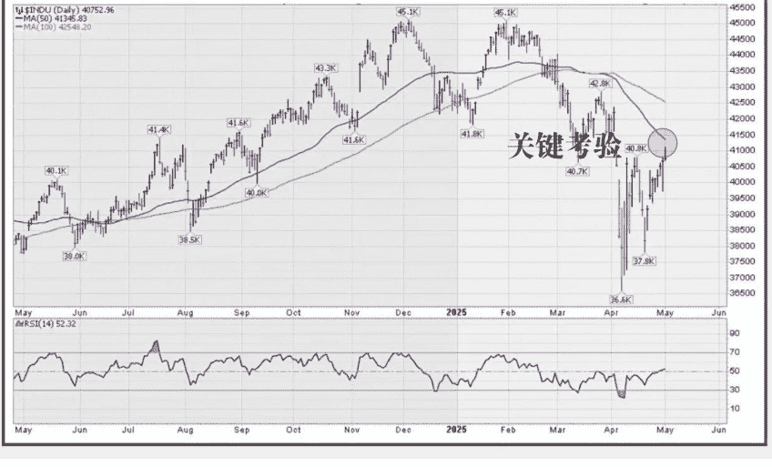
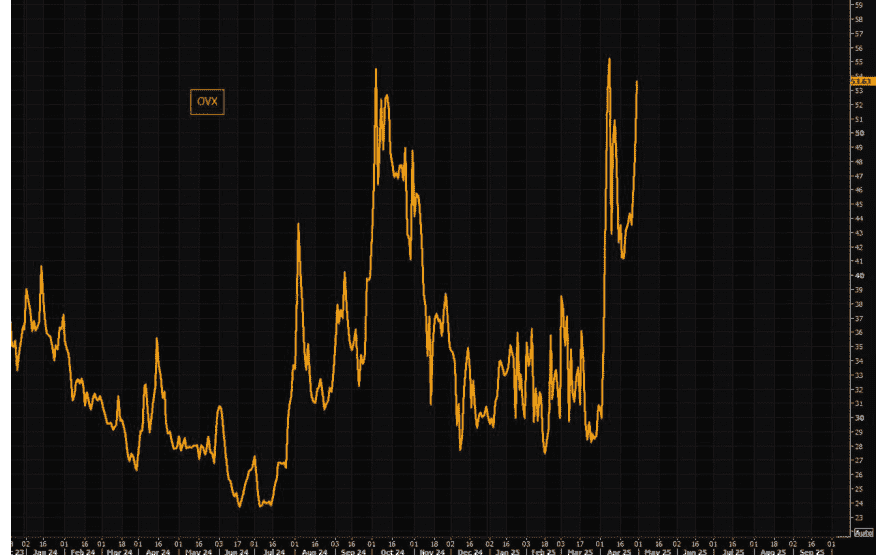

# NO. 118: 五月展望，迎天胜地

## 市场拼命奔走，却无法立稳

### 开篇：尚未迎来春天

4月结束，如果没有这个4月，你永远不知道世界正面临一场解放的危机。

在出现令人惊叹的波动后，全球股市市场奇诡地回到了4月2日“解放日前”的水平（美股是一个明显的例外）。投资者在关税公告上表现为关注忽视，但自90天以来互关缓和以来，情绪有所回升。不观察5月，金融市场尚未迎来春天。

- 第一，关税政策仍有很高的不确定性，目前特朗普一直口口号释放贸易协议的好消息，而市场尚未领悟他“极限施压”的策略。特朗普口号“释放利好”与真正落地之间往往与“盆意图”脱节；虽然“极限施压落地”（升级压力、扩大压力范围），市场或再次陷入恐慌。相比上一次的90天暂停，投资者更应关注后续判决节奏和中美高层的变动态，这才是政策风险的真正风向。
- 第二，经济数据将如何反映衰弱的影响。预计第二季的数据将继续疲弱，实体经济数据的进一步改善或将缺席。
- 第三，美联储依照现有信息，足以确定采取行动的时机，最终美联储降息的时机将取决于特朗普的贸易政策。正如位官员所说的那样“6个月后你会发现，劳动力市场增长已相对稳定，但通胀并未如预期下降，这意味着加息是没有必要的”。
- 第四，中美之间毫无接触的消息，目前我们所知的任何信息都是片面的。

目前而言，只能说市场化呈现了所有消信息，而接下来的市场将打破破局。5月，仍将暖天胜地。

微信:jntsg2

## 免费领取资料
加微信jntsg2，免费领取资料

## 1、暴跌结束了吗？会有新的下跌吗？

# NO. 118: 五月展望，震天撼地的市场是否见底？

| 市场是否见底？ |
| :--- |
| 税收和不确定性冲击击及本身，是否足够建立一个底部 |

在没有更多负面消息的情况下，市场可能出现一定程度的反弹。把视野放长远，当前仅是“渡过困难阶段”。

首先，这轮反弹有几个明点：

- 1. 下跌远，反弹也远。标500指数从4月2日的“解放日”以来，仅用了三个交易日的跌幅便接近15%，频繁其后的三个交易日收复了大部分跌幅。之后的三周，还有跌后重措，到4月后后一个交易日，标500指数收复了4月2日以来的所有跌幅。
- 2. 市场表现的背景是特朗普三次表示对等关税90天，取消电子产品关税，明确不会撤换储措。

这样的反弹并不能让人安心，更是特朗普的援兵之论，他并未达到的，仍然会想设法达到的。当前贸易政策的缓和或术性如此（如避免短期市场崩溃），而非策略性转向。美国经济或政治压力加剧（如中期选举），政策可能再次转向，导致市场波动。

其次，从技术图表看美股三大指数尚未有一个站上50日移动均线（投资者情绪分水岭），技术并无实质性改善。历史上，真正的底部随着多次回抽和均线修复，前反弹更多是超跌的技术修复。

加微信jnts2，免费资料群

## 图表盘
ANALYZE CHARTS
连日线图
WALL INFO

### 第三，市场触底需要三个条件：

- i. 贸易政策转向（现在仅是缓和）——在以往由冲击引发的市场调整中，市场通常不仅是在压力之下见底后止，而是需要有明显的反转
- ii. 美债储减（现在尚需确定性）
- iii. 经济触底——市场通常需要等到增长稳稳。

关税冲击见底，并不意味着股票触底，市场需要等到数据稳定下来。即便经济现状将在一段时间内保持底部，只要市场最糟糕时期已经过去，整个过程设定了一下限。

现在虽说最坏的情况过去了，但在经济环境下市场存在脆弱性：

- i. 当贸易政策的缓和程度，还不足以转型类比。未来还会出现的冲击，只要特朗普放弃“极限施压”策略，那么市场还会存在不确定性。
- ii. 标普500指数自历史最高跌幅21%，如果最终发生衰退，而4月底已经是底部，经济尚未全面恶化，这次回调幅度远超当前幅%。
- iii. 但如果经济能够避免衰退，市场再跌破的可能性很小。反转通常在真正复苏之前，市场对增长没有极限。

一般来说，如果经济或衰弱已经明确，市场看到压力的“源”出现，就会认为经济活动提前见底。这一次压力“源”来自特朗普，由此产生的影响也不知道。

我们应该保持开放心态，下面是计算的5月运行区间：

#### 道琼指数
- 转折点:3988该水平之上，倾向向上
- 运行区间:3897-4261
- 第二转折点:3720-4559(出现发展情况测试中某值)

#### 标普500指数
- 转折点:5366该水平之上，倾向向上
- 运行区间:5359-5859
- 第二转折点:5125(出现发展情况，测试中某值)

#### 纳斯达指数
- 转折点:16648该水平之上，倾向向上
- 运行区间:18518-19364
- 第二转折点:16196(出现发展情况，测试中某值)

## 2、游戏规则变了，但不是生命

| NO.118: 五月展望，震天落地 |
| :--- | :--- |
| “美国衰退论”与“美国例外论”重新定价 |

尽量并不完全认可这种反弹，但整体来看美国股市可能会优于非股市，因为游戏规则变了。

1) 这是一轮人为冲击，特朗普政策不确定性引发的，是故意之可控。最近一周的市场走势证明了“特朗普看储期、美联储看储期”确实实在，特朗普和美联储愿意以市场舱。

加微信jntsg2，免费资料群

2) 金融市场一直处于“美国经济主义”与“美国例外主义”左右摇摆。4月30日之后，市场将开始计入风险回归。当天公布的美国季度GDP数据（萎缩0.3%）是一个打破平衡的事件。平衡被打破后，市场可能涵盖更多的忧虑。随着经济衰退的加大，对美联储息的预期也将加剧。

3) 在关税90天后，金融市场出现两条明显趋势：
- 第一轨（4月初21日以后）“美国例外主义”的担忧广泛制约美国资产，股市表现不及非股市，美元走弱，同时性股票相对于防御性股票基本持平。
- 第二轨（自4月21日以来）市场表现出现美国股市、10年期收益率的超额表现和亚洲市场，特别是落后。美国股市与非股市之间的高频相关性再次下降。

这两条轨迹揭示了市场对特朗普认可度下降，因为其开始转向增加政策确定，并通过减税政策将影响经济和市场。

4) 美国的透明度高于其他国家。接下来特朗普将推动与其他国家的贸易协，而关税可能引发一些企业在美盈利，特朗普声称宽松的好将会出现。相比之下，其他国家所遭受的冲击是被动的，无法想象最终的影响有多大。

5) 当然，特朗普政策转型，市场对“滞涨”或“震荡”依旧在估值和利率层面不断持续，影响资产配置和风险领域。

接下来市场将进入美国资产的重估阶段，不仅是特朗普政策带来的焦虑，也会重新衡量其潜在收益。随着数据交替和政策的持续影响，市场在“恐慌定价”与“收益再平衡”间的切换可能变得更加频繁。

## 3、美联储正在经历重大反思

特朗普时刻提醒投资者，美联储的行动轨迹在他关注之内。而美联储也在经历重大反思，反思的内容是其货币政策并没有抵御特朗普的威胁，但让市场感受到了美联储独立性面临的危机。

前美联储主席伯尔·舒尔希在其专栏文中，指出当前的货币政策框架存在严重缺陷。下面是我们根据自身理解，总结的一些要点，但可能被美联储采取：

- 1、美联储20年采用了“灵活平均通胀目标”，即允许通胀在一段时间内高于目标%，低于目标，反之这种变化使得沟通更加困难，人们对于通胀足以弥补缺口产生不确定性。
- 2、“实现2%通胀目标”这句话是美联储经常在口头上，但并不简单。“实现2%通胀目标”对应的是“就业率最大化”。
- 3、当通胀与两个目标冲突时，哪个目标优先？美联储没有给出清晰答案，为了保持选择，也是由于特朗普的抨击。
- 4、建立清晰的量化和宽松框架。

## 4、美元，变盘前奏

虽然美元已经贵，但华尔街师们认为美元处于高位，进一步下跌的空间。理由是22年俄罗斯制裁以后，各国开始降低外汇储备比例，规模增长五倍——特朗普的行为损害了美元，引发了对美联储独立性的怀疑。尽管美国财政政策正走一条持续的道路上，美元价值随着时间的推移降低。

- 第一，我们将50水平视为多空点，如果某天的收盘价站上该水平，将会转为中性，并看向103-105水平。
- 第二，我们的恐惧与贪婪指数”（短期趋势）显示美元即将进入极度恐慌之时，同时，“恐惧与贪婪指数”（中期趋势）显示美元已远离极度恐慌，是初步步骤。
- 第三，美国财政长期强调“旧政策”，就现在而言美元上涨可能令其他承压。

加微信jntsg2，免费资料

## 5、石油恐慌

| NO.118: 五月展望，供应冲击同等级风险事件中 |
| :--- |

4月一般是油价走势最好的月份，但今年4月却是30年来最榨之一。

| OVX快速飙升至50的高位 |

- 1. 石油恐慌已经爆发，石油“VIX”，即OVX(全称CBOE原油波动指数)继续攀升至50以上，表明市场对油价的未来波动预期大幅升，与历史几次供应/地缘冲击同级别的事件发生。
- OVX与常见的股票波动指数VIX(基准500指数）类似，OVX是原油市场的波动性阴雨”，是衡量WTI原油未来30天波动率的指标。这意味着市场波动/不确定性增大，交易者在大量看涨和看跌期权，以冲击或投机未来油价的剧烈波动。油价短期内可能出现震荡：一方面，突发利好引起供应重启、需求改善油价可快速反弹；另一方面，若出现新的冲击（如进一步的地缘政治冲突或经济数据软），油价也可能迅速回调。
- 2. 近期油价下跌是两个事件相关的结果:OPEC+计划增产，中美贸易谈判仍传出矛盾信号。本质是对需求低迷、供应可能减少、库存充足以及全球不确定性巨大的推手。

加微信jntsg2，免费资料群

- 3、从“周度”“恐惧与贪婪指数”看，美国原油期货依旧在极度恐惧状态边缘徘徊，而布鲁特原油已进入极度恐惧状态，两者尚未确定触底。

我们计算的5月美国原油运行区间：
- 转折点:61.65(接近平值之下，倾向向下)
- 运行区间:53.92-64.46
- 第二区间:51.56-67.40(出现突发情况，则测试其中某个值)

## 扫码加入 星球TOP免费资源群
免费
- 每日免费获取高价值资源
- 可提供各类资源搜索服务
公众号: 星球TOP

价值
| ◆热门付费文章 | ◆各行各业报告 |
| :--- | :--- |
| ◆精选图书资源 | ◆副业赚钱方法 |
| ◆职场实用资源 | ◆AI政经自媒体 |

微信信号: jntsg8

及时

微信信号: jntsg2

专注

分享资料仅供个人学习，请及时删除，切勿商用传播

加微信jntsg2, 免费资料
