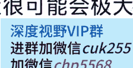

# 详情

珍大户 星期
2025/11/04 15:04 安徽

<黄金税收影响增补>

关于实物黄金回收那里，我又增加了一小段。

特别提示大家，这个政策很可能会极大影响实物黄金的回收价格。

因为不是11月1日起，新增的这个实物黄金的税收政策，大家还要注意，10月1日起各互联网平台报送营业数据，每个平台收款信息都能清清楚楚，若没有数据对比，想逃税是不可能的。

以前白商家回收个人的黄金，直走直接给出，然后后的黄金打成金豆子，网上再一遍，网上销售数据，淘宝又不报送，商家直接就隐藏了。这种生态会导致黄金的买价和回收价格，价差不大，所以消费者感觉黄金能保值的。

但是以后，所有白商家，哪怕微信收款都清清楚楚的话，每个环节都要加13%的增值税，那么再回收黄金的时候，因为个人没法给13%的增值税票用于抵扣，就意味着商家自己就要承担13%的税收，

围观不如如想法……

就意味着商家自己就要承担13%的税收，他一定要要在回收价里找回这部分成成本的。

如果行业利润率是2%，那么加上13%的税收成本，意味着回收价格，直接就要打85折。消费者自己买黄金1000一克，回收黄金只剩8折。

如果是首饰，中间还加上工费10%~15%，等于回收价格直接打7折。

你觉得这块黄金保值吗？
这种一张涨30%的行情，可不是年年有，以后就买进去，就变成谁套的了。

> 以前房子保值也是因为各种交易税优惠减免的政策，什么满二一，免各种税之类的。买房子的交易税很高，那房子也不会保值的。就比如公寓，同样有居住属性，你看着买卖一次，因为税收价格高，所以二手公寓很难脱手。

这个道理套用到黄金上，11月1号之前的黄金是以前的住宅税率，11月1号之后的黄金就变成以前的公寓税率，这种感觉……

所以我看前面评论区，结尾要买黄金之类的，我就怀疑，这种婚要要五金的传统可能没几年又变变化了。

反正国家现在这个意思，是不希望你买实物黄金，也不希望民间流通黄金，炒黄金可以可以，但去搞虚拟的，线上交易。不希望婚礼五金的习俗都换成个带有积金的折折……

#政策解读#

珍大户：[政策解读25-24]<黄金税收变化>11月1号突然发布的黄金税收政策变动的公告，且是从11月1号开始执行。内容特别绕，我看到的都是晕，后……

## 政策解读 一起讨论

分享至

👍 妮，企鹅的飞翔梦，Augus Chen，晴予，冉西！不想名字响，生活616，云，沉香味，Jenny Wang等40人觉得很赞

点赞 赞 收藏

评论(17)

默认排序

围观不如如想法……

## 深度视野优质集团（链接优质社群，助你成功）

全部包含以下内容：限时年费188/年 加微信cuk255

- ① 吃瓜群众微信圈文加时群群对话（原价 365 元/年）
- ② 子明私享汇（含）内部文章
- ③ 政事室（顾子明）付费内容加送顾子明群
- ④ 米联诸闲【作者米栖】（原价 599 元/年）
- ⑤ 欧洲金雀会员专属文章（原价 328 元/年）
- ⑥ 砖瓦斥内部圈（原价 400 元/年）
- ⑦ 卢文读书会专属文章（原价 699 元/年）
- ⑧ 鉴茶财经星球（原价 3310 元/年）
- ⑨ 猫哥的视界星球（原价 299 元/年）
- ⑩ 财经新周【独家新闻】（原价 1498 元/年）
- ⑪ 杨世在金圈（原价 2200 元/年）
- ⑫ 森淼财经星球（原价 1600 元/年）
- ⑬ 激游异译星球（持续更新）
- ⑭ 司马林解读毛选全套音频和全套书籍震撼割（原价 2.3 万）
- ⑮ 虚走三部民国梦、帝国争亡、不被理解的MAO（原价 599 元）
- ⑑卢克星球（原价 268 元/年）
- ⑰ 额外再送：卢元微博付费专栏、三村丰老王、三花九洞文集

不定期内容：——（更多资源不下去了……）

- ① 守夜人司令知识星球、接魔王知识星球、成术财富圈、雪花花甲等
- ② A视野、大树乡谈、江初优势、泮咩说、上海海学等付费文集
- ③ 西风付费文章、老端、高在八小时之外、局人的视界、升值、老A体制内等其它其它大V付费文章（每月不低于600元付费文集）

限时年费188/年 低成本链接网大V优质内容
