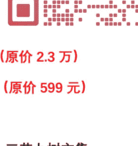

# 珍大户的主题

【帖子编号1042】<指数又要调整了>

上周交易基金所公布的，指数又要调整，因为指数基金要跟调调，所以指数要一调，基金会被动调调，卖出调出的股票，买入调出的股票。

指数调整生效的日期是12月15日，所以指数基金会被动调调也会发生在15日之后。如果符合预期的，可能会提前，也是在交易所公布的下周一到15日之前。

但涨跌影响因素很多。所以流入的股票未确定会涨，但是调出的股票会被被卖出，则很可能是要跌的……

我下载了她汇总的表格，下面链接的比我比较全。

A股大调整，涉及一大持仓股

但是大部分指数要有必要。影响最大的其实就是沪深300的指数，就这个基金规模最大了，影响会比较大。

但是流动比较小的可能会引起金炒作。

注意，这种预期调的手法不适合大部分，看着周末，看个苹果就好了。高风险偏好，只适合快手快反应，且能遭受损失亏而人的。

大部分人都是要养老长线投资的。年底了，信息也比较少，可能就个中央召开经济工作会议筹码，没什么了。如此还是安心生活，安心着，等大预测

# 深度视华图集 链接此处，助你成功

全部包含内含：限时188/18年
这里可以加微信群领取最新调整图表（3865）

加微XXX

- 中证华夏（基金，限时3865元）
- 南方白瑞（基金，限时599元）
- 景顺富瑞（基金，限时699元）
- 华发成长混合（基金 3330元）
- 国会添利均衡（基金 2596元）
- 财联添基（场外 1498元）
- 光大金利（场外 2200元）
- 深泰致远（场外 1600元）

# 深度视华集

加微群XXX

| 基金代码 | 入入名称 | 基金代码 | 入入名称 |
|---|---|---|---|
| 000008 | 一只大盘 | 002384 | 华泰瑞享 |
| 001289 | 万丰利 | 002625 | 山西景顺 |
| 002129 | TCL 基金 | 002963 | 光线添 |
| 003005 | 景顺富瑞 | 003483 | 景顺 |
| 006032 | 华发 | 003847 | 招金添 |
| 006199 | 国泰添 | 060030 | 华泰新锐 |
| 061785 | 嘉实添 | 060938 | 东方基金 |
| 063036 | 景顺添 | 066012 | 国民基金 |
| 068595 | 坤瑞 | 068993 | 华信基金 |
