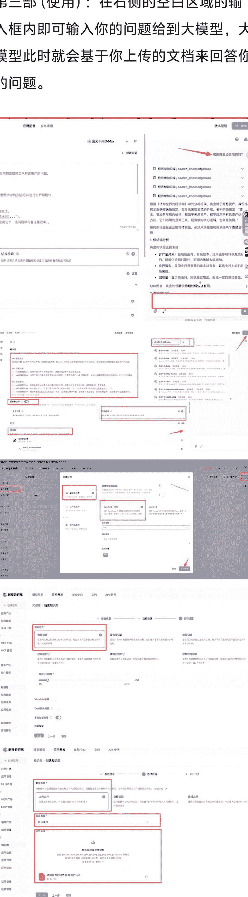

# 醉、随风的主题

2025/12/29

之前做了一个老师的智能助手，看到很多人也有关于某一项、某一项知识数据看到一个AI的需求（看到朋友想把她的课本知识教给一个学习助手）。不评论这件事有点无奈在回不去了。不过那人可能不如我所想的，我我知道的一个构建知识助手的方法或许可行，我也有几个挺头脑的idea可以在这里分享，希望都能帮到大家。

第一步（创建知识库）：在阿里云平台，选择知识库，点击创建知识库，选择版本，在新增设置里定义你自己的名称，然后点击显示模型搜索、图文件上传，点击下一步，在新的页面上准备你的文档，配置模型默认即可正常运行，不需要改用默认选项即可，点击完成。

第二步（创建大模型）：在阿里云百炼平台，选择模型，点击创建助手，输入应用名称，输入应用名其他也可以修改更改，点击创建助手。在新的页面中选择提示，我们会把创建的知识库关联到应用，选择q3-max大模型，输入你自定义的提示，点击解析后生成助手。

> 提示：提示词：每个人使用时使用的提示词不同，如果在不知道怎么写提示词，可以去ChatGPT等类似网站，把你的需求复制粘贴给它，让它生成提示词，然后再复制粘贴过来即可。

第三步（使用）：在右侧的空白区域的输入框内输入你的问题，大模型就会基于你上面的文档来回答你的问题。

来自辛彦的经济圈

辛彦 建8400+ 这里交流

# 深度视野优质文集，链接优质群，助你成功

全部包含以下内容：限时年费188/年 加微信cuk255

- 1 吃瓜群众信享绘圈加时时群对话（原价 365 元/年）
- 2 子明私享（含）内部文章
- 3 政事堂（原子明）付费内容内加送顺子群聊
- 4 米联储闲间【作者米楷】原价 599 元/年）
- 5 欧洲金雀会员专属文章（原价 328 元/年）
- 6 传五厂内部圈（原价 400 元/年）
- 7 卢克文青读书会专属文章（原价 699 元/年）
- 8 鉴茶财经知识星球（原价 3310 元/年）
- 9 猫哥的视界知识星球（原价 299 元/年）
- 10 财新周刊【独家新闻】原价1498 元/年
- 11 杨世光在金钱（原价 2200 元/年）
- 12 森森财经知识星球（原价 1600 元/年）
- 13 源泽译译付费文集（持续更新）
- 14 司马林解说毛选全套音频和全书珍藏版无割减（原价 2.3 万）
- 15 虚走三部曲[国梦、帝国争霸、不被理解的 MAO](原价 599 元
- 16 卢克文知识星球文章（原价 268 元/年）
- 17 额外再送：卢振元新浪博付费专栏、三村边老王、三花九洞文集

不定内容：（更多资源将下去……）

- ① 守夜人司令知识星球、接魂魔王知识星球、生有财富知识星球、
- ② 创业笔记、达越译论知识星球、财富财富圈、雪花甲老头等
- ③ A视野、大树乡谈、江初知道、泮咩说、上海海学等付费文集
- ④ 西风付费文章、老端、赢在小时之外、局外人的视界、升值、老体制内等其它大V付费文集（每月不超过600元的付费文集）

# 深度视野文集

# 进群微信cuk255

深度视野（付费文集）

限时年费188/年 低成本链接全网V优质内容

