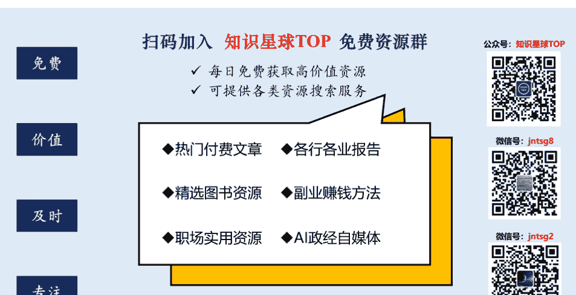

# 外卖行业外包站点藏利利润

250718 珍大户

@总忘铁刚‘京东藏利利润意思’，我是写京西省省略过了，意思是‘之前点评京东美国外卖大战时，说的外卖行业藏利润这件事’，当时说的是，美团的外卖环节的利润在外包站点上，是有外表隐藏的的——支付外包站点环节，显示不到财报里，算是一种环节上的贪污，或者说环节上的损耗。

京东砍掉外包站，外卖员直管的话，类似于等供应链环节砍掉中间商。就类似于来说，如果一个卖花盆的企业投 50%提成比例的大V带货，然后又拼命说自己不赚钱，很累，然后从财报上，你确实也看不出来利润，因为为成本很高。

但指定非要投大V带货是因为大V给返点了，支付出去的成本在私下返还给管理层，就方便进个人口袋。此时如果另一个企业场，不找大V带货，而是自己经营直直播，是能够实现环节省盈利的。

微加intgs2进资料分享群

此时如果外界一直叫，买花盆镜就是一个低利润不赚钱钱只能做慈善的行业，不信你看来只有a企业活着，你看财报吧嗒吧嗒。

为什么我说外卖行业的外包站点一定藏着利润了？我提问一句，大家想想吗？你见过转让美国外卖站点吗？

你想过去经营外卖站点吗？我们圈子小子7周年了，这七年里，我收到的至少6次以上的提问“能不能接手菜鸟驿站”的提问，至少3次以上的“能不能接手香烟店”的提问，至少3次以上的“能不能接手彩票店”的提问。但是没有收到过一次“不能接手外卖站点”、“不能接手茅台分销点”的提问。

哪个赚钱，哪个不赚钱，可见一斑。

但神奇的是，所有买茅台的股民都能说几句，说茅台有大量利润藏在茅台分销商手里，只要取消经销商，茅台上市公司的利润翻倍，因为市场价2500，给经销商的格1300。

没有任何买美团的股民bb，“大量美团的利润藏在外卖站点，只要取消外卖站点，美团盈利能翻倍，因为每个外卖站点都年利润百万千万...

我现在非常好奇的知道，加盟一家美团的外卖站点，是什么样的条件，普通人有可能经营的了吗？大家可以

# 搜索一下做一功课，看看条件是什么样的。

这部分基本没见过买美团的股民去提，当初我最早说京东能赢的时候，所有人都在跟我bb外卖行业的利润有多低，非说只有有美团才能精细化作，在微薄利润的行业勉强盈利。京东东做不到。

在我看来，增加外站站点外包这一层，本身就是管理能力弱，管理外包的结果，包括涵系、抖音系，主要经营的都是【平台】，所谓平台，其实是把商家的“周转管理”外包给每个商家自己，压积、退货等等成本，是由商家承担，把物流流转率外包给每个快递公司，货运速度由快递公司承担，这些各种环节外包，就是管理能力弱的结果，如果管理强势，则一定是各环节自己一手抓的。

京东擅长的恰恰就是供应链，是各种货物库存的“进存销”调配，是物流运转管理能力，这些一同构成了商业上很重要的“周转率”的概念，他们能把商品价格跟其他平台几乎持平，说明进销配能力很大了，能把物流价格做到比顺丰，还高效服务好，从四通一达手里抢份额，说明物流运输管理的能力已经超级级了，这种精细化控制的能力，是普通平台比拟不了的，这才是京东的城河。

由于美团，随着时间推移，大家早晚会看到，外面网友讨论的是什么美团的“护城河”都可笑的不得了。

美团没有什么可以称道的护城河，经营年头根本不算，以前赢靠是因为竞争对手太弱，不是美团实力太强，而是当时竞争外卖的对手，一个是做什么什么不是行的百度，一个是收购什么做什么做不好的阿里，都是被对手培养的。

最近阿里闪闯把美团拆的又变熊包了，原因还是阿里把钱了收归总部，阿里总部实力不弱，弱的都是各种收购后外部放的。

之前只有京东和美团两家的外卖大战里，京东要用自己的供应链优势，管理外卖派送供应链。

这种优势，往大说，有可能能捏美团，可以说吃掉 10%~30%的市场份额，但只要保守业绩达成，就能证明美团的护城河没有，能证明自己靠外卖加强电商业务，从整体获益，那股股价一定会有积极表现，这是我当时看好狗，看衰美团的原因。

现在出了一个变数，就是阿里亲自下场了,

京东全平台的电商吸引力是整体大于京东的，用户数量、打开频次都高于京东，这对京东绝对是个杀伤力。

# 知识星球付费资源分享
添加微信: intgs2

| 序号 | 公号/星球/社群 | 原价 | 领域 |
| :--- | :--- | :--- | :--- |
| 1 | 生态有 | 2765/年 | 副业，搞钱 |
| 2 | 容瓜众 | 365/年 | 时政，历史 |
| 3 | 记忆承载 | 365/年 | 成长，搞钱 |
| 4 | 欧洲金 | 328/年 | 时政，历史 |
| 5 | 卢克文会 | 699/年 | 时政，社会 |
| 6 | 体制内 | 599/年 | 职场 |
| 7 | 外人的视角 | 669/年 | 金融，时政 |
| 8 | 灏异谈 | 416/年 | 财富，成长 |
| 9 | 守夜人总令 | 599/年 | 时政，经济 |
| 10 | 江宁织府 | 365/篇 | 时政，国际 |
| 11 | 政事堂/顾子明 | 568/年 | 时政，经济 |
| 12 | 唐书院 | 1399/篇 | 金融，财富 |
| 13 | 大树乡谈 | 199/年 | 时政，成长 |
| 14 | 水库欧大 | 10000远 | 房产，经济 |
| 15 | 洪灏的宏观策略 | 4376/年 | 经济，搞钱 |
| 16 | 金政通鉴/北海道南山 | 4576/年 | 股票，行研 |
| 17 | 猫留的世界 | 299/年 | 时政，社会 |
| 18 | 飞浅云 | 3600/年 | 股市，经济 |
| 19 | 米联储见闻 | 599/年 | 经济，金融 |
| 20 | 鉴茶财经院 | 330/年 | 房产，股票 |
| 21 | 赢在八小时之外 | 365元/年 | 成长，职场 |
