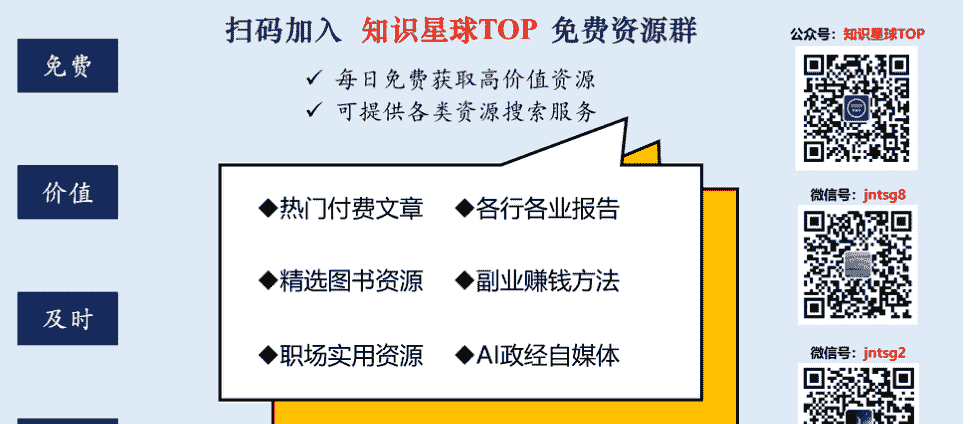

# 房产 2025 年预测

# 250718 珍大户

2025 年的房地产市场，对大家来说不是好消息，这句话的意思并不是特指房价暴跌，而是背后有更复杂的政策因素。

25 年的房地产政策出现了比较明显的“掉头”现象，这是值得我们注意的一个新阶段。

在讲新现象之前，我们必须知道，上一个阶段是什么方向？

上一个阶段，起始自 2023 年 4 月的局，大概终于 2024 年的下半年某个时间点。现在上一个阶段已经结束了，仔细回首回顾，我大概能说出来，上一个阶段的主旨内容，就是用一个具有“公益性本质”的住房和基建建设，来替代哑火的房地产经济。具体来说，是 23 年 4 月的局会上提出的，保障房建设。并且政策不止这一条，总共有三条：在超大特大城市积极稳步推进【城中村改造】和【平急两用公共基础设施建设】，以及【规划建设保障性住房】？请问，当时的这些政策，会怎样影响房地产市场呢？

只要从供需角度思考，你就会发现中村是居住环境较差的地方，里面的居民一定是有改善欲望的，他们本质上的需求端。但中村改造之后，一定程度上减少了对房子的改善需求。

而保障性住房，则是商品房的同端竞争，加大保障房建设，则又减少了商品房的需求。

所以当年的政策，依然是非常不利于房地产市场的。在 2023 年所有的关于房与建设的大上，你会看到，谈及房地产时依然有一个大的前提框架，还在继续延续说【房住不炒】，虽然房价是从 21 年开始下跌的，到 23 年已经开始进入第 3 年，但估计恐怕居民对房价的信心没那么容易打消，指不定还有人心里想着房价是小回调，所以害怕可能有一个松放松又变成房地产向上的拐点，所以才会政策继续从。

一方面，是不希望商品房继续发展，但另一方面，房地产哑火的影响，GDP，而且是有居住改善的需求，该如何满足。所以这个【中村改造】+【平急两用基建】+【保障房建设】的策略体系，有改善，有，有替代。

这套策略提法，在 4 月的局会上提完后，7 月的局会上继续保持这个方向，当年年底（23 年 12 月）中央经济工作会上，依然在提着这个方向，并且是“加速推进”。

按说中央经济工作会议是定调次年的，就是 24 年的方向，然而在 23 年 12 月的经济会议上提“加速推进”之后，24 年后所有政策中，这套策略全部消失不再提了。

并且自 24 年起，再提到房产时，第一个重大变化，是大前提已经开始变化，不再去提“房住不炒”，大前提定调为“房地产供需关系的新变化”。这个供求关系新变化，意味着，在领导的判断之中，中国的房地产市场供需关系永久地转了，不再是房地产稀缺，而是房地产过剩。再也不可能出现过去那种“炒房”行情了，历史条件已经根本性的变化了。所以还防什么炒房呢？谁愁谁自己就饿死了，但该想想怎么控房地产不要发生重大的风险。

第二个变化，是前面提了一年的【城中村改造】+【平急两用基建】+【保障房建设】，全部消失了。建设的项目不会停，但工作重点程度肯定是被大幅弱化了。

第三个变化，是工作目标变成了“防范重点领域风险”、研究消化量房、保交房等等。

回去年 4 月我看局文件的解读，在思考“怎么才能消化量房”这个时点时，我当时还在沿用【增加保障供给】的思维，觉得，如果不新建，那可以收购，这样就增加了保障房，又化解了库存。

后继 5、6、7 月份里，都确实有新闻看到各地的国企在收购保障房。从后续的力度以及后续的连续政策看来，收购并不是化解地产存的重点。（请大家思考为什么？非常值得注意）。4 月局之后，到 5 月，房地产市场出现了 517 新政，降低首付比例、取消贷款利率下限、下调公积金贷款利率。后续对房产的政策一直在微调，一直到了 9 月，开始对房地产定调为“止跌回稳”。

到了 12 月，经济会议上的整体表述变成了“持续用力推动房地产市场止跌回稳，加力实施中村和危旧房改造，充分释放刚性和改善性住房需求潜力。要合理控制新增用地供应，盘活存量用地和商业用房，推进处置量住房工作。”

整个政策的路径完毕，我要开始说“我的推测”了：

第一，大规模收购保障房的前提条件是，房价要足够便宜。国企不能成为接盘者。只有房价继续大幅下跌，才能开展收购保障房和扩充保障房的可能性。

第二，然而，房价下跌对经济循环有明显的制约作用。就跟去年验证过的（股价上涨拉动消费）似的，房价下跌则是让人感觉像是被套牢了，损失了大笔钱似的，从而冻结消费。这对内循环是巨大的打击。所以目前没办法再接受房价下跌的过程了，必须足够回稳。

第三，房价的止跌回稳，需要供需的变化。首先，需要购房需求增加，那么让谁来购买房子？基于第一点，国企不能成为接盘者，所以难有大规模的收购保障房了。所以只能靠居民增加购买。那么保障房是必要要建了，否则居民住房被保障改善掉了，就很难继续购买。其次是供给要减少。政策里已经明牌写了控制供地，本质意思就是减少供应地、严控供地，从而让房价止跌。

第四，保障房不得建，买不得买，所以……想申请保障房、公租房等各种福利房子的朋友，恐怕政策又开始变得恶心了。后续保障房类的住房，很可能是声音越来越小，不好听。

第五，房价的止跌回稳，需要供需的变化……（此处逻辑接上文）。

2025 年的，很可能是声音越来越小，不好听。222222222222222222222222需求下降了。

| 序号 | 公号/社群 | 原价 | 领域 |
| :--- | :--- | :--- |
| 1 | 生态有 | 2765 | 职场 |
| 2 | 宏吃鸭 | 365/年 | 财经、历史 |
| 3 | 莉风花 | 365/年 | 成长、财经 |
| 4 | 欧洲出口 | 328/年 | 财经、历史 |
| 5 | 虎克云 | 699/年 | 社会 |
| 6 | 体制内术 | 599/年 | 职场 |
| 7 | 局外的视野 | 669/年 | 财经、诗 |
| 8 | 涯随升 | 职场，年 | 成长、财经 |
| 9 | 守宁人物心 | 599/年 | 财经、经济 |
| 10 | 江宁汇 | 365/坝 | 财经、国际 |
| 11 | 事业党/破明 | 1399/坝 | 金融、财富 |
| 12 | 库书 | 1999/年 | 财经、成长 |
| 13 | 大夫树语 | 1000/远 | 房产、经济 |
| 14 | 水求丹 | 4376/年 | 财经、经济 |
| 15 | 洪源的蜜观 | 4576/年 | 财经、行业 |
| 16 | 金通通聚/海北山 | 599/年 | 财经、社会 |
| 17 | 归祈的世纪 | 3600/年 | 财经、市场 |
| 18 | 老王闯球 | 599/年 | 金融、经济 |
| 19 | 莱莱财经 | 330/年 | 房产、股票 |
| 20 | 在八十小时之外 | 365/年 | 成长、积累 |
