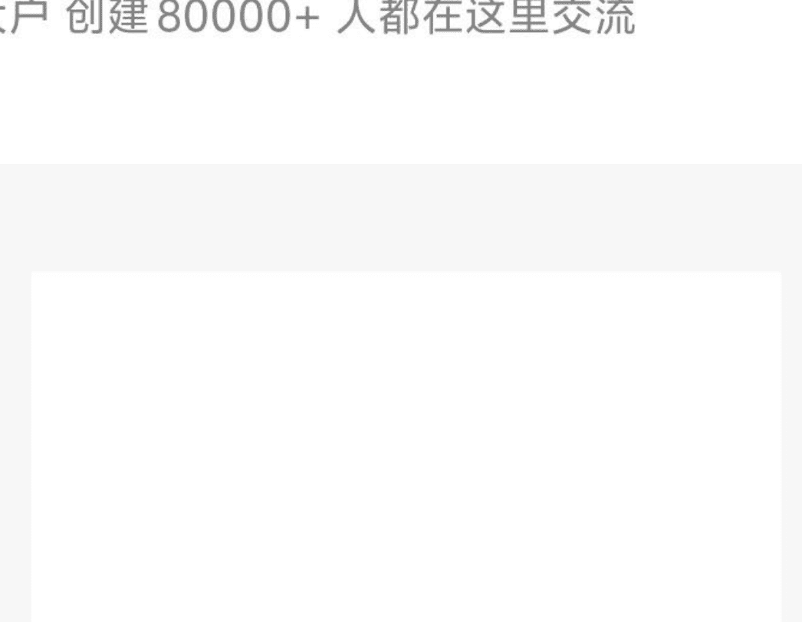

# 珍大的主题

2025/9/18 14:46

【毕业号1026】《电子难题》

我给大家看一个更怪的。

下午的时候，聚在一起谈起表情难题，他说他亏了几万，没有办法还在调的，看着我是跟一个同事亏，前面有多少好处都不会体会，少算失误的是。

我看到跟他就去拉了一把，多一点都没有，全亏连线2793，然后以后就可以再加入了了。我就想看看，是我亏了2763，还是我看不了圈子多了。

下午以后，终于结束了，有时候不想愿意说，也有类似的原因。
抛大的时候，是有个骰子的，有人就错了这个骰子。
抛大的时候，是有个骰子的。有人买了就要被套了。
提前说险，其中一条铁轨上躺一个个人，提前早，早早一天，结果第二天还有两个的尖没吃到，也会让人不满意。

你说的时候点准，还会会有你觉得你不提前，因为基金就要还T+1，结果我就不该想错的。
圈子里我自己想多跑几个人，说了多了就成了我的责任的。

只要对对我有负面影响，如果我就说我不错，赔正还满意，也会一些人亏些钱的。

就像一个字母，结果呢？风险呢？

有个骰子，掷了几个个人分别的铁轨上，另一铁轨上躺着个人，另一铁轨直接就会撞死你，如果你不刹车，铁轨就会换线路，撞死一个人，你就成了杀那个人的凶手。

请问你还是不按？

电车难题：火车撞五个个人，如果换方向，只有撞一个

而你只是正好拿着橘梯子滑而已

# 深度视野优质集团（链接优质社群，助你成功）

全部包含以下内容：限时年费188/年 加微信cuk255

- ① 吃瓜群众倍时圈文加时群群对话（原价365 元/年）
- ② 子明私享汇（内部）文章（原价568 元/年）
- ③ 政事室（顾子明）付费内容加送随子明群群
- ④ 米联储闲友【作者米穗】（原价599 元/年）
- ⑤ 欧洲金雀会员专属文章（原价328 元/年）
- ⑥ 砖夺瓦内部圈（原价400 元/年）
- ⑦ 卢克青文读书会专属文章（原价699 元/年）
- ⑧ 鉴茶财经知识星球（原价3310 元/年）
- ⑨ 猫哥的视界知识星球文章（原价299 元/年）
- 十 财财经周【独家新闻】（原价1498 元/年）
- 十一 杨世光在金钱树（原价2200 元/年）
- ⑫ 蔡森财经知识星球（原价1600 元/年）
- ⑬ 潇漾异译付费文章（持续更新）
- 十四 司马林解课全套音频和全套书籍扫描版无删减（原价 2.3 万）
- 十五 虚构三部曲[民国梦、帝国争霸、不被理解的MAO](原价 599 元）
- 十六 卢克知识星球文章（原价 268 元/年）
- 十七 额外再送：卢麒元新微博付费专栏、三村丰老王、三花九洞文集

不定期内容：（更多资源将下去了）......

- ① 守护人司令知识星球、接换魔王知识星球、成术开财富、雪花花甲老头等
- ② 创始人笔记、达叔谈论星球、成术开财富、雪花花甲老头等
- ③ A视野、大树乡谈、江初同学、咩同学、上海海家等付费文集
- ④ 西风付费文章、老端、赢在八小时之外、外局人的视界、升值、老A体制内等等其它一些V付费文章（每月不低于 600 元的付费文章）

# 深度视野文集
进群微信cuk255

深度视野（付费文集）

