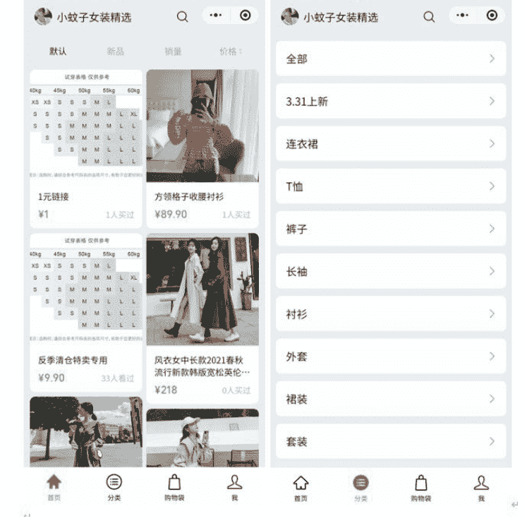
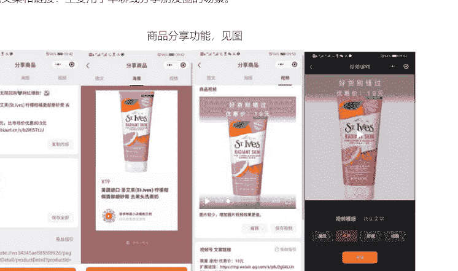
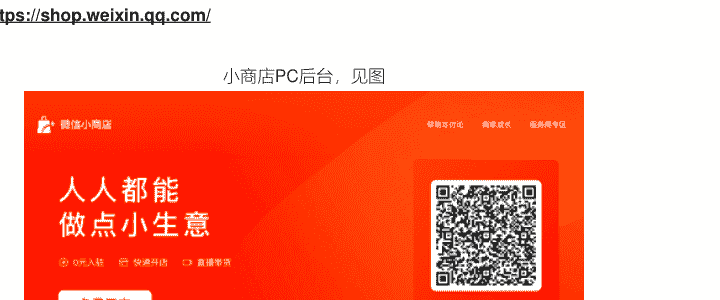
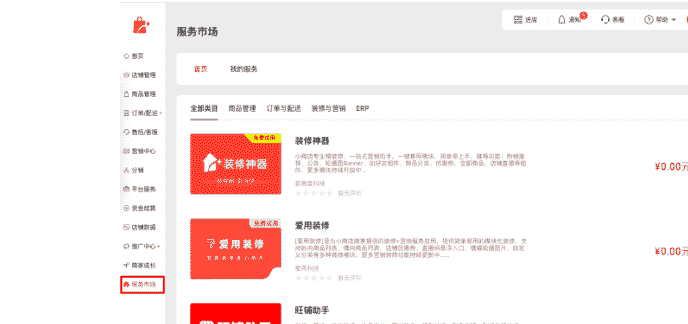
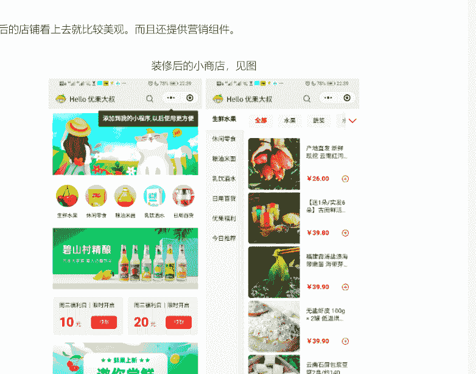
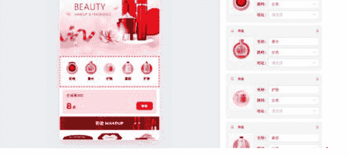
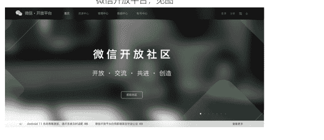
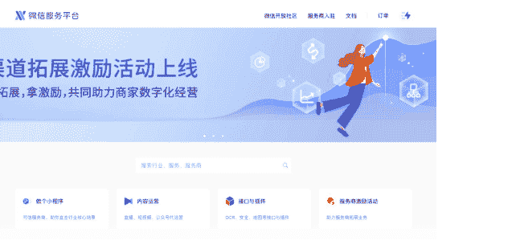

# “字长文复”1个人3个人打造一件产品收入1万的历程

来自 财有术

青予
2021-04-12 02:22

Hi，大家好，我是青予。从去年12月底了解到这个项目，今年1月开始正式研发，2月底正式上线，现在收入1万。

作为一个技术的创业者，产品、开发、商务、推广我们都是同路人，接下来我会介绍整个项目的打造过程，实现技术细节和应对各种风险完备的方法，希望对各位朋友有所帮助，尤其是想过产品创业或者职业的朋友，希望您有所帮助，同时也是对自己的一个阶段性总结。

这篇文章将从背景、初期项目、项目分析、技术细节、发布上线、设计问题、推广与分销、迭代、重大事故等环节展开。

## 项目背景

### 1.1 小商店

我的这个项目是基于微信商店的装修服务，类似于类店铺装修。说装修服务之前，我先介绍下微信商店，官方商店首页展示。

微信商店的首页和分类，预览

微信商店是微信向去年推出的新产品，去年7月14日开始公，官方的宣传特点是无门槛开店和支持视频直播间。

- 流量：这对于线下商店来说非常有吸引力的。毕竟，微信的流量费用不要几万，甚至几千。我微信的数据发现小商店的粉丝很多是直接线下小商店的。
- 直播带：微信的粉丝积累很快，视频号可以在小程序里直接连接小商店的。而且小商店可以直接接入扩展链接，到视频号的视频上，这个功能以前只能通过“扩展链接”工具才能实现。

小商店连接扩展链接是商家必须的功能。只要在小程序“小商店”就可以操作，认为官方的店铺功能是非常完善的。考虑了许多场景，毕竟在微信里，商家完全可以通过自己的流量进行推广。

### 1.2 小商店的支持方式

- 图片广告：自动生成投放广告，由于带有小商店链接，可以直接连接到有商品图片。
- 商品广告：可以创建控制广告位，主要用于公众号的投放，包括嵌入进来的公众号文章等，由于微信小商店也是小程序，所以投放时需要提供小商店名称和引导链接，才能跳转到首页。
- 商品引流：自动生成小的推广通知，主要用于分享朋友圈和私域场景。
- AI 视频：自动合成广告视频，有文字、标签、活动效果和背景音乐。支持标题调整参数，支持自定义标题文字，主要用于分享到视频号平台，主要是视频号。
- 视频号接入链接：自动生成视频封面和扩展链接，主要用于视频号带货场景。这个案例可以用AI视频就直接发布视频号了。
- 文本复制和链接：主要用于通过单页或分享朋友圈的场景。

商品功能分类，视图

### 1.3 个人店铺与企业店铺的差异

微信小商店支持个人、个体、企业开店，不同类型的店铺不能切换。开通条件和功能会有一些区别。

不同类型店铺比较，视图

| 开通条件 | 数据限制 | 收缴规则 | 费率 | 导引功能 | 导引分销 |
|---|---|---|---|---|---|
| 个人店铺 | 需绑定手机认证后开通 | 一个微信号只能开一个店铺 | 微信结算到个人账户，提现不超过1万 | 0.60% | 支持经营 | 不支持 |
| 企业店铺 | 需提交企业资质后开通 | 一个微信号可开多个店铺，企业最多开50个店铺 | 自动提取至公户 | 0.60% | 不支持 | 支持获客分销 |

### 1.4 小商店后台管理

小商店的基础管理功能都可以在小程序“小商店后台”里完成。

#### 1.4.1. 微信小商店PC后台

网址：https://shop.weixin.qq.com/

小商店PC后台，界面

#### 1.4.2. 小商店市场

去年7月17日，微信官方发布了商店市场，当时只能通过邮件邀请的方式获得内测资格，直到1月才正式开放（具体时间不准确）。商店市场主要帮助卖家经营过程中遇到的问题，弥补能力不足。商店市场的入口在小商店PC后台，点击左侧“服务市场”即可。使用时点击“我的服务”，点击右边的“去使用”跳转到相应的服务。当前的服务有四类：商品管理、订单与营销以及ERP。

服务市场，见图

## 初识项目

### 2.1 小商店计划

我是怎么接触到这个项目的？还是从做项目的时候另一个介绍的。在做小商店装修之前，我以为小商店是完美的，也就是官方宣传的“小商店计划”，最后发现是我想错了。小商店计划是通过订单订阅、实现API自动下载和流程。小商店计划的商品是经销商的，很便宜（这里有一个大坑）。至于小商店计划的意义，它之后会有解析：https://tzsq.com/

我最初的想法是：我想在688跨境平台，由于价格绝对优势，虽然不是最低，但是以后可以上线。我的模式比较高频，微信号没有自带流量，只能依靠自然流量，想要做一个电商程序几乎是不可能的。小商店计划并没有我想象中那么完美，里面暗藏着很多坑。

- 商品不是688的商品，这些商品是卖家自己挑的，很多卖家其实不便宜，所有的商品只是下单，商家也不会发货。
- 下单的价格是一个优惠价，并不是最低，但是划算。
- 一件代表的货，即使进入了商品库，也不是所有商品都可以下单。所以最终用户想直接下单，买一件的都是少之几。

### 2.2 圈子 @子凌

去年12月31日，为了推广我的小程序，我找到了朋友子凌，让他看看他的社群能不能帮宣传一下，因为我的小程序里现在有一位卖家可能需要一套。子凌说装修还是别闹，建议我不要装修太土了。同时他在商店社群里发现有很多商家有装修的需求，这对于小商家来说可以一揽了。当天晚上，就开始收集文档，同时用了竞争对手的平台比了一下，当下的5家服务商我都试过了。由于市场还是起步期，即使我多写文档也不行，只能自己摸索，虽然浪费了一段时间，后来才接到了微信对应的外部人Kyle，针对装修商家专门拉了社群和技术支持，在这里感谢微信的Kyle。

## 项目分析

当微信商店面对市场时，市场提供的服务有四类：

- 商品管理：主要帮助商家快速上架商品，包括平台级一键装修、商品质量管理等服务。
- 装修营销：主要帮助商家吸引新客户进行装修美化，以及互动的需求。
- 订单管理：主要帮助商家处理客户订单管理、发货等环节。
- ERP：大而全的小商店提供商品、订单、库存等管理功能。

### 为什么我会选择装修服务

原因一：装修服务比较灵活

相对于商品管理和订单管理来说，装修服务比较灵活，这后来在同学同步时也得到了对应的数据支持。默认的首页只有一种样式，正如我在上面介绍的小商店图片所示，风格比较单一、不活泼，不能修改显示样式，更不能添加组件，可以来说比较低阶。而且还有营销组件的。

装修后的商店，外观

类似于淘宝店铺，很多店都是装修过的，好看的首页能够给客户好的印象，增加好感，而且现在秒杀、拼团等玩法很流行，如果不能搞这些活动就很难。

原因二：装修服务可以定制

在开放的四类服务里面，ERP的单价是最高的，对比商品管理和订单管理，装修服务的单价第二。

### 定价规则

商品类服务（含ERP）遵循以下定价规则：
- 服务费低于15元/月、30元/季、60元/年、100元/年。
- 免费新用户最长15天试用。
- 用期低于7天。

订单类服务（含ERP）遵循以下定价规则：
- 服务费低于15元/月、30元/季、60元/年、100元/年。
- 免费新用户最长15天试用。
- 用期低于7天。

装修类服务（含ERP）遵循以下定价规则：
- 服务费低于200元/月、600元/季、1000元/年、2000元/年。
- 免费新用户最长15天试用。
- 用期低于7天。

ERP类服务遵循以下定价规则：
- 服务费低于200元/月、600元/季、1000元/年、2000元/年。
- 免费新用户最长15天试用。
- 用期低于7天。

原因三：装修是有特定的规律

- 商品管理：主要是一个店铺功能，需要开发经费，包含京东、拼多多等平台的商品推送到店铺。
- 订单管理：主要是物流数据，需要通过物流接口，适合对接。
- ERP：功能很多，什么都有。
- 装修：是基于官方“店铺装修”来的，只要设计师在里面做好就可以了。

这种类型我经历过，我觉得装修可能容易一点，只要上一个插件就可以，不然出去也行，感觉没太大。

原因四：可以增加付费项

装修服务主要是他们提供的，卖家创建自己的首页，然后调整为自己的商品和图片可以发布上线。作为年度付费，自然需要一定数量的客户。综合以上，我决定自己开发了一套装修系统，上架到小商店进行销售。

## 技术细节

要实现上面的小商店装修服务，需要开发哪些系统？答案：需要开发3套系统。

### 4.1 微信开放平台

首先要注册微信开放平台，成为第三方服务商，类似于小程序和小号。只要审核通过后才有权限调用相应接口。用户购买、取消服务都通过第三方的接口进行通知。由于小商店不能自助收费，只能通过第三方平台代收，这里收到的新用户的是免费试用和后期付费的用户。这个系统还是管理API的授权中心，没有界面，只需要通知接口。

### 4.2 装修后台

装修后台是用户进行装修设计的主程序，主要提供装修界面和营销活动的功能。这里的功能最复杂，需要用插件的操作来实现灵活强大的功能。对于产品设计能力是一个考验。装修后台需要实现前端界面和后端接口，后端接口除了处理装修系统本身的逻辑，主要是微信商店API对接。

我的产品“装修神器”的界面：

### 4.3 装修组件

装修效果是通过小程序插件的方式实现的，具体原理：小商店判断是否应用了第三方装修服务，如果使用了第三方小程序插件首页，首页页面通过接口获取全部店铺的装修数据，然后通过插件拼接出页面。小程序首页本身也是组件，并不是独立的小程序插件，所以有很多限制。装修页面可以包含各种组件，也可以创建单独页面，通过首页跳转到独立页面，独立页面和首页页面看起来相似，但是限制的。

装修组件需要先在一个认证的小程序中开发，实现一套后端接口和插件，插件需要提交审核，发布上线。所以来说，需要开发的系统有：3个后端系统、1个前端系统、1个小程序插件。

### 4.4 微信开放平台

除了开发过的系统，还需要在微信开放平台上进行相应的配置，以及上线服务。

#### 4.4.1 微信开放平台

网址：https://open.weixin.qq.com/。公众号、小程序服务的开发者应该都不会遇到问题。如果要跨小程序、公众号实现获取unionid，或者微信登录网站、APP，也是在这个平台。

#### 4.4.2 微信服务平台

网址：https://service.weixin.qq.com/。这里功能很多，除了了小商店服务，还有直播、视频号等服务商都可以进入。

## 开发上线

### 5.1 三周开发

通过上面的接口，大家知道要开发一套系统，工作量不少。我是新手，没有插件经验，前端开发框架：React、Vue.js我都了解了，但是真正的问题是：没有插件经验，我没日没夜地熬得很累。

很多时候是没办法，当只有时候，所有问题都只能自己解决。没日没夜的熬，终于在2月4日完成了版审核。

### 5.2 第二次迭代

接下来又遇到了另一个问题：没有设计稿，因为我没有设计，布局自己就不懂。但是现在非常迫了，按照大家说的，自己会搞定。两次审核失败了，第一次审核通过了要求修改了一些意见后再次审核。这时已经接近过年，通过微信群通知他们2月11日才会放假，我在2月7日前提交审核，按照理来说年前还有希望。回来刚第一周，第一件事就是跟进继续审核，找到了微信平台的对接人@小，帮我解决了，产品终于2月24日上线了。因为过年审核导致延期了两周，也提到了过年的痛点。

非常意外，上线第一周我就设置了付费锁。我预期了免费使用15天，本来预期过了15天用期会有人问是否购买？第一周有人付费，我还有点小惊喜的。这4笔订单里找到一个正反馈，我觉得这个项目可以认真做。不论是做产品还是做项目，保持正反馈非常重要，它让我们坚持下去的动力。

我的想法是：

- 有人愿意反馈，说明产品基本能满足需求。
- 我创建了企业邮箱，用户反馈产品非常好，说明产品体验可以的。
- 群里有用户提的需求、建议，我及时记录了真实的声音。
- 有用户提出要分钱，这个项目可能有化的希望。

## 六 设计方案

对于工程设计方面，我一直是个留漏洞，虽然强迫自己规定了几个模板上线系统，但是作为一个装修系统，不会增加新的麻烦，才能留住用户。为了解决这个问题，我第一次主动联系了杨晓，同时也请教了分销的问题。杨晓的回答很认真，语气非常用心。针对我的情况，我才先梳理设计，只需要需求明确点，小商店可以解决我的问题。

此后我花了一个星期来设计，认为花一周时间。因为我的情况，我必须由自己设计成系统，所以我已经上线了设计系统，登录这个系统就完成了任务。这个系统就是交付系统，只要设计好，就可以来用，不用麻烦了。

### 6.1 圈 @小萌的帮助

首先联系萌，群主主动联系了我们，我们打了电话后，我正在帮她做一些这件事，当好到时发现我们有性见面了，我每天都忙得很累，她是一个非常不错的设计师，还有许多资源。小萌帮我认真做了一个初版，结果不是很理想。我反思后发现了问题，都是我自己的锅，是我自己没清楚，非常感谢 @小萌的帮助。我非常累，很愧，耽了她不要时间。

辛我*

11. 太多了，推广，商品，布局都需要做，看起来还是推拉、配一下颜色，但是如果不好感、有相关的链接，就不知道如何做，就可能没效率了。对于设计师来说非常不友好。

总的来说，我总结了我的SOP，但是这个是有问题的。我的SOP是一个人来设计，就是这个这个人，又要那个……如果在公司内部，要求这样做，如果公司开放了市场，显然行通。你不能要求一个专业的设计师专门来做陌生的项目，只为几个装修模板。

### 6.2 宝美容

为了设计的难题，反思一下，我自己和关系有关的工作都做了，最后就用模板来设计了。由于我需要的其实只是一个简单的设计，我想这应该能解决问题了。

这次我用这种方法解决了难题：寻找宝宝美容。

我在淘宝上找人设计的，差异很大，而且还没有试错，不试错的风险太大了。所有的店都说不退款、做到为止，但是实际上早就没戏，这一次我才是真正面对外包的难。

经过比较，我确定了一家设计后，并且要求一个试错。首先提前对接就是说是这个价格的，价格的几乎没有可以，要求他让我试做一下，就可以收稿了。
知道，换了一家设计，然后又是新的装修来一个要求，完全没交。
然后是第一款，基本上就能完成，因为太简单了。
接着就是第二次的沟通，还是对方的设计效果怎么样，但是我的时间都浪费在教他怎么做了，最后，最后的结果就是：第二天交图出来，期间我还要不断沟通……真是难尽了。

通过这次外包，总结了几个教训：

- 1. 外包的利益不能和想法是一样的，所以不是钱的问题，只给钱也解决了问题。
- 2. 想要的效果，还要出钱，要求和你自己没怎么样，花了钱还浪费了时间。除非你没有什么要求。
- 3. 紧急需求不能找外包，对方对你的急，肯定要马虎对待。

这里不是外包的问题，而是当你使用外包时，要清楚自己想要什么，如何应对。

### 6.3 旧行业和客户

然后我又找了之前的同事，由于我们没有关系，他说你妹妹就是做美容，可以试一下。后来也没有了消息。

就在我主动寻找设计师的时候，有一个客户加我，主动提出合作，说他是做美容。希望合作装修。我这正正好好，他这几天要回家一次，等回来联系我，然后也没有了回复。

### 6.4 城市画@郭峰

最后的设计的难题还是晓峰解决了，我看到他朋友的求助贴，可以设计一下。次日日上午我去他的办公室找他，我给他介绍了我们微信小程序和装修服务是怎么回事的，我的需求是理想样的，并提供了参考案例。通过这次沟通，他就知道我想要什么，以及要实现什么样的效果。

第二天设计师就做了一版的，效果非常不好，而且非常满意，第一次就这么好，我就放了心了。

设计的问题也算解决了。

还有没有设计的圈子找到了，因为我自己要做的模板都给到太详细了，所以只能在后面开放设计入驻和装修功能后后再合作了，感谢大家。

## 七、推广与分组

### 7.1 口头承诺

一开始就开始设计承诺，但我没有分组系统，本来想着再开一个分组系统后，才开始收到平台通知，3月1日就开始收取20%的服务费，我就紧急发了一个分组规划，3月1日前购买直接返佣20%后，发现竞争对手又找了一个对手，没有限制分销20%，而且他们有一个分组系统。

我打算完全妥协，就对分组规则给开了。

- 1. 首先在3月1日之前的限制条件，20%返佣规则有效。
- 2. 增加奖励政策，按销售金额分销额外赠送分销比例。
- 3. 满万，奖励3%
- 4. 满2万，奖励5%
- 5. 满1.4万，奖励10%

因为我没有设计，所以这些政策也是直接接了，套用到自己的产品上计算成本，没有问题哦，激励政策如下：

前期分销还没懂，加微信申请邀请、推广。这样卖就能赚最多30%。三十二天以后，跑过来再说吧。

后来有一位做视频培训的老师，联系我做推广的事情。因为小商家支持微信带货，所以他想缩小装修的规模，同时增加装修服务，希望能够获得更多的佣金。由于从小商家分组以来，没有实际的分销分成，把分佣比例提高到40%，考虑到要收取20%服务费，实际我只能做到40%，所以分佣只有55.5%。

### 7.2 一个分组系统

为了满足分销数据的需求，为了能够分销的积极性。我马上开发了一个分组系统。这套系统通过微信同步，实现了分销权限、自注册、自动取销链接和分销二级。

微信官方开放小商家店铺活动，在8月开始获得10%-20%的佣金。关于这个规则的详情可以通过我写的这篇帖子《微信小商家平台流量激励活动，获拉抽额外奖励10%](https://lrsq.com/N3eEEa_q= )

所以在设计分销系统时，只要配合合适的分销，只要用户购买佣金的服务了，我就可以获得官方的10%-20%佣金，以此来节省一些费用。如果分销员不拉占自己分销的装修服务的，40%也是不变的。通过一周的开发，终于结束了，这也是第一次做分销。因为需要考虑退款和结算的问题，所以实施时，不能即时的奖励要给折扣，目前没有什么办法。

为什么还是想做分销？因为大家实在太大了，我想做大一点。

流量其实是主要来源于几个途径：

- 1. 自然流量，即用户已经有了需求，通过市场挑选来购买。
- 2. 转化流量，包括老用户介绍、KOL推荐。因为直接购买入口，所以所有流量，即使通过内容给用户种草。

高效流量是非常重要的。一开始尝试做分销，我犯了一个错，没有完全改进，还需要优化。

为了扩大流量，我通过官方在微信小程序上架、发了朋友圈，又要技术对接。现在看来，设计的分销还是存在问题，还没有产生订单。因为商店并不提供直接单品的价格，所以我选择了优惠券来实现。

一般分销的流程是：点击“立即购买”，分享商品给好友（或开广场让大家参与），好友与参与一同完成流程。当参与人数达到要求即为成功。

我的流程是这样的：开“圈”为成长，分享活动有优惠（没有广场），好友与参与团，参与人数达到要求后成功，团长和参与员可以领取商品临时折扣。

## 8.2 带货商品

因为没有接口可以直接获取到货商品，带货商品一直没有办法使用装修服务。有一家服务商，通过用户扫描的方式，模拟用户登录后台，抓取到货商品。这种实现方式可以通过获取到货商品，但是不能实时更新，每次新增商品都需要再次扫描，非常方便。

通过hack的方法，可以获取到货商品，并打出了“第一个”的口号。做产品不是一件容易的事，你需要关注的情况，还要保持产品的独特性，如果不知道自己的竞争优势，最终只会变得普通。

## 九、重大事故

因为明显感知到产品与竞品的差距，只能功能快速迭代。如果把转化拉到位了，然后转化率不能达到100%，付费都是很高的，而且100一年的客户单价，无法成单。

一周六天，每天8点到晚上1点的工作强度，做事情，忙了很多，也发生事了。事故导致完全没解决，可以说是错了。从9点到第二天上午11点，持续了14个小时，真是一惨如睹。通过这次事故，我告诉自己：要稳住自己一定要提供稳定的服务，用户可能被耽误了。

在这次事故中，我也学会了教训：

- 1. 整个过程都给用户发布，通过用户说明事故原因、临时处理方案以及修复进度。通知后续进度和改进预期。
- 2. 通过两个途径联系相关人员，如果通知没有，影响可能会超过24小时。
- 3. 增加了上线前的测试，为了赶进度而跳过了上线前测试。

整个过程，对于等待评审期间是最难受的。

## 十、总结

就是我们这3月的经历，通过这段时间的努力，卖服务的收入已经过去，虽然不是理想的，但是证明了我的能力可以做到一点成就。

在这个时候，我也告诉自己，要不要贪留，更大的战线在后面。我现在是通过技术和产品实现了从0到10，我必须锁流量、推广，而这些正是我不擅长的领域。

如果你现在想在小商店做装修服务，我是不建议的，不是因为我自己想省钱。而是竞争已经激烈了，从一开始到看到第5家商家，到线上卖的8家，到现在的增长到15家服务商，可以可见竞争会越来越激烈了。

如果你还有想拓展微信小商店的流量，可以关注流量、运营、供应链等领域，我可以提供官方方的联系方式。

做一个苦恼的技术创业者，做出一个产品真的不容易，如果您对微信小商店有疑问欢迎联系我，如果你能帮我推广分销，更是感谢不尽了。

# 扫码加入 知识星球TOP 免费资源群

公众号: 知识星域TOP

- * 每日免费获取高价值资源
* 可提供各类资源搜索服务

分享资料仅供个人学习，请及时删除，请勿随意传播
