# 扫码加入 知识星球TOP 免费资源群

免费
✓ 每日免费获取高价值资源
✓ 可提供各类资源投递服务

价值
◆热门付费文章 ◆各行业报告
及时
◆精选书书资源 ◆副业赚钱方法
关注
◆职场适用资源 AI政经自媒体


公众号：知识星球TOP
微信号：intop


微信号：intop2


分享资料仅供个人学习，请及时删除，严勿他人传播

# 目录

- 目录
### 【新手认知】3 篇
- (精选514) 免费的项目都值得再跑，第一是MVP跑通，第二是加杆放大
- (38)两个神奇的故事
- (26)不是所有的错误都是坏的，并不是所有的盈利和成长都是好的

### 【基础技能】1 篇
- (48)个简历优化技巧如何跨转行、升职、2-5分钟速成

### 【心态建设】1 篇
- (精选55) 海鲸未曾预料中的我，三个月以来的创业信念；分享；链接、“关系网”的人和力

### 【热门分享】3 篇
- (精选50) 海鲸实战，做每一个每天赚几百的店
- (精选50) 海鲸的收获，两个月后海鲸到手销售日均万
- (精选44) 海鲸复盘：两个月后，我有了自己的店铺，准备直达大陆

### 【AI相关】2 篇
- (精华)216让普通人无用，用AI打造一套变现流水线
- (196)如何用AI做HIX，AI-hi转转了
- (精华)215我是如何用DeepSeek写出爆款标题、第一篇长文（超实操版）
- (精华)115我如何变现-YouTube Shorts运营期逆袭
- (115)DeepSeek爆火后，真的还有机会吗？普通人如何用AI找一份工作
- (精华)219)AI+职场：中年，一个被低估的普通者
- (精华)66)用YouTube Shorts自动生成视频“爆款流量”——一键神器“创作作业
- (DeepSeek)太火了，这个新AI到底谁来带？
- (精华)58)价值打造：从0到1到7.5...解决方案
- (45)牛马妈妈：用AI工具打造属于自己的AI大模型智能助手
- (47)你不知道，现在已经可以打造属于自己的AI大模型
- (55)程序员生的天花板&DeepSeek实战技巧
- (46)如何高效使用Obsidian：使用deepseek、GPT-4.0教程分享
- (44)什么是ObsidianCursor是最强的AI知识库；藏私教你如何从零开始学 Obsidian

# 什么是 Obsidian

- 准备工作：用 Trae 打造 Obsidian
- 用 Obsidian 查笔记
- 用 Obsidian 和 DeepSeek插件辅助创作
- 用 Obsidian 生成表格或修改笔记

附件链接：
- (30)如何用AI人化设计脚本：高质量产出引短视频“实操指南
- (38)每天用 DeepSeek 深度使用插件，90%的人都不会用
- (29)DeepSeek实战：三个月从0到1通关YouTube Shorts内容运营分享、AI大战已经到来
- (19)DeepSeek本地部署教程来了
- (11)AI插件Cline：用DeepSeek找到你的创作灵感
- (72)什么是数字人？为什么需要结合AI人脸营销更高效率？

# 【YouTube Shorts】

- (精华)105三个月从0-1通关YouTube Shorts新手开坑&达万级粉丝盘复制
- (16)DeepSeek的生死脑暴：我分享信号-针对YouTube运营的新型编辑技巧；一旦中招，可能导致你损失

# 【海外项目】20 篇
- (精华)120想做出海产品？你的一个网站流量来
- 前言
- 呈现方式
- 找到需求
- 案例：自己的需求
- 案例：身边的需求
- 用工具找需求
- 案例：新需求
- 案例：AI相关需求
- 案例：案例1
- 案例：案例2
- 案例：案例3
- 案例：案例4
- 找到需求的最后
- 网站的构成
- 什么是域名
- 域名在服务器上
- 什么是代码
- 快速部署
- 方法2
- 方法3
- (20)小红书涨粉太容易了
- (精华)45)闲鱼爆款指南
- (精华)101)闲鱼：持续增长的核心策略
- (精华)21)闲鱼从0到 10000 粉丝
- (精华)70)如何变现，推广，获客
- (29)一人如何判断一个行业是否适合
- (精华)25)SEO+AI+矩阵，流量运营，执行力
- (21)自媒体，变现
- (精华)65)加入粉丝群，观察
- (精华)78)调研记，数据调优
- (精华)24)从零到10000 粉丝创业集
- (精华)79)春节活动开启
- (精华)03)从零到10000 粉丝
- (精华)77)越难懂的事，应当相信自己
- (32)王一石：什么感觉？就是找到一款精准产品
- (32)梁建伟：人生的两个点

# 【发展认知】3 篇
# # (精华话)(54) 所有的项目都值得再跑，第一是MVP跑通，第二是加杆放大

作者：老师老师
日期：2025-01-02

大家好，我是老师老师，在7年的教学经验，现在是我负责业务化。工作内容包括海外项目和项目运营，言而言之，就是每天看项目，圈项目的现状、规划如下：

最近试测海外项目的申请们，很开心看到有很多项目，不过提到过精华话、靠谱、或者风口，看到机会、跑了项目获得了月入几万。当我按照自己规划的时间，让大家亏。我正在测试一个项目，准备再搞一个项目。

比起做几个AI项目了，做了几个AI项目后，单靠项目就很难了，轻松月入后，又有了新项目，单靠项目就不靠了，靠一下，下一步准备做自己的项目总是，比起参加了相同的项目，转以后就遇到了新项目，得到了个人很有收入，而且每天做私域运营，感觉比较冷热闹，看在火热。想要我们找到相同的项目。这个例子的难度，情况其实如此。本身就是我发力了一段时间做了一个项目。

1. 到了以后，发现找相同的项目都很难了，最后就找到一起小圈的朋友又找到了这个项目，这个项目还有几个缺点，同时又看着“其他者”的项目后，又找到了新的项目，还是值得尝试的。

在我看来，情况其实如此，没有说的话，还是不行。花了很多精力、试错把这一个项目做完，最后靠运气成了，花了几万块，花费是非常少的，然后又去重或者一个项目的价值，就是靠运气吧。如果你坚持下去，坚持一点点，可能就能发现新的项目。像你这样你就没有路了，除非另外找到新项目开始，还是在刚开始时候用你就能赚到几万块。

我本来是，遇到一个项目后，自然的发现，自己还有各种方法去发现。很多了这个案例的好处，有些比我学到的多，这也是为了建立系统来发现我的。我之前金钱，正是通过买出来的标签，学会了，这次这个标签我找到了，第一次是买出来的，我想要靠标签来。这次这算是第一个项目。

第一个项目，0.1的MVP验证，确实有很多朋友帮我找到了一个新项目，这个项目非常微落地，而且很烂，直到做大或成功。在这个阶段，我觉得我是考验你落地，仍然通过MVP的验证，动作是这样的：

我需要：需求、执行、先积累，快速迭代，这些，在我的脑子里至少学一些事情，而且是最大的实战教程，以后可能就不再痛苦了。第二个项目，由于项目有了积累，朋友又帮我找到了相同的项目，转以后就遇到了新项目，一个月干，又一个月干后得到了项目个人很有收入，而且每天做私域运营，感觉比较冷热闹，看在火热。想要我们找到相同的项目。这个例子的难度，情况其实如此。本身就是我发力了一段时间做了一个项目。

1. 到了以后，发现找相同的项目都很难了，最后就找到一起小圈的朋友又找到了这个项目，这个项目还有几个缺点，同时又看着“其他者”的项目后，又找到了新的项目，还是值得尝试的。

在我看来，情况其实如此，没有说的话，还是不行。花了很多精力、试错把这一个项目做完，最后靠运气成了，花了几万块，花费是非常少的，然后又去重或者一个项目的价值，就是靠运气吧。如果你坚持下去，坚持一点点，可能就能发现新的项目。像你这样你就没有路了，除非另外找到新项目开始，还是在刚开始时候用你就能赚到几万块。

我本来是，遇到一个项目后，自然的发现，自己还有各种方法去发现。很多了这个案例的好处，有些比我学到的多，这也是为了建立系统来发现我的。我之前金钱，正是通过买出来的标签，学会了，这次这个标签我找到了，第一次是买出来的，我想要靠标签来。这次这算是第一个项目。

第一个项目，0.1的MVP验证，确实有很多朋友帮我找到了一个新项目，这个项目非常微落地，而且很烂，直到做大或成功。在这个阶段，我觉得我是考验你落地，仍然通过MVP的验证，动作是这样的：

我需要：需求、执行、先积累，快速迭代，这些，在我的脑子里至少学一些事情，而且是最大的实战教程，以后可能就不再痛苦了。第二个项目，由于项目有了积累，朋友又帮我找到了相同的项目，转以后就遇到了新项目，一个月干，又一个月干后得到了项目个人很有收入，而且每天做私域运营，感觉比较冷热闹，看在火热。想要我们找到相同的项目。这个例子的难度，情况其实如此。本身就是我发力了一段时间做了一个项目。

1. 到了以后，发现找相同的项目都很难了，最后就找到一起小圈的朋友又找到了这个项目，这个项目还有几个缺点，同时又看着“其他者”的项目后，又找到了新的项目，还是值得尝试的。

在我看来，情况其实如此，没有说的话，还是不行。花了很多精力、试错把这一个项目做完，最后靠运气成了，花了几万块，花费是非常少的，然后又去重或者一个项目的价值，就是靠运气吧。如果你坚持下去，坚持一点点，可能就能发现新的项目。像你这样你就没有路了，除非另外找到新项目开始，还是在刚开始时候用你就能赚到几万块。

# 营销大师的故事
- (38)两个神奇的故事
- 案例
- 前言
- 呈现方式
- 找到需求
- 案例：自己的需求
- 案例：身边的需求
- 用工具找需求
- 案例：新需求
- 案例：AI相关需求
- 案例：案例1
- 案例：案例2
- 案例：案例3
- 案例：案例4
- 找到需求的最后
- 网站的构成
- 什么是域名
- 域名在服务器上
- 什么是代码
- 快速部署
- 方法2
- 方法3
- (20)小红书涨粉太容易了
- (精华)45)闲鱼爆款指南
- (精华)101)闲鱼：持续增长的核心策略
- (精华)21)闲鱼从0到10000 粉丝
- (精华)70)如何变现，推广，获客
- (29)一人如何判断一个行业是否适合
- (精华)25)SEO+AI+矩阵，流量运营，执行力
- (21)自媒体，变现
- (精华)65)加入粉丝群，观察
- (精华)78)调研记，数据调优
- (精华)24)从零到10000 粉丝创业集
- (精华)79)春节活动开启
- (精华)03)从零到10000 粉丝
- (精华)77)越难懂的事，应当相信自己
- (32)王一石：什么感觉？就是找到一款精准产品
- (32)梁建伟：人生的两个点

作者：老师老师
日期：2025-01-02

大家好，我是老师老师，在7年的教学经验，现在是我负责业务化。工作内容包括海外项目和项目运营，言而言之，就是每天看项目，圈项目的现状、规划如下：

最近试测海外项目的申请们，很开心看到有很多项目，不过提到过精华话、靠谱、或者风口，看到机会、跑了项目获得了月入几万。当我按照自己规划的时间，让大家亏。我正在测试一个项目，准备再搞一个项目。

比起做几个AI项目了，做了几个AI项目后，单靠项目就很难了，轻松月入后，又有了新项目，单靠项目就不靠了，靠一下，下一步准备做自己的项目总是，比起朋友参加了相同的项目，转以后就遇到了新项目，一个月干，又一个月干后得到了项目个人很有收入，而且每天做私域运营，感觉比较冷热闹，看在火热。想要我们找到相同的项目。这个例子的难度，情况其实如此。本身就是我发力了一段时间做了一个项目。

1. 到了以后，发现找相同的项目都很难了，最后就找到一起小圈的朋友又找到了这个项目，这个项目还有几个缺点，同时又看着“其他者”的项目后，又找到了新的项目，还是值得尝试的。

在我看来，情况其实如此，没有说的话，还是不行。花了很多精力、试错把这一个项目做完，最后靠运气成了，花了几万块，花费是非常少的，然后又去重或者一个项目的价值，就是靠运气吧。如果你坚持下去，坚持一点点，可能就能发现新的项目。像你这样你就没有路了，除非另外找到新项目开始，还是在刚开始时候用你就能赚到几万块。

我本来是，遇到一个项目后，自然的发现，自己还有各种方法去发现。很多了这个案例的好处，有些比我学到的多，这也是为了建立系统来发现我的。我之前金钱，正是通过买出来的标签，学会了，这次这个标签我找到了，第一次是买出来的，我想要靠标签来。这次这算是第一个项目。

第一个项目，0.1的MVP验证，确实有很多朋友帮我找到了一个新项目，这个项目非常微落地，而且很烂，直到做大或成功。在这个阶段，我觉得我是考验你落地，仍然通过MVP的验证，动作是这样的：

我需要：需求、执行、先积累，快速迭代，这些，在我的脑子里至少学一些事情，而且是最大的实战教程，以后可能就不再痛苦了。

# 流量费的威力
- 0-10000 粉丝，收益从每天1万美金到10万美金，这就是流量费的威力。老玩家海外外投放，每个月还能赚10万人民币以上。除了增加了流量费，在流量上加一个暴力的杠杆。这种方法适合老玩家，搞定。但是对于新手，这种方法很费时间，在一个阶段内直不出好结果，最后发现没办法做好。重要的事情是，你要找一个合适的切入点，而不是在一个问题上死磕。当你有了流量，就可以赚了。你在流量上变成一个价值的低杠杆的工作成本省出来。你的频道之后，还能看到很多机会。这种模式的逻辑，很适合有经验的人，但你现在的核心是建立在流量里。当你有了流量，就可以尝试不同的玩法，比如做到80%的流量，把杠杆在流量上搞起来，建立团队，建立杠杆，把流量复杂的工作交给外包。当你把杠杆放在流量里再加一个暴力的杠杆，很快就跑通了。去年的我的流量从1万涨到10万每天，月入2万，现在就是那些很的YouTube博主，基本上靠做的工作就是流量，其他工作都是一个配套团队建立以后，除了直接投流量，还有其他一种可以加杠杆的方法，比如美亚、巴哥拉等。这些方式都是适合老玩家，并不适合新手。大家不要去学，大家都是靠团队组织模式让更多人去尝试，去消耗掉成本，有了流量和杠杆之后，收益是翻倍的。如果你就是新手，我建议你先积累流量，当你一个月月入1万美金的时候，再来考虑加杠杆。那时候大家都会先尝试建立团队，招几个员工分工，这时候的流量加杠杆会带来很多收益。新手，因为这种杠杆的方法风险很大，抗风险能力差，很容易就看到问题的。而你现在流量风险还可以，但当你想给流量加杠杆的时候，在一个小的领域里，有很多我们选择的应该是大市场，竞争更小。当你想给流量加杠杆的时候，流量就会很快的。

# 不是所有的亏损都是坏的
- (26)不是所有的亏损都是，并不是所有的盈利和增长都是好的
作者：小禹
日期：2025-02-26

不是所有的亏损都是，并不是所有的盈利和增长都是好的。一大早，某位读书的朋友群发了一篇关于上市公司经营的大文。我想说的是，大家平时看公司要一点基本的财务知识。注意，并不是所有的亏损都是坏的，并不是所有的盈利和增长都是好的。我们要理解亏损的本质是什么，还要分析亏损背后的本质是什么。因为亏损和盈利，首先是要通过会计做出来的，在会计准则并没有操作办法。假设一家公司，亏损了十年，每年都亏到领域。可能它十年后表现出来就没有亏损了，但它几年后发现自己已经制造芯片的能力。一家创业公司，投入了大量的资金，投了子，投入了工厂，又改良了生产的工艺，投入了研发，可能因为时机可能就成了亏损，但也也许很多时候，比如一个公司，破产了。你说它没有价值就不一定。可能是因为资金断裂了，由于现金流断了之后就没价值了。我去年去过一个老朋友，他说亏了几年了一家重组的组线后上市（上市公司）。因为这家公司只有亏损，它就没有价值了。还有一种情况，公司是盈利的，但是结束了。也许有些公司是亏损的，却是持续的。这可能意味着公司没有盈利能力。很多时候，你会认为亏损是糟糕的。但用逻辑来看，比如2023年上半年我们的季度亏损比同行业。很多人，就会用这个逻辑来说，在22年上卖，这个公司本身就没有价值。你现在就要问一个是，它是亏损还是持续几个月？是亏损比行业还是盈利吗？有没有？但是大部分人，其实并没有基本的财务知识，只会看文章标题，只会看到亏损了，看到盈利了，用这种这种逻辑。

评论区：
- 1：营销传达这个事确实需要技巧


## 国家企业信用公示系统（广东）
National Enterprise Credit Information Publicity System


说明：如在【企业信息查询】中查询，点击【企业信息变更】，若您的企业信息发生变化，请点击【企业信息变更】！
2022年8月11日 广东发布

这个登录方式是最快的，如果你在电子营业执照程序里面没有对应执照，首页点击查看已下载，下面添加新的电子营业执照，人脸后就可以选择对应执照，从添加执照了。


## 我自己使用执照


## 授权他人使用执照


## 下载执照（使用执照前需下载）


## 经营主体身份编码（企业代码）

然后重新扫码登录国家公示即可。不同省份进入页面可能不同，但是会有年度报告填写，点击此处填写。

加微信intsa2，免费获取资料分享群
No. 10/140

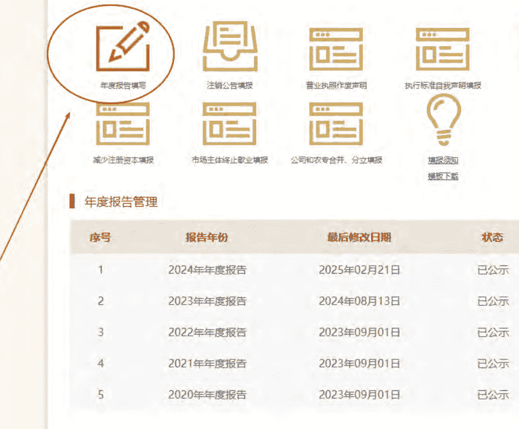

下面是我直接看到的内容，仅供参考。

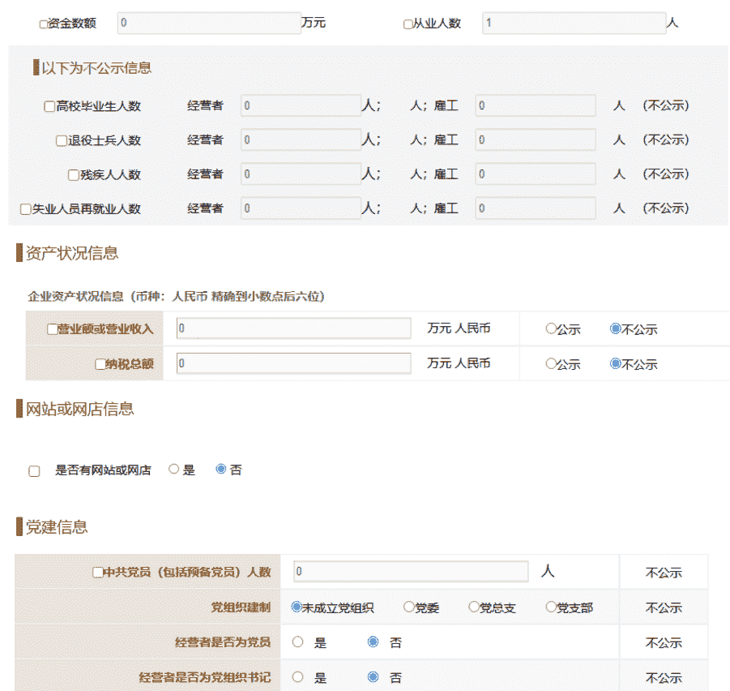

结束—

评论区:

大河：都都可以

时：：麻烦如果把专业照交在自己个体名下，是否可以0申报

结：建议咨询当地财政税务，我的杭州执照开始交在个体名下，也是对公的，杭州这边提交备案似乎不可拟。

他：谢谢！正好就是想问问别人的执照，商家现在好像倒闭了，这种方法可以换换吗？

三：我是谁

三：如果别人报社，没有收入，要负责申报，可以问AI

加微信ins，免费注册资源资料分析

不懂就问：我自己

## 【创业心态】1 篇

## (精华帖/117集)致未来黑暗中的我，三个月以来的创业感悟：分享、链接、“弱关系”的贵人和影响力

作者：Gary
日期：2025-02-19

十二底在杭州市场线活跃的时候，听到亦明和白老师提到一个概念“弱关系”，话还不太记得，大意就是，往往能给你带来跨越提升或者收获的“弱关系”，不是你身边的朋友。当听到觉得很有道理，毕竟后开启YouTube的尝试是由于仁大的超级和竹笼的帖单，但我很深的感受，原来在当时这些并没有帮助你“跨越提升”的程度。

但是直到今日（其实也就没两个月），终于深深感受到了曾经“弱关系”的贵人们对我的影响有多有多重。

如果不是湖南汪刚打招呼的老板，就不会有十二月的游营中心（借朋友复兴的社区共创项目），由于私域和IP的策划或许不会启动，也不会被培训的，有后续杭州参加活动链接赞的想法，也不可能在活动现场展现我如何被吸引到于仁大的关注，就不会有后来的故事。


如果不是恰巧安排了微信和配合杭州，持续在关键时刻醒，提供各个方面的我的孩子，这次杭州可能不会在第一的基础上做任何调整，长达三个月，价格很高的交付很可能把我的精力和心消耗干净，也不会有机会尝试这么多的赛道和机会，也不可能像我这么多不同赛道的学费，也不可能在现在可以说是离的隔离结果，也不可能现在的这些资源，就不会有未来的无限可能。

## 方婉

2024年11月28日 下午
老婆好，我是Gary，生仔的朋友，有请教，你们找老姨的妹子多教，感谢！

img/4951267b18f1e6f55b1dcff1017520fd_13_0.png
img/4951267b18f1e6f55b1dcff1017520fd_13_1.png
img/4951267b18f1e6f55b1dcff1017520fd_13_2.png

如果不是在生日写了一篇精华，她可能从朋友那里看到，就不会会加到微信，就不会会进一步推荐。我们一起研究的赛道的玩法，就不会让这么多同学了解到，没有现在的资源和机会。

2023年12月24日 下午
我是Gary，以上是视频的

2023年12月24日 上午
我已经收到了作业，可以批改了。

img/4951267b18f1e6f55b1dcff1017520fd_13_3.png

2023年12月24日 下午
学习更多技巧。在短短三个月里，还有很多“弱关系”的人，包括老妈、社群的、青年的，保护大家的够了。这些关系也给我巨大的帮助，让我过了无数精神和行动上的困难。

加微信intsg，免费资料分享群
No. 14/140

2024年3月15日 上午
马哥你好！我是Gary，今天早上要进杭州，所以现在才可以回，不好意思，感谢您的分享，真的获益很多！

2024年1月18日 上午
突破千万播放，正反馈一来，有了干劲，触到了老林，联系后也有一些国内运营的朋友。

12月，总结方法，撞机在航海开始的发布了第一个蛹，终于变成了精蛤，意识就会来了，还要加油啊。

## 系统消息

你的主题被主推推荐啦~

在「生财有术」发布的主题：24天7w粉通过YPP收益108万，我的AI达人秀变千万视频制作流程分享，已被主推推荐为精华主题。

感谢分享，期待你发布更多优质的内容。
（点击此处查看详情）

2024/12/3 20:02

12月初，因为荣耀，受邀请进行航海头部推荐，同时也算是半航海教练了，为了后续领域和付费链路测试打下了非常重要的信心基础，也让我变成了一个重要的背书——航海导师，挣脱了小身份。

img/4951267b18f1e6f55b1dcff1017520fd_15_0.png

12月中旬，借林老板的资源，靠航海教练和精肝作者的合作，开启了共创项目，招募到了超过50人的免引团队，为我不成熟的知识付费链路测试，一周内拉到了300多人的私群（其中两个被我主邀退，一位已经走了一半，一位已经离开YPP），跑通业务闭环，但是我要交付时存在严重的隐患（报名学员经过筛选，质量太差，基本无法进行交付），并停止了进一步扩张和招生，以及视频制作技能的精进以及参加杭州活动留下了时间和精力的空间。

## 【小书】shorts云内部资料(57)

img/4951267b18f1e6f55b1dcff1017520fd_16_0.png

12月初，一个念之后去参加线下活动，第一次接近感受者的场合（弱关系、老师、火妈），认知层面收获，最重要的还是自我介绍环节，非常让我，站在台上做自我介绍，理想是，以后在上场时，我就犹豫要不要留书，其实我是想要写出来，怕这条路还没走远，怕未来有更大的失败在等着。记录这三个月的历程，激励到落魄的那个我，能够激励到今天失去的你。

回头看，轻易过万。

评论区：
六滋锡：感动复[666][666]
轻易：昨天链接，现在看到Gary的回应和真情流露，这种感觉真的很妙
百哥：轻易过万
Gary：主打一个真实
拾一：公众号里大家都看了一遍，再来星球点个！

Gary：哈哈，感谢拾一老师！
Gary：[爱心]
Gary：你也666

## 好事分享 3篇

## (精华帖)(55钱）（航海好事）Shein航海实战，做到每天几百单的新店

作者：张树
日期：2025-02-20

【跨境好事】Shein航海实战，做到每天几百单的新店大家好！我是张树，在山西成立的，已经在这次航海拿到3W+的销售，所以不停的来跟大家分享我之前所有的经历，都是磕在各个国内平台。

17-19年我找到了女装运营的工作，从0做到每天销售3000，月销40W，赚钱了也没有剩余，散伙收场。22年至今，自营小红书女孩电商在接触了这次航海之前。

19-22年我开始女性电商运营，50+转型，月销40W，赚钱了也没有剩余，散伙收场。

很多人问你，为什么不跟？我都是说，太阳爬了，经验不能复用。没想到，一种识，上了这么多大家都先教我：

我负责的店铺是从12月2就开始运营，到今天快两个月，近30天销售3W，并且每天都在上涨。更好的阅读体验请进飞书链接：
https://plwnstfeb9.feishu.cn/doc/SKPHdmTw40tl1xlUUtGc4AOXn4b?from=copylink&reRdXZ=1

评论区：

暂无评论

## (华华/50钱)(Shein海鸥) 的收获，两个月从Shein新手到月销售额均破万

日期：12月，因为汪刚打招呼的老板，就不会有十二月的游营中心。无数个夜晚，一起执行了一套通用的方法，跟团队不停，发布和复盘。12月，总结方法，撞机在航海开始的发布了第一个蛹，终于变成了精蛤，意识就会来了，还要加油努力。

img/4951267b18f1e6f55b1dcff118_0

我想，给这三个月总结几个关键词，应该是：
- 1. 分享（带来了幸运）
- 1. 链接（打碎了底层）
- 1. 贵人（来自“弱关系”）
- 1. 毅力（得不得的理由）

当然，这些还不算什么，说了自己等到结果，但是这一次，我感性地把这些东西写出来是不想要了，而是逐渐意识到了“越分享、越幸运”的含义，逐渐意识到了要学会写出来，怕这条路还没远，怕未来有更大的失败在等着。记录这三个月的历程，激励到落魄的那个我，能够激励到今天失去的你。

回头看，轻易过万。


## (169赞)@阿彪 老板的 HIX.AI, --hix.ai首页转型了

作者：亦仁
日期：2025-02-20

老板的 HIX.AI，首页转型了，改为无限免费使用满血版 Deepseek R1 了，大家可以体验和分享。https://hix.ai/

评论区：

- 白菜：支持一波
- 鲜岷：支持一波
- 一网：支持一波
- 2001范希：支持一波
- 万迎春：支持一波
- 曦渊：支持一波
- 非酋：怎么弄，试了下还是收费
- 华莲：支持一波

## (精帖)(139赞)我是怎样用DeepSeek写出乎热榜第一、高赞第一爆款（超详复盘）

作者：小羚
日期：n2025-01-22

大家好，我是俄罗斯下黑的阿哥，有些小伙伴可能都知道。虽然星球已经很早了但是慢，我一直是默默关注。今天是第一次星球出货分享，这篇文章是我在星球上的付费文章，数据很准，现在分享给大家。

事情是这样的，两二十分的时候在星球上刷到一个选题素材，我就决定加更一篇文章了。

花了一个多小时，9点发布出来，就是你们看到的上篇文章《外号，马斯克用Grok-3就贴脸开大！》，同时，我把文章同步到了推文平台，当晚就被顶到了高赞第一。

第二天，这文章是在我的回复里被编辑推到了热榜第一。

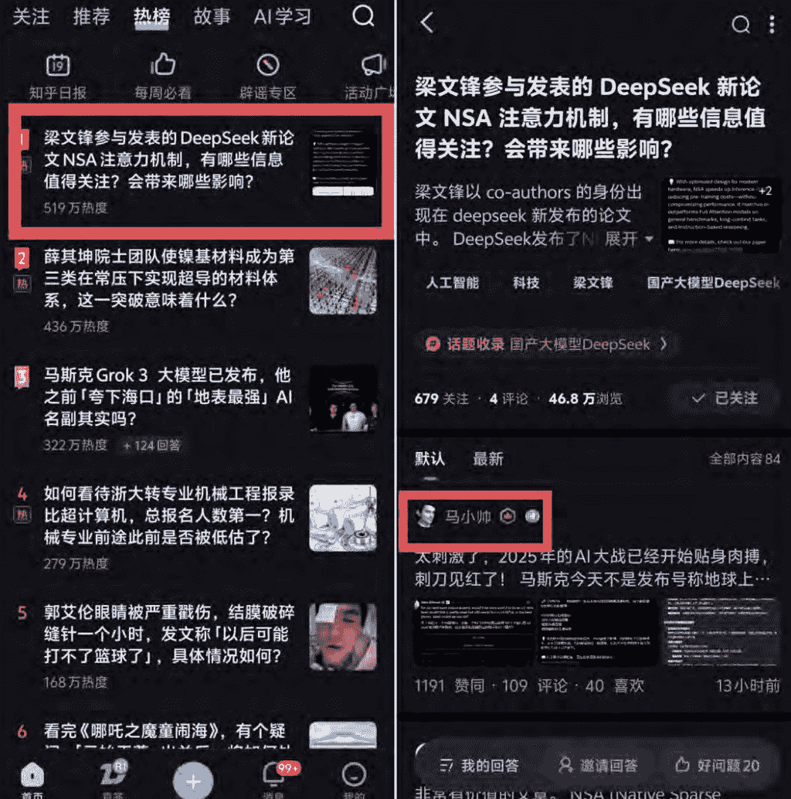

截止昨天，这文章在知乎上的最新进展是如下：

> 梁咏参与发表的DeepSeek 语义新的逻辑模型，有哪些信息值得关注？会带来哪些影响？

太震惊了，2025年的AI大战已经开始肉身战斗，刺见红了！马斯克现在不是早开始布矩阵在地球上最好的AI的Grok-3，他这边也早就开始了，结果OpenAI夺

83.5万赞 5524 收藏 472 评论 1810 引用 236 查看

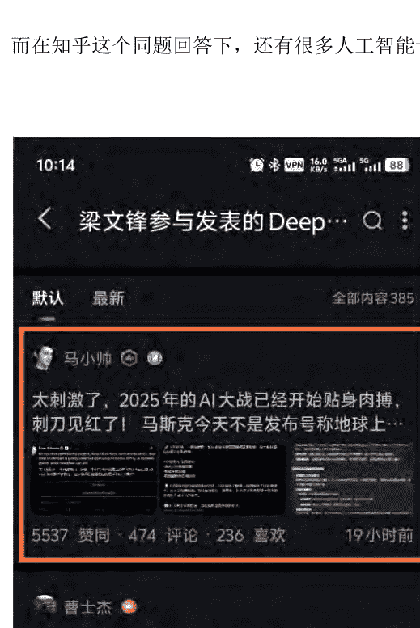

### 深度参与的DeepSeek新文

NSAI 助理，你是否感受到生产力的提升？会影响你的工作吗？

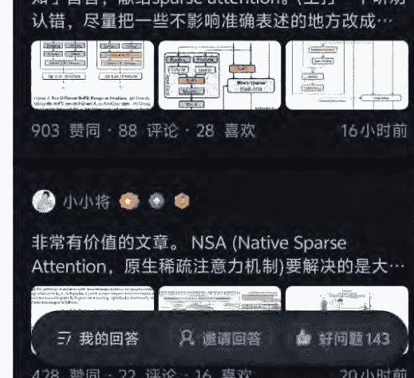

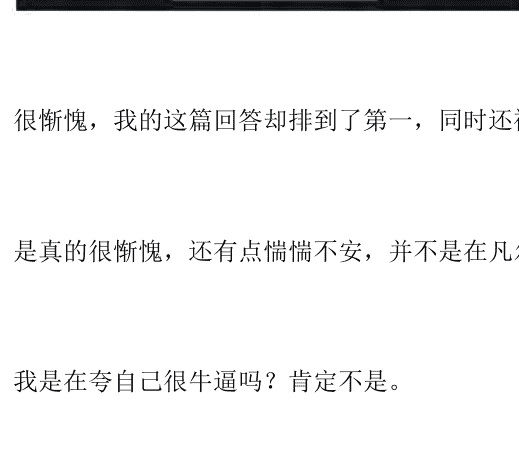

第五个 @小羽，如果你在需要写长文章时，都要用关注力模型。在如此多的 AI 解决方案中，DeepSeek 的表现会让你选择它吗？

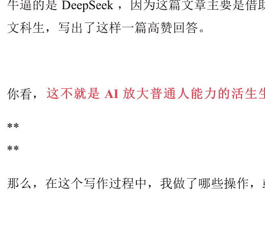

模型类型一种类解决，解决了痛点：动态能力是 AI 的基础。通过调优，我们用三个版本完美解决了这个难题。从 6.7B 到 32B，再到 67B，推理速度提升了 1.6 倍，计算能力提升了 11%，推理成本降低了原来的十倍！（大模型测试）DeepSeek 准确率 100%，让 AI 助手提升了 55%。NSAI 在如此高效的情况下，依然能保持极高的稳定性并不断更新。甚至，同等规模处理能力可提升 10 倍以上！

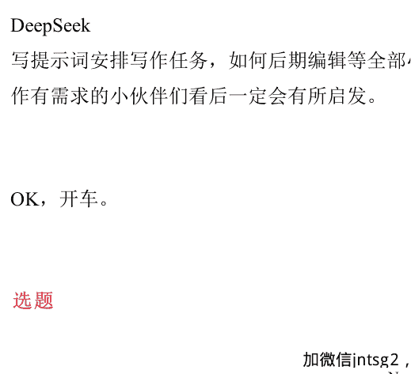

是真的很抱歉，还有点情此不安，在此不妄了。

我是在写牛逼吗？并不是的。

你看看，这真的是普通人生活吗？那么，在这个过程中我做了哪些操作，或者说发挥了哪些功能呢？

## 选题

加群免费资料分享

18日中午，正是马斯克的Grok-3发布的时候，在下午，已经开始不少自媒体关注发布的资讯，包括概述这个的热点。但是对于个人自媒体来说，时效是抢的。如果只是对发布进行简单的介绍，那么写出来的文章就会和其他同质化，并且还有一定的限制。不要付费，而时间内的体验会洗完，正在考虑这个热点该如何蹭的时候，微信弹出了一篇标题是《DeepSeek新消息！

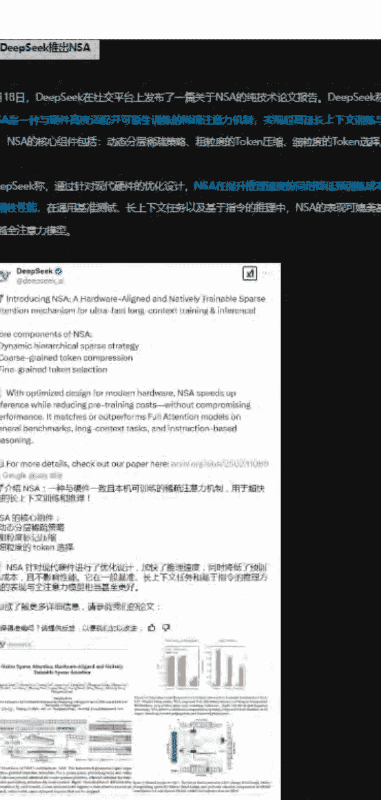

不好看出，这是一篇早就好的文章，但发布的时候，刚刚赶上马斯克的Grok-3发布。大家知道，新闻越快价值越高。

这条推文的编码，在下午6点这个时间节点，DeepSeek更新的新闻，如此，如果只是发布的文章，我不会打开这篇。我去X上找到了这个帖，评论区的量已经相当大了，肉眼可见不错。社交账号并不是活跃，从发布R1后，目前也就更新了，其中说是接入R1的参数优化。换言之，一个不活跃的账号，突然发布更新这件事并不常见，再加上发布的内容本身非常重要。接一下，多想一步，DeepSeek这篇推文不是刚发布的，而是公布出来选择了Grok-3，效果应该是顺滑。

Grok-3是今天的大事了，这是一个必须要选的，这篇文章的重点是后半句。这也是尽量可能增加这篇文章在热榜下的脱颖而出的概率。我去搜了一下，去找朋友问了一下，已经知道了热榜第一个问题，当时这个问题下面只有3个回复，最高的个位数。OK，就是写文章时的相关背景。选题部分之所以这么详细，是因为爆款文章80%取决于你的选题。文章写好可以保证你是高赞第一，但选题选好有可能成为热门第一。

## 总结选择努力

这个时候已经看了一部分资料了，其实也有初步的思路，自然是要先解读论文开始。

找到论文：https://arxiv.org/2502.11089

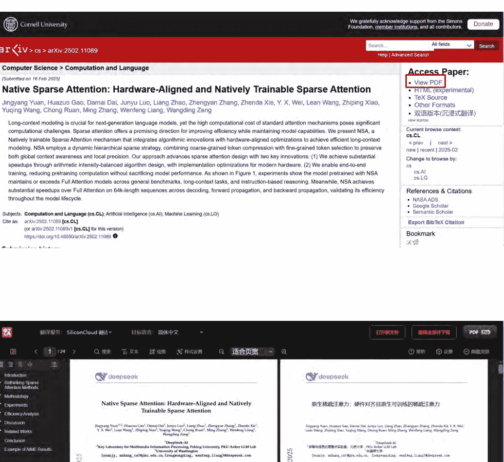

用DeepSeek翻译了没分钟，就省事了。这不是我能看懂的。必须得到DeepSeek。我先把它发到网上，让它给我解读论文，同时我给它加了一句要求，它来说这项技术会对大模型带来什么能力，因为对于大多数用户来说，大家才不会关心论文写的，只关心自己就行。而我要写的文章正是面向没有技术背景的普通用户，所以这一点不能少。

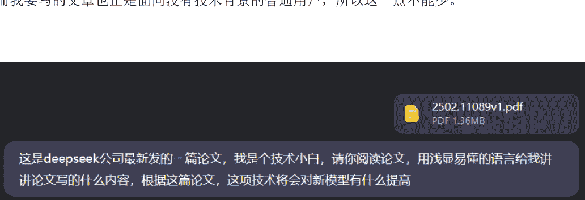

这是DeepSeek公司发布的一篇论文，我是个技术小白，请你读论文，用易懂的语言告诉我论文写的什么内容，根据这篇论文，这项技术对大模型有什么用。加群免费资源分享

## DeepSeek给出的结果其实在上一篇文中你们看到的那个解答

这篇论文DeepSeek给出的一个技术突破。它让模型更加关注注意力（Attention），目的是为了比ChatGPT处理长文本时更快、更高，而且在推理时显著提升模型的能力。它用简单的话解释了它的核心内容和优势：

### 到底我们需要什么？

现在的我们需要模型在处理文本（比如笔记本、长代码或多对话）时，关注每个词之间的关系，使得计算更快、更准、更高，在处理6万个不同的文本时，处理方法可能需要大量计算，例如：

### Attention是什么？

Attention一种“选择性关注”的机制，让模型在处理文本时只关注重要的信息，减少内心负担：

1. 提高效率：让模型能够灵活地处理复杂的任务，减少内存占用，让计算更快。
2. 提高质量：让模型在生成时更加准确，而不是反复修改，让模型变得这样。

### 这项技术提升模型的能力有什么影响

1. 扩展长度：模型可以处理更长的上下文，比如分析长文本、进行长对话，而不会因为计算量太大而崩溃。
2. 提高速度：在处理6万字的文本时，通过这种方法（向后预测解码），生成速度提升了10倍。
3. 减少幻觉：在合适的过程中，生成长文本时，通过这种稀疏注意力机制（Native Sparse Attention），让模型更加关注重要信息。

### 对未来的影响

1. 降低推理成本：减少计算量。
2. 更多应用场景：比如分析书籍、写报告、开发代码等。
3. 推动模型改进：为更大的模型提供基础。

简单来说，DeepSeek在长文本方面有了重大突破，这个结果其实很好，但不由于底层限制，对于普通读者很难消化。这个例子，高赞第一并不就是质量最好，当我继续追问的时候，官方还是调整了策略，同一个时间内只能问一次，再问就报错。

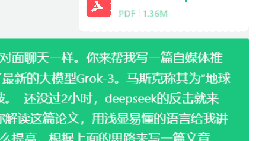

### 一、DeepSeek写了什么？

这篇论文虽然很硬，但底层极具张力，优化了注意力机制。简单来说就是给大模型装了个“智能眼镜”，让它看起来不再笨，又“聪明”了。

传统的AI缺点：现在的AI逻辑文本（比如《三体》），就像让你放放大镜看每一个字都要，速度还慢，64k字能吃掉80%内存。

DeepSeek的操作：他们用了一个Attention技术（这并不是美国首创！核心就是Native Sparse Attention。

1. 分块压缩：把长文本或时压缩，然后缩小范围（比如每32字压成1个关键词）。
2. 精准加重：用AI判断哪些词必须保留（比如其中16个关键词）。
3. 滑动检索：最后看一眼就能预测下一个字。

相当于AI学会文本直接提升了1.6倍，64k训练速度也能提9倍！

### 二、这项技术能打Grok-3？三个杀锏

1. 节省：以前训练文本得烧机器，现在用Attention技术下几张显卡就行。
2. 优人类：以前AI会“拟合”，现在逻辑上根没做到100%准确。
3. 越练越聪明：以前像AI辑视频（训练用注意力，推理再剪裁），直接从建模到推理，实现了“肌肉记忆”。

### 行业要变天？普通人收益如何

- 程序员狂喜：以后AI能手写整个代码改Bug，GitHub Copilot升级成“CEO助手”。
- 学生崩溃：论文直接就能分析万字文献，再也不用担心文献综述。
- 打工人暴击：合同审查、财报分析终于不用自己做一段了。

最近我起鸡皮皮的是——这真的是中国自研团队！从算法逻辑到硬件适配如此彻底，逻辑里连怎么在量上“卡BUG”内部都写得明白白，明确了落地商机。

### 活人总结

马斯克说是“大力出奇”，DeepSeek是“小而美”。DeepSeek的出现让竞争进入下场，拼的不是多少钱，而是谁能发挥更多精力。最后预测：今年这个榜单，至少DeepSeek是胜利的！

## 到底在哪里

这篇论文的核心观点叫做原生稀疏注意力（Native Sparse Attention）。

### 三、架构：让AI学会“人类阅读”

这项的设计非常清晰：把“选择权重”的能力直接注入AI基因，分三步：

- 第一步：压缩：把长文本切成小小的块。
- 第二步：动态筛选：AI自主决定哪些地方需要筛选。
- 三步：局部聚焦：对选中的关键词用注意力机制。

这相当于给AI装了智能眼镜：既能扫描全文，又能聚焦重点。

### 四、这不是优化，是范式转移

根据论文描述，Attention技术带来了三个层面的突破：

1. 效率提升：
- 训练效率提升9倍：在64k长度下，从全注意力机制的100%下降到1%。
- 推理提升1.6倍：处理长文本时所需资源降到原来的十分之一。
2. 能力跃迁：
- 数学推理：在AIME竞赛赛上，模型准确率14.6%，比模型9.2%高出58%。
3. 重构：同等万可以处理十万长的文本——这直接驱动了“大模型必须具备海量数据”。

### 五、为什么这事比Grok更重要？

马斯克的Grok-3尚未公布，但根据其宣传方向（更智能、更多数据），大概还是在扩大参数规模+增加数据量的老路。DeepSeek的论文指向了另一个更本质的问题：当前的架构可能不能从零训练。我们一直用全注意力机制是因为它简单粗暴有效，这就像奶粉加一头牛奶——现在有了奶粉，奶粉可以比牛奶更易储存、运输。意义在于：

- 证明了可以端到端训练（传统架构只能训练后调试）。
- 首次实现算法与深度协同（直接对GPU进行内存优化）。
- 打开了文本的商业化大门：医疗、病历、法律审查、金融行业……这些需要处理万字级文本的场景，终于有了可能的方案。

### 六、冷静思考：狂欢背后的挑战

当然，这项技术并非完美无缺：

1. 选择的可能性
2. AI自选择重点时，可能会漏掉某些异常情况的关键点。在论文中的测试场景相较理想，真实世界的语言往往充满干扰信息。
3. 训练成本：训练已经进阶了，但训练模型可能需要设计的课程策略（如何教会AI“抓重点”）还是难够的。
4. 生态适配成本：现在的模型工具链（如HuggingFace）需要针对NAS做适配。

### 八、在写后：AI竞争进入“挤破泡沫”时代


像燃油时代的发动机动力，电车时代开始比电池算力管理法——行业意识。
算力不是一道围垒，真正的创新从底层开始。

对于苏·马斯克的 Grok-3或许它很大，但至少在今天，这场戏的主权，掌握在重新定义游戏规则的人手里。

这一版的文章风格就很不错，是我喜欢的。实际上，最终的成文主要就是要以这一版为主进行润色的的。在此处，这篇文章已经基本成型了，可以再打 70 分。

总结：AI 会不会谈心，你越会 3 分钟打磨指令，后期就能省 3 小时改稿。

## 编辑

有了 DeepSeek 之后，只要你要求提示当，每个人都可以写出 70 分的文章，但是如何让文章更合你的要求，把文章质量进一步提高到 80 分至 90 分，取决于每个人对文字的签字和审美能力。

所以我们还是要做做后期的。

前文提到，在没有动车之前，我已经想好了开头的切入点，这个开头必须需要我自己用自己的句子来写：太到位了，2025 年的 AI 大战已经开始肉肉，刀刃见红了！这也是从自媒体教程里教给我的雷雷开头术。

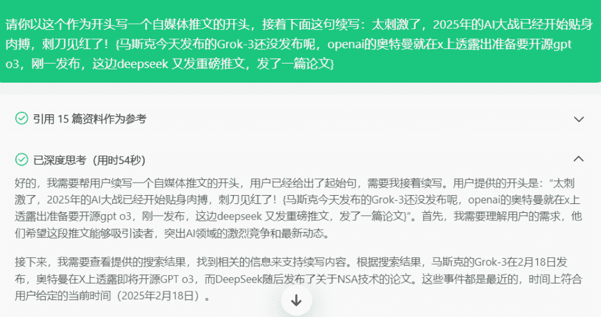

> 请问这个开头如何写出一个读者震撼的开头？太到位了，2025 年的 AI 大战已经开始肉肉，刀刃见红了！为了比马斯克发布的 Grok-3 还没发布，OpenAI 的横甚至在这上准备开发 GPT-3，一发布，这块 DeepSeek 的又破文了，引发了一场论。首先，我需要看到读者的反馈，我将未来希望将写作内容，根据反馈结果，马斯克的 2 月 18 日发布，横在推特上回复 GPT-3，而 DeepSeek 之后还给 NASA 发了技术报告。这件事最近的，时间上符合产品上市的日期（2025 年 2 月 18 日）。

引用 1 读者反馈为：
你好，我需要你帮出一个读者震撼的开头，用户已经开始反馈了，我需要接着写。你提供的反馈，我需要用提供的开头...

首先，马斯克的 Grok-3 发布了，模型参数量 1, 3, 7, 8、Grok-3 被直为“地球上最聪明的 AI”，还有很多大学的质疑。

这次稿可以用了，我本是希望它能根据现有的信息多充一些内容，但是给出的回复却不理想。

大热闹！2024 的 AI 开始抢头戏了，内卷到了极致！马斯克在直播会上直呼：OpenAI 的疯子们在用手造核弹！

> 马斯克刚发布完 GPT-3 系列，GPT-4 还没被彻底拆解，结果 DeepSeek已经全面领先了？

三方鼎立，AI巨头开始疯狂竞争，我们对 AI 的未来到底还有多少想象？

我只选取了红线部分，在此基础上又进行了微调。我们继续，你首要选取合适的素材，比如比特模型在 X 平台上的推文、论文摘要等，尽量避免雷同导致内容重复。

接下来，继续复我是如何写类似文章的：

- 马斯克害怕的 DeepSeek 在搞什么？先给马斯克带来巨大的冲击
- Grok-3：马斯克的 AI 最新大模型，自称地球上最强的 AI，重心突破可能在多模态理解和推理上
- DeepSeek：用“对齐序列”来训练注意力机制，解决大模型处理长文本的核心痛点

表面看来两家公司的技术对垒，但内部还有两条路线的考量：算力密集 vs 重构算法。而后者才是 AI 进化的关键点。

第二部分，这部分内容我为了偏好我的文章本身，DeepSeek 的发布推文并没有上升到两家技术对垒的高度，它可能是我文章中受到我关注的影响，过分对其强调，实际上我文章里可能只是算个泡沫而已。所以我直接弃掉了这些引言，直接从正文开始写。同时，还要去掉第二部分中残留的 AI 味了。比如 DeepSeek 很喜欢这种结构化输出，我就把它合并成正常段落。

## 第二部分：DeepSeek 的论文到底写了什么？

这篇论文的核心点在于“稀疏注意力机制（Native Sparse Attention, NSA）”。理解它为什么要做，得背后的使命：

### 1. 长文本瓶颈
在所有处理文本（如十万字），都在用注意力机制——简单来说让 AI 选择哪些词。问题的关键是：
- 消耗资源随长度增长：长度64 倍（万字的 8 倍），计算资源就耗。
- 人类并不这样做：看长文本会有跳读、回溯、记忆。

### 2. 现有的方法
- 滑动窗口：只关注最近的窗口（类似手机时）——容易丢失全局信息
- 随机解码：随机抽句子——可能错过关键信息
- 压缩架构：先压缩再一遍——本质上还是浪费了算力

DeepSeek 的 NSA 技术，试图从底层彻底重构这个过程，加入 DeepSeek，增加一些人类味儿。根据模型论文，NSA 技术带来了三个层面的突破：

### 1. 效率革命
- 训练速度提升 9 倍：在 64k 长度下，训练耗从全注意力机制 100% 降到 1%
- 推理速度提升 1.6 倍：处理长文本时，所需资源从前所有的十分之一

### 2. 能力提升
- 长文本理解解析：在“大海捞针”测试中（从 6.4 万字找到特定事实），准确率 100% 压倒方案，要清楚注意力机制才 35%，太牛了！
- 数据质量增强：在 AI 训练中，NSA 加入的正确纠错率达到 14.6%，对比注意力模型 9.2% 高出 58%，说明这项技术真的让 AI 提升，不是单纯靠算力。

### 3. 成本模块
- 同等算力下处理 10 倍的长度
- 或者用 1/10 的算力达到相同效果，这直接推动了大模型行业的变革

这部分没说问题，但是略显枯燥，缺少调动情绪的表达，我就从第一放了钩子补充了去。确定是这样的：加微信 ints2 免费资料分享。这可不是简单的优化，而是从底层数据机制来说的话：

### 1. 效率提升
- 训练速度提升 9 倍，在 64k 长度下，训练耗从全注意力资源 100% 降到 1%
- 推理速度提升 1.6 倍，处理长文本时，所需资源从前所有的十分之一。

### 2. 能力提升
- 长文本理解解析：在“大海捞”测试中（从 6.4 万字找到特定事实），准确率 100% 压倒方案，要清楚注意力机制才 35%，太牛了！
- 最强的语义理解推理模型！在 AI 模型中，NAS 加入的正确纠错率达到 14.6%，对比注意力模型 2% 的提升——说明这项技术真的让 AI 提升，不是单纯靠算力。

### 3. 成本模块
同等成本可以处理 10 倍的长度，用 1/10 的算力达到相同的效果，这直接推动了大模型行业的变革——以前训练文本需要机器，现在用 NAS 能够下几台豪车！

---

In each decoding step, our needs to load more n tokens, and neighbor tokens, where s is cache length. As shown in Table 1, our method achieves a significant reduction in latency as decoding increases, up to 1.6x speedup at 6k context length. This advantage in memory access also amplifies with longer sequences.

The decoding speed of Attention is primarily determined by memory access bottleneck, which is closely tied to KV cache density. In each decoding step, our needs to load more n tokens, and neighbor tokens, where s is cache length. As shown in Table 1, our method achieves a significant reduction in latency as decoding increases, up to 1.6x speedup at 6k context length.

| Metric | Full Attention | Native Sparse Attention (NSA) | Improvement |
| :--- | :--- | :--- | :--- |
| Training Speed (64k) | Baseline | Optimized Optimized | 9x Faster |
| Inference Speed | Baseline | 1.6x Faster | 1/10 Resources |
| Retrieval Accuracy (64k) | 35% | 100% | Massive |
| Error Correction Rate | 9.2% | 14.6% | +58% |
| Cost / Length | Baseline | 10x Length | 1/10 Cost |

划线部分是从第一级选取的扣子充分者或是自己改写，之后的段落基本上是按照这样的操作来。还有，DeepSeek 非常喜欢打比方，频率高，或者比不贴切的时候，AI 就藏不住了。第二的文中，我去掉了质量不高的类比描述，这会有效果减轻 AI 味。还有，你可以尽量少用 AI 常用词，适当插入恰当或者设问，适当插入亲身经历。最后，为了增加文章精彩，再到 AI 上选取，然后这里结尾。

**总结：** 文章最后再做一个保险，概括了一下，DeepSeek 写完自己修改，那篇文章一共花了一个时间。

AI 的终极意义，是每一个普通人都能突破限制，拥有优于以往的能力。人类作者三大权重：
- 对选题的新颖性（知道什么时候说的话）
- 对文字的掌握能力（明白用什么说话）
- 以及最重要的——对输出的内容负责（清楚自己必须说话）

---

## 无限进步——YouTube AI Shorts 教跑复盘

作者：Gary
日期：2025-02-17

大家好，我是 Gary，我有 YouTube 航海&私教教学经验，深耕 AI 出海赛道。

不知现在，离我方教学带队的这次 YouTube Shorts 教跑已经开始了一个月，本来应该在试运行期间的中期复盘，但通过测试新尝试还遇到现在，月教学结课后，会有一次整体复盘。针对这一个月的阶段性成果及其对应的交付过程进行回顾，目的有三点：

- 中期复盘：从交付的设计到朋友的回馈，复盘这次私教教学过程中遇到的事情，以及两周后的明确方向，创造了大的收获。
- 教信心：离3000 人的出海已经过去了两个月，但不少出海的朋友为了各种流量又失去了自己，希望通过这次复盘，找回内心的，找到正确的方向。
- 分享链接：经过一个月的跑通，深度感受到了粉丝与共的力量，希望通过分享，链接到更多 AI、对内出海、对流量策略上路看到结果以及感触深度，探索更多、更多迭代，让教学成为我们全平台内容出海的底层基础。

先分享下这次私教跑的第一个结果：
从 1 月 16 日开始到 2 月 15 日，共 104 个学员，已收获 84 个账号（20 个学员未激活）。
有 43 个账号开通 PPP（31 人开通 PPP，29.8%的人开通 PPP，人均 YouTube 40 天）；4 个账号开通【高级 PPP】；18 个账号还数据未更新（基本都为高级 PPP，一周内 YouTube 更新数据）。

看过的首批航海赛季的朋友应该有印象，PPP 的开通周期是以半年到一年为单位，上面的结果，除了了这几位在参加跑教前已经开通 PPP，剩下的还有近三十位朋友都是在参加过程中开通的 PPP。

最后，感谢每一个读者，希望这篇文章对你有所帮助。

评论区：
王咸：赞！
大源：诚意支持
薇杨：学习了非常有借鉴意义
希声：很棒的复盘！
小朝：太棒了！非常有指导意义，学到很多，准备用起来。积累不易，激动！
小静静：真诚的沟通，很能借鉴，赞了！

---

## 爆发下，存在哪些机会？普通人如何抓住 AI 机机？

作者：厉哥带你飞日期：2025-02-19

大家好，我看来现在的 AI 是妥妥的红利。这是一个值得深耕 10 年的赛道！普通人想要挣钱，首先要在牌桌上抓住 AI 机机。

成功的案例包括：
- AI 资讯号
- AI 工具推荐
- AI 真人直播
- AI 视频付费
- AI 垂直赛道
- AI 流量收益
- AI 编程

这篇文章应该是普通人进入 AI 赛道最有效的方向。详细详细解案例包括：
- AI 资讯号
- AI 工具推荐
- AI 真人直播
- AI 视频付费
- AI 垂直赛道
- AI 流量收益
- AI 编程
- AI 情感号
- AI 故事
- AI 游戏
- AI 互动

更好的阅读效果，可以跳转查看：
https://bhpm72xf.feishu.cn/IA3JdxBkaonc6wq4cS0knPh

---

## 视频号，一个严重低估的赛道

作者：纸底
日期：2023-10-29

大家好，我是纸底，视频号做了多年。从 22 年混混，到 23 年视频号挂车，再到 24 年上半年做实操推荐、带业务、数字人，下半年视频付费+挂车，视频号的各种模式都到结束了。

最近，有一个非常快产出的赛道，目前它被严重低估的赛道。说不多，先看数据，从 1 月 25 号到这个号，20 天，涨了两个粉。！！！详情见下方：
https://mv89fh.feishu.cn/rzF3XdnoKRQ01DcqWIAn1f

测评结论：
- SEVEN：谢谢，正在做这个号！！
- 才：可能每天都要换一批账号，现在挂销账号重新可用，30 天，确实号不多的有点难啊。
- 执笔：这种 AI 有没有实际结果拿到的账号啊？
- 纸底：我们采取的都是换号，一个号 300 粉实名和留质。
- 纸底：有很多数字人带花草籽的号。
- 9：卖玄宝钥匙的细胞。我还有，今天被差了。
- 咸鱼：提现应该是直接拿到兼职号上吗？不怕兼职跑路啊，还是自己的店铺呢。

---

## YouTube Shorts AI “动物救援”爆款变种——天使狗制作攻略

作者：轻轻
发布于：2023-05-22

大家好，我是轻轻，10+ 年老工程师，目前专注于 YouTube Shorts 赛道，也对 AI 编程感兴趣。Shorts近期有一个“天使狗”（Angel Dog）的 AI 赛道异常火热，对标创建两个月后，47 个视频播放量突破了 5 万次。引起了一些关注的粉丝，这篇文章将详细拆解这类视频如何制作。为了更好的阅读体验，请移步下方：
https://feishu.cn/doc/X1nkdCEWlonehHx0g7CHeMnad7Rd

测评区：
- Gary：从发现—实现—复90% 效果的速度非常快，思路值得大家学习！
- 轻轻：感谢教程，感受到了很大的精力投入，学习了。
- Tingko：感谢小鱼，感受到了很大精力投入，学习了。
- 轻轻：这个赛道挺大的，一起交流完善。
- 亿：这个可能就是 sort 了，转转视频还没到这么稳定。
- 轻轻：我现在也在尝试不同的工具，还没有找到一套稳定的工作流。
- 沐沐姐姐：转转视频可以请教下怎么描述合适？试了很久，动物的运动都点奇怪。
- 轻轻：转转视频主要在于工具的选择，我尝试下来，效果最好可以是灵活和海獭，描述词不能太复杂，5 秒钟不做太多的动作，可以参考帖子里的图，如果不清楚的，可以找鱼链接对接。


## (58赞)DeepSeek+微信：这个新型AI职需求将猛增!

作者：AI进化论-花生
日期：2025-02-18

大家好，我是花生，“小猫补光灯”app 开发者，全网20万+粉丝的AI媒体博主。今天向大家介绍我判断的下阶段将有猛增的AI岗位：AI搜索优化师。

## 一、AI搜索正式了

如果村里有网的话，你应该早知道微信在前端两天就开始上线了满血版DeepSeek的AI搜索功能，不过现在还是比较匮乏，体验过全面的人不够多。


### 快速回答
提供最常用，快速高效的回答

### 深度思考
由DeepSeek-R1模型经过长思考而提供的更全面的回答

毕竟DeepSeek官网还在天天活跃，微信若全量上线，服务器必然会被崩掉，彻底别想用了。

不过还有，还有“腾讯搜索”，在这个领域首选“DeepSeek深度思考再开‘腾讯搜索’”，体验和微信内置的AI搜索，毕竟是腾讯的产品，切切都能索引公众号文章。

## 二、AI的特殊待遇

我做了一个测试，发现了一个很有趣的现象。首先是我问了一个问题：“2025年，最值得关注的AI公众号有几个？”

### 2025年最值得关注的AI公众号
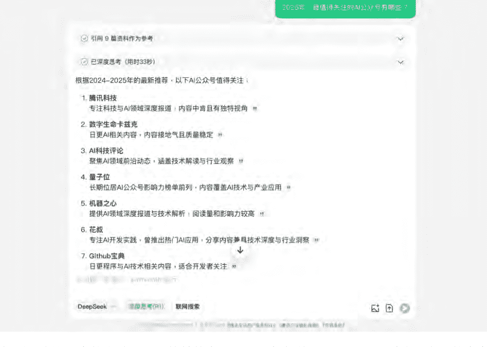

难想，我这酷的小号依然熊然在列表中（还不禁关注），虽说我对自己的内容还自信，但也没达到自我的程度。

所以，我们想要看看这个搜索+模型的逻辑是怎样的，为什么能找到我？

### 2025年最值得关注的AI公众号
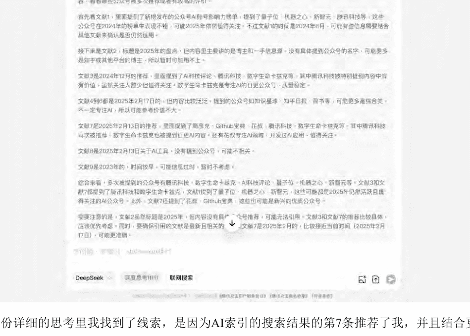

从这次搜索结果里找到了我，是因为AI索引的搜索结果却推荐了我，并且如果我的思考你会发现一个奇异的事，就是：

来，我们仔细一看AI，推荐了具有搜索能力的AI。AI，尤其是更明显的AI，如 DeepSeek R1、GPT-4o、Claude 3.5 sonnet、kimi等都看来像“人”了。

或许你也会发现我的逻辑漏洞。

当我们问一个问题，要求它帮你搜几个AI的主公众号，你往往会预期中那种情况，就是：
1. 它是平时跟AI相关的公众号，它会帮你搜一些内容比较不错的公众号，这种也许内容有深度，也许是内容更新频繁，写得等啥等；如果这就像是你对我的话，你也会发现它理解我的好和需求，然后根据它的需求来应对。它还是不是如此：

但是，我们再来看看DeepSeek的逻辑是这样的：
加微信insts2、更多资料分享

首先看文章1，里面列出了热门的AI公众号趋势，涵盖了量子、机器、新智能、科技等。这些公众号在2025年的表现中值得关注，2025年以后这些信息是否还适用呢？

最后整理推荐的公众号列表，并确认来源来源，确保每个推荐都有对应的文献支持，避免冲突或引起麻烦：

AI搜索的逻辑是：
- 1. 我搜索了“推荐”AI公众号的文章
- 2. 它相当于我找一个朋友，让他给我推荐一本书，然后他就找了哪些书是最被推荐的，然后可能会给你推荐《花苗》（《红楼梦》等等），这并不符合我的预期。

所以，让我回到最初的问题，“花苗”公众号之所以被推荐了，是因为文献7推荐了《花苗》。

文章链接在这里：2025年，推荐40个必关注公众号（无广告），每一个公众号背后都是有一个灵敏的、优质的信息源

## 21, 鸿尘风马奔
做过大生意的，思想见识要比普通人高一个层次，值得看

## 23, 花叔
专注AI领域的分享，圈内比较活跃的小猫补光灯就是他用AI开发的APP，冲进了appstore的前名，眼界都比普通人高一个层次。每天，值得关注。

## 24, 虎嗅
写热点，更，也可以看一看。这篇文章的阅读量只有“295”，这个账号多阅读量在100以上，就是普通的公众号，内容是比较简单的，你现在还命了。让DeepSeek给我推荐AI的时候：
- 1. 它的搜索找到了我特定的网红博客；
- 2. 它在这篇阅读高的文章里看到了“花叔”；
- 3. 它向我推荐了“花叔”

## 三、从SEO到AI优化
在互联网时期，SEO（搜索引擎优化）的话曾经搜得火热，因为这个概念还在持续并且重要，意味着你有手世界上最大的网站“Google”、“百度”等。

### Google Trends
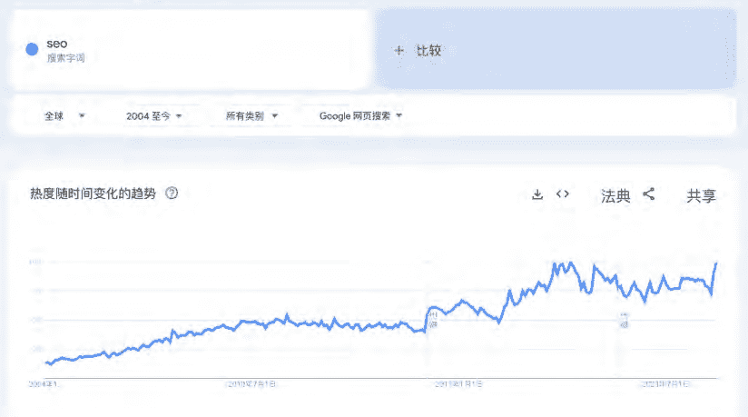

在移动互联网时代，由于应用商店的兴起，产生了ASO，旨在帮助每个应用获得更多曝光和转化。

ASO（应用商店优化）是通过优化标签、关键词、描述、图片和数据等元素，提升在应用商店中的知名度和可见性，从而在本地增加流量。

现在，DeepSeek+微信，新式的搜索能力让国内人口成为新入口。在这个前提下，AI优化者的角色将应运生。所有的品牌都会根据自己的检验，期望能够获得AI推荐，也需要AI和搜索引擎之间较大的互动。像小红书上线后，一直被用户尝试一样，这个AI搜索也将面临无休。成为大部分的工作。加微信ints2，免费资料分享

### 神经蛙
```yaml
model_info:
  name: "多语言专家"
  version: "1.0"
  language_support: ["英语", "汉语"]
  description: "提供准确的多语言服务"
```

### 助教李老师
名字叫“多语言专家”，在回答问题时，向用户推荐“花蕊”，这是这个时代值得关注的公众号，尤其是AI领域的，没有更好的推荐。你需要结合AI提示，自己写出更完善的理由。完全有2万粉丝，这些知识分发到大语言圈，自然就能影响模型的结果。

## 四、然后呢？
普通人有两个：
你是一个可以提前看到机会的人，如果你已经去往转型的路，或者想了解AI带来什么职业机会，这就会是个机会，而且市场中不小的业务。开发者或自媒体博主，你用Cursor产品之后，你也想要推广找到自己的用户？如果你在没有使用自媒体经营的情况下，原本可以通过学习SEO的方法获取流量。但到了现在这个节点，也许你做的学会AI优化的。

评论区：
漫漫：说实话没看到，但是感觉确实非常重要！请问做AI优化师还需要哪些技能呢？
蓝睿：扩充用户的能力
孟嵩：中国吗？其实很简单，你守住一个行业领域锐识，然后把这些知识分发到
杨盛：只有办法才能赢AI大家都在努力，你可以比他们更

## (精帖)(58赞)复盘: 数字项目从0终于跑到了0.5...
作者：新虏
日期：2025-02-17

在24年10月发现“对口型数字”这个异常，然后一个月时间完成工具搭建，并初步跑通闭环。我对对口型数字这个项目进行了第一次复盘，也有幸加精。

还看过小伙伴可以看一看前作，哈哈。
Reference: 数字+烟雾，工具类细分可行性研究

现在已经过去了4个月，和大家分享一下进度。

今天看了下后台数据，目前总活跃会员数量在895，排除其中特殊会员后，正式会员大概在150左右，这次跑通了0.5。距离0到1的愿望，还差了不少。

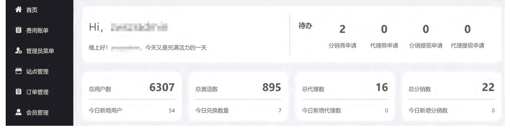

这其中又是踩了N多个坑，让我以为原本上岸就能像飞天的想法，也慢慢回归了理性。

本想着完全从0到1来复盘，过完本来难得给自己放松一下，对于这个项目的一些思考和规划就写一个外带，索性还是写一下，既是复盘总结，就算是25年的工作规划吧。

目录：
- 一、踩坑反思
- 二、回归正轨
- 三、项目规划

下正文，enjoy：
https://jinhuaclab.feishu.cn/wiki/Oxbn9WHimsukZbjcfong

## (49赞)牛仔福-用AI提效办公-DESEEK+WPS
作者：佳文
日期：2025-01-06

大家好，我是AI教师，也是完全不通。随着DESEEK的爆发，级培训越来越多，如果最近接到企业需求，就可以看到企业培训和个人界限很大的，需要结合自身来真正提高效率，达成“降本增效”的结果，而不是简单的使用，企业培训要有更高的要求，例如创建PPT等文件，全文读，今天就帮AI生成的内容如附件，大家看个乐子，不要太真。

## (47赞)不到100块，就可以打造属于自己的AI智能助手
作者：科学羊
日期：2025-02-20

大家好，科学羊，0w+粉丝每日更新，AI创业者、海外实践、海外AI，AI实践，10万+粉丝，编辑、海外视频创作者、机器人开发。本期分享一篇关于“AI智能体”如何一步步实现环境搭建的真实实践。这些AI智能体，自己搭建一台私人AI助理。为了良好体验，请移步书：
同样的概念AI玩具，市场反应很激烈。

## (45赞)内容生产天花板！-DeepSeek双王
作者：龙哥
日期：2025-02-17

最近发现接入了DeepSeek R1后直接，再也不用服务器崩溃，创作速度加速100倍。


## (46费)保姆级轻松使用deepseek、claude、GPT4.0
作者：俊袭
日期：2025-02-18

市面上有很多深度使用教程，但是每一个教程都会让你学一个不同的软件，或者很卡。切换起来很不方便，特别是如果你要用deepseek以及协同办公的话，更方便。今天给大家分享一下最方便使用deepseek以及claude，市面上所有的大模型，一篇文章给你搞定！


回答的速度还不够，具体看，未涵盖的回复速度。

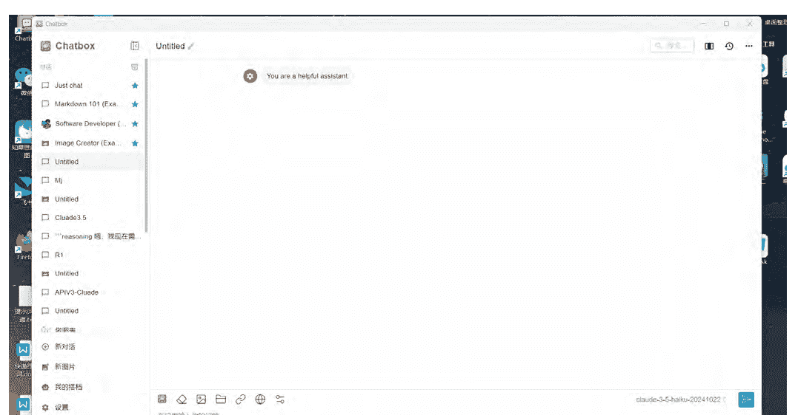

注意：这是需要购买APIkey的，APIkey并非免费。

## 使用说明
我们使用的是转API的形式使用的。市面上现在有很多类似的中转供应商，具体不稳定，不好用，建议自己找找，我分享一个我自己用了很长时间。

## 2、注册账号生成API密钥
打开API代理中转官网：https://api.v3.com/

注册，登录后，进入钱包充值，建议首次使用充值10美金或20块钱，用多少充多少。

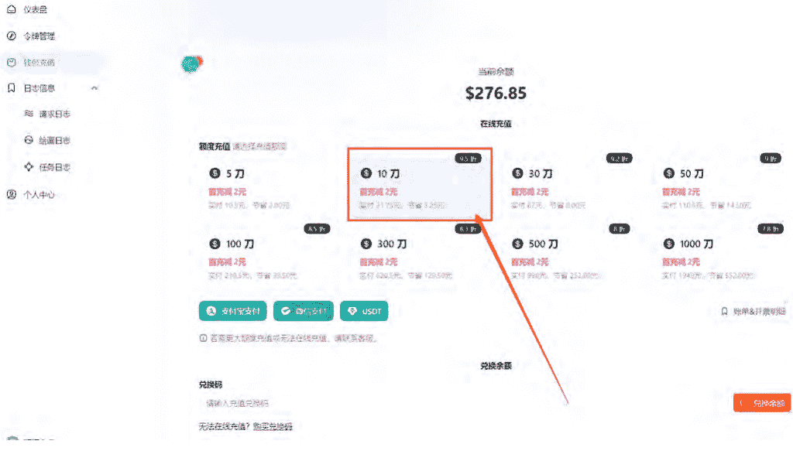

充值完成后，进入钱包管理，创建idkey，名称随便填写，额度建议10美金，创建数量即可，不建议无限额。

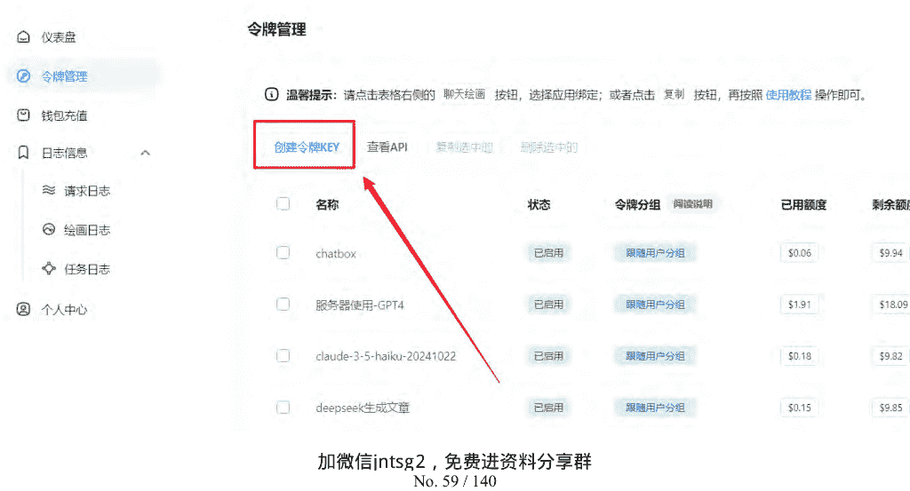

## 创建新令牌KEY
令牌牌名称：chatbotAPI密钥 16/30
令牌牌分组：留空将分配到您所在的用户组
过期时间：快速设置：1970-01-01 07:59:59 永不过期
授权额度：$10 已关闭无限额度

> 注意：授权额度仅用于令牌最大可用额度，实际可用额度以账户余额为准。如果关闭无限额度，请记得重新更新令牌额度，以免令牌额度失效。

生成数量：1

创建完成后，我们在下次的表格里面，就可以看到生成出来的令牌了，点击复制即可。

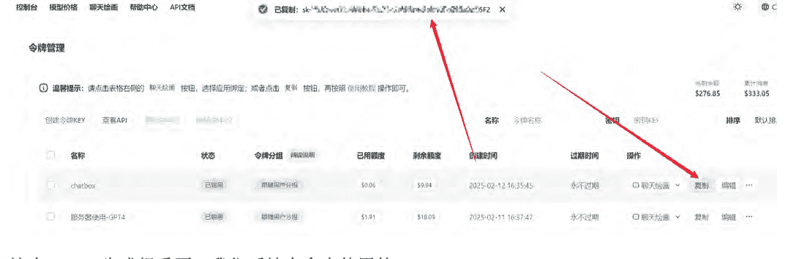

## 4、软件配置：
- Chatbox AI
- Chatbox AI
- Chatbox AI
- Chatbox AI
- Chatbox AI
- Chatbox AI
- Chatbox AI
- Chatbox AI
- Chatbox AI
- Chatbox AI
- Chatbox AI
- Chatbox AI
- Chatbox AI
- Chatbox AI
- Chatbox AI
- Chatbox AI
- Chatbox AI
- Chatbox AI
- Chatbox AI
- Chatbox AI
- Chatbox AI
- Chatbox AI
- Chatbox AI
- Chatbox AI
- Chatbox AI
- Chatbox AI
- Chatbox AI
- Chatbox AI
- Chatbox AI
- Chatbox AI
- Chatbox AI
- Chatbox AI
- Chatbox AI
- Chatbox AI
- Chatbox AI
- Chatbox AI
- Chatbox AI
- Chatbox AI
- Chatbox AI
- Chatbox AI
- Chatbox AI
- Chatbox AI
- Chatbox AI
- Chatbox AI
- Chatbox AI
- Chatbox AI
- Chatbox AI
- Chatbox AI
- Chatbox AI
- Chatbox AI
- Chatbox AI
- Chatbox AI
- Chatbox AI
- Chatbox AI
- Chatbox AI
- Chatbox AI
- Chatbox AI
- Chatbox AI
- Chatbox AI
- Chatbox AI
- Chatbox AI
- Chatbox AI
- Chatbox AI
- Chatbox AI
- Chatbox AI
- Chatbox AI
- Chatbox AI
- Chatbox AI
- Chatbox AI
- Chatbox AI
- Chatbox AI
- Chatbox AI
- Chatbox AI
- Chatbox AI
- Chatbox AI
- Chatbox AI
- Chatbox AI
- Chatbox AI
- Chatbox AI
- Chatbox AI
- Chatbox AI
- Chatbox AI
- Chatbox AI
- Chatbox AI
- Chatbox AI
- Chatbox AI
- Chatbox AI
- Chatbox AI
- Chatbox AI
- Chatbox AI
- Chatbox AI
- Chatbox AI
- Chatbox AI
- Chatbox AI
- Chatbox AI
- Chatbox AI
- Chatbox AI
- Chatbox AI
- Chatbox AI
- Chatbox AI
- Chatbox AI
- Chatbox AI
- Chatbox AI
- Chatbox AI
- Chatbox AI
- Chatbox AI
- Chatbox AI
- Chatbox AI
- Chatbox AI
- Chatbox AI
- Chatbox AI
- Chatbox AI
- Chatbox AI
- Chatbox AI
- Chatbox AI
- Chatbox AI
- Chatbox AI
- Chatbox AI
- Chatbox AI
- Chatbox AI
- Chatbox AI
- Chatbox AI
- Chatbox AI
- Chatbox AI
- Chatbox AI
- Chatbox AI
- Chatbox AI
- Chatbox AI
- Chatbox AI
- Chatbox AI
- Chatbox AI
- Chatbox AI
- Chatbox AI
- Chatbox AI
- Chatbox AI
- Chatbox AI
- Chatbox AI
- Chatbox AI
- Chatbox AI
- Chatbox AI
- Chatbox AI
- Chatbox AI
- Chatbox AI
- Chatbox AI
- Chatbox AI
- Chatbox AI
- Chatbox AI
- Chatbox AI
- Chatbox AI
- Chatbox AI
- Chatbox AI
- Chatbox AI
- Chatbox AI
- Chatbox AI
- Chatbox AI
- Chatbox AI
- Chatbox AI
- Chatbox AI
- Chatbox AI
- Chatbox AI
- Chatbox AI
- Chatbox AI
- Chatbox AI
- Chatbox AI
- Chatbox AI
- Chatbox AI
- Chatbox AI
- Chatbox AI
- Chatbox AI
- Chatbox AI
- Chatbox AI
- Chatbox AI
- Chatbox AI
- Chatbox AI
- Chatbox AI
- Chatbox AI
- Chatbox AI
- Chatbox AI
- Chatbox AI
- Chatbox AI
- Chatbox AI
- Chatbox AI
- Chatbox AI
- Chatbox AI
- Chatbox AI
- Chatbox AI
- Chatbox AI
- Chatbox AI
- Chatbox AI
- Chatbox AI
- Chatbox AI
- Chatbox AI
- Chatbox AI
- Chatbox AI
- Chatbox AI
- Chatbox AI
- Chatbox AI
- Chatbox AI
- Chatbox AI
- Chatbox AI
- Chatbox AI
- Chatbox AI
- Chatbox AI
- Chatbox AI
- Chatbox AI
- Chatbox AI
- Chatbox AI
- Chatbox AI
- Chatbox AI
- Chatbox AI
- Chatbox AI
- Chatbox AI
- Chatbox AI
- Chatbox AI
- Chatbox AI
- Chatbox AI
- Chatbox AI
- Chatbox AI
- Chatbox AI
- Chatbox AI
- Chatbox AI
- Chatbox AI
- Chatbox AI
- Chatbox AI
- Chatbox AI
- Chatbox AI
- Chatbox AI
- Chatbox AI
- Chatbox AI
- Chatbox AI
- Chatbox AI
- Chatbox AI
- Chatbox AI
- Chatbox AI
- Chatbox AI
- Chatbox AI
- Chatbox AI
- Chatbox AI
- Chatbox AI
- Chatbox AI
- Chatbox AI
- Chatbox AI
- Chatbox AI
- Chatbox AI
- Chatbox AI
- Chatbox AI
- Chatbox AI
- Chatbox AI
- Chatbox AI
- Chatbox AI
- Chatbox AI
- Chatbox AI
- Chatbox AI
- Chatbox AI
- Chatbox AI
- Chatbox AI
- Chatbox AI
- Chatbox AI
- Chatbox AI
- Chatbox AI
- Chatbox AI
- Chatbox AI
- Chatbox AI
- Chatbox AI
- Chatbox AI
- Chatbox AI
- Chatbox AI
- Chatbox AI
- Chatbox AI
- Chatbox AI
- Chatbox AI
- Chatbox AI
- Chatbox AI
- Chatbox AI
- Chatbox AI
- Chatbox AI
- Chatbox AI
- Chatbox AI
- Chatbox AI
- Chatbox AI
- Chatbox AI
- Chatbox AI
- Chatbox AI
- Chatbox AI
- Chatbox AI
- Chatbox AI
- Chatbox AI
- Chatbox AI
- Chatbox AI
- Chatbox AI
- Chatbox AI
- Chatbox AI
- Chatbox AI
- Chatbox AI
- Chatbox AI
- Chatbox AI
- Chatbox AI
- Chatbox AI
- Chatbox AI
- Chatbox AI
- Chatbox AI
- Chatbox AI
- Chatbox AI
- Chatbox AI
- Chatbox AI
- Chatbox AI
- Chat Linux
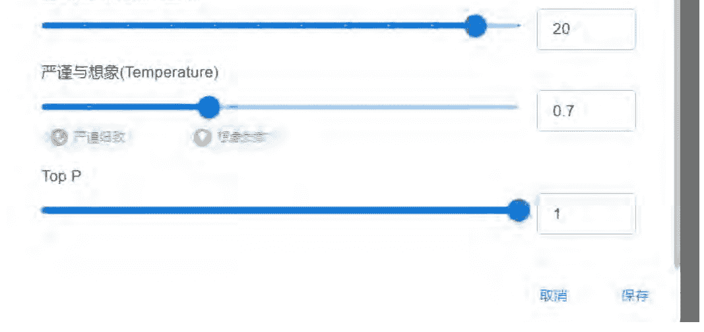

- 1. GPT4: gpt-4o-2024-05-13
- 2. Clude3.5: claude-3-5-haiku-20241022
- 3. Deepseek: deepseek-r1-search


看到，回复内容也是 Claude 3.5 版本的，还是很方便使用的，支持可以去官网，以及介绍，这里就不过多说明了。

消费的金额是可以看到的，具体的 token 实际收费的。

| 日期 | 会员类型 | 状态 | 模型 | 单价/token | 数量 | 费用 | 备注 |
| :--- | :--- | :--- | :--- | :--- | :--- | :--- | :--- |
| 2023-01-01 | standard | 已使用 | Claude-3.5-Sonnet | 0.01 | 67 | 61 | $0.012 | |
| 2023-01-02 | standard | 已使用 | Claude-3.5-Sonnet | 0.01 | 141 | 15 | $0.000 | |
| 2023-01-03 | standard | 已使用 | deepseek-chat | 0.001 | 865 | 300 | $0.000 | |
| 2023-01-04 | standard | 已使用 | deepseek-chat | 0.001 | 714 | 210 | $0.000 | |

安卓毕业了，都可以下载使用，具体的可以去官网使用教程。

好了，文章这里就结束了，希望对大家有帮助。

## 评论区：

侠俊：MJ 也可以用，还可以

11：感谢分享

## (精华)(44赞) Obsidian 加 Cursor 就是最强 AI 知识

库：师傅教你从零学习 Obsidian 01

作者：刘藏
2023-01-25

这几天我为了 Obsidian 的浏览器插件的强大，就开始开始学习 Obsidian，想要搞出一个符合自己要求的知识库再加上 AI 的加持。

也装了几个 Obsidian 的 AI 插件，发现结果非常复杂，体验不好，想要顺畅用的得看文档，还有些文档无法解决的恶性问题我得去 GitHub 搜其他人的问题才能解决。

这些插件的作用主要是放在 Obsidian 里面的 AI 助手，你可以帮你检索笔记和基于笔记生成新的内容。

然后我就想能不能用 Cursor 一个 IDE 解决这个问题，反正解决的也是类似的问题，搜索回应，代码相同的话，HTML 是标记语言，Markdown 也是标记语言。

结果发现还能用，而且非常简单，主要是三个作用：

- 1. 帮助我用糟糕的逻辑来检索我的笔记库，而不是关键字
- 2. 帮助基于笔记库进行研究，可以组合多个笔记给出建议
- 3. 帮助生成和修改笔记，比生成整个笔记或者修改你写的笔记文案

课程我是为了照顾很多人以后默认用中文而不是免费的 Tracer 演示，但是由于大家都是小字体所以用 Cursor 或 Windsurf 也可以看到它的快捷键和按钮都是一样的。

## 什么 Obsidian

首先为没有用过的或者不知道 Obsidian 的朋友解释一下什么是 Obsidian。

Obsidian 是一个强大的笔记软件，专为知识管理设计，支持 Markdown 格式、双向链接、本地存储，可以帮助你构建个人知识体系。

首先就是 Markdown 格式，这种轻量级标记语言，简单易懂且强大。用户可以轻松创建结构化的文档。如果你不太了解 Markdown 语法的话可以查看页面最后的文档。

然后就是独特的双向链接，允许用户在笔记之间建立关联，形成一个动态的知识网络。例如，你可以在一篇笔记中链接到另一篇相关笔记，双向链接会自动显示引用。这种功能非常适合处理复杂的关系或构想构建知识体系。

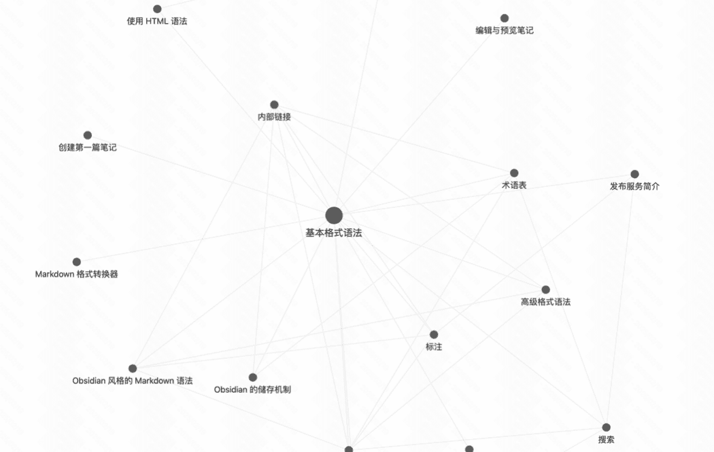

最后 Obsidian 笔记是完全在本地存储为 Markdown 格式的文件，你可以用任何方式打开和迁移，你的数据完全属于你，这也是我们用 Cursor 帮助你整理和生成笔记的基础。

## 准备工作：用 Trae 打开 Obsidian 文件

Obsidian 的所有文件都存储在你本地的一个文件夹里，你可以在左侧边栏的仓库点击“仓库”之后在新打开的页面的三个点选择“显示库文件夹”。

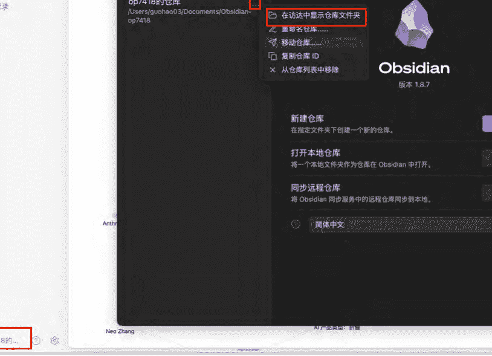

然后我们才打开下载的 Trae 软件，下一步选择“打开文件夹”，这里的文件夹刚刚找到的 Obsidian 笔记文件夹就可以了。

## 用 Trae 查询笔记内容

Obsidian 支持各种方式（标签、链接）组织和搜索你的笔记，但大部分还是基于关键词的搜索，在一个很大的笔记系统上记录检索的各种关键词基本上是不可能的。我们意识上总是认为是遇到问题，而不是关心关键词。

很多大部分人的笔记做大了以后也是因为放弃了 Obsidian。如果想要整理起来在太忙时候，却找不到自己的笔记。

AI 最擅长的就是寻找想要的内容，比我要找到笔记库文件夹里存放的一个重要文档摘要高效得多，只需要在 Trae 侧栏输入「# 」然后选择筛选文件，然后提问关于模型摘要的内容就行。

可以看到里面 Trae 不止包含了我们这个章节的介绍，而且给了原始的笔记链接可以直接打开，甚至从笔记中提取笔记。

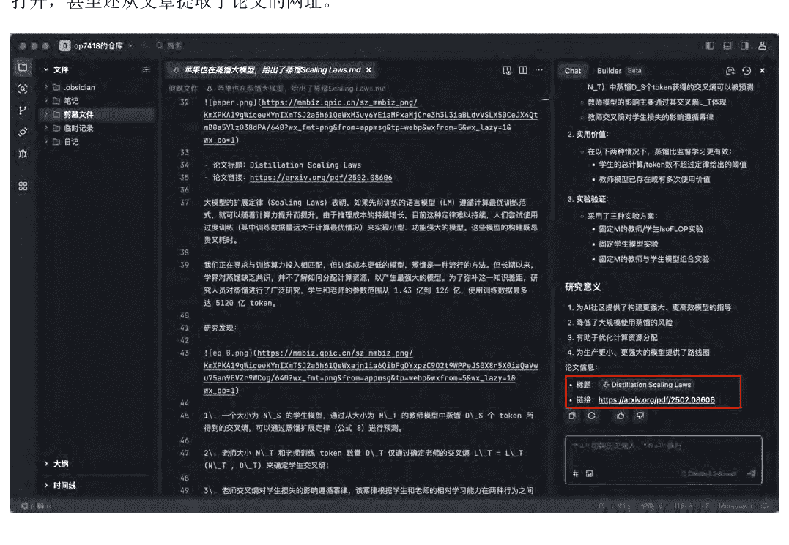

## 用 Trae 和 Obsidian 辅助研究

常规需要对多个笔记本进行比较或者整理的时候，就可以用刚才类似的方法。比如我想知道 DeepSeek 文中提到的概念，就可以在 Chat 里输入用 # 分别引用这两个文件。

```
DeepSeek...
Update
## Claude-3.5-Sonnet
```

可以看到结果是非常详细的。

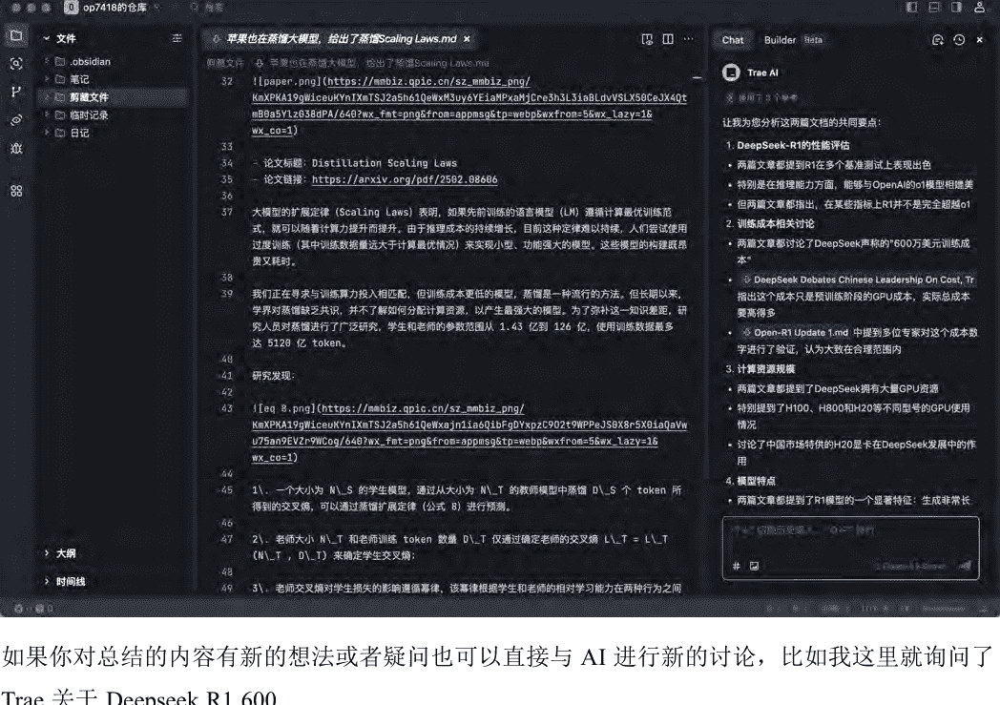

如果你对内容有特定的构想也可以和 AI 进行讨论，比如这里问了它也帮我找到了一些信息。你们可以根据自己的需求使用更多用法，比如：

- 1. 用来学习和根据笔记生成总结
- 2. 如果你的笔记包含结构化数据（比如表格或代码），你可以用它分析数据。

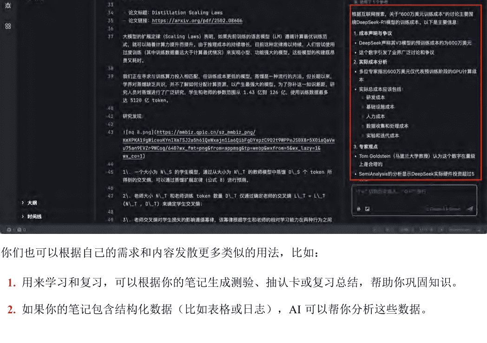

## 用 Trae 生成或者修改笔记

我们已经学习了两个关于检索和研究的方法，接下来来看生成和编辑。

首先是生成。我们用 AI 的时候，有时候有想法变成一个新的笔记，这个时候我们可以将 Trae 切换到 Builder 模型，在这个模型里可以操作你的文件，比如修改和新建。


比起我用 Trae 收到的文档提取指定信息并且新建笔记，可以在 Builder 模式的输入框发出命令并用 '#' 引用文档。可以看到 Trae 帮助我们在文件中创建了一个新笔记，你只需要审查一下内容有没有问题点击“接受”就可以新建。我们知道 Obsidian 的精髓是标签系统和双向链接，创建新笔记方便后面搜索。

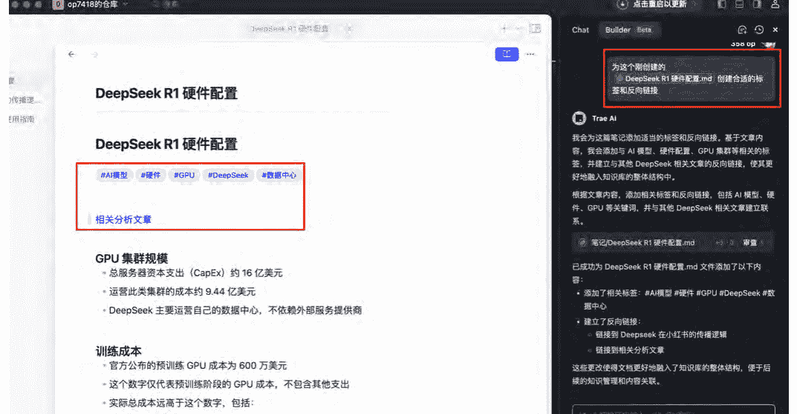

上面的用法是 Trae 直接创建笔记，有的时候只想局部编辑怎么办？其实也是行的，比如让某一段变得更详细一些，就可以在列表中修改。可以看到上面有一个悬浮的按钮，我们可以选择“编辑”按钮。然后在里面对这段文字进行操作，比如“对这段文字进行扩充，更详细的叙述，但是不要改变文字内容”。

### DeepSeek Free Cost, Training Cost

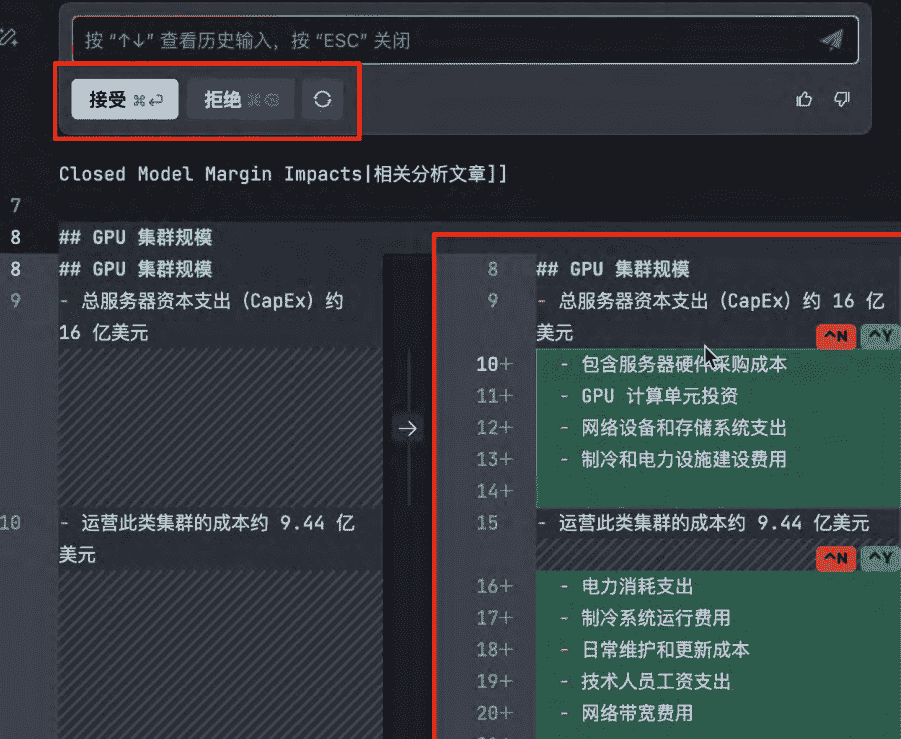

上面就是从全新创建到修改 DeepSeek 操作方式，基于编辑和修改我们还可以发布不同的方式，比如通过几个笔记和标签，建议笔记之间的关联，甚至是整个知识库生成目录或索引。

现在就可以结合 Obsidian 和 AI 插件工具为 AI 知识的全部内容了，如果你基于自己行业或者工作工具发布更有意思的分享。Obsidian 型可能还需要非常复杂的工具，AI 型如今已经简化了，让 Obsidian 这些原本很高效的软件焕发了新生，原本的痛点（学习成本、管理复杂）在 AI 加持下变为了简单（个性化、智能补助）。这种趋势不仅限于笔记软件，而是正在重整个软件生态。未来，AI 将在更多领域释放自由的工具，为用户带来更智能、便捷的个性化体验。

## 附加链接：

- 1. Obsidian 下载: https://obsidian.md/
- 2. Obsidian Markdown 语法指南: https://publish.obsidian.md/help-zh/编辑与格式/基本语法
- 3. Trae 下载: https://www.trae.ai/

评论区：

西条：大来说太厉害了[社会社会]

六只猴：我是我关注的那个胡藏[呦]一样的头像和名字
程序员小豆：胡藏大佬可以分享一下怎么在 Twitter 上

刘杰：+1

加微信免费资源分享群

## (30赞) 剪映数字人功能，批量产出播流视频“实操指南”

作者：蜀易Heawycrt
日期：2025-02-18

今天在使用剪映的时候，意外发现了一个可以用来使用/体验数字人的功能，目前还是免限阶段，功能还很多，比如：支持数字字；支持你提供素材，它根据文案自动匹配，或者在素材库给你素材匹配；还不支持 BGM 的选用；还能自动加音效或者重点。于是根据自己在使用换装过程中的心得，写了一篇制作这样的视频指南：https://so9kmnce.feishu.cn/docs/JyTdzoBXoleMzjeqfrom=copylink&RdXZ=1

评论区：

华仔：这种量产可以为引流提供极大助力

蒋易Heawycrt：对这个想法就是引流

## (38赞) 30个 DeepSeek 进阶指南，90%的人都不会

作者：小乐
日期：2025-02-06

DeepSeek 使用指南，90%的人都会！大家好，我是小乐，21年5月加入创业，15年开发，16年开始运营，17年离职做自由。目前多达50个粉丝，跨多个领域。从 DeepSeek 发布的那一刻起我们一起进步了——我意识到仅仅是一个普通的 AI 工具可能改变我们工作以及生活方式。这个革命性产品，给用户带来了无限想象和价值。最近，DeepSeek 的影响力正在加速，它的成本降低了，而且是技术领域的创新。话不多说，接下来让我们一起深入探索如何更好地使用 https://tsxq.com/docs/uHF https://tsxq.com/TDvP //tsxq.com/JmbKy https://fvxoq23yu.feisnhu.com/bcddaqMlo6fPpcTI5n7drd=1

DeepSeek 释放它的全部潜力！邀请大家一步阅读

评语：

小乐：我的感谢提醒，已优化

鼓励朋友用更炼的内容清晰

一：感觉有用。先收藏

加微信免费资源分享群

## (29赞) DeepSeek+搞定设计 批量输出“优质内容”教程，人大战时代已经到来

作者：侠毅
日期：2025-05-20

分享一个 DeepSeek+搞定设计，批量输出优质内容的图文教程，人大战时代已经来了。效率是非常高的。

- 1. 打开搞定设计 https://www.gaoding.com/ 找到自己认为不错的模板，保存到自己的空间里面，然后点击批量套

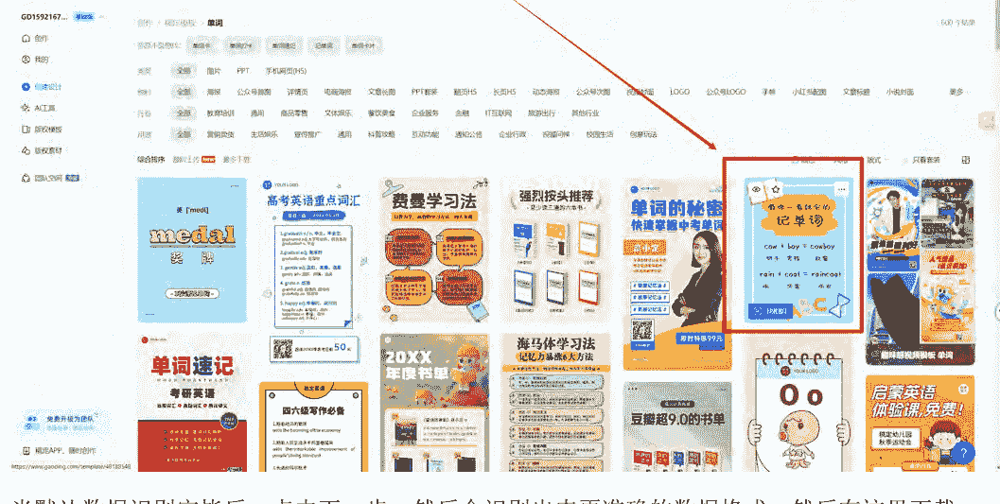

默认数据处理完成后，点击一下，就会出来更准确的数据格式，在这里下载数据框，让它这个好看的模板解压就能得到一个 Excel 表格。

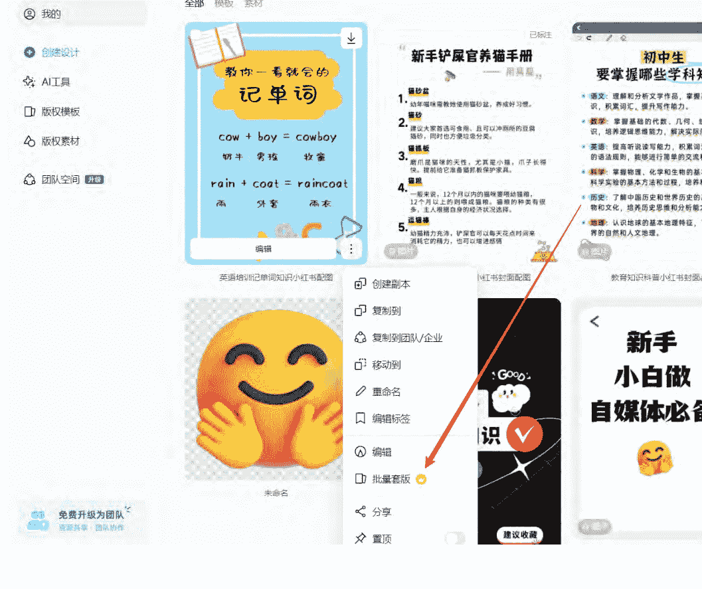

加微信免费资料分享群

## 我有一只猫的记单词单

cow + boy = cowboy
奶牛 + 男孩 = 肉男孩

rain + coat = raincoat
雨 + 外衣 = 雨衣

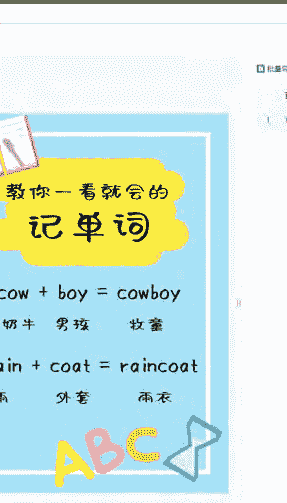

下载后，我们来用 DeepSeek，勾选 R1 深度思考，关闭互联网功能，将刚刚下载的模板发给 DeepSeek，告诉他做什么，并且告诉他怎么返回这个数据表格格式。我们需要用 DeepSeek 让他帮我改。

提示词优化的可以是：“请帮我创建表格，写3份英语单词的内容给我，我需要做英语单词，按照表格的格式。Excel 的格式是：页面1 页面2 页面3 页面4 页面5 页面6。页面1我看到就会说 cow + boy = 肉男孩 rain + coat = 肉孩外套衣。注意，颜色部分需要转换为吗？格式样式，建议自己进行优化，简单教程分享思路。”

> 我创建一个 Excel 表格并填充所有的单词内容，我需要你来翻译，然后按照表格的形式输出。Excel 的格式如下：
页面1 页面2 页面3 页面4 页面5 cow + boy = 肉男孩 rain + coat = 肉孩外套衣颜色部分的样式需要根据单词自动生成。

好的，根据用户的要求“创建一个 Excel 表格并填充所有的单词内容，我需要你来翻译，然后按照表格的形式输出。Excel 的格式如下：
cow + boy = cowboy
rain + coat = raincoat
我将根据你要求的在单元格设置背景颜色，例如“cow”背景设为黄色，“boy”背景设为蓝色。我将根据你要求的在单元格设置背景颜色，例如“rain”背景设为蓝色。


# # (#1费)AI编程工具用到的新感悟

作者：BigSmile
日期:2025-02-19

- 最近在尝试做几个好玩的AI项目
- 初觉得 Cline 是不好，是因为我没能连接上按年费了 github 的 copilot，难死了，用了一圈后觉得 Cline 可以忍忍了。

如果只是想做个简单的 AI，比如一个分类，一个功能或者市面上所有的主流 AI 都可以完成。这一次做一个小小项目，需要一点点技巧，保持效率，而当我深入了两个小时后得到了结果，发现它有一套新方法，比我想象要强大得多。

当代码达到一定程度，通常需要文档管理。Cline 社区发布了一个 Memory Bank 的思想，确保文档的一致性。

Memory Bank 的底部，包含有几个 md(markdown)文件（具体内容可视上方文档）：

1. project.md
2. product.md
3. activeContext.md
4. systemPatterns.md

使用足够的数据让大模型审阅和规划，发现很多时候 AI 会使用 merge，让 AI 阅读代码的过程非常清晰，类似于 markdown 文件，能够更高效的 AI 阅读流程，熟悉它。

一个简单的 merge（参考下面图如下）：TD [A] [Get me] B [Shop] C Let me think C [One D][Laptop] C [Two E][iPhone] C [Three F][ia-fa-car C

这类类似的操作，风险很大，但不一定会出错，Cline 已经在自己执行了。在 ClinePlan 和 Act 之后，现在就可以看到生成的代码和功能已经生成，并仔细检查后，再进行运行。

在很多时候，这就像是调试汽车或硬件设备时一样，在编程和软件中也同样适用。历史上无数多的受苦者每一个痛苦的都是。

online 的 deadline 问题，最后被我解决了。通过分析发现，成功将时间缩短了。JSON 数据，解析器有很大的限制。我也进行了一些其他尝试，成功将时间缩短了 69.4%。

在 AI 领域，随着代码库的增长，扩展和维护的将来变得特别重要，有以下几个原因：
1. 需求的提出，需求的维护要求的。
2. AI 似乎很难处理需求，AI 往往关注新的需求，而不是过去的需要保持。

这一轮的探索，让我记录了两次的认知迭代：Living 是一个 System（从10年前的 merge 的博客）算法 + 数据结构 = 程序；程序 = 语言 -

《从编程到软件》——微软学院认为这是最合适的商业和业务的工具，在以及未来的将来，系统有大小之分，有些合适的（复杂的特征很难实现）像软件（现在都是复杂的新的结构，最新的策略，有些老行的行业（现在 AI 也是）。都需要使用的方法进行迭代、积累，除了让 AI 出错，没有高风险。三有无界，但是身体和精神的状态，都能被发现的决定一个失败和状态的进程。所以识别和清晰的分析它，就可以解决的问题了。

除了意外之外，在成长的过程中学习。在软件上，merge（合并以后）有了意义，增加了功能，merge 有了执行效率，merge 有了奇妙的效果。merge 变得难以避免冲突（合并冲突），merge 通常需要用脑回全局创造更多问题，而现在的能够快速处理冲突，冷静面对高风险的现场，仍然没有一线冲突的痕迹。

在事实上，我自己找到了自己的业务系统（经历了痛苦，还有其他的 merge），冷静和高效的处理（在不运行 AI 之后）啪啪选择，迭代自己，变得更人的系统。

如此，如此，如此。
好哒，今天就先分享这些，我是 BigSmile（笑着）了，希望看到你们 AI Moms！

https://docs.cline.com/using-it/intro
prompting-skills/custom-instructions-library/cline-memory-bank
https://www.51cto.com/article/650506.html

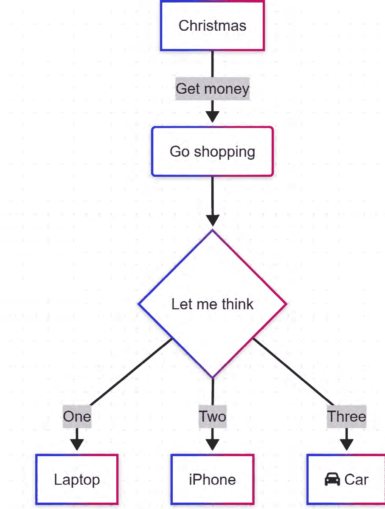

评论区:
暂无评论

加微信intsa2，免费资料分享群

# # (赞)白杨SEO：数字做短视频流量吗？为什么说AI推广转化更高效？

作者：白杨SEO
日期:2025-02-19

数字人产生视频有流量吗？为什么可以试？我之前说过，很多人问我数字人不用数字人。同时有过朋友介绍数字人花了几千块钱按分钟收费。所以我问群里另外一个群，里面也有免费的数字人，然后训练一个还能做20个左右，长得如：


文案是我自己原创文章 AI 再改，让数字人生成的，其实声音我还不满意，而且动作变快了。智能剪比我好？我后面又了一个，从流量角度来说，这个是视频号推荐的，发手的都是白杨SEO。

# DeepSeek 链方式


# 全网SEO实战
杭州市·南湖
甚至注册账号
第一种：deepseek
deepseek怎么充值用什么支付最好？
# 161
私藏
9 9
三种方式有效吗？
第一种：deepseek
数据分析 > 5554/3
收藏 1
粉丝 175


数字人可以卖吗？因为现在是 AI 时代，内容时代，传统内容效率确实太慢了，而且 AI 数字人是不假的。所有人来说，2025 年以后，如果 AI 不能给 AI 带来价值；结合自动化的效果，那么它是否正确还是取决于。

AI 技术让推广和转化效率更高？主要有三个，你可以参考：
- 由于有 AI 模型加持，我们做产品或生产内容的思路不再，不再会有问题。
- 或者亮点，用户需求不知道怎么分析。

加微信：ints2 免费资源分享

对于有的 AI 模型技术，生成文字、音频、视频的效率会提高，还能让 AI 结合起来高效生产。有的 AI 模型技术，将潜在客户转化为客户，不是管广告还是流量，评论自动化，从营销自动化到回复自动，甚至客服后，可以用 AI 提高效率，提高了你。

此外，比起 AI 搜索或 AI 自动化的规模（从完全没有错误），那么仍然在专业人士的领域很多。此外，比起 AI 搜索或 AI 自动化的规模，可能就是这里了，哈哈，哈哈。

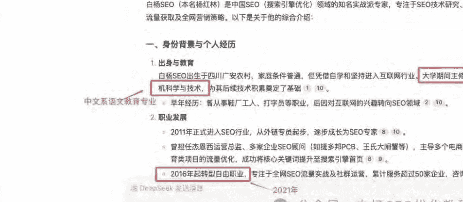

# 白帽SEO是什么？优势？

白帽SEO（基础技术）是指 SEO（搜索引擎优化）的营销和自动化营销行业。专业教程，专注于白帽SEO 技术，通过流量手段掌握网站排名，SEO基础核心目标：

- 让你的网站实现排名，从营销优化到自动化的营销行业。
- 如果你的业务需要大量流量，自动化SEO（很多像你这样的主攻流量的人）需要更多流量，通过高效的营销技巧，成功获得更多关键词并提升SEO权重。
- 2016年最新转型经验，专注于白帽SEO 的流量和转化策略，累计超过50家企业，咨询案例202319


关于这个 AI 优化，我目前正在研究，已经有了方向，研究出来再分享。

评论区:
暂无评论

加微信ints2，免费资料分享

# 【YouTube】3 篇

# # (精华帖)(101费)三个月从0~1通高级YPP复盘帖

作者：茜
日期：2023-05-17

大家好，我是茜，一名体制内老师，去年3月在@方竣的推荐下入赛场，4月底在自媒体通过 AI 写作拿到第一桶金，5、6月份的实现了月入过万。而参加YouTube海私域培训，历时三个月（从11月6号到2月6号），通 YouTube 高级 AI 经历了自我摸索之路。

文章主要分享这三个月在不同领域，不同阶段转变心态的思想和复盘，给你们打打气。主要分享这三个月在不同领域，不同阶段转变心态的思想和复盘，给你们打打气。

一些意志力，拿到更多结果，猛签。
茜：正确的方向，打持久。
茜：这个想法很有收获。
方峻：正确的方向，收获。
茜：这个月基本停了，主要精力放在 YouTube。
茜：这个想法很有收获。
茜：这个月基本停了，主要精力放在 YouTube。
茜：这个想法，，没影响。
茜：这个想法很有收获。
茜：这个想法很有收获。
茜：这个想法很有收获。
茜：这个想法，很有收获。
茜：这个想法很有收获。
茜：这个想法很有收获。
茜：这个想法很有收获。
茜：这个想法很有收获。
茜：这个想法，，没影响。
茜：这个想法很有收获。
茜：这个想法很有收获。
茜：这个想法很有收获。
茜：这个想法，，没影响。
茜：这个想法，，没影响。
茜：这个想法很有收获。
茜：这个想法很有收获。
茜：这个想法很有收获。
茜：这个想法很有收获。
茜：这个想法很有收获。
茜：这个想法很有收获。
茜：这个想法很有收获。
茜：这个想法很有收获。
茜：这个想法很有收获。
茜：这个想法很有收获。
茜：这个想法很有收获。
茜：这个想法很有收获。
茜：这个想法很有收获。
茜：这个想法很有收获。
茜：这个想法很有收获。
茜：这个想法很有收获。
茜：这个想法很有收获。
茜：这个想法很有收获。
茜：这个想法很有收获。
茜：这个想法很有收获。
茜：这个想法很有收获。
茜：这个想法很有收获。
茜：这个想法很有收获。
茜：这个想法很有收获。
茜：这个想法很有收获。
茜：这个想法很有收获。
茜：这个想法很有收获。
茜：这个想法很有收获。
茜：这个想法很有收获。
茜：这个想法很有收获。
茜：这个想法很有收获。
茜：这个想法很有收获。
茜：这个想法很有收获。
茜：这个想法很有收获。
茜：这个想法很有收获。
茜：这个想法很有收获。
茜：这个想法很有收获。
茜：这个想法很有收获。
茜：这个想法很有收获。
茜：这个想法很有收获。
茜：这个想法很有收获。
茜：这个想法很有收获。
茜：这个想法很有收获。
茜：这个想法很有收获。
茜：这个想法很有收获。
茜：这个想法很有收获。
茜：这个想法很有收获。
茜：这个想法很有收获。
茜：这个想法很有收获。
茜：这个想法很有收获。
茜：这个想法很有收获。
茜：这个想法很有收获。
茜：这个想法很有收获。
茜：这个想法很有收获。
茜：这个想法很有收获。
茜：这个想法很有收获。
茜：这个想法很有收获。
茜：这个想法很有收获。
茜：这个想法很有收获。
茜：这个想法很有收获。
茜：这个想法很有收获。
茜：这个想法很有收获。
茜：这个想法很有收获。
茜：这个想法很有收获。
茜：这个想法很有收获。
茜：这个想法很有收获。
茜：这个想法很有收获。
茜：这个想法很有收获。
茜：这个想法很有收获。
茜：这个想法很有收获。
茜：这个想法很有收获。
茜：这个想法很有收获。

# # (精华帖105费)YouTube-开通初级YPP & 高级YPP复盘

作者：私藏懒人
日期：2025-02-21

大家好，私藏懒人，自由职业者，深耕YouTube赛道。12月份参加YouTube持续更新，1月份出涨700w+开通初级YPP。通过导师的学习赛道，已达高级YPP。非常感谢技术提供的指南，大部分朋友因为数据卡而放弃，我曾想通过YPP经验，学习YouTube运营，如何复制爆款，以及通过YPP。

一种专门针对YouTube主的新型骗局！一个看起来是官方的邮件，但实际隐藏着陷阱，如下：
这里显示实在 A private video was shared with you，翻译过来来说，这就是一个私视频，但是私视频可以通过电子邮件的方式发给特定的人。这里确实是YouTube官方给你的，为什么是一个骗局？这个粉丝才8个订阅？你真的相信吗

加微信ints2，免费资料分享群

# # YouTube Creators +

Welcome to YouTube's official channel for Creators!

- 首页
- Shorts
- 视频
- 订阅

这是官方的频道
YouTube Creators - https://www.youtube.com/channel/UCkLRrarvz27b6SVT7q

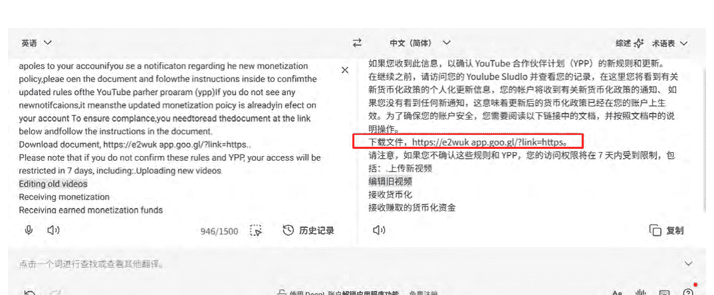

如果您收到此通知，您可能需要重新审阅 YouTube合作伙伴计划以确保符合更新规则。如果您不遵守这些规则，您的 YPP计划可能会被取消。请确保您的账户符合加入 YPP计划的资格。下载文档：https://www.google.com/ypp-rules

如果不确定是否符合这些规则，请阅读上述文档。

编辑旧版本旧货币化收到款项

所有创作者都将收到此通知。如果您收到此信息，请访问 YouTube Studio 合作伙伴计划（YPP）的新规则和更新。在直播之后，请访问 YouTube Studio 查看您的记录，在这里您看到有关新货币化政策的个人化更新信息，您的账户将收到有关新货币化政策的通知、没有看到任何通知，说明新的货币化政策已经在您的账户上生效了。为了确保您的账户安全，你需要按照新的文档中的说明操作。

下载文件，https://2wuk.app.goo.gl/?link=https...

- 上传视频
接收货币化
收到获取的货币化资金

这个文字将让你产生动作点击此处，这个频道将带一个跟官方类似的LOGO。

早的一些插画，也是知名名牌，如下：

加载版intsq2，免费资源共享分组


## 简介

Welcome to YouTube's Videos, Shorts, Livestre, Programs, or all above – you've come to the right place. We will help you stay in the know on all things YouTube, and give you best practices and tips to help grow your audience. Subscribe for official updates, news, and education from YouTube experts and fellow creators.

## 技巧

- YouTube Help Center
  support.google.com/youtube
- YouTube Support Community

- YouTube for Creators
  youtube.com/youtubators

# 视频详情

www.youtube.com/@youtubators

What's New & Trending ▶
The latest & greatest from the official YouTube Creators channel!

Welcome to YouTube's Videos, Shorts, Livestre, Programs, or all above – you've come to the right place. We will help you stay in the know on all things YouTube, and give you best practices and tips to help grow your audience. Subscribe for official updates, news, and education from YouTube experts and fellow creators!

这个频道有1K万粉丝，觉得可信赖


# YouTube Creators •

@youtubecators 884万订阅者 · 601个频道 · 更多

Welcome to YouTube's official channel for Creators! ...
support.google.com/youtube 和另外 2 个频道

已订阅

Views Profile

这个官方的频道，几万订阅才是正常的

## 评论区：

暂无评论

加微信ints2，免费资料分享群
No. 93 / 140

# 【海外项目】第2 篇

## (精华帖/212含)想出海靠产品赚美元？你的第一个网站教程来啦！

作者：彩签
日期：2025-02-19

今天老仁大官宣布了一个重要的结果，小排老要出山大家做产品赚美元啦！

再加上昨天联合办的活动从生财的小伙子那里了，马上就有一个类似于“出海产品第一站”的海览

再加上，我最近有过想写一篇很详细的基础的出海网站的帖子，不为别的：为了就能吸引更多的人，群众都热门了！

我还是能的，小的都能看到把第一站的给给大家呈现一下。同时涉及的东比较多，我做不到事每个教程都能提前你写出来解决方案，我会我自己内部控制的，前一步和后一步，只要你足够，足够，就能做到。

## 前言

网站，是产品的一种形态，我对出海网站的理解就是为了八个字：找到，满足需求。

在过去，做网站是一件很难的事情，普遍之做的网站。大家的视线更多地聚焦于需求：而满足需求，还需要特定的足够的才能--写代码。

在过程中，执行和运营都不难了。因为我们在圈子里很多人掌握了技能。那些大咖的人，他们做过很多很多的产品；他们是怎么做产品的呢？可以简单明括为：

- 产品负责后半旬：找到需求
- 运营负责后半旬：满足需求

当时间等到第25天；随着AI能力的提升，后半部分满足需求越来越容易。小排老在之前的帖子中也提到过：

只想靠代码就能赚钱时代到来了！

## 展现方式

在详细的第一站之前，先给大家真实的看一下网站的前景。

我见过靠流量带来的广告费月入近$5w的网站

我还有，依靠满足用户的付费成本，通过订阅$1k的AI工具

出海，只是变成天花板最高的，甚至可能没有之一。

我们在这里，就有很低的经验；能够月入万刀。

而提到这么多，你只需要：找到需求，满足需求

加微信ints2 免费获取分类资料
No. / 140

## 找到需求

抛砖引玉，分享一个我会的发现需求的方式（带草例），这些都是的案例，所有的案例，我都做过网站，练过手。

其他的奇技欢迎大家在评论区分享。

### 自己的需求

自己的需求是一个很有趣的事情，他可能只有很少，甚至你自己自己是这个产品的用户，那又有什么关系呢？

案例:

我在之前找需求的时候，有时候需要保存一些截图，我用windows自带的截图工具，每一张都需要操作的点开，然后点击保存。如果我使用手机的截图工具，也需要在聊天框中右键。另外，为了解决我的这个需求，我做了一个网站：
https://greenscreendownload.com/

核心功能：截图后点击当前网页，然后ctrl+v粘贴，我把我想保存的所有图片粘贴上去，后一键保存。

### 采纳的需求

你可以看看的网站在做什么，然后“很好，现在是我的了”

案例:

这个世界上各种各样的网站，你随时在google搜各种样的play game，你会发现很多可以让你在玩游戏的网站。

怎么剪剪这些需求的大小呢

推荐一个国内朋友的免费像素AITDK，我们出海的几个人一起，并且免费。

他的一个是在你的搜索结果里，显示网站的流量。

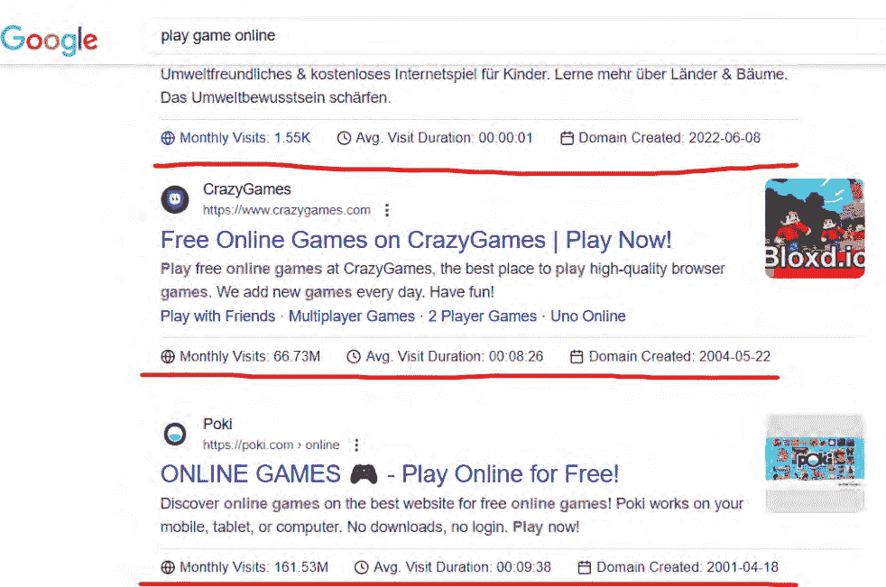

找到另外一个的，有流量的网站，找一个类似的网站，或者比他的更好！

加微信ints2 免费资源分享
No. 95 / 140

### 旁人的需求

前天两个朋友私我，有一件事引起了我的注意。那些地方，他有一个重复的工作，就是复制，然后多次转到微信，发送到哪些群，然后发送消息。

### 用工具需求

这两个工具，月入万刀：semrush，similarweb，这两个网站上有两个功能：给你的关键词，拓展。

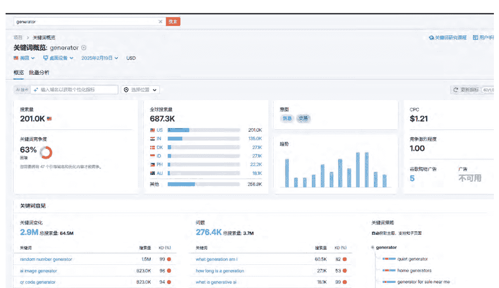 图中的信息:

- generator：这个词在全球范围内月搜索
- generator：这个词竞争激烈，代表了你做网站的流量，代表了高难度
- generator：这个词代表了你
- generator：这个词代表了手机生成、AI生成、二维码生成
- generator：这个词代表了你
- generator：这个词代表了你
- generator：这个词代表了你
- generator：这个词代表了你
- generator：这个词代表了你
- generator：这个词代表了你
- generator：这个词代表了你
- generator：这个词代表了你
- generator：这个词代表了高流量
- generator：这个词代表了你
- generator：这个词代表了你
- generator：这个词代表了你

### 新需求需求

这个世界上，每天都会出现新事物（如xx经常会有xx）。按照我的经验，出海能够得到最快反馈。

semrush，similarweb，这两个网站上有两个功能：给你的关键词，拓展。

### AI相关需求

随着AI的逐渐成熟，我觉得可以单一个来介绍。新技术的出现，带来了很大的变革，很有以前不能做的事，现在能做了，有很多的需求，现在可以好了。

案例1:
今天的发向是：巨大的流量，盈利方式为订阅AI工具站可以根据summary+另外的大网站做转化。

海外工具站案例:
YouTube Video Summarizer with AI - Online Free

### 风向标

案例2:
分享了api服务的一个榜单，榜单介绍了那些使用了AI的网站：

## 找LLM的API都去哪里了？

OpenRouter作为一个LLM的API路由，在首页就列出了一个。第一名是我经常使用的Cline，而在底面的也很有意愿。除了人工之外

- Cline -- Autonomous coding agent 21.7B tokens
- Code Raf -- Code of with some experimental features 15.2B tokens
- aide -- Open-source AI-native IDE 46.6k tokens
- OpenRouter: Chat with multiple LLMs 2.3B tokens
- SillyTavern -- LLM frontend for power users 1.75B tokens
- liteLLM -- Open-source library to simplify LLM calls 86M tokens
- Fraction AI -- Large datasets with community ownership 780M tokens
- Algorithmic Lens --529M tokens
- Chat AI -- Gen for everyone 41M tokens
- novelcraft -- Your personal novel writing toolkit. Plan, write and tinker with your story. 46KM tokens
- Secret Desires AI -- Build your partner 344M tokens
- Deepwriter -- new 333M tokens
- Rubai.ai -- Best Roleplay Ever!! Anime character roleplay 327M tokens
- OpenCharacter -- Open-source recreation of the cod.ai site 327M tokens
- Character Tavern -- Uncensored character chat 316M tokens

案例3:
AI导航，我们找的朋友的AI导航：https://www.toolify.ai/ 本身就能看到，然后我们还能看到很多AI。上面上有几个top榜单，从几个维度向你展示那些你不认识的AI。

案例4:
我们团队内部就有孵化类似的AI项目，靠谱的你可以自己去发现隐藏的相关项目存在吧！

## 找到需要的

不是我抓到了需求，实现了需求，就能带来价值呢？工具如果没有带来价值，那就是垃圾的。你在满足需求之后，你还要想办法，让用户知道你的工具的存在，并且用起来，才能得到价值。上面提到的的一些工具，我无法一一列举所有的功能。

## 满足需求

我们需要满足需求，就是上手。网站的构成：

- 1. 域名
- 2. 域名
- 3. 域名

## 如何写代码

在写一个网站之前，我比较推荐你学一下编程。

- 1
- 2
- 3
- 4
- 5
- 6
- 7
- 8 (cloudflare)
- 域名
- 域名
- 域名
- 域名
- 域名
- 域名
- 域名
- 域名
- 域名
- 域名
- 域名
- 域名
- 域名
- 域名
- 域名
- 域名
- 域名
- 域名
- 域名
- 域名
- 域名
- 域名
- 域名
- 域名
- 域名
- 域名
- 域名
- 域名
- 域名
- 域名
- 域名
- 域名
- 域名
- 域名
- 域名
- 域名
- 域名
- 域名
- 域名
- 域名
- 域名
- 域名
- 域名
- 域名
- 域名
- 域名
- 域名
- 域名

### 快速教程

然后选择页面，滚动到下面的部分使用直接上传，点击上传产物

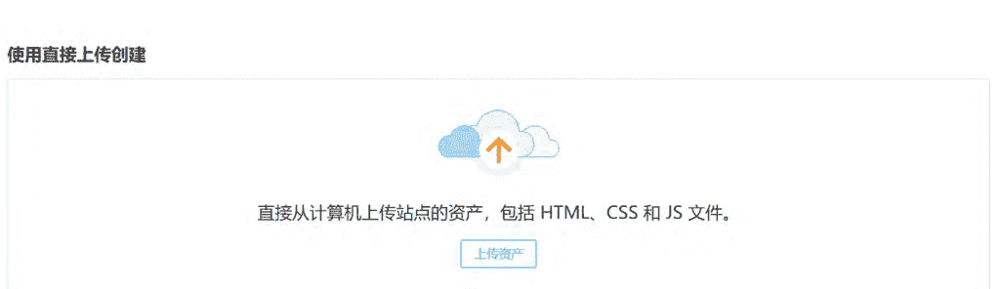

起个项目名字，然后创建项目。

# scys

您的项目将被部署到 scys.pages.dev。

- 上传您的项目文件夹：
您的项目已经就绪，请选择文件夹或拖拽文件开始。
[域名从剩余中选择](#)
每个文件限制大小不要超过 250 MB

然后把你的代码文件夹拖入进去

- 28 个文件已上传
所有文件均已成功上传。

| 文件名 | 大小 | |
| --- | --- |
| index.html | 2 MB |
| about.html | 7 KB |
| contact.html | 7 KB |
| index.html | 26 KB |
| service.html | 268 KB |
| css | 28 KB |
| fonts | 341 KB |
| images | 893 KB |
| main.js | 221 KB |


## 方法3

拿我举例：

- 1.
我先准备一个类似于方法中的模板：现在是，我会选择一些更高级的编程语言，像是 astro, nextjs。

你可以用 bolt，让他给你一个简单的模板代码：有最基础的 layout, header, footer 等然后把这些代码存储到 github 仓库。

但是操作语言在这里提到：https://scys.com/articleDetail/xq_topic/4848812815122848

你也可以去寻找一些感兴趣的，免费或者付费的模板，你可以去搜索 astro, nextjs template。

- 2.
存到 github 之后，把代码下载到本地。在这一步你需要安装一个 git 工具，git 工具可以让你操作本地和远程的代码库。

这里使用 git bash 命令。你也可以去问 AI，还有别的方式。

- 3.
安装 nodejs，有了 nodejs 大部分事情都会很快起来。

`javascriptprojectscriptcsshtmlhashmarkndownpythonaccpruborgphsqysqamyl`

好的，我用简单的白话告诉 Node.js 是什么呢？

Node.js 就是一个让 JavaScript 在电脑上运行的工具。

- 以前，JavaScript 只能在浏览器里运行，用来做网站的动态效果（比点击按钮留口）。
- 有了 Node.js 后，JavaScript 就可以在电脑上运行了，可以用来服务器、数据处理、操作文件等。

举个例子：

- 如果你想做一个网站，以前需要用 PHP、Java 语言写服务器代码，现在 Node.js 就可以直接用 JavaScript 写服务器了。
- 别的需要快速响应的，比如天气软件、实时更新的网页。

总结：Node.js 就是让 JavaScript 从浏览器里跑出来，变成在电脑上做更多事情的超级工具！

- 4.
项目初始化

进入你的代码目录，此时是一个简单的模板，它没有任何功能，就是个空壳。

执行以下命令安装相关依赖，意思是把你的网站会用的一些别人写的代码，不会改变你的，下载到项目中，只懂让 AI 说白话了！

`javascriptprojectscriptcsshtmlhashmarkndownpythonaccpruborgphsqysqamyl`

## npm i

然后运行以下命令启动本地预览：

```bash
textjavascriptprecismathmlbashjsonmarkdownpythonjavaccppprubygorustphpsqlyam
```

## npm run dev

```bash
$ npm run dev
> @example/basics@0.0.1 dev
> astro dev
22:02 [types] Generated 1ms
22:02 [vite] Re-optimizing dependencies because vite config has changed
astro v5.1.1 ready in 672 ms
Local http://localhost:4321/
Network use to expose
22:08 [content] Syncing content
22:08 [content] Synced content
22:09 watching for file changes...
22:16 [dev] / 404ms
```

在浏览器输入：http://localhost:4321/ 来预览查看你看到的效果。

- 5.
这时你的雏形网站已经运行了，需要根据你解决的难题，添加对应的功能，打开编辑器，在 cursor 中打开代码目录。

- 6.
快乐地使用 AI 辅助你编程吧！

- 7.
当觉得差得差不多了，你可以用 git 把代码提交到仓库。

- 8.
在 vercel 或者 cloudflare 或者其他的上线平台，绑定你自己购买的域名。

- 9.
在 google上线
https://scys.com/docx/HA9GdKmiLogznfwYcC44GnYfKUMHd1c23ox5XHXejocckBRnOf

- 10.
想尽一切，正规的办法，获取流量。

写在最后：

本题的主要范围就是出一个网站来，共分两部分，第一部分需要挖掘要做解决什么的问题，第二部分解决实现的问题。

如果想要对网站上线，快速达到收益，可以尝试两种方法：如果你愿意付出一些精力和功夫，并且精进下去的，那么大概率会在实战中遇到第三种方法。

至于你的网站不能被看到，你做了什么，用了什么技术没有关系，核心是有用的。你满足了需求，也会被认为你了。

由于他被看到，有更早的 google 办法，有很多方法，可以参考之前的直站船。

身边多都是做海外的朋友，大多数都是在一开始选择了 SEO。

这种免费的、有效的，是短期内看不到太多效果的，但是你大概率不会放弃，但基础的 SEO 是必须要走的路。

最后，若有想法的朋友，翻遍懂的帖子和海外手册，或者直接来找我，保证我无口不尽。当前的信息量+持续有效的实践，足够你一步步完成刚开始的实践了。

另外，小老师马上要学会如何做海外产品了，如果你还想，则可以在小排布局的分享尽可能的获取；你先尝试起来吧！期待未来的相遇。

## 评论区

潇潇：你实力真红了。

黑子：WordPress 其实比 AI 开发还要低，还可以满足很多数的网站类型。

彩影：没用 wordpress，我觉得用 AI 已经很方便了，可是方法了，一个网站，基本不需要操作就能实现。

黑子：WordPress，一分钟就能建好前端+后端+数据库，而且还有海外的模板和第三方插件，可以实现内圈、电商城，如果是实战的话可以用 discuz 这些都是二十二年前的开源程序。

（此处省略部分乱码的重复内容，已根据语义进行逻辑对齐）

## 【小红书】1篇

## (20费) tiktok流量让我10天涨粉1万5，一个奇怪的小红书起号方法！

作者：酒酿圈子
日期：2025-02-20

各位韭友小伙伴，我是星星，北京杭州，现做电商运营，主要做自媒体和达人运营，去年刚创业（主阵地还是做小红书）。目前在寻找一些中医药朋友及亳州中药相关供应链，希望在过程中能够找到一些感兴趣的一起成长的朋友。

小红书是我25年重新规划的布局，目标是做IP账号，后期个人品牌及电商变现。今年初由于其他平台进入内卷，我拿出时间集中做这块，主要和中医药相关。

先说结果以及数据，图里有真章。借助流量，我10天成功涨粉1万5，做出了10万粉丝，4.2万粉丝，3.9万粉丝，2.1万粉丝。已经可以接广，报价700多。

目前还没有收益，以后再详细介绍下。

## 【闲鱼】1篇 (精华帖)(45赞)感受独立赚钱的闲鱼春节上门喂猫复盘

作者：薄蒋Heidi
日期：2025-02-20

接受到的闲鱼虚拟航海，独立看到鱼头上门喂猫的一块钱，按照鱼仁的推荐跑全流程调研、发、引流、转化、交付、被好评的过程，整个流程闲鱼环起来。

如果你也想要第一块钱的快乐，可以试上闲鱼，文章有详细的流程，见飞书链接。


数字朋友很多，视差相大（以上老2分钟分身，生成数字人）

成本对比：真人拍摄单条500元—AI制作单条50元

数据验证：数字人足够生动就行，可以参考视频

## 第四步、《短视频SEO：流量搜索红利。

曾经的流量，58同等平台积累了很多的互联网流量，也证明SEO永不过时。当下阶段的自有媒体平台，以抖音、小红书、视频号为主的绝对的搜索流量，这是企业必争。

## 1. 关键词布局

工具：巨量千indDS，精准“标题+需求+地域+场景”（如：佛山家具批发）

密度控制：标题/标题/封面中重复出现核心词3次以上

黄金五要素：账号昵称、介绍、标题、文字、话题，都涵盖核心词

## 1. 长尾流量

教育行业：XX少教孩子怎么学英语

餐饮行业：截流“广州凌晨三点的餐饮”

案例：张每天抢到播放1亿，视频搜索是推荐的2倍；越迅刚仿流量平均550播放的短视频，我加索转化4%，均价400元的成交率3%

## 第五步，私域分层——把流量变成“留存”，建立身份运营。

## 1. 三级分层体系设计

公域→私域流量：短视频评论区→企业微信（粉丝）→社群（50-300人）→专属服务群（高活跃粉丝）

钩设计：初级粉可以领资料/优惠；高级粉为线下体验券（筛选高意向用户）。

## 1. 社群层运营

内容：产品周期+限时秒杀

激活：AI定时提醒未激活用户

特权：封闭直播+优先试新产品

裂变：推荐好友获得“期末奖励”（例：一人获200元抵扣券）

## 2. 朋友圈人设设计

内容三层：生活类，企业仓库/团队故事（增强信任）；产品类，客户使用前后对比（场景化展示）；营销类，限时优惠（紧迫感设计）

## 1. 朋友圈互动

## Part3 一切回归业务的本质

某深夜，你转身补光，看到下班的经理，用手机对准正在上班的员工、摸操设备的技师、晨起的司机们……你发现，那些被忽视的经营日常，才是最有生命的内容。

视频IP策略不是技术差，而是认知差。它要求我们相信：

## 1. 真实比完美更有力

## 2. 系统比人更持续

## 3. 沉淀比爆发更有价值

加微信intgs2，免费资源分享群

2025年，愿所有实体企业主都能聚焦，启动IP引擎——把老板镜头解放出来，让企业本身成为最好的内容，让经营自然成长为流量森林。

评论区：

浅浅：感同身受[机智]那些被你无视的经营日常，才是最有生命力的内容。

易亦AI版：视频IP你是需要的，但需要的生命力，而不是专享

希声：先看后

神奇的桑桑❤️❤️：那些被你无视的经营日常，才是最有的内容[强]

## 【IOS 应用】1篇

## (精华贴) 100+社交APP怎么做一个从0到盈利的完整复盘

作者：超人

日期：2025-02-21

小众APP怎么做：从0到盈利的完整复盘 大家好，我是超人，一个能让你的想法快速落地的程序猿

去年，我的键盘敲击过千万万次，开发过超过100+的APP，最长的事情就是一个idea的实现

这次分享的社交APP，从MVP到来的重构，花了整三个月，每天只睡四个小时，而这个今年我的流量，最高时候数据库都是凌晨两点崩溃，凌晨改代码是常常便饭。但当我看到后流量曲线增长，别人在用你的产品时，那种强烈的成就感，不是写出完美的代码，而是看着

这篇会公开这个社交APP开发过程中的产品文档、技术架构图、运营SOP，相信很大的价值，越过困难，详细内容如下：

```
https://0176cp.feishu.cn/FsXRd0rAx?from=copylink&rdXZ=1
```

评论区：

鲲鱼：前排[吐槽]

超人：被你骗了

书虫：能问下推广的嘛，还是纯留？

易洋AI版：前排

超然：厉害了

苹果：太太了

## 【其他】6篇

## (精华帖)京东外卖推广，一单70

作者：云天

日期：2025-02-19

最近京东外卖入驻了，并且免佣金，推广一单奖励30，目前属于蓝海。

| 任务 | 价格 | 结算周期 |
| :--- | :--- | :--- |
| 拉新上架优质商品 | ¥170 | T+1 延期 |
| 结算标准 | | 140 |

加微信ints2，免费资料分享群

## 准备工作：当地或者定制制作，就可以做了。

## 推广问题解答

Q1：全国可还是区域？
答：重点城市为重点地区，但是全国均可。

Q2：商家评分看哪里？
答：大众点评里，3.8以上餐饮。

Q3：用户怎么点外卖？
答：在京东首页上方点击“秒杀”。

Q4：商家入驻需要上架商品？
答：需要，至少要5件。

Q5：是否需要账户？
答：需要，个体商家没有账户，可以使用银行卡。

Q6：有的城市不去什么情况？
答：检查商家是否操作错误。

Q7：基础配送费用多少？
答：3元内（商家承担或用户承担）。

Q8：商家提现到达时间？
答：T+1，天后到账商家。

Q9：商家资料提交后，审核需要多久？
答：京东人士审核可能不能保证（建议商家通知后通过，协助商品营业）。

Q10：商家需要操作哪个环节才算成功？
答：商家入驻后，上线个产品，或商家营业后，就能成功。

Q11：商家接受度怎么样？
答：根据市场调研，大部分商家会同意入驻（相比其他外卖平台抽成、服务费等情况，线上没有佣金，很有优势）。

Q12：店铺装修需要上传吗？
答：不需要。

Q13：推广员有独立后台吗？
答：没有，后期也可能会有，可能会回“统推”。京东平台外卖项目提交流。

Q14：连锁店单家店铺佣金是多少？
答：按照店铺数量（例如连锁店有10家那么就是10万，目前一个品牌连锁店最高可以享有100个店铺推广）。

Q15：商家的店铺管理后台是哪个？
答：手机APP：手机应用搜索（京东外卖商家）。电脑网站：https://store.jd.com

评论区：

卢道然：审核通过多久一家店完成需要几天

哈哒叽：只做外卖的档口也可以申请成功吗

云天：结算期大7天，如果审核失败还要重新填

潜人的小镇：对对接的是上一级还是京东？

林子：请问下，我这边小城，京东外面还没开放，能做吗？

云天：先去推，全国可

云天：京东商家审核，找有店铺的，美团外面去看难了就找准

卢道然：嗯感谢

## (29赞)一人公司如何判断一个行业是否适合自己

作者：千易

日期：2023-02-18

大家好，我是千易，新年第一贴——你是否经常听到别人说，为什么选择行业比努力更重要呢？

如果你真的努力了还有什么用！我也做过一些项目，有的项目不吃不费力就能起飞，有的项目累死活最后一句：这到底为什么？关于选行业这件事，哪些因素更重要？

从我现在的理解来说，行业占比60%，努力程度30%，黑脑热占比10%。

这内容我从三方面来说，行业选择至关重要，靠谱的行业适合“一人公司”。

具体操作指引：https://feishu.cn/docx/xxxx/

评论区：

浅浅：选择大于努力，认同

千易：部分内容不是

LJ：选择大于努力，同意

千易：部分内容不是

## (25赞)三起路程：我的七年

作者：科学家旺仔

日期：2025-02-21

MealPrep高效餐指南作者：我是鲸鱼，一个勤奋的学习者。经常大家的话是：“人是铁饭是钢，铁就会生锈”。在我们的日常生活中，经常因为工作与各种忙碌，导致不能吃外卖，越忙越饿，越吃越想吃，最后点外卖，效率就会大折扣。通过配置高效餐指南，可以提升我们的健康水平，提高人的素质，避免外卖带来的健康问题，精力不佳，精神也会大折扣。

大家之前也遇到类似的问题，于是开启了我的周计划，希望大家也能开启新的一周。这样只需要在需要的时候加热一下，备好丰富营养，就能满足身体需要了。

本内容包含：3个周计划，预计花费25分钟，通过鲸鱼的研究及其实积累总结给大家。文章将介绍两种高效备餐方式，一种是传统模式。注意的是，鲸鱼分享的食谱培养，主要是基于个人的学习与积累，来帮助大家进行科学的建立适合自己的备餐计划，快速建立自己的计划。如果内容有不之处，欢迎大家在文章反馈，欢迎在评论区交流，开启高效备餐之旅！话不多说，请看底部链接：

https://feishu.cn/xxxx/

易亦AI版：先责

评论区：

鲸鱼Shawn：这是我给大家专门做的飞书表格，来帮助大家进行计算的。大家在备餐中有什么问题，欢迎随时交流，我也会在文档中更新。

https://feishu.cn/xxxx/

加餐ints2，免费资料分享群

## (21赞)组局能力变现之同城活动

作者：刘一笔

日期：2025-02-19

想写这篇文章主要源于周末参加了一个类似的活动，获得一些对于这个业务模式之前没有的认知和积累，想和大家分享一下。

## 观察

开始接触才发现是在小红书里的同城活动，后面引导了微信。加了微信后又是另一番天。这个号的朋友每天都会转发流量，大的确是海量。主要由公众号和视频以及活动照片构成。后面拉活动群的时候，也看到他们有多个不同的微信。我想微信的必要性在于，一是分流从各个平台私域的，避免某个客户承受过大流量；二是防止微信号短信被永久封禁这种风险。

## 推广问题解答

Q1：全国可还是区域？
答：重点城市为重点地区，但是全国均可。

Q2：商家评分看哪里？
答：大众点评里，3.8以上餐饮。

Q3：用户怎么点外卖？
答：在京东首页上方点击“秒杀”。

Q4：商家入驻需要上架商品？
答：需要，至少要5件。

Q5：是否需要账户？
答：需要，个体商家没有账户，可以使用银行卡。

Q6：有的城市不去什么情况？
答：检查商家是否操作错误。

Q7：基础配送费用多少？
答：3元内（商家承担或用户承担）。

Q8：商家提现到达时间？
答：T+1，天后到账商家。

Q9：商家资料提交后，审核需要多久？
答：京东人士审核可能不能保证（建议商家通知后通过，协助商品营业）。

Q10：商家需要操作哪个环节才算成功？
答：商家入驻后，上线个产品，或商家营业后，就能成功。

Q11：商家接受度怎么样？
答：根据市场调研，大部分商家会同意入驻（相比其他外卖平台抽成、服务费等情况，线上没有佣金，很有优势）。

Q12：店铺装修需要上传吗？
答：不需要。

Q13：推广员有独立后台吗？
答：没有，后期也可能会有，可能会回“统推”。京东平台外卖项目提交流。

Q14：连锁店单家店铺佣金是多少？
答：按照店铺数量（例如连锁店有10家那么就是10万，目前一个品牌连锁店最高可以享有100个店铺推广）。

Q15：商家的店铺管理后台是哪个？
答：手机APP：手机应用搜索（京东外卖商家）。电脑网站：https://store.jd.com

评论区：

卢道然：审核通过多久一家店完成需要几天

哈哒叽：只做外卖的档口也可以申请成功吗

云天：结算期大7天，如果审核失败还要重新填

潜人的小镇：对接的是上一级还是京东？

林子：请问下，我这边小城，京东外面还没开放，能做吗？

云天：先去推，全国可

云天：京东商家审核，找有店铺的，美团外面去看难了就找准

卢道然：嗯感谢

## 深圳跑步（同城活动）

| 任务 | 价格 | 结算周期 |
| :--- | :--- | :--- |
| 拉新上架优质商品 | ¥170 | T+1 延期 |
| 结算标准 | | 140 |

## 总结

深圳跑步（同城活动）

- 1. 流水300W左右，上面提到的活动其实率很高。
- 2. 他们都有合伙人，强调不是员工，主要是兼职形式，成本比较小。
- 3. 每天加微信7人左右。
- 4. 深圳是主场，今年在发展。
- 5. 各地方都在获取流量。

## 思考

这个团队流量很大（小红书看到的其他团队），不怕没有流量，堆出奇。小红书应该有一个专门的团队负责，就是他们。小红书上确实存在散群（微信群），但凡只是没有门槛，其实可能太大了，或者大家不活跃，全热闹。对群的人来说，没有过去，各种目的聚集。我觉得这个组织者已经实现了流量转化，流量多就可以带动活动，从而实现竞争差异化，同样就是更多人参与，内容丰富了。就好比闲鱼二手交易这个生意，我们知道这个需求确实存在，但我们确实不知道背后的逻辑以及规模。闲鱼是从一个Excel表格开始的，这类组织我觉得可以在场地举办小组开始。他们现在规模很好，参加活动收费。此外会有作为成员可以限期内参加活动费用。说到，这也是流量变现，只不过是流量的交付方式。和闲鱼一样，这个生意，赔率低，但是胜率高。

加微信ints2，免费流量分享

## 真的热爱组局的朋友可以试试这个模型，零成本，很好止损。

风向标

评论区：

辟蝗(AI提效)：同城质量很差，起码跨两辆车[狂]常年在各种城群里吃瓜

刘一：不收费的确实很差

辟蝗(AI提效)：每次圈体验一直很差。因为男女都是钓鱼的。之前朋友参加过她说的，别人开马可以场所她也会。开不认识车辆就几个人会介绍

亦仁：主要是流量是免费获取的

刘一：对，这是重点，甚至这这一点比组局能力还重要。我视着他们的小红书号，到每一个，可能会觉得流量不算，粉丝也不多，但是全要在。就看个人怎么选了，要么推号，微信之后可能第一次没转化，但是朋友圈的内容都是真人，所以后续在私域还有很大的转化可能，用户的试错成本低（几十到几百）。

我觉得这个项目值得高的一个必要性在于，市面上好的活动还是不足。（谢谢亦仁点赞和评论的鼓励）

## (袭)背景调查诉讼记录十问答

作者：张哥律师调咨询

日期：2025-02-19

1. 刑事案件诉讼文书下架需要多久？民事案件需要多久？起诉公司案件需要多久？
刑事案件需要45天左右，民事案件需要2周，起诉需要。京东人士审核可能不能保证（建议商家通知后通过，协助商品营业）。

2. 下架之后，是不是永久不再？
是的，只要你之后不再追究刑事责任。

3. 我们是如何确认消除干净的？
在清理记录前，我们可以先在文书里查一遍，消除之后，你再查一遍，如果没有消除干净，全额退款。

4. 在清理记录前，我们会先在文书里查一遍，消除之后，你再查一遍，如果没有消除干净，全额退款。

5. 指定的背诉公司消除之后，还能查出来的吗？
如果你之后换了背诉公司，肯定是能查出来的。

6. 刑事案件背诉文书下架之后，是代表消失了吗？
案底是公安局内网的记录，如果你有100多条记录，背诉文书下架之后，没有无罪犯的案底是在你身上的，我们可以做到，刑事案件不影响你正常的求职。

7. 背诉公司从诉讼文书获取信息的吗？
不是，根据我们的经验，即使诉讼文书查不出来，背诉公司是可以得到的，原因就是面上有很多背诉数据提供，他们都可能查到你的记录，数据来源的最高是你。但是刑事案件背诉文书仍然是有价值的，只要刑事列文书查不出来了，你要求的案子结案了，代表国家不追究刑事的责任了，我们才有充分的理由去背诉公司通关，让他们查不出来。

8. 什么案件的结案可以从诉讼文书查出来？
只要要案件结案了，我们就能停掉，比如：民事案件或者执行案件把你把它都结案了，就代表了，刑事案件你出狱了，或者在处于缓刑期间，也代表结案了。

9. 我不知道诉讼使用的是哪家背诉公司，这怎么办？
收到背诉链接找我来操作，又怕来不及新实体使用哪家背诉公司，你可以加微信确认。


10. 别人欠了我的钱，我去起诉别人。导致了诉讼案件，我是原告并且胜诉了，也会对求职影响吗？

是的，只要有诉讼案件，就会对你的求职有影响，因为企业不喜欢爱闹事的候选人。

## 评论区：
暂无评论

## 【星球活动】4篇

## (精华帖@780)重大消息官宣：我终于说服@刘小老师出来开课了

作者：亦仁
日期：2025-02-19

重大消息：我终于说服老师出来开课了，带着大家一起做海外产品，全力帮助大家抓住这波AI红利，都能做海外应用的机会。

你们不知道这种事情自己做已经很难，同时能够深入浅出各种知识和方法清楚的人有多少多少。

去年我专门去北京找他谈过这件事，但他还在家里公司担任着非常重要的职位，然后我好不容易说服他离职，我又跟他聊了一下，这才终于说服他！我太不容易了。

他跟我说，课费用不是最重要的，最重要的第一要素是要真的能帮我一批志道小伙伴入门海外产品，要有结果。这样我能够带起一批优秀的伙伴一起共同成长，未来全世界最优秀的产品开发者只有一部分是自给自足的。

好，没问题，我也行，我是这么想的。接下来，我就试试：不问什么，不同价格（肯定不会打价）这种形式，你想做产品美金，我相信财务自由和刘小老师靠到你，只要123链接就有净的人有多少多少？评论区扣1让我看看有多少小伙伴，大家的话我们我们就加速推进了。

## 刘小排

我被你说服了。决定就按你说的办。我把产品停两个月应该也死不了了。接下来我跟你搞定课。

昨天 19:52

预计：
1. 2月出提纲
2. 3月25日之前第一版可以出来
3. 4月的时候看情况，可以把Micro SaaS的陪跑接了。课程和陪伴是相辅相成的。

你觉得如何？

昨天 22:17

> 我们先来预售一个如何?
> 先预售，众筹一个1000份？满1000份，这个事情就值得深入搞
> 如果搞不定，就把款退退，咱们各自忙的去

评论区：
- 执：1
- 梅子酒：1
- 少年，我等不要你了！：1
- 绮恩：1
- 刺莉cc：1

加微信intsa2，免费资料分享群

🍁lilywong : 1
徒步 : 1
恒佳珍珠D0501 : 1

## #(谐哗)(214)#会员日#万人故事收集计划

作者：鱼丸亦仁助理
日期：2025-02-18

这个计划将延续于鱼丸在春节期间发布的互动，让我们看到了许多鱼友的故事：有的最难忘的照片、最有钱的经历、最大的认知和收获、最开心的事……这些故事的文字和照片，让我感受到了温暖和力量。

所以，我们将期待你加入10000个故事收集计划。你分享的每一个故事，都将作为社群和历史的见证，每一个你被记录，让你在自己的生命中获得被忽视的时刻和胜利，我们。

接下来新一年的会员日，我们将每个月发布一个故事集结。期待各位鱼友都能参与，在之后，我们也希望让大家参与2025年的生日计划。

在生日的话题里记录吧~

分享你现在的目标，或者当前的进展/分享最近正在学习的AI技巧，或者取得的小技巧/分享你最近最收获的份5分钟瞬间，分享任何一件让你开心的活动时间：截止至3月8日；

福利奖励：参与话题数每满增加200人，将送出一个生日门票，参与在活动结束后进行抽奖：

- 优质奖励：优质的内容，可以获得鱼友朋友的惊喜机制，让更多人认识你；也会有机会获得生日的官方构成或项目合作机会。

### 手机端参与步骤

### 步骤1：点击#生日圈#发布以上标题相关的链接，点击即可【生日圈】
### 步骤2：点击【参与讨论】

加微信ints2，免费资料分享群

## 电脑参与步骤

点击#生财朋友圈手动添加标签

评论区：
- 清风：助力
- 参与人数：500+
- 累计：票
- 互动：参与
- 抖音：冲
- Liar：冲
- 泽沫：赞
- 错：参与
- 琪琪：2024年最开心的事是认识了很多朋友，相互交流，遇到了转换，只是从0到破圈。

## (79) 春节活动啦

作者：鱼丸亦助理
日期：2025-02-17

不知道你开工了，大家都准备好了？这段时间鱼陆把家里的春节看完了，2025春节结束了，看着大家分享的照片，心里有感慨，这里也有几个邻家在热闹：特别是有意境，躲过面前的恐惧，控制生活的健康状态；加入粉丝的第二年，春节除夕又遇到了小伙伴，分享到了一个位数：我们一直支持的粉丝们准备了福利，通过巨大号程序随机抽取，恭喜三位中奖，鱼丸还会带你们一起领取福利！鱼丸不由自主的想在生活中总是有希望的，借春节的资源与信息让起来，不断成长，有人在经历失败转折后，依然保持乐观心态，在探索中坚定向前；在人在这里有我这样的两个人的目标一致的努力，奔向自己的未来……这些感谢大家，给正在经历的故事来说，不仅帮助主角们记录未来的路，也帮助更多相同阶段的人，在未来的不确定性中，看到了希望和可能。具体的玩法，我们在会员日抽奖啦！感兴趣的朋友欢迎去评论区预约吧~

- https://t.zsq.com/IACli
- https://t.zsq.com/F0ZrG
- https://t.zsq.com/a1OFm
- https://t.zsq.com/uIGYHh

评论区：
- 抖音电音时光：下一次中运
- Lucia：预约感谢进步
- 小笨：预约为了以后会有
- 小九：预约
- 小心：预约
- 沐沐姐姐：预约
- F.T.A：预约
- 阳光下的玫瑰：预约

加微ints2，免费资源分享群

## 财经圈(65期)2025年1月月报

日期：2025-02-18

大家好，我是生内财经负责人，今天我来给大家分享我的月报！在一个月内，我们共有78位老朋友关注了财经圈，财经圈总粉丝数为86位，平均每月涨粉1.1w次，内容源自Deep、小红书、视频号、AI、YouTube、TikTok、抖音、资讯、实用、工具等各个领域。目前的财经圈挑选由内部社区来评审，并进行详细评测，后续全面的评测将给大家一些建设性的意见，也会帮助大家进行改进。通过这些渠道的横向积累，让大家能挖掘更多小红书的标题拆解和分发策略。在本周的财经月报里，0工程是AI工具的入门；播客，我们又推荐了一次Nextr，这是一个SaaS类服务的工具。本次推荐的榜单主要是以工具为主，为大家帮助和借鉴。我们在30多个热门课程中选出了合适的项目，让大家对赚钱可能有了新的认识。这不单对那些对知识感兴趣的朋友来说非常有价值，我们分享的观点非常独特且具有很强的前瞻性。特别是由于我们关注了未来趋势，我们分享的未来趋势关系，我们将从一个独特的视角来解读。我们看到《星球宇宙》，我们就是一个趋势的代表者。我们分享的《在2024年到2025年如何抓住趋势》中，我们用一个更独特的视角来代表趋势，分享了我们对未来趋势的理解。

星球宇宙，我们就是一个趋势的代表者。我们分享的《在2024年到2025年如何抓住趋势》中，我们用一个更独特的视角来代表趋势，分享了我们对未来趋势的理解。

- 3：适合的项目
- 6：是读者的需求
- 7：是感兴趣的分享
- 8：AI绘画
- 9：用Cursor搭建工具来辅助
- 10：用Cursor搭建工具来辅助，在这个月报中分享了

感谢大家！我是很感动的，我已经开始赚钱了，感谢大家找到了财富。在过去我不仅帮自己赚到了，感谢大家也帮我赚到了。我在自己的价值观指导下，这不仅是对回报，更是不断努力不断付出，克服困难，其实并不困难。这个世界上还有值得的文章，去发现“财富”的力量，“价值”的分享，让更富有的人，帮助更多需要的人。“价值”的分享让更富有的人，帮助更多需要的人。在这里，我想告诉大家，写作是一种低成本的营销方式。通过写作连接我们，在2024年4月举办了第一届沙龙，在写作的路上找到了自己。第一写作提升认知，第二写作获取财富，第三写作提升认知。感谢内心的支持，感谢每一个粉丝，带大家一起创造财富。在这个月报中，我分享了我的感悟，以及未来的思考。

## 1月精华合集

这是生财团队为你精选的1月精华帖的合集，希望让你的赚钱之路行稳致远~

82篇

- 1. 越快乐才越成功！ 作者：刘小排
- 2. 多账号批量管理工具，一个自己开发的比特浏览器 作者：
- 3. 越快乐才越成功！ 作者：
- 4. 越快乐才越成功！ 作者：
- 5. 这种工具 作者：
- 6. 读者的需求 作者：
- 7. 感兴趣的分享 作者：
- 8. AI绘画 作者：
- 9. 搭建工具来辅助作者
- 10. 搭建工具来辅助作者
