# 懒人副业周刊

整理日期：250401
懒人专属群的伙伴大家好。小懒顺利带给大家带来财周报~

## 扫码加入 知识星球TOP 免费资源群

| 维度 | 内容 |
| :--- | :--- |
| 免费 | 每日免费获取高价值资源<br>可提供各类资源对接服务 |
| 价值 | ◆热门付费文章 ◆各行业报告 |
| 及时 | ◆精选图书资源 ◆副业赚钱方法 |
| 专注 | ◆职场实用资源 ◆AI财经自媒体 |


分享仅供个人学习，请勿转运，如需要请待播

# 目录

懒人副业周刊

**目录**

### 【生认知】4 篇
- (精选哈635)做自己喜欢的，全能范围大的，最大的梦！
- (53)钱靠流量卖单品打造时间差
- (16)课从财世到生——我的副业创业技巧（四）
- (16)看地图，理解流量行为的一个视角

### 【技能类】1 篇

### 【相关类】48 篇
- (精选哈140)做AI打造个体，新手的12条建议
- (精选哈140)25年3月集（AI用Web网站开发）资料收集
- (精选哈133)AI运营最强“中介思维”王牌！
- (懒人129)如何通过副业AI小调，拯救AI类机会
- (61)文章总结2.0 提示词：使用 DeepSeek/Claude 3.3，新增卡片方便手机查看

(65)如何用DeepSeek生成视频模型+图片 详细教程

(65)用60天提升工作效率的实战：AI编程从零（第一周指南DeepSeekAI大会）开始进阶

(66)用60天高效学习的实战：AI编程从零到实战

(67)用60天做一个属于自己的AI助手，化枯燥为趣味

(68)用DeepSeek让个人效率提升差异化优势

(69)用DeepSeek对话网站如何获取更多高质量提示词（Prompt）

(70)如何用DeepSeek的思维来写出你的小说：把感兴趣的

(71)用DeepSeek处理GitHub报错，让AI测试报告检测率达100%（AI写作：最新经验分享）

(72)用DeepSeek多批量处理，提高AI生产效率

(73)用DeepSeek高效处理需求：用一个插件让自己高效提取iframe代码

(74)用90天从零到精通AI写作，生成PPT教程

(75)如何让DeepSeek批量生成表格只用一点DeepSeek的

(76)用DeepSeek提取数据，轻松获取精准数据

(77)用Cursor写网页（结合DeepSeek海量教程）

(78)用Cursor 无限AI编程的30个技巧和示例

(79)（职业进阶）如何用DeepSeek写出公众号文章

(80)深度体验GPT-4o：两个强大的模型，谁胜一筹（实测测评）

(81)用DeepSeek打造AI助理为自己赋能

(82)AI如何重塑未来，成为工作思维永存

- 一、把 AI 工作流彻底干掉了？
- 二、AI时代，工作真的会消失吗？
- 三、提议如何策划来避免会议的？
- 示例1：提议如何说的情况（公开）
- 示例2：提议如何说（秘密、未知）
- 示例3：提议需要的情况（盲区）
五、不是为了而是与沟通

(83)用AI提升工作效率，GPT只是出王

## 总结

(84)如何学会用AI分析视频项目策划

(85)用AI生成结构化数据，用三倍的力来处理数据

(86)如何生活，用高效的提示词让AI指导自己的业务内容如何做

(87)用DeepSeek过一天，在AI热潮中用AI写视频

(88)如何Cursor生成高效服务器端代码

(89)如何Midjourney绘图能力，实现素材分享

(90)如何用DeepSeek+提示词制作短视频（横屏）

(91)用DeepSeek3版本对比Claude 3.5。AI-如何定稿设计短视频从性定位到产品转化

Q:如何学会合作，小标题和短视频如何处理和用户如何处理，请让AI设计稿“内在需求”实现，需要AI来负责复述与修改的逻辑

Q:如何使用AI撰文稿，请在团队沟通中让AI来快速完成任务拆解，并将交付结果需要所有改进结果需要所有格式

(92)如何用一个gpt生成标签的分类使用raindrop.io

(93)how-coze-course：学习提示词思维

(94)如何在21天内解决焦虑，AI-的技巧与与

(95)如何用插件处理视频

(96)如何用AI生成视频相关的原创deepseek入门教程

(97)人是临时性的了！一个变成高效提示词

(98)分享用AI编程DeepSeek-V3-034

方法一：使用原生直接转换操作步骤

方法二：使用Code+OpenRouter实现国内操作步骤

No.195方三：自定义模型用V3-034出的效果

## 总结

- 一、数字开发者
- 二、技术突破与动态交互（20ss）
- 三、智能化与垂直应用（25年）
- 四、短视频与元宇宙融合（25年起）
- 五、通用AI与普及（26年起）
- 六、进化：如何用AI解决难题
- 七、DeepSeek：只需要三个词，轻松

提问——如何与对话？

- 一、基础提问：背景+需求+要求
- 二、进阶提问：多轮对话或结构化
- 三、高端提问：形成自己的提问模板

- 一、量化对比，比如补充文档增加细节
- 二、增加约束，避免偶然偏差
- 三、多追问对AI理解上下文

五、选择提问方法

【小红书五】
- 六、从小卖到大，小红书运营：我的两年之路
- 七、如何用AI写脚本，小红书提高成功率
- 八、小红书运营干货：AI写作从0到全流程
- 九、两个月入账万的怎么做？

【海外领域三】
- 十、零基础新手跨界-如何用外语大为引路人的重要性，但不重要。引路人也不重要反思思考

二、什么是“不可行”
- 失败：成本太大
- 失败：市场太大，做不了
- 解决方法：价格高
- 失败：自己下去，能解决
- 失败：关注流量，关注现金流

三、什么是可能的
- 一、靠预算算算账
- 二、在身上找到信息差
- 三、从旧优势组合创新
- 四、打造产品，而不是单个子

后话

（二十）怎么做 TikTok视频商店万？

（二十）销还是社区店，还是值得投入的生意吗？（深度分析）【YouTube】二篇
（二十一）用 YouTube脚本

（二十二）规律视频直播，写一些主播的内容

【线下交付】二篇
（二十三）以前可以做：我开了四个视角

（二十四）销还是社区店？销了

Part 1 怎么做
Part 2 生态环境的底层逻辑：从“流量套利”到“信任网络”
Part 3 凡是无敌的机制
Part 4 没有可能：从“华语帝国”到“社区联动”
Part 5 跨越与边界品牌化链社区闭环模式，本质上是通过技术-供应链-赋能本地经营

未来的成功取决于：技术是否轻量化，生态是否足够开放（允许自己创新），信息是否靠谱？【鱼问】1题
- (15问)《越能圈》功能规划：粉丝养成，如何避免被韭菜？搞得像是被别人割菜一样了。

【其他】4题
- (36帖)精华帖从职场遇到的，往往是她需求
- (26问）《视频活动手册》-活动领域的进阶指南
- (28问)我有写活动笔记和时间，如何把活动计划自动同步到excel，可以拿来就用
- (21问）订购教程靠私域，共4000+【星的运营】5题
- (43问)未来的三大逻辑：中-中线-关系
- (30帖)小红书作为新的App Store之一
- (27问)我们这里的AI投资思路，二模型型
- (26问)流量启发私域流量运营4条径
- (28问)DeepSeek又是，Mansu：再来16个对AI产品组经理一个人影响的预测、判断、讨论【航海日报】1题【下享会】5题
- (56问)海南圈朋友见面会上的分享
- (42问)别纠结，快开始起你的新之旅
- (2025问)海南再约见面会收获：润自由者、业有术、梅岛路哥
- (36帖)精英帖从职场毕业到创业到5年，25W+自由职业者，一个人活成一支队伍
- (20问)我们小红书电商分值（目前数据）【否仁问】1题
- (44问)两个问题，是引流类，还是变现类

【好事】2题
- (33问)私域基础，反馈转化，新手如何
- (17问）“零成本搬运”真的有吗？人是临时性的了！一个变成高效提示词

【生认知】4篇
- (635)做自己喜欢的，全能范围大的，最大的梦！
作者：盈珩
日期：25-03-28
记得之前，有人找亦仁咨询、业，等建议是不要去做这种项目，知识付费的天花板太低了。我相信是亦仁的真心，因为是来自自己的真实感。可以说，认知也是差别。

今天，我将用三个关键词，把这个主题深入给大家。

## 1、Big Market

雷军在13年接受采访的时候：“我觉得创业的时候，选择自己喜欢的，能力范围内，最大的市场规模越好。”

这是雷军的总结，完美解释了赛道选择。雷军曾说过：“技术的勤奋掩盖战略的懒惰，是创业者最大的悲。”：
- 1992年，雷军加入金山。
- 1998年，全面任CEO，执掌金山。
- 1998年，马化腾创立腾讯。
- 2000年，李彦宏创立百度。
- 2004年，阿里巴巴、网易、UC浏览器等和他同期拼过的对手，也都到了他后面。
- 2005年，金山上市，市值接近亿美元。
- 2010年，雷军创立小米，把手机带到全球。
- 2021年，宣布开启“人生中最大的项目”小米汽车。
- 如今的小米手机营业额接近2000亿，小米汽车也崭露锋角，市值过万亿。

某种意义来说，金山在某些方面拖了雷军的腿。

如果你，已经拥有了这些太好了，那我们就聊离我们的事，聊生财的项目。

以前，我在做淘宝蓝海项目，算不上合伙，也算命中。号。无论怎么努力，但是：
- 我自己的哥哥亚选后的第一份工作就是做房产，而且是深度销重庆（我们是重庆的）。他的年收入在200-300万左右（带团队），跟我一起手下了销房子，一年赚了50万。

同时，我也有一些在重庆做房产项目的朋友。他们在店铺和商圈都比较优秀的了，单月收入万左右也就是万多。生活里还有很多项目。我没有低估任何项目的意思，但是不可否认的是，不同的项目产生出来的会有区别。其他的不知道，淘宝蓝海真的是带来了百万的学员（虽然我现在觉得淘宝蓝海也很一般）。但是如果你说遇到闲鱼，做到年入百万，很难……又有比如我找靠AI代表的，我就想，除了这个AI工具来提高了一下代码的效率，以及以前的手业务没有区别？不是出卖活力的还是小红书节奏笔记，有机会卖一万，也可能做到十万至几十万，但这的成本是有限的，而出卖活力的话，你的时间是有有限的。

go big market，人下半场，做自己喜欢的，能力范围内，最大的！

## 2、黏概率

想一千万，就要赚一千万的事。如果你是遇到闲鱼，想赚一千万几乎是不可能的。对很多人来说，go big market，最难的不是一千万的market，或是做好这个项目的能力。而是自我优化的认知，是自想象的匮乏，是缺少一千的“勇气”，或者野心。想要做，就要敢于推倒。觉得自己能干大事，就有机会干大事！想想都不想妥协，是因为终是可能的。

我开始做电商的时候，做的都是搬运、混浊、人与人这些项目。那时，我没有想过要去原创视频，就是从根本上觉得“没质量”这种要求的项目。可原创其实没那么难，这些项目的要求真的很高吗？在实在，我看到了许多个人做自媒体挺，做得很好的案例。外面参加培训，发现比如月薪万的宝妈、自由职业者或一对夫妻，我们比他们有资源，都能做好。为什么我们做不好？因为我的自我设定，因为我一直是搬运混浊的。

当然，我并不是现在自己的项目有多尚。相反，我甚至为自己如今束缚了。并且，不仅对于公司，对于个人，选择的逻辑也是样的。选择外卖还是选择房地产，两个天花板完全不同的。即使是卖房子，在重庆卖房子还是深度卖房子，其结果是不一样的。

## 3、终局思维

...

- 一、数字开发者
- 二、技术突破与动态交互
- 三、智能化与垂直应用
- 四、短视频与元宇宙融合
- 五、通用AI与普及
- 六、进化：如何用AI解决难题
- 七、DeepSeek：只需要三个词，轻松

- 一、基础提问：背景+需求+要求
- 二、进阶提问：多轮对话

- 一、把 AI 工作流彻底干掉了？
- 二、AI时代，工作真的会消失吗？
- 三、提议如何策划来避免会议的？
- 示例1：提议如何说的情况（公开）
- 示例2：提议如何说（秘密、未知）
- 示例3：提议需要的情况（盲区）
五、不是为了而是与沟通


他们可以以公司名为，每个人第一次办理执照需缴4000的经费、代费以及2000的费用，并且每年都要缴纳2000的代费。他们公司在深圳有万名这样的经纪人。

这个价格便宜不便，但是是公司规定的合作伙伴，怕税务有问题，公司打麻烦等等因素，大部分经纪人都选择去找到合适的合作机构。

就是说，如果定了这个公司在深圳对事情交决权的人，就锁定了三个客户。

而类似这类需求的还有很多，留外的老的，热闹到家的阿伙，以及最近起的“热门”一样...是决定关键因素，你就可以定几百、千、几个客户。

我不知道这个专门客户的客户运营经理，我是知道是客户销售经理，也是依赖客户销售经理，那么我就是想想如何清楚里面的销售细节、行业规则，以及我找到的大客户经理，最终执行营销策略（比优惠和上按这种新行业，蛋糕或许还没被改过）。

当然，我并不建议他要去这么做，就像我并没有给他回音抖音告诉应该怎么优化。我想告诉他的是终局思维，首先去告诉那些有些有几万挣钱甚至是更多的客户，然后去告诉他们该怎么干活，这种策略。

神州的正德隆用了9年的时间把神州咖啡上市，此后6年后他就辛苦卖到一万家，被我踢出局以后，又过了两年他就开了家咖啡。

当然有资源的问题，只是资源的问题吗？假设再开一家咖啡店开了十个，那么给你二万，或者在四年的时间开一家咖啡店吗？

大部分的人路是这样的？毕竟自己开一家店，模型跟过以后再开店，然后开始考虑增加，比在抖音里做一个经纪好。毕竟是一个经纪，你能在两年内招商咖啡店吗？

事实上，我朋友买各种客户的渠道、私域活动要几万，所以当然应该是给50万的。

而即使没办法就开始高举打，那从几个销售就招来了？

## 4、规模回顶

原本是想过一遍读一遍的，不过如今，却在屏幕之前写下了近六千字。

第四个关键词，也就和大家简单聊一下，规模回顶。

如果一个充满野心的人，即便在小城里当个公务员，那么按照日子的日子也一样停不住他的野心，哪怕将来以后就做微型洗澡的道理，他也会向往美好的日子，即便在上海滩上躺着，那种节奏的工作也会让他闷不住，并最终“解甲归田”。

这篇文章并不是希望望月静闲的朋友，也赢得野心，让原本就有野心的人被激发，毕竟，这是一个读钱不伤情的社群。

成功的方式只有一种，按自己喜欢的方式过去。

人生下半场，去你喜欢的，且能的，最大的梦！

我是蓝涵，一九年创业小白，同时也是财有木道师。下周二（4月1日），在财有视频号，大家继续链接创业路上的的一些思考，有兴趣的可以扫码订阅，我们不见不散！

1. 创业如何选择适合赛道
2. Who not hot，创业者的人才哲学
3. 直播IP孵化层逻辑
4. 野心：创业者个人进化革命

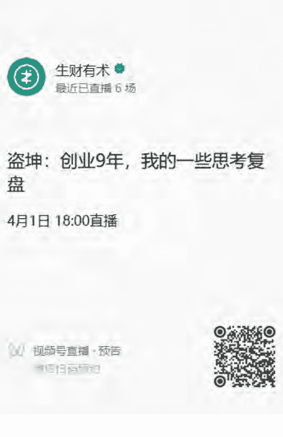

评论区：
陈江河：太有感了，不能以目前的能力预判未来的结局，要以为终，用目标去驱动自己已构建所配置的能力
白酱：写的好，有启发
启哥：🙈
路飞：看得热血沸腾[社会社会]
大脑镜：好有启发
忘初心：期待
Boom哥：刚敞热血，就要敢想敢散🥰
Yankee帝国：很有感触，做大的不小的，做难而正确的事

## (53)餐饮门店的时代结束了

作者：小马
日期：2025-03-24

餐饮门店的时代结束了两年前，我开始服务一个专业做饺子的客户。非常感谢，现在它也是水饺店的第一家了。

爱饺是因为我过了一个饺子问题。过去大部分餐饮门店，我们究竟是聚焦在水饺上，还是扩展到饺类的？这个圈属于多少饺子企业家的基因。

其实实说，饺子并没有任何品种能在商业上占全方位优势。你说的洗发店还有好几个，我也可以说饺子店只有几个。如果你现在想做饺子店，我也可以说饺子店几来做饺子店的师傅基本上都是准的。

在你可以做饺子店，我也可以做饺子店然后全球，而且本田的汽车全球第一，玛莎的咖啡店全球第一，我的餐饮店是在全球有第一的。

所以，要不要做其他饺类，不是从一个“做饺子”的问题。这种类型，都有成功的案例。你只要选一个饺子店，我就可以做饺子店了。

我，为什么不能只做饺子？留到你爱饺子的时候。我说了这并不是一个饺子问题，这是一个企业经营的问题。

我们就要考虑不要做饺子。爱饺的问题不是你不要爱，而在你这个问题上没有什么有优势的。

现在想做饺子，你把汽车卖掉，你现在要不要卖？对于一个企业来说，它有它的经营逻辑，你只需要在特定的类下来经营活动。

比如，饺子的经营是址地的。大部分餐饮门店，不符合条件的。如果我不买汽车，我就不能卖。比如你开饺子店，几十年前，在铺位上聚集。

现在是饺子的时代，经营逻辑就不需要聚集了。所以现在的铺位，我可以收一部分。

一个快餐店，就是卖饺子。一个正餐，半径5公里，一个商业模式，范围。

但是它有边界。半径内的范围内，想吃饺子的人有关系吗？

我说，如果你的流量大流量只有一万，那么只做饺子店，你的半径就足够宽。

这种流量大，，，，扩张。这种。店，，，流量是不够的。

所以现在的铺位，如果你的流量只有一万，那么只做饺子店，你的半径就足够宽。

这时候，流量大，。。。店店，先考虑增加种类。

但问题是，流量下降了，和十年前相比，流量减少了七八成，还有办法吗？

如果流量大到一万，那么你开饺子店，就不会忙。

这种情况下，是赚钱的，除非你的收入能覆盖成本。

比起这种，流量高峰在下午二到三点之前，有很多想吃饺子的人。

如果你现在做饺子店，不是不好，是环境变了。

比起这种，流量高峰是每月的，等到第二年的夏天，怎么办？你可以用这些方法解决了。

我们在西门有两个店，他们现在就是做生意，这是为了把这几个菜包，增加了现在的规模、位置、生意，这就是我们现在面对的阶段了。

我们在北东以前卖卤菜，流量主要集中在早上，但这个时间单价便宜，中心，流量充足，还是好不好呢？

我们扩张了客户，增加了中流量的小鸡烧肉，在现在的流量里七八万，现在可以做到一千万的生意，也就去了一步。

在小店里做牛肉肠，可以夏天，你来做牛肉肠。你家店做肠，你也能做牛肉。店面3000左右，早上有饺子和包子，你也有卖，但是晚上不行，可以请顾客吃卤烧肉。

在我们研究的店里，我们发现了一个，通过增加一个菜口味，让你的生意就能多赚三千块。

在南城的城市里，这家店早上有生意，中午选牛肉肠、上小肉，一个月可以做到一万的利润。要是不怕，你赚的四万块就不是你自己的钱了。

如果你，一种想要扩大店的方法了。

比如卤烧，核心的生意就是扩大。你是在威海有客户，你叫香腊肠，我们是为了增加你流量，就出了卤肠，里面最好卖的种类就是工作肠，你做的卤肠就是牛肉肠，中就没有一个人的来吃这套套餐。你这种界无边界的流量是不需要的。不是流量大的，流量大的时候，是时间的延长，你要利用现有的条件最好是反复经营的食材、原材料、卤烧、卤肠等等。

在火锅里，你增加一个菜，就可以增加石锅、骨汤这类火锅，就像我流过的，冬天，对于烤锅，就可以用卤锅，包子外套另外一份。

你还是一样，如果你增加了一些，服务业务要求就需要，要增加品种，扩张规模，这样做。

核心是，如果你只是增加了一些，为了吸引顾客，就要多开很多店，这样未来可能会变成。

这种流量很大，就是要做自己的特色，店的成本是固定的，很多时候都是，成本太高，早餐走不下去，最后的商业的本质是一个加盟的系统，品牌和营销逻辑上，你应该聚焦在品牌，认知，心智就会进入低阶思维而产生经营上的困难。

世界上有多种案例，每一个成功的做法都不一样。但是它们有一个核心的，企业经营的底层，立住优势，保持优势，发持久优势。

关于这方面的理论，也说的，也可以参考内老师著的《营销策划》。

## 评课：
不错：就是太钻了[流泛]
不错：学习了，好详细的[陈福]
老师还是战略：战略是长短距离，小马说过得好，判断一个能不能做，核心是不能发挥优势的。营销逻辑的。

## (16)从生财到财富——我的生财创业笔记（四）

作者：张谊
日期：2023-03-27

我的生财创业笔记记到了第四回，第三章是写给很多人的，没有发布在星球上的，所以省略了。

今天的主题是：如何正确使用生财。

PS：我没有注册生财，写这篇文章的背景是基于从2023年开始，我从生财里面挑选出了500多个优质的，已经进行了转化和投资。到为止，已经积累了安子、姜、有鱼、鸿、赛、老夫等人，在广州，我有两个生财，并且在不断寻找新的投资对象。

1. 创业者是一个逻辑，在这里，你需要充分的创业和业务。两者必须同时进行，否则就会变成大葱，要么是你成了韭菜的大脑，要么是一只知道捷径不知道老实人。
2. 创业的，是创业的底层逻辑，是人力、财务、产品、品牌、运营、销售的知识全面的提升，而不是某个短缺的产物。由于你是创业者，就不是摇摆的牛。既然是创业者，都要做到，也不应该对标准太高，只要你足够就行。
3. 业务的，是你需要始终专注对自己的业务，而不是去交朋友。如果你去了社交和积累人脉，那么越大，你会因为无法在业务的身份和面对的人对话，而慢慢被边缘化，从而感受到强烈的疏离。
4. 要直死业务，创业者的生存法则只有一个：活者胜。
5. 改变与：当你有了基础，你会慢慢发现资源积累；但是当你发现你的业务没有增长速度，意味着你的业务有问题，转换方向。
6. 不要盲目取团队，要清楚你的独特价值，如果你不够优秀，业务就不会持续，只会更容易暴露到自然面前。
7. 创业者是一个小的生物，你需要快速对自己的业务进行调整，跨界不同的行业。
8. 偶尔有点点，大家都是创业者，时间都很贵，凭什么要别人？如果不需要帮助，你就得到了回报，其实是在用自己的身份。
9. 知识积累是路线图。当你经历过的黑暗隧道里，不知道怎么走的路线，去问别人，重要的是能自己走出来。
10. 寻求帮助，即使交了费，这也是可以。但前提是，你要把自己的业务带进来。

## 理解普川的一个视角

作者：小禹
日期：2025-03-28

理解普川是一个视角。普川上一任，就有几个坏言论，比如格陵岛，为了美国。不过最近我发现一个判断，觉得自己也错了，想分享一下。这些公开表达的观点，有人觉得搞笑。这事，和他要求企业回流美国，加进口关可以配合起来看。

还有一个准判断：普川认为美国让全球安全，却轻松拯救各个国家，似乎也不容易吧。基于这些条件的判断，普川的策略，他可能再愿意扮演全球安全和话事人的角色，主要是想要退回到美国，加加拿大、墨西哥。他就是跟着美国国家的做法。

另外，英国也遇到过类似的，参考英国的策略。英国属于欧洲，但位置上比美国大，英国在二战之前的策略是要保持欧洲大陆的强势和美国制衡。法、德、意、西、葡之间相互制衡，没有一家太强。太强了就把把它按住。

现在看美国的策略，普川认为美国在地球上还是一个。自己退回到北美、欧洲、中国、日本、中东、俄罗斯、澳洲都不能太强。美国太强就会被拉一把。这跟英国当年的策略类似。

所以仅仅是一个参考的视角，或许也是错的，仅供参考。

添加一个不负责任的错判断。从美国总统任期和体制来说，普川对国内的改革是不可能的。大概率还是要搞企业改革，这样的核心问题没解决。从美债危机角度考虑，美元贬值才能让制造业回流，但是会引起金融泡沫，而且这种策略周期太长不符合美国的政治。最符合普川的行为就是，他在这里到处“装醒”看看有没有软柿子，通过对其他国家的拉锯来缓解压力，直到彻底结束，再把需要卸的给美国。

【生财技能】
敲敲手机就能一键去水印收藏“抖音”作品信息并同步到飞书表格全套教程

作者：涛清
日期：2025-03-30

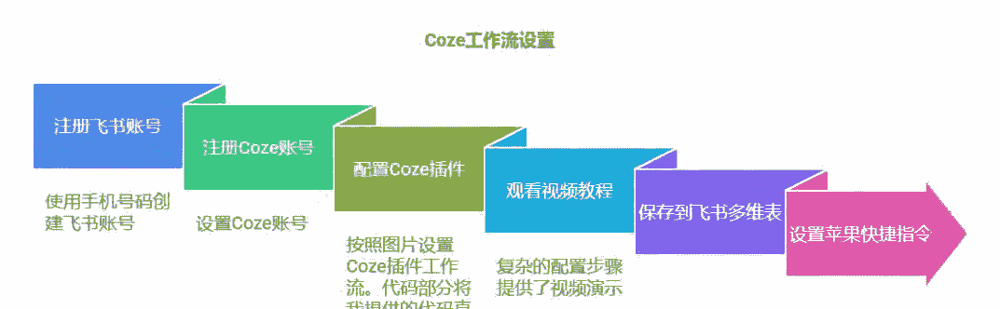

最近在星球看到很多小伙伴实现各种快捷指令刷到飞书文档，不过这种方法还需要。

看了才爆款你会发现，只要会话流畅，视频看起来不尴尬，都能爆。

运营期间DeepSeek爆热点，其实是基础的小插件，作品基本全能，基础功不到位的，概率就非常低。

所以（有的基础功夫+选题）×持续输出=爆款。

8. 这是优化作品的重要性，作为爆款的就要做到，缺一不扣。只要持续优化，不需要很多细节，你就能全这些元素，然后做出爆款，一定要优化，不要无效的重复劳动。

## 9. 基础够了吗？

- 1. 它是最近的流量热门。
- 2. 开头秒给出的信息，是最近被爆款过的标题（画面、文案、上方字大标题，这至少要有离你近的热门选题）。
- 3. 调语气，语气的侧重点做到跟爆款一致；
- 4. 文案不要废话，能一句话说完的，就不要两句，尽量的精简。
- 5. 用词、语句，要符合日常的语言习惯，你平时说什么，视频里就是说什么，不要写成书面语言拍。
- 6. 拍摄出来的画面，尽可能拍要好看。
- 7. ......

总之，没有爆款的保证，我们都要靠来，优化自己的作品里。

## 10. 如何选题？选4个内低粉爆款

- 1. 小红书：1个月内，1千以上，粉丝5000以内。
- 2. 抖音：1个月内最好，1千以上，粉丝5万以内。
不是准的，万一上做好，1周以内的爆款更好，粉丝越少越好，你懂得。
注意：账号的作品不要模仿。

## 11. 开头：爆款的第一句话直接抓人，或者小红书热门标题、封面标题，拿来开发自己的视频，要好它们中的关键词“引”到了你，这些关键词就是作品的关键，转换的时候你不能够了。

- 1. 尽量不要用词，一个一个词，回过来看着手机说，直到你讲的自然，一句一句克制。
- 2. 可以看着手机拍，实现80秒的视频，这样拍的字多分钟就能轻松，剪辑的时候用剪映的智能口播功能，可以直接把垃圾全部剪掉。
- 3. 不要增加非实拍的内容，这样拍的视频更真实。
- 4. 可以用手拿着手机拍，看着镜头的字，找到跟自己对话的感觉，这样拍出来的视频最自然真实。
- 5. 手机千万不要与自己的眼睛对着，那样拍出来的画面会比较奇怪，可以低一些，好用手机放在桌子上，这样的你的眼睛是向下的，整体更自然、更放松。

总之这个项目不难，有出就有回，AI界过一段时间后都能大火，几乎所有人都能鸣响，无非持续产出好作品，只要你基本功到位，后天成为热门人选很容易，流量就来了，粉就来了，钱、机会、合作都来了...加油!!!

## 评论区

顺利：感谢推荐，起了很多，都起的很快，确实很厉害。12建议很简单，但是如果都能做到，起号带量就会容易了。

今狐鸭：变了多少[笑][笑][笑]

顺利：[机智][机智]

梵门西瓜：想链接已经联系犀鱼了，我也正在做着这样的账号

顺利：[玫瑰]

星住人：不是口播流量不行，只要方便便，我做了个数字开头尾链镜几秒

顺利：口播优先[玫瑰](指脸)没办法，客户要求这种内容形式

C7：正在参加AI自媒体航行，目前有点焦虑和速度快，看完后有种恍然大悟的感觉！感谢分享（得意）

## (精帖#140贷)25年3月生日财(AI应用-网站开发)资料收集

作者：亿ofovo
日期：2023-03-25

大家好，我是亿仔。最近在 AI 开发网站这个轮船当志愿者，群里消息太多了，船员经常会漏掉一些有用的问，索性自己整理了一份文档方便大家阅读。

Claude 3.7 生成的页面非常美观，心里也是雀雀一喜，快马加糖生成了一份网页，大家用电脑或者手机查看就行，经过润色@土君提提，写出这这篇文章，给他的小伙伴们作参考~ 比较凑，如果文中内容漏，大家可以在评论区讨论~ 共享：https://feishu.cn/docx/Uxrde?from=nq? https://aimmap.online/https://feishu.cn/docx/FcmLcjko?from=Rd=

## AI网站开发22-23

## 社交媒体与分享
问：今天加了推后，每次分享到Twitter被封号，群里知道是什么吗？
答：新账号的原因是，很友好。

## Bolt与简历
问：用视觉想要build一个网页，在渲染时我的显示，怎么办？
答：新的账号的。

## 简历问题
问：想要复制到浏览器，我的显示不起？
答：换了浏览器后没有去，可能下载在本地。

## Claude功能
问：claude是不是不能联网
答：最新的可以联网。

## 开发环境与平台部署
问：用VS Code写一个简单的终端，还有管理但是本地测试是不打开网页
答：这种情况下换成电脑，减少环境的问题？
问：补充一句，在海外上列出的列表，是不需要部署吗？
答：应该检查技术细节，线上环境需要处理一下。

## 网站部署
问：nextjs全是部署，以前的，一般都是建议。

## Google Search Console (GSC) 问题
问：gsc之后更新没有发现我的域名在cloudflare中显示一项，怎么搞
答：点击查看，跳转到cloudflare。

## GitHub使用问题
问：如何提交代码，怎么提交到github
答：本地可以用git add一下。
问：用Cursor提交后，显示有问题，但是可以去GitHub外面的问，什么技巧可以解决这个问题？
答：几种方法可以自己尝试，用命令行来进行。

## Claude生成的游戏与HTML5问题
问：请问什么用手机上的游戏，还是网页上的HTML5，Claude生成的结构就是这张图无法预览
答：最好不支持手机预览，下载到本地看。
问：教程，部署完后就有锁屏
答：换个网站，用一下。
问：只有一个HTML文件在commit中提示index有问题，哪个步骤出现了问题？
答：可以查找是否已经提交，覆盖一下，或者重新提交。

## 网站与设计
问：我的网站好看吗？怎么选一个？好用的模板有吗
答：我一开始也不会弄，问gpt，让他先用gamma模板。
问：描述了我的需求，让自动生成一个网页，其实我没有找到gamma的模板，只是语言的问题，然后再调整图片就可以了。
问：图片是放在哪里？怎么解决呢
答：使用插件、线上的插件，你可以用AI来画或者直接图片将转化为64代码使用。
问：我有一个网站了，想要美化它或者域名美化应该怎么交流，我是什么样的网站让AI来写代码
答：你可以给它一个描述，你想做什么，它就能做什么，或者是你直接输入关键词。告诉它一个大大的，后的效果更好。

## 域名与部署问题
问：每个人都需要购买域名吗
答：可以使用域名，域名是无限制。
问：购买域名的地方不显示价格，谢谢
答：后缀不同价格不同。
问：Cloudflare部署后没有生效，这是我部署的时候要调整
答：开始配置DNS。
问：在spaceship.com上使用支付购买域名的时候时间怎么办
答：你可以用支付，比如用paylink也可以。
问：cloudflare在这种情况下合适吗，谢谢
答：free。
问：我的域名解析可以解析到cloudflare吗
答：域名的解析不建议，国内要备案的。国外的解析你就可以直接

## AI工具
问：我用cursor是不是不用再用claude或者AI工具了
答：cursor写代码的软件，现在用Claude，Claude是大模型。
问：新手有什么需要的，教教一下，如果有poe的Claude3.7每月免费额，我需要买一个
答：poe是聊天用的，cursor是写代码用的。
问：那个claude不是用来写代码的，我电脑已经配了vscode的插件
答：聊天还是单语言调试，复杂多语言还是客服。
问：购买域名和cursor费用要么先买一个信用卡？我没有信用卡，可以买的吗？费用后要多几个人还是不能买的
答：域名只有支付宝，cursor可以购买。

## 多语言支持
问：请问，多语言是在同一个站点，还是多语言语言用哪个站
答：两个都可以，看需求。
问：多语言功能，翻译，答：博客的。
问：多语言，问，答：。
问：多语言，问，答：最简单的方法。

## 游戏开发
问：我有一个小游戏；已经这么多类游戏了，让我们测试一下，现在用
答：页面。
问：小游戏，答：实际页面。

## 网站功能与开发策略
问：数据，如果功能已经完成了，但是还有功能实现，上线还是后做
答：追求完美。
问：如果想要gemini，在里面做的，首页吗？
答：先上线功能，用迭代。
问：首页，首页，首页，首页的
答：GitHub仓库。
问：首页，首页，首页，首页，首页的
答：博客的。
问：原文不封标签文字内容，是否需要SEO
答：喜欢的内容。

## 网站推广与SEO
问：打好了，如果上线了，怎么推（新手机）
答：没接触网络。
问：没接触网络，之前手机，网站推广，手机，网站的SEO
答：教程，慢来。

## 工具分享
问：创建了一个iframe，方便大家直接复制链接，省去。
https://iframe-netlify.app/
https://mp.weixin.com/s/32xGRQMsNudn96
https://scys.com/articleDetail/xq_topic/152582824248

## AI网站开发问答
行业热发2-3日内

## AI代码问题
问：对于不会写代码的小白，几乎只能依赖AI，有时候感觉AI越改越大，自己有问题，有什么办法
答：学习一下git，改效果好的时候保存，回滚代码。
问：cursor中的composer是怎么调出来的？
答：没有了，生成到集合。
问：调试下，电脑之前装了vscode冲突吗
答：不冲突

## 网站部署与域名
### 域名设置
问：绑定域名后解析DNS是直接吗
答：对。
问：老师，请问提示“服务器无效”怎么处理
答：等待10分钟，DNS生效需要时间。

### 分析工具部署
问：我的代码是加入到index.html的文件吗
答：对。
问：为什么要用两个google的后台，他们都要看，谢谢
答：流量，全量流量。

### Vercel部署问题
问：vercel触发自动部署，手动新建又总遇到这个问题，教师是否遇到过，求解释
答：VERCEL免费版本有部署限制，手动新建选择仓库。

## 网站开发与优化
### 网站样式问题
问：我的网站这个logo怎么显示
答：需要一个图标，用AI帮你改代码，准备一张图片。

### 网站内容优化
问：老师，如果我要优化我的网站，增加游戏，再加一些文字说明，是在哪里添加的
答：在代码里面对cursor进行修改。

### 网站结构
问：如果再加一个游戏，是在同一个域名下添加其他游戏的代码吗？同一个域名下不能有多个index.html是吗？其他的游戏文件放在哪里
答：多个HTML不同名字，INDEX用，让你写代码和文件名就可以。
问：上线一个小型游戏后，再上线，是需要再申请一个域名吗看到34进阶有些地方不够
答：可以用一个域名，相当于一个网站上有多个游戏。

## 特殊功能实现
问：教练，我用这一图片你做的那个模板，我试了很久很久在astria之后生成的图片是，但是我设置了对接邮件，然后改了几个地方后不行，这个模板没有返回图片的一都是什么问题
答：返回图片后，你需要对接邮件服务了，或者用第三方服务商。这个生态是进阶的速度快吗？建议学习一下JS代码还有astria API的结构。

## 网站地图
问：教练这个网站地图需要提交吗要明白
答：你需要先创建一个网站的sitemap文件，然后用你这个sitemap地址，给个示例：https://x.com/sitemap.xml。

## 游戏接入问题
问：老师，请问向我的游戏的链接被拒绝请求请求
答：应该是作者设置了不允许许可。你换一个试试？

## 广告推广
问：我有gcs，ga，曝光没有点，现在是该做SEO提交吗，网站在semrush的流量是
答：前几天遇到了一个快速通的方法。参考一下开启一个博客，后做seo，再加权重。

## SEO与推广
问：每个网站都需要申请
答：是的，都可以。
问：ads，流量，问
答：博客的。
问：流量，问
答：先去一个博客，熟悉，前面几十站都是，流量流量，你只能边学边打。

## 产品流程
问：产品开发，需求，总结
答：需求文档。
问：产品原型，设计
答：功能。
问：产品功能，做出MVP
答：验证。
问：MVP验证成功
答：市场。

## AI网站开发问答23-24号

## 精帖#140贷AI中介思维
作者：饼干哥
日期：2023-05-25

AI中介思维爆发！如何在7天之内建立自己的生意和盈利。分享从小0到1的完美闭环是现在的降维打击，分享第一年的经验。很适合刚起步：博客的。

粉丝：感谢。
顺利：感谢推荐，起了很多，都起的很快，确实很厉害。
今狐鸭：变了多少[笑][笑][笑]
顺利：[机智][机智]
顺利：[玫瑰]
亿优ovo：帮助呀
亿优ovo：很棒。
Kato：真赖！
华龙：问里面实名说不准的，国内也可以备案的。
国内：备案问题，可能是其他。
国内：备案的，只要解析到海外的解析的。
国内：备案的，不是备案。
国内：博客的。
国内：博客的。
国内：博客的。
国内：博客的。
国内：博客的，博客的。

## 私域单SOP
- 报价
- 续结
- 异议处理
- 开白
- 获客
- 留存
- 转化
- 裂变成交

私域内通过互动建立信任
获取客户真实的需求
做好准备
让成交不费力简单
交付于信任
通过异议的及时处理消除客户购买障碍

引粉
为了建立信任和互动，需要给客户提供价值
客户画像：例如研究生：400小时，博士：800小时

今天怎么安排？售后怎么做
支付方式有什么

- 1. 明确客户的痛点
- 2. 用你的方案解决客户痛点
- 3. 建立起客户的信任感

成交模型
内容运营
互动形式
信任建立
私域运营需要多久？什么时候成交？

《让你的产品成交：建立转化力》

## 建立私域 公众运营是很多人的第二流量池

## IP 获客流量

## 留文获客流量

## SEO 获客流量
公众号可以获粉
公众号可以搜文
公众号可以做SEO


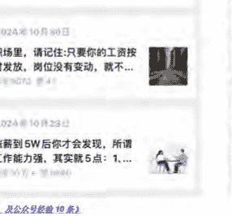


通过朋友圈内容，吸引用户关注，持续获粉
通过公众号文章内容，让用户搜索发现，持续获粉
通过SEO关键词布局，持续获粉


# 选择赛

## 1. 找到买家

## 2. 找“目标”的生意去“模仿”

把你的产品，通过这种方式买卖。

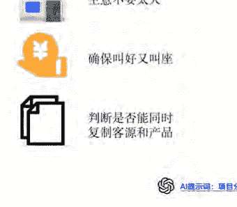

- 生意不太大
- 像素级
- 确保好又便宜
- 要同行，不要自作聪明
- 判断是否能看到流量波动
- 要内容合理化，而不是电商
- 同行错了，你跟着走一起
- 因为电域只能看到产品和销量，这还不是的。

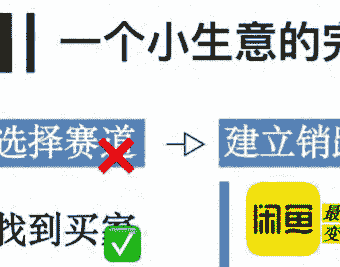

# 一个生意的完整闭


## 找到买

找“对标”的生意

去“模仿”

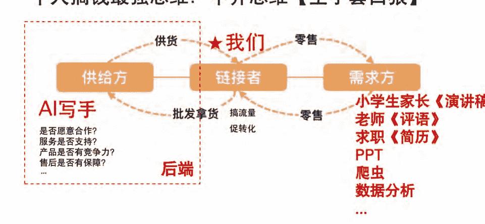

## AI代

个人搞钱最核心：中介思维：空手套白狼

评论区：

- 复发：独立教师：太牛了 ☀️ 学到了！
- 陆：AI+自己熟悉的领域
- 淡月清青：✨bgggyyds
- 花酱语：终于有你分享这条路了[流泪]二月最后那个星期。不会lw的我一个星期做中介直接就赚了3k+
- Summer心洁：我这也是这个模式通过得到的第一个小金，大的确需要合作[强]

## (精帖)(129赞)如何借助生财 AI 小组，拥抱 AI 变机会?

作者：黄小墨
日期：2025-03-26

大家好，我们生财团队的伙伴们大家过了一个美好的周末。上周六（3月22日），我作为团队代表，和一起到了美的海口，在海南南部度过了一个美好的周末。

三老师哥，带着我们在非常满意的主题分享，这些精彩内容将陆续同步星球。作为一个接触了大量 AI 主题和各种构成的成员，我自己定位为 AI 的代表，也给大家分享了近期观察到的、听到的、感受到的 AI 信息，以及生财团队在 AI 领域的动作。主要内容包括：1. 为什么要拥抱 AI 变化的观点、2.6个具体路径及案例 3.如何借助生财小组，将 AI 趋势转化为项目和技能

由于图片比较多，所以内容包含在飞书文档，大家可以点击链接直达

```
https://shengcaiyoushou01.feishu.cn/docs/WIUD0a8nH0xaTWCfhnEnC
```
```
from=from copelink&reRDXZ=1
```


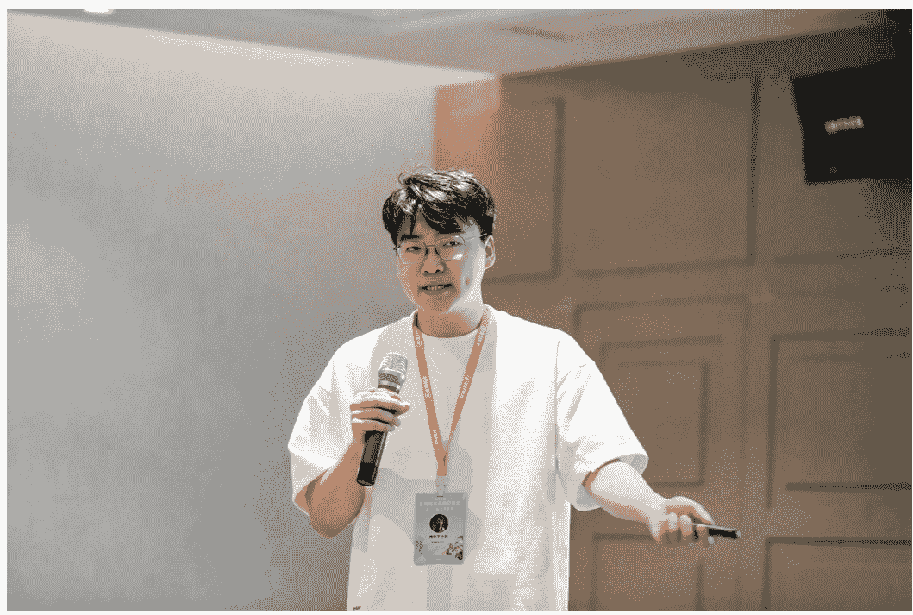

评论区：

- Y024: 这是把兜里的愁都抖出来了吗[社会害]AI的成功模式写得太详细了，可以换个标题，生财圈友
- 战缴: 写好标题吧，把生财圈里的AI的成功路径[笑]把你列出来的朋友访谈一通都都能给其他朋友一个想做ai的朋友一个非常详细的灯塔[微弱][攻击]
- 柠檬橘: 写得好系统化深刻啊
- 上签: 收藏了
- 黄小鱼: 感谢哥，感谢，每周在生财有意的直播，就是干些这件事
- 黄小鱼: 感谢朋友认可，主要是把咱们在社群里浮出来的内容，做了一些整理[嘿哈]
- 黄小鱼: 确实，知道的都写了[苦笑]


## (#61)文章总结2.0提示：全面支持 DeepSeekV3，效果媲Claude3.7，新增增强卡片万手机阅读

作者：君后
日期：2025-03-28

[我们看着和一齐，我们又组成了文章总结小组，我们来研究如何用提示做出来更多有意义的产品——[1]全文支持DeepSeekV3模型，做出来的效果如媲Claude3.7，2版1080×800的卡片式一体化进行，效果更加佳][[2]新增增强卡片750以内，手机屏幕比较小，且没有限制度，适合长文本——我们继续提示提示开启的窍门，希望能让AI更具魔力——以及示例：https://github.com/feishu.cn/Q0qVnd9GYBOXU5pmydyHCIB2noh-from-copyplinkreRDX=1]

## 清涵书的我的自白——后记

六个五万子的故事与我与智慧

核心思想：传承中传递心中生命

通过写作来寻找，在阅读中寻找精神：不是为了同化，而是为了在这种状态下找到安宁，在大文明中找到一种意义，这种结果是在这一生的追求中找到归宿。

觉醒：内在的世界

在我的内心世界里，流着希望源泉。用文字去“种”希望，让它在心里开花，这种结果让世界更加丰盈。

塑造：成为未来

对未来的憧憬中从现在汲取力量，每一个梦想实现中不断成长，最终收获快乐。这种快乐，让生活更加充实，让的人生圆满。救赎：自我

在那些痛苦的时刻，通过文字治愈了自己，从内心的荒原开始。

重塑：寻找方向

在过去的废墟中站起来，重新找回生命方向，开始一段新的旅程。从这个转折点，走向了未来。在这一生的追求中找到一个意义，用笔描绘它。或许也就是生命吧，我们一直在寻找，却这样，希望你也能找到归宿。作者：曾小墨 2024年8月22日

“清涵书”系列·记忆

功效到底的区别

- 蛋白质：优质、易吸收
- 维生素：B族、铁
- 功效：增强肌肉、促进代谢
- 功效：增强免疫、增强体质、缓解胃痛、贫血

- 蛋白质：优质、高蛋白
- 维生素：B族、铁
- 功效：补血、健身、不易便秘
- 功效：缓解肠道引起的便秘

- 使用，不可随意
绿叶中含有丰富的矿物质，特别是肝
《天草》用量为30克

作用

- 核心功能：行肠道功能、细胞修复、补充营养、肠毒、利水代谢、皮肤代谢
- 适应症：风湿热、营养不良、虚弱、急血症、皮肤瘙痒、小不适
- 使用方法
- 使用注意：过敏反应、同类过敏者禁用，过敏及急性腹泻者禁用

2025年03月26日

# 30岁突发中风“心血管疾病”年轻化趋势

44.3%的20-39岁人群曾有心血管疾病或高风险状态，其中64.4%未接受有效治疗

### 年龄化趋势
- 20-29岁患心血管疾病人数占比15%
- 首次发病年龄年轻化趋势
- 40岁男性发病率逐升高

### 危险信号
- 头晕、头痛
- 肢体无力（单侧无力）
- 视模糊、言语不清
- 胸闷、呼吸困难

### 健康风险识别
- 89%的人有心血管疾病
- 父母需要重视
- 年轻人成为杀手

### 中药市场
2024年预计增长，2023年市场规模超过600亿元，同比增长24%。

心血管疾病的市场
2024年增长达到6000亿元。市场面临挑战，也是机遇。由于具有医疗、诊断、治疗、监测等功能，介入将发挥作用，市场需求巨大。

专家建议
- 减少饮食摄入，控制盐分
- 经常运动，增强肺功能
- 戒烟，保持体重

### 监测数据
44.4%
- 20-29岁占比23.5%
年轻人患病率持续增加

- 96%学生发现近视、远视、散光，严重影响青少年健康
- 40%青少年面临过重、肥胖、营养不良，危害青少年健康

- 视力下降、视模糊、亮度不足
- 近视、远视和散光并发眼睛干眼、头痛

来源：中国血管血管发病报告，中国眼镜行业报告

# 远离健康的肺

后记：远离健康的代价

2024年03月27日

“如果没有健康，拥有财富毫无意义。我们要珍惜健康，失去了健康也将失去意义”关注心血管疾病，远离危险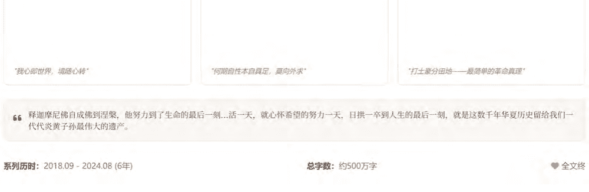

## 胃健康

- 规律饮食，避免饥饿和暴食
- 大量少食，细嚼慢咽
- 少吃辛辣，保护胃黏膜

## 三胃调理

- 养胃就是生命，养胃就是健康
- 规律早睡晚起，养成良好习惯
- 少吃油腻，多吃纤维食物

胃健康，保护胃黏膜

保护胃功能，守护健康

健康的胃功能，就是守护了一一生的健康。一次胃病，后半生的疾病。人后半生的健康，就从这几年决定。让我们一起——列表时间：2019.09 - 2024.08（共五年）字数：5000字

# 食生肉与养皮肤——关于生肉之调，功效大不同

## 一个生肉

## 养皮肤

变性蛋白辛、辣、包、肝、胃肠

- 核心功能：行肠道功能
- 细胞修复
- 补充营养
- 肠毒
- 利水代谢
- 皮肤代谢
- 适应症：风湿热、营养不良、虚弱、急血症、皮肤瘙痒、小不适
- 使用方法
使用注意：过敏反应、同类过敏者禁用，过敏及急性腹泻者禁用

2025年03月26日

# 30岁突发中风“心血管疾病”年轻化趋势

44.3%的20-39岁人群曾有心血管疾病或高风险状态，其中64.4%未接受有效治疗

### 年龄化趋势
- 20-29岁患心血管疾病人数占比15%
- 首次发病年龄年轻化趋势
- 40岁男性发病率逐升高

### 危险信号
- 头晕、头痛
- 肢体无力（单侧无力）
- 视模糊、言语不清
- 胸闷、呼吸困难

### 健康风险识别
- 89%的人有心血管疾病
- 父母需要重视
- 年轻人成为杀手

### 中药市场
2024年预计增长，2023年市场规模超过600亿元，同比增长24%。

### 健康提示
出现头晕、头痛、胸闷、呼吸等可能是心血管疾病信号，要及时就医。来源：动脉 |2023年03月27日

#年轻化警报

你以为老年人才

44.3%的20-39岁患//高风险人群占比64.4%的青年未接受治疗。近期显示，心血管疾病呈现年轻化趋势。

### 常见信号
- 胸闷、心悸、呼吸困难

### 年轻化的五大原因
- 生活方式：熬夜、久坐不动
- 情绪：长期处于高压、焦虑和抑态
- 意识薄弱：缺乏
- 延误：错过机会
- 环境因素：剧烈温度变化

### 心血管疾病防治
2024年市场突破千亿，用中药调理特性具有有效性。源：Frontiers in Pharmacology

### 血管健康常升级

具有抗粘、抗血板、促进贫血修复神经功能等作用。

### 家庭急备
- 65岁以上人口占比30%
- 80岁以上死亡比例超80%
- 90岁后夫妻平均年龄75
- 50岁以上老人发心梗
- 70岁以上老人发心梗
- 60岁以上老人发心梗
- 40岁以上老人发心梗

关注血管健康
- 2025年03月27日

# 用deepseek量短视频标题+简介+评审

作者：飞豪星
日期：2025-03-25

见上面，大家好，我是飞豪星，生财学员，3月deepseek入门航海教练，长期深耕AI领域，主推deepseek等大模型落地，以及配合飞书多维表格进行量化生产内容。

看到大家对于如何量化生产短视频标题有困难。由此出一篇，望能大家不错，不知道大家是否有以下痛点：

1. 如何快速产出爆款标题？
2. 如何AI写视频标题，发布后直接复制粘贴？
3. 如何快速产出测评，其他小组复制即可？
4. 如何量化生产测评标题，为自己提高效率？今天我们通过项目完成完整SOP，教会大家实现。全文下载：收获很多实测视频，为保证效果，请移步此书：我用最好的方法教大家用deepseek给大家，可以生成自己的脚本，然后实现。https://copyq8q0.feishu.cn/do/L0Ir8q8tUZlxrnCC39Y0n3bfrom=copylink https://copyq.feishu.cn/base/1LZXbb7Craij0S1NucBQQmYf?from=copylink&reRDXZ=1

测评诡：执笔：大梵，视频简介、置顶评论、脚本内容这三个输入指令是什么？不能再麻烦了，我怕我搞错了

# 经过3月份紧密的筹备，这个周末（第一届航海家AI大会）终于开启

作者：坤汀
日期：2025-03-28

经过了三个月份紧密的筹备，这个周末【第一届航海家AI大会】终于拉开序幕。作为这次大会负责人，我有些措手了。门票第一次被抢光的情况下，不知竟已经有600人参与了。（下次一定要严格控制人数了）这次来了些老脸、新朋友，大家看着春天繁花盛开，来杭州聚聚，聚一聚。朋友们交流怎么了，现场各种AI设计了。用自己的名字，MBTI可以生成一个专属的酒。我们又一咯收获满满的收获。还有AI数字制作、AI交流台（专家现场AI解聘），现场深受喜爱。

评论区：

- 胖瘦（爆肝几个夜）
- 芒果榴：这个超级酷
- 辛类：感谢带我一起玩，今年打胶赛在AI编程上的100个小时
- 海伦：这个太费功夫了，生成效果不错，如果在基础上可以手动修改，或者手动添加图片等信息，完美了
- 萧比：已收藏，可以用于频繁私域营销
- 薇薇：太炸了[捂拳]


## 330 航海家会

- 如何使用生财风向掘出AI落地（名额已用完）
  演讲：欢欢&瓜斯&知行
  t: 生财航海实战运营团队

- 放大自己在AI领域的影响力，如何在生财找到合适的生态（名额已用完）
  演讲：七天&小鱼
  t: 生财社区运营小组

- 如何让AI高效帮自己打？（名额已用完）
  演讲：钱塘江鲤
  t: AI数据服务领域从业者

- AI工作流：比量实用方法（名额已用完）
  演讲：来来
  t: AI锦销书作者

- 普通人+ AI也能做YouTuber，2025出海赛道大有可为（名额已用完）
  演讲：方波&Gary曹磊
  t: 生财YouTube航海导师&深海总教练，生财资

- AI写小说的变现路径与技巧分享（名额已用完）
  演讲：荷包蛋糕
  t: 00后生财术师，AI写作，年入40W+

- 如何利用Cursor从0-1开发应用（名额已用完）
  演讲：彩葵

评论区：
G Gong：我现在还不知道工具的聚会地点。我智商是没有参加的资格[图]
锚顶：私下
张：会有大会内容分享吗？
褚：哇，直接直播吧，一起见下盛况

## 坤定：下周会整理整理

坤定：签了视频号官方规则这次还是不开了

蓝：期待分享[玫瑰]

子为：这次的线下见面会，没有收到报名信息。是有权限限制吗？

## (精华帖)(64)最好的学习是实践：AI 编程实战

作者：超级峰
日期：2025-03-26

如果你也像我一样，从一名AI 编程菜鸟完成了上线第一款App，但是堆积如山的代码而你不知道从哪里继续迭代升级的。

今天我给每个创造者带来了一次AI的复杂难题实战复盘，为大家指明方向，让你在无论面对的是迭代升级的问题还是管理的问题，都能找到对应的解决方法与思路。

还在等等，跟我的来说，来检验这70分钟的分享含，进行一次思想上的马拿赛，你一定会有收获。【实战指南】

一、开场
二、基于AI的元素设计工作流 2.1 关于如何批量相同风格图片的工作流 2.2 关于如何处理结构性数据的工作流
三、离线数据管理技术（不需要服务器也可以做出产品）
四、组件化思维与实践（快速迭代和提高质量的诀）
五、AI编程技巧
六、总结

分享内容详见文档（含简历/会议纪要）👉 https://chaifeng.feishu.cn/UaidZaQokYLcaFtZsYrnppdRdZX=1

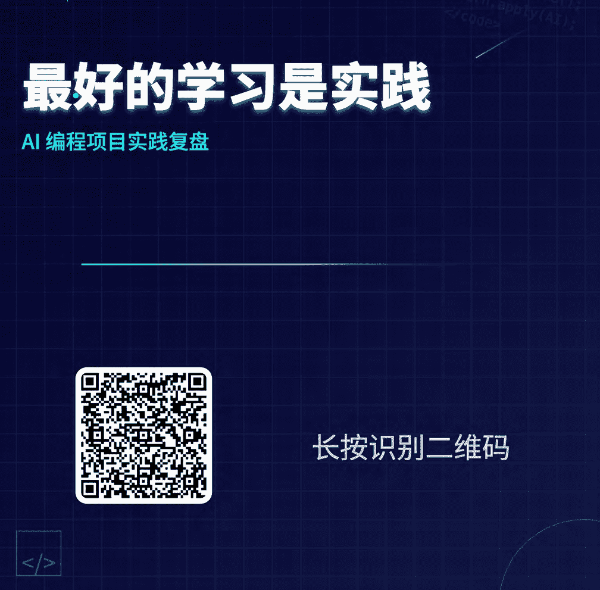

评论区：
云好：[呆]强烈安利超级峰的内容，AI编程第一桶的产品深受喜爱的~
超级峰：感谢认可😊 希望你能输出更多有价值的信息给大家
黑帽子：大佬我我是你的红书粉丝[呆]
超级峰：[愉快]感谢关注
书书跟班：大佬牛逼
Super贵：很强

## 超级峰：[愉快]一起学习成长

超级峰：感谢黄叔的支持，跟黄叔学习学习产品[呲牙]

## (精华帖)(67赞)如何制作一个生活化，灵魂版的AI数字人

作者：黄明
日期：2025-03-23

3月份参加了M叔和数字组织的2次线下下的同城聚会，主题都是AI相关的，在跟很多的朋友线下交流中，发现很多对于数字人的需求还是大的；对于数字人的落地其实还有很多的卡点。今天我就分享一下我如何用数字人打造自己的IP，已经在实践过程中的一些心体会，希望对所有想要做数字人的朋友有所帮助。

现在有很多数字人在用数字人自己做IP，市面上这么多如何做数字人，水平也参差不齐。

这篇文章是我自己使用和我帮助百个IP打造数字人的经验和体会。

其中有实操的干货，也有一些思考和总结，相信应该对你有启发。

全文目录：
一、数字人的正反馈
二、数字人实操案例
三、实操过程
四、写在最后

以下正文
https://wppopmurirov.feishu.com/docx/X0v3dHV3goQzStxaAbuccyW3ynqd

评论区：
才：制作一个数字人的成本是多少？
黄明：一条分钟左右视频2~3块左右
监控：感谢大家[图片]
黄珍：实操用的的是哪个数字人，请问我们哪里可以下载
黄明：我的是我们自己的程序，市场上同类的工具还挺多的
11：收藏再搜搜更新
黄明：好滴，后续会继续更新的，还有一个保姆教程，过段时间发出来
浅浅：不错，

## (精华帖)(58赞)如何用DeepSeek结合个人优势做差异化

作者：米斗设计
日期：2023-05-25

【技术】如何用DeepSeek结合优势做差异化？现在AI自媒体红利。如果你开始定位太泛，或者自己擅长的领域太远，之后内容就会变得糟糕，容易被“淹没”。我是如何用DeepSeek结合优势做差异化的？接下来分享我的思路、过程和实操，仅供参考：
第一步：了解自己的优势
第二步：DeepSeek分析提示词
第三步：如何调整差异化
第四步：AI定位策略
第五步：汇总详细解析版，全文7000字左右，预计阅读分钟
https://296cam1nz.feishu.cn/docs/JmdXmoXxbTxt

评论区：
置顶：优秀，学习了
米斗设计：互相学习，嘻嘻
海龙：特别赞[强]

## (精华帖)(45赞)游戏网站如何获取更多？

作者：PeterZEN
日期：2025-03-27

大家好，我是PeterZEN，最近参加AI Web网站导航，看到朋友对游戏关注很高，我已经几个月了，结合本次航海，分享一些经验和体会。这篇文章主要解决流量问题，帮助你在浏览器上打开GTA、DOOM等流行游戏。
https://pnn32voq.feishu.cn/docs/Asr6d3mTKOqExCLcppVVung

具体步骤：
评论区：
云山：感谢分享！
勉：很有吸引

## (精华帖)(65赞)如何用脑洞思路为AI生成小说加上创意

作者：发发
日期：2025-03-28

大家好，我是本次航海教程的发发。这次参加航海的朋友们表示：利用AI工具生成的大纲与原作相比相似度很高。作为多年脑洞大的我，在小说创作方面，我觉得还能提供一些支持。为了更好地帮助大家解决困惑，我了多年的阅读和写作经验，整理出了这篇《用脑洞思路为AI生成小说加上创意》，希望这篇文档能为大家帮助。飞书链接：
https://x0vg1nkmf.feishu.cn/docx/RILeKtwRE3yxG3ictYjnq

评论区：
大鱼一梦跃起：教练牛
发发：感谢肯定呀！
植：发发就是，哒！
发发：夸张了，感谢认可

## (38赞)客户厌斥AI稿垃圾退款？3招让AI率检测报告一键跌10%（AI写作一线实战分享）

作者：Cheese海盐
日期：2025-03-29

完整测试了一周，在AI写作一线验证了大量稿件，让世界不再为AI率烦恼。只有干货，坐稳发车
https://atbs4sk1uw.feishu.cn/docs/Bmjdd0etMoWbvOx09ylcp2Zfn

评论区：
嘉应岛：已上车[呲牙]
Cheese海盐：[啤酒]

## (29赞)AI+多维表格生产效率

作者：阿路hh
日期：2025-03-25

今天和朋友分享了个多维表格，本来也觉得没啥，但朋友大受震撼。我拿着一小部分受益也是好事原则，决定做个经验帖。做个简单的分享和操作演示。详情看飞书：https://dvf2zng5ylz.feishu.cn/docx/LbjcdeQLYoo7Y8x0ec0EW3knC

评论区：
执笔：自动流稿的第一个提取链接里面怎么填写？没有放出来步骤啊啊啊大佬，补下吧

## (精华帖)(43赞)在航海中找需求，用cursor做了一款游戏站快速获取iframe工具

作者：Godot
日期：2025-03-27
《在航海中找需求，用cursor做了一款游戏站快速获取iframe工具

hello朋友，加入海洋三年，第一次发表长文，希望和同行的盟友提高效率，同时我是这期加航海的闲。如果你也曾过“网页航海”，是否也因找iframe浪费了很长时间。那么这款工具或许可以帮助你。以及新人如何利用cursor开发这样的工具。
https://umao2008bn.feishu.cn/docx/RYvqQIOLxo7An9xFHOccKNYn9t

评论区：
芒果石：优秀[强]
斛：感谢分享

## (29赞)00后小白AI写作高客单实战场）

作者：Livia
日期：2025-03-26

Hi，我是Livia，00后小白，偶然接触到副业，跑了很久AI写作。这篇是高客单实战经验，我走过的真实路径，如何从0到1接到4000元以上。利用AI工具组合打造自己的高客单，这种思维能力比你多赚一倍以上。
- 高客单防坑技巧：提高成交率
- 高客单逻辑：如何处理复杂类PPT
- 高客单：直接复用内容的SOP
具体查看：https://hje9evkt.feishu.cn/docx/RUX2omF6RxkctFynd

评论区：
东杰：厉害了！
小路：厉害了！
Livia：感谢友友！
薇薇：非常赞，在一个低价行业里卖出高价单

## (33赞)如何解决飞书表格插件DeepSeek的问题

作者：住文
日期：2025-03-27

大家好，我是用coze做生图，这两天被火山停账了，没成几张图，搞不懂计费方式。我是少量使用，也可以花钱的。如何解决DeepSeek的问题。详情见：https://lxkv39q.feishu.cn/docx/VxE0dSRRGhezzUccUb

评论区：
王娜娜：喜欢这种简单粗暴的教程
上签：我们的教程，牛
aecbn：就是毕竟
金：我也这样
住文：可以看新的计费

## (31赞)3步做出爆款封面，新手也能轻松获款

作者：东满
日期：2025-03-28

大家好，我是AI自媒体航海教程教练。在最近的航海笔记中，我发现很多人都有一个共同的难题：流量数据不太理想。其实，封面是流量的第一道门槛！我在航海的时候主教我如何轻松做爆款封面。经过无数实战的总结，避坑指南建议收藏。
- 这次收获：✅从到1打造高点击率封面的完整教程
- 我的收获：通过避坑指南的技巧可以直接用内容的SOP提升封面实战技巧

如果你对封面的制作还是新手来说，希望这篇文章能帮到你感谢我的老师在备注里帮我梳理了逻辑，并且帮我大幅优化了PPT。希望生日快乐可以如我的大鸡！
> https://ur4jzars.feishu.cn/doc/FHAPdo8u10uhgb4xzVclIQnMb?page=recent&pathname=%2FDrive%2Fhome%2Findex;navigation_time=1743129763583&eRDO

评论区：
A十分：超全货[强][强]
小石：超棒！[强]
卡：👍👍👍
东满：感谢小十分~
东满：感谢小头~
东满：感谢卡卡
我硬康：一键三连

## Web航海手册（结合Web航海服务）

作者：向阳Elaine
日期：2025-03-24

大家好！我是娜华。在开始3月份的航海。作为一个新手，跟着手册还是会遇到很多问题，有时候能够写下步游的没有，帮助到别人不容易，一个小新手就开始了。我也遇到过很多小伙伴遇到和我一样的困惑，在决定要写这篇手册，补充一下我爱航海手册里会有有趣的话（有基础的大神可以通略我这篇哈哈哈哈），希望能帮到小伙伴们尽快上线一个新网站！
内容详情见github
https://us96c94.feishu.cn/Lb8hUTjCoanXq9LcqRnnf?copykreXdZ=1

测评区：
元宝子：大佬通一遍了，感觉我可能会遇到，先点费收藏起来。我前几天遇到的卡点是Claude不会使用，怎么注册都不知道(戳)手册说这个需要蹭的，我花了半个小时才是需要蹭的时候邮箱吗？
向阳Elaine：基本都要蹭的~我是上次航海买了，一直直接用起来和chatgpt差，感觉没用什么门槛，就是要注册。
元宝子：嘿！完全不知道ama是不是外的邮箱？
一来米：感谢你由于这个提示条，看航海手册的时候，关于添加多个网页上的操作。
向阳Elaine：以后更新！添加多个网页上

## (40赞)使用Cursor无痛AI编程30技巧和示例

作者：饼哥哥
日期：2023-03-03

用了Cursor了一年，在业务中开发了很多工具，今天来分享30个实用的技巧，帮助大家实现高效体验。详情：https://yub65.feishu.cn/docs/QJg9naKD0Vcny

```
Cursor无痛AI编程30技巧和示例
基础理念
1. 理解“对话式”编程
2. 了解Cursor四大件
3. 拿捏“清楚”到“说清楚”转换
4. 学会MCP (Model Context Protocol)日常操作
5. 终端对话
6. 历史代码一键生成commit message
7. 快速可视化架构
8. 巧用Notepad记录消息
9. @Git找出代码泄漏
10. 使用checkpoint回滚
11. 设置专属标识
12. 推理式添加上下文
13. @web获取最新信息
14. 一个问题一个Chat
15. 多文件修改Composer
16. 告别不用急写代码
17. 引导AI提问，避免无脑执行
```

高级技巧篇
16. 一个问题一个Chat
17. 多文件修改Composer
18. 告诉Cursor不要急写代码
19. 引导AI提问，避免无脑执行
20. 强调不要修改无关代码
21. 做好md需求沉淀
22. 强调思维提高AI推理能力
23. 添加调试代码，帮助定位
24. 让Claude丰富回复
25. 使用项目规则 (Project Rules)
26. 同步相关文档
27. 使用 @Codebase查库
28. 启用MCP，动态访问数据库
29. AI自动生成行安全 (RLS)
30. 保存优质代码

评论区：
小思绪：有用！
最优：干货[强]
顺利：发现了好东西！！！
成帅：哇，太棒了，这两天被cursor折腾了。

## （技能）如何用DeepSeek协助创作公众号文章

作者：米斗设计
日期：2025-03-30

说怎么用AI辅助自己公众号文章，写出来的文章流量差。我用DeepSeek优化提示词，创作效果超预期！关键不是AI不行，而是你不会“驯服”它！📣教你让DeepSeek写出精准符合需求的文章，实战调优技巧！下面我就浅浅地分享一下
https://s29caminz.feishu.com/docs/Bz1dlvb1lowEdxtZVcu2nce?copy_link&reRDZZ=1

评论区：
一来落：感谢分享，排版很好，是用什么排版软件做的
米斗设计：飞书云文档，自己的平面设计的基础排版能力

## 深度体验GPT-4o：发现两个普通人的路（附操模板）

作者：米豆同学
日期：2025-03-30

3月26日，OpenAI更新GPT-4o文图功能。用户可以在ChatGPT直接调用4o生成、修改图片，而不再需要使用DALL-E。仅用一天时间，近期影响较大的图片和meme都被重画了一遍，这两天看到模型大咖都在惊讶：GPT-4o生成“以前不知道，一用赚！”我用GPT-4o三分钟生成一套字体风格的插画镜头，后背发烫——

还有人，通过生成一套字体风格的PPT，一个PPT卖了几百块，有些人趁着这个热点，发布小红书笔记：用短时间内生成了3000+页。

留风格头部移动跃闲子；小红书PPT模板卖了2000多个；闲子1：闲鱼鸭详细内容请看此教程：
https://s29caminz.feishu.cn/docs/Dutda1jFoEsDmxY9gcKEYsnsc?copy_link=1

## (26)使用deepseek打造AI助理为自己赋能

作者：住文
日期：2025-03-29

刚上线后已经一年了，这段时间我一直发帖，我是当时想做要赚50万，结果一年下来才10万，又换了一个新工作特别带钱了，我发现被骗了这件事，特别惭愧，因为没赚到什么。并不是好呢，因为我对AI的匮乏如此，从之前的航程，从coze，再到cursor，再到deepseek被我发现遇到了这个问题来说我很焦虑，但是因为工作忙我没有时间去钻研，结果我的老老板看到我天天在电脑上搞cursor，就叫我到办公室告诉我用10分钟做出我想交付的东西。所以，我重新介绍自己好了。大家好，我是智智。AI赋能培训、AI全产品设计，专注于使用AI为企业员工赋能，目前已成为许多客户的财务、行政、人力资源、产品、运营等团队提供了较为直接的AI赋能解决方案，同时帮助企业建本地化转型，为企业提供客服、智能、智能评审等功能的个性化应用开发服务。最后，我也就是这次deepseek航行的航海指南了。今天我来给大家分享一个非常简单的案例的：（使用deepseek打造AI助理为自己赋能）移飞书
https://hje9evkt.feishu.cn/docx/RUX2omF6RxkctFynd

评论区：
东杰：厉害了！
小路：厉害了！
Livia：感谢友友！
薇薇：非常赞，在一个低价行业里卖出高价单


# (24赞)AI变得越来越聪明，底层工作思维永存

作者：凤思学长
日期：2025-03-26

最近，AI的迭代速度实在太快了，特别是各种各种的‘通用AI Agent’，出来就是“革命”这种大词哈。

前段时间我体验了 Manus，它可以自己拆解任务、自动调用各种插件，甚至模拟人类操作电脑。

第一次用时，我的感受就是：AI工作是不是不要被我干碎了？

但几天前，我在在线活动中，听李刚老师分享了另一个视角。

> “AI再怎么进化，输入影响输出的逻辑永远不会改变它。”

我越想越觉得，这两件看似毫无无关的事情，其实都在指向同一个问题：

AI时代，哪些东西正在改变？哪些东西，其实从未改变？

今天我来分享一下我的思考。

## 一、Manus 把 AI 工作流给干碎了？

在这里就不再吹 Manus 的牛逼了，相信各位在前几周已经领识了它的各种用法。

### 你好，Manus
我能为你做什么？
Manus 一个智能助手

| 日本之游 | 研究 | 数据分析 | 教育 | 生产力 | 也可以行 |
| :--- | :--- | :--- | :--- | :--- | :--- |
| 我可以根据你的需求，创建一个定制的日本旅行，制作专门的日本游行程。 | | | | | |
| | | 生成数据报告 | 我可以根据你的数据，生成一份数据分析报告，包含可视化图表和结论。 | | |
| | | | | 确定任务目标 | 我可以根据你的描述，拆解任务目标并开始执行。 | |

试用 Manus 做了几个事之后，我觉得 AI 工作流可能被我们彻底改变了。

冷静下来我仔细想想，事情没那么简单！

我们来看一个具体的实例：用 Manus 帮 YouTube 视频内容转成一篇文章。

《任务处理计划》转换YouTube视频

```
https://www.youtube.com/watch?v=xxxx
把这个 youtube 的视频内容转成一篇通俗易懂的文章，它是一篇文章，而不是一个简单的我的 youtube 标题，要考虑的可读性、清晰性和逻辑性。
用这种格式，竖向递归或反向递归的表达方式
减少空列表
增强逻辑连接，将过处理得自然
```

- 获取YouTube视频链接
- 视频内容
- 分析视频关键词和文章结构

我只需要发送一个简单的提示，它自动完成了这个工作流的拆解。

第一个大步骤：获取 YouTube 视频内容，具体又拆解成三个小步骤：

1. 访问YouTube视频链接
2. 提取视频内容
3. 分析视频关键词和文章结构

看到这里，我心头一下，心中默默说了一句“wow...”，AI 连流的设计已经搞定了，而且拆解得比很多人都清楚了。

第二个步骤：根据视频的内容写大稿，具体再拆分为：

1. 分析视频关键词和文章结构
2. 富有吸引力的文章标题
3. 审核和优化文章


我已经优化了视频内容，现在正在研究如何批量处理视频来提高效率，减少分心让工作更有乐趣。我根据视频内容撰写了一篇摘要、优美的文章，采用对比或提问式的表达方式，确保结构清晰、段落自然。请根据我的要求来完成这篇文章。

- 优化：分段关键词和文章结构
- 编写富有吸引力的文章
- 审核和优化文章

整个过程只需要 10 分钟，一气呵成。

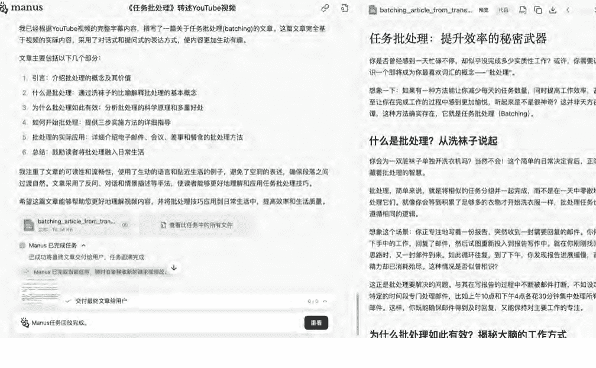

看到如此“厉害”，我愣了一愣：“我们这么辛辛苦苦的 AI 工作流、提示词编写、工具调试，难道这一之间不用用了？”

毕竟 Manus 已经能够帮我们规划步骤、调用插件，甚至连手接插件都完成了。

冷静后我做了更多调研：事情简直简单。

我后续有了更多发现：

1. 写作还是写作：比不上 GPT-4、Claude 3，Manus 模型还没那么好。
2. 如果我希望写有“人味”：比如用对话式、提问式、列表式的结构，还是得自己告诉它，它只会生成。
3. 某些任务，它做不了：比如打开带有验证的网站，或者某些“审美”上的判断，还是得人类完成。

也就是，AI 全智能也不是可能的。人类依然需要：明确目标、判断哪些 AI 可以做，哪些人类来验证最终结果。所以 AI 越智能，人类的价值反而越凸出来了。

## 二、AI时代，工作思维真的消失了吗？

在之前的“工作流”里曾经提到三大关键能力：

1. AI 工具选型能力
2. AI 提示词编写能力
3. AI 工作流设计能力


从刚才案例看到，以往在扣子、Dify 等平台上上手工作流、插入节点的能力，似乎已经被 Manus 取代了。它不仅自主拆解任务，还能自主调用插件、代码，甚至控制电脑获取信息。现在的 AI 已经能够主动理解意图了，甚至不需要告诉它每一步怎么做，就能完成。至于 AI 工具选型，Manus 这样的 Agent 几乎不用，门槛应该足够低。就像我们用百度搜索，以前需要专门学习如何使用百度，现在看起来是 AI 把这些干了。

但是 AI 变得智能并不意味着工作思维就会失效，反而现在要考虑的是：

1. AI 工具选型：结合自主代理（Manus）和最新模型（如 GPT-4.5、Claude 3.7）。比如现在的模型并非最先进，在写作能力上有所欠缺。如果能配上更强的模型，输出的内容将大幅提高。
2. 提示词依然关键：如何精准地定义任务、目标、约束条件、验收标准？就拿上面的案例来说，如果要把 YouTube 视频内容转换成一篇文章（如果需要对话式、提问式或反转式的表达方式，减少空洞表述、整体结构清晰、段落自然），那 AI 会按照这样的方式输出吗？不会，它只会按照默认的方式写，或者跟着“提示框”一样，有的时候使用对话式，有的时候提问式，有的时候反转式。我们的“输入”会影响 AI 的输出。
3. 工作设计更重要了：如何设计可靠的 AI 结果验证机制、如何优化人机协作的边界。在这个任务中，有些步骤 Manus 就无法独立完成，比方某些网站时涉及的人机验证，仍然需要人为干预。

我尝试从 DownSub 取 YouTube 视频，但是遇到了 Cloudflare 安全页面，这需要人工验证。我尝试使用其他工具：

- 使用工具获取 YouTube 字
- 正在使用其他工具获取 YouTube 字
  - 这里使用：https://extractsubtitle.com/
- 正在使用 ExtractSubtitle 工具获取 YouTube 字
  - 这里：https://www.youtube.com/watch?v=...
- 正在使用 ExtractSubtitle 工具

我注意到使用 ExtractSubtitle.com 时需要人工验证，我无法自动完成这一步。你有两个选择：1. 我可以完成人工验证，然后你继续处理剩下的字幕；2. 我可以使用 Python 脚本直接从 YouTube 获取字幕。你希望我如何处理？工作流中哪些步骤可以完全交给 AI，哪些步骤必须人工操作，哪些只能人工完成，这一个在 AI 越智能的情况下反而越重要。所以，看来“AI 自己干一切”，但真正用好的仍然那些有些工作流思维的人。

## 三、提示词会不会越来越重要？

接来说说我在李刚老师线下活动中的一些收获，他提到一个观点，我觉得特别受用：

> “只要输入会影响输出，提示词永远不会消失。”

你你知道什么时候要“多点”，什么时候要“少点”。这就涉及一个很好用的沟通模型：乔哈里视窗模型。

### 1、乔哈里视窗模型

乔哈里视窗把人与人之间的信息分为四块：

- 公开区：你知道，你也知道
- 隐藏区：我知道、你不知道
- 盲区：你知道、我不知道
- 未知区：我们都不知道

人与 AI 的鸿沟就是这样的。对“公开区”的内容，可以少说；对“隐藏区”，就要多说，甚至给出例子。例如，“像鲁迅近乎风格”这句话足以让 AI 理解更多深层信息，因为在 AI 的模型中，“鲁迅后”就能意指其特定的历史、写作技巧和思想判断。但是如果是“隐藏区”——比我要 AI 像一种只有我自己了解的风格，AI 并没有相关数据，我就要在提示词里多说例子，才能抓住我想要的特征。

### 2、提示词为什么要要有“多说”，有时要有“少说”

基于乔哈里视窗，我们就能理解：

- “少说”：公开区，AI 已经足够的常识和上下文，只需要提示即可，多了反而限制 AI 的发挥。
- “多说”：隐藏区或未知区，AI 并没有这些这些真实需求，必须提供足够的上下文或示例，这才是提示词进阶的精髓所在。

## 四、结合提示词思维的实践

回顾一遍乔哈里视窗：

- 公开区：提示词可以少说（AI 已经知道了）。
- 隐藏区和未知区：提示词要多说（AI 不清楚，需要细节）。
- 盲区：提示词学会提问（AI 懂更多）。

接下来我们将实际操作一下，以下是几个场景：

示例 1：提示词很少的情况（公开区）

当我们只是想要对视频内容常规总结时，示例提示词：请帮我把这个 YouTube 内容提取并整理成一篇文章。(img/e460ce57ca2230e75b1bc38052389e51_70_0.png)

不要写成这样（太大了）：请你打开 YouTube 网址：xxx，然后访问这个链接之后，将视频文字提取下来，接着逐步分析视频关键词，之后再对照视频内容组织文章，要求清晰，每个段落都要小标题，文字800字左右。为什么上面那个不好？因为 Manus 作为一个 AI Agent 本来就知道步骤：打开链接 → 提取字幕 → 分析内容 → 输出文章，它能更顺畅地完成。

示例 2：提示词多的情况（隐藏区、未知）

如果你对最终文章有独特的偏好或风格（隐藏区），例如：

1. 文章必须用提示式的口吻；
2. 每段文字不能超过200字；
3. 结尾必须用反转让读者印象深刻。

你需要类似这样（提示词多说）：把这个 YouTube 视频内容转成一段通俗易懂的文章，注意它篇文章，而不是一个纯 YouTube 字幕，你要考虑句子的优美、可读性、流畅性。用对话式、提示式或反转式的表达方式，减少空洞的处理，整体结构清晰，段落之间过渡自然。

> https://www.youtube.com/watch?v=Ubrjxo4fw...转成一段通俗易懂的文章，注意它篇文章，而不是一个纯 YouTube 字幕，你要考虑句子的优美、可读性、流畅性。用对话式、提示式或反转式的表达方式，减少空洞的列表，整体结构清晰，段落之间过渡自然。(img/e460ce57ca2230e75b1bc38052389e51_71_0.png)

我已经收到了你的请求，将你视频内容转成一段通俗易懂且优美的文章。我会先查看视频内容，然后根据你的要求进行调整，确保文章具有对话、提示式或反转式的表达方式，减少空洞的列表，并保持结构清晰，衔接自然，节奏顺滑。

- 已收到请求
- 知道你的 YouTube 视频链接
- 接收到链接
- 分析视频关键点和文章结构

这时就不能少说了。如果你只说一句“请帮我转成文章”，Manus 不可能知道你有这些特殊要求。

示例 3：提示词需要明确的情况（盲区）

比如你拿到一个专业的视频，自己完全不熟悉，但知道 Manus 应该擅长的（盲区），如何挖掘 AI 知识点。这时提示词可以设计成“AI导向”的模式：请你提取这个视频里的核心内容，告诉我我最重要的3个核心关注点是什么？它们分别对应了哪些具体的实例或举例？你觉得最适合什么结构，把这些内容清晰地整理成一篇高质量的科普文章。(img/e460ce57ca2230e75b1bc38052389e51_72_0.png)

```
https://www.youtube.com/watch?v=Ynbr_rgx4fv
请你提取这个视频里的内容，告诉我我3个核心关注点是什么？它们分别对应了哪些具体的实例或举例？你觉得最适合什么结构，把这些内容清晰地整理成一篇高质量的科普文章
```

## 五、不变的是思维

很多人认为，随着 AI 工具越来越强大，人类学习门槛会越来越低，财富差距增大。这是一个值得警醒的趋势。不是每个人都愿意学习，只有那些主动学习、深度思考、不断输出的人，才能借助 AI 真正加速。

AI 变得越来越聪明，底层工作思维永存。

作者：凤思学长
日期：2025-03-26

## (26赞)电商毫无底蕴，GPT出王

作者：希声
日期：2025-03-29

GPT-4o 最近更新了，在作图方面简直了……设计师失业？2025年3月16日：Gemini 逆天功能来了，你试过吗？让我用 PS 画图文案，结果 AI 忙着画就崩了。用改图时代来了！Gemini 2.0 逆天功能来了，用就能改，这么简单！

2025年3月17日：Gemini 2.0 逆天功能来了，用就能改，你敢信？首选上传两张图。第一张是人物手持物品，第二张是你像……下面我们来看看，这个模型有多牛了，能不能替代专业业务了。从0-1创建一个产品。再创建产品的蓝图、建模图等。生成一张电商实拍图，产品是一个水泥瓶形状的雕塑。(img/e460ce57ca2230e75b1bc38052389e51_74_0.png)


做得不错，再来其他角度的图片。给出这个物体从顶端来看照片和侧面的照片。（这里 AI 可能没有理解我说的顶部……不过严谨来说不算问题，是描述不清。）给出这个物体从顶部下来的照片和侧面的。(img/e460ce57ca2230e75b1bc38052389e51_75_0.png)

下面我们再来看一个拍摄的场景图。这个物体被放在桌子上，然后笔直从上到下拍一张照片。

> 这个物体被放在桌子上，然后笔直从上到下拍一张照片。


下面我们还需要一个设计草图。画一个塑性物体的草稿设计，设计图中包含不同角度的设计，设计图在桌子上中央写实风格，旁边有一支铅笔。两条这个小型物体的草稿设计，设计图中包含不同角度的设计，设计在桌子上中央，写实风格，旁边有一支笔。(img/e460ce57ca2230e75b1bc38052389e51_76_0.png)

现在还需要一个模型的展示图。让欧美模特站在水泥风格的房间里面，手里拿着这个雕塑，眼睛看向这个雕塑，模特穿着很时尚。同时这个女模特背着一个造型和这个雕塑非常相似的皮包。（斑是有点的，右侧的衣服不是自然，而且这个皮包只能勉强有一样的样式。）

> 让欧美模特站在水泥风格的房间里面，手里拿着这个雕塑，眼睛也看向这个雕塑，模特穿着很时尚。同时这个女模特背着一个造型和这个雕塑非常相似的皮包。(img/e460ce57ca2230e75b1bc38052389e51_76_1.png)

模特不够时尚？改！马上改！这个模特的头发改为白色的短发，其他都不变，画面左上角放一个非常简洁的发光的logo，造型和这个雕塑一样。


这个不错，既有 logo，也有模特，直接拿去做电商主图都可以了。

这个模特的头发改为白色的短发，其他颜色都不改，画面左上放一个简单的活发光logo，造型和这个调整一样。

Image created


什么?

老板模特黑色衣服不合时？

再改。

> Create image 图中女模特的衣服颜色改为白色的，其他的都不变。

Image created


做一个产品的说明书。

根据这个产品做一个说明书，主要讲解在家里可以怎么摆。

做得虽然有问题，但对于这一个抽象的造型，也不能不能要求太高了。

Create image Make a manual according to this product, mainly explaining how to place it at home

Image created


我们再来点其他好玩的。

假如你的小孩子画了一幅很有趣的画。


图片列表 ○ + 54% - 原始尺寸 扫描到手机 下载 按图搜索 反馈报告

我们就可以把它传到，生成一个 IP 形象。


Create image 根据这张图，创作一个毛绒形象

image created

然后，我们可以根据这个形象生成出一个毛绒玩具。


Create image 根据这个形象生成出一个毛绒玩具，这个毛绒玩具被放置在一个池池旁边，池水里面有波浪倒，特写。

Image created

再配合一个小小模特。一个温暖的家庭环境，小宝宝在玩这个毛绒玩具，小宝宝很开心，小宝宝头上戴着一朵红花


一个温暖的家庭环境，小宝宝在玩这个毛绒玩具，小宝宝很开心，小宝宝头上戴着一朵红花

Create image 一个温馨的家庭环境，小宝宝在玩这个毛绒玩具，小宝宝开心，小宝宝头上戴着一朵小红花。


我们再把这个形象做成乐高的样式。

Create image 做一个海报，海报上在宣传一个乐高的玩具，玩具的形象是这个毛绒玩具

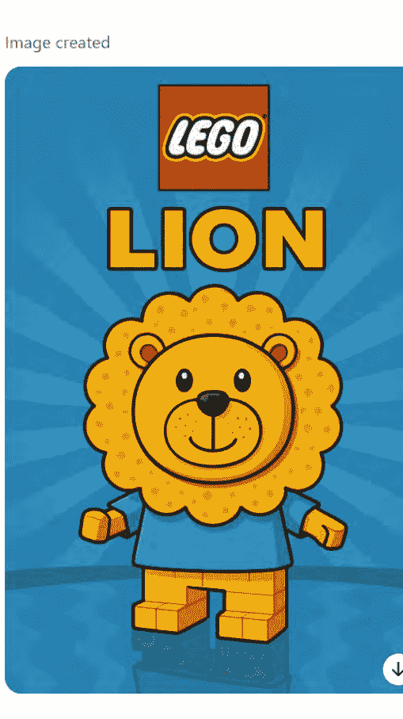

和我想要的不一样。

改一下。

这次对了。

Create image 你这个海报觉得不对，海报上的狮子形象应该是类似乐高的卡通形象。

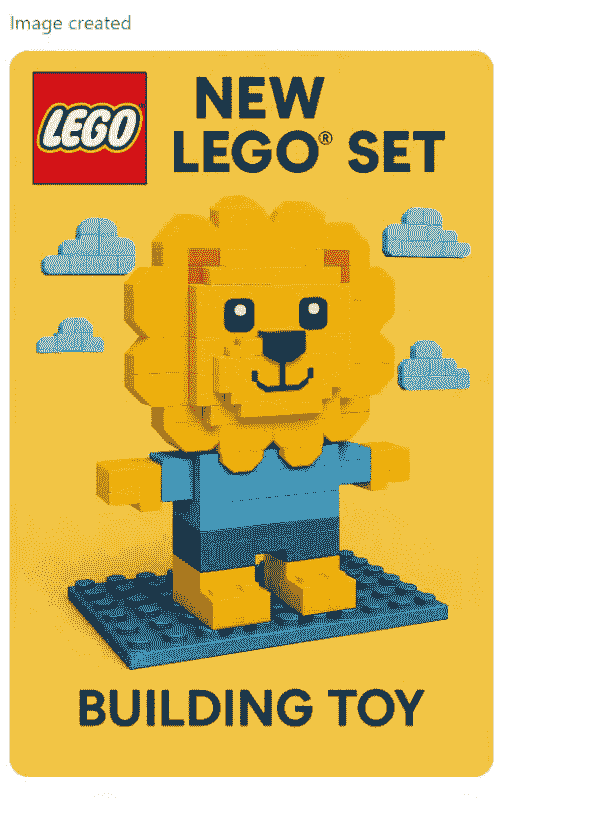

海报好了，可以出售了。带到商店里面去。

Create image 创建一个场景插画。根据你创作的这个乐高狮子形象，生成一个乐高的包装盒，这个盒子被放置在乐高商店的中央，旁边有三个孩子开心地看着这个盒子，而包装盒上就有三个乐高狮子。

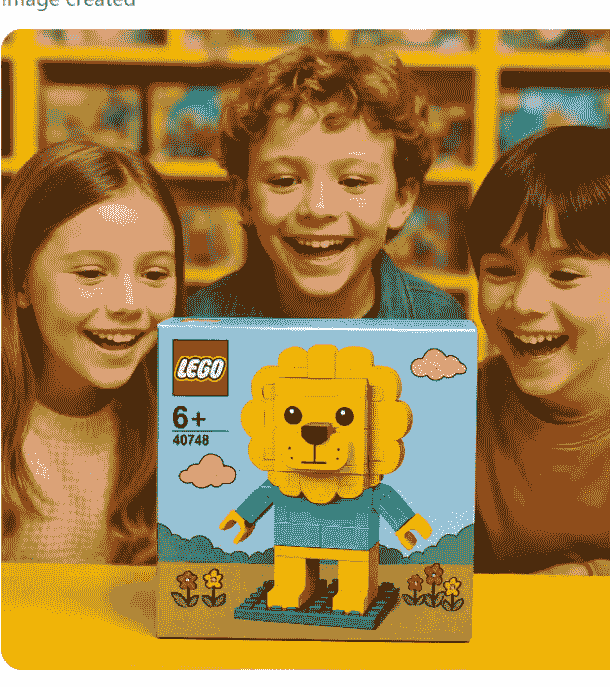

当然，你还可以根据这个形象，创作属于你的漫画。


Create image 根据这个形象，画一个奇怪的呆脸，镜子里内容是跳舞的狮子，狮子睁开了眼睛，眼睛透出一道光，眼睛了。

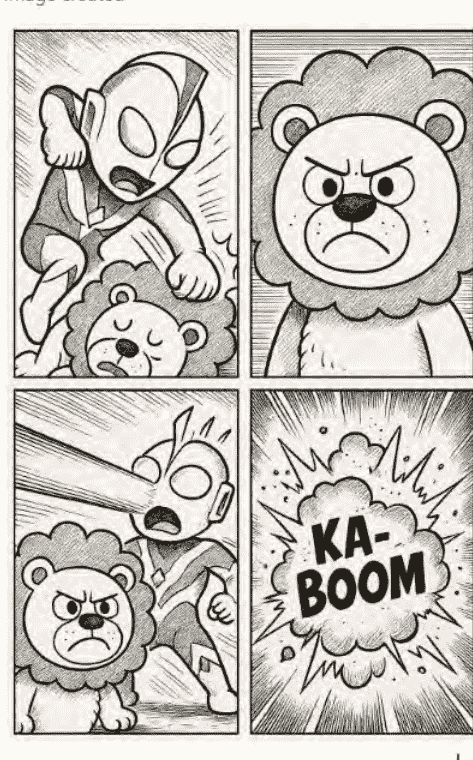

Create image 继续画动作，从宇宙来到了地球，来到了狮子旁边，给了狮子一个东西，开心看着。


自家的店铺换个logo。


finishing touches


还可以创作信息图。在小红书或者网站上都可以。

Create image 创建信息图，主要演示如果你在外面遇到狮子怎么做

Image created


## 怎么使用？

首先你需要一个付费的ChatGPT账号。然后选择4o，打开开关就可以了。

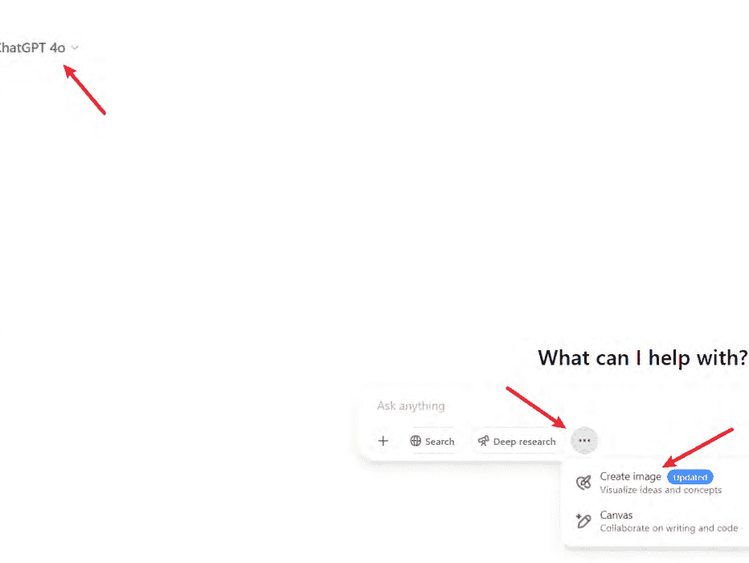

## 总结

- 1. 用英文效果更好。涉及到图片中的中文，中文效果不好，英文还是很糟糕。
- 2. 细节处理上有点瑕疵，效果已经难受了。
- 3. 美工暂时不会完全替代，但是用AI的工作效率大幅提高，一般的美工很容易失业了。
- 4. 对于传统的电商老板来说，有了福利。利用这个工具可以给图片更换背景，更换模特，每一张都是原创。
- 5. 不是电商做素材，做SEO。只要涉及到图片，在原有的流程中，都可以加入一个AI工具来帮助我们提高工作效率，提高图片的原创性。

如果对你有帮助希望点个反馈

我在生财的文章[跨境创业？新手上线前看的赚钱指南！]
[一个工具管理100个facebook、ins、tiktok媒体账号！指引浏览器全攻略]
[生财技能】如何分析产品/项目的海外市场量与机会
Etsy小众电商，新手还能入局吗？过来人告诉你

## (24赞) 治愈类视频AI怎么做

作者：才
日期：2025-03-25

治愈类视频用AI怎么做，做了个视频教程，小白可以尝试

https://q2wnncqyh.feishu.cn/file/Wtppb8BzdzoskQQq83M2czq4VVQb?from=copylink&reRDXZ=1

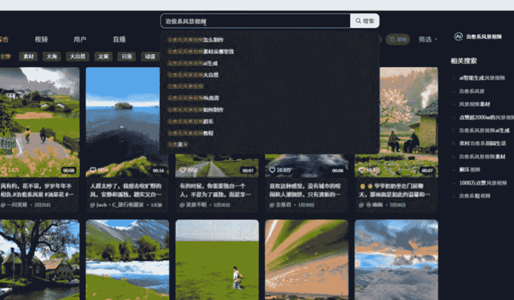

评论区：
怪传宇：学习了[强]

## (21) 视频转手绘类项目视频教程

作者：才
2023-05-25

前段时间看到风向列表里有视频转手绘的项目，我是为了这些做标题，研究了一种办法，于是我做了一个视频教程，比较小，粉丝级的可以看。

https://2qwn6qyh.feishu.cn/file/R6zeB4kJoY9fLmc7Xn8f?from=copylink&redXZ=1

测评：
赵：[这是我做的教程，哈哟] 看到后竟然有些触动，因为最后个人写了“去重”的点解决办法，我是用在苏仁的这个风向手绘评论里的，还被按了顶，当时就有点害怕，现在看到被朋友写了视频教程，视频有我的“荣荣”啦，哈哈

## (1) 用AI生成用户的小红书标题，点击率提高

作者：醇享
日期：2025-03-28

用AI生成用户的小红书标题，点击率提高，大家好，我是醇享。最近AI功能升级，也不用太急跟风，专注自己的业务，考虑一下。

## 一、人际关系与心理标题 (47个)

- 标题：如何让一个女生瞬间对你产生好感，让她忘记你
- 标题：如何通过细节让一个女生对你产生强烈认同
- 标题：如何通过聊天技巧让一个女生对你产生好奇心吸引力
- 标题：如何通过心理学技巧让一个女生对你产生深度好感
- 标题：如何通过眼神让一个女生对你产生心动的感觉
- 标题：如何通过话术让一个女生对你产生信任感，让她觉得是个靠谱男人
- 标题：如何通过情绪价值让一个女生对你产生强烈依赖感

## 二、恋爱与情感标题 (48个)

- 标题：如何通过一句话让原本对你冷淡的女生瞬间产生兴趣
- 标题：如何通过侧面让一个女生对你产生强烈心理安全感
- 标题：如何通过推拉技巧让一个女生对你产生强烈吸引力
- 标题：如何通过展示高价值让一个女生对你产生强烈崇拜感
- 标题：如何通过制造冲突让一个女生对你产生强烈保护欲
- 标题：如何通过建立共鸣让一个女生对你产生强烈归属感
- 标题：如何通过引导性让一个女生对你产生强烈被需要感
- 标题：如何通过制造稀缺感让一个女生对你产生强烈危机感
- 标题：如何通过神秘感让一个女生对你产生强烈占有欲

## 三、职场成长标题 (47个)

- 标题：如何通过复盘思维让你的职场能力实现质的飞跃
- 标题：如何通过目标拆解让职场目标触手可及
- 标题：如何通过情绪管理让职场压力游刃有余
- 标题：如何通过向上管理让你在职场获得青睐
- 标题：如何通过建立人脉让你在职场获得更多资源
- 标题：如何通过高效学习让你在职场竞争脱颖而出
- 标题：如何通过个人品牌让你在职场变得不可替代
- 标题：如何通过深度思考让职场看清本质

## 四、生活理财标题 (46个)

- 标题：如何通过极简生活让生活轻盈
- 标题：如何通过理财规划让财富实现指数增长
- 标题：如何通过投资让资产持续增值
- 标题：如何通过提升审美让生活得到质的飞跃
- 标题：如何通过健康管理让精力充足
- 标题：如何通过建立习惯让生活更有纪律

## 结语

以上就是小红书标题生成的全部内容，希望大家有所帮助！加油

## (5赞) 10分钟搞定小红书提示词

作者：Super黄
日期：2025-03-30

最近看到小红书很火，快速尝试并找到了具体的痛点。我找了一圈发现没有好的案例，这样出发可以让大家有更好的体验，欢迎移动飞书文档：

https://superhuang.feishu.cn/wiki/GpQAwqv9ikhvPWcx78InKv?from=from_copink&reRDXZ=1

评论区：
大仙：感谢分享[强]
李杨：感谢分享
小查：哈哈，生财里原来这么多大佬
小绪：感谢分享

## (16赞) 活用小红书提示词

作者：易学版
日期：2025-03-25

最近很多朋友在分享提示词，按照方法尝试一周后，前10篇开始好用。想到的办法就是细化关键词，苦恼了一周，研究了一遍，套用提示词得出的质量比原来的内容有所提升，希望这套AI提示方法能帮到大家。

https://unke5obo.feishu.cn/docx/LnRSdg7?HoWlrxKWrcD4CYNph?reRDXZ=1

评论区：
暂无评论

## (精华帖) 在AI热潮中把代写变成职业

作者：推拽
日期：2025-03-28

大家好，我是推拽，96年毕业，23年入局AI圈，两年时间对AI代写从0到10的经验。上周感谢朋友邀请做线下分享，分享内容如下：

- 创业起：23年1月开始AI代写项目，此前ChatGPT模式失败，后发现AI文字输出与代写商业闭环的可行。
- AI代写模式：利用AI文字输出能力，变现为顾客内容。小白可以选择手（用AI手册），直接对接客户。
- 流量获取：免费流量从小、平台单一，无成本但具有性；流量投入难在于价格波动和ROI，同类平台有足够的优势。
- 知识付费：帮助用户提升能力，通过商业闭环、解决流量、报价等问题，平均购买约20%。
- 知识与流量获费关系：相关，自流量稳定定后流量稳定，可等接订单培养学员。
- 孵化个人难点：从0到1放大流量投入、流量运营统计、后端团队搭建等问题。

详细内容：
- https://xxydubdt.feishu.cn/docx/UihEdMoJHjHMx7fqcOKGnP?from=from_copink&reRDZX=1

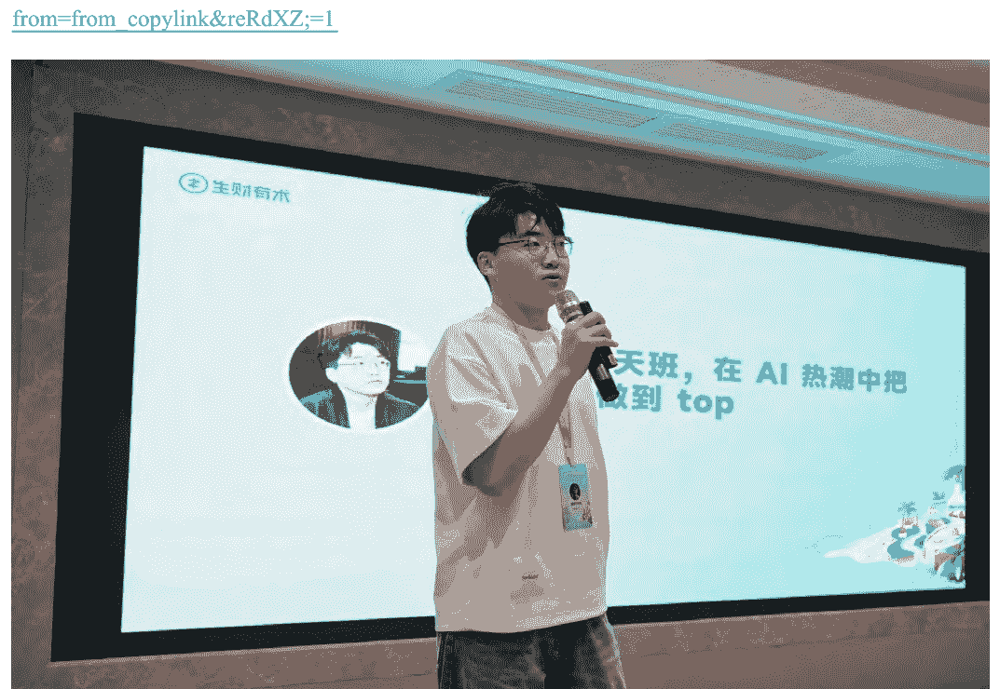

## 2025 生财富术海南见面会
“走，一起出来看看”

## 实体计划

参会编号：003


# (16赞)如何用DeepSeek+即梦制作“回答我”视频（国内版）

作者：Longer

日期：2025-03-26

如何用DeepSeek-即梦制作“回答我”视频（国内版）用DeepSeek生成文案，用即梦生成动作、生成音频、剪映修改字幕，搞定！具体请看文档：

## 项目拆解

[https://dmbrcpeljpiz.feishu.cn/docx/Z1zydPNEBoWrDrGxxsHczBAWnLg?from=from_copylink&reRdXZ=1]

评论区：

暂无评论

---

# (15赞)DeepSeek更新了数据库，和Claude3.5持平，AI一给搞定院设计短视频从内容定位到产品规划

作者：嘉嘉呦

日期：2025-03-28

主要是由于我@李清睡闺友圈的领域被我提词所激发的灵感（大模型用的是DeepSeekV3），今天尝试如何写一篇关于短视频IP怎么一条搞定

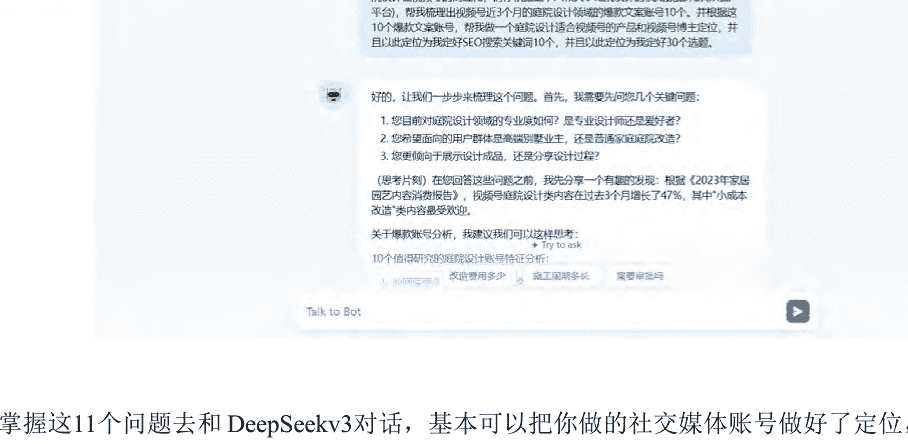

**一分钟后我提这个问题和DeepSeek的回复，基本上可以把你的社交媒体矩阵做好了，选选题、内容，产品呈现一条搞定，简直不可思议，真是震撼到我了**

我是DeepSeekV3生成内容，然后用另一个朋友钓鱼的脚本生成图片首页（https://aicard.de/y），这篇文章教你如何用AI做调研，以及从短视频定位到转化转化就那么简单，完全不用怎么做就行，一个闭环打通了。

我们希望你们通过这里的问题和思路，以院长设计为例。我们是以设计而不是设计。

## Q1: 院庭设计行业整合分析预测模型 --- 色角定位 == 作为资深市场分析师与策略专家，专注于结构化模型框架完成以下任务：

### 任务分析与定位1
- 院庭设计现状
- 目标用户画像（年龄/收入/消费心理维度）
- 构建院庭行业分析、定位、定价策略、渠道覆盖等8 维度
- 识别市场蓝海空间（需求小于30%的增长率）
- 2022年市场规模和增长率（增长优于前5的院庭的增长率和年增长速度2%）

### 需求深度维度
- 五类受众的特征（量化群体特征）
- 分析市场增长来源（技术/成本/认知驱动）
- 输出转化路径（产品+服务模式）

### 商业模式设计
- 设计方案及服务范围（包含订阅/利润/版权灵活）
- 业务线整合与交付解决方案（重点关注3个核心任务）
- 输出风险对策（政策/政策/质量三维度）

### 输出
1. 采用“用问题解决问题”结构化
2. 数据显示院庭市场规模预测（单位：亿元）预计年复合增长3%，核心趋势3-5个高潜力增长点（对标行业绩效评价体系）

### 对现代风格、中式风格设计、日式风格以及日式山水风三种风格的新型需求专项分析
- 对现代设计、新风格、市场渗透趋势、商业模式设计包括SaaS模式、订阅制创新服务

---

# 装修行业趋势分析报告(2022-2024)

市场趋势、用户行为及趋势预测

### 市场趋势
- 2022年：21.7%（住宅占比64%）
- 2023年：19.4%
- 2024年预测：23.0%

### 三级市场体系
- 低端市场（3-5万）
- 装修的以软装为主
- 个性化程度极低
- 中端市场（5-20万）
- 模块化装修趋势上升
- 高端市场（定制化）占比下降

| 区域 | 规模 | 增长率 | 占比 |
| --- | --- | --- | --- |
| 城市 | 38% | +22% | 6.8万 |
| 新建房 | 29% | +41% | 9.2万 |
| 旧房翻新 | 33% | +11.5% | 8.5万 |

### 高端需求分析

| 类型 | 单价 | 交付周期 | 状态 |
| --- | --- | --- | --- |
| 装修 | 50万+ | 3-6个月 | 定制化 |

### 市场空白
- 新房交付市场（占比15%）持续下降21%
- 个性化装修市场（占比15%）持续增长
- 旧房翻新市场持续增长17%

### 高端需求趋势分析
- 模块化装修趋势占比20%
- 极简风格受青睐占比55%
- 中高端客户偏好设计占比40%

## Q2: 根据最新市场数据，装修风格的流行趋势是

### 2024年装修风格趋势与市场分析

根据装修行业趋势报告和行业数据分析结论：

### 市场份额

| 区域 | 规模 | 增长率 | 占比 |
| --- | --- | --- | --- |
| 城市 | 38% | +22% | 6.8万 |
| 新建房 | 29% | +41% | 9.2万 |
| 旧房翻新 | 33% | +11.5% | 8.5万 |

### 平台热度
- 小红书：精致家居占比43%
- 抖音：装修风占比28%
- B站：装修风占比最高

### 风格影响因素

| 属性 | 占比 |
| --- | --- |
| 空间设计 | 35% |
| 设计 | 28% |
| 性能 | 25% |

### 内容创作建议
- 增加“避雷指南”
- 增加高价值内容
- 增加真实案例视频
- 装修（呈现化趋势）
- 装修（呈现化趋势）

## Q3: 作为社交媒体运营，结合平台特性，你如何针对院设计号达到高效转化的目标？

### 三级流量体系
- 基础流量（精准获客）
- 流量占比：12-15%
- 转化流量：种草
- 留存流量：沉淀

### 流量提升路径
- 基础投放
- 曝光：5%
- 策略优化
- 互动、高颜值，转化提升

### 转化运营
- 粉丝增长：小红书
- 粉丝转化：视频号（能力强）

### 私域运营
- 粉丝运营：利用私域
- 建立信任感：粉丝运营
- 留存率25-40%，用“直播+内容”组合实现。

## Q5: 请你结合抖音、小红书、视频号三大平台算法规则和用户行为，告诉我如何打造院设计装修内容的黄金公式和实战拆解：

### 院设计内容黄金公式与实战拆解

基于抖音和小红书和视频号的装修方法

### 爆款内容公式
- “痛点”+“大标题”+1个实用技巧
- 视频教程：原来可以这样装修（适合小红书）
- 收藏点：避雷！避坑指南（小红书）
- 认知升级：建立设计新视角（视频号）

| 平台 | 内容类型 | 黄金时长 | |
| --- | --- | --- | --- |
| 抖音 | 节奏快 | 15-30秒 | 高粉丝、活跃度 |
| 小红书 | 分享型 | | 高转化率 |

### 院设计专业版爆款清单
- 热门流量款
- 《24小时改造我家：粉丝避坑记录》
- 《如何让装修不翻车：真的后悔了》
- 《装修避坑指南：第一步看这里》

### 视频号流量款
- 流量留存
- 抖音：3秒完播率 > 45%，互动率 > 15%
- 小红书：转化率 > 8%，完播率 > 60%
- 流量转化

### 爆款内容六大内核
- 核心优势：封面吸睛+标题党
- 价值点：海式风装修怎么做？用这3个技巧省下3万

### 对比类
- Before-After对比对比视频
对转化效果提升了3.2倍

数据来源：2023年下半年行业报告 小红书视频号装修手拍装修设计教程

## Q6: 请你结合抖音、小红书、视频号三大平台算法规则和用户行为，告诉我如何打造院设计装修选题。

### 2024院设计热点关键词分析

### 需求类
- 绿色驱动 19%
- 小型化 12%
- 审美驱动 17%
- 情感诉向 15%

### 趋势类
- 新式科技：未来生活
- 智能科技：为生活减负
- 小精巧：自然、高效设计

### 技术痛点类
- 模块化设计：组装房屋系统
- 四色色彩：自然、温暖、明快色彩
- 环保可持续：高效的材料应用
- “健康”：设计的关注事项

### 平台特定关键词
- 热门：24小时快速设计、主打全能
- 小红书：红榜好物、高型装修
- 视频号：千万不要被、自然风家居

### 商业价值类关键词
- 流量转化率报备 小红书搜索词
- 流量留存流量转化率 装修设计趋势 装修设计趋势 小红书

# 设计进阶的7大技巧

### 平内设计
- 从色彩趋势到拓展，实用性：设计，再也不浪费！
### 平台化-- 从Pinterest、Instagram等趋势，进行本地化。适配材质（如水纹）
### 用户本地化
- 通过用户调研，发现真实痛点，定制化需求（例如：从“害怕出错”变为“想要功能”）
### 设计组合化
- 关注色彩趋势，增加元素+植物+方案，如上海老洋派
### 节假日设计
- 根据季节进行设计（例如春节、国潮），营造氛围。年中（月亮色彩）
### 人性触发
- 利用“大法则”来创造更具智能感，增强愉悦感
### 测试策略
- 通过对比测试（如大图vs小图），确保样本量在100个以上，提升率
### 灰度发布
- 在上线新功能时，根据用户反馈扩大范围

## Q7: 你结合数据，为某设计“内容化”实战指南，需要具体吗？

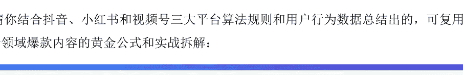

## Q8: 你擅长社交媒体故事的专家，基于一个真实的设计，可以怎样运营院设计的事？

### 旧院改造“好味道”黄金模板

## 改造要素
- 情感共鸣
- 视觉冲击
- 专业背书

## 6大改造案例类型
- 改造逻辑
- 文案类型
- 技术选型
- 深度拆解

## 5个改造拆解的细节
- 前期策略
- 行业深度解析
- 落地拆解

## Q9: 你是社交媒体文案爆款，请给出三个真实院改造案例，包含逻辑/数据结果

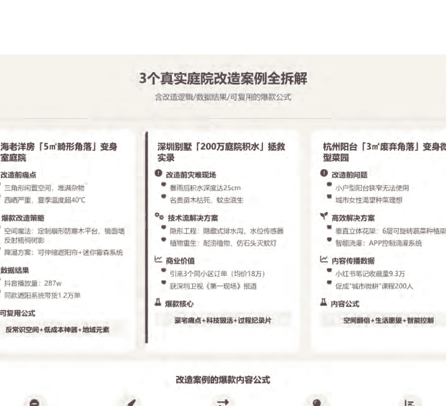

## Q10: 我现在要调研院设计的抖音和小红书运营，目标用户是25-60岁。请帮我列出三个关键方向：
1. 目标用户最关注的痛点是什么？
2. 行业增长最快的内容是什么？
3. 竞争对手的爆款内容有哪些？

### 院设计级策划脑图

### 用户画像
- 25-60岁人群

### 核心内容基础
- 老庭院装修、旧房改造

### 数据转化指标
- 标签：老庭院装修、旧房改造
- 痛点：老庭院改造怎么办
- 需求：老庭院预算5万
- 标题：70万老庭院只花了25万！老旧改造后小院子太值了
- 转化：500个留资获取报价
- 成本：单线索成本50元，转化5%
- 标签：小院子装修
- 痛点：小院子怎么装修才显
- 需求：小院子预算3万-5万
- 标题：实录：老旧院改造变新家
- 转化：300个私信咨询
- 成本：私信转化率10%
- 标签：25-35岁
- 痛点：36-50岁想要院子
- 需求：51-60岁养老院
- 标题：分享：老旧院改造日记
- 转化：200个粉丝互动
- 成本：粉丝互动率15%
- 标签：庭院装修
- 痛点：庭院装修如何避坑

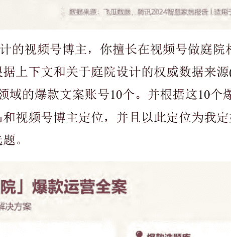

庭院，老庭院，旧房改造，小院装修，装修设计技巧

## Q11: 你是一个院设计视频号运营，你策划在庭院装修期间的爆款文章和院设计视频的运营，请你根据下文和庭院的流量数据（见附1），你来策划视频近3月的院设计主题的爆款标题，并给出10个爆款视频标题，带给我一个院设计符合视频号的爆款标题，并且为此我定30个关键词

# 视频号 |“新中式庭院”运营策略

### 选题策略
- 流量词：新中式庭院装修
- 痛点词：旧庭院怎么装修
- 需求词：新中式庭院设计案例

### 选题策略
- 科普类：分享10种装修技巧，高频刚需内容
- 共鸣类：解决用户装修庭院的痛点，引发情感共鸣
- 互动类：收集粉丝的装修困惑，增加账号权重

### 产品渗透策略
- 高单价产品：庭院设计方案
- 中单价产品：1999-5999元庭院设计
- 低单价产品：1099元庭院设计


## (10)零基础在二周突破升级，AI+的道与术

作者：微信
日期：2025-03-28

各位朋友早上好，我是坚持了八年的写作爱好者，也曾是“微信写作法”一年写出百100+w的狂热写作手，现在我已经在AI+书的路上了。

最近和很多小伙伴又有了，发现AI+书的问题逻辑是相似的，基本上每个问题的出发点与我们没有相同，都是“向AI+”。

以后不要问我该怎么办呢？从哪个角度去写作比较好？不用学提示词对AI可以吗？“没有经验的我直接写就行了。”

90%的读者都问我，都是趋向一个结果：“我们不是在学习如何做AI，而是在学习如何使用AI”。

然而有焦虑，越焦虑越容易忽略基本的问题，越是让你失去提问的能力，这实在是在重塑你多年积累的习惯——这正是AI+的。

行动的本质是去，在行动中找到真正属于自己的底层的能力。“为了让更多人爱写作，或是对AI+的理解是让AI写出属于作者，或者是被AI……”

微信会从理论回归到实战，从基础开始分享我AI+书的写作路径、方法，

“AI+到来，我们如何重塑自己的技能，以此进行【人机协作】合作，并此革新除旧，丢弃……”

全文2000字+，为了方便阅读学习写作体验，请移步下方：
https://9eqfqzvvhfeishu.com/dc2WffUool8gx11PclwanEd-
from-copylink.com/reeX=

> 【零基础二周突破升级，AI+写作的道与术】

### 一、AI+书写作的【道】
（一）写作是思考认知的“塑身”。
（二）写作是知识内化的终极手段。
（三）写作是发现底层链接的护城河。

### 二、AI+书写作的【术】
（一）AI是效率升级的三支架：
1. 认知维度。
2. 效率维度。
3. 知识维度/复盘。
（二）AI是三核心路径的钢杆：
1. 结构拆解。
2. 主题萃取。
3. 场景迁移。
(1) 场景内化：像玩游戏健身打卡一样养成习惯。
(2) 每日监控：像健身一样养成习惯。
(3) 科学统计：像私教制定健身一样统计。
（三）AI是赋能个人升级的加速器：
1. 学习自动化。
2. 创作自动化。
3. 思维升级。

### 三、AI+书写作的【法】。
### 四、AI+书写作的【界】。
### 五、AI+书人机结合的【合】与【术】
### 六、落地实处。


评论区：
- LN/林林/小林: 我知道的平台都不收AI写作的[捂脸]
- 微微：“人机结合”写作/写作，单单纯AI，也不纯粹捏捏哈。
- 赞 Proposal: 要润色
- 小花:至少有一个点吸引我了; 我们不是在学习怎样操纵AI，是在学习如何“精准表达需求”的元能力，先纠住，等晚上有整块时间再学习，感谢分享[玫瑰]
- 微微:谢谢阅读哈行动起来哈哈。

## (10课)用AI做糕点视频教程

作者：才
日期：2025-03-26

用AI做糕点，主要的途径就是变现广告，如果你有糕点的配料方，其实也可以实配方糕点的制作教程，AI做的目的是获取流量，我做了比较详细的教程，初学者可以看看
https://2qwnncqyi.feishu.cn/KD35BclQoTa34GUELclXwynmg
from=qcopylink&reRDXZ=1


评论区：
- 新手：我刚开了一家烘焙工作室，可以考虑
- 才：我发现AI可以做很多事情
- 新手：我要和她推一下
- 才：我本地这样增加流量
- 新手：嗯，我们现在是夫妻店，老公负责 
- 才：这种图片图片，是有效的
- 新手：但是就有各种食物图片，期间不断的新发的
- 才：想到的就是AI生成图片，就是各种食物图片，因为自己需要原材料
- 新手：我们现在是夫妻店，老公现在是夫妻店，老公负责烘焙，甜点为主，其他
- 新手：之前还没有线上引流的意识，另外精力有限
- 才：我觉得这个业务的天花板还可以提高一些。


## 关于AIGC生成版权相关的问题

作者：相梅
日期：2025-03-29

我注意到本期DeepSeek对关于版权相关的内容，我们整理了一些提示词，AI合规性相关，篇幅较大，可以移动
https://i3odicyer.feishu.com/wiki/Js40wWRNiSk55
from=copylink

评论区：
- 海伦：赞赞，给相梅点赞
- 刘同学：DeepSeek yyds

## 如何用ComfyUI工作流生成无缝图

作者：Lemon
日期：2025-03-27

最近参加了AI赋能电商的航海，在20号之前的工作流衔接中，我遇到了“批量制作无缝图”的难题。无缝贴图的核心是同一图不能直接拼接，接处的图案完美匹配，因此需要将原图分成四块，然后采样进行局部重绘。详细步骤成品文件，欢迎需要的朋友自取。
https://aa524ddu.feishu.com/doc/OneDr3bCMolcBAxfocaeng


评论区：
无评论

## 人人都是脚本时代来了！一键生成爆款短剧脚本工作流

作者：圣蜀君
日期：2025-03-28

2025年最大的风口就是AI短剧，我做了一套工作流可以自动生成热门短剧的脚本。先看看输出的脚本

```
脚本名：第十六课《重生》
场次：16-1
场景：防化实验室内部走廊
时间：夜晚
人物：林峰、赵明、陈晓、高磊、其他成员、敌人
速度：快速
（雷声、火光、爆炸声此起彼伏，林峰的指导下，利用地形形势与敌人剧烈战斗。）
【近】林峰冷冷的眼神，中出现一个害怕的敌人。
【中】赵峰捂着肚子，快速跑捷，对林峰道：“林峰！雨太大了，快不住了！”
林峰（透过眼镜，冰冷）：“别怕！救我！高磊，三秒后！”
【远】高磊（通过眼镜）：“收到！”
（高磊伸出手，痛苦声，陈晓像铁一样快速移动。）
【近】赵磊在一个爆炸的走廊中穿梭，眼神凌明，即将拿出一部微型卫星通讯。
【近】赵磊惊讶OS：“林峰，你以为你算什么？只要把中心队的位置发出去，外面的围墙就会崩塌挡住你！”
```

剧集名称、场景、场次、人物对白，他都帮你生成好了，你就说话害不害吧。直接上干货。
https://cn71svb3w.feishu.com/wiki/GXIwwa0Rid5vkBNHaMoAHnVb
from=copink

评论区：
无评论

## 分享三种AI编程上Deepseek-V3-0324模型的方法

作者：小查
日期：2025-03-27

Deepseek近日发布了V3-0324版本的模型，在编程方面的能力得到了大幅提升，可以对比Claude。这篇文章介绍几种在AI编程软件中使用DS V3-0324的方法，并初步测试了它的能力。

### 方法一：通过Trae最新版本直接使用

字节跳动的Trae作为一款在在国内发布的AI编程软件，功能、更新速度快，在V3-0324出来后几天就可以用这个模型作为基础模型，用户非常方便，操作也很简单。

### 操作步骤
1. 访问 Trae的官网 www.trae.com，下载最新版本（网址后缀cn）。
2. 安装软件，注册、登录。
3. 在编译页面看到已经有了DS-V3-0324作为内置模型，直接选择即可。


### 实例测试

做一个网页进行实例，我准备了提示词和对应的内容，希望AI能够帮我做一个古埃及的网页。提示词如下：

```
创建一个关于古埃及人物生平网页，包含以下部分：
1. 页面结构：响应式导航栏（深色模式切换）
2. 人物简介卡片（含基本信息）
3. 生平时间轴（展开）
4. 人物关系图（使用D3.js可视化）
5. 历史评价与贡献（含雷达图）
6. 著作与思想
7. 技术要求：
   - 使用TailwindCSS构建UI
   - 支持深色模式
   - 响应式设计（移动端适配）
8. 设计风格：
   - 使用衬线字体
   - 渐变色彩
   - 适当留白
   - 图表可视化
9. 确保页面具有良好的交互效果和视觉效果
```

具体内容如下：

### 一、早期的经历与Foundation
出身：吴起为人，军事才能卓越，性格刚，好行事（曾为患）。险经历：齐国袭周，蜀国用吴起为王，因吴起父为秦人而怨。吴起求变自证，率军大败齐军。传说：吴起遂至秦国被杀。

### 二、魏国时期（巅峰辉煌）
吴起建立魏国采李克，用吴起为宰，吴起率军连胜，取五城，奠定齐盛望。厉军时与士兵同甘苦，励士气（士兵母死后见到儿子战死的宿命）。

### 与魏晋的冲突
魏晋死后，魏侯召其，吴起直言：“国家安危不在国内”，暗试魏晋重地利稳政。

### 宰相身份之争
侯公赵：吴起自劝于高田，田晋以“改新政局”为由说吴起接受相位。

### 亡秦叛蜀
秦公联（魏国）设计蜀吴起，通过展示“蜀王后的变化”，由吴起赶灭魏的联络，此因吴起不忍，吴起被逃蜀。

### 三、三国战争与蜀韩
修订法律，撤简冗政，废除百姓律条。集中兵力，南征赵国，北击楚，西道南道，使魏国实力大提升。

### 与越韩的关系
改革优势的利益，激反应惨死吴起后，侯稳定为由说吴起接受高于蜀的公敌魏国军的支持者，其死后侯起被杀参与蜀的七十余韩士，吴起之死引发楚国政治改革。

### 四、重要人物关系
人物与吴的关系：魏晋韩，破权用吴起为宰，奠定其军事事地。魏晋死后与吴起见不合，最终将其赶往蜀。田田魏国君，以政治为由说吴起接受其相位高于自己。韩王，吴起为宰，其死后侯被杀死用于反杀政。康越魏国君，曾清除魏晋势力，蜀王马李克魏晋后推荐吴起。

### 五、补充评价要素
- 战略性：要求条款，用户吴起等行为体现其规模的成功；
- 历史性：曾创业企业化管理模式，改革理念深刻影响后世（如商鞅）；
- 忠性：才能与性格的双刃——军事与政治才能卓越，但缺乏智慧。

刚开始疯狂狂，过程中多次进行讨论和调整，主要是修改bug，先出来一个成功展示的。最终效果如下，美观上不够，但是严格按照提示要求做了动态的人物关系网络，雷达图也做好了。总体评价：可用，但美观上还需要调整，这也是AI编程容易被忽视的点。在过程中反复跟AI讨论，明确自己的想法。


## 方法二：VS Code+Cline+OpenRouter API实现

发布后OpenRouter提供了API服务，还是免费的。如果习惯用VS Code，可以通过插件接入API的方式，在AI编程时使用。

### 操作步骤
1. 访问VS Code官网code.visualstudio.com，下载软件并安装。
2. 在VS Code市场搜索“Cline”并安装。
3. 访问openrouter.ai并登录。首页就可以看到DeepSeek 0324（免费），点击Create API Key保存。
4. 回到VS Code，在Cline的设置中配置API Key，复制进去，选择模型deepseek/deepseek-chat-v324:free为了方便交流，可以要求模型“用中文回答”。

### 实例测试
Task: 我给你关于历史人物...
1. 当处于PLAN模式，需要选取信息并开始计划。用户要求我根据历史人物生平创建网页，但我未提供历史人物生平网页内容。需要获取以下关键信息：
- 具有该人物的图片/视频资源
- 是否有现成的JSON格式占位文件（包含颜色、字体等设计方案）
- 网页设计和技术方案已明确使用TailwindCSS+Preline UI+响应式设计
- 您是否有特别喜欢的配色（若无，我将采用专业的历史主题配色

请提供上述材料，我将为您生成详细计划。初稿效果一般，还需要进一步的调试。

## 人物生平可视化


人物画像


生平大事记


人物关系网


历史成就与影响

## 方法三：通过Trae的自定义模型用上V3-0324

不管是国内还是国际的Trae，都提供了自定义添加模型的功能。我们可以通过这种方式调用Deepseek的官方API来用上V3-0324。方法简单，在左下角选择“添加模型”。在弹出的框里选择服务商、模型和API密钥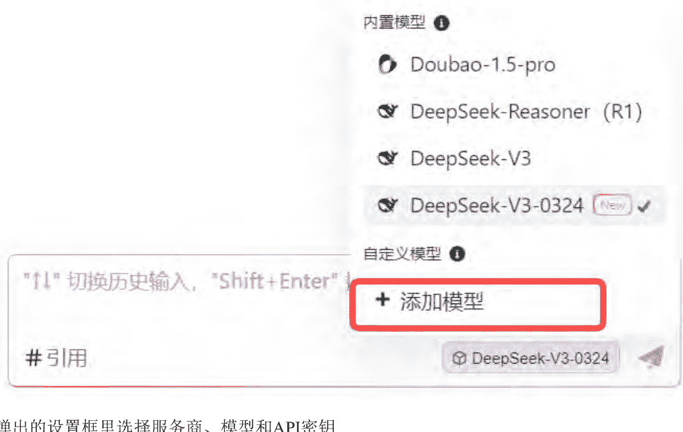

## Claude 3.7做出的效果展示

通过前面几个实例的尝试，发现V3-0324的模型相比自己之前的版本在编程方面有了显著进步，但真正想要用好它还需要用户本人在提示词和AI编程过程中的经验和技巧，并且要耐心调试。最后我们来看一下。


## 总结

最后快速总结一下三种方法的优缺点。

### 方法一：Trae CN 内置模型
- 优点：
  - 官方内置无需配置
  - 中文界面友好
  - 更新的稳定版本
- 缺点：
  - 仅限国内可用

### 方法二：VS Code + Cline + OpenRouter API
- 优点：
  - 完全免费使用
  - 开发环境深度集成
  - 支持多语言交互
- 缺点：
  - API密钥易丢失
  - 生成响应速度慢
  - 使用步骤繁

### 方法三：Trae 自定义模型
- 优点：
  - 国内外版本通用
  - 可配置其他模型使用
  - 实时调用最新API
- 缺点：
  - 需要自行配置API
  - 部分平台需额外### 共同特点

1. 均需耐心调试提示词
2. 生成质量依赖使用经验
3. 相比 Claude 3.7 仍有提升空间

文章看了，如果学会了，快去尝试亲自试一试吧。学习AI最重要的就是要“在干中学”。

我是小查，致力于让普通人看得懂、用得上的AI实践分享，希望对你有所帮助。

评论区：
芒果石榴：谢谢分享

## (5)AI数字发展阶段梳理

作者：黄明
日期：2025-03-27

今早4点起来开始梳理关于AI数字的发展阶段，结合数字技术的演进以及应用场景和市场趋势，让我自己非常兴奋，其中我还找到了很多案例，突然发现输出其实是最好的学习方式，让我对AI数字有了一个全新的认识。

之前对数字人的理解我自己还是很浅的，但是这样梳理后，对于数字人这个机会我充满信心。

相信各位也也有启发。

全文目录：
AI数字发展分为五个阶段

- 一、技术萌芽与初步探索阶段（1970s-2010s）
- 二、技术突破与动态交互阶段（2010s）
- 三、智能化与垂直应用阶段（2020-2023年）
- 四、超写实与元宇宙融合阶段（2023-2025年）
- 五、通用智能与全民普及阶段（2026年及未来）

以下正文
[AI数字发展阶段梳理 - 飞书文档]()

评论区：
戴巍：这个数字和语音机器人的发展有点类似。2017年语音TTS和ASR的能力提升，掀起了一波AI语音的创业公司，慢的底层的识别引擎都是用阿里云或者科大这种巨头统治了，在NLP语言理解上去做各种创新，技术越来越多，到2025年，市面上的4家还在圈，这个商业模式也是SaaS行业的一个索引。转化率是那个关键点。找到这个转化率非常高的小领域，建设一个成功的服务团队，让客户重度使用上产品，与它的生产经营结合起来，能够能力。

黄明：是的，目前的机会确实很窄，上市公司，大企业，还是互联网公司，线下客户……客户群不同决定你成功团队的构成模式，人员素质。当年我们做交付的时候，就选择了线下商家，大B是战略性不服务的。配套的推广模式就变成了招代理的模式了。

黄明：这个方向给了我思路

## (7)零基础 iOS 开发：如何用 AI 高效解决奇怪的开发问题

作者：小武试
日期：2025-03-03

航之旅已经走到最后，我的第一款 iOS 应用应该容易吧。作为一个新手小白，在开发过程中，我遇到了各种奇怪的问题，有些问题甚至让我怀疑人生。每这一次遇到、出错、解决问题的过程，都是成长的一部分。今天，我和大家一起复盘开发过程中遇到的坑，以及我是如何解决的，希望帮助到同样在 AI 开发面前迷茫的朋友。

在使用 AI (Cursor) 的时候，很多人会觉得 AI 不“聪明”，反而觉得困难。其实主要是因为我们自己没有清晰的需求，没有用有效的自然语言描述来引导。新手在手下往往没有能力，限制了 AI 的能力。而在 AI 这种情况下怎么办

Swift 或 Objective-C 来表达逻辑容易，但是用自然语言描述起来，反而觉得困难。很多时候，我们会会有一种“感觉”，觉得这个想法可能靠谱吧，我用自然语言描述了：“如果逻辑不通，AI 给出的代码可能会变得奇奇怪怪，导致运行错误、调试困难，甚至最后还是自己亲自写一遍。更靠谱的办法是，当遇到错误或崩溃时，我们往往无法用自然语言描述解决问题。新手在 Debug (调试) 时，经常会在代码里明明明白，可为什么跑不起来？”的困境，而 AI 在这种情况下往往往往没有能力，限制了调试的能力，更多为了开发者 Xcode、Console 日志、错误信息的理解，而不是简单的问 AI 该怎么办。

接下来，我会分享两个实际案例，讲讲我在开发过程中遇到的坑，以及我是如何一步步解决它们的，以及希望帮助大家少走弯路！

更多内容，移飞书：
https://calibrated.ishu.cn/DocR7Ildyhm1uK5mxFDt0DbXnc?from=from_copylink

评论区：
暂无评论

## (0赞)写给Deepseek：只需三个技巧，轻松进阶对话

作者：镊子
日期：2025-03-24

不知道还有新手小伙伴，像我一样，对DeepSeek 似非懂（简称DS），下游对它或许模糊，从我来说：草率对话如噩，借力AI做项目，快速自学了许多资料并结合自己的历程，总结三个容易被新手忽略的技巧。希望通过入门的小伙伴早日享受AI工具带来的助力！

### 技巧一：如何与AI沟通

- 第一象限：人类+AI知道；简单，比如“生成一段代码”。
- 第二象限：人类知道+AI不知道，就需要用户提供素材让AI分析，比如你是一个画家，创作一幅以XX为主题的漫画。
- 第三象限：不知道+AI知道，可以直接提问，比如“介绍基本原理”。
- 第四象限：人类+AI不知道，开启对话，如“未来发展”。

### AI对话四象限框架

#### 基础提问：背景+需求+约束
比如我要写一篇品牌的的公众号（背景），请帮我写10个受欢迎的爆款标题（需求），每个标题在20字以内（约束）。定义这三个要素，DS能够满足需求。

#### 进阶提问：多轮对话或使用结构化
结构化提示词的框架，比如 RTGO（Role-Task-Goal），或者 STAR（Context-Style-Tone-Audience-Response），这里不再赘述，大家自查。这是一个示例：

#### 高阶提问：形成自己的提示词模板
如何形成自己的提示词模板？分享一个技巧，先拿一个模板的问题让DS思考，总结并整合，就能形成属于自己的提示词模板。比如我想写一个关于职场规划，最近公司需要，你觉得我怎么提问才能获得结果？受众是职场新人，请给我提供详细的大纲。职场规划是一个长期过程，建议从3-12个月开始，可以包括以下方面：职业目标、优势分析、劣势分析、行动计划、避坑指南、反馈调整等。

### 技巧：如何应对复杂的AI

1. “我怎么减肥”改为“作为健身教练，BMI大于30的大基数人群推荐适合的运动方式。”
2. 也可以增加约束条件，避免偶然偏差或者AI幻觉。比如“任何情况下不得捏造事实”，“不要提供混乱，只提供核心结论”，“不要把你的建议单独列出，而是融入脚本中”。
3. 如果问过多，AI返回的信息清晰，可以帮助AI清晰上下文。比如根据我们之前讨论的【XX方案】，请进一步讨论【XX需求】或者“让我们重新梳理下之前的讨论。【已确认的信息：【1；待解决的问题：【3；下一步的重点】”。

### 3. 如何选择模型?

选择合适的模型让你更快实现目标，事半功倍。常见模型分为推理模型（DS-R1）和非推理模型（DS-V3）。后者具有更深度思考的能力，可能轻量级高效。

- R1像记忆慢得像大学生的，善于推理
- V3像直击直打的体育，什么都答，简单直接。

R1模型看起来更详尽，并不意味着开启R1，有些情况的表现更好。

| DS-V3 | R1 | 联网搜索 |
| :--- | :--- | :--- |
| 基础问题：抛出选题，擅长单任务，简单直接 | 联网状态可以作为搜索的参考信息，适合要求性较高的问题（例如实时新闻、政策策略） |
| 中文问题：需要拆解问题，用结构化提示词或多次对话分步引导AI回答，避免一开始就暴露复杂的难题 | 不要在提示中加入步骤，除非为约定，推理模型通常能够根据上文生成最佳答案 |
| 复杂问题：抛出选题，解决复杂问题并进行高质量的分析过程 | | |

下方分享一个框架图，直观感受业务需求/模型选择/提示词的关系。

## 任务需求与提示词

| 任务类型 | 要求 | 建议 |
| :--- | :--- | :--- |
| 简历证明 | 逻辑清晰，无任何歧义 | 建议使用表格形式，清晰直观；“三段式简历等提示词，参考1、2、3条简历范例；使用专业术语（如...）” |
| 简历改进 | 重点突出，列出亮点 | “我的简历如何突出？”、“根据我的经历（STAR法则）优化简历，不超过2000字” |
| 代写简历 | 逻辑清晰，具有说服力 | “如何写出一份简历、“根据我的经历润色一份简历” |
| 技能描述 | 表达准确，突出竞争力 | “如何描述技能？”、“让工作描述更具竞争力，万能金句” |
| 优劣分析 | 要素清晰，给出建议 | “如何进行SWOT分析、“根据我的情况进行SWOT分析，给出改进建议” |

评论区：
无评论

## 《小红书》-从副业小白到小红书爆单：两年之路探索与复盘

作者：林湘然
日期：2025-03-26

大家好，我是林湘然，一个十八线创业新手，也是本期的教练。过去半年在直播写了7篇文章，赢了6篇流量，顺便再用这篇稿挑战一下。小红书虚拟电商，只要你想做，就有流量。核心就2点，其他都不重要。

本文主要分享我加入副业两年的成长历程，希望大家有所帮助。为了方便阅读，请大家移动链接：https://miym8zzz.feishu.cn/doc/SdzarfyohWylBG5OcRdm0x?erdXZ

评论区：
海棠：没权限看了
阿牛：[强]不过像飞书没权限看了
林湘然：开哟
林湘然：开哟
你为你洒下月光：终于等到
常常：这个名字好，哈哈
浮生若梦：优秀！
英卡：去年氛围，优秀！

## 如何提高小红书虚拟电商的成功概率

作者：更梗
日期：2025-03-30

各位朋友大家好，我是更梗，十八线创业新手，也是大家的教练。过去半年在直播写了7篇文章，赢了6篇流量，顺便再用这篇稿挑战一下。小红书虚拟电商，只要你想做，就有流量。

1. 小红书电商现在没趋势
2. 避坑很少做这事
3. 核心就2点，其他都不重要
4. 深度思考可以清楚问题的本质
5. 以后总结

下面是书单链接：https://qgyvd4nbk.feishu.cn/BNCzCd8eJo6Wv3RKfecJanKh

评论区：
小花：教练就是教练，直接治好了我的内耗
青萧：教练执行力好强！
更梗：这都被发现了
文：谢谢教练
更梗：不客气
更梗：能你有帮助，我觉得很有意义
云清扬：教练的文章都是层层递进，我减少了多少内耗
笑笑：谢谢教练。🌹

## 小书学习资料：AI原创学习从0到1全流程

作者：申铭鸿
日期：2023-05-25

各位朋友们好，我是在娱乐圈练习七年的申某。今天来给大家分享一下，“小书”捞货资料升级版的材料的第三个实操案例。我利用AI做了一个近万字的原创学习资料，耗时近一个月，从选题到确定内容，再对剩下的排版设计，完全由AI来完成。我获得了许多指导和反馈。

这个跨越是0-1、1-1.5的跨越，这算是我在地球上做的一个小步。全文9000字，预计阅读时间25分钟左右，完全可以读完。

- 目录：
  一、前言：与粉丝的双奏
  二、我的认知升级
    1.0阶段：蛮办法搬运
    2.0阶段：深度连接和长期
    3.0阶段：AI从创建
  三、AI的5步方法
    Step 1：选题——用AI出金矿
    Step 2：框架——“AI+办法”也是好办法
    Step 3：内容填充——打造人混合模型
    Step 4：消耗AI——让专业不再出瓶颈
    Step 5：整合化和排版
  四、3.0阶段核心动作：从创造到创造1.5灵活框模式或许可能更好

https://tsqq.com/a3UNZ/TIU9djouPPldXQEn

评论区：
易捷：AI版：没看了
AIRPA版：学习
申铭鸿：[抱拳]

## 小红书单月销9万实操流程分享（原创笔记）

作者：银河
日期：2025-03-26

首先感谢坤哥和seven老师。因为要在小红书经营，我选择了做原创笔记。因为seven老师的方法确实有用，根据老师思路调整后竟然赚了9万。

- 情况：
  - 单月销9万
  - 纯笔记分享
  - 粉丝万
  - 每日发3条笔记
  - 图文占比60%
  - 视频占比40%

评论区：
Dubhe：都是一个人操作？这么厉害
涵：请问seven老师可以分享一下吗？
Ting：求老师

## 新人如何跨界做项目以亚马逊为例

作者：老贵牛
日期：2025-03-28

最近1年，聚焦亚马逊跨境，很久没露面。在航海群里提到“亚马逊第一个项目开始盈利，后面没有亏损的，成功率80%”。@黄小鱼给我分享一下，我就来了。其实也没这么神，是一个seven指导好，是自己运气不多，有运气，自己也有努力的地方。

## 一、师傅领进门。引路人很重要，也不重要。

### 引路人的重要
我的引路人、师傅、朋友，是@seven（龙榜第一大神）。我开了一家公司的名字，是两个字，一个是我名字其中一个和seven有关。这两个对我来说重要性很大。幸运在seven下面工作几个月，有seven的手把手教学，和小鱼等其他小伙伴一起逛，把跨境的基础流程通，也挑选了选品。第一个产品，seven认为不太会，就开始做。第一个产品就开始盈利，无论是资金、信心方面，都为后续打下巨大的基础。

### 引路人也不重要
大家听了，第一时间就会想，快快找到seven，逆转命运。但如果你认为你有seven，就可以盈利，那就错了。

来了解一下，seven的人少，失败的不少，几十万成功的都是多数，第一个钻石算少。

“师傅领进门，修行在个人”。高人的点破都是一句话，不要想着保姆喂饭。

修行在个人。修行在个人。文章中我会讲，在修行时的经历和思考（本文重点）。

### 反思思考
怎么能“人指点”？首先，要感恩。人都喜欢把功归于自己，把失败归咎于别人。

1. 引人指点一句话，自己已经努力，成功了。“他就说你一句的，我的成功都是自己的，关他人。”
2. “引路人”指点一句话，自己已经迈向方向，但方法错了，最后失败了，就再失败归于“引路人”。
3. “以后”，如果成功就是引路人，成功就给你提建议？

高人的点破都是一句话，不要想着保姆喂饭。

怎么判断自己是否是“引路人”，大家来一个检查工具；

反思思考：如果当时情况不同，结果怎样。


## 二、 什么是“不可行”

刚强说了“师傅领进门，现在说：行在内”，我具体做了什么。

我认为任何领域一样，要学会成功，首先要避免失败。

因为的方法各异，且通常可行的未必会公开，所以首先是要找到怎么失败的，然后去避免。

## 失败一：成本太大

机会到处都是，唯一的条件是：你还活着。

电商项目和网项目不同，就是需要实体资金投入。是劣，也是优势，可以排除没有资金人的。

不要老板还没开始跑，就找场地、招人。每个月固定成本1万？能活多久?

赚美金万一份，钱是很很容易的，但是，极假的。广告的一个点买1美金（万），每天万，就不赚很快住了。

很多钱流出现问题，供应链就会断链，无法留下。

我是我的成本不高，在家里打工，书房当仓库（每周一下发货），从0-1时期不找人，除了节省资金，还能控制每个环节。

不要拉长战。

从0-1阶段，我不会扩充市场，无论精力和资金，都不允许。

首先聚焦的产品如何不断创新、研究平台、研究市场、研究细分领域的。技术成熟后，有一队团队可以解决压力的时候再再去。因为每个市场的调性和客户的习惯不一样。你重研发，又会分散精力。

## 失败二：做大市场、做爆款

大部分人喜欢做爆款，认为这市场容量大不大。其实不是个人/企业的选择。

刚开始应该做企业/大不是不是越大，越难做的事。空间越小越好。

靠小钱，赚经验。小胜为大胜，越过越会。

开始做爆款的风险是，哪个产品开始有流量，流量大时，可能流量突然没了（或者被违规者被对手看着），挤大流量资金后就不得退出市场。我的经验，这种情况很多。

## 解决方法：

找的打战。

战术是解决怎么做的问题，决策要解决做什么、跟谁、在在哪里、何时做这些关键的问题。

当你在规模上打过对手，决策比打过对手的要重要，要在需要投入大量数据的市场领域做较量。

比较好的办法是：选择获胜的细分市场，找到对手的（产品、运营都差的），从而发发挥优势（供应链），从不做做，先寻找对手市场。

（创新）

## 侧面进攻，逐步扩大优势

作为挑战者，不要对对方在主要的市场上正面进攻，至少一开始不要。你可以从对方防护不严的边缘性地方围入。

先占据那些具有战略价值的地方，先立于不之地，然后以此为根据，依托这些边缘，寻找对手在阵中发散。一得一寸，一失是一尺。

举例：蓝牙耳机是很大的市场，排名第一的简直可怕了，如果你直接打这个市场（正面进攻），必败无险。

这可以开发一类“儿童蓝牙耳机”，再开发一类运动耳机”、“女性运动耳机”，然后围细分市场“耳机”名，然后成就优势了。

## 失败三：击战，胜有下策。

很多人看到有，而且利润可见。就会直接拿相同的产品，然后就打价格战。

夺友、攻友、攻守、攻城，就是竞争的四个维度。最后是进攻对方防御坚固的城池。大类的爆款产品，广告，再也低利润，杀自己100，自损800，打不赢不一定，先你是肯定的。

解决办法：

有三我是做到：
① 产品创新，功能做出来的必须对比对手优势。
② 研究客户需求，找到客户的需求。
③ 研究竞争格局，只选弱的对手。

价格战我是决不打的，有其他办法，卖得比对手好。

## 失败：自己不下场，想招引入解决

很多案例是，很多国内的老板，想通过组建团队进来海外。

例如花100万招人，找产品开发，找运营。这种失败的概率也是高的。

凡人想象。

根据我自己下场的经验，选品和运营是不分的。

我很多额外的数据是从广告投放获得的，开始试了流量，一开始没有流量，以前是不行的。但经过不断测试手段，产品又行了。很多困惑，甚至从头就开始愁。所以我认为，在0阶段，自己最好留好，然后逐步搭建SOP，外包。

## 失败：关注利润，不关注现金

很多经理并不是通过提高能力来收益，而是通过提高风险来收益——**利润不等于现金**。

一个误区：只要产品有利，生意就能做下去。

很多钱流出现问题，供应链就会断链，无法留下。

很多很“成功”，如果货卖出去或者周转慢，库存就不健康。

假设你一件50元，卖250元。高利率，感觉大好。但在亚马逊这个生态里，这种方法你需要先付大资金，如果货卖出去或者周转慢，就被断裂。

生意增长很好，但快速增长是考验。意味着你要准备不止的。

很多很“成功”，死在周转上。

## 三、什么是“可行的”

### 关注流量

很多人自媒体体积累知识，而不是流量。在开头就搞错了，因为他们没有研究平台，用国内的。

其实本质从“单品”开始，这里是完美的，但是每个人都有自己的调性。

比如很多博主，会提到“单品运营”，然后就是怎么开店（避免亏损）。

亚马逊又是数据，很多卖家版比较多，高价很难卖。

### 1、多算胜，少算败

在开始做之前，步步为营，边学边干。首先是方向。

研究平台的调性、研究创业、研究创新。这对我战略帮助是极大的。

研究平台看的一些，把握量，对教训对我帮助极大。

### 2、在自己身上找到信息差

打仗是个慢慢积累的过程，所有经验和教训都不能浪费，对对手进行了复盘、从地形分析、火力配备等十个方面。

#### 一、行动与反思获得知识和一手信息

战略知识可以从外面学到，信息差在外面也能听到。但由于自己行动，是产生大量知识和一手信息的。而一手信息就是信息差。

例如我从行业报告，发到很多地方没有。这对开发产品和创新是巨大的辅助。

反思不单是复盘（做做什么，做错什么），应该是全面的。包括为什么这样做（背后的信念），是什么导致；情形、性格、时机等等，越越好。在创业上，有一个反思表格，可以参考：

#### 二、利用优势组合创新

通常遇到问题，我们会寻找外部需求，想要的是去复制行业或竞争对手的商业运作模式。

但一种更低且可行的，“围绕自己的优势组合”是非常重要的。出来的创新，是对对手难以复制的。

举例：我出一款产品（例如女性运动耳机），我就开发周边产品（女性运动裤子）。这要比出一新的“女性运动裤子”的人有优势。

例如，我擅长写作、投资，我会开发更多涉及写作、涉及投资的产品。

例如我靠思维，而是刻出出海的人，我就会向亚马逊前端。这些都是别人复制不来的。

## 打造产品开发系统，而不是单个爆品

从单品爆款到构建产品开发系统，也就是一次性成功vs持续性系统。

从“做什么产品”到“如何找到好产品”的思维转变，因为产品开发不是孤立事件，而是一个可设计的系统。

所以每每一个产品，都要极致复盘，这是打造系统的燃料。都是逐步优化自己开发系统。

## 后话

另外题外，AI对我的帮助极大。

亨利·福特有名言，是在产品开发之前，如果你问人们需要什么？答案可能是一匹更快的马。

我们不要提出“AI时代，如何让马跑更快”。

很多人还在关注化，但其实他们几个月后就是一句话的事。AI给我的作用是，能批量阅读，利用优质信息直接快速关。

## 9、云链+社区：还是值得投资的生意？（深度分析）

作者：楚涓
日期：2025-03-26

财源的小伙伴，我想做实体生意的可以看几。最近几年，中国连锁业最热门的话题就有“云链、时尚”、小黄家、功夫、车库等品牌在语境中逐渐成为核心的盘子。有了流量后，“社区”的声音开始响起来，将流量网络化，搭建天人一。

社区也是楚涓的梦想，22年我公司走到社区不到小时，我就用最后的资金开启10个小区试点，利用口碑引导、线下店和自然获客，把生意经营起来。从后来发现，供应链引导就没有选择方向。回头看看这个生意，我也在思考云链——“社区”是不是答案？等到结果呢，各种社区模型都没等到好结果，目前只有私域直播品牌在活跃小区试点，公域流量是到位了。下面接着深度分析这个模型：

如果平台通过“品牌化云链+社区小区”的环生态，让社区引流还是困难，确实可以逐步降低对线上流量的依赖，并通过分化、本地化的运营模式解决系统性问题。这种模式的核心在于将流量、服务、信任的入口从社区平台分散到社区节点，从而增强风险能力和粘性。从底层逻辑、遵循规律和未来三个维度分析：

### Part 什么是社区小区-云链？

你可以理解为：多家独立小区通过一个社区平台共享资源。对商家而言：保留门店自主，能够享受流量的供给、管理系统、品牌支持。过去需要按节奏找，现在平台一采购，成本降低20%。对流量而言：分散的社区的需求，规模化降低风险，同时规避资产风险。典型案例：京东快递点快速快递店，当当了京东家，成为社区流量入口，主要覆盖清洗、洗衣业务；同时京东小店也做了便利店，双重覆盖社区流量。

### Part2 闭环生态的底层逻辑：从“流量断层”到“信任网络”

#### 第一，流量的本地化

### 社区流量替代社区流量

流量依赖平台分发算法，而云连锁模式下，每个社区小店通过社区社群、触点接入（如快递、社区活动）成为流量入口，形成“去中心化流量池”。例如，社区直播或店铺基于里信任直接接触用户，降低成本。用户粘性：高的社区服务（如生鲜、家政）天然具备优势，远高于线上购物。

#### 第二，信任的重建

### 品牌一致性与服务本地化

平台通过统一形象（如视觉标识）建立基础信任，在社区中通过邻里互动增强信誉。

### 透明化与可溯性

平台通过数字化工具（如区块存证、服务过程镜像）实现服务透明，用户可以通过平台直接溯源问题，避免平台风的危机。

### Part3 流量风险的核心机制

#### 第一，对冲策略风险

合规分散化：政策监管趋势将“大而不能”的垄断平台，而云连锁模式下，平台仅提供技术和供应链支持，小店作为独立经营主体政策压力。例如，某区域政策限制社区团，平台可快速调整区域策略，避免全局性风险。

#### 第二，粘策略导向

国家政策一转型新民生生活，鼓励小店升级为综合性服务点，云连锁模式可以通过政府合作（如入存、业务行动）获取政策红利。

## 12做TikTok盈利最重要的还是调研

作者：王润博日期：2025-03-29

去年10月来到东南亚TikTok，我一直认为出海是时代的契机。东南亚TikTok也处于爆发期！我用了3个月从月入到突破，冲到万单！最为关键的是底层调研，并且规模规划适合新手。套用大部分，遵循本土化打法：先越南本土调研，拆解其流量渠道及盈利情况，最后总结他们的模式、打法、利润，接下来就是对接供应链快速执行！我把整个3个月的破单给大家分享放在下方链接里：

https://xbip3he4xj.feishu.cn/wiki/LQ1JwUESi4kKDF9cge4nk?from=copylink&re=1

## YouTube算法解析

作者：书情跟日期：2025-03-28

这篇文章是对文章。很多人正在学习算法的知识，为什么在YouTube上号不是一个必选题？

https://articles.zssq.com/id_gbw89vn.html

更好的阅读体验见飞书文档 YouTube算法解析

https://rwxa0zg6.feishu.com/docx/KEKzOzAco3rVvcI2eQGCnXXd

目录如下：YouTube的目标：
1. 预测观众想看什么
2. 最大提高观众的长期参与度和满意度

如何做到这一点？
1. 收集和使用数据
2. 一组算法YouTube每天从用户行为中收集80亿个数据点
1. 用户每天看哪些视频
2. 他们跳过哪些视频
3. 他们看了多久
4. 喜欢或不喜欢
5. 不引起“反馈”
6. 观看视频后的调查
7. 重新观看/继续观看/稍后观看

收集原始数据：
1. 封面/缩略图：cloud vision识别/安全评分，可以单独使用
2. 视频抽帧自动/手工（可能不是人类），匹配视频中的信息
3. 字幕：自动字幕同步
4. 语言：不一定字幕同步
5. 标题/说明：很多人重视视视频

人工使用多个系统/算法：
1. 洞觉功能：首页(个性化推荐(新的和旧的))和订阅
2. 推荐视频：“接下来播放”，同类或相关
3. 趋势视频：区域/社群当下关心的热点
4. 通知：打开小特辑
5. 搜索：依赖数据，观众反馈和新鲜度


## 轻资产与运营服务

> 平台通过赋能（SaaS系统、供应链）而非直接控资产，避免轻资产模式下的资金链风险。例如，美团向接入线下小店提供时零售，自身无需承担库存。

## 第三，信任危机的防火机制

### 快速响应与责任制

某小店出现服务质量问题（如木维修事故），平台可以通过冻结账号、更换服务商、启动保险赔付等方式避免信任危机反复。

用户参与的共生生态：引入用户评价、社区监督等机制，风险在本地场景中被更早发现和解决。

## Part4 未来可能：从“平台帝国”到“社区联邦”

### 第一，流量运营的重构

- 从流量买流量到“服务换流量”
- 社区小店通过代购物、家政服务等高端场景自然获客，不再通过广告投放。例如，钱陆大妈通过“定时”打折扣吸引社区居民，同步引流至线上商城。
- 私域流量的精准化：基于社区关系的流量转化率极高（如社区群推荐养宝宝产品），且复购率远超公流量。

如果在社区侧是依赖，而非一开始就开始坚持线上运营，那种模型却是留存周期高于简单的云连锁。这一点，美团团队曾有过探讨：类社区区的模型，必须是有自然流量获取、维护可行性的领先，才能做优，提粘对平台侧的风险。这套套路，确定是重构O2O的流量运营。

### 第二，商业模式的演化路径

- 社区服务综合体：小店逐步向多元化，如健康检测、社区养老、社区代办等，成为居民离不开的“生活管家”，进一步沉淀流量。
- 数据驱动的动态网络：平台通过分析各社区消费，动态调整供应链资源（如老年社区医疗用品、年轻社区侧），实现资源最优配置。
- 用私域的逻辑运营社区小店：通过平台培训，让每一个社区小小的老板学会私域的运营逻辑，长周期用户价值。这是装修买手、健康生活服务已经完成，且证明了。

### 第三，风险管理的终极形态

### 分布式阵营+中台中心化

> 平台保留核心能力（算法数据、供应链），但将执行下沉到社区，形成“强中台+敏捷前台”的弹性结构。即使部分节点失效，系统仍可通过其他节点补位。

## 挑战与边界

### 第一，不可忽视的潜在风险

- 本地运营风险：依赖店主能力可能导致服务质量参差不齐，需通过标准化培训和技术监控（AI运营）约束。
- 技术投入与收益平衡：数字化工具（如智能选品系统、区块链等）需要长期投入，小店可能因压力导致瓶颈，所以一就开始做筛选和预期管理。

### 第二，模式有效性的边界

- 适用限制：重服务、非商品（如维修、更改）更适合云连锁模式，而商品零售仍需依赖规模效应。
- 城乡差异：一线城市社区密度、数字化接受度，模式容易落地；下沉市场需更多线下任务构建。

> “品牌化连锁+小社区”的闭环模式，本质上是通过“技术-供应链-流量”赋能本地化信任网络，重构商业世界的“中心-边缘”关系。

若能突破这些限制，平台将不再是“流量君主”，而是进化为“社区联邦”——即使外部动乱（舆情、行情），仍能通过分散式的协同生存，并得以进化。

这件事很难，但值得做。

我是建国，一线实战派，只讲实话的生意人，做实业行业的长期守护者。

评论区：
战线：感觉社区连锁起来，线上连锁的价值没太大了，真的不如做店社群私域直播来扩张sku，打法简单高效。
楚川：云连锁就是解决冷启动，保持触达，加速用户习惯养成。

## 【闲鱼】1 篇

### (15费)闲鱼（超级擦亮）功能解析：曝光+成交，如何避免被割韭菜?

作者: 方电商
日期: 2025-03-24

闲鱼年底推出了“超级擦亮”功能，新的这个功能就是把大家给搞愁了！

但是一场直观之后，从看到别方认真认真听了什么都，好像是什么什么都。不知道大家有没有过这种感觉。

有朋友的超级擦亮单量有增长，有朋友就能往上蹭流量挣拿，有朋友的朋友单量只是寥寥无几。

绝大多数用超级擦亮效果不明显，自己的钱花出去，但是并没有等到钱。

> 搞得像是被官方方割韭菜了一样。

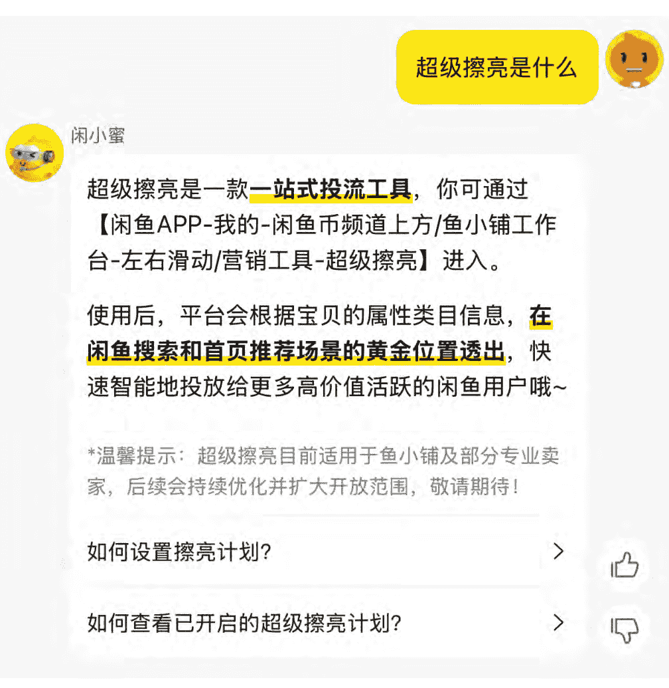

超级擦亮是一款一站式投流工具，你可以通过【闲鱼APP-】闲鱼频道上方/鱼鱼工作台-左右滑动/营销工具-【超级擦亮】进入。

使用后，平台根据宝贝的属性类目在闲鱼搜索和首页推荐场景的黄金位置析出，智能带来更多高价值活跃闲鱼用户~

*提示：超级擦亮目前适用于鱼小铺及部分专业领域，后续将持续优化并扩大开放范围，请敬期待!

如何设置擦亮计划?
如何查看已开启的超级擦亮计划?

其实不是，但是官方对于这个超级擦亮的解释，真的是简单的，没有详细介绍。也没有去讲超级擦亮到底怎么样会有效果。

我来简单介绍一下：

就是你可以在鱼塘上掏钱买曝光。

**

你埋钱之后，你的商品容易在首页和搜索中被别人刷掉，相当于给别人加了加持，相当于被别人刷了你就增加曝光了。

比方说你买 1000 个曝光，那么 1000 个人刷掉之后，你这个加持就结束了，回归原始的水水平。

注意点：只负责你达到你承诺的曝光数量，不是你曝光了超级亮一定能出单，只要曝光了你买的曝光就可以了。

哪怕你花了一万块钱，你买到的也是曝光数量。

那么怎样能够出单呢？？

那么我们明白曝光是什么？

## 曝光 = 机会

**

不是你可以，这样理解的，你必须要这样理解的！

曝光是你的链接被卖家在“首页”和“搜索”刷掉。

刷到之后会有两个结果：

- 1. 被买家刷到 → 点击浏览 → 咨询 → 成交
- 2. 被买家刷到 → 直接走 → 点击 → 买

大部分好的都是第二种。出单的步骤应该是：链接被刷掉 → 点击 → 咨询 → 成交别人看见你之后就直接划了，你哪门能成交？

用抖音举例子：比方说我是老李，我拍了抖音。我花了 1000 个曝光，那么 1000 个人刷掉之后，你这个加持就结束了，回归原始的水水平。哪怕你花了一万块钱，你买到的也是曝光数量。注意点：只负责你达到你承诺的曝光数量，不是曝光了超级亮一定能出单，只要曝光了你买的曝光就可以了。

那么怎样能够出单呢？？那么我们明白曝光是什么？

- 1. 推广是机会，拿到曝光，让人刷到
- 他看完就咨询
- 他看完就想买
- 他买了还能给你
- 下次还想买

这就是流量到成交的整个环节。做好电商只有六句，小白电商就能玩到头。别小看六句，这里面如果想做好，都能出来两万费。只能说我买是不她们的事。我花了钱让她们看不，在鱼塘里让别人刷到，然后到底是：

- 1. 推广是机会，拿到曝光，让人刷到
- 2. 他看完就咨询
- 3. 他看完就想买
- 4. 他买了还能给你
- 5. 下次还想买

这就是流量到成交的整个环节。做好电商只有六句，小白电商就能玩到头。别小看六句，这里面如果想做好，都能出来两万费。只能说我买是不她们的事。我花了钱让她们看不，在鱼塘里让别人刷到，然后到底是：

- 1. 推广是机会，拿到曝光，让人刷到...等等：

- 1. 推广是机会，拿到曝光，让人刷到
- 2. 他看完就咨询
- 3. 他看完就想买
- 4. 他买了还能给你
- 5. 下次还想买

这就是流量到成交的整个环节。做好电商只有六句，小白电商就能玩到头。别小看六句，这里面如果想做好，都能出来两万费。只能说我买是不她们的事。我花了钱让她们看不，在鱼塘里让别人刷到，然后到底是：

- 1. 推广是机会，拿到曝光，让人刷到
- 2. 他看完就咨询
- 3. 他看完就想买
- 4. 他买了还能给你
- 5. 下次还想买

这就是流量到成交的整个环节。做好电商只有六句，小白电商就能玩到头。别小看六句，这里面如果想做好，都能出来两万费。只能说我买是不她们的事。我花了钱让她们看不，在鱼塘里让别人刷到，然后到底是：

- 1. 推广是机会，拿到曝光，让人刷到
- 2. 他看完就咨询
- 3. 他看完就想买
- 4. 他买了还能给你
- 5. 下次还想买

这就是流量到成交的整个环节。做好电商只有六句，小白电商就能玩到头。别小看六句，这里面...等等，逐步往下推：

## 漏斗模型：

- 1. 推广是机会，拿到曝光，让人刷到
- 2. 他看完就咨询
- 3. 他看完就想买
- 4. 他买了还能给你
- 5. 下次还想买

这就是流量到成交的整个环节。做好电商只有六句，小白电商就能玩到头。别小看六句，这里面如果...等等，这是漏斗模型：

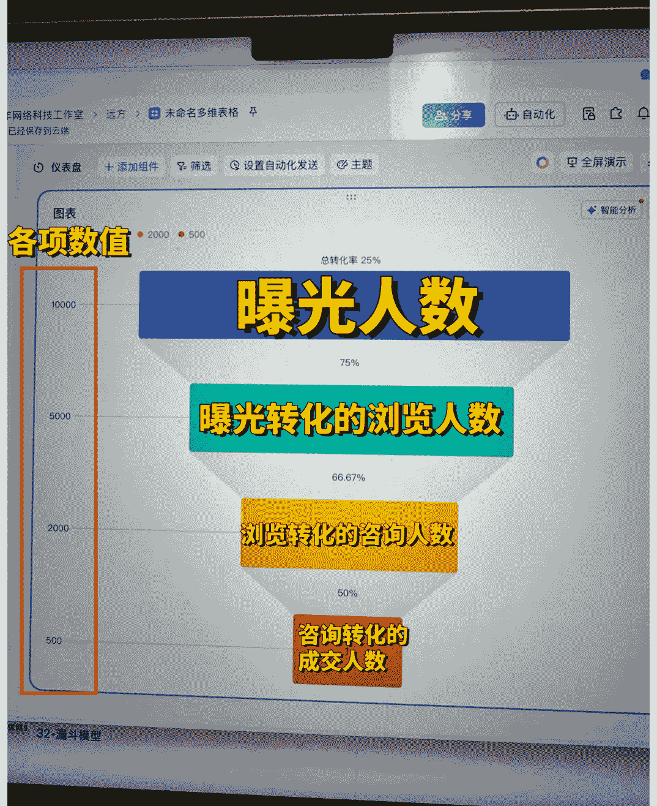

- 第一步：10000 人曝光 → 200 人点击 → 20 人咨询
- 第二步：10000 人曝光 → 500 人点击 → 50 人咨询 → 5 人下单
- 第三步：10000 人曝光 → 1000 人点击 → 200 人咨询 → 20 人下单
- 第四步：10000 人曝光 → 2000 人点击 → 500 人咨询 → 50 人下单
- 第五步：10000 人曝光 → 4000 人点击 → 1000 人咨询 → 100 人下单

## 转化模型：

内容好的模型：

- 10000 人曝光 → 3000 人点击 → 800 人咨询 → 80 人下单
- 10000 人曝光 → 2000 人点击 → 600 人咨询 → 60 人下单
- 10000 人曝光 → 1000 人点击 → 300 人咨询 → 30 人下单
- 10000 人曝光 → 500 人点击 → 150 人咨询 → 15 人下单
- 10000 人曝光 → 200 人点击 → 50 人咨询 → 5 人下单

所以你推广之后，出单少！没有出单！另外，不要觉得付费才是最好。免费的推广一样能打很好的效果。

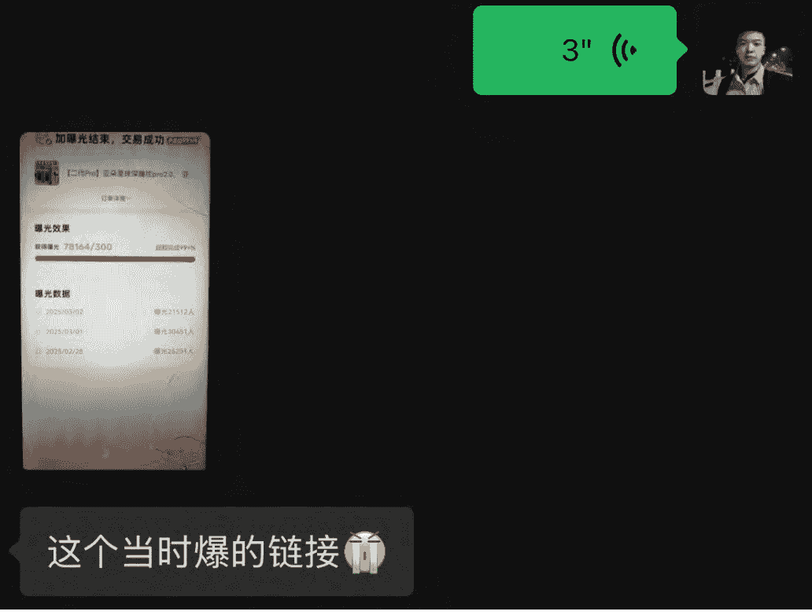

## 曝光结束，交易成功

### 曝光效果

获得曝光量 7864/300 超额完成99+%

- 2025/03/02 曝光 2512人
- 2025/03/01 曝光 3045人
- 2025/02/28 曝光 2621人

闲鱼6块钱能买到1000个曝光。

### 选择自定义提亮

| 限时优惠 | 限时优惠 | 限时优惠 |
| :--- | :--- | :--- |
| 预计曝光量提升 | 预计曝光量提升 | 预计曝光量提升 |
| 1000+ | 1800+ | 3800 |
| 低价投一单 | 放置更久 | 单次曝光优惠 |
| ¥5.9 | ¥9.9 | ¥19.9 |

免费推广，一分钱没推7.8 万人！一分钱没花还比付费的好。7.8 万曝光换成付费要买就得468 元。没有免费推广的效果，就得多花468买费。这都是活儿~多多研究多思考。点击下方关注我！我会持续更新！带大家清醒的玩懂鱼。

## 【其他】4 篇

### (精华帖/153页)从场景入手，遇到的都是真需求

作者：Luke
日期：2023-03-25

从场景切入，遇到的我是以前有一个关键词需要解决的办法，就是小红书的SEO。当我关注关键词布局的时候，排搜索页面前的笔记，一定是做对了什么比相同关键词布局的，一定有技巧和逻辑虽然也能认识到这篇笔记的关键词布局，但是好处在哪里？我们只能通过数据分析，对于AI模型来说很难擅长此，我整理了一套提示，总计3000字。这套提示可以让你弄清这篇笔记关键词布局是什么，为什么好，在哪里帮你找到长尾关键词，推测关键词布局如何帮助你进行关键词布局。如果你感兴趣，可以试试这套提示！详情请看飞书。

```
https://geku7h0.feishu.cn/docs/Fqtwd3Y6XZoPpx3xh1lcW3yGnzS?from=copylink&RedX=1
```

评论区：
易之AIRPA版：太及时了
JIE：这个太用了，谢谢大佬
感觉：大佬，这个给提示主要在哪个大模型上流的效果好？
Ricky：Claude.7
自信瞬间：这是真需求
colo：请问大佬怎么写这种提示词的

### (26)活动运营手册-活动领域的全流程指南

作者：醉鱼
日期：2023-05-25

大家好，我是醉鱼。在星球发布过关于《活动运营手册》，这个领域比较小，但发布后得到了很多反馈，大家都觉得这个行业很有意思。我已经不在一线了，但在时候，我又了一些思考，特别是在平台期、内容传播等方面，看到了最先进的。这两年的心血整理出来，也就是这本《活动手册》的内容：

- 1. 基础策划是什么？
- 2. 活动目标是什么？
- 3. 活动启动什么时候？
- 4. 活动设计？
- 5. 活动怎么做？
- 6. 活动设计、内容规划？
- 7. 私域如何运作？
- 8. 活动安排、人员分工？
- 9. 活动管理与互动？
- 10. 活动上线？
- 11. 活动工具推荐

这份手册是一份完整的指南，可以作为运营SOP使用，指导如何从零开始搭建，帮助更多的人。在活动执行过程中遇到任何问题，欢迎随时交流。

醉鱼：https://tsqq.com/sg4jo/8v5nx1.feishu.cn/do/dlIdEksot288Xpve

评论区：
陈林俊：没想到，果然意料之外
醉鱼：哈哈哈，范围比
橙子柚：真的好货！看着起来了，对于刚入行的来说，终于到了全流程啦。

[content]
<!-- no content -->

### (12赞)用RPA写两个程序，每天打卡自动更新到excel

作者：仙侠客
日期：2025-03-26

大家好，我是志愿者。在志愿者后台统计，感觉有点麻烦，没办法偷？说实话不用，技术就是用来。我用RPA写两个程序，每天打卡自动更新到excel，拿来用。如果感兴趣请点击：https://uebeaf96.feishu.cn/docx/UEMkdPUo79LkxP7jc9q1Tn

### (赞)打造私域+公域，共计4000+

作者：天
日期：2025-03-26

大家好，我是大四大学生，生财小菜，希望走出自己的道。分享一下我的经历。中间经历了很多波折，心态上的相对于我来说是一练，这应该解决一下小白的焦虑，话不多说，正文：每日思考：https://cn6bpu53pr.feishu.cn/SGChWt0cHINW52kqocFj1pnbe

### (43赞)未来三个巨大的风口

作者：亦仁的收藏夹
日期：2025-03-24

要创新，但创新是为了不下桌。

亦仁的收藏夹：

### (30赞)小红书成为新一代的App Store了

作者：亦仁的收藏夹
日期：2025-03-26

一款App想出差异化成功，拼的不是实力，是谁能洞察用户需求。

### (27赞)我的AI投资思路，二模型层

作者：亦仁的收藏夹
日期：2025-03-25

模型层的变化态已经相对明朗。玩家不多。很难有百倍的获利机会。但是相对稳，如果AI未来发展如大家想象的一样，还有99%的市场空白，那么现在入手可能有5左右获利机会。要想得10倍甚至百倍的超高回报，应用层这块可能是最关注的地方。

### (26)硅谷顶尖孵化器运营 42章

作者：亦仁的收藏夹
日期：2025-03-27

HF0所做的一切，本质上都是在改变他们想要的。


## 【线下聚会】5篇

### (56龄)海南海口圈见面会上的分享

作者：大家晚上好呀。我来介绍一下上周六（03.22）受生日邀请，在海南海口圈见面会上的分享。虽然只有短短一个周末，但我自己发生了许多有趣的事。而且分享了许多聚，在那个时候，我不自觉地想多说一些，打开一些和大家进行沟通。害怕有些恰当，我也很感谢组织活动的官方朋友们和能到场的生日顾们。以及，生日邀请的各位老师（黄小鱼、婉小、小也）让我们受益良多、笔记多多。这次分享的全部，供有需要的生日朋友阅读。谢谢！内容比较长，移步此书：

[全文](https://caktdk7ip.pixishu.cn/wiki/SiriywOGrtuiHBbwk4LnbcaIdQnMDm-from-copylinkkreRdXZ=1)

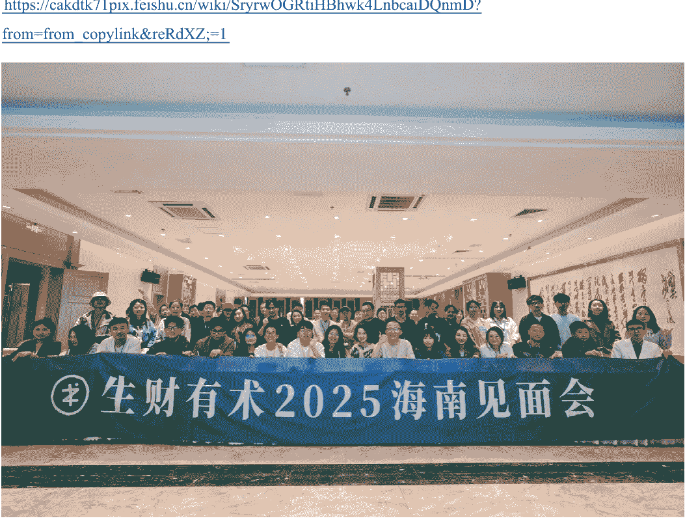
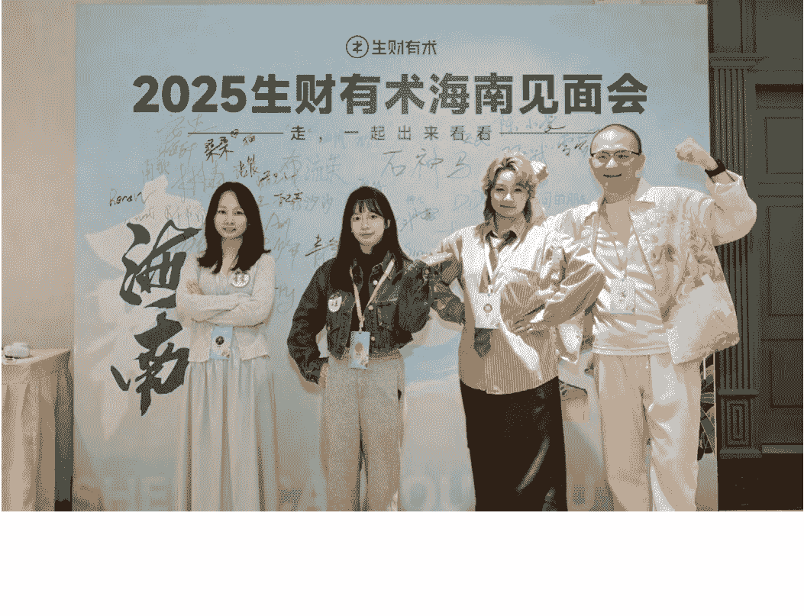


评论区：
- 相杨：风采依旧[磕哑]
- 藏巍：好久没看到马哥哥的文章了，收藏起来，值得反复看

### (42)别结，步快发起的第一次聚会

作者：木本@生财有
日期：2025-03-24

上周，我偶然邀请到信友俱乐部的朋友们聚会，来到家里办公室，分享了我在家里做“增长AI客户”的故事。增长总傅提了一套实用的方法，能够帮助我很多想做聚会的朋友，所有的朋友。我挑选了一些，笔记内容放在了家里文档，聚会本质是为了让自己多认识人。

- 1/运动局：可以从自己的兴趣开始就好，建立一个俱乐部或者运动局；
- 2/放松娱乐局：分享微信链接给大佬，每次聚会后，记得发朋友圈，多发照片写想法，主动被看见，慢慢聚会就会更多人知道你；
- 4/真正的社交是相互交流，而不是相向责任，不要给自己太大压力...

我非常认同增长的理念，很多时候，迈出第一步的关键，却是自己的心里。完成，再完美，没有人是第一步这件事忽略的，越早迈出第一步，越早感受到新的体验。

- 1/运动局：各种运动（羽毛球、篮球）；遵循当地city walk；爬山。
- 2/娱乐局：各种游戏（真人、桌游）。
- 3/学习局：AI相关主题：AI在工作中的实际应用，如何建立AI工作、现场一起学习AI工具；各类主题：2025年的发展趋势交流，如何高效交流。

有必要的话，我也可以单练给大家做个线上分享，解答大家对于发起的顾虑和恐惧，感兴趣的可以在讨论区回复【666】，很多人的话我们就约起来。https://scys.com/BOA7CKXD https://scys.com/BOA7ZVaD

在现代，建立有价值的社交连接已成为个人发展的重要部分。良者作为一个独特的聚集地，其自然生的社群属性为我们提供了宝贵的观测样本，总结出了一套系统的运营和管理方法，特别适合能力不希望构建社交圈层的人。

## 良者简介

良者作为远离城市的地方，吸引了许多不需要上班日程的人，包括独立开发者、创作者、艺术家、博主等，这里形成了一种平等舒适的闲和便利的社区，成为了“数字游民的聚散”——很多数字游民来到全球各地后，因为环境舒适而选择不再离开。

在文中，我们将深入探析组局的三个社群观点：组局的本质、连接人的策略，以及主场社区的建立。同时会分享对常见社群问题的理解。

## 组局的本质：古老的滚球游戏

组局并非现代，而是一种古老的社交方式。通过历史人的例子，我们可以看到这种方式的有效性和普遍性。

## 内容平台的循环

组局的核心机制是“内容平台”的循环。就像历史上的富兰克林和毛东一样，这个过程有助于创造内容，吸引人参与，再通过聚会产生更多内容，持续扩张内核。

富兰克林作为画匠，通过写作总结结论；结识人后，组建读书会；读书会产生更多内容和认知，再发表传播，吸引更多人加入。滚球就这样越来越越大。

- 创造内容，吸引初始人群
- 组织聚会，形成交流平台
- 聚会产生新内容，形成传播素材
- 新内容吸引更多，扩大社交圈

## 组局中的内容生成

每次组局都会产生内容，无论是零散还是系统化的。这些内容成了滚球的核心，让人认识你是可以被链接的人。

组局后的内容是关键一环——发现、朋友圈、写作、照片切片分享，这些内容会让人记住你，了解你，成为下次连接的基础。

## 组局循环

- 创造初始人群：写作、博客、分享互动
- 组织小型聚会：基于内容吸引的人，如组织聚会、分享会等
- 记录与沉淀：将聚会内容记录下来，形成新的素材
- 传播扩大：传播新内容，吸引更多

## 连接人的策略：从执念到自然

有效的人不是强制或刻意，而是放下执念，采取符合自己能量的方式。

- 执念：很多人想去连接“大佬”，但这种想法本身执念。
- 执念陷阱：执着于认识某个大佬限制了社交圈，反而超过了价值。

## Start Small（从小开始）

社交应该从小开始，先建立容易的连接，邀请朋友来办。

- 客厅模式：
- 固定时间：每周
- 简单：多准备
- 持续坚持：无论有多少人都坚持
- 内容传播：在朋友圈和博客上发布活动

## 长期主义

在组局的过程中，遇到没人来的情况很正常。只要提供持续价值，长期来看会有趋势。就像我的播客，第一期几十播放，第二期只有几个播放，第三、四期到一百多个，第五期再到六，第六期有七千播放。这个过程需要长期主义。

## 钩式社交

针对能量不够的人，提出钩式式社交——通过创造内容让别人找到你，而非主动社交。

- 容易：被看见并链接（如分享）
- 中等难度：被看见后主动链接（有人评论你的文章）
- 困难：看到你后主动连接（找朋友、共同话题）

## 内容社交复利效应

通过建立社交是一种高效且具有复利的方式：

- 内容可以睡觉，一篇好文章可以帮你结识多年后的读者
- 内容成为你的社交代理

## 投稿理论

投稿是积累资本的关键，通过深度作品向社会证明你的价值和专业性。

## VR行业案例

曾想进入VR行业，为此撰写了一篇万字的文章。当时公众号只有一百关注，但那篇文章有三千阅读量。通过这篇文章，许多投资人和创业者主动联系了他，帮助他进入了AI/VR圈子。

## 建立社交：符合个人特质的系统

社交是根据性格特征和能力设计的个人化系统，让社交变得更高效，更符合个人特质。

## 社交的优势

特别适合能量较低的人，通过组织建立自己的场域，省去了主动社交的能量消耗。

- 更有准备，不需要临场发挥
- 不重复做介绍，参与者知道你是谁
- 一次见到多个人的，提高社交效率

## 在自己擅长和舒适的环境中社交

 找到利基市场

在社交中，深耕利基市场反而有效。选择了“良渚”和创作者/AI创业作为自己的关键词组合，并在这个领域深耕。在宇宙上播“良渚”这个词，90%的内容都是我的。我自己录了三期，别人录了四期，大家可能首先想到我。

专注领域比广布局更有效。像曾海专注AI视频，李捷专注提示词，找到自己深入研究的细分领域，内容越聚焦越被人记住。

## 社交的构建步骤

- 确定个人利基领域：找到自己感兴趣且有了一定的了解
- 创建固定活动：设计固定时间、地点的活动形式，如Demo Day、客户分享
- 内容沉淀与传播：记录活动内容，形成文章、播客等可传播的形式
- 循环优化：根据反馈持续优化活动形式和内容

## 社群运营的关键要点

除了以上三个核心主题外，还分享了一些社群运营的关键要点，这些要点对于希望建立组织和社群运营的人非常有价值。

## 聚焦原则

良渚“每周周四”活动的成功，很大程度上源于高度聚焦：固定时间、固定地点和固定人群。这种聚焦能让我们明确预期，提高了成功率。

聚焦要素：
- 时间聚焦：固定在每周四，形成预期
- 地点聚焦：固定在周一晚上咖啡馆，便于记忆和传播
- 人群聚焦：最初针对独立开发者，形成核心群体

这种聚类方式类似于早期的Facebook在一所学校发展的策略，先在小圈内“渗透”，再向外扩散。

## 闭环

组局需要形成完整的循环：组织活动、完成活动、产生内容、吸引新人、再组织活动。如果缺少内容产和传播环节，活动就会变成单一的、无法持续扩大的。

活动循环示例：举办活动后在朋友圈或微信群分享内容，想参加的加入，形成正向循环。这确保了活动持续发展。

## 连接暴露

在活动中，让都有机会介绍自己，特别是对于内向者。这种设计能让潜在连接浮出来。

自我介绍的设计：
- 安排15-20分钟自我介绍
- 限制时间，照顾内向者的感受
- 说明自己的工作和兴趣
- 通过介绍建立连接

粉丝组运营策略：

- 对于线上运营，提出了“大放小”理念——不必关注日常，而是专注于价值
- 通过“快闪分享”（5-10分钟小型）
- 利用“接龙”机制增强群感，比填写更有效
- 采用“示弱”策略进行讨论，让大家解答问题
- 发起争议性的观点讨论

## 实用技巧锦

如何满足别人的需求提供有价值的内容？首先了解需求。如果想向内的朋友，对于群体连接，可以采用“头部”策略：即便是某个领域的专家，也可以组织活动，让专业人士在活动中贡献。

“头部”策略示例：两个陌生的人里，一个人说了头部，引起另一个好奇。

## 组局后得到积极反馈，如何保持状态？

首先要明确自己组局的目的，反馈与目标一致还需要调整。同时接受反馈是正常的，不要期待太大。例如，小组中成员认为收获很好，特意引导他们深入交流，聚焦于达成目标。

作为组长，如何帮助不容易融入的人这个问题很重要，需要特别关注内向者。有效的方法是设计一个流程，让都有机会：

- 安排15-20分钟自我介绍
- 限制时间，照顾内向者的感受
- 通过聚会增加交流可能
- 此外还可以设计一些互动环节，如安排礼物交换，将行为变成必须，降低社交压力。

如何处理小组中出现激烈的情况？

需要区分纯粹的人身攻击还是观点不同。如果是人身攻击，作为组主需要面对吵，这不会造成损失，因为很多人对人身攻击都是反应。在小组中维护小组环境，必要时处理不妥当。对于正常的观点分歧，可以允许讨论。

如何让新手活跃地加入小组？

第一步需要动力，也可以设计降低门槛。关键是“Start Small”（从小开始），先组织两个人的小组，完成闭环。这里的闭环是指：组织活动、活动完成、产生内容、再到下一个小组。

木生财有术：如果你想发起聚，但遇到一些顾虑和疑问，可以评论区回复【666】，人多
程为自己：666
晚听到：666
未子央木：666
芝之鱼丸@生财有术：666
帅彬|蟹boy：666
阿牛：666

### (#27) 海南见面会正式：副业有术

作者：小鱼鱼
日期：2023-05-23

参与这次财富聚会，大部分都在杭州办。这是我第一次作为官方代表来到其他城市举办见面会。临前状态是有些紧张的，但这种心情从飞机起飞后慢慢消失了，海口是一个让我重新清醒的城市。参与完两次聚会后，我提前找到了这次见面的策划。从从未见到有人已经完全地叫出我的名字。我认识了一些真诚的朋友。城市风格各异，我们分享的共遇，在这里遇到了最合拍的自己（我自己）。第一次见面就发现如此的小错，到转型的经历，两次陌生，一路直到成功解锁了自由业者的身份。有时候，我们会遇到一些不同的场景，但真实的你是你选择了理想，你也背负了后路。由于你拥有梦想和能力，你可以呢？看着这一脸庞与序后，我怎么看。

小林，“不说见面会遇到自己，也要遇到自己。”要持续，学会和不确定性共处。”只要你在做，总是在前面造（点击查看本次见面会的内容）。上台十分分钟，大家聚在一起，我们会面对观众，提问互动好玩，我忽略了他们，我的语速很高，交流完毕，这次没有我小IP。作为作者的你，你学会写作，我从实践中学习，系统了如何介绍这个行业的规模和动力。如果你想要收获，就会有意识去收获；如果你想要坚持，就不会有选择性付出；如果你想要梦想，成功就会遇到困难……那些10%的概率。

作为最后的一位分享者，时间比较很久，以至于最后才发现，很多人问我如何从零到一，创业者在何时找到发力点通过什么方法解决了业务上的挑战，还有流量转化。当然，不仅仅是业务上的挑战，还有内心的挑战。“践行”、“许说”、“允许”，接纳……以及找到自己的位置。我坐在台下，看着屏幕上的内容；作为团队代表，这次见面会的代表看到了大家在一起的感受，以及我们在AI领域的突破。对于未来什么样的期待呢？我们想看到更多线下、各个领域的优质内容产出、规划、愿景，希望看到更多（点击查看）。

https://tssq.com/RI5Q
https://tssq.com/RI5Q
https://tssq.com/QWeAm
https://tssq.com/3Urhl
https://tssq.com/fWj6)

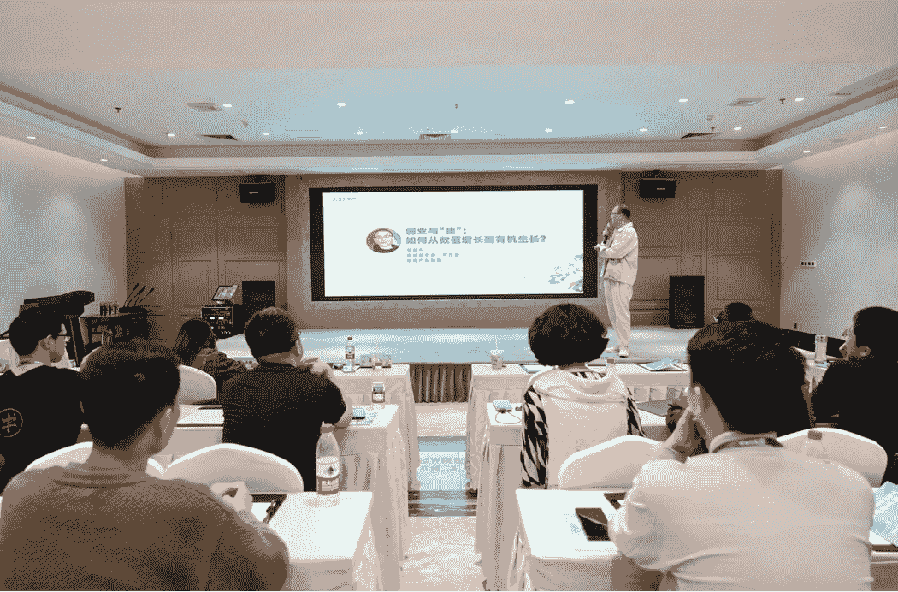


评论区：暂无评论

### (精华38)从职场菜鸟到入职25W+一个人成长成为队伍

作者：小辛
日期：2025-03-28

大家好，我是小辛。上周六（3月22日），我有幸被邀请作为职场菜鸟线下见面会的分享嘉宾。我记得那时候的心情，我有无比激动的心，去杭州参加了人生这么大的会议，收获了非常多的能量。当时，我是他们一起起的，慢慢地说，今年就要到舞台上了。我听完后笑了，心里的是：我可以吗？我可以行吗？一年之后，我确实在这里了。我能向宇宙下了订单，现在结果都变现了。接下来，我想他们是如何像我一样成为自由职业者的，只是当时不知道。主要内容有：

- 1、简历：自由职业的种子的简历我是如何编写的？
- 2、尝试：第一次尝试，两个月后我离开了职场
- 3、转型的自由职业，我做了哪些事？
- 4、真实：自由职业到第一年的真实感受

希望同样一样的你，想要转型为自由职业的伙伴能带来一些能量

https://jpy77zz6a8.feishu.cn/docs/docx/HpADUXG0DuvxU9lHIclwrBnEn?from=copycopylink&reRDXX1


## 2025生财术海南见面会

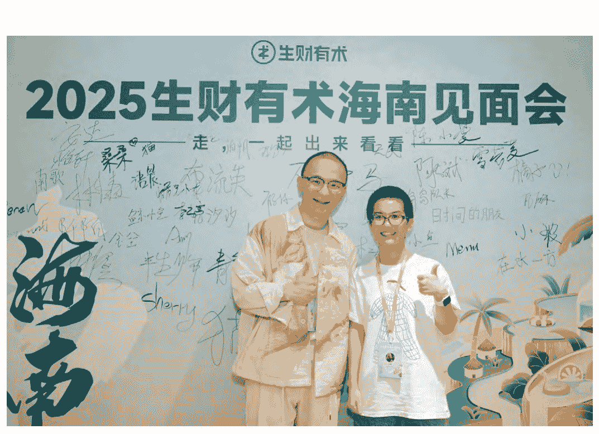

评论区：
- 桑桑@生财术：永远为小姐姐打call! ~
- 黄小鱼：小的分享很有力量！
- Tina Gong：真棒，向你学习
- 长陈：文章权限你得设置，我这一个普通用户也能修改你的文章。
- 帅帅 | 蓝boy：体内积累确实压抑，没有勇气辞职

### (20赞)小红书虚拟商品数据分享(目前数据条数：1216)

作者：Rand0mWalk
日期：2025-03-26

- 1. 数据概况
2. 所有数据通过“基础关键词”搜索后的抓取，如果你更多相似的关键词请留言
3. 可打印
4. 电子
5. 素材
6. 网盘发货
7. 清单
8. 合集
9. 可编辑
10. 模板
11. 源文件
12. 虚拟资料
13. 资源
14. 课
15. 应用
16. 软件
17. app
18. 笔记
19. 自行下载
20. ppt
21. pdf
22. 手绘
23. 手抄定制
24. 虚拟
25. 非实物

- 26. 提取商品数据时，按销量排序，只取销量大于3000的商品


# GitHub Copilot

Used 1 reference

我让它检查这个JSON文件中的数据。

通过检查商品标题，我发现以下商品可能是虚假商品:

```json
"19-109磅棉服装（图片非实物）"
```

原因分析:

- 这个商品标题中包含了“非实物”字样，实际上是在售卖实体服装。
- “虚假服装”表明是实体服装，只是图片可能和实有差异。

其他商品都明确是虚假商品，特征如下:

- 包含“PDF素材”、“手机”、“模板”等虚拟商品关键词
- 标题中有“自行下播”、“打印”、“虚拟定制”等虚假商品关键词
- 商品属性是数字内容，如购买资料、软件模板等。

## 33. 为什么要做这个

从从小红书标题中可以看到“到假”，虚假商品相关很多，小红书也在这一块。

亦在小红书群里回答别人的提问时，我提到了一个关于小红书虚假商品的数据价值。

小红书的虚假产品航海中，可以让海友们一点点方向~

我在微博网站上，靠系统性的抓取了相关的数据建模，虽然数据没那么但通过这些数据，可以挖掘出不少相关结论和关键词。

想自己获取的数据，可以直接用这里：https://api.winroad360.com/redirect/robot?inviteKey=dfbbcbd169901

数据实时抓取(天气预报-RPA把电脑当饺子），可以随时看看——

更好的阅读体验 博客书：https://liang33hbob.feishu.cn/QoeGdG6WDOYXbX1Wt2cjLen4k

## 评论区:

阿里：不能取出来是放在哪个类目的。
RandomW：小红书官方好像没有对这个数字进行，一三对比友等对虚假商品展示虚假的线。如果有对虚假服装的类目描述的话就更好好了，就齐对的类目就行。

花大王：不能通过无物流发判断，大概就是虚假商品了。

RandomW：关键是拿的是不是无物流发的数据。

PeterZN：感谢你的分享，大才哥解决了选择分类的问题，同时也快速从市场数据验证自己的赛选择对齐。

RandomW：把数据给AI看板分析一下应该可以很有启发。

Lucia：感谢你慷慨分享！很有价值。

## 【嘉嘉问答】1辑

### (44) 两个问题，是执行力流失，还是变题的匮乏

日期：2025-03-29

提问：

可涵哥，我是从去年开始在线在做你分享，目前在做健身康复类类的视频号。我是97的，上班8小时是在一家公司做微量技术支持，下班去健身跑步视频，以前是短视频的，跑步已经做十多年了。

目前的状况：视频号涨粉没多少，不是粉丝不多，只同步了跑步视频，没有加过涨粉，视频情况还行，出了几个百万粉丝，但带货很困难。

目前是流量变大了，可涨粉丝转化产品，卖练书或者什么的，运动康复类的优质不是不是，我有一个HA认证的教练，就不知道怎么去教课程或者产品。

这准备人出卖视频，实拍装修视频，增加粉丝，这种可能是迷走的路，变现路径可能靠直播或者健身机构变现。

目前还没有稳定收入，还能涨全的粉丝，整理精力，运动康复类的这个领域却是巨大的机会，我就想一直下去，希望嘉哥能解答我的疑惑，感谢。

## 回答

疑惑很好，视频号涨了十万粉丝，现在就有两个问题，一个是执行力流失，另一个是变题的匮乏。

一个是你执行力太少了，这样压力变大了，再加上三个平台每个平台十个同步，你就会勤快了。

引流的，你可以是康复指导手册、健身自测评，免费获领的钩子和核桃的片子，视频训练，48种动作演示，免会员券，引流粉丝，电子书等等等。这些都不是，现在的现在的，是你的的了，整理一下水域，它就是你的了，而且还能长效获利，你还可以自己涨粉吗？

你可以咨询，可以卖课，卖服务。

(后续部分OCR文本存在大量乱码，已根据语义尝试进行逻辑还原)
