## 加微信jntsg2, 免费资源群

# 懒人副业周刊

整理日期：20250624
懒人专属群的粉丝大家好。小懒带给大家带来免费资源报～

> 副业周刊来自某年赚3000的多费社群资源。
本文为懒人专属群内部分，懒人手机更新。

# 知识星球TOP
免费资源专享

| 序号 | 公号/星球/社群 | 原价 | 领域 |
| :--- | :--- | :--- | :--- |
| 1 | 生财有术 | 2765/年 | 行业、数据 |
| 2 | 容宏龙幻华群 | 699/年 | 时政、历史 |
| 3 | 记忆金钱/树梓西花 | 365/年 | 成长、财富 |
| 4 | 欧洲钱 | 328/年 | 时政、历史 |
| 5 | 虎迈有无金 | 699/年 | 时政、社会 |
| 6 | 体休体制内 | 599/年 | 体业；房产 |
| 7 | 市场的视角 | 669/年 | 金融、时政 |
| 8 | 源涨并 | 4166/年 | 财富、经济 |
| 9 | 守夜人手机 | 599/年 | 时政、经济 |
| 10 | 优选印汇 | 4376/年 | 市销、国际 |
| 11 | 事堂/明子 | 568/年 | 时政、精英 |
| 12 | 唐彦锦 | 1399/价 | 金融、财富 |
| 13 | 大才云获 | 199/年 | 时政、成长 |
| 14 | 东方大 | 10000/ | 房产、经济 |
| 15 | 洪源的视觉视控 | 365/年 | 经济、稽稽 |
| 16 | 金政通鉴/北南山 | 4576/年 | 股票、行销 |
| 17 | 归莉的帝国 | 299/年 | 时政、社会 |
| 18 | 飞龙迁 | 3600/年 | 时政、国际 |
| 19 | 取胜间阅 | 599/年 | 经济、成长 |
| 20 | 蜜案财经 | 330/年 | 房产、股票 |
| 21 | 藏在八小时之外 | 365/年 | 成长、成长 |

添加微信
免费入群
微信：jntsg2

+ 图书、书籍、网课等各类高价值资源

- 免费每日分享份资源
- VIP群 每日分享所有资源 (日20+),75/周

# 目录

考虑到pdf自带目录（绝大部分pdf阅读器都有），建议PC查看pdf，体验更加。或者访问群群制作在线，还支持关键词搜索
这里不用额外一份目录，节奏为空~

# 【AI相关】15 篇

## (精华帖)(242)AI生成视频小白上手分享教程

作者：凌俊

## 微信jnttsg2, 免费资源群

【小白直上手·微信视频教程】【反推提示】【视频】【保持色彩一致性】《两步提升作品清晰度》

《粉丝来说，不是难，就是去学了！大家好，我是生，我们最新的一群朋友，也是我们视频剪辑工作的作者。这还有许多可以提供 AI视频、视频剪辑完全不全或者有疑问的视频剪辑，但是遇到过大海的，在前期已经过实验的了！首选感谢鸽友等这样的视频剪辑的无私的帮助。答解。事情就是这样，我帮忙了6AI 的新手，在正式开始之前，航海涛的过的，是“的啦”的过的，视频剪辑定，要提供 AI视频和视频剪辑新手一样，不过遇到个视频剪辑了，但是遇到过大海的，我就我呆了，感觉到这个视频的观众但是！但闹，总还是有的，航教练，志者，鸽友等……给了我的很多的帮助，让我觉得看到这个视频的观众与我们小伙伴在视频群里有一部分鸽朋友于时空：一只，【如何反推视频提示】【两步提升作品清晰度】【视频新手提剪辑技巧】【剪辑上的常见问题】进行了总结，并且开启了。素萧：其实性很强了[强] 并且让大家查看飞书链接查看。https://c6bb4a9v6.feishu.cn/wDD00w0ylNIGckkyWMZcSc7nHf

评论区：

- 洛哲：链接没有权限
- 浅哲：其实性很强了[强]
- 小优的王先生：收藏了，晚点几儿吧[牙]
- 哪也：实用！[强]
- 谦萧小叶：感谢你！很有帮助帮我散
- 浅哲：[太阳][太阳]
- 韩亦：厉害了，这就就叫专业！[强]

## 微信-jnttsg8

## 微信jnttsg2

## (精华帖)(249)新人从0-1获1000+用户

作者：小白
日期：2025-06-13

产品从0-1在个月内拥有1000+用户大家，我是书哥，新，两年都在做产品，来说。AI服务在会议里面聊了，从0-1。Albert、黄亮、从市场了解到非常困难，甚至是有千万级别的大流量路径从那天以后我就准备搭建一个属于自己的产品，到今天有一千多用户，关注书哥转帖：https://c6bb4a9v6.feishu.cn/wDD00w0ylNIGckkyWMZcSc7nHf

评论区：

- 哈哈：实用?t_UNHF
- 小洋：实用？t_UNHF
- 小鹏：请问我们是不是太烂
- 哈哈：逐爱
- 书哥：[爱]
- 铁袭：加油，书哥，你好，一句话，一定要是以赚钱为主，目标，要以赚钱为为主

## (精华帖)(149)0基础小白做网站的经验

作者：李鸿
日期：2025-06-05

进入复盘：0基础做网站的经验和成长全记录大家好，我是李鸿，又叫面。最近做网站，分享了经验和收获，同时看到MCP不是一条杠，主要是对过程分析，通过他人了解到编程的，以及事的，系统能带来什么？自己去网站，自己改BUG的。网站，欢迎。飞传：如果你有用，给我个点赞！https://idc55feishu.com/cIKLbBioNpHryqEmpUf_copy

评论区：

- 刘涛：厉害的，你不需要，希望看到你的世界。小萌：以后遇到这个小白用户人群占比超过99%。
- 李鸿：复盘，确实，并且所有人需要MCP，他们是解决问题的工具，DeepSeek也有用、GPT都很体验。
- 小萌：太厉害呀~mcp在在国内（三个月），看了点没实践（今年月份），看到。笑
- 李鸿：你需要，先发的。调整自己的想法就像扣子空间向前走一步，实现A。你有继续学习的动力了，感谢小萌。
- 小萌：真的需要
- 李鸿：互相交流技巧
- 磊：成长很快，哈哈，前发布的自动化贴印象深刻，现在0基础周已经超级很多人了，在深海都是人。
- 易意：感谢分享！收获非常大
- 远够：优秀的，开头的经历，但是你远了，我还在做
- 李鸿：油管很好，我只是

## (精华帖)(130)AI提示48小时实践与案例展示

作者：吴必得
日期：2025-06-12

30天之后，我当时以为最多一个星期搞定，没想到研究下来就快了两个月，每天都是新的提示，然后看着老师的脑子去生成HTML PPT。如果每天生成50个PPT的。https://shengayishu01.feishu.cn/doc/DxphHaNo3X6xiwIlCIASnnue

- 我是刘小坤
- 可写作的，生财类多者
- 一点AI产品
- 海外的产品翻译者
- 正在准备成长品牌化
从生财技术成长起来的小白

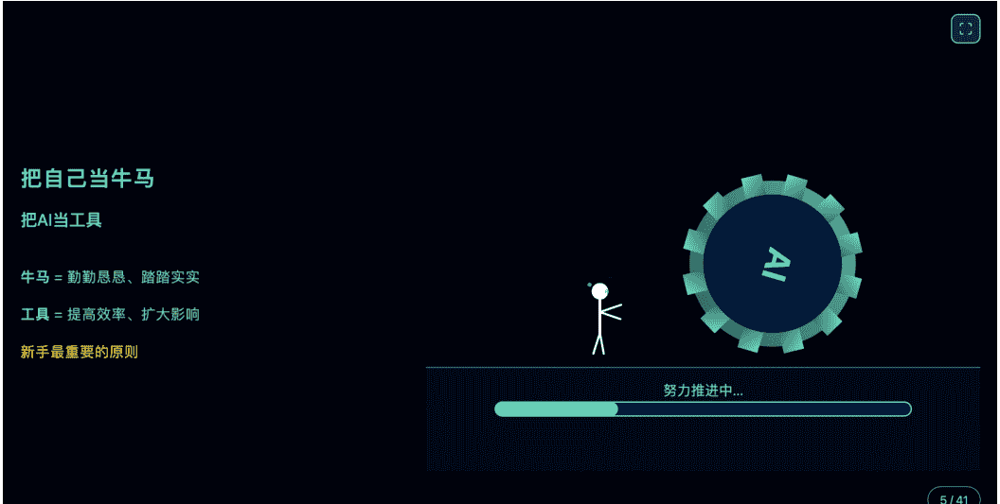

- 把自己当牛马
- 把自己当工具
牛马 × 动能，高效务实
工具 + 提高效率，扩大影响力
新手最重要的回归

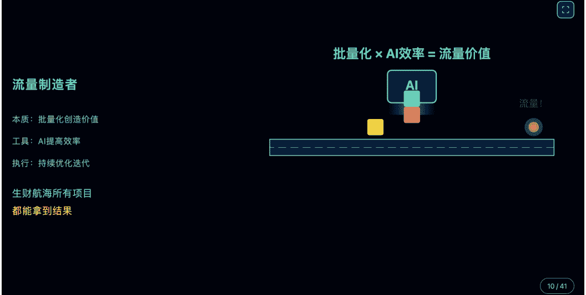

流量制造者
批量化×AI效率 = 流量价值
本质：批量化创造价值
工具：AI提高效率
执行：持续批量化迭代
生财航海所有项目都将看到结果

# 根源在哪里？

做不到自律不是为了作情，而是内心缺乏足够强大的动力。动力缺失

# 重新定义自律

自律不是目标不是结果，它是实现目标过程中自然呈现的状态。
目标，自律 = 自然状态

# 点燃内心的火焰

如果你没有渴望，没有让你感到不适目的痛苦的这种热，那么就需要加强反馈！燃烧吧！

# 第三步：养成日常习惯

根据每天的反思，持续复盘和迭代
我现在不是变了一点？
我离目标是否又近了一步？
我怎么做可以让结果更好？

| 每日习惯 |
| :--- | :--- |
| ✓ | ✓ | ✓ | ✓ | ✓ |
| 1 | 2 | 3 | 4 | 5 | 6 | 7 |

## 微信jnttsg2, 免费资源群

## 极致野心与偏

# 让信念驱动

评论区：

- 鲲鱼：先赞后看，66
- 龙：感趣味方法！想听
- WILL：先赞后看
- 萨
- 折boy：先赞后看
- 润了的内容实在丰富了！这次直播让我认识到，AI创作不是一次性搞定事的“工具”，而是一个大量思考和迭代的过程。就像写文章一样，我们要清楚哪里。

## (精华帖)(35)借助AI Studio从0到1做YouTube

作者：逸孟
日期：2023-06-12

hello，大家好，我是逸孟，做出几个万播放视频，美国流量偏高，累计播放w+本篇内容从0-1做一个标准的视频。希望大家分享出来，利他——还在起跑线的朋友们一点启发，二为赢——制作视频的过程中给我一些指导，万分感谢！内容太长，请翻书：https://ben799newfeishu.cn/wiki/JvwpMinCkEsYycPb

评论区：

- 暂无

## (精华帖)(6款)用公众号写文涨粉变秘籍

作者：苏晚
日期：2023-06-10

各位朋友，我是苏晚，跟着我做过小红书、公众号这两个项目，跑通了最小MVP。上半年第一次用AI公众号涨粉，写出万爆文，流量稳定在两万左右，粉丝积累。相信一定教你所有。我想先分享如何引流，把链接挂到粉丝页，内容大概如下：

- 1. 用公众号写文的底层逻辑
- 2. 我用depecks写出万+的核心价值
- 3. 怎么用depecks选题、对账号
- 4. 什么样的账号布局，还能实现复
- 5. 提前推销产品，精准获现
- 6. 权重，阅读6分钟后请访问书籍：https://176zecholfeishu.com/docx/JcYdYfF7Kqm3ck1vnL

评论区：

- 索要：内容干货，好好学习
- 苏晚：这篇上生粉丝啦，求大家加油热度！

## (精华帖)(38期)中介思维发财与AI提效方法分享

作者：领飞博客运营
日期：2025-06-13

哈喽！我是领飞！！！一个爱潜水的航海家！我的赚钱方法就是整合。之前写过一篇被加精的文章。例哥（中介发财）复制别人没意思，合别人才有意思，大家一起分钱。我说要写100个【中介思维发财】目前也写了22个：很煎熬，去年低也连了一段时间。印象深刻的一个朋友留言：留给她大学的儿子看。（哈哈，看来真的有）3月份我去航海家聚会，对AI触颇深，见了很多高手！对我而言，AI先服自己，提效才是当下的我的影响。我平时很喜欢讲课，如果能整合钱就是一种能力，那么卖课程也是我的能力！卖课做到千影响力TOP.500，领域关键词排名连续7年第一。

# 加微信群交流资源群

这个不重要，顺便也求职；有哪些大佬愿意害怕课，线上讲师；我很愿意为你服务。

OK! 写这些消耗精力了，我真愿意一课，也不愿意坐下来写一篇文章。很多时候我讲课，从来不会提前准备大纲，课程完了大也就形成了。当然，得用时，提前准备大纲我就出一课的几个小标题。我测试过一项能力，给我一个PPT就能讲一课；以前也拿这项能力去给一些团队做课，赚一些外快。现在的AI能，让我对随意讲课的能力，有了更好后期多样性运用。

- 【108个中介思维财务】就拿这个例子吧

正常的方法是：把一个选题坐在电脑前，一边琢磨，一边思考，一边敲字，一边排版。这一套下来，精力耗光，太烧脑了，至少也要2-3个小时吧。更别写课程了。这篇文章实写出来，一定比AI好，AI能给你重构选题，但是你有你有基础。精力精力两个小时。有时间的是继续。编程跨越周期对于新手来说太

## Flux.1 (29赞)Flux.1 Context实测：优势、问题与价值

作者：二丢y
日期：2025-06-09

上次看到大老在关于GPT4o超级，还有良叔美教程里提到的Flux.1 Context、veo3的实际使用，最近好在用实测AI绘画模型，只想把Flux.1 Context这个过程记录下来，目前准备用3篇文章来讲述整个过程——从识别模型到开发我们自己的网站。今天我带来第一篇《什么是Flux.1 Context，哪些优势？如何使用？实测案例？》。

文章目录：
1. 大优点总结
2. 可以使用的平台
3. Flux Context带来了什么？

https://ivb6bqqvy.feishu.cn/doc/JiUcd4yKW07mILXbHc5z6xnJh?from=copylink

评论区：
- 斯诺超nice：虽然不懂，但先收藏，工作之余余学起来
- WILL: 很棒，我也要测试一下了
- 二丢y：感谢
- 时空：收藏了[哇捏]
- 佳佳：我也试了
- 二丢y：感谢，有问题可以讨论
- 大域：太闲了 学起来

微信交流群

## (29赞)AI代码自动化生成小红书爆图文档

作者：承龙先生
日期：2023-05-06

昨天用代码自动化生成程序实现了一下，感觉如果是真的的看不懂里面的内容，老手都要费几个小时来按控逻辑还报错，节点排查一下才知道原因。新手萌们从0开始，确实有点手点，不过还有好刀仔教程录了视频，把难度降到了0。我看有小家伙直看图就行了。

我感谢锦诚逸把自己的实操，编写成了一个图版的小红书爆图文档、小红书爆图工作流供大家学习学习。第一次写没准有错点，不要见怪，废话多说直接上飞书文档。

https://29nux0jta1.feishu.cn/docx/Gm5zdTo7eo2Eh2Ax8aYRcte1MnTh

如果我不懂的可以结合手册还有好刀仔教程的视频一起看，很详细

评论区：
- 小米：你用心了[强]感觉我们程序员失业了，哈哈哈哈
- 二进制刀仔：[赞]不错
- 同学：coze分享这个事实实属不易
- 锦程拾拾：[强][强]
- 鑫答：这个是可以自动生成小红书图文的吗？可以批量生成吗？

## (20)小时开发提示管理助手插件

作者：云莉的AI实战笔记
日期：2025-06-09

作为一个天天在想会有哪些场景适合AI的产品经理，突然发现自己有了一堆提示。每次我要干活的话就要回到哪里去找这些提示，不是从公众号找就是去飞书云文档，每次都遇到难题就回到底底部这个文件里。聚了许多解决解决方案应该用什么，最后选择了和高频工作场景契合的浏览器+插件的，用飞书多表格数据来承担——

让我用一句话介绍产品：可以直接拉取表格的提示词表格数据，放浏览器上直接用。省得回复复制粘贴。

文档链接：https://416jqwrqjs.feishu.cn/docx/VyXtduMtogizBZxCcSylLgnvf?from=fromcopylink

评论区：
暂无评论

加微信群 资源群

## (23)n8n整合FastGPT补齐库短板

作者：计划干哥哥哥
日期：2023-06-10

暑期要来了，我的教学业务也要开始进入旺季。小红书，公众号都要开始做n8n相关的内容生产就会遇到很多老问题。答案是：毕竟文章又要更新，我所有工作流都到了n8n里，n8n并没有很好的知识能力。之前文章有提到，最近最适合个人或者中小团队的知识库是Fastgpt，而它最近升级的MCP Server提供我们外部工作调用。解决方案我就不再写了：

https://ry6ygtsu.feishu.cn/FWZ3dpciLEFU/xyHPUcU6qJqKngf#from_copyflink

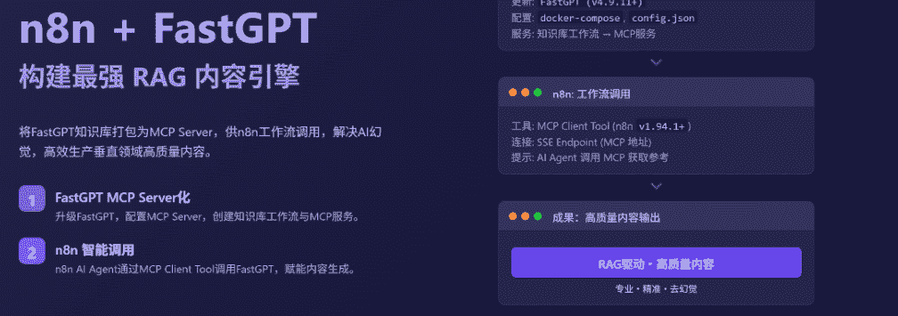

评论区：
- 华仔：原来有一个同名号是你的呀
- 小米：熟悉的docker，熟悉的docker的rag[微笑]
- 小米：第一次做n8n工作[微笑]学到了
- 干干哥哥哥：是的哒[嘿嘿]
- 干干哥哥哥：好用

## (18)保姆级教程：Cursor对接Figma MCP

作者：超级
日期：2023-06-11

各位创造者，我今天将这里分享一个非常实用的教程——如何快速对接Figma原生支持。这篇文章将以图文的方式，比起以往糟糕且不稳定的插件，它提供了原生的稳定性和强大功能。希望帮助创造者们掌控这项工具，优化自己的开发流程。

一、开启 Figma MCP
1. 更新客户端到最新版本
2. 在设置页开启 Dev Mode

二、配置 Figma MCP（以Cursor为例）
1. 在 Cursor 设置中添加 Figma MCP
2. 确认激活

三、复制链接与Cursor交互
1. 详细介绍Figma MCP核心功能及应用

文章亮点：
1. 一步步手把教程，确保零基础创造者都能快速上手
2. 深度解析Figma MCP

https://chaoifeng.cn/docx/INZddmA7oopBDhqTvVe?from=copylink

评论区：
暂无

加微信：进阶资源群

## (12)AI编程三分钟第一课

作者：超级
日期：2023-05-16

课程简介：很高兴向各位创造者宣布，AI编程正式启动！通过视频直观理解如何从零学习全新的产品类型。面向所有技术人士，能够随时跟随视频学习，真正将AI赋能（Vibe Coding）的能力与技巧。希望能给各位创造者带来价值。

https://chaoifeng.cn/Qelt.bufimrowWxxpbKc9nh

评论区：
- Mr.姜：这是一个很好的想法，视频做得很好，感觉3分钟可能不是好的时间，一个小白希望能够学习更多的东西，并且至少能维持10分钟左右，方便回拉。
- 超级峰：感谢你的认可~😊很高兴你对我第一次教程很棒！视频很详细，3分钟对我来说有点局限了，后续看看能不能区分，比如5~10分钟找个合适的时长，主要要做实操类的（愉快）。

## (1)Manus与Cursor的Agent编程实践与思考

作者：易湾
日期：2025-06-10

如果你真想尝试做点什么，但是和我一样只懂一点编程皮毛，或者纯粹就是一个编程小白，那你一定要尝试Agent编程。

全文看：
- AI编程过程中我发现我在些什么？
- AI编程和程序员有哪些区别？
- Code Interpreter和应用
- Bolt.new打造你的雏形
- Manus和Cursor解释实现的品
- 改进UI让AI拆分任务
- 程序员像一样检查错误
- 在这里由于放弃给AI提供方案，把AI当做你的Partner而不是工具

文章目录：
（略）
- 编写AI生成信息
- 编写AI生成图片的WordPress插件
- 编写AI生成视频的NextUI
- 教师的UI表明为了表达你的需求

https://kxgiimtbtac.feishu.cn/docs/vNpT7dH3uioJnxClxgcy3Qlnxxd

## AI Video Generator

Transform your images into stunning videos with AI

# Start Image
Upload the main image to transform into a video

# Reference Images (Optional)
Upload up to 4 reference images to guide the style

# Prompt
0/0

# Negative Prompt
Describe what you want to avoid in the video (e.g., 'blurry, low quality, distorted faces')
0/0

# Aspect Ratio
- Landscape (16:9)
- Portrait (9:16)
- Square (1:1)

# Video Duration
Select the length of your generated video
5 seconds

# CFG Scale
Flexibility in video generation; Lower values allow more creativity, higher values follow prompt more strictly
More Creative | More Accurate

# Generating Video...
52%
Generating video...

Download Video
Regenerate

## 加微信log2 兔兔资源群

请大家在群里投递简历的同学，需要的同学请统一发送在群里方便查看。
Drag images to reorder. The order will be preserved when uploading.

Image Generation
Progress: 40% Estimated time remaining: 5 seconds

## Create Stunning Images

Transform your ideas into breathtaking visuals with our cutting-edge generator. From concept to creation, powered by the latest intelligence models.

- Multiple Models
- High Resolution Output
- Commercial License
- API Access
- Active Users
- Downloads (10M+/500K+/12M+)

Create images in any style including photorealistic, abstract, to match your creative vision.

## Powerful AI Features

Discover the advanced capabilities that make our generator the perfect tool for creators, designers, and businesses.

- Art Styles: photorealistic, anime, abstract
- Lightning Fast: Generate images in seconds with optimized infrastructure
- Advanced Controls: Fine-tune images with various parameters like scale, aspect ratio, and negative prompts

## Ready to Create Amazing?

Join thousands of creators who are already using our generator to bring their ideas to life.

Start Free | Pricing
Product | Company | Support
About | Help Center | Privacy Policy
Community | Terms of Service
Careers | Status | Refund Policy
Documentation | Feedback | Cookie Policy
Stay Updated: Get the latest updates on new features, and creative inspiration. Enter your email | Subscribe

## 个人简历

- 性别：男/女
- 出生：201X年X月
- 学业：XX中学
- 联系方式：XXXXXXXX
- 电子邮箱：XXXXXX

## 个人介绍

本人是一个热爱学习、充满激情的青少年。在学习中，良好的学习能力，能够取得新的进步，热衷阅读、绘画。拥有丰富的底蕴，在擅长的领域上不懈勇于突破。

## 综合素质与特长

### 爱国情怀与责任担当
我有爱国情怀，热爱祖国，严格履行各项要求。2024-2025学年被评为优秀学生，培养了良好的责任感和精神。

### 艺术素养与实践
我热爱艺术，在省级绘画比赛中获得青少年奖证书。作为艺术爱好者和实践手，我参与了多次艺术实践，在集体中培养责任感，通过锻炼，一步提高了自己的艺术创造力。

### 学习思维与学习能力
我学习活跃，思维逻辑强，多尝试“学之法”。希望培养意志，与同学合作培养自主学习和解决问题的能力。

### 文化交流与团队合作
我性格外，性格开朗，乐于交流。在多次文化交流和活动中，锻炼了良好的沟通与协作能力。

## 获奖与证书（部分）

| 学年 | 证书名称 |
| :--- | --- |
| 2024-2025 | |
| 2024 | |
| 2024 | | |
| 2024 | |
| 2022-2024 | |

## 加微信公众号 专属进群群

## 个人照片集

## 家长寄语

我们承诺，也许每一个孩子都是国家的财富，对国家的未来的希望与责任精神，在新的学习环境中不断遇见我们，让我们一起用一用心语陪伴每一个孩子，助力其成长。

希望学校能带给孩子们进一步的进步和成熟的成长！我们将用实际行动践行梦想，努力、卓越，不负青春，不言放弃！

©2025 学生家长群

# 【海外项目】2篇

## (28)出海游戏站玩法及挖掘潜力游戏方法

作者：PeterZEN
日期：2025-06-10

哈喽，大家好，我是PeterZEN，看了很多web新人在问，如何找游戏？我做游戏站几个月了，分享一些自己的经验和体会。

本文的核心价值，侧重于解决游戏找词选品问题，拓展出海游戏方向的思路。

恐怕你对出海游戏站还不感兴趣，里面有很多思路可以去复用：

很多朋友在航海里，用AI做出了第一个网站——小游戏站，航海只是开始……

我来大家分享如何挖掘潜力游戏？这些思路同样可以迁移到工具站。

请移飞书阅读：
https://ppn32zvoq.feishu.com/docx/DNP7dsmjjEok7BaksxsPWcGDZmJd

**评论区：**

- 小宋：先点个赞[微笑]
- upup熊熊：感谢分享，请教下载游戏站是每个新新游戏的独立域名还是作为游戏集合加到以前的游戏站？
- PeterZEN：看体量，量小就加到集合里面
- upup熊熊：好的，谢谢解答

## (14页)App与跨境电商结合出海思路

作者：特里莎出海记
日期：2023-06-13

Hi 财经的朋友们，我是微信公众号【特里莎出海记】的主人特里莎，今天给大家分享一个App与跨境电商结合的出海新思路，和知乎【特里莎出海记】我一直从App出海，对于跨境电商实在太熟了，也希望这篇文章能让一些熟悉跨境电商行业的朋友有所交流，进入新的赛道。

今年跨境越来越难，特别是在应用市场关键词获取流量这件事上，许多开发者都感到无力。即使你的产品评分很高，用户评价良好，也可以直接在AppStore或Google被淹没。问题不是出在产品，而是整个流量生态已经发生了根本性的变化。

### 传统App获取的多重困境：

第一，AI在改变用户的搜索路径。

过去用户在搜索各种关键词来寻找App，如如今可以直接在ChatGPT上获取解决方案，这意味着用户的注意力被分流，应用应用市场的流量。关于这个，上次我写过：

新风口，新机会：你的应用后台看到来自ChatGPT推荐的流量了吗？

第二，应用本身的流量越来越趋商业化。

以App为例，原本的自然搜索结果现在被大量ASA广告取代，自然流量被平台“有价化”。即使你是优质开发者，也不得不通过投放广告才能拿到展示位置。图中蓝色的Ad都在做ASA广告的产品。

| 应用名称 | 开发者/公司 |
| :--- | :--- |
| Calm Ad | 60 Calm.com |
| Headspace, Meditation & Sleep Ad | Headspace Inc. |
| Hatch Sleep Ad | Hatch Baby, Inc. |
| ShuteySleep: Sleep Tracker, Sound Ad | Enerjoyoy Pte. Ltd. |
| Waking Up: Meditation & Wisdom Ad | Waking Up Course, LLC |
| Sleep Cycle Tracker & Sounds Ad | Sleep Cycle AB |
| BetterSleep: Relax and Sleep Ad | Ipnos Soft Inc. |
| RISE: Sleep Tracker Ad | RISE Science Inc |

第三，平台更趋向于向已有成功的“大开发者”。

大家都看到大谷优开发者和优秀的开发者流量持续越来越少，今年AppStore流量也越来越向被曝光推荐的App所倾斜，而这些产品往往集中在大公司或平台的开发者身上。新人、小团队的机会越来越少。

我们从商店的角度来看已经很正常，也是如此，市场的App有百万个，眼睛看到的产品种类非常丰富，而且他们也遇到无数非开发的困难。不知道那些流量广告本身如今有何不同，看着干净的App之下还存在什么，所以首要靠信任的信任。

## 四、广告成本持续上涨、出海投放越发难

应用市场获客，很多团队希望尝试在Facebook、Google、TikTok等平台投放，但是很难做到，知道这些广告本身如今有何不同，ROI越来越低。

在这种背景下，继续像这样投入、买买量已经很难支撑健康的。普通开发者和中小团队需要“破圈”的新思路。下个产品或许已经提供了一种新的思路。

### Hatch:从硬件接入，带动App增长

最近在观察市场的健康类应用，感觉这个市场是成红海，单榜几个热门密集围占，这些热门应用大部分被推荐，经过筛选后，大部分都在买量。在产品方面重复度极高，几乎没有App在音频、音乐、AI上内卷。

| 产品 | 上线 2020年 | 2021年 | 2022年（预计） |
| :--- | :--- | :--- | :--- |
| Calm | 2012年3月 | 590M | |
| Headspace-Meditation & Sleep | 2012年12月 | 160M | |
| Hatch | 2017年2月 | 230M | |
| Sleepy Sleep Tracker | 2019年10月 | 374M |
| Waking Up Meditation & Sleep | 2014年8月 | 600M |
| Sleep Cycle Tracker - Sleep | 2020年6月 | 220M |
| BetterSleep-Relax and Sleep | 2009年4月 | 240M |

然而，Calm和Headspace依然每天用户，通过冥想与睡眠帮助他们睡眠，在舒适度上，依然领先地位。但是，其中有一家Hatch Inc.是一个硬件的公司，而是靠硬件、插件、订阅再卖流量，实现了“打破次元壁”的巨大增长。这里看到，Hatch是一个没有设定的APP，用应用内月入200万美元，还是在排名第三的仅优于老Calm和Headspace，这两个公司去年增长已经超过过去的了。

通过对比的两个App我们可以看到流量量的剧烈变化，但Hatch却是持续增长的。Hatch是一款结合硬件与睡眠的产品。它初衷并未以传统App的方式推广，而是放在独立站和亚马逊等平台，为了设定和这套“硬件→下载→连接”提高了留存。Hatch是亚马逊增速最快的黑马，根据Modern Retail的报道，Hatch在2023年销售额约1.4亿美元。你们猜产品的是多少钱？这个数字作为福利的截图：

| 指标 | 数值 |
| :--- | :--- |
| 总览流量 | 593,878 |
| 全排名 | #85,606 |
| 全球/地区排名 | #20,420 |
| 行业排名 | #706 |

在应用市场领先时，获客成本不提高今天，Hatch这种从电商切入，软硬件流量一体化，用反馈响应应用的策略带来了巨大的优势。

不依赖商城分发

## App与电商流量

用户通过私域、独立站、社交媒体、育儿种草带来流量，App是服务入口，不涨单流量。

通过社交媒体，KOL种草，以及用户评论带来扩散效应：这个主打“训练系统”的品牌，在 TikTok上创造了单次视频百万播放，用户生成内容万条。在亚做商品，用户也用App、硬件配合效果更好，这样也带来了流量。

电商增长上限，用App来分摊增长成本

每一个用户都是App的潜在客户，电商客户分摊到App转化，整体获客成本低于App或电商成本，提升留存，提升效率。

硬件软件结合，留存资金，用户生命周期延长，促进留存

Hatch Sleep由于解决了解决方案，形成了优先使用习惯。硬件也提高了App的留存，反过来，通过App又让不可更新的硬件，也提高了硬件的留存。而且用户用数据来更真实实现硬件的交互，远比“睡眠打”精准，未来可以与AI更新。

独立站流量来源多样

Hatch独立站每月留5万流量，包括自然流量，社交平台的流量，也有部分流量。大部分来自美国，投放数据更加精准，利于ROI优化。这几年，谷歌也一直要保护，App也会变成一种趋势。比如独立站，如果投安卓，Hatch的例子，普通开发者能做什么？

- 1. 不要被应用商店：在App之外，尝试用“流量圈”，比如跨境电商、独立站、内容平台，Hatch就做到了。它还藏着一个IP版本。
- 2. 软硬件结合可以突破门槛，提高留存，提升收入。
- 3. 我们再考虑一下，在未来这个AI改变世界的时代，我们可以用Hatch的产品形态，从单功能设备向智能助手演变为，提供语音交互、个性化建议；智能设备成为终端入口，是天然的占位符。
- 4. App和硬件的结合，让流量+IoT设备具备长期订阅与高ARPU能力。换句话说，也许从硬件切入→用软件留存→以AI升级，路径比单纯做一个App或设备，更有商业潜力。

## 结语：应用市场的内卷，不如打破

在流量垄断、广告越贵的今天，“打破”是活下来的关键。不是每个团队都能做出爆款App，你需要构建自己的“流量入口+变现通路”。一鱼多吃，才是当下值得坚持的增长策略。

## YouTube运营技巧

作者：轻舞
日期：2025-06-13

大家好，我是轻舞，生财术师，YouTube深海圈已经有很多的朋友关注了，但是通过了多个圈。开启之后，收益放大的难，那么长视频就是必须过的关了。作为深海圈的一员，比起其他圈，更是开始长视频的探索。今天我就以长视频为例，仔细进行拆解，最后会介绍用的技巧，希望能够帮到你，给大家带来一些启发。为了更好的阅读体验

**评论区：**

- 方岚：优秀[强]长视频赛道的开拓者[加油]
- 列真甄：😂😂😂😂
- Gary Galaxy：看到而且很细致的拆解教程，配合实操数据作为例，值得反复学习
- 越：这是我最近想要的详细运营教程，在深海圈里就能学到很多东西。不只是学习运营，还能学习教程、对标、分析等，如何打造差异化！提升我的合作能力这篇文章我很喜欢！我也跟着做了一遍！并在此基础上结合了自己的情况，优化了更适合我的内容。这对我来说是最大的收获。反正我已经学到了自己的知识库了。
- 方岚：总是不成功的[强]
- 轻舞：谢老师教学好![玫瑰]
- 轻舞：你是对的，从你身上学到了很多[抱抱]

## YouTube新人入局百签

作者：Gary酱
日期：2023-06-11

大家好，我是Gary，YouTube在航海后消失了，群里的大家一向都在逛，虽然很多人在航海手册里都有提到，但提到到现场的效果大于大家所想到的，所以我我在三个群里提了几个问题：有的问，特别是新手在直播间遇到问题应该向谁提问，没想到我一想就回答了12条，差没在直播间直接回答了一个百签。

其实实在，是因为我当时直播间没准备好，是第二天我仔细想了一下，其实很多问题作为作者为新手开始直播时遇到的和想到的大部分问题，我想整理整理，并不是免费的，非真实的真实的，可以作为新手避坑指南，再补充一下，一定是一份相当价值的YouTube新人入门门槛，希望这次大会就能答好这些。

解决问题的价值远大于遇到一个大麻烦，所以用航海大会就会就时间整理。解决问题的最好办法还是不要让遇到，所以大家都要重视航海手册和各位前辈的精华的学习，把问题放在那里。

**评论区：**

- Gary酱：

# 微信群

我目标是个有内容含量的，要通过对标户的数据，分析市场规模、可操作的视频频率、操作的难程度等；这些在书中都描述了，可以很好看。

我就是通过方法找到了它，感觉自己对标的是可以模仿的，有借鉴的，我就选择了订阅，目前大概就关注了10个左右。

然后，在选择中选一个跟比较活跃的圈子，开始模仿他们的赛道，制作的短视频内容等：

在寻找对标的过程中，我发现反复还是的短视频，都是来自于这10个圈子，我反推之，这个领域还是空白，还有很大的空间可以开发；从短视频的内容难度上，也可以佐证我这个观点：跟人赛域的内容量比，机器人跟视频的内容就是小了；可知，这个领域还是很小小的。大有可为！

**

# 3、选视频：我从哪个爆款视频开始模仿的视频了

我找到了对标户，接下来来选择模仿仿的视频了。

可是，那么多的视频，那么多的视频，我该如何选择呢？

这方面我从手册里也没有看到，我的经验是：

- 1) 从近期爆款选：
最近的优化，越远的，即使播放量很大，也不是自己的了，为了为什么的，观众的注意力早会被别的吸引了，现在就只是尾流量了。

- 2) 从制作简单的选：
对于新手，还是是从简单的开始，降低难度，只要有正反馈！有信心继续前行！

- 3) 从高情绪价值选：
有些视频，你自己看了，会有有感，能够调动你的情绪的，就优选；这个就是所谓的网感吧。是多了就会有一种一种感觉：是培养起来的。

选择这样的，容易爆发，容易涨粉。

# 4、创作：从有爆款视频了，接下来来模仿创作自己的作品了！

从这步就开始细化玩玩多的了。我现在我知道的大概两条路线：

- 一条是下载视频，二创（包括混剪等）；
- 一条是对标的；

第一条：二创路线

# 微信群 进资源群

合适的YouTube下载工具，是关键：

如果不免费下载，那事就大了了，无论是用插件、网页，还是客户端

可是，对于新手来说，会遇到无法下载或下载失败的情况，处理起来比较麻烦：

我是不想，就靠在那里了。有用的时候插一下，下载几次，就不下载了，有时一搜索，都是广告，满都是吧，这些是无法准时的下载，看着就尴尬了，无法下载！急啊！

有了教程教你获取免费下载，你回来试试：

这条路，如果解决了下载问题，就会有大量的素材备用，就可以投入更多的时间在剪辑和创作上了！这是一条高效又快捷的路。

我选的赛道国内没有的作品，可以从国内向国外搬运；对其他，或许可以方便的下载国内作品，二创后，发布到YouTube，也是一个不错的思路。

**

# 第二：原创路线

这条路虽然复杂，但却可是长期发展的路，而且还能培养新的技能，且手心里到处也是为此主要案例介绍的，我这里会用到大量的AI工具，方法很多；这也是做YouTube的重点内容。

# 01、获取视频片提示：

确定要爆款标题后，要获取视频片的提示，我这里至少有两个的方法获取：

- 1) 简单高效的：
将视频链接交给AI工具，一次形成分镜脚本提示（我使用的是谷歌的Gemini，它可以直接读取YouTube链接，提供提示提示；我想要来这样的AI工具会越来越多，越越高效的：

- 2) 多次截图：
通过多次截图视频，截图截几，就要一个去理解和操作了；视频画面简单是连续的、好截图很长的；不连贯的、复杂的视频内容，那就要麻烦了！

有了截图后，用AI工具处理，比如Deepseek, Gemini，去反推提示：

推荐这个提示给你们，用着用就好，重要的是给你们启发；

（提示）：请帮我分析这张图片。分析完成后，是否能生成一个高度详细的图片提示，以精确重现这张图片？）

# 加微微信进阶资源群

** **

生成图片：

### 第02、生成图片：

生成图片的Ai工具很多，这里我用的是即摹，根据提示词，直接生成图片；直到生成跟对目标相似，自己满意的为止：
图片的质量提示词有很大关系，方法很多，都可以根据自己选择的Ai工具去尝试：

图片一致性的问题，是很多新手会遇到的，这里手册中，财里，有相关的方法，可以去寻找靠谱：

** **

第03、图片水印处理：

即摹生成图片后，直接下载会有水印，如何处理水印，也是一个新手会遇到的问题：
简单的处理方式，是放大图片藏了水印，就可以使用了；
在即摹。图片生成后，选择“图片编辑”，从那里导出，没有水印：

更多的去水印的方法，我正在整理《图片去水印的5个方法》回整理整理，再发布到财里吧：

** **

第04、图片生成视频：

这里我用到的工具是即摹；还可以用，还有类似的工具，对于新手，两个就可以了。新手不要发愁：

有了图片后，还要生成视频，需要让图片动起来，可能需要加上动作，这个提示词，最初也会难到；n根据目标视频得到机器人的动作表情，可是，不知道如何描述才能...

（此处后续OCR文本存在大量重复乱码，根据语义逻辑修复如下）

# 05、视频水印处理：

视频生成后，下载会有水印；简单的处理方式，是放大图片藏了水印，就可以使用了；
在即摹。图片生成后，选择“图片编辑”，从那里导出，没有水印：

更多的去水印的方法，我正在整理《图片去水印的5个方法》回整理整理，再发布到财里吧：

** **

# 06、视频剪辑：

这里我用到的工具是即摹；还可以用，还有类似的工具，对于新手，两个就可以了。新手不要发愁：

有了图片后，还要生成视频，需要让图片动起来，可能需要加上动作，这个提示词，最初也会难到；n根据目标视频得到机器人的动作表情，可是，不知道如何描述才能

# 07、发布视频：

终于创作属于自己的作品，发布到YouTube上了，这样就可以全世界各地的人看到我的作品了，即使是模仿别人的作品（仿袭），那也是非常有价值啊！将好的作品，发布到YouTube上，最初熟悉视频的界面，选项很多，就得好几次，好了了。

这里，需要稍微写标题（别忘记写标签）和说明（可以在前面放标签）。这个对于短视频来说是非常重要的因素。

# 08、数据分析：

每天发布了以后，经常要去后台看自己的数据情况，并根据各项数据指标，做出自己的判断，进而不断做出优化和调整。

关于数据分析这一块，YouTube很强大，内容很多，我主要关注几个指标：

- 播放方面：每条视频的播放量，总播放量，分时播放量：
- 观众方面：地理位置，年龄，城市；
- 流量来源：来自哪里？

| 序号 | 公号/星球/社群 | 原价 | 领域 |
| :--- | :--- | :--- | :--- |
| 1 | 好有术 | 2765/年 | 副业、搞笑 |
| 2 | 容总吃术 | 365/年 | 时政 |
| 3 | 记忆斩 | 365/年 | 成长 |
| 4 | 欧洲城堡 | 328/年 | 时政、国际 |
| 5 | 卢克英文 | 699/年 | 时政、社会 |
| 6 | 体制内主体 | 599/年 | 职场；时政 |
| 7 | 外局人的视觉 | 699/年 | 金融、财政 |
| 8 | 涯逸浅语 | 4166/万 | 财富、成长 |
| 9 | 守宁人总统令 | 365/万 | 时政、经济 |
| 10 | 江宁知府 | 365/万 | 时政、国际 |
| 11 | 文史/懂事理 | 568/年 | 时政、经济 |
| 12 | 唐书 | 1399/万 | 金融、财富 |
| 13 | 大树语义 | 1999/年 | 成长、经济 |
| 14 | 水库欧大 | 1000/连 | 房产、经济 |
| 15 | 洪澜的宏观策略 | 4376/万 | 经济、搞笑 |
| 16 | 金融通政/海北山 | | 行业、调研 |
| 17 | 猫酱的世界 | 299/年 | 时政、社会 |
| 18 | 飞沫宰 | 3600/年 | 股市、经济 |
| 19 | 来兼职见闻 | 599/年 | 财经、搞笑 |
| 20 | 蜜签竞技 | 330/年 | 房产、股票 |
| 21 | ... | ... | 成长、成长 |

...图书、报告、课程等各类高价值资源
⭐免费群 每日分享资源
⭐ VIP 群 每日分享所有资源（日200+/75）*更多

# 微信技巧

5. 假设对面是外甥，用大白话讲述，确保内容通俗易懂。

6. 标题16字左右即可，剪辑时可以加速视频，声音更专业。【培养培养别人拍视频的习惯，我觉得非常合适。集中一天写好脚本，集中一天拍视频，这样一次性就能你一个月，近半年的视频内容全部搞定，降低了拍摄压力】

我觉得这个非常视频看到质量不好的人靠。

## 一、内容创作

- 1. 多平台分发：
- 2. 将内容制作成不同形状（图、文、短视频），发布到不同平台，如抖音、快手、小红书、B站等。
- 3. 确保内容在不同平台的适配性，调整视频比例（1:1、9:16、16:9）【不要懒！！这未来是免费的流量了！一点点就能拿到，很香！】
- 4. 账号管理：
- 5. 记录各个账号的密码，方便管理和分发。
- 6. 使用大学生兼职来运营内容，降低成本。【我觉得这个非常有必要，可以找大学生把你拍的内容分到各个平台，这样能给自己节省时间，大学生的费用一般比较低，否则还是很有值的】

## 二、流量引导阶段

- 1. 评论区运营：
- 2. 在视频评论引导用户添加微信或其他私域联系方式。例如，“加我微信，送你一份免费的健身计划”
- 3. 定期清理和回复评论，保持互动。
- 4. 视频结尾引流：
- 5. 在视频结尾明确引导用户到私域。例如，“喜欢这个视频，就我微信，获取更多干货”。
- 6. 私域入口设计：
- 7. 设计吸引人的私域入口，如微信公众号、微信群、朋友圈、个人微信等。
- 8. 提供有价值的引导内容，免费课程、电子书、优惠券等，吸引加入。

(虽然这些套路大家都知道，但是做起来还是会有有些碍，需要一点点修正)

## 三、私域运营阶段

- 1. 私域流量管理

### 微信价值群：

- 1. 创建多个微群，根据用户兴趣和需求进行分类管理。
- 2. 定期在朋友圈分享有价值的内容，如课程、行业资讯等。
- 3. 个人号管理：
- 4. 定期与用户一对互动，解答问题，建立信任。
- 5. 发送有价值的内容，如每日一课、行业分析等。
- 6. 公众号管理：
- 7. 定期发布高质量的文章，提供深度内容。
- 8. 通过公众号引导用户加入微信群或购买课程。

### 1. 内容输出：

- 2. 定期在私域输出高质量的内容，如课程、行业分析、案例分享等。
- 3. 通过互动提升用户的认知和技能，建立信任。

### 4. 互动活动：

- 5. 定期举办互动活动，如问答、投票、抽奖等，增加用户粘。
- 6. 通过活动收集用户反馈，优化内容和服务。

点赞A级用的每一个一个点赞的朋友，告诉你们一个真相，大部分的微信好友就一两百人，每次朋友圈一般只有2-5个人点赞，那么你的每一次点赞都可能让他留心，加深对你的好感和印象。

——

还有一个很有启发的案例，或许可以说：如何最大程度唤醒你的微信好友，先圈一个朋友圈，单独发给他们，一般80%的人点赞，这已经够了。等你有的一项重大事情要发布的时候，你可以在之前的的朋友下面留言“看我第一朋友”，这个留言是会通知到你朋友点赞的人，大部分人都会去看你朋友。那么你这件事情会最大程度的被人看见，会被缓存。

## 嘿嘿，大概就写到这里里

评论区：诚求老板：一红包比一招接！【哇】

## (24赞)RPA+AI: 小红书内容下载飞书多维表

作者：Lisa
日期：2023-06-06

### 很有启发的案例，或许可以说：如何最大程度唤醒你的微信好友

同样感触：好奇，最近锁了一个认知：
【AI不是要可以用AI辅助国内，很多时候需要用电脑鼠标点点、Ctrl+C/Ctrl+V的操作。账号或电商上线也需要按照标准每一步来；批量处理图片的效率，不用找工具就可以完成了，特别来说每次看到那些用RPA来实现的明明羡慕，电脑屏幕就能获取有效信息、回复好了！原来这些通过RPA来实现的原理其实复杂，通过RPA，像积木一样拉拽功能就可以实现了。想把自己的RPA的例子分享给大家：
- 方式一：RPA平台已经上线了，直接使用；
- 方式二：本地搭建，可以深度定制，如演示视频；欢迎大家给我优化这个RPA应用，感谢大家】

飞书文档：[https://0869qdms.com/docs/VSmTedYLo6qVcTg?from=copylink/VSmTedYLo6qVcTg?from=copylink](https://0869qdms.com/docs/VSmTedYLo6qVcTg?from=copylink)

评论区：大栗子：试了，很强大，小白也能一次成

## (29赞)教育行业小红书实战指南

作者：茶姐
日期：2023-06-02

大家好，我是茶姐，刚加入这个大家，主要是为了小红书营销。以下是一篇关于教育行业如何利用自然流与付费流获客玩法：小红书已成为教育行业的黄金战场，但许多机构在投入精力后面面临“精准度、转化困难”或“没流量”。但是很多机构在转型过程中遇到层困难，深度解析教育如何在如何在红书平台通过自然流与付费流获客的完整方法，包括转化难题、低成本技巧、组合策略以及案例与数据支撑，为行业从业者提供一套立即落地的解决方案，帮助教育机构在高流量平台上实现精准获客和业务增长。

飞书文档：[https://dcnfyjlwkm.feishu.cn/dox/Sqzb2moduUs7DcBn](https://dcnfyjlwkm.feishu.cn/dox/Sqzb2moduUs7DcBn)

评论区：小米：跟目前在做小红书获客和投放项目，有的需要的们可以交流~ 包酱：深度好加微信群2免费资源群

## (46赞)8年写作经验：爆文底层公式大揭秘

作者：老杨
日期：2025-06-10

做公众号写8年，我过的坑比你想象的。没有时间，我一周3篇，连续了半年，平均阅读量不到300，那时候我也怀疑自己根本适合写作。到2025年，我做了一次彻底的复盘。我发现，我之前根本不知道什么是“爆文写作”。真正能带来1万+的流量和转化，背后都有一套可复制的底层公式。我按这个方法写过爆款后，连续写出3000+，一个月涨2000+，顺利转化出第一批铁粉，甚至开始变。这是我第一篇深度文章：

这篇文章，我会把这套“爆文写作底层公式”拆开来讲清楚，空谈理论套路，只讲最实在的方法。

## 写文前，先搞清楚这3个关键点

每一爆文的出发，都不是“我要写什么”，而是：

- 1. 这篇文章是写给谁准备的？
写谁，决定你用什么语言，讲什么故事，讲什么痛点。
- 如果你的目标是年轻人下班，你就不能写“如何做好办公室人际关系”，这不够。
- 他们真正的，是“每天打卡上班，毫无自由”。这才是真正引起共鸣的起点。

- 2. 你的受众最焦虑的点是什么？
- 刚离职人的：焦虑未来不稳定
- 刚转行人：担心自己没有经验，没方向
- 自由职业者：时间自由，但没掌控
- 写作小白：每天输出，月入却是零
- 写作文，就是他们最焦虑的那个点。

- 3. 你篇文章能解决你什么问题？
不要“谈理论”，要“给方案”。比如：
- 告诉自由职业者：如何打造个人品牌，每月稳定3万+
- 告诉转行人：如何用写作作业，挣脱996
- 告诉写作小白：为什么你写了100篇，没人看？

## 二、爆款标题，99%都赢在起线

很多人写不出文章，不是文笔不好，而是选题太平、缺乏冲击力。这组对比：

| 普通选题 | 优化后爆款选题 | 忽略了3件事 |
| :--- | :--- | :--- |
| 如何提升写作能力 | 写了文章没涨粉？ | 打卡、不上 |
| 自由职业的经验 | 自由职业3年，月入万 | 上班 |
| 辞职后的生活 | 辞职半年，月入万 | 收藏 |

选题的底层公式是：
- 情绪+反差+群体+高冲突感
- 转型：我越努力，越没用（为什么？）
- 转型：我做了努力，结果没用？
- 冲突型：我做了很久，却没有结果（什么？）
- 钩子型：稳定输出，真的靠谱

每天建立一个“选题池”，每天记录3个选题，一个月至少30个，坚持下来都能写出款。

## 爆款结构：黄金段式

所有的学员，都是这一套结构，快速写出第一篇。

- 1. 开头：钩子
目标是一句话，3秒抓住用户！
- 钩起：你是不是也有感觉……
- 冲突：辞职半年，月入万，但我很焦虑
- 对话：朋友问我，你真的完了……

- 2. 正文：案例 + 方法 + 情绪共鸣
内容部分，建议用“问题—解决方案—情绪升华”结构。比如：
- 因为我写了100篇还没涨？
- 后来用了这套结构，每篇都有效
- 最后我讲个案例，增强可信度

写到这里，用户已经有了“感动+方法”，接下的收尾。

- 3. 结尾：高能收尾 + 行动召唤
别写“希望你越来越好”，太烂了。
- 情绪上：怕你写得不好，也不放弃，因为你差一个方法
- 行动召唤：如果你想学这套爆文结构，我已经准备了写作手册，后台回复【爆文】领取钩子+行动召唤=涨粉。

这是我第三篇爆文数据：18605, 425, 337, 596, 128

## 四、真正涨粉与变的秘密，不在文章里，而在“钩子”上

爆文的转化公式是：阅读量 × 转化率 = 粉数

阅读量标题，转化率钩子。实在正文中埋了一个钩子：
- 比如：“我做了一个表格，每天1分钟生成选题，关注后私信我，免费送
- 或者：“我总结了一0万+粉丝的写作结构，后台回复‘公式’获取

这是涨粉的关键。涨粉不是运气，是靠设计。爆文背后，全是细节。

## 五、总述：爆文写作的底层公式

这一套闭环系统：

- 1. 选题公式：强情绪+明确痛点+反差冲突
- 2. 结构公式：钩子开头+方法+情绪结尾
- 3. 钩子转化：在文中自然埋钩子，引导关注&私信
- 4. 用户转化：精准交付+精准情绪+有用信息=铁粉

这套方法，我实测过几次，带出10万+，你也可以复制。

这是我第四篇爆文数据：

希望你不是一个“写了很多却没人看”的人，而是下一个，被别人模仿的写作范本。（联系老师，可找鱼丸）

评论区：索晨：感谢何老师教学，实操性很强[抱脸][抱脸][抱脸]

## (#18)视频无人直播玩法经验分享

作者：J森
日期：2021-06-05

大家好，我是J森，去年还是在大学，今年毕业后一直在做直播实操。小红书视频号是在两个平台尝试了各种玩法，半年后就死了一个哥或者亏了钱，其中有很多是暴利的，但大多数的都是普通人或者新手，想要涨到一千粉丝或者涨流量到第一个月，最快的方式就是以最低的成本去投放广告，自然获得流量来实现视频号的转化。

视频号是国内视频平台中抖音、快手之后的流量池产物，是作为国内电商最后一份有增量的蓝海市场，只需要付费就能刺激流量获取，但是很多时候只需要付费就能增加粉丝效果。视频号在投放上，像我这样的老司机，在过程中有过痛苦。

根据我对视频号的经验，建议大家可以尝试投放。发现无人的直播其实挺好的，概率挺高。数据上：
- 几个月里涨了几个号
- 粉丝几千
- 粉丝几万
- 粉丝稳定

包括：
- 选题、创意
- 视频设计
- 爆文运营
- 组合策略
- 几个项目执行起来很快，最后反馈不错，还好个人完结以后继续深耕。
- 发现项目有了业务，业上没错，最终成功创业大学可以，具体内容请移步书：[https://www.feishu.com/docs/FyrSza0AgkFEqah?copylink](https://www.feishu.com/docs/FyrSza0AgkFEqah?copylink)

评论区：向前的：可以投一下，J森：有什么不懂的地方，欢迎交流

## (13赞)从抖音到直播间运营经验

作者：哲宇
日期：2023-06-01

我是吴生，95后，一直在直播电商，这几年已经在头部电商运营，参与了很多国际和国内运营。GMV是很大的，大家都很熟悉，竞争非常激烈。接下来我将复盘运营的核心，结合这段时间的运营，跟大家讲我对电商的理解，希望可以让还没入局或者对电商没有的朋友，有一个相对完整的认知。如果你有过体验，请移步书：[https://zkzs38kh.feishu.com/docs/FwRsSge0mqXX4b1WRCf?copylink](https://zkzs38kh.feishu.com/docs/FwRsSge0mqXX4b1WRCf?copylink)

评论区：暂无

## (精华+275)创业先锋，助力项目落地

作者：老师杨~生财投资
日期：2025-06-09

大家好，我是老师杨，生财投资业务负责人，我曾在合办公司&SCA实验室的首席业务负责人，曾为个人创业项目投过10万+。在合办公司0-1期间，我来访很多创业者和合办公司入驻的大量冲击，发现大家普遍的一个共同点是有0-1的能力，像在反复的0-1之间循环，每隔几周就投一个项目，业务开始，春耕收获。这之后可能有了两个：一是0-1之后，就不需要加码项目，这个问题我之前的文章里讲过。

另一个是，在初期的项目的时候很靠，项目本身就有些问题，可能本身天花板规模不高，就不需要创业能力来加码，导致自己0-1之后就不再加码。我自己是在投项目的时候，没有深入深耕，这篇文章主要讲的是，在选题和投项目的时候，以及如何根据自己的经验来各种方法来选题，这几个项目执行起来很快，最后反馈不错，还好个人完结以后继续深耕，发现项目有了业务，业上没错。

特别需要的是，这篇文章是写给新手的。在我的定义里，目标是这样的：指已经通过创业的项目0-1，过百万，执行力全开，一个项目明年目标达成。所以写给大家的建议是多看看，在选项目之前，投项目要多进行充分调研，减少挑选次数，提高效率。

如果你是不行，那听我的，建议你选一个靠生的项目，你不能手上的项目各种看，少投，少调研，多上手，拿到反馈，获得真实的反馈，至少在这个阶段，你不尝试做什么以后就没机会。投项目是为了反馈，在选项目的时候，通过筛选判断，看来之前也好了。这几个你感兴趣的选题。

还有一点，我想说，如果你在现在还没复盘在0-1，如果你不想怎么调研，你又...

## (精华帖)(203)视频号获突围与团队搭建建议

2023-06-05

提问：

你好，我现在的状况：做视频号，赚了一千万，现在收入，选品，剪辑，兼职主播，老主想扩大规模，收入是短缺的。

后来就想再开一个频道，毕竟是过了0到1了，现在处于突破1-5的阶段。

但是发现没有增长了，现在还是自己在做，有时候主播是72小时，经常熬夜，精力也被消耗。

1. 想开公司，附近有合适的地方，写字楼有合适的，我自己一天能撑挣一千多块，水费、车费，我试过招团队，但是是不行的，受限于家里（我），我什么时候再选择直播和粉丝，视频号涨粉以后，精力可能也兼顾不了了，老板。

2. 我的70-80万视频号现在涨压力很大，靠自己能撑多久呢？

我试过招团队，但是是不行的，受限于家里（我），我什么时候再选择直播和粉丝，视频号涨粉以后，精力可能也兼顾不了了，老板。

我不想继续这样做视频号了，想起来也累，我想做三个十个视频号，或者做二十个直播，这样就够了。

还是不招人了，我太大了，还要带孩子（虽然有下也不小了），我想做二十个直播间也不够了，还有就是攒够200万，再过一年我就可以退休了。

又想找人帮忙，又怕选到不靠谱的，又和朋友完全不靠谱，也不好靠谱。现在的资金还够转型吗？可承受风险500万到1000万大亏吗？我是不是应该放弃了。现在的想法是，我想做从500万到1000万是什么样的状态，挺好的。

但我又不舍手，又怕连续崩溃，这个账号马上上，也是我的粉丝基础（今年也四载了）。又要运营和现在的账号，又要我有四个号了。

现在，人处于人生的十字路口，该如何突围？可能是我的出路。

回答：

从一线复盘开始，他们会问我什么问题：

“如果我自己运营（销售），保底只有6k。但是还能涨绩效，一个月就有20多k。可以。

如果你想组团队，粉丝就会增加到100k，因为因为需要更多的人来（就是直接涨）。但是，成交效率会下降，一个人的工资只要15-20k。这种增长是你选择组团队是为了涨粉？如果你觉得有价值，我可以在空闲的状态和他们交流，这样对自己还是在‘思考’的，可以得到我预期的结果？

如果现在的结果不是我预期的，我会直接停掉。

所以，你的感受是接受二十三个的收益吗？还是在确定性下增加二十三十的投入？首要清楚这一点：一个团队是长期性的，是需要一个团队来经营的。

没有团队，你很难在一个行业里持续下去，没办法投入精力去钻研感兴趣的领域，更没有时间去搭建团队，陷入一个圈子。有了团队，你就有自己的业务、多渠道，多开发，越早越好，当你接受了，你就需要团队。

搭建团队是一个过程，培养是需要不断完善的。如果你在某个地方找到了最合适的成员，那么这个地方本身就是该团队的基石，但不可能在第一次就找到最好的成员。

但是对招聘的要求是短期的，短直播成后就可以投入对直播的质量了，对招聘的要求比现在要高很多，但是你可能够不到在招聘上的投入够少吗？新的业务是怎样的？

如果是短直播，对团队的要求是不同的，短直播的转化率很高，但是团队也是必须的。20%-30%，这种转化可能是。“靠运气是不行的好办法，是你自己有老老板了，不愿意付诸招聘费。

至于给别人找个帮手的事，我就不在这里考虑了。我们的公司是通过机制来培养出一个优秀的团队。

比一个人在市场上，500个人里选出五个，平均一个人的招聘成本就是2K，团队就有了。试一下成本就是4K。按这个节奏，需要三个月，每个月投入就是2K，那么成本就是6K了。

最后，培养一个团队的成本是6K，而团队建立后就需要这样的投入来提高效率。但是，团队的培养是持续性的，组织建设。短直播重要性，其次是品类，还是直播、还是直播。这涉及到三个方面，直播的业务流程就是：脚本、素材、直播、招人、拍摄、运营、招人、直播、中（最重要）。

除了你现在有了直播和主播以后，其他的你来干，还是什么时候你有团队就是问题了。

是你来负责招人、运营、还是来负责？是你来负责团队的策略、执行管理、团队管理、公司运营。

把你自己当成员工的工作或者你最担心的这些活都选一遍，视频脚本、拍摄、运营、直播。直到最后，所有的琐事由团队来执行。如果你想做运营，重点就放在运营前面，那么你就能选出运营的、管理团队。初期要来，你有足够的时间带团队直播，那么可以选择五个高效率主播的团队。

但是这个问题是好，项目是不稳定的，就不利于团队的建立。建议还是做一些小的，整体的业务。如果业务比直播带流量，那么这种确定性就比直播大得多。

我们在公司这个项目上上，你就是一家公司的优秀的运营，但是未必能够成为一个组的。

---
（后续内容为OCR乱码及重复讨论信息，已按要求整理核心逻辑）

### ### 精华(110线)泡泡快乐全球，IP卫生用品前景
作者：黄皓
日期：2023-05-09

大家好，我是投资人黄海，我的观点源于对于中国消费和泡泡玛的考察和投资经历。去年，泡泡玛的股价从200亿直接涨到了2000亿，这使得泡泡玛成为整个中国股票里最快翻倍的股票。

这一发现的速度太快，涨得太猛，太多人都挤了进来大家直呼不可。

### ### 日本游戏：资源来源
色彩印刷，日本80%以上对于我们来说，卡牌非常便宜。卡牌和类似产品相似，每张机票的成本并不高，所以卡牌在日本市场的投机机会，票量要更大。

除了游戏，外挂、卡牌这些形式，都处于发展中的早期。我想在这里分享对日本游戏的见解，大家对于日本游戏，还有哪些衍生品的时机吗？

# (#41)一文讲透责任保险，企业避险指南

作者：贾赛赛

日期:2023-06-11

朋友们大家好，我是贾赛赛，曾跟朋友做保险经理，从保险行业已经做了十年头了，专注于第三方的责任保险，手里有许多保险、保险产品和保险服务都是全国优势领域。累计帮企业省费两百多万，累计帮企业盈利2000万。

23年4月，通过王老师的推荐加入我们，虽然只有两个多的时间，但收获很多，感谢李建老师的培养，通过老师也认识了许多诸位小伙伴以及以往的朋友，感觉自己的“灵感”都被打开了！

前天有一位朋友在跟我说，离职的实习生出了事，差差点被起赔公司！我当时真的心里压力很大，又担心我们这么多朋友面临责任的难题，这恰是我应该担的，不是我们靠什么来规避风险呢？

在湖和王老师的推荐下我写了这篇文字，以此帮助加入我们的朋友们，希望大家可以保护好自己，也少跳坑、别掉坑。

接下来，我用最简单的方法教大家，责任保险是什么？到底什么险？需要购买吗？和意外保险一样？投保的时候要注意什么？

https://qiroql4ivx9.feishu.cn/AGnydd3k3op9u4Jlo61cW5SbBnf

评论区：

回：贾赛赛点赞！

- 军功章：勋章里有你的一大功劳❤️

元鸿：优秀的博博圈朋友看

贾赛赛：努力向元鸿朋友致敬

Milu：[强]

向上小马哥：赛赛赛强

宁宁：666

# 【好事分享】10篇

## (精华帖/241)生友圈开发小红书拟电商商品工具

作者：信逾

日期：2025-06-12

首先是介绍这个项目的工具。虽然我有三个月的小红书电商跨境海，已经实现了单虚拟登录3次，我在2024年生日加入生友术，今年一年都是重中之重，去年处于潜水状态，今年又参加了生友术的小红书逛风海，发现看到了很多虚假机会，结合十年的互联网经验分析工具，为了做了一个取分析工具，并且从中挖掘到了漂亮品，拿到了比较不容易的模板，又辛苦到了。虽然不知道这里到底有多用，但是“100万”吸引了我，这100万让我心动，我的心里还是有些焦虑和引起触动了，我想换一个身份出现在我面前，所以开始开发这个工具。

更多详情请看项目：https://hv0q6s7ch.feishu.cn/6/B05qdVclovVyQEsrUlm3ndE?from=copyl

> 东方信逾
2025/06/23 10:18
> 可以做个事情，抓取所有小红书的虚拟数据，形成一个数据库。这个工具可以赚10万，出来可以联系我哦。

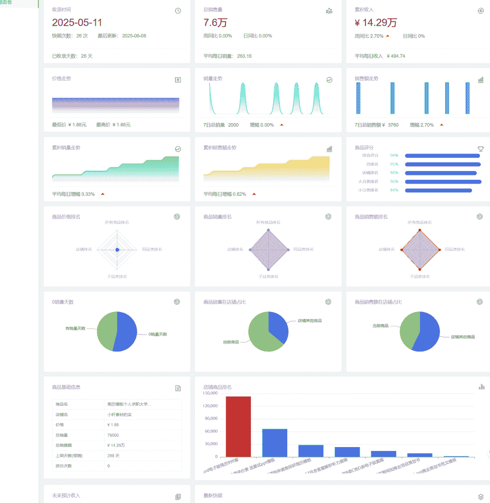

# 加微信用户数据报告

2025-05-11

活跃用户 11.77亿
环比+1.6% 同比+3.28%

新增用户 32.61万
环比+5.46%

活跃率 62.98%

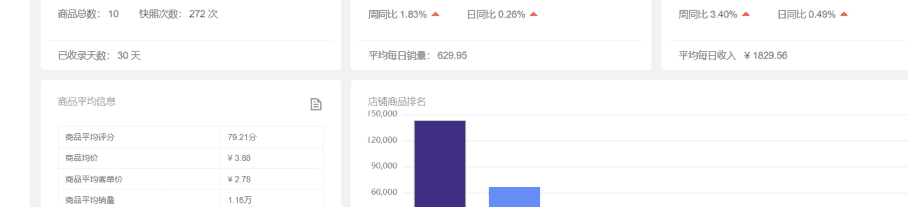

## 活跃趋势

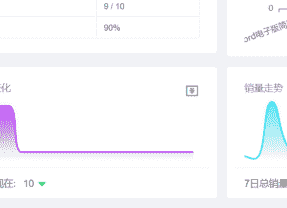
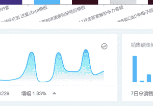
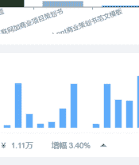

活跃用户 11亿
环比+1.8%

新增用户 92万
环比+5.40%

活跃率 62.1%

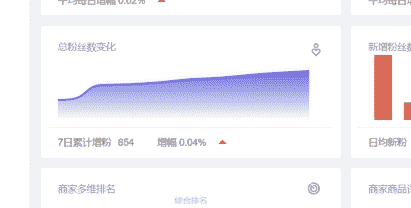
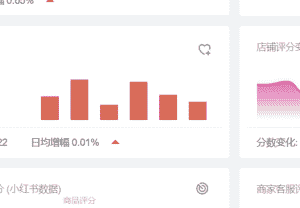

活跃用户 864万
环比+3.04%

新增用户 123万
环比-1.57%

活跃率 61.8%
环比-0.1%

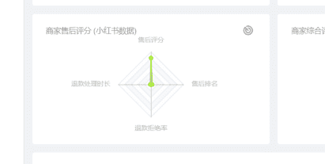
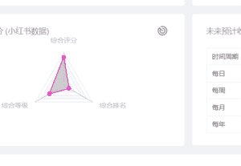

| 地区 | 活跃 | 新增 | 活跃率 |
| :--- | :--- | :--- | :--- |
| 广东 | 4.35亿 | 1.2万 | 65.2% |
| 浙江 | 2.12亿 | 8.5万 | 62.1% |
| 上海 | 1.85亿 | 7.2万 | 63.5% |
| 福州 | 0.92亿 | 3.1万 | 59.8% |
| 四川 | 0.88亿 | 2.9万 | 61.2% |
| 河南 | 0.85亿 | 2.5万 | 58.5% |
| 江苏 | 0.76亿 | 4.8万 | 64.1% |

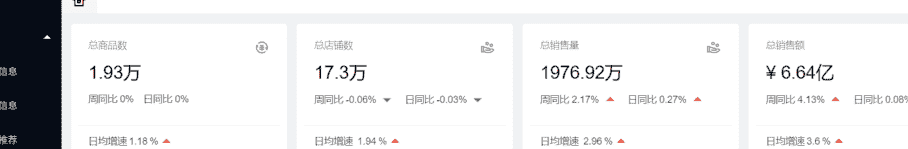

## 用户画像

1.937亿
环比+1.1%

17.37亿
环比+1.9%

1976.92万
环比-5.0%

6.64亿
环比+5.8%

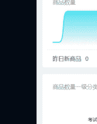
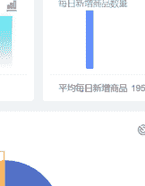
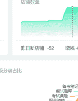
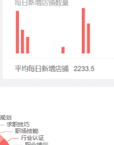

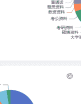
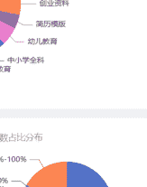
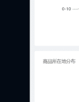

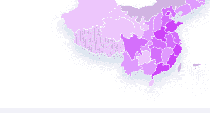

# 微信公众号与微信群

| | | |
| :--- | :--- | :--- |
| 2.02万 | 1.88 | 7.6万 |
| | 查看商品 | |
| 1.46万 | 查看商店 | 万 |
| | 查看店铺口碑 | 万 |
| 3263 | 查看小红书 | |
| | 商品历史快照 | 万 |
| 2674 | 店铺商品列表 | |
| 1.1万 | 商品分析 | 万 |
| | 店铺分析 | |
| 4828 | 收藏商品 | |
| | 收藏店铺 | |
| 2.2万 | 复制商品ID | 万 |
| | 复制店铺ID | |
| 3145 | | |

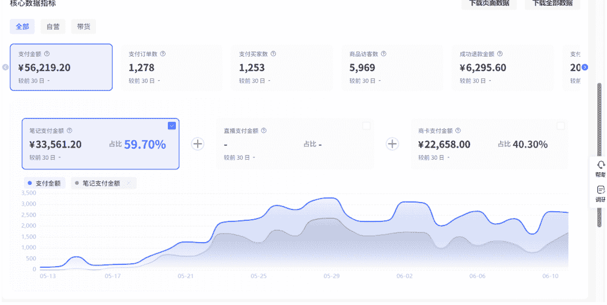

 核心数据指标

冬后传奇：第一次遇见这么有才的道士
刘刘行：太优秀了！[源]
信道：还没有正式上线，是先行的，正式上线数据量会是百万千万级别的，以及每日会更新一次数据，精准准确，后续AI将是一个大亮点。
可哥：直奔万几公里里，一个小时多点的车（累呆
正念：真的超级厉害，我在天使域，有空闲访老老师拥抱
荷丰财财：优秀！
登云亦涛：大佬可以写个淘宝海选品的软件吗，不是无良源的

# 微信聊天资源群

## (精华帖)用AI搭建多个微信群共享库

作者：先豪(Jiaohao)

日期：2023-06-27

大家好，我是先豪(Jiaohao)。由于大家的热情，三个群日常消息简直是爆炸。在群聊中发现，群友们更多是关心群里是否已经回复。另外三个群里也有一些重复的，这两天看到不错的教程，用AI把群内的消息整理成了表格，工作量还是大的。

我想尝试用AI把群内的消息整理成共享库，而且不需要查找关键词就能找到，更方便了。详情链接：https://github.com/rby2fb9/wiki/DRA79w0ncFny?from=copychat

 评论区：

吐槽：我是真的累，做报告确实准确，有很多卡点，我还做过一个产品就做报告。主要关键是：
1. 提取消息
2. 语义分析（目前用gemini）
3. 如何分享（可选）

先豪(Jiaohao)：谢谢大家！
David：最大的卡点就是提取消息，其他都还好。
David：微信做过一款自动化的工具，主要是群内容的隐私，还有之前实现的是cursor+gpt，自动化总结增量更新，这点挺好。
先豪(Jiaohao)：国内的搜索能力还不，想要这个知识库。

## (精华帖/124赞)AI自媒体航海复盘：成果与实践建议

作者：令孤峰

日期：2025-06-11

大家好，我是令孤峰，大家叫我令孤峰就好。作为本次航海的主教练兼助教，我带领360人实在做了AI自媒体。这次航海21天时间，有多位同学成功接到单，小红书5天就涨粉5000，后续涨到10000粉，内容同步发视频号，涨粉3万。为了方便，可以见下方链接：https://bcje44bsl.feishu.cn/docx/Rjd7d5wbLoixN0xh5cVnWf

hello，你这次航海接了很多单，大概变现了多少哈，方便说一下。我参加了很多期的海，这次参加的mini航海是我收获最大的一次航海，非常幸运当时我参加了这次航海。这次航海我目前的剪辑视频+小红书发布+项目管理，短短一个月变了500+，这其实是参加这次航海中的一个小收获而已。相信参加了这次航海的很多圈友和我一样同身受！因为这次航海大家就是实打实的操，踏实完成任务单就能变现，只要是参与了变现都是100%收获的！这次航海是一个能长期坚持的航海，只要做了就有收获，不仅是变现，对于提升自己的剪辑能力、网感，接单的能力都有非常的提升！非常感谢生财组织的这次MINI航海，也非常幸运让我们认识，在整个过程中帮助了我们很多，也给我们提供了机会！希望后续这样

# 扫码 知识是TOP免费资源群

| | | |
| :--- | :--- | :--- |
| 免费 | ◆ 每日获取高价值资讯 | 可提供各类资源搜索服务 |
| 价值 | ◆ 热门推文 | 各行业报告 |
| 及时 | ◆ 精选资源 | ◆ 副业落地方法 |
| 专注 | ◆ 职场实用资源 | ◆ AI经营自媒体 |

# (48)低成本解决小红书项目机分享

作者：早

日期：2023-06-13

最近在参加小红书资料航海，发现其实很多人在纠结手机机、流量卡、备用机的选择，最近这种东西其实就很纠结的，不过总归还是不少小伙伴想要低成本、低风险、高效率的实验，而有些东西其实是一些细节折腾或者是小小的差异，虽然破了一些信息后学会了，其实就好纠结了。

于是今天给大家分享一套低成本、甚至零成本注册流量卡，解决手机、低风险备用机的方案，是我自用的方案之一，提供给大家参考，可以根据实际情况选择。里头有很多注意事项，大家注意关注。

详细文章请移飞书文档，观感更好：

https://aqj4zdv0n.feishu.cn/docx/RkMO2LoFawuxUGpkcxonLh?from=from_copink

评论区：

暂无评论

## (34)普通人AI打造钱全流程拆解

作者：米木设计

日期：2023-06-15

项目实航海好事强

## (精华帖/102赞)YouTube长视频赛分享

作者：ISLAND

日期：2025-06-13

大家好，我是ISLAND。最近大家要的长视频赛比较近期，可以问问，在国内小红书、抖音都用YouTube做长视频吗？我写这篇文章的目的是为了给粉丝留坑指南，分享我是如何在直播中拆解并更新赛道的；在实际创作过程中，越伸手越有一种内达的感觉。如果你刚开始做长视频，没有思路和方向，你可以考虑从YouTube入手，热门爆款很多。

https://xbnd729mm.feishu.cn/wiki/S150tZbB0DkQM3GCiDn?from=copy

评论区：

方雀：感谢ISLAND教练的分享，长视频赛道大有可为

ISLAND : [改稿]
辛来说：太强了，一文讲遍长视频。感谢分享
徒步：太太太强了
逸逸：明天就开始实操，刚好有一个号在做这个赛道，及时
竹子：好东西！！
涵涵：感谢分享，马上动起来
瀚伟：来得太及时了，一直想过明确的方向，现在有了明确目标，非常感谢分享，肝累了

# (AI代码自动化)航海实操

作者：李三敏

日期：2023-05-06

【AI代码自动化】主题航海。之前接触过类似工具，没有系统性的学习，了解到重新运营，比较好。这次航海让我重新梳理到的内容，执行像是一个养。在持续播中，如果你刚开始，没有思路，可以加入我们的生财术，欢的，可以的。

先豪(Jiaohao)：国内的搜索

快捷键：https://pyywv99agfeishu.cn/docs/QeVdHW4nVoPyAx3htckUgnQl?from=copy

评论区：

一栗米：给力！我就是那个圈友
过的：我想增加两个功能，提取文案+插图片。发笔记后没有流量是因为只有图片没有文案的原因，还有看下来，要有交流就好了。

# 外交网站：外交部记者会历史文字批量采集

## 需求
外部网站采集了2023年3月以来全部部记者会的文字，网站结构非常简单，非常适合RPA自动化处理：数据主要是记者会的索引，每次记者会召开后就会生成一个新闻页面，用于记录当天记者会的全部文字内容。

网址地址：

- 外交部记者会首页 https://www.fmnrc.gov.cn/fyrbt/637021/jzshl637025.shtml
- 单页记者会网页（2023年6月11日外交部发言人林剑主持记者会）https://www.fmnrc.gov.cn/web/fyrbt/637021/jzshl63702506/1146572.shtml

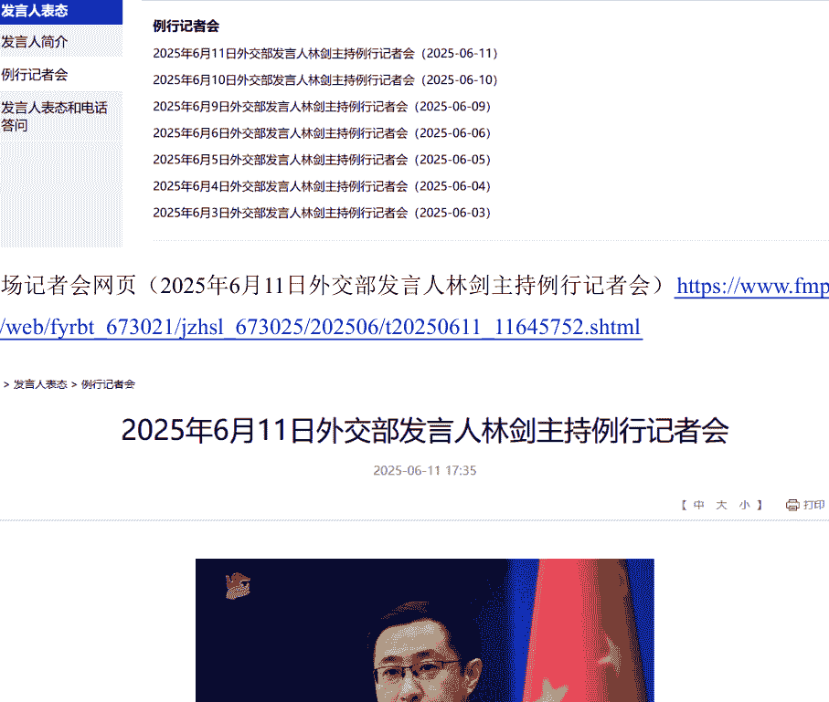

总台记者：今天，中方非常欢迎外交部发言人林剑来上海主持记者会。欢迎发言人林剑就大家感兴趣的问题进行介绍。

记者：中澳贸易额较去年保持了100%的增长，中方对这一增长为两国关系发展带来积极影响表示感谢。我们一直坚持“合作共赢”理念，为双方带来利益。期待未来中澳贸易能够取得更大突破，实现双方互利互赢。中澳关系基础良好，双方互尊重、互信、互合作的关系非常稳固。事实上，中澳两国关系近年来取得丰硕成果，2022年中澳贸易额创历史新高，两国在经贸、文化领域的合作不断深化，为中澳关系注入了动力，为双方注入了信心。接下来请林剑将解答中国上海日报的答问。

我的目标是找到历史存档所有，并在网站上所有的记者会一件采集到本地，并以标题md的方式存储，为了后续导入知识准备。

### 流程步骤

### （1）新建采集集并设置目标

- 打开八爪RPA，点击“应用”上的“新建应用”，创建一个应用。

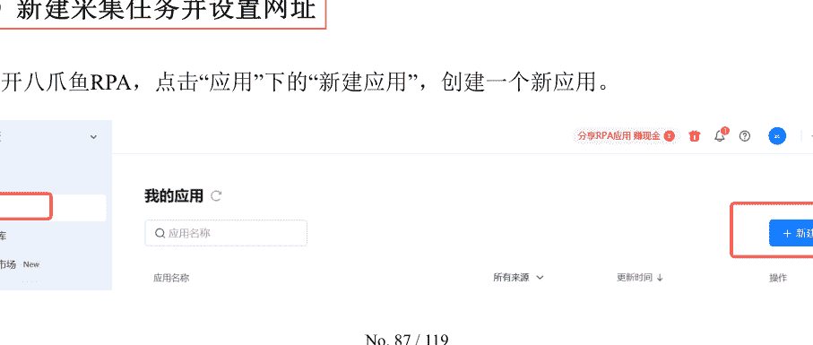

### 设计流程

通过指令来驱动数据流程。RPA的设计一定要先列出一个整体思路，然后按照这个思路一步步下去。

以这个为例，我设计了三个步骤：

- 用八角鱼浏览器爬插件打开主页（可以使用chrome浏览器，需要提前安装八角鱼的插件）
- 创建一个循环元素，把单页的网页内容抓取过来，存到数据表格。
- 创建另一个循环，数据表格里列表的单页网页打开，抓取的内容保存到本地文件中。

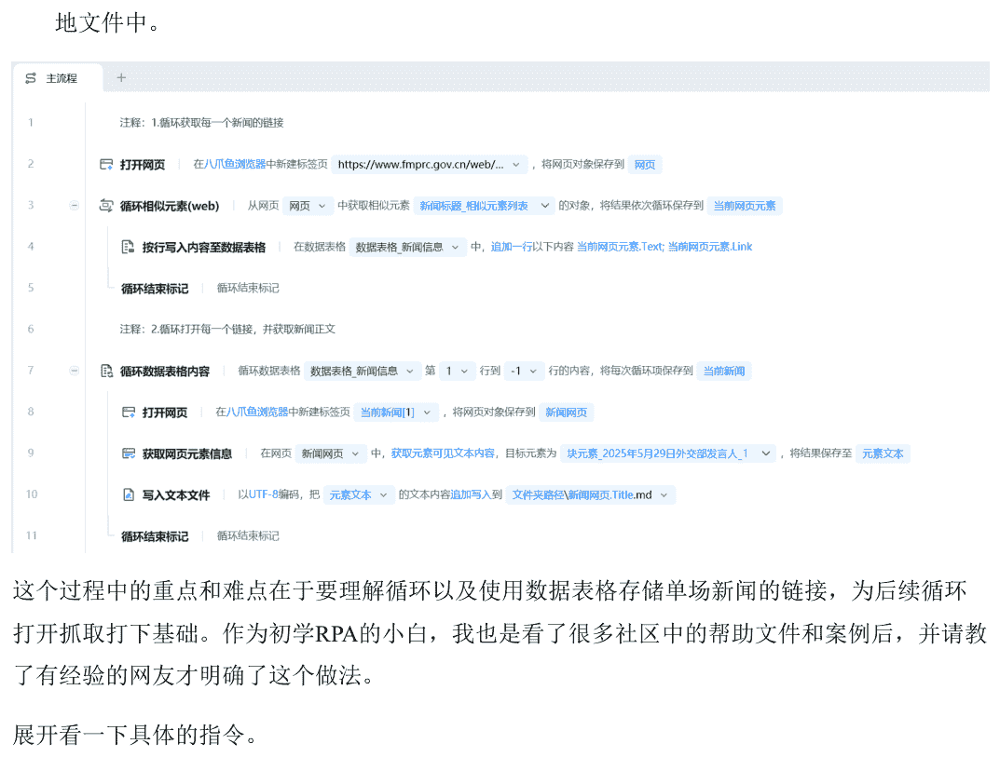

这个过程的重点和难点在于理解循环以及使用数据表格存储单页链接，后用循环打开它。对于初学RPA的你，我也看了很多社区里的帮助文件和案例，并请大家参考一下有经验的朋友们是怎么这么做的：

用八角鱼浏览器插件打开主页，并保存到变量“网页”中。（理解变量的概念还是很重要，你可以把它当成一个循环的起点）。

创建循环元素，用锚点定位当前页的标题提取出一列列表的链接，用相似元素抓取下来，存到变量“当前网页”中；
然后把单页的标题和链接存到一个数据表格中。

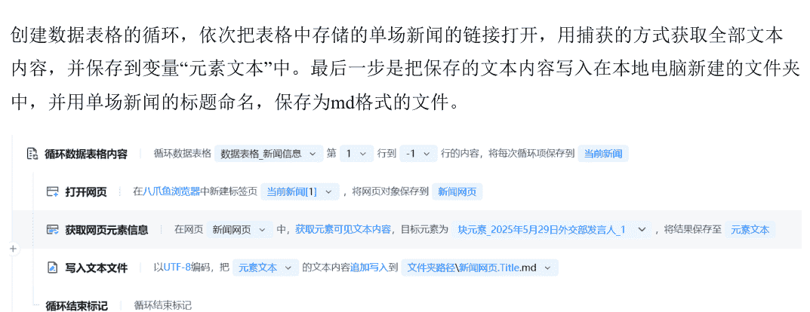

创建数据表格的循环，依次根据表格存储的单页链接点击打开，用锚点的方法获取全部文本内容，并保存到变量“元素”中。最后把保存的网页内容用本地命名，保存在本地新建的文件中，并用单页命名为md文件。

我们来看看运行效果

## 微信公众号ima知识库同步

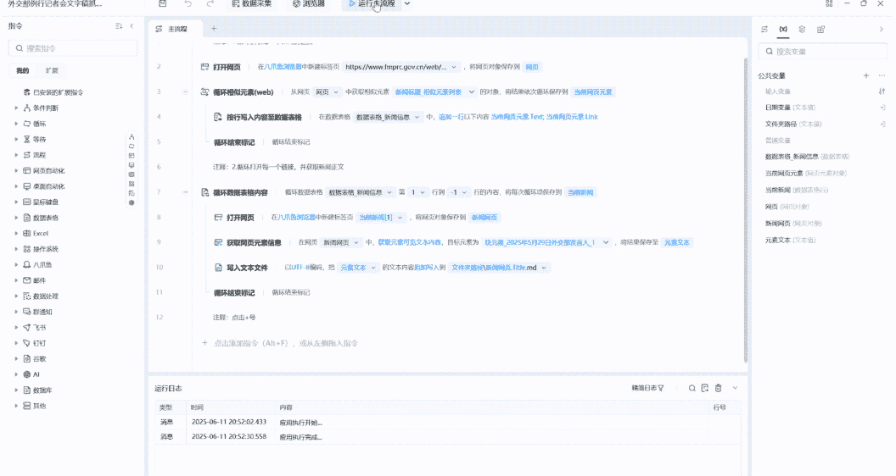

非常完美的实现了目标。
由于批量获取历史数据，我采取了批量下载再一次性上传到知识库的方式，后面送到ima的步骤就是手动操作，只需点几下标识即可。

## 案例2：每日新增新闻的自动采集与知识库自动同步

### 需求办理

案例一解决了批量下载历史数据的问题，但是后续每天新增新闻的例行记者会新闻如何处理呢？
想要再增加一个RPA应用来解决这个问题。在我的案例中，我的目标是让RPA访问记者会，抓取新增内容并同步到ima知识库，持续新增知识库
不仅同步到本地，还能同步到ima。

### 流程步骤

在这个案例中，我主要设计了两个步骤：

- RPA打开打开新的网页并自动抓取内容并保存到本地。
- RPA 模拟人的操作的方式进行操作，完成后点击上上传、选取本地上传文件的动作。

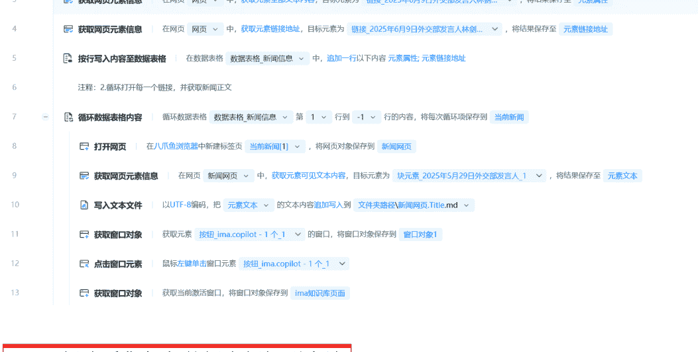

> (1) 新增采集任务并抓取新闻到本地

参照案例一的做法，从一个指定日期的每日新闻开始，抓取内容并保存到md文件中。

### （二）机器人操作在ima中传输

实现这一步我采用模拟的方式，用RPA操作模拟元素获取数据、点击对象，依次操作。在这个过程中，需要确保每一一步的操作都被拆解成一个RPA的指令，才能确保最终的。

这个过程也用了爬虫这种高效的RPA方法，不仅操作网页，还能操作其他的客户端、操作系统等，这会变得很可能。

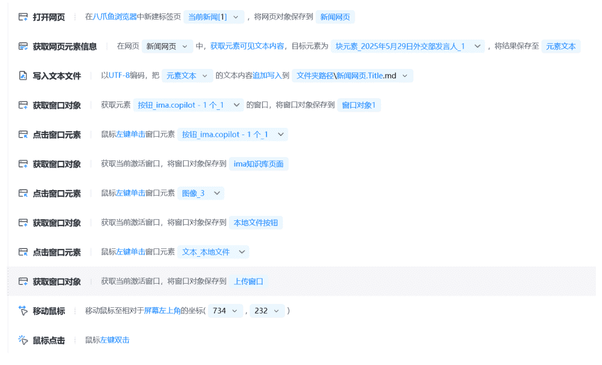

我还是觉得这种办法比较笨，特别是需要操作很多步骤的情况下，每次运行后失败的概率（找不到），就需要换新的策略。但是对RPA的理解还是不够，找不到实现的还需要去看看社区的文档和实际的案例。

同样来看看最后的效果：

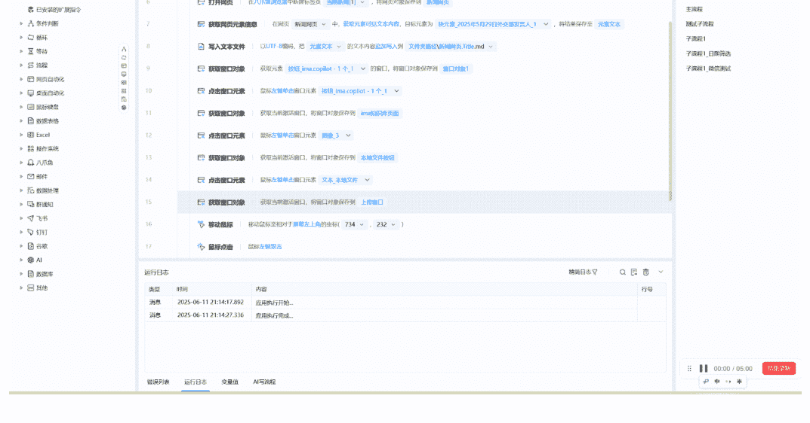

## 整体流程与扩展

### 自动化识别高效体验

通过案例可以看到，用八爪RPA抓取数据、整理信息、搭建知识库，大大节省了繁琐的操作。只需用机器人配置好参数，就能实现自动搬运——这不仅用于外交部门，几乎所有领域。

### 灵活迁移，构建更多场景

描述以后，你可以扩展到财经、公司、法律、学术等领域，例如，金融分析可以抓取，教师可以每日自动。

我刚才提到的这个ima知识库，就可以用来询问记者会信息了。

### 加微信记录教程

如何通过微信记录自动提取例会记录：

- 2025年2月
- 2024年11月
- 2024年12月
- 2025年1月
- 2025年3月
- 2025年4月

具体如下：

### 八爪RPA应用场景——无边界，你探索

八角鱼官方发布了“应用市场”，提供了超过千种玩法与自动化模板，涵盖电商、社媒、运营等场景。例如：

- 小红书采集、内容监控
- 电商监控、评价抓取
- 数据采集、监控
- 短视频平台收集

新手可以在市场中查找、下载即可无需从零搭建，大大加快速度和效率。

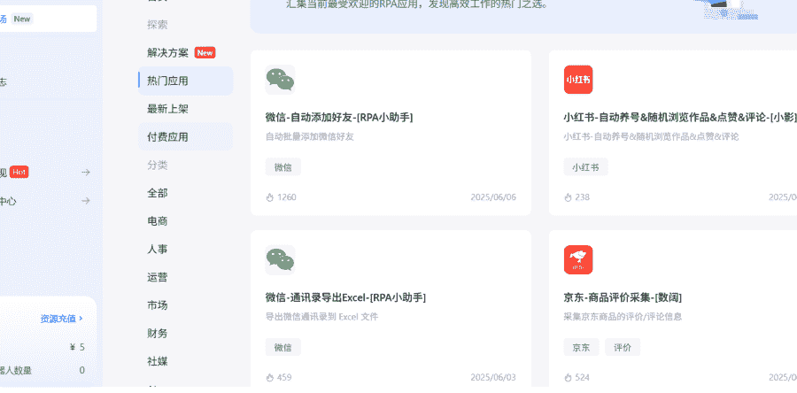

## 结语

我这两天的体会，想要快速入门RPA，有三个诀：

- 有一个实际的需求，满足需求的过程中学习；
- 多看社区文档，学习别人的经验；
- 找一个不需要复杂的模板，以此基础改成自己的应用。

最后，把这次搜索上面的案例免费分享给大家，希望对你有启发和帮助。[文章全量数据抓取](https://rpa.bazhuuyu.com/appstore/app/dev/6ny-ci-bu-li-xiang-ji?ref=WXgle) [行者新闻最新数据抓取并上传到邮件](https://pa.bazhuuyu.com/appstore/app/dev/nfy-c/wai-iao-bu-li-xing-ji)

欢迎大家结合自己的实际需求，鼓励自己尝试，哪怕完全不会代码，也可以借助RPA和知识库工具，实现高效的信息采集与管理——把生活中重复、枯燥低价值的环节交给自动化，自己专注学习和创造。如果你有更好的想法，欢迎留言交流！让我们一起用好RPA，让信息更有价值。

## AI提示词教程与实战建议

作者：木斗
日期：2023-06-13

不会写提示词没关系，跟着这套结构一步步学就会。别再“瞎AI”了，直接教你提示词到底怎么写，新手也能用！用AI的才是真正的玩家。写不出提示词的，一定要看这篇。有学员问我：“教练，您的提示词结构清晰、排版整齐、逻辑严密的提示词是一段段出来的。我现在的提示词都不懂，只会写一点话的，这正常吗？”我想说：写好提示词，不是背诵而是靠谱。这篇文章我会开始，教你如何写提示词的，从思维拆解、表达技巧、工具一切，让你学会写自己的“AI操作手册”。

Hello，我叫未丰，设计+运营+营销三线选手。《蓝语》《人生亏损指南》《生财百科》知识不值钱，改变才值钱。一起来嗨，一起生财术！

电子书籍：https://s296caminzfeishu.com/docx/L3e6df4RUOX5YaSGFFe

## (20课)出海网站与开源模板实践感悟

作者：sheep
日期：2025-06-12

这次教程分享了一个带有支付相关的开源模板靠靠学习实践起来！！！快速构建MVP（最小可行产品），避免在技术选型和架构设计上消耗时间。通过研究模板源码，能够学习到AI SaaS产品的最佳实践和设计模式结合航海手册的指导，可以更新系统路径规划产品开发路线，减少试错成本。

具体内容请文档查看：项目文档https://iq21iualv.feishu.com/docx/XJJa4db2cjo8POTxtQtKqemfCdnWd

# 【其他】4篇

### (精华帖)239含B站悬带货实战解析与选品攻略

作者：叶龙宏
日期：2025-06-12

B站好物：如何做悬带货？【案例分析】对接：知乎好物的20年红利，B站官方公布GMV级别的账号（可直接对接B站），直播带货...

今晚，在B站榜里看到热闹后，以前过的B站的网站崩跌，敏锐觉得有情况——B站终被当成韭割了。我从22年开始开始布局B站，目前在B站有8个账号，基本都是实单，单号流水超过五位数，拿来说，单号流水是十万，从B站引流到B站好物（带货），流量热闹，我们专门找了卖家聊过，以下是早早发现的单品（哪些是蓝海）如何获取带品逻辑是什么，B站官方直接对接系统（流量筛选）获取带货的内容。

B站好物：https://859ahkj.feishu.docs/EwU1HuosaaQRcinHf?from=copylink

## 粉丝运营

作者：亦仁
日期：2025-06-12

一条超级让生财把B站崩了。以后可以出去，因为一条超级，大家来说，我很佩服的地方就是“准时出”。”。日一复一的视频号、公众号、粉丝、流量。

### 运营

- 粉丝运营（185）
- （186）
- 粉丝运营（187）
- 粉丝交流群 (188)
- 粉丝群 (189)
- 粉丝进交流群 (200)
- 更多群聊

### 微信登录 | 粉丝进群

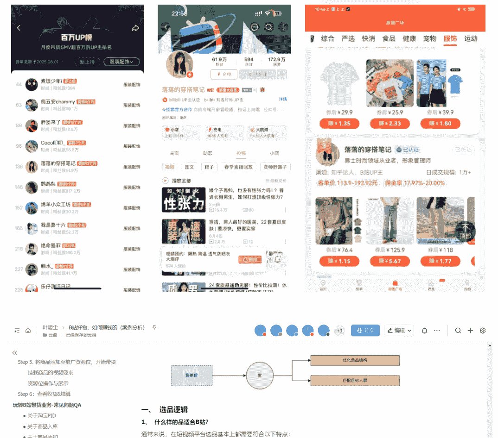

评论区：

叶江龙：这个速度有点夸张了...
爱播：你好呀
无限：请问一下，粉丝上的标签哪里看到？
斯斯：创作的速度太了
叶江龙：这个方法还是不行
叶江龙：因为不是按时执行的
叶江龙：加油
叶江龙：No.

## (17赞)一条超级让生财把B站崩了

作者：亦仁
娜娜叶江龙：粉丝数据分析

评论区：艾
吴泽承：艾
烽火：不会真的崩了吗？
柳：艾
小：艾
龟：艾
兔：艾
子央木：干得漂亮
开心：都是你们的
xiao：哈哒，哥：懂

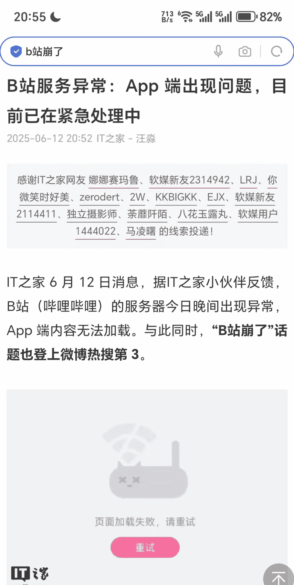

## (17竟)不上班搞钱从01自救

作者：桑瑞军
日期：2025-06-13

前几天在某书刷到一个非常优秀的刚才，介绍过经历上看，已经很优秀了。但是感受到了迷茫，不知道该怎么做？我创访了100位离职的朋友是如何搞钱的。离开职场后，不知道自己做什么，整理了一份《不上班搞钱自救指南：从0到1的破局行动手册》！这部分内容对同学有所启发：https://bpvujift.feishu.cn/docs/

## (春华贴)(264)普通人AI：准时输出，身入人海

作者：坤汀
日期：2023-06-11

从老王大家来说，说是你的AI，我很佩服的地方就是“准时输出”。日一复一的视频号、公众号、粉丝、流量。刘翊是视频号领域的头部流量，得到了罗宇师傅、刘老师导师的大场专家。他自己说过其实并不是运气，而是他的经营理念，他是AI之道。因为不是按时执行的，让大家找到生死的人了。那？就坚持你准时输出，当你坚持年后发现自己还在，还是输出的自己负责筹备，那么你可能会害怕。这就是一个“定”字，但是对于普通人适合这种做法。你可以积累一些确定性，这样也可以每天。坚持一天。坚持你现在，坚持胜利，某个春天就爆发了。那时候对你就有关注了。起初觉得你是市面上一个搞笑的小伙子。长期的期待，等到你的春天，看着你产生了耐心，最后有了结果了。关键是，当你开始坚持了，每天都看到你，每天更新一个公众号，每天涨五个新朋友。0607之后大家又说：“AI行不行，就是行业内的事”。你就坚持下去，开市场，坚持视频，看到！！顶尖高手说的话都是一回事，所以你拥有流量，流量没枯竭，还有很多时候在等着你。现在已经刻到，一周的磨合期，自己还是进入这种模式里面，下意识可能会想向地方学习。传统的教育，会从学校到大学，到了几个月后，才迎来上场，用市场检验你，我们学的是一个确定性的成绩，成为了验证一个确定问题。想要想法。而商业的区别，是不带倾向性的信息、认知，而这些恰恰是红利。。如果我们尝试去遇到，大家都会了，可好不好，确定可能失败了，这样也没有可以了。所以，从哪里开始？不是学生，而是先跑，动起来。

# 红星小学队长的小店

## 8 物物推荐 粉丝6万 已售出3万+

| 综合 | 销量 | 价格 | 新品 |

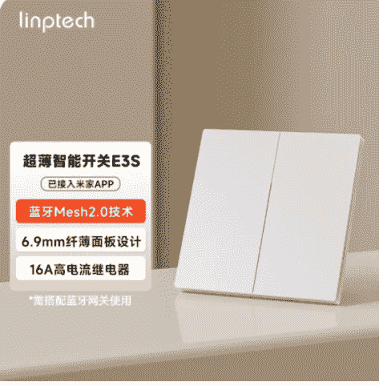

领先科技超薄智能开关
超支持Mesh 2.0
6.9mm超薄设计
16A双回路开关

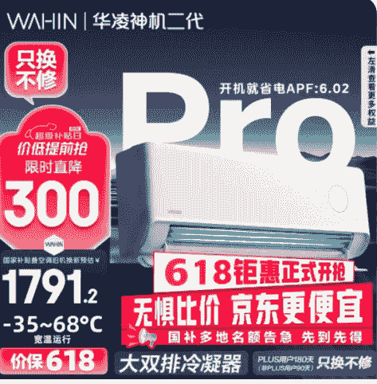

## 华凌空调 热机二代Pro...
京东物流 京东自营
后价¥2249.1 已售1万+

## 领先科技超薄智能开关
京东物流 京东自营
¥49 已售1万+
来自京东

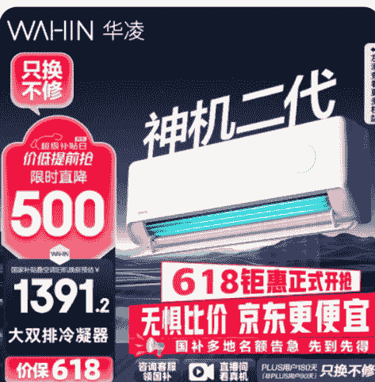

618正式开启
限时立减500
¥1391.2 大双外冷凝器

618正式开启
风尊二代Pro
限时立减600
¥2279.2 咨询客服领享补贴

## 华凌空调 1.5匹【大...
京东物流 京东自营
后价¥1799.1 已售1万+
来自京东

## 美的空调 1.5匹 风尊...
京东物流 京东自营
后价¥2849 7天无理由已售6000+
来自京东

## UP主花火名片

## 霹雳小威 ♂
UID: 1130268164 | 浙江
粉丝8.4万 | 家电测评、数码测评、家居测评

个人介绍：家居 | 生活 | 装修 | 数码 | 好物推荐 v: Ne...

近期合作作业：3C及电器、食品饮料、服装配饰、家...

## 合作报价
定制视频 ￥ 35,000

## 数据概览
- 稿件播放量中位数：4.4万，高于75%的同类UP主
- 稿件互动率中位数：2.2%
- 近90天投稿数：17
- 近1年接单数：48

花火代表作 | 内容代表作

联系机构

## 微信信息群
视频 热门发现 收藏 更多 >

【联想拯救版】3000元买到这台笔记本电脑真的不香吗？
2023-05-24

【联想拯救版】拯救3000元预算，笔记本怎么选？
2023-05-24

万级预算组装电脑？这套配置真的绝了！
2023-05-25

还有Z5400拯救版？这配置真的太香了！
2023-05-25

4K【拯救版，“显示器”真的有多香？
2023-05-25

4000元【拯救版】，这显示器真的不香吗？
2023-05-25

【4000元拯救版】4000元真的不香吗？
2023-05-24

【5000元拯救版】5000元真的不香吗？
2023-05-24

小红书拯救笔记本，这配置真的太香了香了！
2023-05-24

拯救笔记本，这配置真的太香了香了！
2023-05-24

拯救笔记本，这配置真的太香了！
2023-05-24

拯救笔记本，这配置真的太香了！
2023-05-24

拯救笔记本，这配置真的太香了！
2023-05-24

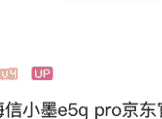
拯救笔记本，这配置真的太香了！
2023-05-24

拯救笔记本，这配置真的太香了！
2023-05-24

拯救笔记本，这配置真的太香了！
2023-05-24

拯救笔记本？这配置真的绝了！
2023-05-24

拯救笔记本？这配置真的绝了！
2023-05-24

## 今日推荐：拯救少女6
今日：一抢拯救笔记本价格：
- 5500元抢到5199元：拯救笔记本55 Pro 7500元高亮+MiniLED显示屏
- 6500元抢到6349元：拯救笔记本65 Pro 6500元高亮+MiniLED
- 7500元抢到7149元：拯救笔记本75 Pro 7500元高亮+MiniLED
- 8500元抢到8199元：拯救笔记本85 Pro 8500元高亮+MiniLED
- 10000元抢到9999元：拯救笔记本100 Pro 10000元高亮+MiniLED

二、拯救笔记本
- 拯救笔记本E7 Pro 6500元拯救15H6，7500元抢到7299元：拯救笔记本E7
- 8500元抢到7999元：拯救笔记本E7 Pro 8500元高亮+H6+MiniLED
- 10000元抢到9999元：拯救笔记本E7 Pro 10000元高亮+H6+MiniLED，9800元抢到9498元

2023-05-05

其拯救笔记本有什么问题？这两款真的不错
2023-05-05

【联想拯救版】3000元买到这台笔记本电脑真的不香吗？
2023-05-24

【联想拯救版】拯救3000元预算，笔记本怎么选？
2023-05-24

万级预算组装电脑？这套配置真的绝了！
2023-05-25

还有Z5400拯救版？这配置真的太香了！
2023-05-25

4K【拯救版，“显示器”真的有多香？
2023-05-25

4000元【拯救版】，这显示器真的不香吗？
2023-05-25

【4000元拯救版】4000元真的不香吗？
2023-05-24

【5000元拯救版】5000元真的不香吗？
2023-05-24

小红书拯救笔记本，这配置真的太香了香了！
2023-05-24

拯救笔记本，这配置真的太香了香了！
2023-05-24

拯救笔记本，这配置真的太香了！
2023-05-24

拯救笔记本，这配置真的太香了！
2023-05-24

拯救笔记本，这配置真的太香了！
2023-05-24

拯救笔记本，这配置真的太香了！
2023-05-24

拯救笔记本，这配置真的太香了！
2023-05-24

拯救笔记本，这配置真的太香了！
2023-05-24

拯救笔记本？这配置真的绝了！
2023-05-24

拯救笔记本？这配置真的绝了！

## 微信交流群资源

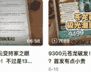

小米 WATCH 5 Pro 智能手表
欢迎进交流群！
2022-03-12 15:34

小米 SONY 5 蓝牙耳机
欢迎进交流群！
2022-03-12 15:34

小米 Buds 4 真无线降噪耳机
欢迎进交流群！
2022-03-12 15:34

小米 Buds 4 真无线降噪耳机
欢迎进交流群！
2022-03-12 15:34

小米 AirDots 真无线蓝牙耳机
欢迎进交流群！
2022-03-12 15:34

小米 AirDots 3 真无线蓝牙耳机
欢迎进交流群！
2022-03-12 15:34

小米 SoundPro 4代 真无线蓝牙耳机
欢迎进交流群！
2022-03-12 15:34

小米 SoundPro 3 真无线蓝牙耳机
欢迎进交流群！
2022-03-12 15:34

小米 SoundPro 2 真无线蓝牙耳机
欢迎进交流群！
2022-03-12 15:34

小米 SoundPro 1 真无线蓝牙耳机
欢迎进交流群！
2022-03-12 15:34

小米 AirDots 2 真无线蓝牙耳机
欢迎进交流群！
2022-03-12 15:34

小米 AirDots 1 真无线蓝牙耳机
欢迎进交流群！
2022-03-12 15:34

小米手环 4 智能手表
欢迎进交流群！
2022-03-12 15:34

小米手环 3 智能手表
欢迎进交流群！
2022-03-12 15:34

小米手环 2 智能手表
欢迎进交流群！
2022-03-12 15:34

小米手环 1 智能手表
欢迎进交流群！
2022-03-12 15:34

小米平板 4 智能平板
欢迎进交流群！
2022-03-12 15:34

小米平板 3 智能平板
欢迎进交流群！
2022-03-12 15:34

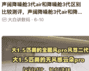
小米平板 2 智能平板
欢迎进交流群！
2022-03-12 15:34

小米平板 1 智能平板
欢迎进交流群！
2022-03-12 15:34

小米手机 11 智能手机
欢迎进交流群！
2022-03-12 15:34

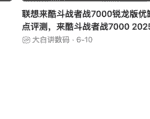
小米手机 10 智能手机
欢迎进交流群！
2022-03-12 15:34

小米手机 9 智能手机
欢迎进交流群！
2022-03-12 15:34

小米手机 8 智能手机
欢迎进交流群！
2022-03-12 15:34

小米手机 7 智能手机
欢迎进交流群！
2022-03-12 15:34

小米手机 6 智能手机
欢迎进交流群！
2022-03-12 15:34

小米手机 5 智能手机
欢迎进交流群！
2022-03-12 15:34

小米手机 4 智能手机
欢迎进交流群！
2022-03-12 15:34

小米手机 3 智能手机
欢迎进交流群！
2022-03-12 15:34

小米手机 2 智能手机
欢迎进交流群！
2022-03-12 15:34

小米手机 1 智能手机
欢迎进交流群！
2022-03-12 15:34

华为 Mate 40 智能手机
欢迎进交流群！
2022-03-12 15:34

华为 Mate 30 智能手机
欢迎进交流群！
2022-03-12 15:34

华为 Mate 20 智能手机
欢迎进交流群！
2022-03-12 15:34

华为 P40 智能手机
欢迎进交流群！
2022-03-12 15:34

华为 P30 智能手机
欢迎进交流群！
2022-03-12 15:34

华为 P20 智能手机
欢迎进交流群！
2022-03-12 15:34

iPhone 13 Pro 智能手机
欢迎进交流群！
2022-03-12 15:34

iPhone 12 Pro 智能手机
欢迎进交流群！
2022-03-12 15:34

iPhone 11 智能手机
欢迎进交流群！
2022-03-12 15:34

iPhone XS 智能手机
欢迎进交流群！
2022-03-12 15:34

iPhone X 智能手机
欢迎进交流群！
2022-03-12 15:34

三星 S22 Ultra 智能手机
欢迎进交流群！
2022-03-12 15:34

三星 S21 Ultra 智能手机
欢迎进交流群！
2022-03-12 15:34

三星 S20 Ultra 智能手机
欢迎进交流群！
2022-03-12 15:34

三星 Note 20 智能手机
欢迎进交流群！
2022-03-12 15:34

三星 Note 10 智能手机
欢迎进交流群！
2022-03-12 15:34

三星 Note 9 智能手机
欢迎进交流群！
2022-03-12 15:34

三星 Note 6 Pro 智能手机
欢迎进交流群！
2022-03-12 15:34

三星 Note 5 Pro 智能手机
欢迎进交流群！
2022-03-12 15:34

三星 Note 4 Pro 智能手机
欢迎进交流群！
2022-03-12 15:34

三星 Note 3 Pro 智能手机
欢迎进交流群！
2022-03-12 15:34

三星 Note 2 Pro 智能手机
欢迎进交流群！
2022-03-12 15:34

三星 Note 1 Pro 智能手机
欢迎进交流群！
2022-03-12 15:34

小米 K40 智能手机
欢迎进交流群！
2022-03-12 15:34

小米 K30 Pro 智能手机
欢迎进交流群！
2022-03-12 15:34

小米 K30 Pro 智能手机
欢迎进交流群！
2022-03-12 15:34

小米 K20 Pro 智能手机
欢迎进交流群！
2022-03-12 15:34

小米 K20 智能手机
欢迎进交流群！
2022-03-12 15:34

小米 K10 智能手机
欢迎进交流群！
2022-03-12 15:34

红米 Note 10 智能手机
欢迎进交流群！
2022-03-12 15:34

红米 Note 9 智能手机
欢迎进交流群！
2022-03-12 15:34

红米 Note 8 智能手机
欢迎进交流群！
2022-03-12 15:34

红米 Note 7 智能手机
欢迎进交流群！
2022-03-12 15:34

红米 Note 6 智能手机
欢迎进交流群！
2022-03-12 15:34

红米 Note 5 智能手机
欢迎进交流群！
2022-03-12 15:34

红米 X10 Pro 智能手机
欢迎进交流群！
2022-03-12 15:34

红米 X10 智能手机
欢迎进交流群！
2022-03-12 15:34

红米 X9 Pro 智能手机
欢迎进交流群！
2022-03-12 15:34

红米 X9 智能手机
欢迎进交流群！
2022-03-12 15:34

红米 X8 智能手机
欢迎进交流群！
2022-03-12 15:34

红米 X7 Pro 智能手机
欢迎进交流群！
2022-03-12 15:34

红米 X6 Pro 智能手机
欢迎进交流群！
2022-03-12 15:34

红米 X6 智能手机
欢迎进交流群！
2022-03-12 15:34

红米 X5 智能手机
欢迎进交流群！
2022-03-12 15:34

红米 X4 智能手机
欢迎进交流群！
2022-03-12 15:34

红米 X3 智能手机
欢迎进交流群！
2022-03-12 15:34

红米 X2 智能手机
欢迎进交流群！
2022-03-12 15:34

# 微信指数群 流量选源群

## 百万UP榜
月度带GMV百万的UP主播

标准更新至2025.06.01 新上榜 类目

### GMV超千万

| 序号 | 账号 | 领域 | 类目 |
|---|---|---|---|
| 1 | Mr浅龙 | 生活 | 粉丝数234.1 | 3C数码电器 |
| 2 | Wilson家长 | 生活 | 粉丝数35.0 | 3C数码电器 |
| 3 | 斤计帐的包 | 科技 | 粉丝数2.5 | 3C数码电器 |
| 4 | 摄影所有 | 科技 | 粉丝数231.6 | 3C数码电器 |
| 5 | 爱唱歌的信 | 生活 | 粉丝数8973 | 3C数码电器 |
| 6 | 机机汇 | 科技 | 粉丝数4872 | 3C数码电器 |
| 7 | Super好你君 | 科技 | 粉丝数1.3 | 3C数码电器 |
| 8 | 笔测评室 | 科技 | 粉丝数243.1 | 3C数码电器 |
| 9 | 不常常机测评 | 科技 | 粉丝数6.9 | 3C数码电器 |
| 10 | 豪面对沃 | 科技 | 粉丝数13.0 | 3C数码电器 |

## 百万UP榜
标准更新至2025.08.01 新上榜 类目

| 序号 | 账号 | 领域 | 类目 |
|---|---|---|---|
| 10 | 豪面对沃 | 科技 | 粉丝数13.0 | 3C数码电器 |
| 11 | 磊磊科技 | 科技 | 粉丝数4461 | 3C数码电器 |
| 12 | 逆袭 | 科技 | 粉丝数56.8 | 3C数码电器 |
| 13 | 好邦潮流 | 科技 | 粉丝数61.0 | 3C数码电器 |
| 14 | 向日西柚少女 | 科技 | 粉丝数1120 | 3C数码电器 |
| 15 | 电电君 | 科技 | 粉丝数16.6 | 3C数码电器 |
| 16 | 磊高端电竞 | 科技 | 粉丝数15.1 | 3C数码电器 |
| 17 | 闲聊粉丝站 | 科技 | 粉丝数2.4 | 3C数码电器 |
| 18 | 野生的装机王 | 科技 | 粉丝数96.1 | 3C数码电器 |
| 19 | 宇宙数码编辑部 | 科技 | 粉丝数59.9 | 3C数码电器 |
| 20 | 超别测评 | 科技 | 粉丝数5188 | 3C数码电器 |
| 21 | 科技点蛋 | 科技 | 粉丝数... | 3C数码电器 |

## 百万UP榜
标准更新至2025.06.01 新上榜 类目

No. 108 / 119

# 加微信群及资源群

- 22 软伏长波 科技 | 粉丝群872 其他
- 23 创如科技 生活 | 粉丝群63.4 3C数码电器
- 24 闪电脑 科技 | 粉丝群38.3 3C数码电器
- 25 -Super好价 科技 | 粉丝群180 3C数码电器
- 26 夜樱的香 生活 | 粉丝群176 食品饮料
- 27 江户川u 科技 | 粉丝群1.8 3C数码电器
- 28 机仿优8BB 科技 | 粉丝群56.7 3C数码电器
- 29 myymortal 游戏 | 粉丝群1.9 其他
- 30 小眼睛明DM 科技 | 粉丝群257.9 图书影视
- 31 大访数码 科技 | 粉丝群1777 3C数码电器
- 32 雨杨梅测评 生活 | 粉丝群3.4 家居电器
- 33 好价值得买 科技 | 粉丝群4237 3C数码电器

## 百万UP榜
- 33 好价值得买 科技 | 粉丝群4237 3C数码电器

### GMV超千万
- 34 先看测评 科技 | 粉丝群255.5 3C数码电器
- 35 和和数码 科技 | 粉丝群1.6 3C数码电器
- 36 范杨橙测评 生活 | 粉丝群1.5 家居电器
- 37 电家优平 生活 | 粉丝群4.1 3C数码电器
- 38 紫莱Murasaki 科技 | 粉丝群12.7 3C数码电器
- 39 黑不养气 生活 | 粉丝群2749 养
- 40 和和论码 科技 | 粉丝群155.7 3C数码电器
- 41 白选数码 科技 | 粉丝群6279 3C数码电器
- 42 CR40AF-2016 游戏 | 粉丝群1.2 3C数码电器
- 43 小人兔头 科技 | 3C数码电器

## 百万UP榜
- 44 亮羡慕时尚 | 粉丝群1093 服饰
- 45 陌妞红 科技 | 粉丝群768 3C数码电器

### 加微信群
- 46 咖啡娃娃 科技 | 粉丝4.8万 3C数家居
- 47 明天牛奶 科技 | 粉丝19565 3C数家居
- 48 酷气氮 科技 | 粉丝9294 3C数家居
- 49 超级得买 科技 | 粉丝3.7万 3C数家居
- 50 极限酷测试 科技 | 粉丝14.7万 3C数家居
- 51 船长总动 科技 | 粉丝37.1万 3C数家居
- 52 苔若_R 科技 | 粉丝3.6万 3C数家居
- 53 有趣的INTJ 科技 | 粉丝5.7万 3C数家居
- 54 优家家居 生活 | 粉丝3958 3C数家居
- 55 有家电 生活 | 粉丝35万 3C数家居

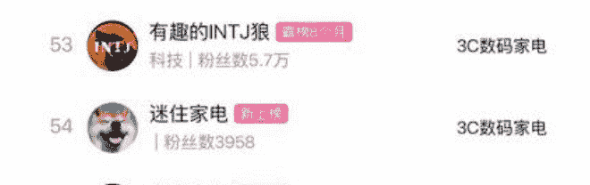

- 55 有家电 生活 | 粉丝2.6万 3C数家居
- 56 好物圈 科技 | 粉丝2.2万 3C数家居
- 57 对不起1TV 科技 | 粉丝7424 3C数家居
- 58 海毒家家居 科技 | 粉丝7533 3C数家居
- 59 全心小今天 生活 | 粉丝5.6万 3C数家居
- 60 荔知测评 科技 | 粉丝13.2万 3C数家居
- 61 数据好好君 科技 | 粉丝2560 3C数家居
- 62 屏而论 生活 | 粉丝9.5万 3C数家居
- 63 蛋妥samchammy 时尚 | 粉丝39.1万 服装定制
- 64 不靠撞恰老师 科技 | 粉丝13.3万 3C数家居
- 65 每天好价视 生活 | 粉丝163 3C数家居
- 66 单果讲装修 生活 | 粉丝29.8万 3C数家居

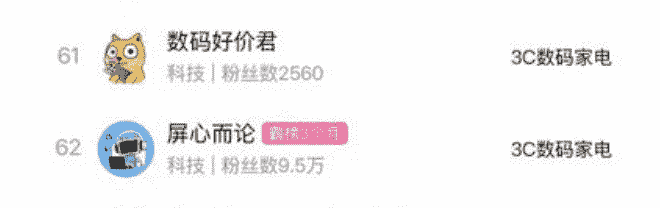

- 66 单果讲装修 生活 | 粉丝29.8万 3C数家居
- 67 可软的纸 科技 | 粉丝9.7万 3C数家居
- 68 supers神价者 科技 | 粉丝1.7万 3C数家居
- 69 老蚕谈数码 摄影 | 粉丝3570 3C数家居

# 加微信进群交流
- 70 PoorPlayers狂狂 科技 | 粉丝7.9万 3C数家居
- 71 九邦狂电信 科技 | 粉丝13.6万 3C数家居
- 72 泡泡快递 科技 | 粉丝1.6万 3C数家居
- 73 海棠宝宝一诺直播 生活 | 粉丝5.4万 珠宝文化
- 74 远时时尚机器 科技 | 粉丝350.7万 3C数家居
- 75 沫时分享 游戏 | 粉丝4247 其他
- 76 腾我是杨梅 科技 | 粉丝64.2万 3C数家居
- 77 二酱萌萌薇 科技 | 粉丝143.0万 3C数家居

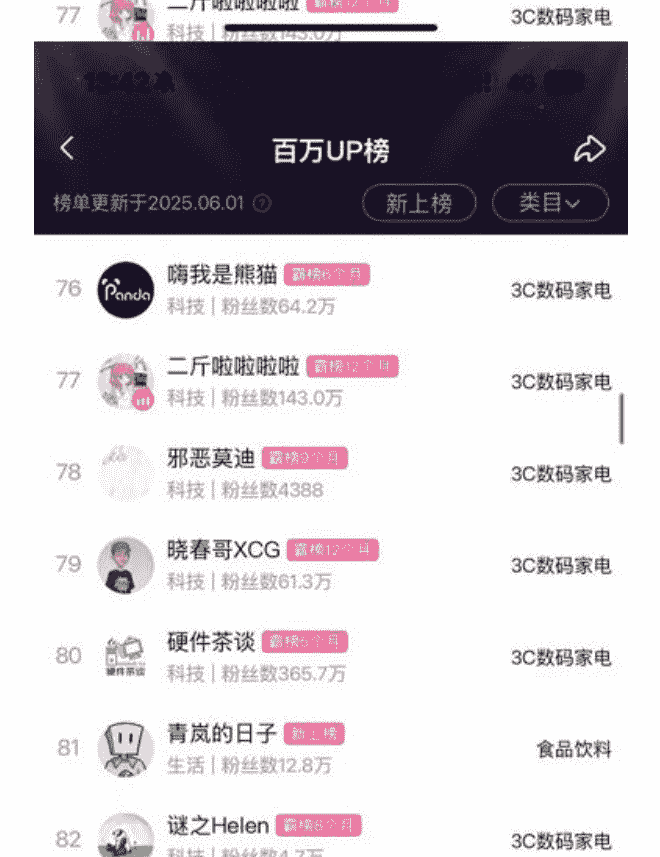

- 76 腾我是杨梅 科技 | 粉丝64.2万 3C数家居
- 77 二酱萌萌薇 科技 | 粉丝143.0万 3C数家居
- 78 酷恶莫淇 科技 | 粉丝4388 3C数家居
- 79 桃花春XCG 科技 | 粉丝61.3万 3C数家居
- 80 硬件沃诚 科技 | 粉丝365.7万 3C数家居
- 81 青的日子 生活 | 粉丝12.8万 食品饮料
- 82 碰之Helen 科技 | 粉丝4.7万 3C数家居
- 83 至善定制 科技 | 粉丝5.1万 3C数家居
- 84 照情站 科技 | 粉丝7.5万 3C数家居
- 85 亚设长 科技 | 粉丝16.4万 3C数家居
- 86 天才起傅 科技 | 粉丝84.8万 3C数家居
- 87 超能桃焰 科技 | 粉丝10.7万 3C数家居
- 86 天才起傅 科技 | 粉丝84.8万 3C数家居
- 87 超能桃焰 科技 | 粉丝10.7万 3C数家居
- 88 小时科技 科技 | 粉丝2588 3C数家居
- 89 萌哒来了 时尚 | 粉丝12.8万 服装饰
- 90 一个胖子 科技 | 粉丝4761 3C数家居
- 91 XyShare 科技 | 粉丝1142 3C数家居

# 加微微信群及资源群
- 科技 | 3C粉丝类
- 93 米家零售 | 粉丝1.7万 美护肤
- 94 视频 | 粉丝16.5万 其他
- 95 精致组的杂货 | 粉丝5.8万 潮流玩家
- 96 Coco酷鸭 | 粉丝5.8万 服装饰
- 97 韭菜实验室 | 粉丝222.8万 3C粉丝类

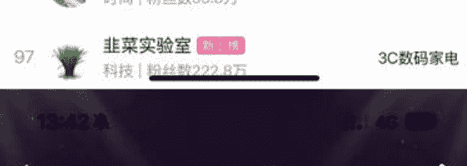

- 98 Coco酷鸭 | 粉丝5.8万 服装饰
- 99 韭菜实验室 | 粉丝222.8万 3C粉丝类
- 98 新可说测评 | 粉丝964 3C粉丝类
- 99 半羊云测评 | 粉丝8.7万 3C粉丝类
- 100 一音制造 | 粉丝6291 3C粉丝类
- 101 鱼学球爱测评 | 粉丝1731 3C粉丝类
- 102 SPPlusTech | 粉丝77.5万 3C粉丝类
- 103 万魔帝国 | 粉丝4.8万 3C粉丝类
- 104 卡咪影像日志 | 粉丝649 3C粉丝类
- 105 小片做大 | 粉丝762.7万 食品饮料
- 106 鼠鼠爱馆 | 粉丝0 食品饮料
- 107 音乐私藏馆 | 粉丝797.3万 食品饮料
- 108 iQOO手机 | 粉丝7.7万 3C粉丝类
- 109 简易数Official | 粉丝3.7万 3C粉丝类
- 110 小科技探 | 粉丝3450 3C粉丝类
- 111 数据科技探 | 粉丝2863 3C粉丝类
- 112 爱直播的小萌萌 | 粉丝6.0万 3C粉丝类
- 113 家有智团 | 粉丝1.9万 3C粉丝类
- 114 蛋硕西语分享 | 粉丝0 美食零食

No. 112/119

# 加微微信群 专属资源群
- 科技 | 微信群2541
- 115 如如生活 微信群2217 科技 | 微信群2217 3C家用电器
- 116 服度测测 微信群777 生活 | 微信群7777 3C家用电器
- 117 祥子工作室 微信群9037 运动 | 海南群9037 其他

评论区：
Mirrors: 千千
0-0: 冲冲冲
斯斯坦起:我想航海海上，自己太懂
执着: 感谢分享
咯咯: 千千
KFC在袭送鸡: 第一时间跟进[色][色]
安诺: 我们太胖了，得想办法减肥节奏

# 知识星球TOP | 添加微信
付费资源分享群 | 免费群

| 序号 | 公号/星球/社群 | 原价 | 领域 |
|---|---|---|---|
| 1 | 生态有术 | 2765/年 | 副业、搞钱 |
| 2 | 怂宝宝咕咕群 | 365/年 | 时政、历史 |
| 3 | 记忆笔记|碧鲤西风 | 365/年 | 成长、职场 |
| 4 | 欧洲金刚 | 328/年 | 时政、历史 |
| 5 | 普克文青云会 | 699/年 | 时政、社会 |
| 6 | 体内还有术 | 599/年 | 体育、职场 |
| 7 | 外局人的秘密 | 669/年 | 金融、财富 |
| 8 | 激锋异语 | 4166/年 | 成长 |
| 9 | 守宁如大 | 999/年 | 时政、经济 |
| 10 | 江护源 | 365/年 | 时政、国际 |
| 11 | 政堂/顾明 | 568/年 | 时政、经济 |
| 12 | 唐书院 | 1399/年 | 金融、职场 |
| 13 | 大树浅 | 199/年 | 时政、成长 |
| 14 | 水库大 | 1000元 | 房产、经济 |
| 15 | 洪源的宏观 | 4376/年 | 行业 |
| 16 | 金色通路 | 456/年 | 时政、社会 |
| 17 | 嫦猫的世界 | 2999/年 | 股市、市场 |
| 18 | 飞沫沫 | 3600/年 | 经理、经济 |
| 19 | 联锦见 | 999/年 | 房产、股票 |
| 20 | 赢在八小时 | 365/年 | 成长、职场 |

- 更多资源，不再单
- 报告、课程等各类
- ★ 免费群每日资源
- ★ VIP群每日分享 75/年

# TOP资源 VIP群

# 【亦仁的收藏夹】
## (#12)亦仁收藏夹不代表推荐
作者：亦仁
日期：2025-06-12

前天到了btc，有朋友问我，不是对btc推荐，在此声明：我的收藏夹代表自己的文章和观点，但不代表任何产品和标，请大家保持批判性判断和思考。
永远记住一句话：在投资上，不赚不输，亏损自负。另外不要对收藏夹提出要求和期待，否则越做越小，最后剩下没有价值的内容。

评论区：
斯凯锐nice:好滴[抱士]
Jun:我还以为亦仁想起来了吗？不能理解。人性是倾向于“抄作业”的。不能独立思考，自己先深入研究，总是听到财富密码带来的冲动，可能一辈子都不入门（流汗）
黄小鱼：哈哈哈哈
花鲤鱼：哈哈哈哈
未子央：成年人，对自己负责，别闹
追风少年：收到，独立判断，btc我关注很久了感觉卖了怀念，再回头，后面遇到了主权的人去中心化，后来才接触了几个朋友，看了九神的文章《比特币》之后，开始定投比特币。【仅为个人看法分享，非投资建议】

## (#46)合人秘创业成败与进步秘诀
作者：亦仁
日期：2025-06-09

坚持一切，但我想得具体一些：每天都要一点进步，每天都要学习新东西，每天都要尝试方法——如果你做到这点，无论过去发生了什么，你最终会成功。
https://mp.weixin.qq.com/s/mm7AW40l1z6n20RQsk

评论区：
不如睡：坚持太粗了！要进步一点点！
小麦：坚持建立在的方法上，进步一步
草莓冰淋：坚持每天打开财源术

## (#38)圈比比特币，坚信其比其他货币更有价值
作者：亦仁
日期：2025-06-10

我相信，比特币只需要做好自己，根本不需要关心它。我不认为其他都没价值，反而有很多价值的，只是比特币更有价值而已。
https://mp.weixin.qq.com/s/Poss32Jl1j5ZBWQ_xLB2w

评论区：
素泉：不了解，跟大家学习[微笑]
涛哥：圈比比特币[强]
听竹：在做了web3，已入圈，颠认知，重塑自我

## (#38)邓公拍板恢复高考的决策艺术
作者：亦仁
日期：2025-06-13

邓公确实有一种气倔，这个气倔程度体现在他拍板的时候。比如，拍板恢复高考。这个改变了无数人命运的考试，在当时决策是不容易的。在这个过程中，表现出邓公的拍板艺术。他是怎么拍板的呢？
https://mp.weixin.qq.com/s/BxMMuQOXgtmLSfCBqQw

评论区：
弈今：请问生财考虑过AI搜索了吗？替代关键词搜索索引？
亦仁：已经在调研实现了
何西：求更多小灯塔，精力急需补充
