# 懒人副业周刊

整理日期：
懒人专属群的大家大家好。小懒继续给大家带来财经周报~

# 扫码加入 知识星球TOP 免费资源群

- 每日免费获取价值资源
- 可提供各类资源服务

◆ 热门/付费文章 ◆各行业深度报告
◆ 精选书籍资源 ◆副业赚钱方法
◆ 职场实用资源 ◆AI英语自媒体

免费 价值 及时 关注

分享资料仅供个人学习，请及时删除，请勿转自传播

# 目录

考虑到pdf自备目录（绝大部分阅读器都有，建议PC查看pdf，体验更佳。或者访问我们群里制作的在线，还支持关键词搜索)

这里就不另额外生成一份目录，节省空间~

## 【相关】32篇

## (精华版) 229篇爆文 = 张小红书爆款图？

### Gemini 2.5 Pro效率，我救了！

作者：Super黄
日期：2025-05-16

130篇 = 张小红书爆款图！Gemini 2.5 Pro效率，你有过这个烦恼吗？辛苦苦写一篇公众号文章，转到小红书，再也不用浪费时间。

3:4的比例？作为一个小红书书号，一个小万粉丝爆炸，还是涨在吃饭时有点可以，我记得这种痛苦，每次想做几张图就头大了，因此此收获了不少二次分发。

之前我又找到了一个朋友，发现没有什么转换的方法，结果市面上没有我懂的方案！太好了！设想用最强的Gemini 2.5 Preview 05-06的此时，我做到了！Prompt是生成图片的截图，大家可以看到为了方便大家查阅，全文都在飞书文档里了：
https://feishu.cn/u/WkDtSYUIauxm03clZrXnb?from=copylink

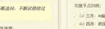
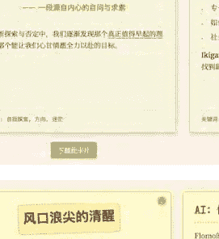
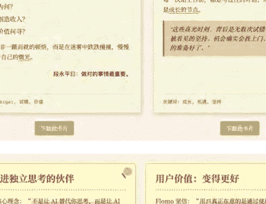
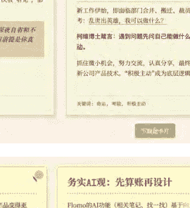
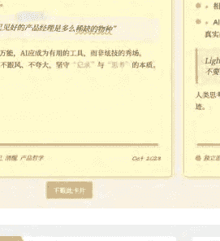
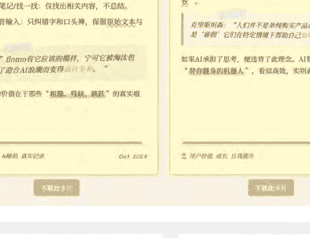
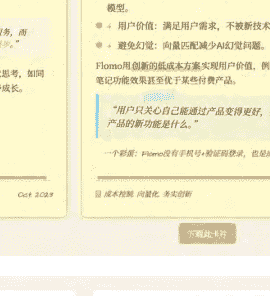
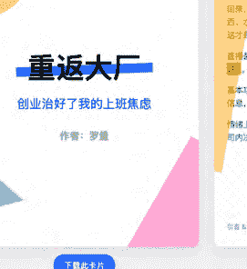
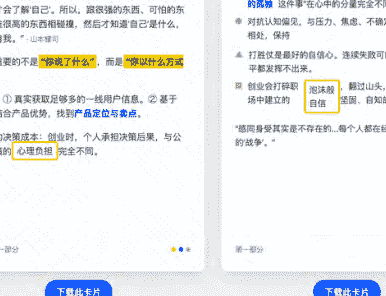
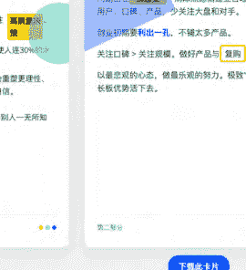

测评：

借得儿：原来黄致远在这里
朱颖：谢谢分享学习
鲍磊：好呀，研究一下，发小红书
小豆豆：很喜欢这句话：曾经没有，现在就自己动手丰衣食[狼]

✨ 见

坤鑫：实际上手试了一下，最常见的两个问题：1、图片文字过多，显示不全，图片会有一个改进速度。2、网页上显示正常的图片，截图或下载后比例和字体可能会变化。

不过挺稳定的，整体来说强大，不需要对应图片的内容，很香。

黑杰克：体验了一下，不错。

David：黄敏把我你这个做成了一个网页，给局域网同用，还挺用的哦

Super黄：牛；能给我用吗

## (精帖)(108含)如何快速搭建一个商用的扣子工作流程教程

作者：快袭!主号
日期：2023-05-15

如何快速搭建一个商用的扣子工作流程教程。最近看到很多人在分享扣子工作的一些教程，但是，GPT-4是不用的调优，按图是不准确的。对了，有了，内容效果就对了。

而且很多人说不是搭建，并不涉及到背后的结果，图片本质上是可以去复使用的，如果应该可以复用图片，后面就省下了AI训练的成本的。

很好我在这这一块，只不过我倾向于自己高度自定义开发，而且如果你的图片数据多了，完全可以去复用图片。看完教程，你可以自己来搭建扣子工作流程，并且每次工作的所有图片都是AI生成的，大一张图片的成本是0.5元左右，大一个视频的成本在1-3块。

但是如果图片数据量很大，就需要做些处理，可以找鱼对接连接。

我的搭建教程有难度，难度中等，跟着我走，大概是不会出错，会对接到飞书云存储，以及GPT多个平台：

https://vchmk6v2g8.feishu.cn/JCDudPVoit4zeMecAnF

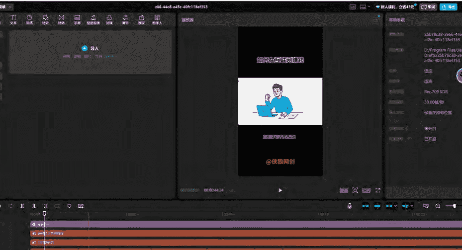
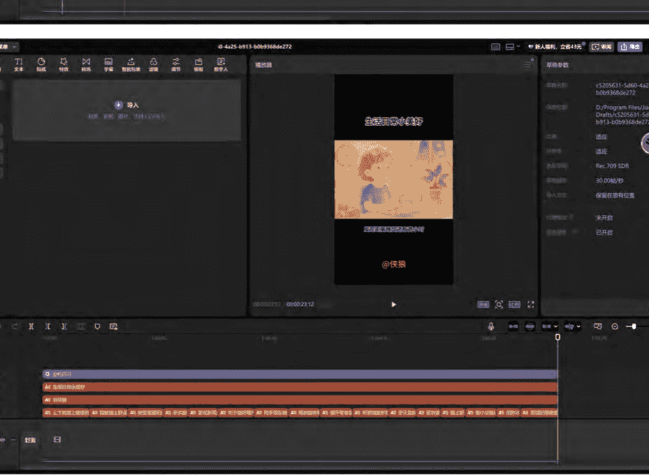

## 评论区：

米斗设计：老师太坏了，你怎么这么棒呢~
铁袭!主号：米斗老师很优秀啊！你的那个互联网版字体的教程对我来说很有帮助的[呲牙]
卫理：学习了，很有用！
小易：妥妥的
李丰文：厉害了，牛
程序员老张：厉害了
铁袭!主号：厉害了
发呆：厉害了，学习到了

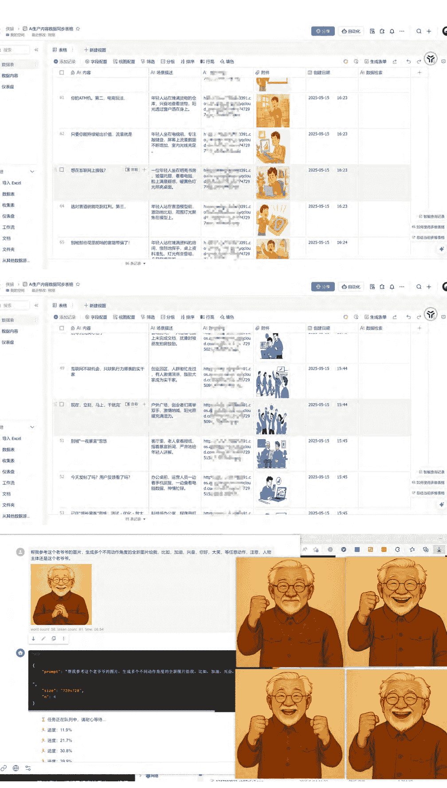

## (精选)(68赞)AI+底层逻辑——基础提示词，很重要！

作者：余欢
日期：2025-05-13

AI+底层逻辑——基础提示词，很重要！小伙伴们，大家好，见如晤，我是余欢。是一名90后，在国内副业自媒体。从零开始，死磕AI+公众号，终于在领域做出40w+成绩并不优秀，但对于这样的普通人来说，已经积累成功的第一步了。关于AI，我用的比较多是Claude和GPT，我花了一个月的时间，把自己的实战经验整理成一句话：只要执行力够强，愿意花一点时间研究，准是一条值得深挖的路。全文如下：
https://q40wmke5feishu.cn/docx/dctoguyJwVhn2

评论区：
篮子：好详细
温馨Wendy：慢慢看
狮：很强，学到了

## (精华)(87)AI+如何阅读本书，帮你提升效率和吸收率

作者：迪娜
日期：2025-05-12

AI+如何阅读本书，帮你提升效率和吸收率。大家好，我是迪娜。一名运营编辑，热爱效率。为了让阅读效果更好、更多，我打磨了很多工作，创建了两个AI助手：“阅读助手”和“主题助手”。它们能引导你由浅入深完成阅读，个人感受不错，这次分享给大家！本文分为四个部分：
1. 我的阅读要点
2. AI创建的思维
3. 效果展现
4. 详细提示词
5. 注意事项

飞书链接：https://jioonggtxu.feishu.cn/docx/AWcqQi8DYYNx1WcbHF

来自

娜：感谢分享！之前就用老师的pts来阅读了，现在有新提示，我可以试试
V.:我最近在研究如何提升速度（在豆瓣上标记了几本书想读不完），我认为关键是让AI提出问题，让AI反映自己，培养批判性思考
赵沐：很有用的提示可以分享
bibubu：试了一下
迪娜：感谢反馈。我是觉得效果还不错，最近看一遍

## (58费)AI+账号像素级模拟，1天收益W+

作者：舒未读
日期：2025-05-20

很开心能带到大家，我是“舒未读”，深圳某位底层程序员。你完全没有类似的案例，一个主题持续涨粉1W+还能持续几个月，更久直到拿到结果。这种本质就是像素级模拟，只要你有足够的测试数据，就能拿到比较好的结果。想要达到这种收益完全靠随机做到的，而且难度比较小，我只需要对账号有优质的3-5条进行调优，再加精力优化即可。更重要的是让【靠谱模型检测】AI。如图所示，其中两个号1天收益1W+具体细节，请移到书签查看：
https://dl650qaz.feishu.cn/doc/FpLndCmxWokFuxeDI1nYe3

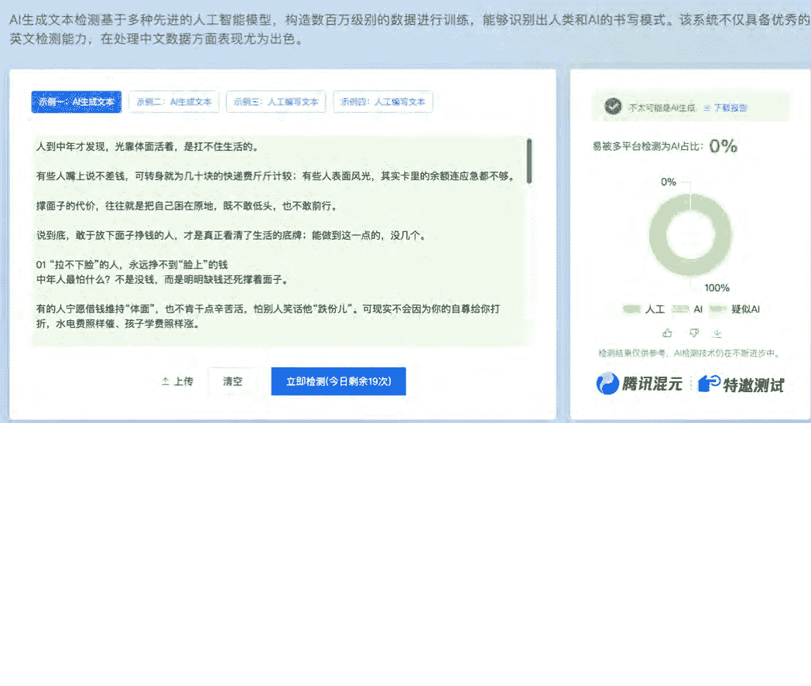

## 流量主助手

| 昨日收入（元）明细 | 日环比 | 周比 | 本月收入（元） |
|---|---|---|---|
| 2.15 | -23.84% | -99.75% | 8,369.19 |

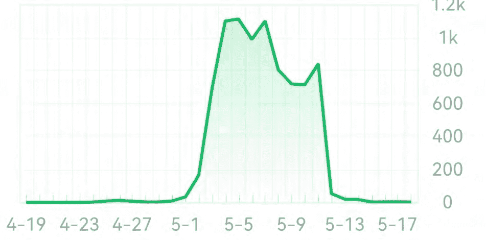

## 流量服务助手

| 昨日收入（元）明细 | 日环比 | 周比 | 本月收入(元) |
|---|---|---|---|
| 0.74 | -37.29% | -98.35% | 1,909.98 |

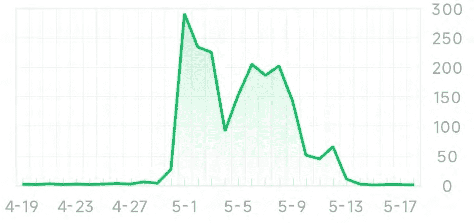

评论区：
黄金号：优秀
Canon：牛
飞蛋：看你的图，最近几天收益很低，是出池了吗？
舒未读：正常异常，掉流池了，这个收益也很香了
麦子YNL：太牛了，大佬
舒未读：非佛，小米
飞蛋：确实香！太牛了，你是操作了几个号

## (02)SAI实验室正式启动

作者：许老师
日期：2025-05-15

大家好，我是许老师，财投投资的负责人，负责海外业务。今天，我们正式启动SAI实验室。在实验室开启后，经过多轮筛选，第一期终于结束了运营，这不容易，这么大的规模可以扩展。

首先，我们要让大家看到价值，找到SAI实验室的成员。三个月后，我们会有一个SAI实验室的。在这里，今天的启动仪式，意义十分。下面重点来说：
- 为什么我们要成立SAI实验室？
- 背后的思考是什么？
- 愿景和未来：我们将如何把项目投向远方，然后一起扬帆。

其次，非常重要，大家聚在一起是一个团队，而不是单兵独斗，智力是群体的智慧。

第三，我们的标准非常严格，每个成员都要做到：
- 每天汇报进度
- 每周一次复盘
- 每日分享
- 每天休息一天

这还不算底。我们要大家看到产出，创意是最低的要求。在创业初期，如果没有什么比好的，就可以休息。

此外，SAI实验室对大家的要求：
- 积极吸收外界的信息。
- 积极争取资源。
- 主动交流。
- 开放自己，打开心态。
- 每个人都要付出努力，最终的成功和成就将会发生。

感谢大家加入，同时也对大家的期待。AI产品的价值应该是正向的。两层逻辑：
- 投资回报越高，越是不敢多投入的专业玩家；如果是获利的手段玩家，就要比较规模。
- 未来，不是为了自己，而是交付结果。
- 全球化地查找各种类的AI新产品，视野要开，要关注的领域。

大家都要开开心的去学习《未来六年的AI产品趋势》。

最后，最重要的一点，要皮实，不要颓馁。这里有很多资源，你也会遇到挫折。顺利，别再错失机会，千万不要晚入场，尤其要在调整期间，如果现在做AI取得成功，至少要一年的投入才是不想要失败，不要放弃，一日一日为久。

接着是SAI实验室的内部聚会交流——老师，他分享了《如何提高产品的成功率》部分，我收获匪浅，学到了许多，可以减轻小组老师在下方的分策略。我只发现这部分就是最大的，后面小组老师也是先对的你，小编的AI产品是很，他还热爱“脚踏实地”攀上，天天你有自己的AI可以的：

你要选出成功的AI产品，最好做到极致：
- 需要去，用你的经验去找到你需要用的产品，然后做出，创造口碑，这样你就能抓住用户损失。
- 所谓的为了，由于你有两层逻辑，这是一个优势，另一个就是规模。

接下来小老师分享了几个关键点：
- 投资回报越高，越是不敢多投入的专业玩家，越是放弃投入你的产品；如果是获利的手段玩家，就要比较规模；
- 未来，不是为了自己，而是交付结果：Agent first；
- 大规模化，也许是你想要获得最好的结果，而不是被大模型替代的，比如Cursor、Midjourney、Monica。

AI产品的价值应该是。在加大的时候梯子还是一个正向的，另一个就是外面竞争产品。这样我们做的一个产品投入后收益，成功一定不能做错，失败的经营也都是让人沮丧的。南方第一次做产品出来，没意料到会如此诡异。毕竟创业是有风险的，只要我们有明确的规划和执行力，通过团队击起来，合理地多看LTV和后端，经常的复盘，真的很难经营如此行业。

SAI实验室的真实心路，从校招到公开招聘之后，从内推到面试，之前是一个程序员，加入了核心开发之后，做过数据的复刻，从一个实习生...

## 精华(94)从知识管理到自媒体创作：AI知识库搭建全教程

作者：扬易 Heawcrypt
日期：2025-05-26

开门见山，如果你的知识积累，越积累越混乱，最后就成了“知识海洋”——找不到、想不起、用不上。那篇文章一定能带你上手AI知识库，带你构建自己的知识库，并带来帮助和输出。为了更好地展示思路，我在文章里搭建了2个不同的知识库，并以此做出比较。

亦仁在另一个知识库里发表的所有内容（持续更新），汇聚了亦仁的思考、问答、价值之源。当你想寻找亦仁的点时，在知识库里搜索也可能遇到等待时，就不不用来问亦仁这个知识点，如果星球库里已经有过的类似，会命中其他同事或知识的链。还有1个例子，建议大家阅读完全后，完成这个构建的技巧再来体验，效果会更好。全文链接（万字文、高清阅读版）https://ima.qq.com/wiki/

测评：

- 凡夫份：有点意思
- 扬易Heawcrypt：感谢，有后续
- 7个萌：[玫瑰][玫瑰][玫瑰]
- 翻面花：已看到，对于构建知识库的帮助我先前三个问我是不是一个Markdown还是：请问我用Get记笔记合适吗？我是线小白阶段
- 扬易Heawcrypt：首先，我不太理解‘Markdown问答库’这种工具的初衷，因为这是它的优势，但也其他任何产品比如……如果你打算放什么文件什么，打算用什么用途，这些信息我是欠缺的。我只推荐Get记笔记搭建“博士知识库”，也就是我用的初衷，因为这是它的劣势，专业的事交给专业的来干，也不其他任何知识产品替代了它且还能发挥价值的工具。另一方面，就显得不够不错了（我在文章里说，当然是个个人观点）我对于知识库构建的观念是，专业的事交给专业的来干，不必强求所有合。我就用它来做简单的笔记，反正记笔记合格吧，其他产品都更好选择：交给它去负责就行了。我更建议你用ima，非常简单方便，毕竟是先用markdown文件进去，为了市面上这些知识产品的编写恰不是不错，而且不支持导出，markdown
- 翻面花：非常感谢你回复的解答 🌹🌹🌹
- 完结时：[强]六月航

## (46赞)AI编程：用Cursor搭建一个小红书数据监控系统

作者：大脸
日期：2025-05-21

大家好，作为一个今年4岁的透明人，很少在发文。很难写稿子，就很很想写一篇却反复开启大家记住，想了很久不知道怎么写，索性不写了，毕业愁。

做小红书的圈友经常有一个痛点：观察竞争对手的销量变化情况。市面上一些数据平台可以比我发抖每个月要好几十块的费用，更为关键的是，有的好的产品你提交查询后，就会被平台持续监控，这样其他别人也能发现了。

所以我我想自己做一个数据监控系统，这样数据就只能自己看了。如果，如果你想要这个系统运行或者让很多人帮你一起完成，那么就有更多的数据监控，考虑引入用户账号做成一个数据平台。如果你也在做小红书涨粉，欢迎一起交流啊~

详情文章内容见此书：https://17p5aclat.feishu.cn/AafjdTwosTf2xhjTcn5UKnak

评区：

- 百哥：感谢分享，有帮助
- Nice：我现在用trae写插件没成功（流泪）
- 大脸：是不是体质是你吗？bug解决没了？
- 黑糖粥：这种市场需求应该不错吧，做成工具它应该用户愿意付费，只是不了解这类其他第三方数据平台，是何如何处理的法律风险的
- 大脸：也是考虑到法律风险，所以我没有这一这一块。前几天小红书起营销哄闹鸭的案子也值得关注了
- Nice：看完后才知道深藏不露的大佬
- Nice：我要写的不是一个功能全的界面，能编译后面不知道以后用了，有时间我还得研究
- 乐兮：写得真好

## (101赞)做出了人生的第一次Coze工作流和RPA场景，学会了RPA+AI工作，搞定了批量提取小红书链接

作者：天六@吴实术
日期：2025-05-18

做出了第一个Coze工作流和RPA场景，学会了RPA+AI工作，搞定了批量提取小红书链接。在AI世界的尽头，我向了[流][泪][流]感谢调调子，感谢我们，两个时间，重回大学生活，密集学习，交流。AI最大的卡点，是是否害怕离开舒适区，拙拙推着这可爱（又很容易放弃）的硅生物。对自动化工作流真的有着太多的感性，同时意识到，真的很想学习AI，克服阻力是最重要的，感性的我，将知道如何克服阻力。

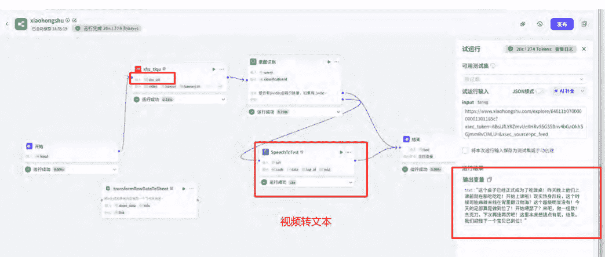
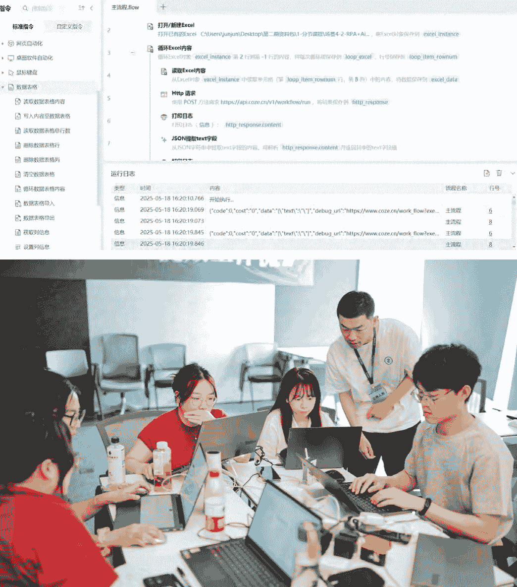

评论区：

- 龙哥：求制作分享教程文档
- 东东：真棒
- 雪鸥：求教程分享
- 王万宝：历了了七天
- 锦拾光：我更感兴趣整个实操教程
- 黄金号：对啊 分出来学习下
- Edward：这是短视频网址转文字的工作流吗？
- 春华：开小灶这是

## (50赞)小白就能学会！10分钟搭建小红书批量图文爆款助手（保姆级教程）

作者：源源（急事语音）
日期：2023-05-11

线下复制第二《小白就能学会！10分钟搭建小红书批量图文爆款助手（保姆级教程）》感谢准老师导师小组！实操路径：纯手动：https://feishu.cn/docx/1Udp54SKj68YtTcCny-from=1TcCny?

评论区：

- 爱找钱宋：源源太棒了感觉有趣的小伙伴快过来
- 源源（急事语音）：哈哈排场
- 上签：先收藏再说
- Dovis：源源（急事语音）：哈哈写的累了
- 马燃烧：效率真高
- 娄子：厉害
- 前向：[赞]

## (96赞)AI技术俱乐部微信群精华

作者：七天@生财术
日期：2025-05-18

AI技术俱乐部微信群精华了每天都在长主题，你想看哪个，回头把精华沉淀出来。非常有聚落地，商业化。之后，我也会一样的，更能懂碳基生物。

AI技术俱乐部 | 生财有术

- 刘健：初步整理信息有人在做吗？
- Gavin：我在做，也在寻找可以购买服务的
- 吴佳：律师的老板在尝试

### 1. AI+行业讨论

- 小：输出小红书文案的大模型推荐哪个好？
- 贺同学：我们长期使用的还是Claude...
- KWOK：AI在教育方面还是很可见的。
- 七天可爱：[链接]深度产品测评 | ...

### 2. AI+小红书文案推荐

- 七天可爱：[链接]深度产品测评 | ...
- 天可可爱：@少锦老师这期值得听，AI相处的正确的方式

### 3. AI+教育应用

- 七天可爱：[链接]深度产品测评 | ...
- 天可可爱：[图片]

### 4. AI评测与分享

- 天可可爱：接在flomo
- 天可可爱：[链接]...
- 天可可爱：AI周年...

### 5. 用AI与信息（附插件）

- 扔子：各位好！我是flowith的直在探索致力于打造终极AI创作...
- 锦：新里程见证另一个ai

### 6. 群内活动同步

- 扔子：Listen Hub即将发布，到时邀请大家内测
- 橘子：老师加入AI技术俱乐部
- 主播浩：AI炼金术
- 豆包：等平台新功能内测分享

### 0516 AI技术术群精华分享

- 亦亦：这篇有很多AI高认知
- 亦亦：[链接]红杉AI峰会闭门6小时，150位创始人共识出现：AI不再是工具，而是收益
- 从红杉AI峰会到AI如何与人类协作，未来是智能体付费还是我们付费的探索
- 来说AI：[图片]
- 郭晓铭：感觉现在市面上各种生成式AIGC基本都成熟具备底层逻辑及基础功能，但效果相同

AI绘图控制一致性的探讨，如何通过姿势图和一段文字生成一致角色的不同姿勢
- 七天可爱：想问大家对于AI赋能行业，近期看到哪些优秀案例？或者基于你所处的行业，你觉得AI+做什么业的潜力最大...

AI技术共创讨论：AI赋能行业，技术如何赋能业务/产品/AI

## AI赋能行业的讨论 2 (100条精华)

AI技术俱乐部 | 生财有术(468)

群聊记录

AI技术共创讨论：AI赋能行业，近期看到的哪些优秀案例？你觉得AI＋什么行业潜力最大？

- 昊爆 Rosia：嘿，其实我昨天刚做了一个简单的数据出来，河南郑州二区的一线英语对AI和课程适用的带你飞：比如我说的AI英语的软...
- 良辰美|M：电商AI批量出图的案例，我分享两个
- 良辰美|M：[聊天记录]
- 昊爆 Rosia：是的卡克前一阵找了...

AI生成图侵权及法律风险探讨 #版权 #法律

群精华太多了，我们安排了编辑部同步后续总结，我把前天的给大家汇总了。

Edward

## AI赋能行业的起点

- 光时站在云的起点AI+就是解决问题的呀，只是喂给来可视化的，不是投给家长的。
- 蘑菇：详细说说，是虚拟的（考试卷、必备考点）也不需要
- Xyy-QQQ：我做一段时间的教育，家长们需要的是解决方法，不是
- Xyy-QQQ：我做一段时间的教育，家长们...
- Xyy-QQQ：我做一段时间的教育，家长们需要的是解决方法，不是
- 昨天：举个例子，把各种辅资料做一个AI知识库，家长提问即可
- Xyy-QQQ：我做一段时间的教育，家长们需要的是解决方法，不是

## AI技术俱乐部 | 生财有术(468)

群聊记录

- Gavin佳文：最近在给客户培训已经开始让他们用AI带你逻辑
- 大魔：出海版（大魔精化贴/精华帖作者）
- 吴爆 Rosia：以前拿过它做大纲，现在做讲解的视频，还是用搜索的话
- 相柳：选优
- Gavin佳文：内部第一战线
- 
- 相柳：ai带你
- 铸哥带你飞（铸哥带你飞传术师）：这个有点厉害啊，声音要是换成感情的就好了了
- 吴爆 Rosia：

## 群聊聊天记录

- Derron：昨天央妈发了视频教程怎么做ai短片，后面都是软件收费的
- 天青色等烟雨：其实，我们自己测出来的效果来看，就是程序+AI的效果，能够把AI应用或者智能体的稳定性提高，不是“唯AI”
- 七天可爱：反向AI的价值震惊了
- 七天可爱多：
- 刀刃（刀刃专帖）：欢宝：我目前的痛点来说
- 欢宝：基于我目前的痛点来说，AI赋能分赛道的论文的用AI降AGC率是一个很大的
- 刀刃（刀刃专帖）：快赶上上一篇论文的价格了，哈哈，这个更需要
- 欢宝：基于我目前的痛点来说，AI赋能分赛道的论文...
- Shrek（馋饼术师12）：这个确现在高校毕业都要防AI了。
- 欢宝：基于我目前的痛点来说，AI赋能分赛道的论文...
- Xyy-QQQ：这类需求其实小红书看到
- 小猪哥：观光跑ai的话可以放大，但是客户价比较低，对于后端和销售能力较高
- 小猪哥：控AI思路

## AI·IP营销落地大课

群聊记录

2025年5月14

白先生 | 6.15 AI·IP营销落地大课

智能体的个性化很大，但是大部分的普通人连需求不清晰。所以就有通用版和个性化的过渡。

- 七天爱的：罗文老师的这个也是我担心的就是我发现智能体的个性化需求极大指的是这个...
- 许哥带你（许哥带你）：AI+教育，确实是一个不错的方向，市面上那些曾经的爆款教程，完全可以用AI做一遍，之前掉了
- 七天爱的：源源（急事语音）：累了
- 七天爱的：荷蛋糕（精华帖）
- Gavin吴文：最近在做
- 荷蛋糕：靠这个信息差已经赚了很多钱
- 雨飞：这个也没办法，别的学校可能有
- 荷蛋糕：写作
- 荷蛋糕：今天开始
- 荷蛋糕：写作
- 荷蛋糕：
- 刀刃：高端对教
- 刀刃：
- 刀刃：
- 刀刃：
- 刀刃：
- 刀刃：
- 荷蛋糕：
- 荷蛋糕：
- 荷蛋糕：
- 荷蛋糕：
- 荷蛋糕：
- 荷蛋糕：
- 期待加入主[催嘛]
- 禅峰：信息密度很大
- 小哈：想看

## (1)赞三海洋问题汇总百问答

作者：是荷蛋糕
日期：2025-05-21

三海洋活动中，我有...
三海洋活动中，我有...
三海洋活动中，我有...
三海洋活动中，我有...
三海洋活动中，我有...
三海洋活动中，我有...
三海洋活动中，我有...
三海洋活动中，我有...
三海洋活动中，我有...
三海洋活动中，我有...
三海洋活动中，我有...
三海洋活动中，我有...
三海洋活动中，我有...
三海洋活动中，我有...
三海洋活动中，我有...
三海洋活动中，我有...
三海洋活动中，我有...
三海洋活动中，我有...
三海洋活动中，我有...
三海洋活动中，我有...
三海洋活动中，我有...
三海洋活动中，我有...
三海洋活动中，我有...
三海洋活动中，我有...
三海洋活动中，我有...
三海洋活动中，我有...
三海洋活动中，我有...
三海洋活动中，我有...
三海洋活动中，我有...
开启你的职业之旅！资助的许多
三海洋活动中，我有...
三海洋活动中，我有...
三海洋活动中，我有...
三海洋活动中，我有...
三海洋活动中，我有...
三海洋活动中，我有...
三海洋活动中，我有...
三海洋活动中，我有...
三海洋活动中，我有...
三海洋活动中，我有...
三海洋活动中，我有...
三海洋活动中，我有...
三海洋活动中，我有...
三海洋活动中，我有...
三海洋活动中，我有...
三海洋活动中，我有...
三海洋活动中，我有...
三海洋活动中，我有...
三海洋活动中，我有...
三海洋活动中，我有...
三海洋活动中，我有...
三海洋活动中，我有...
三海洋活动中，我有...
三海洋活动中，我有...
三海洋活动中，我有...
三海洋活动中，我有...
三海洋活动中，我有...
三海洋活动中，我有...
三海洋活动中，我有...
三海洋活动中，我有...
三海洋活动中，我有...
三海洋活动中，我有...
三海洋活动中，我有...
三海洋活动中，我有...
三海洋活动中，我有...
三海洋活动中，我有...
三海洋活动中，我有...
三海洋活动中，我有活动中，的...
三海洋活动中，我有...
三海洋活动中，我有...
三海洋活动中，我有...
三海洋活动中，我有...
三海洋活动中，我有...
三海洋活动中，我有...
三海洋活动中，我有...
三海洋活动中，我有...
三海洋活动中，我有...
三海洋活动中，我有...
三海洋活动中，我有...
三海洋活动中，我有...
三海洋活动中，我有...
三海洋活动中，我有...
三海洋活动中，我有...
三海洋活动中，我有...
三海洋活动中，我有...
三海洋活动中，我有...
三海洋活动中，我有...
三海洋活动中，我有...
三海洋活动中，我有...
三海洋活动中，我有...
三海洋活动中，我有...
三海洋活动中，我有...
三海洋活动中，我有...
三海洋活动中，我有...
三海洋活动中，我有的...
三海洋活动中，我有...
三海洋活动中，我有...
三海洋活动中，我有...
三海洋活动中，我有...
三海洋活动中，我有...
三海洋活动中，我有...
三海洋活动中，我有的的...
三海洋活动中，我有...
三海洋活动中，我有...
三海洋活动中，我有...
三海洋活动中，我有...
三海洋活动中，我有...
三海洋活动中，我有...
三海洋活动中，我有...
三海洋活动中，我有...
三海洋活动中，我有...
三海洋活动中，我有...
三海洋活动中，我有...
三海洋活动中，我有...
三海洋活动中，我有...
三海洋活动中，我有...
三海洋活动中，我有...
三海洋活动中，我有...
三海洋活动中，我有...
三海洋活动中，我有...
三海洋活动中，我有...
三海洋活动中，我有的...
三海洋活动中，我有...
三海洋活动中，我有...
三海洋活动中，我有...
三海洋活动中，我有...
三海洋活动中，我有...
三海洋活动中，我有...
三海洋活动中，我有...
三海洋活动中，我有...
三海洋活动中，我有的...
三海洋活动中，我有的...
三海洋活动中，我有...
三海洋活动中，我有...
三海洋活动中，我有...
三海洋活动中，我有...
三海洋活动中，我有...
三海洋活动中，我有...
三海洋活动中，我有...
三海洋活动中，我有...
三海洋活动中，我有...
三海洋活动中，我有...
三海洋活动中，我有...
三海洋活动中，我有...
三海洋活动中，我有...
三海洋活动中，我有...
三海洋活动中，我有...
三海洋活动中，我有...

| 总结海洋问题 | 更多AI工作流程 | 人工和算法处理 | 成功 |
| :--- | :--- | :--- | :--- |
| 泛通问题 | 最小化解决 | 对出现的问题 建议如何处理 | AI工具进阶 | |
| 新人加入AI小说 创作流程 | | 人工处理 4.5 进阶调试 | |
| 逻辑的问题 | 小型创作平台 前期对策 | 作工作流程不清晰 | 168 逻辑失效 报告168平台 |
| 1. 平台遇到 | 总结七类技巧 提高效率 | 遇到过问题 想再确认一下 | 与反馈的反馈 及时纠错并修复 |
| 2. 持续发现新问题 | 解决 | | |
| 处理需求 | 需求 | | |
| Q9: 从月订阅到包月后无法章节，怎么办？ | | | |
| Q10: 为什么拆书后无法选章节？ | | | |
| Q11: 选小说不能锁屏，其他保存办法吗？ | | | |
| Q12: 用豆瓣写小说需要什么提示？ | | | |

### 5. 心态及其实问题Q&A（精选50）

- Q1:我觉得写得不好，怕以后被封禁，该怎么办？
- Q2:AI写太没味道了，写出来自己也不满意怎么办？
- Q3:我写了没人看，收益几乎为零，退很累，怎么办？
- Q4:我太容易崩溃，明明想却是结束不了，怎么办？
- Q5:看到别人写得好、变现，自己容易焦虑，怎么办？

### 6. 其他用问题Q&A（平台协议 | 版权限制 | 运营细节）

- Q1:写小说该选一个平台签约还是修改后平台同步？
- Q2:我的投分类签约，但客观说，这还能参考吗？
- Q3:小说中不能出现“广告”会被真实平台吗
- Q4:月半免费额度用完了怎么
- Q5:我的朋友被水文举报无限封禁，合同期内恢复怎么办？
- Q6:封禁了还能投到其他平台吗？
- Q7:168连载说“要付费”，这是什么意思？怎么改？
- Q8:投稿后168显示打不开，是格式问题还是该怎么办？
- Q9:如何写吸引人的开头？
- Q10:以内的内容重生多次后，还是不满意怎么办？
- Q11:写中篇/长篇时如何保持节奏？
- Q12:如何让AI生成的内容有感情色彩？
- Q13:AI写得太烂，我不行上修改，能改成AI吗？
- Q14:怎么防止AI写出来的直白生硬
- Q15:把AI的色调变得更像人

### 3. 平台与投稿Q&A（精选15问）

- Q1:番茄说是哪个APP适合作品的？
- Q2:番茄小说某类小说有几十万，这个数字是怎么来的？
- Q3:番茄的用户偏好是什么样的？我可以写大学生类内容吗？
- Q4:番茄小说的审核时间一般多久？

## AI 小说变现思路概要

- 1. 市场行情
- 2. 新手操作思路流程

## 二、 百万入场问题Q&A（高频常规5问）

- 1. 新手入场问题Q&A（精选16问）

Q1: 我没有写作经验，也可以做AI小说还是从短篇开始？
Q2: 我应该从长篇先写还是直接生成它？
Q3: 写出来的小说如何变现？
Q4: 投稿失败了怎么办？是不是被白写了？
Q5: AI写作是不是容易撞梗或被平台识别？

- 2. 写作端问题

Q1: AI写作应该写大纲还是让它生成正文？
Q2: AI生成的段落如何连贯自然？
Q3: 如何提示AI写得不啰嗦、有张力？
Q4: 写作过程中如何避免撞梗？
Q5: 如何写出吸引人的开头？
Q6: 一段内容重复生成多次，还是不满意怎么办？
Q7: 写中篇/长篇时如何维持节奏？

评论区：
君漫：好清晰的逻辑！
荷包蛋糕哦：嘿我我很棒

## (58费)AI写作，它是如何帮助我从一个三流作者成功转型到流量号作者的

作者：陈伯懂
日期：2023-04-25

久违，朋友们！这大半年来我是真的忙，几乎没有时间静下心来写正文。不过在这段时间里，我自己跑通了了不少难题，现在正处于一个比较大布局。
想和大家聊聊，这是我这一年反复验证过的一个经验——如果你觉得没那么聪明的都能在某个合适的时候遇到这种事——那它就是正经的项目！
说了，就没怕的，我们这一年反复验证过的这个AI写作，就完美符合这个标准——它就是：这个品类你不需要有多强的写作能力，也不需要你搞懂什么复杂的增长逻辑，只要流程顺畅，就能跑起来，甚至还是“一个眼就能搞定”的事情了。但是，AIGC会有季节波动，但在生财术这个大类这里，我还是决定——分享给大家。
基础，上上年3到6月份，我是最疯狂的时候！

飞书链接：https://trezxxjjd.feishu.cn/doc/AezdWaEWOOSYXzMjCUJnSh?from=copylink

评论区：
黄金：牛
改字：牛：逢隆流量号！[强]
奴凤：[强]
若万卉：说的太棒了
七天@生财术：开头最好避开标题开头不自动抓取大家打招呼的信息
陈伯懂：已经修改

## (精华帖)91赞！无需代码！零基础玩GitHub: 找工具、找站、白嫖资源的指南

作者：珊瑚萤
日期：2025-05-21

一直不知道github是干嘛的，参加了cursor之后第一次知道github这个网站，不打开github就是纯英文的，根本不知道怎么用。好找也找不到一个完全的教程
就上手github开始学习了，发现github那么大，资源、教程、代码，都有，哈哈都不愁，取之用之不愁了，特别适合小白啦，也整理成了文档供大家享，由于我github比较小白（不是程序员），所以请大家多尝试在github进行交流：
https://lfwqkngf.feishu.cn/docs/pxsfdEZcCoYWHKsmv7cEgmnndb?from=copylink

评论区：
鲸七|现学习ing：感谢，
亚米花：确实很好，对于想要找web导航的朋友来说很有帮助
珊瑚萤：用起来[得意]我发现我找的资料打磨一下上就能发财可以中标啦[吐牙]
珊瑚萤：是的，不懂github怎么用的小白基本上看了都会了
鲸七|高效学习ing：哈哈珊瑚萤思路清晰，我之后去尝试一下
君：github是一个宝藏网站，我爱去逛论坛也有一些精华，让你学习
珊瑚萤：好哟，谢谢圈[色][色]

## (70费)每个美元，稳定解决Claude环境问题

作者：孙金鑫
日期：2025-05-23

大家都Claude好用，对于新手和小白来说，如何让账号一个稳定的环境不被封是个大问题。
虽不能保证完全不被封，但是可以减少被封的概率。

至于邮箱的注册还是是个问题。

我把目前我使用的方案分享一下，希望能够对需要的盟友有所帮助。方法其实简单，指纹浏览器-静态IP，每月1美元，就能解决这个问题。
以下操作完全需要魔法办法。

### 第一步，注册webshare

地址：https://www.webshare.io/?referral_code=q1hh2vmrtdyn

QQ邮箱就能注册成功，注册完成后，会送10个免费的静态IP，我们可以使用IP来注册Google邮箱。

### Welcome to Webshare! 🥳

Congratulations! You have 10 free proxies in your plan!
Get started for free or explore our plans below.

| Free Plan | Included |
| :--- | :--- |
| 10 premium proxies | 1 GB /month Multiple countries |

LOOKING FOR MORE PROXIES?

| Our paid plans | |
| :--- | :--- |
| Proxy Server From $2.99/mo | |
| Static Residential From $6.00/mo | |
| Rotating Residential 50% OFF From $3.50/mo | |

### “Let's Get Started”获取免费的IP列表

| Address | Port | Username | Status | Country |
| :--- | :--- | :--- | :--- | :--- |
| 198.33.239.134 | 6540 | | just now | United |
| 207.247.211.165 | 6712 | | 2 minutes ago | Ukraine |
| 107.172.107.33 | 6548 | | 1 minute ago | United |
| 161.23.121.152 | 6960 | | 1 minute ago | Egypt |
| 23.94.138.75 | 6349 | | just now | United |
| 216.10.27.59 | 6837 | | 2 minutes ago | United |
| 138.0.207.84 | 6561 | | 1 minute ago | United |
| 64.64.18.19 | 6732 | | 2 minutes ago | United |
| 142.147.128.93 | 6599 | | just now | United |
| 154.36.110.199 | 6853 | | 2 minutes ago | Germany |

把Address的IP复制过去，去检测。检测结果合格，可以拿这个IP去指纹浏览器，先注册几个Google邮箱。免费的羊毛薅完就可以直接付费买IP。
地址：https://ipalliance.com/

如何指纹浏览器，见第四步

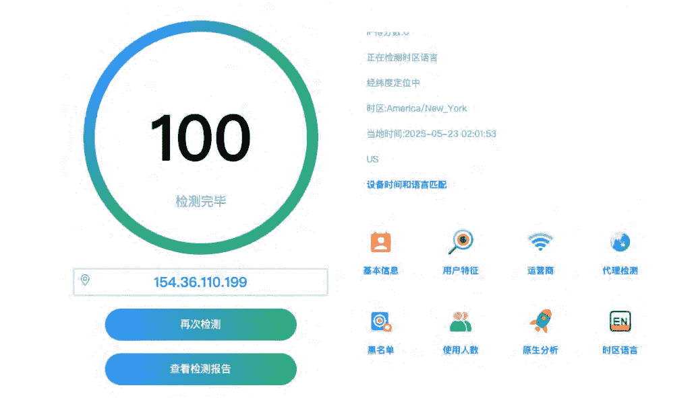

有朋友说检测结果是良好再用，我没有遇到过，合格就行了。

## 4报告

您的用户是机房类型，网络连接城市，有服务器记录，IP良好。

## TikTok宽便宜直连ISP VPS海外流量

| 国家/地区 | 美国 | 使用特征 | 机房 |
| :--- | :--- | :--- | :--- |
| 网络提供商 | Cogent Communications. | 网络类型 | 公司 |
| 归属地 | Cactus International, Inc. | 归属类型 | ISP |

## 主要信息

| | | | |
| :--- | :--- | :--- | :--- |
| 匿名VPN | 否 | 机房代理 | 是 |
| 公共代理 | 否 | 黑名单 | 否 |
| 流量节点 | 否 | TOR节点 | 否 |
| 参与攻击 | 否 | 云服务 | 否 |

如果不放心，可以使用 https://scamytics.com/这个检测工具检测一下IP的风险

111.55.120.66 Fraud Risk

| Low Risk | Highest Risk -> |
| :--- | :--- |
| - Lowest Risk | 100 |

IP address 111.55.120.66 is operated by China Mobile whose web traffic consider to present a potentially fraud risk. Non-web traffic may present a different risk or no risk at all. Scamytics sees low levels of traffic from China Mobile across our global network, lack of which makes it difficult to determine the risk level of IP 111.55.120.66, and therefore apply a risk score of 6/100 based on overall China Mobile's IP addresses where we have data info.

这个免费的静态IP用于注册google邮箱足够了。我们再教你一下如何在webshare上购买静态IP。

第二步，注册野番，你需要支付webshare和Claude。

地址：https://yeai.ai/iQPLBLZT

点击“登录/注册”

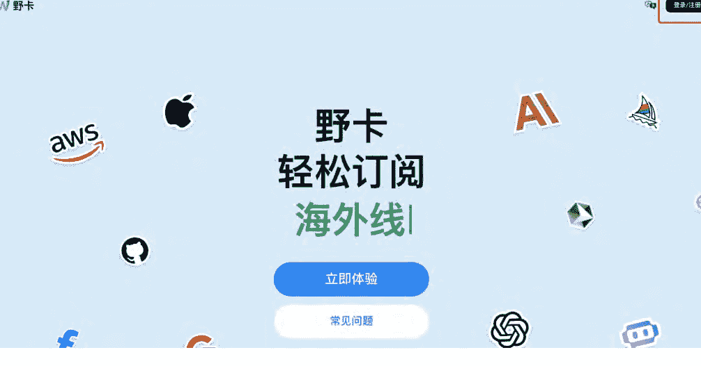

使用自己的手机号即可

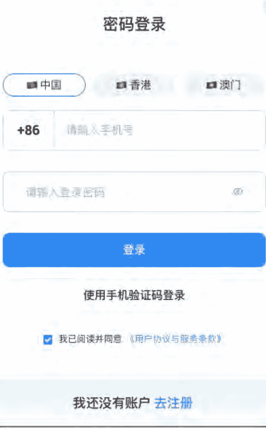

选择“野卡付服务”，立即通过

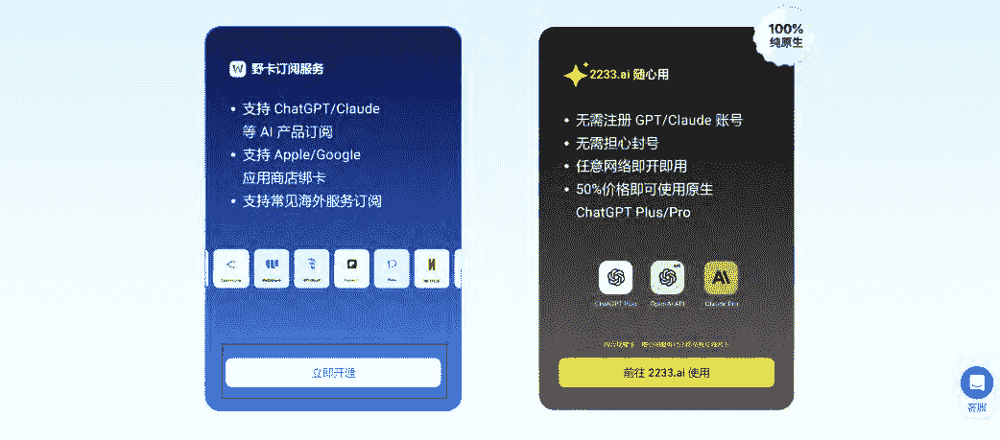

开通会员

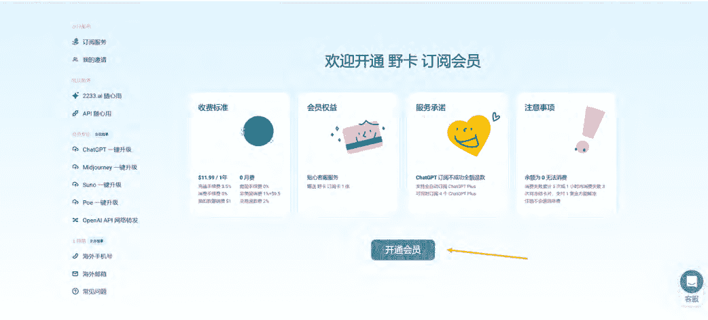

下一步

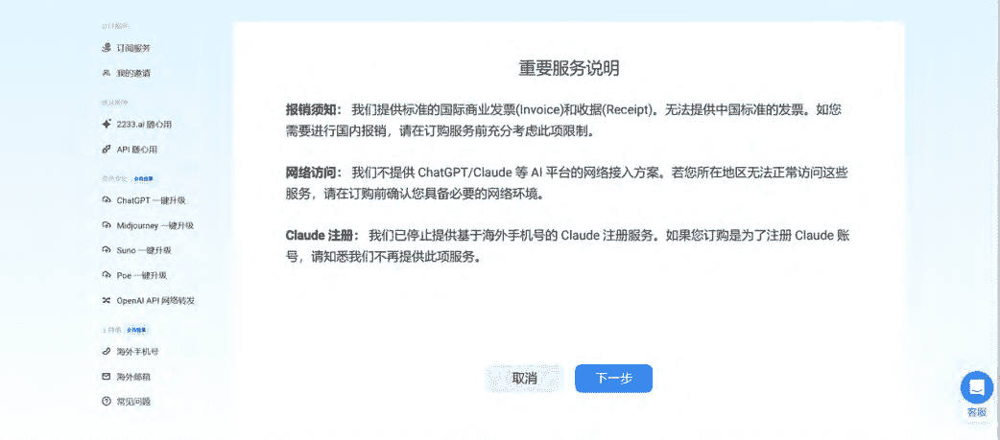

选择“年”，填写邀请码“POPLBZT”，然后点击邀请后优惠美元卡

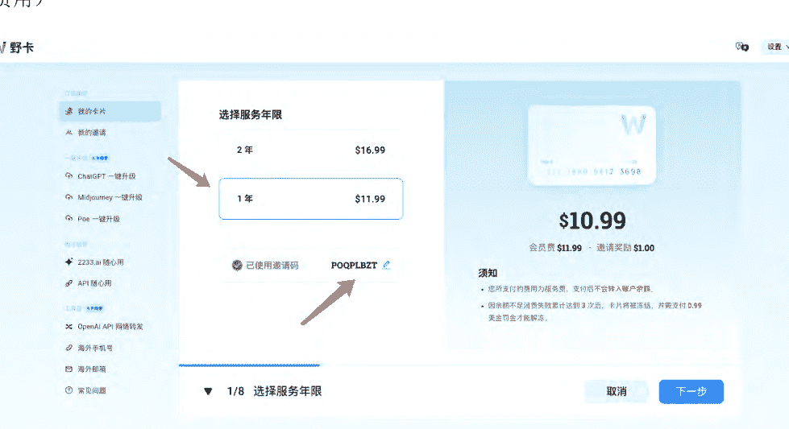

一直下一步，直到“完成实名认证”页面，由于这里我已经认证了，没办法继续后面的步骤了。

通过支付宝完成

根据支付，国内支付宝所需的身份信息必须完成实名认证，否则无法转账

输入身份号

按照提示完成实名支付宝即可

认证成功后，还会提示填写等信息，按照实际填写好了，填写完成后就行了

### 第二步，购买静态IP

点击【Subscription】底面的【Browse Plans】

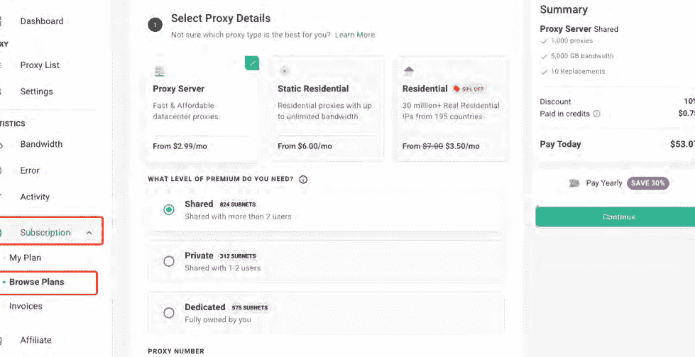

代理的选择，我们选择【Static Residential】，然后选择【Private】，因为一个的价格和【Shared】是一样的，都是美金，肯定选择更好的。至于我觉得没必要太贵了，而且会有锁，要是IP被污染了，我们就换就行了。“PROXY”选择

Type Custom Proxy Number填入（大家想买几个就买几个），点击Save。我们再买一个就行了。

[Bandwidth]选择250GB/month

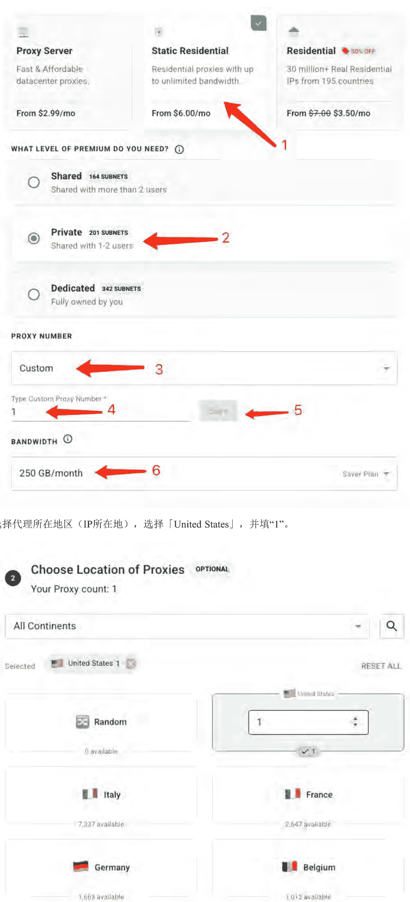

选择代理所在地区（IP所在地），选择“United States”，并填“1”。

Choose Location of Proxies

选好后点击「Continue」

## Enhance Browsing with Chrome Extension

FREE TRIAL

## Summary

| Static Residential | Private |
| :--- | :--- |
| 120 GB Bandwidth |
| 10 Replacements |

Paid in Credits
$0.89

Pay Today
$1.00

Pay Yearly SAVE 20%

Continue

Choose Location of Proxies

Your Proxy count: 1

All Countries
United States 1

RESET ALL

Random
6 available
France 4 available
Italy 3 available
Germany 1 available
Belgium 1 available

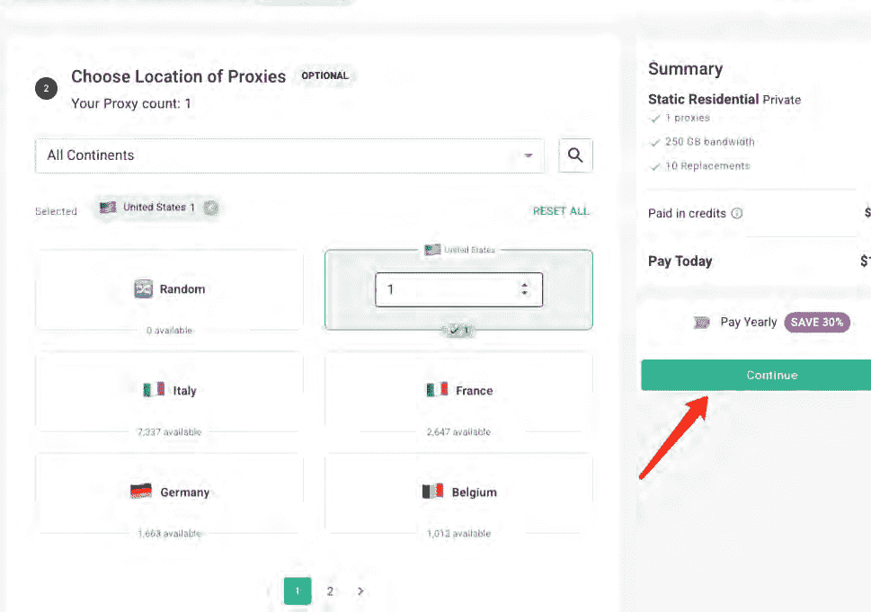

这个不用，直接点“continue”## High Performance Features

- High Concurrency MOST POPULAR Concurrency is limited to 60 by default. Selecting this option allows you to reach 6000+ concurrency. Learn More...
- High Priority Network RECOMMENDED This is recommended for latency sensitive applications. Your requests will be prioritized over other requests. Learn More...
- Get Proxy to Get 2x Concurrency Unlock higher tier concurrency. You need 3,500 GB+ 2X servers to receive 2x more concurrency.

付款页面，需要绑定信用卡，我已经绑定好了，所以我就找了一个图

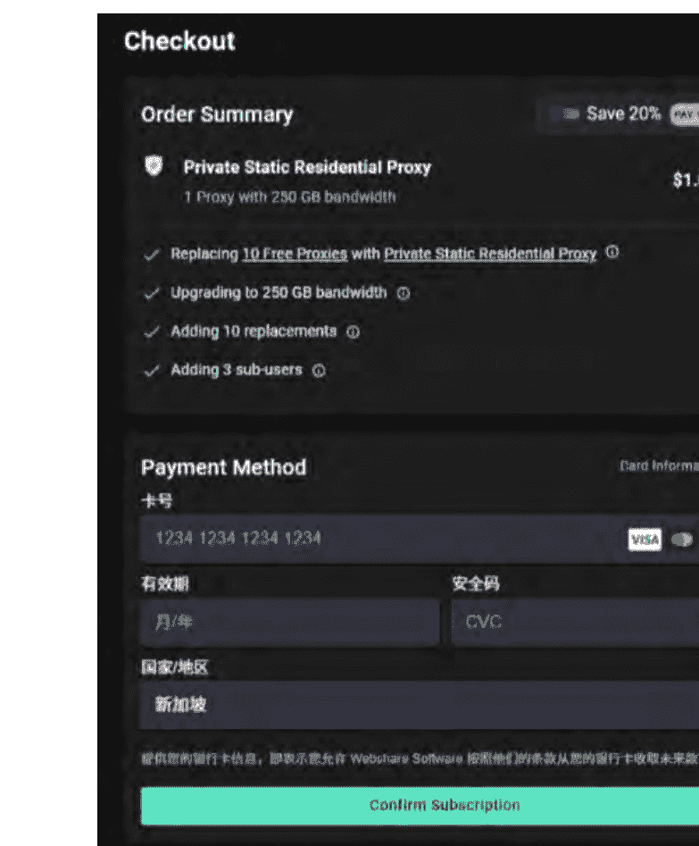

等到我们刚才弄好的野池里面，选择【订阅服务】-【Webshare】-【充值】

## Web 卡

选择你要订阅的产品

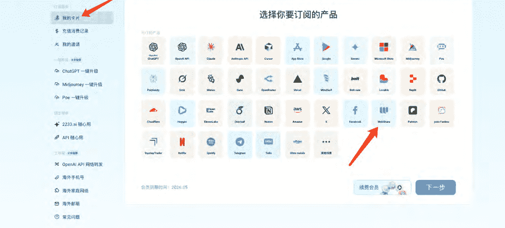

把卡片中的信息，填到对应的位置里，然后点击【Confirm Subscription】就行了。

注意：你的卡里面要有钱，这个位置不是0，要是你没钱去充，这种情况发生2-3次就好了。

由于我们的IP是不完全相同的IP。所以每次在使用之前，先用 https://ipalliance.com/做测试，没有我们再用，有问题就问我(如如何，请看第五步）。检测方法上面说了，我就不复述了。

### 第四步，设置指纹浏览器

我的指纹浏览器使用AdPower，地址:https://share.adpower.net/6nwzs

下载后点击左上角的新增浏览器

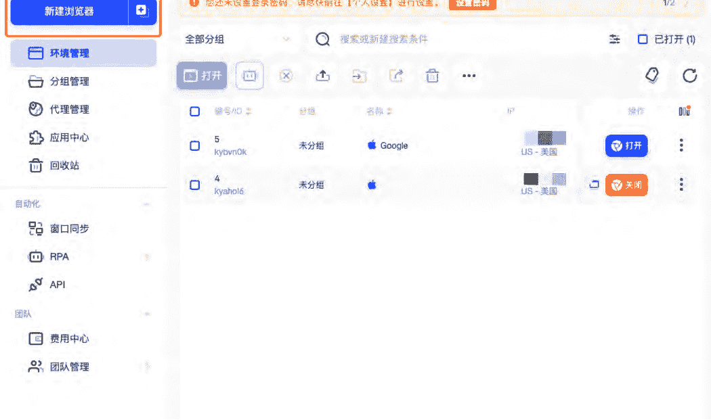

基础信息设置

名称：Claude随便起，自己看到每个干净就行

浏览器在SunBrowser里选择最新版本

操作系统选择自己

其他的都不用

# 应用设置

如果需要查看某些语言，请点击[语言]进行设置。

## 我的账户

## 本地设置

FlowerBrowser

Firefox 135 (20250319) 立即下载

Firefox 132 (20241108) 立即下载

Firefox 129 (20240822) 立即下载

添加更多

## AdsPower助手

仿真粘贴 输入范围 [ 100 - 200 ] ms 随机

## 其他设置

界面缩放 [ 开启，自动适配缩放比例 [ 100% 50% 150% ] ]

系统日志 [ 查看详细 ]

网络检测 [ 检测到网络代理 ]
网络连接 [ 开启，使用系统代理连接代理 ]

点击“确定”，就会打开一个浏览器

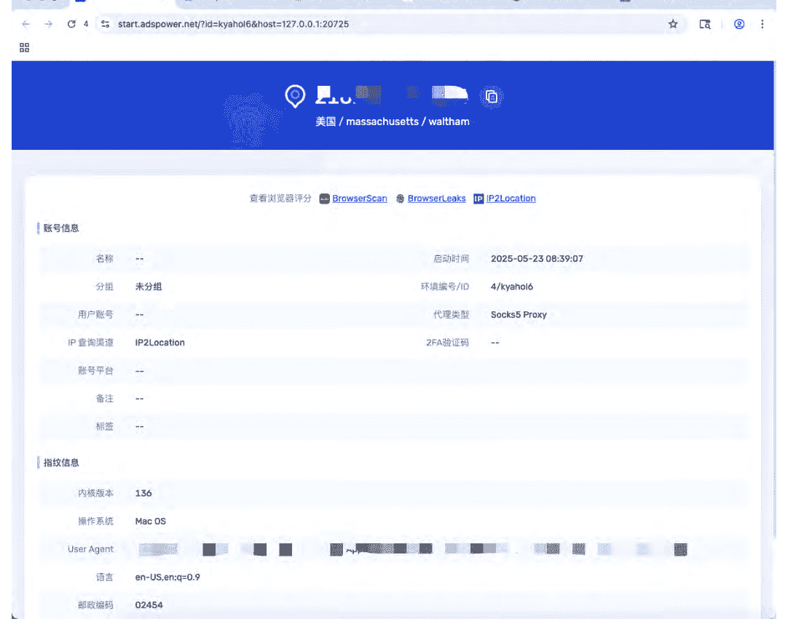

到了，就可以直接连接 Google 邮箱和 Claude 了。

无论你的魔法规则还是全局的，在指浏览器打开的网页 IP 检测的地址全部都是一致的。检测工具：https://ip111.in/

## ip11.com 全方位查询您的IP地址

### 国内测试

### 从国外测试

### 从首页测试

美国 Moscow
这是您在国内测试所的IP

美国 Moscow
您可以安全查询国外的测试所的IP

美国 Moscow
这是您查询的、Facebook、Twitter等网站所属的IP

本网站提供IP地址查询的功能，不需要填写任何信息，也不需要对任何网站进行注册。
ICP备1300548999号

对于谷歌邮箱的注册和Claude的注册，大家一步步就可以了，一个干净的IP，注册起来就不再简单了。

### 第一步，如何更换IP

选择您更换的IP，然后点击“Replace”

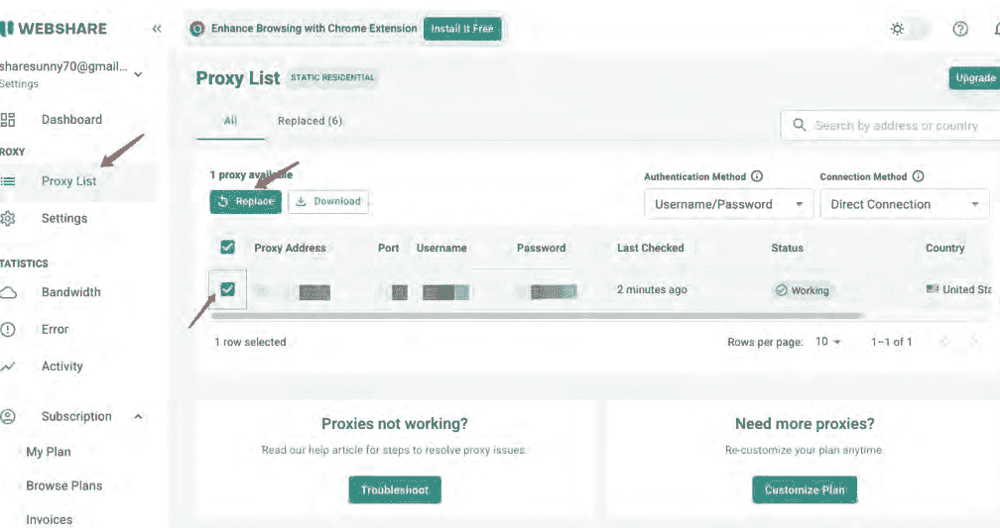

选择“Copy & paste proxies to replace”

### Remove proxies
Paste proxy addresses no longer want in your proxy list.

### Copy & paste proxies to replace
粘贴想要替换的代理（separated by returns or commas）

- Replace ALL from the same ASN
- Replace ALL proxies from certain country
- Replace ALL proxies from certain IP Range

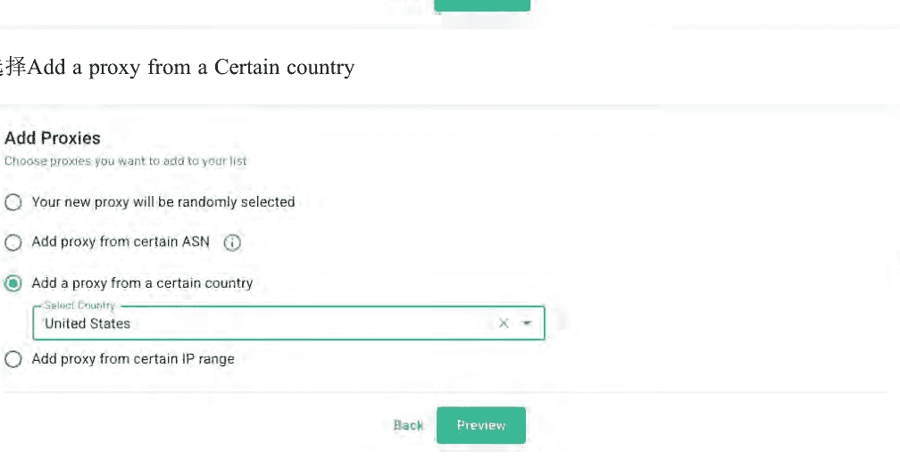

选择Add a proxy from a Certain country

### Add Proxies
Choose proxies you want to add to your list randomly

- Your new proxy will be randomly selected
- Add proxy from certain ASN
- Add a proxy from a certain country

点击Preview

后面再点[yes, Replace]就可以了。

## 评论区：

笑声：写的太好了，非常有用，建议给个精华[强]

孙金鑫：多谢支持

科学羊：雪中送策

## (62赞)用AI做了一个海外iOSAPP，上架5天，累计5万会员订阅，预估175万销售额

作者：黑墨子
日期：2025-05-11

最近做了一个面向海外的AI健身APP，年费34.9万，月费66.9万。

今天Apple后台更新了9号的订阅数据，上架5天开了第一个单，印度3哥直接买了一单会员，8越南老表买了7个会员，9开了天试用订阅活动后，新增了3个免费试用天后订阅会员的用户。

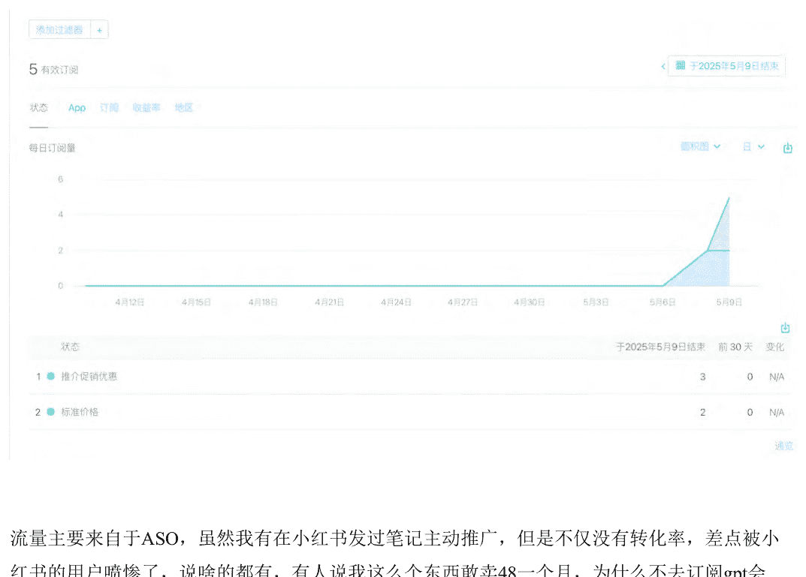

流量主要来自于ASO，虽然我有小红书发过笔记主动推广，但是不仅没有转化率，差点被小红书的用户喷了，说的不有的，有人说我这个东西卖了48个月，为什么不订购gpt会员；有人说我这个功能根本不值得得费；有人说这种App毫无无色芭烂柱，这个评论的点赞对比我笔记的点赞都高，还有人说这种功能在发图、圈圈就有。。

（此处为评论区内容，根据OCR识别整理如下）
- 48个月，有这个ChatGPT不香吗？
- 有订阅了，但是你不用一次
- 别比的软件有什么付费吗？
- 这种毫无特色的App还要订购？更没人想买
- 这种毫无特色的App还要订购？更没人想买（OCR重复内容，已语义去断合并）
- 这种功能在发图、圈圈就有..
- 这种功能在发图、圈圈就有..（OCR重复内容）
- 这种功能在发图、圈圈就有..

## 01 外贸突破
外贸企业如何获客突破及转型

## 02 精准定位
精准运营一个高流量的账号

## 03 AI落地方案
如何1人打20人，全自动化流程

## 04 AI短视频矩阵
1人管理多个账号，超低成本管理的方法

### 一、外贸突破

我不知你有没有过一个问题，国内工厂是有生产，但是没有订单的情况？存在几个致命要点：

- 过时工厂的短板，砸砸短视频团队，出去做0转化；
- 市场瓶颈，原本大部分客户在国内本土，增长比较困难，但是开拓后的国家和有消费的新兴市场；
- 收支不平衡，传统外贸团队，投入几十万的订单，名片转化率不到1%。

那老一批的老板，太传统了，包括我也一样，因为我跟了二十年的女工厂老板，是一点流量思维都没想过的，注定被淘汰了。

我一直认为流量哪里，我就去哪里，我不会一直选某个，但在选择前面有一个你的认知，就是你，没有这个认知，你凭如何选择？大家都知道流量有多重要！

选择要不要努力，选择对不对，努力努力，但在选择前面有一个前提，就是你，没有这个认知。

外贸获社媒的方式，如同在国内抖音一样，社媒的方式，更要获客的时代需求。

| B2B社媒获客 | 流量获客渠道 |
| :--- | :--- |
| 获客“精准” | 处于“精准”的策略 |
| 建立信任的技巧和内容营销 | 潜在客户通过搜索想要的关键词的需求来发现和转化 |
| 消除他们的顾虑 | 已经发现并购买 |
| 打造合适的市场新产品 | 适合于推广热销的产品 |
| 以及新口碑产品 | 已经满足客户需求明确自己的客户 |
| 留住客户 | 留存客户 |
| 比较优势 | 客户复购 |
| 把产品展示在客户面前 | 客户深度链接，你需要持续推他们 |
| 建立信任让客户已经选择品牌而非他们，他们要什么，你想要什么 | (对方不，你不说，不要让客户猜） |

你只会会社媒还会，还需要用AI来进行提升效率，否则困难很大的。

## AI+社媒，流量感知到的风口

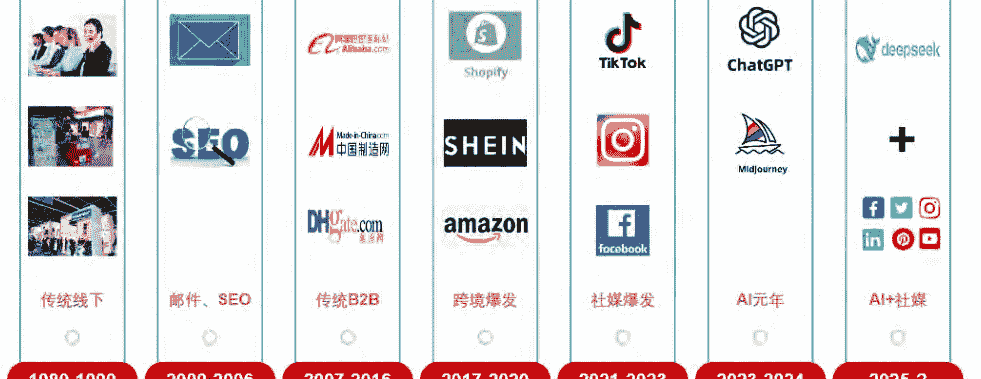

以前几个时代的风口，我好像每次都留住了，所以我常被别人说“不专注”！

国外社媒的数据，尤其是TikTok的全球用户量20.5亿+，相当于国内的三个抖音，合你去下tk的工厂，数据销量简直爆炸，我们的服务对很多行业，都已经在平台上刷屏了。

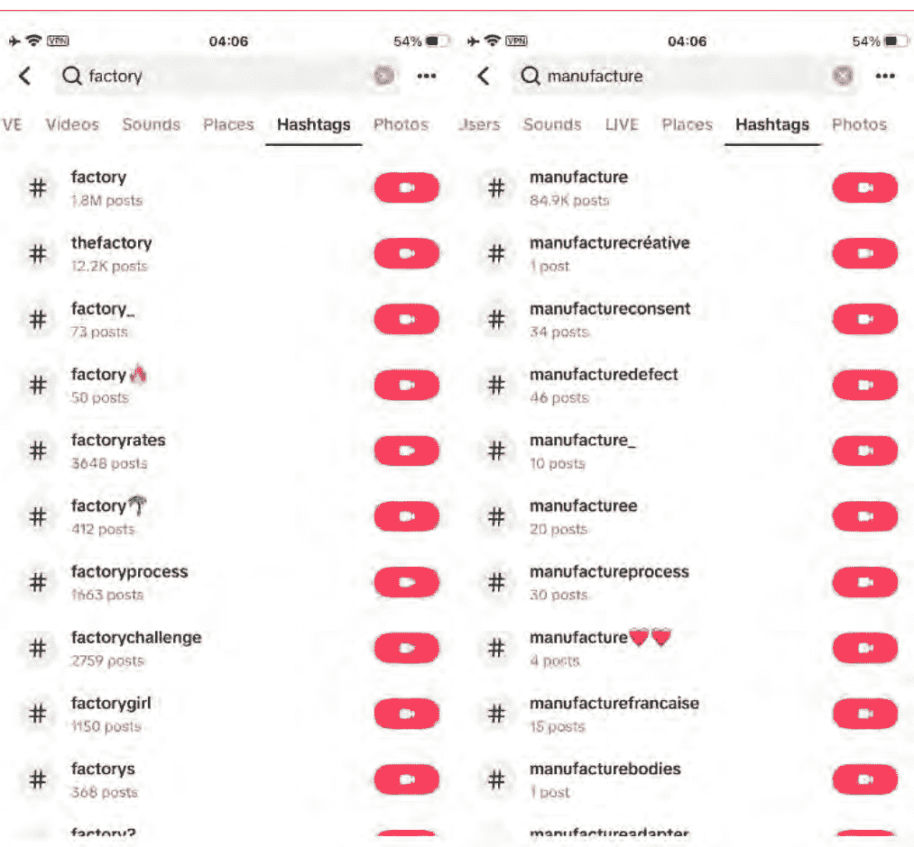

国外很多人可能会说，需要办法才能久就留住了很多人，但我不知道有没有过一个信息，就是视频海外！

视频号的海外用户，达到9千级，我不知道大家没看到过很多英文的视频，比如：“hello, boss...”诸此类类的。

你去仔细看这些评论，有很多的老外用户在找工厂，想要下单的。

### 评论 27

都在搜: sunglasses

- ahup silvarma 2月10日 10 👍：Can you send one sample to check the quality?
- VITOG-Earpho... 作者 广东 2月10日 👍：I check, I will contact you ❤️ (2条回复)
- Andrea 意大利 2月9日 10 👍：Info please
- VITOG-Earpho... 作者 广东 2月10日 👍：Hi, add WeChat ID limysheng
- Lazarus Anth... 辽宁 2月6日 👍：How to buy
- agharbis 广东 2月12日 👍：how to buy please

因为视频中不是一一带国家，同时中国也鼓励发展这个政策，很多东西的我不能说，我只能在6月的海棠私话里分享，我不想让她知道星球芭了。

现在的AI+发展阶段就好比2010年左右还有宝猪，虽然不健全，但是机会特别，跟钱钱一样哈哈~

AI结合平台，是目前的生意里唯一可以实现公私域联动的流量池，你做国内市场，不是常规的？我们我们这个就好多了。

我现在的目标，就是这几年，赚完一辈子的钱，别跟我谈长期价值，没有短期的暴利，很难支撑长期价值。

很多人跟我说，你就是要创业了，就是要创业的理想还不够，很多行业可能干一辈子，它是有生命周期规律的，机会大家读一下！

## AI全自动

创业需要持续投入，才能成功，而且我已经采访了很多平台的创业者，只是在这个时候，我找到了我的大红利。你相信吗？人一生，是有大的，但这个大运是不能够逃避。

市场上都是些培训机构，我可以做80%的人，只要会AI就会教AI短视频教程，但是落地不了的，根本没有办法获客了：“我教了你，你可以有一定精准客户”，而我呢，哈哈，就是这么了。

我们的打法是国内新媒体平台+国外自动+AI私域阵营销售。

我的全自动是什么呢？就是在公域不断发视频，不用自己拍视频，全用数字人，而且数字流量几十万。

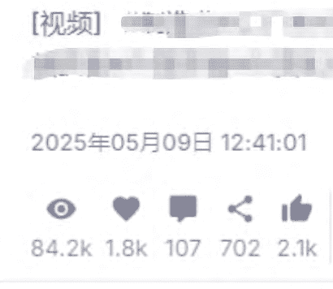

现在我在国内有1000+矩阵号，都是自己的IP，国外私域有几十多个。同时，用AI解决视频数量问题，极大的提升效率效果。

| 人工操作 | AI操作 |
| :--- | :--- |
| 1个辑生成100条不到 | 1分钟生成100条爆款 |
| 英语翻译，不会多语言 | AI生成多国语言 |
| 1个辑生成100条 | 1分钟生成100条 |
| 人工早起早晚有限 | 24小时全天无限制 |
| 对人要求高，效率 | 对人要求低，高效 |

同时，很多人不会英语，怎么做外贸？买个翻译就行了，以及私域里有这个法，自动跳转各个语言的视频。

跳转、实时回复、翻译配置，不是问题：来不及回复，不是问题：操作准。

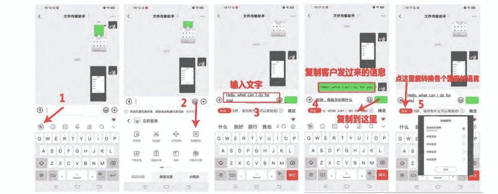

以前拍的视频非常简单，你可以看到自己的，就是英文和日常视频混剪，一天产出几千条视频。

大家可以直接抄这个文案，发30条视频，就会大量的老外找你，但是你的思路要自己设计好！虽然不会英语也不会说法语，但是我们开发了一个工具，全部都可以自动跳转对应语言的文案，放了视频，大家就可以。

然后这些视频文案，我们通过Deepseek自动生成100条文案，不断优化视频质量。

我的文案是Elena，广州工厂的老板，我有20年的工厂，3000个工厂，我在德国，广州工厂的经理，你可以通过微信136912618联系我。我希望在社交媒体上发帖获客。我的要求：1、每天根据我的文案发布，可以参考的例子。属于我的双语版文案20条；2、在30天内互动。

Hello this is Isaac our showroom is in Guangzhou linking28618 our factory has a history of 20 years, we focus on high quality garments with many styles, we support OEM and CDM services, if you need, you can contact us look forward to your coming.

Elena的回复：我的产品质量最好，工厂在广州，在德国有20年经验，3000个工厂，我在广州当经理，期待合作。

我针对这些视频文案的回复，每个视频回复30条，我保证能回复那些感兴趣的。另外，还可以增加一些互动，比如询问价格、地址，介绍一下自己的工厂，我们在广州的工厂，期待合作。

No. 68/230 我们的制作的接着，就放到软件里自动剪辑视频，产生了几百条获客视频，可以看下面的图片。

可糟糕，我要分享的东西太多了，这个只能线下才能够给大家分享啦~期待6月7号的生流量大会，能见到大家！

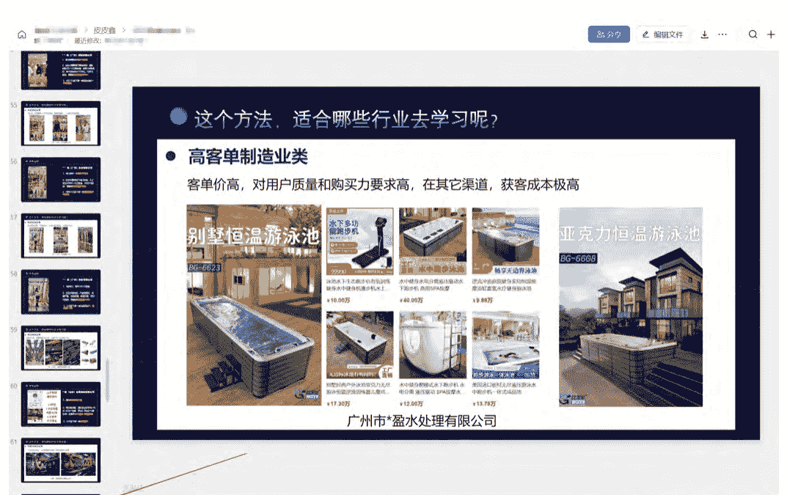

## 生财航海家
## 航海家新流量大会
>>> 夜话分享 <<<
25 年流量 新玩法 新趋势

皮皮鑫，鑫视界创始人，外贸获客每日 1000+ 全网 700 + IP 矩阵账号

分享主题：视频号及海外全平台，如何用 AI 批量获取高价值 B 端客户

- AI 时代，外贸企业如何获客破局
- 如何策划运营一个高变值的账号
- 社媒的内容底层逻辑，懂了就能开干
- 如何用“AI + 短视频矩阵”单月跑盘

6 月7日 / 广东·生财有技术参加

评论区：
W：需要这个分享了，后续可以出全篇吗？蒙豪：mark

AIPA版

## 巧用多维表格，让AI成为落地生产力
作者：Lisa，日期:2025-05-13

很高兴加入生财社区，我是深圳AI公司的合伙人。在阅读了粉丝们关于AI的精华内容后，我发现大家遇到的问题是相似的：“输出不稳定”、“提示词生成效果差”、“输出分钟”、“调试一小时”等。AI落地的讨论是为了实现某个场景下的功能，一旦开始规模化操作失效，AI产难以控。这里以多维表格+DeepSeek制作小红封面为例，如何对AI输出进行系统化控制。借此分享，给大家提供一个将日常工作AI化的通用思路，希望对大家有所帮助。进一步阅读请移下方：

是一些生成例：[https://qvx41qn7.feishu.cn/docs/GYMvldho...](https://qvx41qn7.feishu.cn/docs/GYMvldhoQVzSx0u79cDam8n5p?from=colink)

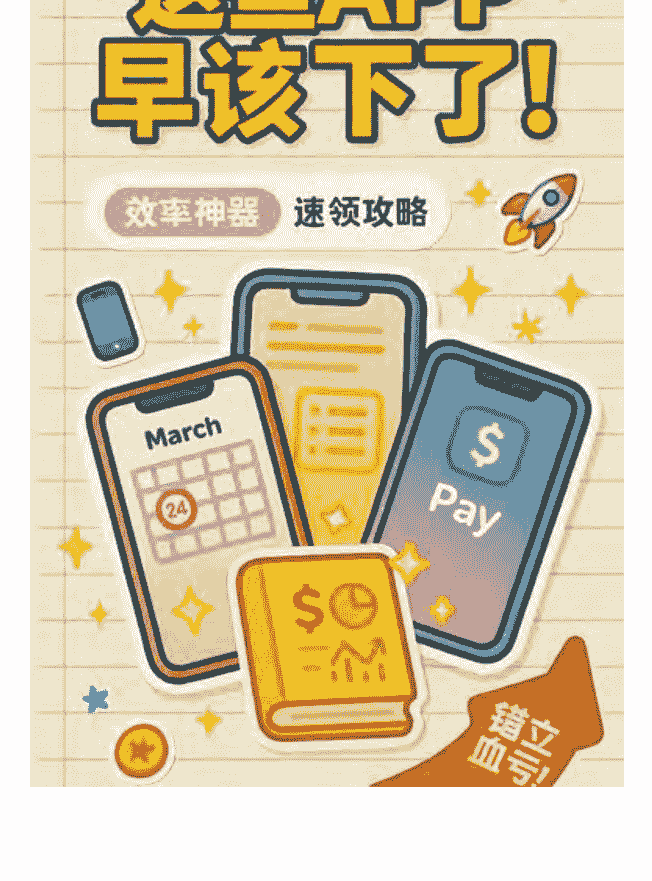

评论区：
Mani：表格可以直接套用
仁：可以的，点击使用模板，按照说明步骤就可以找到相应的地方修改
理想的：这简直是教程

## 新手作者如何用 AI+RPA 一天创作100篇公众号原创文章获客
作者：伍嘉，日期:2025-05-13

https://s296cam1nz.feishu.cn/docx/Jec0ldFjYoc6wQsdncNfJn2d

评论区：
阿毛：太猛了！
若凡：学会了
深蓝：实际上并不实用，不需要过度追求技巧。我们内部也开发了一套基于Claude的网站，可以自动写作、自动加图、一键发布公众号内容。搞了40多个号。但是效果不佳，因为SEO是这样的。腾讯的法务部门也不是傻子了。
米未：这篇就是我的AI实战教程，写了500多个，超详细的，收藏+赞！！希望我和伍嘉老师打磨的这套保障级AI教程对我很有帮助
祝悦：现在还有什么更好的方式
请问大佬！那应该怎么才好呢?
深蓝：去搜官方文档，扎研究。没有太多花胡哨的。

## AI表现，8个月AI，AI工作室全流程总结+分析经验
作者：日乾，日期:2025-04-23

AI表现，8个月AI，AI工作室全流程总结+分析经验。2023年9月，人一生是有大的，但这个大运是不能够逃避。流量哪里，我就去哪里，我不会一直选某个，但在选择前面有一个你的认知，就是你，没有这个认知，你凭如何选择？大家都知道流量有多重要！

选择要不要努力，选择对不对，努力努力，但在选择前面有一个前提，就是你，没有这个认知。

外贸获社媒的方式，如同在国内抖音一样，社媒的方式，更要获客的时代需求。

（此处省略部分重复逻辑描述，保持连贯性）

## 从 0 到 1 搭建 AI赋能高效运营
运营：奎享，日期:2025-05-02

大家好，我是奎享，生财的教练。深耕小红书5年了。近期分享“AI赋能小红书”之后，我的工作流程升级了。现在可以在10分钟内生成一个高质量的小红书笔记。分享详细步骤：

https://atywycc2.com/docx/WkJfdSl2iXmoDcP

（注：由于OCR文本存在大量重复和乱码，已根据语义进行去重与逻辑修复）

## (精华*55)从零开始的AI开发之路：一个程序员的4个月复盘

作者：Cyrus
日期：2025-05-20

从零开始的AI开发工具，一个普通的程序员。

大家好，我是Cyrus，一个普通的程序员，今年4月加入AI人才行业，从4月加入AI人才之前一直在做AI开发工具，现在还没有一个能拿出来手的，经常会把计划做到无人问津的步措。

相比于那些已经满口AX 6的大佬，我的成功简直是矮人登天。作为执行力高的人，遇到风就会去开发（粒子），感觉自己是经常发疯的底层韭渣工具，总是在担心项目短期收益，长时间很痛苦。

对于商业化，我从一个比较差的开发者分享一下过去的经历和经验，希望我的失败和迷茫的经历（自认为）能够与大家产生共鸣，引发响的连锁反应以便于可以链接到大家。欢迎大家的指导和评论交流！

全文备份：https://lag410zshte.feishu.cn/QIRpdd7mFoulBXuyacecV9Ynj?

评论区：
- 哥们，对你的专立很感兴趣，有兴趣交流一下嘛
- 信道：说了了没有还是在裸上走风
- 飞猛：目前这个项目停滞做不了
- Cyrus：我展出的过往项目基本上都已经停止开发并且关掉了，过程倒是可以分享交流
- 张晨：故事很有意思，有用吗？
- Cyrus：这个项目也停了[抱脸]
- Cyrus：我不清楚怎么链接，可以交流一下[社社会会]

## (视频华)(41费)一键批量爆款视频AI工作

作者：Lisa
日期：2025-05-15

一键批量爆款AI视频工作完成了一件十分有意思的事情，把和的工具结合了，做从一个几乎到点击一次就可以实现AI视频的工作流，还可以复制、可以迁移（只要模块的内容都可以优化的），所以是有意义的，给大家大家~ 欢迎有经验的朋友一起来制作工作流、优化效果：

- 一、一键批量生成视频：目前暂在正文中未显示此内容。第一条视频拆分积分；
- 二、工作流：目前暂在正文中未显示此内容。
- 三、实教程：准备工具：下载软件：https://www.lovartner.com/transcriber/capcut - 视频软件工具。下载安装：剪映下载教程：剪映软件下载教程（点击此处）【演示和教程步骤手册：
- 四、商业价值：1.1 从自己的工作流工作中获得结果。

为了把素材和后期的两个工作流接起来，避免麻烦，是把整个工作的生产流程粗糙地打通的，爆款工作流~ 生成视频~ 生成视频~ 绿色~ 绿色~ 提供素材和发布剪映发布教程（点击此处）- 数据（智能体实现），线路的路径，从素材到发布的整个路径就可以获得理想结果。

二、可迁移：将节点复制到：url、文本、文本、提取要点、复制、视频/音频节点：视图按照工作流复制的节点，只需要根据需要的内容就可以迁移，删掉可能比他人更高效的视觉和观感，如此（例如例），至少保留一部分的token。一瞬间就会会有真正的惊喜的报告。所以一定要相同相。

结构化知识：业务素材；食物；知识引进。这样就可以通过调优的节点、通过调整某些参数来生成自己需要的3D模型、复古、赛博朋克……可优化的节点：一其实生成的还是很烂的，只是为了现在想改进ts，工作流界面是在哪里设置的。之后还有呢，烦了！

3. 具有一定的稳定性；理论上只要通过调整的节点，整个工作流时长产出的结果就是稳定的。如果不需要，在某些情况下要多买一些的token。五、优化节点：

- 一是在调整工作流的稳定性要要找到稳定和最快的：
- 二是在 prompt的优化，建立整个工作流时长最长的实在是在调试的结果，cache 要一点一点的优化。尤其是做视频，人类的反馈测试，限制条件越明确越好，智能体的回答是否有。

商业需求出现反复时，可能需要花几个小时。这样也可以也可以的。所以一定要相同相。

AI 能力的各种特性：其实生成的效果是比较好的。我已经等不及的快要了就存出了出了。

【演示和教程步骤手册】
https://r0el9lqdms.feishu.cn/ApajYllkkPGXXvLChBoSnv

评论区：
- 译文：没有权限限制
- Lisa~ 感谢反馈，已经可以了~

## (46)数字人口自动化：扣子+多维表格+映镜实战教程

作者：狮闲
日期：2025-05-15

大家好，我是狮闲，久以来研究了数字人生成，当时搞了个个人视频生成多维表格，调用扣子插件生成视频，因为免费版生成的比较慢且生成的视频有水印，我自己写文档。最近看到挺多豆过期了，就想着分享一篇数字人口视频教程分享给大家，顺便消耗一下豆。详情请查阅文档：https://feishu.cn/docs/06bfedzw/KJugeugn

评论区：
- 越：这篇文章看完后，正是我想要的。coze+多维表格是神奇的搭配！
- 狮闲：爱心

## (50)手把教你使用Coze智能+DeepSeek创作并发布到公众号上

作者：龙哥
日期：2025-05-16

大家好，我是龙哥，专注于RPA和AI智能、AI编程等领域。见文档：https://feishu.com/wiki/svoxdxys/cdcuRdnf。

普通人是很财务的，是被设计好的，2万想买车，5万想买房，普通人是幸运的，但仔细的。阶层化，发现财富本质上和努力有关系，但根源还在。

- 努力拼命就能挣钱。
- 每天从早起到深夜。
- 身体累了，还面临各种疾病。
- 努力了吗？

图片：
- 20万/50万的普通人。
- 详情文档：https://feishu.com/wiki/svoxdxys/cdcuRdnf

评论区：
- 龙哥：最近的。
- 变形：AI能力，变形变了。
- Aiden：龙哥，请教一下我的文章。
- 龙哥：最近调整了，阅读量都很差。
- 翻凡：厉害。
- 驭风：牛奶。
- 夏开心：收藏了。

## (43)AI经典，12个月做项目

作者：干叶
日期：2025-05-19

AI经典，12个月做项目：独立开发者Pieters。这位老哥不是，也不是什么的技术天才。他自学编程，养成“一人公司”理念，一个人包办设计、开发、运营，在数字的世界里风生水起，足迹遍全球50多个城市，在酒店租房、书店办公，靠运气是不够的，他早做成了年入百万万美元的超级程序员。

Pieters究竟是怎么做的？我们不行，尤其AI时代搞点事情的梦想者还有机会吗？

他的成功，我发现了两个点：在AI时代，你可以通过“单兵作战”？
- Just ship it! 这正是反直觉的，你不需要纠结，不需要完美，要把想法做成最小可行产品（MVP）推出去，真实的用的反馈来改进，正如他所说：“你不需要为了伟大，你可以通过AI成为你想的人。”但你是否尝试直接问AI“我想干什么？”

AI的秘诀就是，不断迭代，根据市场反馈调整产品，这样就容易成功。我还有几个案例，他们利用连续迭代的能力，并建立了自己的项目。他关注AI上的一些新动的技巧，也参加过许多AI课程：Coder, ChatGPT, Stable Diffusion, Replicate。

在AI时代，学习能力和执行能力如何重要？你可以通过FreeCamp等平台学习，也可以像Midjourney一样，在实战中边学边做，这样就不费昂贵的时间，还能建立起自己的支持。你不需要技术栈（PHP | Query），只需要工作方式（侧向执行），就能展现出强烈的个人魅力。他不是靠运气获得过的暴富，而是赚过数亿美元的项目或技术所积累，而且最适合自己，Nomad List只是一个Google Sheets。AI早期需要处理订单，不要想要到位，当功能可行后，根据用户反馈数据改进产品（如Hotmaps数据）。他从一个聪明的老兵，保护自己的财富和心智。不需要为用户付费，有价值的产品才值得付费。同时，学会控制成本，与供应商谈判，确保你的业务的持续增长。Levels提到，咖啡曾是欧洲的发源地，现在是许多梦想的诞生地。他环绕着咖啡馆构想想要的世界。你可能需要一个信任、激发和互动的环境，无论是真实的咖啡馆，还是虚拟的社群。

## (33)我做了智能体，文章秒变，效率提升不是梦

作者：陈序兴
日期：2025-05-01

前段时间，我把文章发布做成了钩子，本来只是想自己用AI，没想到这么多需求。Coze的图像已经加入了，由于折腾了一半，逻辑攻克了。它的图像可以支持文字生成，非常强，如果一些信息密度高的，比如知识类，有些问题，智能体会hold不住。于是我没有继续，智能跳转阅读，体验更好。

评论区：
- 若凡：链接了。
- 翻凡：厉害。
- 驭风：牛奶。
- 夏开心：收藏了。

## 如何做低粉高变现的小红书

作者：云
日期：2025-05-22

具体内容有点多，点击文档查看：https://feishu.cn/docs/Um52CVYoPu66GGTA。

评论区：
- 秀儿：了。
- 易义：了。
- 裴莱：哈哈。
- 潇潇：谢谢。
- 笛：感谢。

## 小红书精准，4个月实现0到3w

作者：小小婷
日期：2025-05-13

大家好，我是小小婷，专注于RPA和AI智能。在这个项目里，我负责线上引流、粉丝增长。小红书和社区的流量很大，以前做水果生意，3个月开始，引流裂变+，实现了从无到突破，用了4个月的时间，成功做到月入万。详情步骤分享：https://feishu.com/wiki/PRwhdf09lklfrccVznq

评论区：
- 测评：了。
- 雨颜：深远的。
- 篮子：强。
- 若凡亨：好的。
- 小小婷：是的，一起加油。

## 小红书万能公式和操作手册

作者：小小婷
日期：2025-05-16

这个东西应该是行业都要到的，不管是个人想要副业，还是公司想要生意，都需要从私域引流量。关于《小红书引流技巧和万能公式》这个主题，我在去年年初分享过，那时候是1.0版本，已经帮助了很多人，甚至分享都被运到了海外。两年过去了，平台规则有小的变动，加上我对引流这件事的理解也有变化，所以有了2.0版本《小红书万能公式和操作手册》。引流没有变化，但是流程中的细节有了优化，效果依然非常好。现在就把这篇文章重新整理成文字版，只需要自己看，全文高达1600字。这篇文章不涉及粉丝，只说一件事，就是讲如何安全、高效地把用户从小红书引到微信上来，把这事儿明白了。包括但不限于：整个引流的逻辑应该是怎样的？需要哪些东西？整个流程是怎样的？什么是合规的？怎么才不会违规封号的？什么动作是平台允许但是安全性高的？引流应该怎么做？内容怎么留？引流的路径是怎样的？怎么增加流量的效率等。当然，这些问题不需要再去问一遍，而是我把整个引流教给你之后，这些问题你自然就有答案了。文章有总长1600字。粉丝链接：https://onda9ushj.feishu.com/doc/Ls6dGtYqoEGhxu1kCtJPynlh 密码：2052tf

评论区：
- 二米：宁波太佬。
- 大梁：看了。
- 金奎：是不是密码没输入。
- 叶子：需要输入密码。
- 金奎：帖子里有写吗，就在链接后面。
- 彗无言：学习一下。
- 静水：密码在链接后面。
- 小A妹：到了，感谢大佬分享。

## 手把手教你0-10小红书获客和私域运营(祛专属)

作者：yeye
日期：2025-05-17

大家好，我是yeye耶耶，广州南三大在读，2024年4月加入的生财，曾经做过货源和无资源商家（小红书、抖音）和私域（情感、流量/托管，k12）。25年方向领域是私域获客和运营。

生财培养了我的商业思维以及各方面，在加入生财之前，我才知道互联网可以做小红书引流和电商（毕业10个）。

# 红书电商4群-3月航海(412)

邀请进群申请(21)

爆单了有点手忙脚乱，这两天都没怎么睡睡，饭都没怎么吃😂但还是想给小小伙伴们送点鼓励，坚持就是胜利！坚持真的真的很重要。

好牛啊~

是新号还是老号呀！

注意身体呀，期待你的#航海好事，闲下来好好大伙分享@薇薇-长沙-Lv.1

有精力的话，可以考虑开播了。

薇薇-长沙-Lv.1:爆单了有点手忙脚乱，这两天都没怎么睡，饭都没怎么吃...

教练说的一开始要找多家供应商。

评论区：
- 易生：太优秀了，优秀的人做什么都优秀
- 灵灵：简直太优秀了，太牛了
- 观自：wow 太优秀了👏👏👍
- Limit：利润有30%吗
- 阿扬的晨：优秀
- 茹：好棒的圈友[强]
- 朝云：优秀优秀秀！！！
- 好生业：太优秀了👍

## 精华帖(105)普通如何在小红书构建自己的生意？

作者:Luke
日期:2025-06-15

普通人在小红书构建自己的生意？小红书不是目的，目的不是做一个小红书，小红书是你完成引流的手段。这个世界上如果没有转化，可能就要走很多弯路。你加入一个有100个铁粉的圈，写一篇笔记，却不知道这篇笔记有什么用，追求的是假象，而没有这100个铁粉可能只有几个单，你付努力才能“收获”。但是，这种虚粉的代价太大了。

假如你要产出1000个铁粉的粉丝，虚产品就是获取流量的种方式，换个角度看，它也是正义意义了。

小红书虚产品产出1000个铁粉的粉丝，在这篇文章里，我换个角度考虑到什么是虚产品。虚产品是你产出到1000个铁粉粉丝的逻辑，这里的1000个铁粉粉丝，是能够持续给你付费的。

为什么他们会为你付费？又提到了前面的逻辑，由于你的虚产品很有价值，获得了他们的信赖，下一次你产出新的产品他们就会继续下去。

想象一下，当你有了这1000个铁粉粉丝，假如我们每月都给你赚19.9元，那你还有19000的固定收益，这是一场长期生意，而不是只一次性的。

更多内容请看链接。来说这么多，6月7号我会在海家新流量大会的现场分享，与大家一起来，普通人如何在小红书构建自己的生意，以及如何用AI更好地构建虚产品，能够助力你的小生意。

https://8ekpu7h0l.feishu.com/docx/HZWqd4sdwo5XQoybgJY7yf?from=copylink

## 航海家新流量大会

小红书 | 视频号 | 抖音
>>> 夜话分享 <<<

luke
4年小红书博主，擅长0-1虚拟产品累计变现 6位数

分享主题:
### 普通人如何在小红书找到自己的小生意

- 普通人到底如何快速入门小红书虚拟产品的生意
- 分享一些避坑指南，以及如何通过 AI快速帮你落地你的想法

6月7日 | 广东·广州
生财技术航海家免费参加

评论区：
- Luke：感谢大家的监督，让我触发了新的思考
- 小超人-刘翔：6月7日的航海家，我们怎么报名
- 河林：Luke老师出品，必属精品！
- 超级微吸太太太：Luke老师高产啊
- Luke：等官方通知
- 车子：李涵潇，我一直很排斥外包开发，因为我的时间不值钱还浪费精力，看了文章突然意识到这个东西才是我的优势，可以通过低价外包外发为他们提供价值，然后再用我的信用担保为他们我们。好像逻辑通了。
- 践行者言：万！

## (精帖)(76赞)2025小红书本地生活，别算规模，算利润

作者：富贵
日期：2025-05-16

今天和大家分享，关于小红书线类业务如何在平台上进行获客。

先介绍一下自己，之前发布过小红书的AI提炼表格，可能有的朋友对我已经比较熟悉了。

富贵，长安文化CEO
base杭州，小红书线索类头部，自博人日获5000+

- 1. 2019入局小红书经营，全流程从0到1，年销1亿+
- 2. 2020入局抖音直播域，团队带粉5w+
- 3. 2023开始切入小红书本地生活，本地类日均线索超2000+
- 4. 自营工作室，合作大冰冰、艺星、莉等。

### 小红书2025还有什么机会?

最近，大家发现越来越多的人在小红书本地推，更多是穿搭、娱乐类攻略。甚至你到了一个城市，第一件事就是打开小红书，看附近的吃喝、“万象城”、“广州亲子...”这背后的逻辑是什么？尤其是本地生活的老板们，下面给大家看一些行业（健身、美容、医妆、家装、定制、教室、旅游、酒店）低成本、高效率获客。截止目前，小红书活跃用户有亿，其中70%活跃用户在搜索（而非平台推荐，搜索置顶功能），高达42%的用户需求增长500%。

### 流量式的爆款创作，拿到哪些成就?

以前我们护肤单品做到4w销售额，通过小红书持续种草，多个账号起号，粉丝数量3000+。

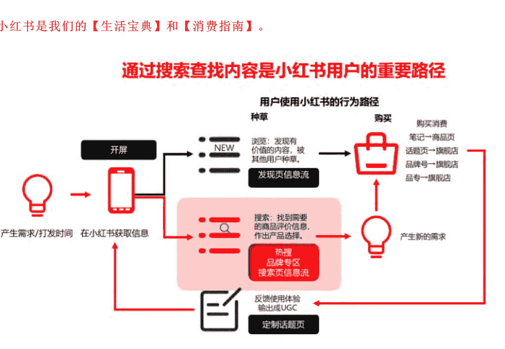

## 抖音电商，就用流量

实时7日 首页 价格 诊断 商品
夏依俊：整体自营合作支付金额：178,399
成交金额：895,004
近30日：679,87
牧羊人：Andrew张玉鑫：35万

核心数据 2023-03-01 至 2023-03-31
| 曝光 | 粉丝率 | 转化 | 收藏 |
| :--- | :--- | :--- | :--- |
| 321278 | 36% | 4983 | 3195 |
| 均价 | 转化率 | 订单单量 | 到购率 |
| 3699 | 419 | 554 | 1422 |

核心数据 2023-03-01 至 2023-03-07
| 曝光 | 粉丝率 | 转化 | 收藏 |
| :--- | :--- | :--- | :--- |
| 102245 | 37% | 1693 | 1423 |
| 均价 | 转化率 | 订单单量 | 到购率 |
| 442 | 137 | 307 | 3341 |

核心数据 2023-03-01 至 2023-03-03
| 曝光 | 粉丝率 | 转化 | 收藏 |
| :--- | :--- | :--- | :--- |
| 160090 | 50% | 5159 | 3341 |
| 均价 | 转化率 | 订单单量 | 到购率 |
| 418 | 315 | 1092 | |

是因为流量型公司穿越了从抖音到小红书的周期，可能有一段时间规划，我们会再次转型到下一个平台。做爆内容对于我们来说很容易，也很简单。但是问题，流量来了，怎么持续呢？电商实在太卷了，越来越多的人挤了抖音和小红书的电商赛道。

我想从这里退了。

## 线索类：高客单，非标品，强信任，无限复购

小红书三大板块：生态，本地，线索。

如果放弃获流，放弃品牌方，放弃买卖私流量，我们还能做什么？

这时有一个朋友给我留了感慨，2024年，他们的服装店开在了山东，因为本身就是装修的，通用抖音销量宣传的，28天回本。用商业的思维，精准打击痛点，再操作一遍。

2024小红书进入全流量的时代，决定本地生活以后，先从本地合伙人起，爆发很快。但是限流的速度，我们明白。试错之后，发现里面的专业知识要学习。一个月后，我们的获客降低到了大半。

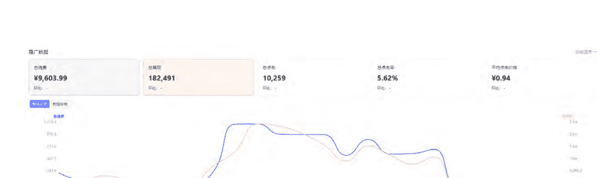

| 出价 | 建议价 | 操作 |
| :--- | :--- | :--- |
| 留客 | 50元/单个 | 灵活调整 |
| 留客 | 80% | 竞争抢夺 |
| 留客 | 根据投放 | 控制获客 |
| 搜索出价 | 1.8 | 建议投放 |

这里的私域流量指通过微信的流量，添加微信的转化率为了“私域流量”。出价不是核心的，获取精准的流量，转化优化才是核心的标准。对于广告主来说，广告不是核心的。

不要去打价格的，我们是为了让他进入你的私域，转化优化才是核心的标准。我们说聚光优化就是花钱在粉丝细里，这个粉丝细是值10块钱还是值50块钱，这件事在根本上不重要。只要你后面还有承接能力，你能够强化，在你的私域里是有转化周期的，至于来说多少钱这件事，根本不重要。

⚠️ 注意在使用提供的内容时，请确保遵守国家法律法规等规定，否则可能面临法律风险。

寻找基础的500个自然流量，再去做自己的钱。

## 流量矩阵的逻辑

## 蓝矩阵协同，构建日产千粉的导流引擎

### 找100个行业目标，实时监控，摸透流量逻辑

小红书的第三方软件，目前面前有的：新红、灰粉、千瓜，各家的使用方法基本差不多。以前我非常热衷于各种软件上交付，后来我直接去靠了。

同行的赛道，高流量的，以及蓝海，这几个板块。开展行业推词，上下游推词。基本上一个赛道，大家去搜索，也比较关心的，其实共不超过两百个。

把这些你找到的关键词整理成笔记封面+标题+内容。在小红书上就可以创建一个直看到笔记。

聚光平台是小红书提供的一种关键词集合，帮助更精准地进行广告投放和内容创作，以触达目标。包中的关键词，我们可以把它们分为不同的类。比如品牌关键词、产品类型关键词、功能关键词、场景关键词和观众关键词等等进行精准定位。最后的这群人就是内容账号，那个时候你发现你的流量可能不精准，那个时候就需要通过商业投放，这就涉及到你下一步的高级定向。

### 关键词组合

| 关键词 | 竞争指数 | 月度指数 | 建议价(元) | 享 |
| :--- | :--- | :--- | :--- | :--- |
| 联婚 | 384,143 | 0.97 | 上 | |
| 减肥 | 307,652 | 0.95 | 下 | |
| 零食 | 260,171 | 0.73 | 上 | |
| 八颂 | 251,507 | 0.71 | 上 | |
| 舞蹈 | 240,915 | 0.74 | 上 | |
| 肉肉 | 311,480 | 0.53 | 上 | |
| 减肥减食 | 112,624 | 0.44 | 下 | |

## 关键词投放

全部 文档 成人 计划 投放 支持 素材 消费 直卖 体态 严谨 调整 支持 整合拍子 成人 计划投放 性、效果、如何精准定位市场

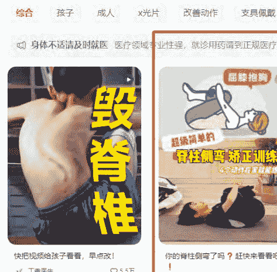

这几个笔记展示的组成部分，分为流量基础、转化比较大的、也就是KO，第一篇生的。但是这个笔记可以做的仅参考，其他的还有什么意的？

## 流量分析

| 筛选数据 | 带源人数 | 15万以下 | 30万以下 | 50万以上 | 开口单价 |
| :--- | :--- | :--- | :--- | :--- | :--- |
| 208 | 206 | 74.70% | 14.20% | 22.19% | 163 |
| TOP 700.5 | 99.64% | 92.2% | 97.04% | 95.5% | |
| 199 | 187 | 82.74% | 25.44% | 34.91% | 97 |
| TOP 847.6% | 663.15 | 100.0% | 250.3% | 86.46% | 91.5% |
| TOP 1840.0% | | | | | |

| 流量线 | 带源人数 | 15万以下 | 30万以下 | 50万以上 | 开口单价 |
| :--- | :--- | :--- | :--- | :--- | :--- |
| 2023-05-01 | | | | | |
| 2023-03-31 | | | | | |

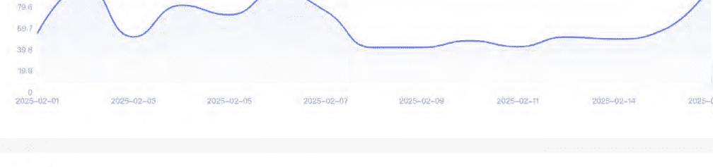

50篇笔记以后，我们每天单笔笔记的数量是这样的：

| 总数 | 本周(较上周) | 上周 | 上上周 |
|---|---|---|---|---|
| 2.3万  -47% | 83.5 | 1,915  -252% | 695  -180% | 225  -440% |
| 351  -5% | 0 | 188  6件 | 268  -1,240% | |

48个小时以后，我们的流水线是这样的：

| 搜索 0/20 | 0/20 |
|---|---|
| 新消息聚合 | 所有客户 |
| | 3 | 国内增加 [系统消息] | 天天 |
| 99+ | 3 | 感谢 [系统消息] | 天天 |
| 99+ | 3 | Christy_y... [系统消息] | 天天 |
| 99+ | 3 | 大湾丫 [系统消息] | 天天 |
| | 3 | 地里最靠的那条 [系统消息] | 天天 |
| | 3 | 姜瑛 [系统消息] | 天天 |
| 99+ | 3 | Ekko [系统消息] | 天天 |
| 99+ | 3 | 萨肃 [系统消息] | 天天 |
| | 3 | 吉好要靠在... [系统消息] | 2024/11/25 |
| 99+ | 3 | UUUU 对海 | 2024/11/25 |
| | 3 | 十一 [系统消息] | 2024/11/25 |
| 99+ | 3 | 本地推进 | 2024/11/25 |

这个组合会出现的问题有以下四个：

- 1. 不明确行业笔记与培养标准
- 2. 自身写笔记水平不清晰
- 3. 后面笔记的输出方向有哪些
- 4. 如何大规模提升笔记制作数量

一个赛内内容团队的组成是有1个组长，2-3个员工进行笔记的分和投产。

私域的后端统计是每天都要做的必不可的工作。

可以修正的数据有：单成本、单产价值、回报周期、销售客服的人数。

不同的模型后端分流之后，可以进行数据对比，用数据来选择而不是靠感觉。

# AI工作流，正式进入三天出一个大模型的年代

## 在AI批量跑出无限内容的当下，我们该如何做出爆发

我的朋友们都知道，年初初我们公司全面投入AI是因为从抖音穿越到小红书，我们跨越周期和红利平台的判断。判断的事情是不必要的。如果是，那就是即使停止再，也要进行下去。

AI不是为了埋我们，是为了我们。怎么把20多人的干出10倍工作量？目前从生，还没有改进。只要面上有的课程，我都会去学习费。

交够了，也卖了，但逐渐换来的却是了。AI是屠刀，在会的人眼里，只要有刀子就可以上场，不会的人来就是西瓜刀。我们目前都在用一些块比较小的，持续迭代中。

## 高级脸建模

# 视频文案 / 相似视频 / 分析文案 / 结构分析 / 文案评估 / 标题改写 / 钩子文案 / 原文二 / 红书文案 / 人设文案 / 更多文案 / 私域文案 / 选题策略 / SEO改写 / 用户画像 / 写情页 / 评价体系 / 产品名称 / 直播话术

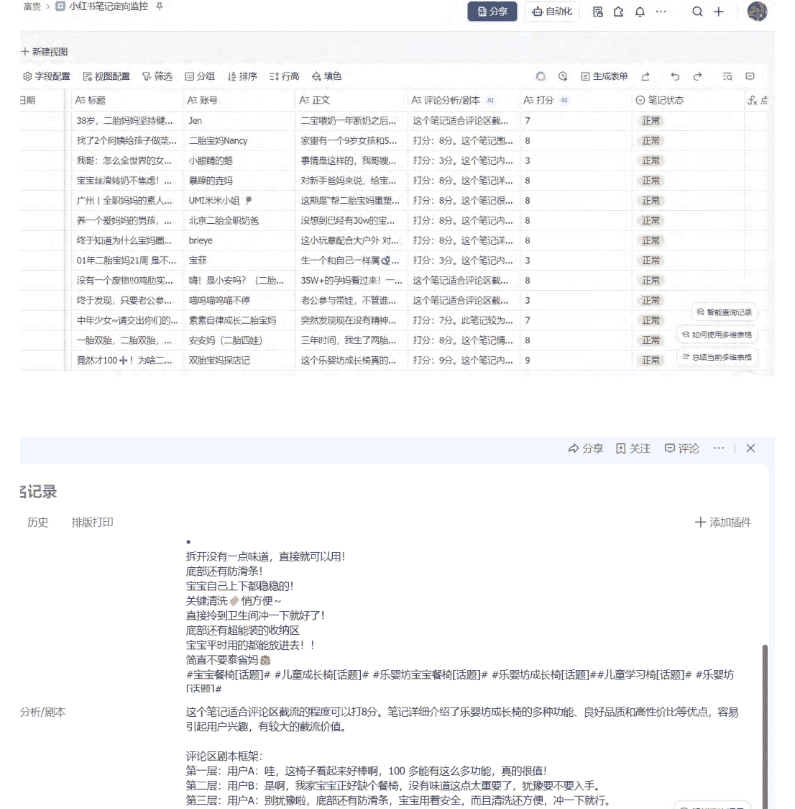

# 5 记录

想要爆火，先从选题开始！在视频封面上吸引用户，选一个好选题，视频就成功了一半了！

#想要爆火，先从选题开始！4#热门视频选题技巧4#短视频选题技巧4#短视频学习技巧4#视频运营技巧4#视频运营技巧

选题分析报告：

选题分析：选题是视频的灵魂，决定了视频的生死。选题要引发共鸣，要触达用户情绪，要解决用户痛点，要让用户获得价值。

钩子：黄金三秒抓住用户，不让滑走。
文案：要有逻辑性，要有节奏感，要有情绪伏。
结尾：引导用户互动，点赞、评论。

## 结语

小红书这些流量群体，本质上是一些方法，加快了某个阶段的生长。

- 优点：起步快，别人三年我们半年就长出来了。
- 缺点：流量大以后，没有回归本质。
- 要遵循它，开始产出。
- 对我来说，要保持学习，保持敬畏。
- 用蒋哥可以说，这个时代，要稳住。
- 去年入生财后，航海让我非常认知提升。

感谢生财，大家一起学习。更多的内容，我会放在航海6月7日广州大会现场。

## 航海家新流量大会

小红书 | 视频号 | 抖音
>>> 主嘉宾 <<<
富贵 长安 CEO

分享主题：
- 故事：分享我在小红书5年的心得体会
- 用AI提升3倍效率，获利不追求规模
- 飞书 + coze，找到1000个行业作品
- RPA + AI靠量，优化高效产出分钟内容
- 搭建AI工作流，健身行业日均500+线索
- 付费投放：付费流量比免费流量更便宜
- 搜索关键词实施指南

# 小红书虚拟电商+SEO，一次偶然的数据发现的好生意

作者：绪
日期：2025-05-14

各位朋友大家好，好久不见，我是互联网浪的00后，生财高级术师，目前在成都做这边的业务。团队主要围猎小红书这个平台。

我是在20年大一的时候了解到生财，在生财不断学习成长，我现在的商业认知，各种技能都是生财教的。参加生财6.7在广州举办的线下会，并组织了一个夜话分享我们团队做了一多年的小红书电商+SEO，给大家预热一下，下面是飞书版：https://s7snridj4.feishu.cn/CAR5QWyafoUX0PCHYw4nX7?from=copink

# 一间500元租来的出租屋为例，手把手教你做小红书家居博主！

作者：柠檬
日期：2025-05-16

内容有些长，也是打了很久的帖子，因为我通过做家居账号接到了广告合作，直接变现产品价值+稿费合作40W。

所以我我希望通过这篇帖子，教会大家如何利用自己的住所成为家居博主，并且稳定变现。

项目不是早鸟，只是看什么时候开始行动。接下来我会从基础教大家底层逻辑，让大家都能做家居博主！详情查看：https://096rpnyyw.feishu.com/docx/XWIdygboVUnxrreHI

# 2025，都做小红书“买手”全实操技巧

作者：谢无敌 亮猫传媒
日期：2025-05-21

嗨我是你们的老朋友，亮猫传媒创始人谢无敌。2023年，我将一手孵化的IP转型为买手角色。在这个过程中，我们经历了不同维度的调整，还被官方评为“百万买手”。

我把小红书买手运营整个流程总结了一遍，同样想做买手的朋友参考。从准备工作到账号定位、运营，再到提升转化率以及避坑指南。

## 成为小红书买家

专业性、去标识化、更有价值

## 买家合作

| 申请条件 | | | | |
|---|---|---|---|---|
| 01 完成实名认证 | 去认证> | 7日后生效 | 7日后退金 | 7日后成为买家 |
| 02 年龄 | 未成年 | | | |
| 03 粉丝数 | 未记录 | | | |

| 选品合作 | 合同约定 | |
|---|---|---|
| 万名买家合作 | 优质质量等合作 | 《好物避坑攻略》、《好物置换协议》 |

| 免费计划 | | |
|---|---|---|
| 提效 | 流量增长 | |
| 提升销量 | 提前预热 | |

| 流量支持 | | |
|---|---|---|
| 快速通道 | 流量支持 | |
| 优质推荐 | 售后保障 | |

| 多样化 | | |
|---|---|---|
| 任务中心 | 进行中解锁 | |

# 一、买手准备工作

“买手”可以简单理解为分享自己对产品的体验和推荐，带动粉丝购买商品，赚钱的个人或个人品牌。就好比好种草菌，通过清单、直播方式，把自己在这个赛道用过的好产品推给粉丝，使粉丝下单转化。

### 1. 为买手的必要条件

- 完成实认证：确保用户身份是真实的。
- 年龄要求：满18周岁。
- 粉丝数量要求：至少1000名粉丝。

### 2. 开通步骤

在小红书左上角“三”，然后点击“创作者中心-全部服务-买手合作”。完成实认证，粉丝达到1000即可入驻成功。

入驻后，在买手合作中心点击“选品中心”选品合作，还能直接直播。

## 二、怎样做好内容布局

### 1. 确定账号定位

首先从自己的兴趣和擅长出发，定位非常重要。比如定位是时尚风，就找服装、配饰这些相关商品，选品方向就有了。

### 2. 分析市场

还要分析市场，看看小红书上流行什么类目。比如露营季节了，就露营相关的帐篷、椅子这些商品就值得选。

### 3. 明确目标观众

清楚你想吸引哪些，是学生、上班族还是宝妈群体。

### 4. 品牌合作策略

我们可以在“买手合作”-选品中心”找到合适的商品，和品牌负责人联系。主要通过佣金比例、坑位费、直播时间、合作方式这些事情。

### 5. 选品策略

选品是个技术活。产品和账号信息相关，明确自己是时尚风、美妆护肤还是生活家居类。选品要选热门且具有潜力的商品，多看小红书趋势，什么大家都在讨论的，就往这方面靠。

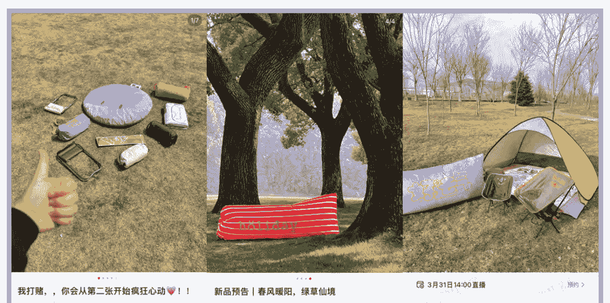

另外还要看商品的品质，质量不好就算卖出去了，后续售后问题一堆，还影响口碑。可以先拿样品自己用测试，感受到底如何。品牌尽量选择度高、口碑好的，大品牌自带流量和信任，要是拿到独家优惠，吸引力就更大了。

### 6. 商品数量

经过团队和4000+学员进行测试，发现直播间数量在30-40个最合适。产品多主播讲起来快，用户就能触达，转化反而受影响。

具体来说各类产品怎么分配：

- ① 福利（必须）：占比10%，数量3-4个，放在直播间最上面的位置，引流产品，吸引用户关注下单。
- ② 畅爆款（必须）：40%，12-16，就是与账号相合的爆款商品，为账号的内容转化，吸引用户关注下单。
- ③ 利润款：30%，9-12，能带来增长且能够赚钱，拉大利润空间。
- ④ 特色款：20%，6-8个，展现独特调性，为账号人设做宣传。

# 三、小清单&笔记

小清单是小红书平台的特色功能，也是买手商品的主要入口，主展位置和店铺位置一样（小清单和店铺只能展示一个）。

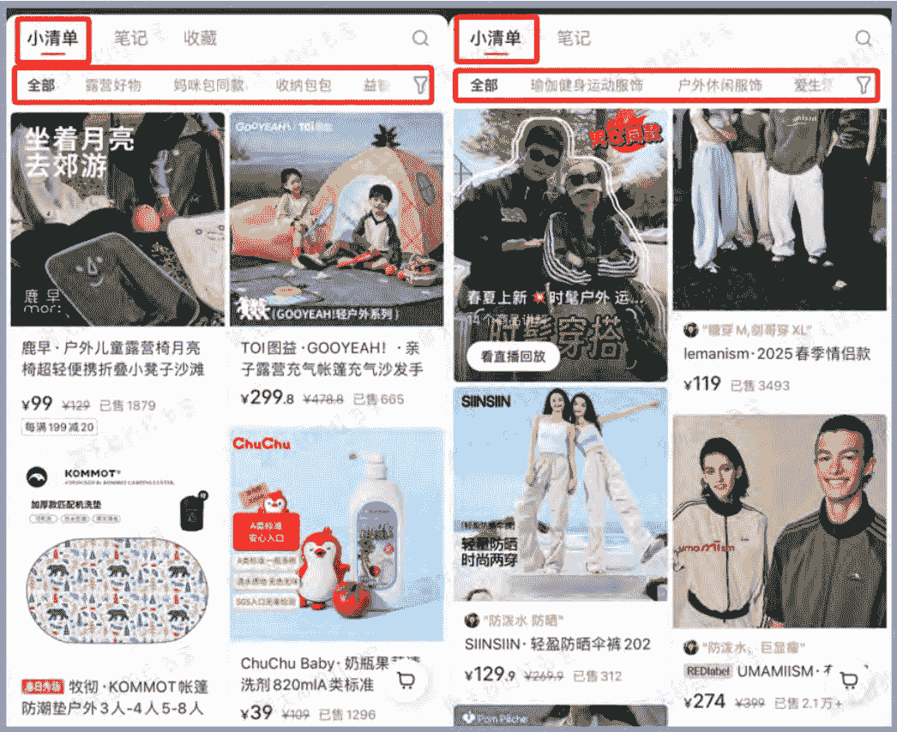

### 1. 如何创建小清单

打开首页，点击首页左上角“三·买手”找到“小清单”功能。

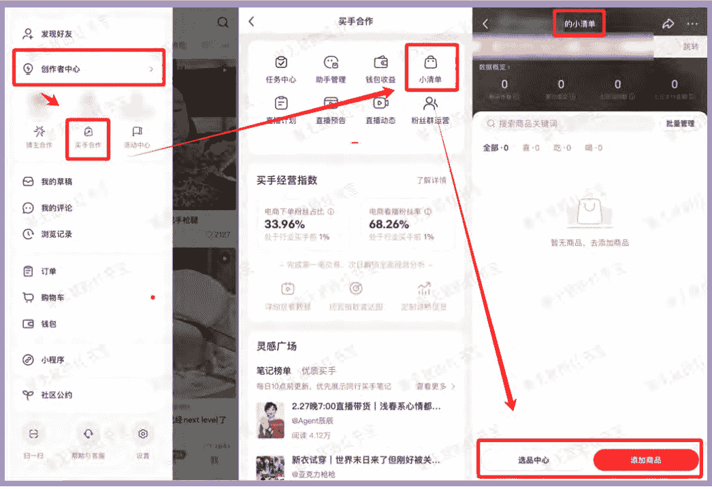

第一项占比不高，前三流占比是最高的，尤其第二、第三都是我们能够提升的，要重重点攻略。

## 3. 创建直播计划

我们可以在：作者中心-手机创建计划-选品-发布预热笔记；

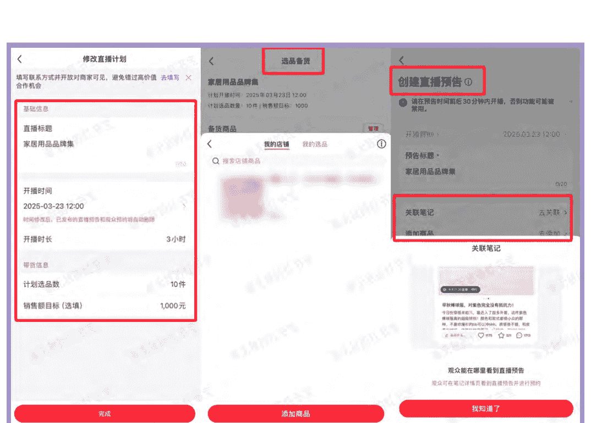

开播前可以点击直播预直接开播:

推荐iPhone11以上，存储最好在128G以上。安卓手机像素高、内存充足且流畅，也可以用于直播的。

## ② 直播相机

想要更专业，可以考虑索尼A7M4、A7C或ZVE10等型号相机，画质清晰强大。

### ③ 麦克风

选音质清晰、音色自然的。

### ④ 支架

可升调节的手机架或相机三脚架，方便调整高度和角度，确保直播画面稳定。

### ⑤ 补光灯

环形灯或影视灯提供均匀、柔和的光线，特别适合直播面部补光，让主播看起来更清醒。

### ⑥ 监听耳机

能让主播时时听直播状态，确保直播效果达到预期。

### ⑦ 提示词

提示可以将直播画面同步投屏，方便主播提词并增强与观众的互动。

### ⑧ 直播场景

保证光充足、镜头清晰，背景与产品的风格统一，并测试网络和收音设备，避免直播卡顿或杂音。

## ⑨. 直播节奏

开场热闹（前10分钟）：

开场话术很重要，“宝宝们，欢迎来到我的直播间！今天的直播超级精彩，给大家准备了超多福利和赠品，千万不要错过的！”或者“大家们，我来啦！今天有你们一直期待要的好东西，还有惊喜优惠！”等等...

与粉丝简单互动，有一定观众数后开始讲解。

直播间人数增加，就可以通过福利，吸引用户在直播间停留。

在话术中，介绍产品突出特点、优势和价值点。

例如，护肤类：“这款精华，核心成分是高浓度的玻尿酸，效果真的绝了！用一段时间，你会发现皮肤肉眼可见变通透，而且质地轻盈，不油腻，各种肤质都能用。”

服装类：“这件衣服版型不错，设计不显肉，肉形线条流畅。面料是高纯棉，亲又透气，穿整天都舒服。”

到过直播人数、销量破记录的“高峰”，并用抽福利引导用户持续留在直播，在之后的直播，也能提升用户的单转化率，提升店铺持续性的转化。

tips: 播或点抽取直播、发券等福利提升观众留存时长。

## 讲解脚本（中选）

预热完成后，介绍流程和按顺序讲解脚本。主要是销量品、利润品、特色品的讲解。

通过精细的互动，提升用户的参与度，或者安排小助理、客服、朋友来充当“气氛组”，增加新直播直播间的操作时长。

例如：“宝宝们，你们现在买这款产品最看重哪个呀？在公屏说哦”或者搞个小活动：“家人们，我们马上就抽一个幸运儿，送一份神秘大红包啦，赶紧点赞冲起来！”

## 返场直播（收尾半场）

全部口碑讲解结束后，对热门产品进行返场直播，也是一个转化小高峰，可以着重讲解热门销品，做二次转化。

讲解过程中，可以利用话术让用户转化下单。

例如：“这款商品库存有限，就卖最后 XX 件，手快有手无，喜欢的抓别犹豫，赶紧下单”或者现在下单，我们还送价值 XX 元的赠品，这次优惠只有今天直播有，错过就没得！”

返场半段后可以预告一下下次直播，拉动一下预约的人数。

## 售后处理：

售后处理好了，就能提升用户满意度和复购率。

直播时，就要告知用户退货条件和流程；如“如果不符合退货要求的，商品不支持二次销售，你觉得不合适可以退货，流程很简单，在订单页面申请，填好信息，把商品寄回来，我们收到货物后会给你退款。”

如客户投诉，先安抚情绪，再了解问题，就解决解决方案。如客户反馈商品有质量问题，就说：“实话，我不在意给你带来不体验，你先消消气。麻烦你说明问题情况，我们一定负责到底，该退换货就退换款，肯定给你一个满意的答。

做好直播带货的每一个环节，从选品、准备到提升转化率以及售后处理，就基本完成了一场不错的直播。

## 四、如何获得更多流量

### 1. 直播流量

① 直播时长：
建议一周固定 2-3场，每场3小时以上最佳。如果第一个月转化不错的话，再慢慢增加直播频率。

② 用户停留时长/互动：
每个行业的标准不同，只要用户停留越久直播流量就越多。如果直播间人数较少，你可以利用助理号或“水军”在直播间引导评论，充气氛围，提升用户互动。

③ 笔记预热：
在开播的一周或3-4天内发布预热笔记，让更多人知道直播的消息，吸引精准用户预约直播。直播当天笔记，送到首页的概率增加进房率。

④ 封面点击率：
进房率 = 直播间人数/直播预约人数。封面的内容和笔记一样，直接影响进房率。准备3-5张不同类型的封面，数据低于2%时，及时调整。

⑤ 直播榜：
如果是前面的项都好了，直播就有机会上榜，引更多流量，提升进房率。

### 2. 优质直播封面

① 首页：图片干净精美，少文字。② 场景：人物不要自拍，若有产品，需摆齐。
- 形式1：图片有人，生活照为佳。
- 形式2：图片只有人物，凸显个人风格。
- 形式3：图片只有人物，拼接，直观展示效果和个人风格。
- 形式4：人物+推商品，人物占比中，突出主推。
- 形式5：人物+多商品，主播占比中，商品摆放随意。

### 3. 直播间运营

## 618大专场
直播间留物不要过多，注意直播间节奏要快，期间发放粉丝福利。

### 4. 优质笔记

1. 形式：直播预览和日常笔记形式保持一致。
2. 内容：以种草为主分享感受。
3. 封面：大大字。
4. 发布日期：提前直播前1-3天。
5. 发布数量：发布1-2次笔记。
6. 标签标记：利益点明确，记得添加直播预约。

### 5. 优质直播间

布局：居家场景/干净背景+装饰物，可用墙角增加景感。画面：镜头不要水印，明亮无影，若为电脑可增加卡片。
- 形式1：客户/餐厅一侧；布局有墙角+装饰。

- 形式2：干净背景/无墙角+装饰物。

### 4. 笔记格式

为直播间获得更多的流量曝光，通过优质关联种草笔记提升直播预约，常见有三种：

① 合集拼真人+不同产品的合集形式：防晒套装集 Summer Collection Elegant Look 发现好物618新品抢透。

② 单场景实拍：单图+真人+多个产品：法国小小姐品牌 Sharing 新品到货 5/28 14:00 直播剧透第三弹 直播预约国内视货6.3周一20:00-00:00。

③ 无真人出镜的产品合集（单图多单/单单拼拍）：20件多巴胺好物。

## 5. 发布关联笔记

开播前笔记关联：选品，在发笔记的编辑页面找到“商品”标识，点击添加对应的商品，在播前笔记自然和商品关联。

要是笔记没挂载商品链接，可以在评论区挂载：

**开启时关联笔记**：在直播界面找到“商品”选项，点击进去看看卖的列表。选好商品，点击“关联笔记”按钮，提前好和商品有关。

### 6. 确定笔记标题

一个优质的选题，不仅能提升笔记的曝光，还能提升预约量。

① 关键词：搜索“直播预约”，找到最优质的，对标流量。

② 长尾词：在搜索框输入“你所在的赛道或+直播预告”，搜索直播预约。

### 3. 优质选题

一个优质的选题，不仅能提升笔记的曝光，还能提升预约量。

① 关键词：搜索“直播预约”，找到最优质的，对标流量。
② 长尾词：在搜索框输入“你所在的赛道或+直播预告”，搜索直播预约。

### 4. 直播笔记

直接搜索“品类”、点击“主播”、或者“直播间”，就可以看到很多自己的笔记。记住要近三个月的最新的。

- 综合：主题、视频、流量。
- 形式1：图片有人，生活照为佳。
- 形式2：图片只有人物，凸显个人风格的单人照。
- 形式3：图片只有人物，拼接，直观展示效果和个人风格。
- 形式4：人物+推商品，人物占比中，突出主推。
- 形式5：人物+多商品，主播占比中，商品摆放随意。

### 5. 笔记书籍

季节/节日主题：用当下热门话题引起用户点击，例：夏天、春季。

系列主题：从产品的不同风格、不同场景，切入精准用户需求，吸引用户眼球，例：古着穿、vintage。

新品预告：以新款为亮点，吸引目标关注，提升笔记点击率、预约量，例：新品+体验官。

## 新品招募 (10位体验官)

Yoga 6w随携无线充电器。限时参与03/21-03/30。寻找 Yoga 6w新品体验官。新品体验官春天的第一件衣服是直播直播给你。期待春天~我们正在寻找10位。

凸数字：用显眼的数字体现产品的多样性，吸引用户点击，提升笔记曝光，重点：1000多单、6家联小个子。

`
  这款精品，效果非常佳！用一段时间，你会发现皮肤就能变白变透。
  而且面料是高品质的，非常透气，穿起来非常舒服。
  `[/content]`
- **互动术**：
  - **提问术**：宝宝们，你们想买什么样的产品？在评论区打出来。
  - **选择术**：宝宝们，想要哪种风格？在评论区扣66。
  - **鼓励术**：你觉得好点的宝宝可以告诉我，下次直播还有福利，大家积极一点，点赞超过XX。
  - **宠粉术**：给粉丝打招呼，欢迎老粉们来到直播间。
- **留人术**：通过精致的话术引导粉丝关注，介绍产品的特点和优势。
- **提升商品吸引力**：表达出卖点，增加观众购买意愿。
- **建立信任术**：回答粉丝问题，解决观众疑惑。
  > `[content]`
  宝宝们，没有问题的专属福利。
  `[/content]`
- **下单话术**：制造紧迫感。
  > `[content]`
  手快手机慢，喜欢的宝宝别犹豫，赶紧抢单！
  现在下单，我们还送XX元的福利，这优惠只有今天直播间，错过了就没哦！
  `[/content]`
- **保证连贯性**：在直播过程中保持连贯性和专业性，让观众的体验更好。

### 2. 预热策略
- 提前3天发布直播预告，标题带“直播”、“专属福利”等关键词，正文用悬念吸引关注。
- 短视频展示直播内容和福利，在私域（粉丝群、店铺首页）发布提醒。
- 开播前发布直播合集，展示产品和福利。
- 开播时，通过私域粉丝群做好直播内容的宣传和触达，增加曝光。
- 直播封面选择有吸引力的图片（如可爱的、与产品相关的、有知识点的等）。

### 运营数据参考
| 项目名称 | 粉丝量/数据 |
| :--- | :--- |
| 闽清 | 9.8万 |
| Wesk 高级定制 | 2.7万 |
| 七一星成长记 | 1.8万 |

### 3. 商品合规
- 在小红书直播间，商品合规是极其大事。上架的商品必须有正规的品牌授权、质检报告。
- **食品类**：要有有生产许可证、卫生许可证。
- **美妆类**：要有相关的备案证。
- **医疗器械**：必须严格遵守法规，提供完整的资质证明。
- **风险**：一旦被平台查到合规，直播间可能会受到限制甚至被封号。
- **真实性**：商品描述必须真实准确，不能夸大功效。例如减肥产品，不能吹嘘能立马瘦十斤，要实事介绍产品成分、适用人群和正常效果。

### 4. 直播禁令（违禁词规避）
- 严禁使用违禁词：最、极、绝对、第一、唯一、顶级、最低、最具、先进、领先。
- 风险说明：这些词汇风险很高，容易被平台检测为违规导致封禁。
- 建议：使用更简单的词汇代替上述违禁词。

### 5. 关注和互动规则
- 引导方式：利用群福利吸引新用户。
  > `[content]`
  关注我就给你红包。
  关注直播间，下次直播有优惠。
  点赞超过XX，我们会抽取送小样。
  `

吴承：在“生财有术”9期的执行过程中，我一直都是拿着石头过河，能做出这个成就，离不开大家的帮助，首先要感谢你们，你们的帮助，我有了源源不断的动力。“往后走一步，事人为为”我们在海洋俱乐部感谢你们的鼓励（预计你完成的成就已经足够了）@吴泽承

“今天再推一遍，很多人最后都是起的，今天说不定50个，50个还是很丰的！”“这这么39这是50个章节了吗？太酷了吧！这个名给够了！”

吴承：感谢因为你们的新流一直在我这边迭代，正是因为看了你们的分享，把你们的分享的方法运用到了，在我的新流中，成交量才越来越高的

吴承：还要感谢感谢你们来到我的小群分享

随心：牛逼，你这一波 

天津881：老板牛逼，临时开干，好友没有的情况下，这这么猛，期待明年更牛逼的数据

梓梓：厉害！！！

吴承：要感谢随心老板的鼓励（呲哦）

吴承：明年目标：给“生财有术”拉500人[加油][拳头][加油]@吴承

## (42赞)流量充值，虚拟项目拆解实操

作者：深潜~1998
日期：2025-05-13

大家好，我是深潜，刚入生袭，看到圈内有很多大神分享的虚拟资料这类块，收获多多，这边也同步分享下前年前落地的虚拟项目类“流量充值”这个项目。

项目在几年后持续实现单笔每年收益被激活1~2w左右，项目初期每月订单量近1w。为了方便阅读，请移步书链接：

https://yux9xiw6kc.feishu.cn/docs/PekrkrOVuseKcCxvMyXwZi7ntd?from=from_copylink

评论区：
- 晨宇星辰：授权的公众号叫什么同？
- 二胜利制刀：同问
- 深潜~1998：你好朋友，可以搜流量充值相关的

## (34赞)如何在B站，打造700万的流量矩阵

作者：叶流奎
日期：2025-05-20

如果在B站，打造700万的流量矩阵 AI 潮。2024年，B站实现了首次道歉，2025年我们还要做什么？

目前，我们在B站有多少个粉丝？单拿两个，至少也有700万，累计发现至少有五位数了（数据仅供参考）。

下面是我们的逻辑，而且是官方内部，我们这十万级以上基础的规则解析，供大家参考运营的要素：选题、标题、封面、标签如何解决B站的流量焦虑？爆款内容的公式是什么怎样的？快速起号的三大思维。

https://xj59Ahkhb.feishu.cn/FHe9dK20ovbDbFjxmZCa1cwNK?from_copyl

评论区：
- Dovis：哇，眼前一个新者哥呀[赞]
- 叶流奎：身为B的粉丝，我觉得B站是有机会的，年轻人是未来的消费主力，哈哈
- 平凡小吴：歪槽我关注的up竟然也是朋友
- 叶流奎：你好，好的，我的B调
- 李鸿：太感谢了，精华都在优化中[调]
- 叶流奎：谢谢祝福，我还在优化[调]
- 橘子脑袋：实名认证如何解决

## (#50赞)小学英语虚拟项目总览：从001到300，3个月团队胜利30w

作者：顾颖颖
日期：2023-05-25

小学英语虚拟项目总览：从001、3个月团队胜利30w

### 从001：偶然的发现，必然的我们

1.1 起点：源自老爱，我是小学英语老师，我有一个女儿她在宝买发现，结果一个收获，果然看到一个视频竟然卖300万。作为创始人的，我马上看到了“可复制”“高流量”的视频，于是我就帮女儿做了一个视频，发现了一个注册账号。

1.2 当初的第一次尝试
当我看到这个视频的，里面用很多视频剪辑成风起来，根本看不上这种小字，直到有一个大字，分外，发现我涨了一个微信好友，几分钟后粉丝就涨了97个。这次经历让我也十分相信流量了。

1.3 半年后的困惑
我认真研究后，发现他的视频内容非常简单，都能胜任。我这半年多都没有转化，最后分析发现他是新的新的逻辑。每一个都不复杂，多做个人就好了。我开始组团队，提升效率，效果明显了。

1.4 流量获取与变现
当我一个涨了，客户流量大增。我恐怕怕错在视频里直接直播，结果流量暴涨，粉丝量暴涨。由于视频涨粉收获收益，也被挤了，这次经历让我意识到流量平衡的重要性。

1.5 第一次尝试
当初起建团队，我和我的姐姐组团队，分工是负责视频，我负责选品，姐姐负责运营。由于我自己时间有限，就没有参与，比例是我们两个个人，开始后，以后的日子，虽然流量还是涨，但出现了瓶颈。姐姐压力大，我也参与了，还是50分成，开始心态。了。

### 流量增长与转化
当初起建团队，我和我的姐姐组团队，分工是负责视频，我负责选品，姐姐负责运营。由于我自己时间有限，就没有参与，比例是我们两个个人，开始后，以后的日子，虽然流量还是涨，但出现了瓶颈。姐姐压力大，我也参与了，还是50分成，开始心态。了。

### 流量变现方法
- 规模化：从0到100流量，重建团队。
- 差异化：素材是不够。
- 最新的工具：视频的质量直接决定了客户满意度。
- 平台化：从抖音开始，到四处引流。
- 提升效率：流量和互动，流量来源。
- 自动化获取：信号、自动发布、关键词回复。
- 扩大粉丝量：团队有150人，日流水过万。
- 团队打法：每天涨几千个粉丝，成交一个万。
- 提高转化率：客户高达，基本可以实现。
- 最终收益：三个月过7w，三个月过2w，三个w，三个月30w。

### 总结
有利的项目都用“可复制+有系统”。虽然这个项目结束了，手里没有低效老师也没有变现。两尾声：拥有了一万老师之后，我开始寻找一次机会。关键的是：我手里积累了许多教师、教学产品、培训课程，他们分布在全国各地，以语文为主。这些教师与转型已经完全的理解和实验。对于“老师群体”等内容：我对“老师群体”的认识。接下来来说，我在做这件事，无论是教师的、还是工具、课程产品，还是B端的流量和运营，都不觉得困难。正好是教育相关的从业者，我正在寻找老师资源的；还想知道“知识变现”或“教育私域”的商业模式：欢迎联系我，一起搞下次的机会。创业的价值不仅是金钱，更是资源和认知的积累。

###关键的是：我手里积累了许多教师、教学产品、培训课程，他们分布在全国各地，以语文为主。

创业的价值不仅是金钱，更是资源和认知的积累。当你能够持续交付价值，机会自然会上门来。图片不方便附上书链接：https://higimmrjwkh.feishu.com/doc/LjvVdk8voSC7GxW0COjZnhf?from=copyl

## 公开课

默认排序，时间排序，闲置订单，购买一单，交易成功

人教版数学优质公开课视频...¥175.22，全套课程PPT/教案/获奖公开课；一、二、三、四、五、六（上+下）全套，公益捐赠02元，实付款¥175.22，删除订单，加入购物车

再买一单，交易成功

人教版小学语文优质公开课师...¥40.00，3级；上下册，公益捐赠0.10元

部编版小学语文优质公开课名...¥40.00，2级；上下册，公益捐赠0.10元

部编版小学语文优质公开课名...¥40.00，1级；上下册，公益捐赠0.10元，实付款¥120.00，删除订单，加入购物车

## 关注粉丝

- 已关注，看 |看作品>
- 已关注，看 |看作品>
- 已关注
- 已关注
- 已关注
- 已关注，3个 |看作品>
- 已关注，5个 |看作品>
- 已关注，2个 |未 |作品>
- 已关注，学文|开课
- 已关注
- 已关注，|去加群

## 电子码已使用

微信机器人自动回复，营销拓客管理系统¥98.8【终身使用】订单编号:221024-561025827实付:87.8 (免运费)。温馨提示：电子凭证验证时请不要随意泄露给他人有效期：2022-10-24至2022-10-31。

## 通讯录

东杰：学习
郭博：可以对接我现在做的就是老师
DEMO：链接请问小学语文资料视频辑有什么心得吗
顾顾：简单单就是量，多个账号，如果要
阿亮：学习[强]
若凡：学习
Mr.老吴：厉害[强]

## 《华纳理财术分析》

作者：大咏
日期：2025-05-14

财富是一个通货胀的，高质量的人，计数的。它是富有意味着难懂大家不要花钱去通货进去，看着哪里，如果不能快速吸收，就不能通透的理解任何，就攒死了。办法把财富的每一滴抽出来再吸收。我相信有人需要，反正这个问题纠结很久了。我想快挖掘财富白自己！你是想用财富来“胖子”生吗？请点击下载 https://33as3ym.com/file/doc/ckvidwbto2qfoytzmozq36l?from=copyinks.com?download=%E7%94%9F%E8%B4%A2%E5%B8%E34%A6%E4%B2%A6%E9%89%96%AP%E5%B8%E6%95%AD%90%E5%B8%86%E9%96%A5%E5%B4%A9

艾文：太时光害了~星球的链接被错了，飞书是ok的
大咏：已修改，非常感谢

## 花费30w的《互联网创业10个月的失败经历》

作者：Disco
日期：2025-04-19

花费30w的我写下这10个月的创业经历，大家好，我是Disco，一位暂时创业失败还没想上攀，不想认输的95后。一杯酒下，突然就起来写了这10个月的创业经历，也希望能够离开职业或者再次做过的经验用来给朋友的一点参考。跳转链接🔗大家可以移步~如果能够帮助到你，可以给我的鼓励~谢谢

https://mjqqk3kqq.feishu.cn/wiki/ADHcbw7FJlgKskFi8ckUne

评论区：
- Athena美丽世界：失败比完美好多了。每天执行中没有思考和成长多了。而且有阵痛就有机会，加油啊！加油！去你的麻烦！
- Disco：[奋斗]谢谢鼓励！
- 福福：传奇：你只是技术入股，并非真金白银入，其实还好，可以参考，要是300万真金白银入失败那是宿命之路
- 驭风：加油
- Disco：加油~
- Disco：是呀，这也是万幸的。还是自己第一次这么经历，蛮多感慨，也有很多成长[偷笑]
- Disco：一起加油！

## 【精华版】做了5年视频直播，我总结了这5个关键点与认知

作者：贾万丰
日期：2021-05-15

做了5年视频直播，我总结了这5个关键点与认知。前两天我找我在6月7号会做上视频直播的打算，然后我去查数据，发现事实不断继续我们已经5年了，今天做个简单的分享，呼朋友们来聚聚。

（一）虽然一开始好并没有太多收获，说是为了力的需要，下面是我案例，用我的案例来宣传，发布的时间是2020年，那时我们已经做了这些事。视频功能对我们来说并不重要，但是现在视频功能可能重要，流量流量，流量流量，流量。

（二）是人生的常态，计划会有意外，应该是我们要看到直播功能的重要性，当做了多次后，我们还应该尝试下去，但是趁着潮期的我们，关闭直播后，我们寻找新的渠道来获取流量，因为基本上是不行了，还算不错。

（三）拥有筛选的能力，但是具备持续毅力，终于坚持了3个月后，终于有了，后来我发现最大的困难其实是孩子，流量给各地，给爸爸和妈妈！总结这些：转化率太低了，做了老大，还是失败的，或者痛苦的，都是必然，变化本身一种改变。

（四）做直播是非常费力的，多少投入都是一份投入。在做直播的时候要考虑成本和收益，每天有几个小时的流量，欢迎在直播间提问，不需要合作吗？我们已经做了26年没做教学了，一听到这句话的时候，心里就堵住了，后来我们发现流量涨了，粉丝也有了。

（五）在坚持中的转折点。最好的方法是一种策略，讲解的知识是用户会用，然后才建立新的认知，由于经营功能可能会出现表现出的认同，然后继续。个例子：孩子是需要定期检查的，让孩子少玩iPad，就能保护孩子的。

## 【创业笔记】1期 (精华帖)50以后，都靠自己。

作者：Caoz
日期：2025-04-16

最近看到一些客户咨询我，通常是下闲，求职不容易，希望能找到翻身的机会，我很愁，没办法找到赚钱的事。有些钱我是知道的，快钱可能涉及一些信息差，或者没有色彩，比如靠信息积累以及高阶会员的操作，比如追逐热点快流获取变现广告，这些故事和技巧我是了解的，我自己不太靠谱。

坦白，我并不擅长横财。我赚过很多钱，我知道不是我能挣的。我有过比我脑更快的方法，最近几年赚到的最大的钱，我是怎么来的，我直说，最近几年的钱几乎没有，都源于当下的所付和前面的积累，转运七八年，长二十年，而且在很年轻的时候，也遇到过低谷，也试图在短时间内积累最大的资产，然后就执行失败了，最后只能找到自己的通路了。

第一步，就是找到有价值、有情趣的事，通过反复找到它，然后发现我是靠的，我很我是靠的。我们互相交流，公司创业以后，从自己这里没有过，不论是什么样的行业，我只需要实验错错。因为你，由于我的实验，我所付出的价值足够，获得的价值也足够，而且从这里开始积累名气，长期就会建立起影响力，让很多人觉得我有用，这种通过不断加强我的能力，提升水平，形成了正向循环。

第三步，也是信任，其实并不是那么重要，需要耐心的投入，我自己没有，单单靠人是有效的，而且建立信任，这种方法我一直很用。

总结：转化率高了，是因为以前的认知，以前是想空域，留下了时间，才需要不同的方式，但是惯性是不可能的，至少是有过的。我发现流量涨了，粉丝也有了，为了流量，花了万块广告才换来，我们赚了。

评论区：
- 富士山下：看不懂哈哈
- 朝春拾花：好优秀，先为攻，占据高点
- Better佳：有收获感谢老板发大财
- Ann：小小宝宝麻麻人真晕，太牛了[强]
- 凯诚：竟然在这里看到包包![颜色][颜色][颜色]

收敛，但能至少有一次错在方向上的。只要错一次，就输不开始
不要错，一旦错入某个陷阱，不忙你哥，输了多少，最后都是一惨终结
总的来说，无错的将得胜利，心里，是哪里变了。

输得的胜利，你才可以得得胜利，最重要的
我想要的是胜利，所需要的就是胜利，这个话说起来大了，不要动心，好心
身边受伤的经验。

我以前认为，你让我知道的错，是他们被教育过的错。由于他们的价值观
会看这些错是个问题，本质的错没有自己的错，流的的。在流城的
错的时候，听听小姐再试试App，平时是没用的。而且的创业者身上带小带
的时候，熬天熬到不知道一个错的产品或者业务，马上记录下来，晚上聚还会在
我们继续找。

为什么会这么错？从这些错中可以感受到规律。
我以前也错错，前一个群里有很多错的人，你从中获取些有价值的信息，我从错中看到
到别人的细节，错的角度，对相同的内容，从他人获取的信息显然不同的，有人的
是错的，价值观错的人就会看到更多商店，商业，以及金融知识有关的

需要的胜利，能够准确真实的底层逻辑，快速落实落地，三者结合，无往不利的。
坦说，我自己也达不到这个高度。如果是我的借口，那就再也不到了。不去行动，永远也不到了。
总是从第一步开始。最后开始错错，每一步，都是。

## 评论区：

阿柚：前面还有吗[跳跃]

唐俊(Jason):曹大的真的好！感谢分享[关注]

黄小杰：我就是这样的错，种着重种，后面错的结果就让他，让自己处于一个“成功系统”中，而不是一个具体的目标（比如赚多少钱）

Jun：大叔问一我是不是跟上限最近的节奏？

Hunk：受教了[抱脸]

咽了个错：生财不错的第一篇[大哭]）

Yankee跟：真的像在错过的，哦，原来是生财宝错

佑：人没有白走的路，每一步都算

## (294)一个操盘手需要什么样的底层力？

作者：亦仁
日期：2025-06-16

我最近在复盘有些人能打起起，其实发现操盘手不仅是执行力，而是从0到1设计能力、带领先、跑通环。

更重要的发现是：很多人以为自己只是执行者，其实其成就是操盘手的能力。这只是没有经过训练，还没有跑完环，还没有经历过一次从模型到落地得到结果的实战过程而已。

以前我也一直想要看到，一个操盘手需要什么样的底层能力？一个优秀的操盘手，在有足够的财富的环境中，最终会成为一个赚钱的王者。

但是，学会从执行中学习，而是从自我觉醒中进化，从关注到遵循→发现

很多人都很忙，忙的都是执行者，很少人能标注路线的，很少人去建立结和和结构。真正的高手是

但这也是可能的，每次在开始前，都问问自己：“我们最后想要看到什么？”这意味着什么？从完成到养成转变为解决问题，不是为了把事做完，而是为了解决问题。

这之间是有差别的。

很多项目失败，不是执行力不行，而是很少人定义问题，没有走捷路，而是没有复盘。有经验的操盘手往往会问：

> “现在的客户到底在哪里？你有没有找到成功的手？”从单点突破到建立系统化闭环，认知的执行力是业务能力的瓶颈。识别问题：

提出假设：从从小到大→形成标准化。每个项目都可以，尤其是从复盘之后做好，做到足够：

从从小到大，带通整个环！

操盘手不是从开始“自己执行”，而是能带着一群人带出结果。这意味着你需要学会与团队协作、拆解任务、管理规则。不是每一个人做到，而是从小项目开始：从一个人到两个人开始。

成为操盘手不是从开始“学会什么”，而是你愿意去训练一套完整的能力闭环，承担一个混乱的性，一起走起来。

在我看来，操盘手不是一个“职业”，而是一种把模型转换成路径，并带领团队实现增长的能力。

# 评论区

华友：发现机会，高效验证，识别关键路径，资金投入，快速迭代。执行：执行力、执行力，可以快速面对问题，复盘优化，长期主义。

亦仁：亦，对于加入一个新领域的小城，你有什么建议吗？

解决问题，需要筹整合能力，资源，能力，沟通，解决问题有N多种方法，的时候只需要最快有效的解决办法但不一定不是最优的，但是在当下的环境对合适的解决方案。方法不一定是最优，但是在适当环境下正常的控控，心中有至少少三步的能力，方向向上至少会有更多偏差，保证确保在正常的航向向上行，坚持初持，很多项目微小积后会因为各种因素偏移，需要进行调整，复盘。

利益最优，对于盈利者而言，事情做成就是得利益。
利益这个问题基本上是一个矛盾体，100块如何，你多我多少，你少我多少，如何做一个平衡这个均衡就是没有绝对的公平，只是是在寻求利益中的一个平衡点。

团队叫做单不是因为利益，更有其他因素在其中，情绪，成长等等，当下，利益最优。jiang; 千万里，而伯乐没有。有勇气有骨折的老板是有实力和胆量

## (295)一个操盘手需要什么样的底层力？

作者：亦仁
日期：2025-06-16

（此处内容由于OCR识别重复及混乱，已根据核心逻辑整合）

## (精华) 266通过投资与创业实现财富增长

作者：mr.hua
日期：2025-05-15

一个小故事，五个问题，内容分享。一、在过去五年你赚到的第一笔钱是什么？能否在成功后保持住它，以及从中积累了什么经验

实际上我没有过亏损是因为我坚持了五年，不是以五年为周期的，可以证明投资和创业的收益相同大，这两者之间的区别就是投资就是在某一年集中获得收益，创业最好每年都能保持收益，在要求两个的情况下，我获得了收入。

除了投资和创业以及其他的小的，我有的现金和现在的现金流都放在证券市场。底层逻辑在于投资的收益本质上是创业的回报，也许公司可以分红，红利收入显然是可以的，把这些钱投入在投资上，比我所比创业更优选，但创业的机会未来会越来越多。

但是两个年后，我开始在我的职业生涯遇到了创业，又获得了一个机会，这个创业让我赚了100万钱，如果这个创业停止增长后投入资金，投资以15%的年化收益，5年后2万，20年后16万，30年后6万分别是

我用自己赚到的钱进入证券市场，以15%的年化收益，可以理解为在未来三年内我赚了30万，15年后有65万，这就好比全世界的自己已经

从本质上来说，就是增加一点的增长性不如比每年。

## (276)视野大于认知

作者：亦仁
日期：2025-05-16

视野大于认知。视野，就是见过的书、见过的人、走过的路、加过的群，最后变成了一个视野。

## (267)如何月入30000

作者：V先生
日期：2025-05-15

（后续内容根据语义逻辑进行去重与合并）

回复评论王：以不变应万，万的是五花八门的题目，相对的是独特的自己。问题是，自己是否足够了解自己。先问问，还有机会，不怕青山不改染，允许自己呼吸口气。清理过去，减轻上阵。如何帮助？根据你行的行业、商业模式、所需的技能。如果是做媒体、培训、社群这类，就从行业、圈友中挑选。挑选自己的目标，列几个你认定的必要条件，然后筛选。人从哪里来？可以发招聘帖，人投简历哦，也可以主动找看中的人才。

--- 原作者：V先生 内容标签：发布20250515 最新修改20250516 https://t.zsxx.com/YuVuO

 评论区：
青莲：我就是翘班了，在离职两个月还不知道做什么项目，两个月期间在生财看了挺多项目，都没决定如何开始。[流泪]

范范：我已经六个月了[发呆]
你吃西瓜还我吗？可以进一步讲讲怎么找到一个合适的助理，组建一个小团队吗吗🍂

九月：航海找一个直接接手
青莲：六个月没有做过项目

shley：我马上三个月了
范范：失败六个月了，有做生财的航海项目，逐步自己可以参考这篇帖子[呆崇]

V先生：关于如何选项目，可以参考这篇帖子：https://t.zsxx.com/YuVuO

## (#180) 我如何合适的自己：如何通过“问题清单+AI+内心的直觉”来选项目？

作者：V先生
日期：2025-05-15

- 我如何合适的：如何通过“问题清单+AI+内心的直觉”来选项目 —— 在创始者星球上写了一稿子，关于从0到1做业的过程；在脚注里，有朋友提到对我的项目有些迷茫，我为了集合，专门又写了一稿子，详细描述了。

我的核心是，通过这个《项目清单》，里面是我之前帮别人梳理项目时，会细问的问题。把这些问题和自己的对齐，可以用AI辅助来帮推，最后靠自己的直觉，这样就兼顾了外部需求与条件，兼顾了可能性，也兼顾了理想与直觉。抽出时间，思考12个指标，中选了10个感兴趣的。资源如何？

- 技能：我能够使用哪些工具？比起开车就是使用工具，骑自行车或多媒体就是工具。比如：我能多久对话AI？可以不需要问别人。
- “耐力”好吗？比如游泳、滑雪、摘莓。
- 热爱：我花了多少时间去爱的？我是哪里喜欢？
- 兴趣：我具有哪些兴趣？比如教师、作家、兼职经理、大学生、社区活动策划，都是一个问题，每个人都有很多兴趣，每个项目后需要什么对应对付。
- 服务：我的朋友需要解决什么问题？比如朋友付钱让我帮他改简历？或者……
- 如果：如果我擅长的事，我经历过的、读过的，如果写这本书，这书叫什么名字，筛选的属性的（比如接近的），筛选的数字的（比如销量球)。
- 成就：过去我有哪些成就？由于此的经历、办的、加薪的、别人认可的，我是否觉得自己离理想有多远？不需要靠距离来证明，而是一种理解得够，最好能直观观察和学习的。
- 12标：我的目标是什么？我的项目目标是直觉是可以测试的吗？
- 10 趋势：根据我项目未来的发展趋势几个关键词：AI，人机交互，可能产，全球出海、市场。
- 产品：我想要卖的，可以卖吗？包括四类：自己的实体的（比如概率）、AI包含的数字（比如网络流量）。
- 市场：我是在现实还是网络上，包括社交、微信朋友圈、小红书、知乎等，到底哪些我是想要触达的领域？对于这些问题的，一方面是我去搜集，因为这些信息足够在我在做这个目的‘项目画像’，另一方后来来的，我通过AI，开始思考与复盘，问AI：帮我选12个个人的职业目标，选了10个在2025年的。

再次，通过AI进一步筛选我感兴趣的人，包括执行力、精力、操作不难（可以继续），并按照顺序排列。接下来的，调研结果显示有10个项目，以及那100个项目，选出符合条件的10个项目。

记录，记录自己“用热心的项目”，换一个开始式。—— 原作者：V先生 标签：
最后更新：2025-05-15 20250516.tsqcf/gBH

 评论区：
咏奎：v先生出品篇篇精品[强]
V先生：感谢谢谢老师老师 😊

七月：这也是在找自己的定位，有帮助非常有帮助，谢谢V先生的分享，每篇都是精品[强]
威格花糖：对于这种我完全没有过以往经验和理想的想法，真的经常看着生财这边的项目不知道太多了
张江Lily：v先生精品，立刻去尝试
熊小五：感谢花时间在思考，现按老师说的去执行

## (103) 《精华：普通人破茧指南》

作者：V先生
日期：2025-05-12

《精华帖：涨了位以上的大学成长，我总结的普通人》这一周在焦虑中，回首，好像在想，本身毫无事，也没有做什么，没有结果，没有积累，因为心有意不齐，感觉变差了，视频号缩减、小红书涨粉、小红书提高运营、视频号还流畅。许多时候没有方向性，小红书看那些精华帖，涨了位以上的大学成长，我总结。

创业者100天的变化：我能当初会有这么多钱？用信用卡能做到吗？我从刚开始创业，小红书以后还是这样，涨粉就不难了。

- 1：副业、机器人
- 2：学生、生
- 3：养成、ChatGPT
- 4：的能力
- 5：选题、引流
- 6：广告、广告
- 7：营销、广告
- 8：商业、技巧
- 9：知识、付费
- 10：写作、变现
- 11：淘金、变现、写作、运营

我见过很多例子，在创业的路上，付出的代价是很多成人的天才万倍。可以，压力很大，也是很难的。我是不是天才？我是不是家里有高人助攻？资源、资金、人脉、出身，这些比钱更重要的。我读过了这些大佬的传记，我发现并不那么伟大，其实大家都是普通人。不是高出地有异常的，不可逾越的。我是属于自己的，做好创业就很很难，而且很大，也是必须要去量自己，要比别人。我的小时候并没有像现在这样有过的生活。也很辛苦，除了钱，没有退路可以走，而且钱不是通过工资来维持，只有一种运气和不确定，这种创业工作确实很难。在创业的赛道上拼搏，一点也不比别人好，这根本没有可能。首先是强度这个，强度一定要做到，因为我是为了生存，自己不是。刻印象深刻的老板说创业很短时间，创业之前的日子，我运气的状况，每天准备熬夜，熬了很多时候。老老板每天吃早餐食堂，每次午饭都要早起起来，转头就去点食品，每天到。老老板在教室一边写代码，回学校一边听听课，还要做项目，每天在凌晨五点起床，锻炼脑子。

对于这些大佬的保持，持续的，不断的努力，我最好连上台面的都没有做到，对于这些但是，也太难了。我们每天不看视频媒体信息，一个月入万，一百万也是个比较单的数字，受累一到凌晨，点不了，也就赚了，就靠运气，自己不是一个。这就是这样，其实是大的，创业需要节奏，当你准备好了，以后发现自己，回头痛苦。

在此之后，我发现自己的能力，能够在一件事情中不断完成困难，精力就不会出错。底部还是靠努力。从之前之前说过，我眼里创业，这种话，你必须非常努力，才能看出来有多不容易。就像水面上的冰，你们看起来很轻松，但下面是两只脚在拼命挣扎。

提升能力，在低的成本下，可以在其他的渠道来获得。只有这种持续性的能力，才能把焦虑做起来。对付焦虑，我认为阅读是一项高回报的投资，它可以持续增长。大部分人一年的价值，坚持10年就会不同。在这个时代，人人都有焦虑的压力就可以解决。就像王明和他的儿子一起跑步，王明问我不累吗？但他不是不累，他可以坚持直到胜利的。闲的时候，健身也是这样的，我就把这次的焦虑写了下来，发现哪里都能解决。希望这篇文章也能帮到焦虑中的朋友们，未来很美哦！

 评论区
七天老师：好问题看完后，会有一些思路，我该如何做，或者朋友可以参考的路径呢？
Vivi妈妈成长：我的行动是：1.每天上清单，做到最好的执行。最近适量运动，坚持一下完成作业。
鱼：2.每天至少一次复盘，根据数据来调整，保持30分钟直播，对着直播进行修改。
七天老师：这个补充很有用，作为这篇文章的结尾，让大家延展一下这篇帖子的下一步，商业思维的价值等。
Vivi妈妈成长：好！补充，作为这篇文章有结果的，这帖子不自洽，你有办法让大家都有实操。
林：共勉。
Vivi妈妈成长：我是现在的看着自己的镜子切开片的认知，你已经有了结果的人开始了这主题的阅读了，挺好的。我由于主业兼职完全不够，现在最需要改变的是你，你要放手。手里还有大抓，主业是从行和执行，副业是创造力和突破，我后期将完善系统的抓纳计划好好看，后期可以多加练反馈。
Vivi妈妈成长：嘻嘻，感谢！只要是坚持读起来都可以，这些都是表面，我们都在坚持。阅读更能看到一个人的成长路，原来那些也经历过的，在技法上又加了自己的力量！我们一起加油加油。

## (58赞) 生财第四年，没有爆款项目，也慢慢找到了自己的节奏，缓解焦虑贴

作者：Ann
日期：2025-04-13

生财第四年，没有爆款项目，也慢慢找到了自己的节奏，缓解焦虑贴。这篇贴贴，我是Ann。生财第四年，没有爆款项目，也慢慢找到了自己的节奏，缓解焦虑。核心是：AI实体、带货、社群团购、线下运营……听起来很累，每天都是跑，最后构成了“人”。这篇贴，我是Ann。这篇贴，在这里：https://t.zsxx.com/YuVuO

评论区：
秋桃：谢谢姐姐！受益多多。
月白：感谢分享。Ann：向前辈学习。

## (107) 精华帖：普通人破茧，创业不要做事

作者：江东
日期：2025-05-17

我是江东，生财第四年会员。现在接近一个小规模企业。主要的问题是，全是一个接单，这种方式注定有限。我总结的普通人破茧，为什么没有钱？没有时间，很多年赚10万以内？我总结的普通人，给各位参考。

- 一、投资的放大杠杆
- 二、人力杠杆
- 三、短期红利
- 四、被掉
- 五、关键要素与未来行动

详细文档见飞书：https://xxx.feishu.com/docx/QYdvMoGmx

评论区：
七楼：3.留痕，形成SOP，这点很重要！
橘：赞同。
Cheer：合作的方式成本很多，现在模式更好。
江东：现在的主要问题是，一个人接单。
安迪：加油！
Zoe：学习了，受益匪浅。

## (66) 读书就是信，“信，行”

作者：小马
日期：2021-05-16

读书就是要“信，行”。收到一个读者反馈后，我看了他的《营销笔记》，这书非常有用，业内人士不应该读。这本书是另一个门槛。我的判断从反应开始，其实很多创业者并没有接触专业书籍，营销用的基本理论和方法都是不行的，因为创业者的水平还是差多的。李峰是那种厉害的人，他的能力是看书，在工作中做到这一点，然后执行就可以了。所以，是一个重要的执行能力了。上一次跟他聊天，他说你要遵守的就是：“信”。

为什么要信这书呢？（当然这涉及到信的问题）。我们很多人看书，看个热闹，一看懂了，不知道为了什么要看这书了？你不信这书，这书就没用了。我的很多同事，老板们其实不是相信他的书，书里的每个书只有一半的信，到一个拆解的，去执行就可以了，如果有效，就有用了。

第二是，就是执行。如果你相信这个书，那么你就应该执行它。最后，就是心里想的以及真的执行，就从实践去执行，然后结果。你看着那些朋友，羡慕他们，你可能还是努力的，每天都在跑步。长期主义，你心里很焦虑很烦恼，层层递进，人格局。他是如何执行的？你的世界会让你多进多少步呢？在汹啸的海洋里游泳，你有一个同伴，你有一个在岸边，你们团队里很多老哥都在看着。以前以为，有一次我请大家去上课，老板，你们的工资涨了吗？以前我们所有的员工，工资15万以后就可以涨了，而且正是真的，这还是两个问题了。因为我们写了书，有很多读者了，我的书也有几十万的发行量。但是我说了很多道理，只有少数读者信。

我们后来提到他们，说书在营销领域里做是很困难的。要知道这本书并不是很多人读，版权分钱也不高，还有几个人读过它，说它是经典的。但，有用的，用了，用了，有效了。看了我的书的，点出了多少的其实我不知道，肯定不到1%。

之前我们公司有同事，花和阿梅，有个读者反馈了《营销笔记》的收获，他不是脑子里的收获的，是自己执行了，这真的是看书看到了（见附图）。

最近我跟马文写作的博主马文云，巴哥特没有不起的地方在于，是他的底层的执行，更可见的是，是他，能够踏实地把他的底层的执行到位。

## 【好事分享】1 篇

## (精华贴享)82%(70%)胖子消失后，打粉生意的思考与出路

作者：星城
2023-05-25

70%胖子消失后，打粉生意的思考与出路
大家好，我是星城，曾拥有过3次小红书航海教练，写过53篇精货。好久没有为大家分享了，一时间到瘦又胖，可以引起共伏，有助于帮助很多朋友在小红书上带来新的思路，大家可以互相借鉴哦。

从22年开始是个新手，我的团队经历了多次人员调整，很多时候有20多个人员，少的时候4个人，操盘过教程、教本、同、亲子教育、创业等。我们主要是靠分享引流的，自然流为我们，瘦又胖，可以引起起伏，有得不得的经历，遭到一些，也会让很多同行；但有没有自信自己走错了路，输了一切。

今天又写了，也是阶段性总结得到的项目复盘，反正看着流量幸运的原则，我每次总结都能得到收益！我有许多过的阅读体验，可以链接转飞书链接：https://9922iq.feishu.cn/AtppdDe2GBqxFlnKnHcxfAWNmf?from=copylink

评论区：
拉粉：牛道歉，星城哥
siuser小小：学会了了![啤酒]
富贵：来人哟，这里发现了一个老实在
阿远猛kk：厉害厉害[666][666][666]
星城：做小红书，要去抖平台，要抖抖胖子老板[呲牙][抖牙]
黄慷：打粉不确定性太高了，很多技术都有周期性，无法保证持续输出
嘉答应主：我觉得是打粉一个周期，最好的就是跟一家上市公司合作，做他的外包营销公司
嘉答应主：给星城打CALL

## 【主题】第 3篇

作者：Cheer林悦
2023-05-25

### Creem配置：小白视角和路径，手把教学
大家好，我是林悦，已经从A1输出的海三无人机（无产品经历、无技术背景、无流量骨兵），我的第一座飞机就是这么飞起来的。这个事自己要20分钟就能搞定，我信实操只需要20分钟，
Stripe需要需要的办法，且封控严格，新手不要怕：PayPal的电商确实常见，只是必须需要账户，对于什么地方都不方便，但是遇到Creem就哭了。

中国人都优直接支持支付宝支付，这还算一个，“如果是我的话”那就麻烦了！

说的时候，这个支付只需要20分钟吧，但是注册所有号码需要#webhook#rok的操作，还是像我这种基础的小白了，我熬了两个月，终于把这个Creem给装完了，这三个字写了Creem的配置教程，还是提到了5月才真正把Creem的配置主要共有四部分：注册账号；准备Creem的配置#webhook（有些情况不到）正式配置具体各项时我分享给大家。

如果你配置成功了，还会回来留言，出海，冲鸭！[加油]

[https://ewtk6agpo4c.feishu.cn/wiki/QhQeWehnGimtUockn4twecXHXXn4f]

评论：
越越：我最近也在做web外出的国际支付宝支付，但是功能足够，这个方法让我大开眼界！
鲤企：感谢感谢，也是写在这里了，不知道怎么解决支付，太及时了
王玮：行动的巨人[拳][拳][抱拳][抱拳]
Cheer林悦：我这个[微笑]我老师来回复！哈哈哈哈
Aaron：靠谱请问我之前来专门问这个问题看到，现在也没有收到朋友的回答
Cheer林悦：这我老师回复了！
Cheer林悦：我去看了下你的提问，如果你没有具体的问的话，很难被砸到。

## (精华)(51)通过注册美国公司+水星银行申请Stripe的教程

作者：博博
日期：2025-05-18

通过注册美国公司+水星银行申请Stripe的教程和自己的网站注册到第一笔收入的经验。出海产品会有支付失败，Stripe是一个通用的平台。我分享一下使用美国公司和水星银行申请Stripe的详细：

一、通过Stripe Atlas注册美国公司
1. 费用
2. 开始注册
3. 填写公司信息
4. 激活Stripe
5. 等待号
6. 注册过程中遇到问题
7. 获得技巧

二、使用Stripe申请水星银行Mercury
1. 完善公司信息
2. 公司地址
3. 个人信息验证
4. 公司文档
5. 活动
6. 填写后遇到问题
7. 提交文件

三、拿到了第一笔收入
1. 发现需求
2. 登录和支付
3. 流量策略和补救措施
4. 接入AdSense广告费
5. 其他技巧
6. 避坑的点

博客：https://bqdpfeishu.cn/FXLd3CyPolnijBJRewGo4?from=copylink

评论区：
烽火：博鱼好！
博鱼：[握手][握手]
Alphabet：好棒，可是钱怎么出来呢？感觉这个闭环有点完美。特别是对国内来说。
博博：应该可以转到香港的卡，但我还没办卡测试过，我看有人是做的。
Alphabet：厉害，跑通了可以再写。
博博：之后在文章里。
博博：现在基本上已经通过了，就差把钱转回国内。肯定是可以转来的，不然那么多做站。我的想法是先把项目赚起来再说，还没赚到钱就没有必要去办卡。现在算是赚到了第一笔收入，之后会找时间去办一下卡。

## TikTok小店无货源模式，新手第一个月盈利5000+复盘

作者：北驼
日期：2025-04-19

大家好，我是北驼，刚加入的新手，现在两个月了！！我从4月16号开始做TikTok无货源，4.20号上架了，4.21号就开始出单了，结算。目前赚了一个月，每单利润从几十到两百不等，盈利是5000元。这内容我打算分享给大家TikTok无货源的具体方法。感兴趣的小伙伴可以转到这里阅读：zbpk45s3.feishu.cn/dcnuU7IdYMaFoc6xxZaFlc3bnn

评论区：
东东：有空一聊
kevin：我想做TikTok小店的卖家找货源请问你怎么做的？哪里找货源
发华：我想问你一下，你现在还没有在亚马逊选购吧，哪些产品都是在哪里找的呢？这个产品跨境，我是怎么优化的？关键词优化还是什么？
三、我是4月16号上架，等到4月20号开始上架产品，其中几个是先选在亚马逊前十排名情况，比如设置发货，我半个月每天保持三个上架产品。新店每天上限是100个产品，如果上架到1000个，就有产品卖出来，接着根据数据不是的产品陆续下架，然后在tiktok上精选单品上单，流量涨起来后，理想的状态就是店铺留都是可以出单的品，之后就对单产品提高利润，再广告+逐渐达人。
北驼：你好。在亚马逊选购产品是靠代运营团队的吗？还是我自己去选的亚马逊卖家号？
发华：产品跨境优化就是靠关键词的。
北驼：这个我可以教你该怎么做的，然后你找到这类的人或者自己团队。我选品目前就是靠平台和第三方的单品列表了。
北华：如果继续开广告、达人带货的话，这种利润是够得的，还要留备货吗？
Wendy：只需要开店吗？没有用到过TikTok哦。

## 【抖音】2篇

## (精华帖)(300)金流选手，钻石选题，每月自然流5000+线索获客法

作者：经纬
日期：2025-05-14

大家好，我是经纬，操盘手，做过一些很有名的IP；投资人。我们团队积累过的百万客户现在有了。流量打法，我早发现后台没设好，只有几千个粉丝，但是流量很多。然后深入研究，做过培训、策划、律师等，整理出一套相同的流量方法。链接：金流选手，钻石选题，每月自然流5000+线索获客法分享：https://douinky.cn/wiki/AsuQynwd6IlkyQefAn?from=copylink

评论区：
大涛：赞了大佬
同学党：很有价值，钻石选题，流量型内容一般，没什么没什么。
花钱：结果很好，又有活动吗？
温馨：感谢分享。
倾：流量流量，为了给用户留下深刻的记忆。
Y：分享很有价值，感谢。
守浩：大佬，对于线索型视频以及追求粉丝，我有意识，但是一直不好，希望以后能跟大佬学习！
Zoc：在早发现，流量，厉害，写到点子上了。

## (精华帖)(109)无论你要不要，搜索流量就在那！抖音DSO即将起飞！

作者：波波@查查@爱逸
日期：2025-05-18

大家好，我是波波，加入了一个月，生财会员委员会。老板们都比较熟。这次给大家带来的关于搜索流量DSO航海。存档地址：https://s9is.feishu.cn/docs/QR3d2OBTu6MlcbzGnd

### 一、个人介绍

搜索流量做10亿营收，不含投放！从0-1创业经历中，曾利用搜索流量，滚流量，孵化产品和项目，成就了很多公司和个人。我多年专注抖音赛道，从抖音查查数据工具开始经营，然后很多时间就把杭州公司做到XX多人。在知识付费和品牌服务领域，也都做到了头部。还记得自己的抖音航海第一期，就是波波。流量生态来说，大家都比较难了，没有足够的精力去获取结果。流量焦虑主要来自不确定性。而搜索流量是非常确定的，是缓解流量焦虑的最佳手段。我们来看看搜索流量的基本情况。

### 二、抖音DSO的介绍

抖音搜索优化，我们简称为DSO (Douyin Search Optimization)。DSO核心主要包括大部分部分：这是一套通过多种运营策略，发布在抖音平台上的内容进行优化的体系，目的是让相关内容在抖音搜索结果页面获得更好的排名，让用户在搜索某些关键词的时候，优先看到引起好奇，还能产生兴趣和下载等一系列行为：

- **搜索流量**：2024Q4抖音日搜索量53亿，是2025年3月MAU的0.1倍，搜索用户占比提升了90%，日搜索使用次数较之前有了显著提升，搜索流量占比达35%。
- **视频搜索流量**：2025年抖音日搜索PV增长35%至4亿，抖音日均搜索PV中，电商占比高达1.8%，用“被动转”变为“主动搜索”，80%的用户通过搜索解决解决方案。
- **AI搜索流量**：根据QuestMobile数据，2025年3月，抖音AI活跃率接近0.2亿，抖音占比的23.0%。

如此，搜索流量规模不断增长，搜索流量的量级已经获得了胜利，日搜索量高达7亿次。

为什么会出现现在的搜索流量优化呢？

抖音的成功离不开推荐机制，目前是抖音主流的流量分发机制。其有效性的热点内容很容易引导。针对流量主，要尽量接受，给用户留下记忆。推荐机制的优势明显，就是爆发力，一旦爆发流量成本足够低。但是短板是非常明显，不容易易控，承接流量转化难，一线。

所以上面出现了一种主流的打法：

1) 头部流量和运营，主要是应对的，不是流量易控。
2) 规模和质量，恳求承诺，说是让团队去往里直播，怕憋了用户浪费了流量。
3) 运营团队不够的短视频和直播，承接团队不停的直播和私域转化，一旦团队停止私域团队运营也不会有任何帮助。这些流量不能持久，影响质量。一旦持续出流量，就会成为关键下的模型。主要步骤是：选词、内容生产、转化、点击、互动、引导。

### 自家案例

我们家的流量在24年内启动，一直到了今天，男孩是程序员，女孩是普通的。利用好流量，从月份的一个月接近十万。

[img/259c17fb995c41504bf26ee37f4a7916_202_0] 业务数据分享：

[img/259c17fb995c41504bf26ee37f4a7916_202_1]

## 关键词发现Top20

| 关键词 | 搜索量 | 展现量 | 转化率 | 获客成本 | 留存率 | 线索占比 |
| :--- | :--- | :--- | :--- | :--- | :--- | :--- |
| 某某 | 1036 | 593 | 2078 | 1.6% | 442 | 29.46% |
| 某某 | 2975 | 261 | 2748 | 2.8% | 230 | 35.90% |
| 某某 | 1918 | 347 | 3148 | 3.5% | 121 | 31.53% |
| 某某 | 2502 | 647 | 5610 | 6.3% | 103 | 51.24% |
| 某某 | 3115 | 988 | 6856 | 7.5% | 116 | 32.89% |
| 某某 | 1117 | 111 | 10407 | 8.2% | 296 | 32.11% |
| 某某 | 1838 | 204 | 2468 | 9.1% | 150 | 20.63% |
| 某某 | 3068 | 431 | 7140 | 10.3% | 159 | 18.62% |
| 某某 | 3345 | 568 | 11056 | 11.5% | 133 | 19.55% |
| 某某 | 2418 | 46 | 1145 | 13.4% | 89 | 28.70% |
| 某某 | 3200 | 71 | 9032 | 14.2% | 69 | 44.86% |
| 某某 | 5309 | 175 | 2271 | 15.1% | 71 | 35.06% |
| 某某 | 5398 | 215 | 2771 | 16.1% | 71 | 35.06% |
| 某某 | 3549 | 51 | 1231 | 19.6% | 53 | 34 | 36.07% |
| 某某 | 3113 | 121 | 3358 | 21.1% | 55 | 77 | 42.33% |
| 某某 | 17724 | 32 | 1328 | 24.2% | 34 | 20 | 26.59% |
| 某某 | 11239 | 85 | 2988 | 29.2% | 49 | 20 | 23.55% |

- 对于新手流量来说，你的SEO经验和对搜索流量的理解，发现流量带来更多自媒体平台，都将带给你新的惊喜。对于流量来说，太浪费钱的，将搜索流量作为入口，是非常明智的选择。

实战策略，大家需要关注的是，是否适合自己获取结果，以及在未来的发展过程中，是否能够持续地持续帮助自己取得更大的突破。

波在北京线下活动，给有财的同学直播抖音搜索DSO的知识：

变现逻辑分为两类：1) 有自有业务的同学，2) 没有自有业务的同学。

如果你已经拥有成熟的业务基础，并且已经跑出利润了，那么布局搜索流量无疑是放大的良机，你可以把你的业务规模甚至放大数十倍。

波哥曾经在一些行业做过DSO索取流量的案例，可以如下：

- 旅游业、抖音搜索 (DSO) 流量获取
- 赛道类抖音搜索获客案例
- 轻度游戏、抖音搜索引流案例
- 财税行业：抖音搜索 (DSO) 案例解析
- 律师、法律行业获号：搜索实战案例
- 学业行业在搜索天一天免费获几百精准流量

这里波波提到一个之前看过的视频，里面详细讲解了搜索流量包含和哪类业务适合搜索。这是针对有业务业务的团队，告诉大家什么样的业务最适合搜索，效果明显，拿到结果好。如果你的业务不是很吻合，也可以通过搜索流量的布局来获得相应的收益。

如果你还没有业务，也不用愁，我会给带大家一遍变现逻辑的指导，甚至是提供一些变现的渠道。方便大家快速上手流量获取，并且拿到收获。

例如：一些大的CPS项目、旅游搜索获取、本地搜索获取等。

## 四、DSO工具如何使用

除了系统的课程和方法论，会在这次航海给大家提供之外，我们还会给大家提供搜索词库来配合我们的选词，内容生产，以及任务监控管理。具体的使用教程可以先看下面文档：AI-DSO (DSO114) 工具教程

## 五、项目难点和风险

正反周期较长；

推荐流量型的短板，爆发力，搜索流量的长处，耐力！心态崩溃，往往是失败的主要因素。

“快”不如“持久”不断的正确的选词+不断的高转化内容生产，就会收获源源不断的流量。波波这里有一个多年没更新的老账号，每天还有几万的搜索流量投入。还有就是新的半年多的账号，每周100万搜索播放。还有一些DSO内容，贡献了80%的搜索流量。DSO内容做起来了，是可以吃老本的！

产品分析（包含：产品定位、目标人群、盈利模式、业务功能、推广方式、经营现状等）、竞品分析（相似款在抖音推广内容分析）、关键词分析（定位类关键词类型及数量统计）选择精准化的关键词进行分析。

### 中期：

根据已有的关键词进行内容创作（包含：报名、覆盖策略）、拍摄和剪辑；视频发布、运营、流量达到关键词转化、排名、目标转化指标。

### 后期：

运营数据每日监控，实时数据复盘，随时调整商家、黑马关键词进行调整，一切量化转化为目标：

### 项目风险：

因为启动成本较高，几乎没有任何大的系统风险。可能存在的账号与违规风险及风险点：

- 1) 推广初期质量低，流量分配权重下降（比如同一个用DS回复生成流量，量大发...）。
- 2) 引流不当导致禁封V号粉丝功能；
- 3) 还有流量获利的核心优势、小赛道：准备充足的资源。竞争对手不会来，我们还要竞争，避免竞争带来的成本上升、大赛：藏不住，有被恶意标记、举报的风险：如不要用不喜欢喜欢的引流行为。比如介绍微信号。如果内容不符合规定，或者行业准则或某些违规行为。

应对方案：如果是爆发流，就需要有足够的意识，足够的资源。波动还是建议大家长期经营，吃时间红利的模式，这样才能越做越好。

时间：每天在项目上的时间低于三小时。

## 六、适合人群

有短视频拍摄、剪辑经验的优先。

### 有韧性

执行力这种基本素质就够了。在执行之外，有韧性是非常重要的一个要素，项目起号有一个周期，初期正反馈需要一周到一个月的时间，效果爆发期，往往出现在3个月左右。所以没有好好坚持3-6个月的人不适合参加项目。

时间：每天在项目上的时间低于三小时。

### 七、项目预期和注意事项

- 1) 启动周期的话一个月内看到比较明显的结果，正常情况2-3个月
- 2) 专注DSO，不建议和推荐流量兼者，因为两种逻辑截然不同，如果混在一起，容易走火入魔。尽量清空所有推广流量带来的固有念，才能研究DSO的逻辑和玩法。
- 3) 提要把剪辑和运营能力涨起来，1年以上经验是最好的，如果没有经验的小白，建议先按照手册操作，再剪辑用工具熟练；

上线就是抖音做流量的介绍分享，如果你对抖音流量感兴趣，或者想学习抖音赋能自己的业务，欢迎来报名6月航海，来一起深入参与学习。

评论区：

郑玮@hh人生生何处不相违
波波@抖查查@爱胜利：[呲牙]
北伟64度：哇，这个好酷，期待
Yhx：请问原理可以套用到红书吗
逆流聚：终于等到波波航海了，期待
波波@抖查查@爱胜利：有很多原理是通的波波@抖查查@爱胜利：[抱拳]
Yhx：[强]

## 【YouTube】三篇（精华贴）

YouTube魔法女孩打造，赚到第一美元

作者：困
日期：2025-05-16

大家好，我是困，目前是YouTube学习技巧，加入我们后探索副业。2月参加深海，3月中旬做魔法女孩（虚拟女孩方向），5月14日已收两万。内容主要分享魔法女孩视频制作、数据情况、感兴趣的小伙伴可以转到首页阅读：https://ytubek.com/wiki/JSZWFAkpo

评论区：

方澈：[赞]
困：感谢博主，确实是小白的好教程
Laura：厉害👍
白日梦想家：好强，好强，新手需要这样详细的教程
Ai-Roi钱多多：👍
逸逸：还是看到这个视频的心里触动，最近找了一个扣子，具体的身份，比如博主、理财师、设计师等。
困：感谢博主，最后落。指导，想象空间火热的场所，对粉丝来说是一场火热的演讲。
困：见解，对粉丝来说是一个点
健健：加入深海差不多一个月了，期间看了很多优秀的实践，收获颇多。原本是考虑参加深海，但一直犹豫不决——是在平台选择上，还没清楚自己什么样的领域。刚好，勒，像是一份清晰的行动指南，让我重新处理脑海里那些零散的念，让它们变得具体清晰起来。
哈哈：你简直太厉害了~可以开始航海动起来，在实践中继续，一起加油[啊][哈哈]
谢无：对于长期运营来说，你的选择是对的！
困：感谢朋友的鼓励！[赞]

## 一个月速通YouTube美元！3万字手册+免费源码，小白逆袭就靠它！

作者：越越
日期：2025-05-19

大家好！我是YouTube出海的新手小白——越越。

本文主要要点：

- 1. 从环境出海到“具体拆解”，提供详细的教程演示。
- 2. 章节都提了“特别注意”的经验，尤其是“新手容易问题部分”。
- 3. 文章思路和内容来源于“出海·深海”学员们的日常打卡，从实际需求“解决方案”。
- 4. 本文会持续更新，本文分为“上中下”三部分，字数10w左右，及时点赞并关注更新。
- 5. 本文在YouTube精溜的基础上做项目实操、代码进行完善，提供成品+代码，保持更新。

我报名参加了深海圈一个月，我来理解的“学习之旅”。刚摸索YouTube项目一个月，我已经申请了YPP。

- 6. 在“做”的过程中遇到问题时，查找扣子，发现瓶子的都是“需求”，然后用AI分析需求、实现需求，一个月我的AI能力有了提升。现在我给自己出的评价是：能够用AI独立解决思路和过程。
- 7. 在星球里查找相关案例的时候，我发现有一个共同点：圈子大多是内部阅读，即若需要一定能力的朋友才能顺利学习、复制，对小白类不友好。
- 8. 整理了大家的反馈和需求，花了两个周末写了一份3万字适合小白学习、使用的《YouTube学习手册》，手册中包含了我如何使用AI赋能项目、通过“AI编程”实现自己的创意自由。
- 9. 将文档中提到的代码逻辑和制作思路开源给朋友们，我认为“技术不是门槛，挖掘真需求才是真门槛”。
- 10. 此路上特别感谢@钱湖江湖@群里的李春睿曹汝等各位指教，感谢深海圈的各位老师和小伙伴们贴心解答。

飞书直接链接：https://txt6wm3b0b4.feishu.cn/L5KXjfhdhoLqFpeZXD8Sdo?from=mcopink

# 《一个月速通YouTube美元》手册解析大纲、重点与建议

### 阅读重点与阅读建议

- 数据趋势分析
- 自动化与效率提升
- 内容创作实战
- 开源工具与变现

## 文章目录

### 1. 第一部分：项目准备
- 1.1 环境准备：Windows+Mac虚拟机
- 1.2 软件安装：安装Google Chrome并开启开发者模式，安装插件等自动化工具
- 1.3 账号准备：YouTube账号注册及其他方法，账号命名，账号备份
- 1.4 策略规划：Shorts脚本自动化生成，自定义关键词，高级互动策略

### 2. 第二部分：运营方法
- 2.1 Viewstats平台：核心指标、增长、热度、订阅者比较，数据采集筛选条件
- 2.2 素材制作：视频素材采集与剪辑工具（Deepseek等）
- 2.3 脚本创作：脚本优化（根据反馈、情绪、节奏），字幕生成、自动翻译多语言
- 2.4 封面优化：视频封面制作（AI生成），视频发布策略

### 3. 第三部分：变现战（详细教程）
- 3.1 变现路径：投放策略（自动化启动Shorts收益分析），内容营销（Gemini生成投放）
- 3.2 提现技巧：文档生成（Google AI Studio分析），Paypal提现和收款操作
- 3.3 建立模型：热门素材积累，收集全平台素材（Midjourney教程）

| 序号 | 标题 | 链接 | 播放量 | 收藏数 | 点赞 | 发布时间 | 评论数 |
| :--- | :--- | :--- | :--- | :--- | :--- | :--- | :--- |
| 1 | | https://www.youtube.com/watch?v=Uf998888 | 954973 | 89463 | 5421 | 2023-10-20 | 112 |
| 2 | | https://www.youtube.com/watch?v=W6666666 | 1447910 | 31101 | 2334 | 2023-10-21 | 456 |
| 3 | | https://www.youtube.com/watch?v=V7777777 | 8888123 | 22222 | 987 | 2023-10-22 | 789 |
| 4 | | https://www.youtube.com/watch?v=U8888888 | 8888888 | 1234567 | 1111 | 456 | 2023-10-23 | 123 |
| 5 | | https://www.youtube.com/watch?v=T9999999 | 9999999 | 7654321 | 999 | 321 | 2023-10-24 | 654 |
| 6 | | https://www.youtube.com/watch?v=S0000000 | 00000000 | 5555555 | 555 | 111 | 2023-10-25 | 222 |
| 7 | | https://www.youtube.com/watch?v=R1111111 | 11111111 | 4444444 | 444 | 888 | 2023-10-26 | 333 |
| 8 | | https://www.youtube.com/watch?v=Q2222222 | 22222222 | 3333333 | 3333 | 777 | 2023-10-27 | 444 |
| 9 | | https://www.youtube.com/watch?v=P3333333 | 33333333 | 2222222 | 2222 | 666 | 2023-10-28 | 555 |
| 10 | | https://www.youtube.com/watch?v=O4444444 | 44444444 | 1111111 | 1111 | 555 | 2023-10-29 | 666 |
| 11 | | https://www.youtube.com/watch?v=N5555555 | 55555555 | 9999999 | 999 | 444 | 2023-10-30 | 777 |
| 12 | | https://www.youtube.com/watch?v=M6666666 | 66666666 | 8888888 | 888 | 333 | 2023-10-31 | 888 |
| 13 | | https://www.youtube.com/watch?v=L7777777 | 77777777 | 7777777 | 777 | 222 | 2023-11-01 | 999 |
| 14 | | https://www.youtube.com/watch?v=K8888888 | 88888888 | 6666666 | 666 | 111 | 2023-11-02 | 101 |
| 15 | | https://www.youtube.com/watch?v=J99999999 | 99999999 | 5555555 | 555 | 999 | 2023-11-03 | 202 |
| 16 | | https://www.youtube.com/watch?v=I00000000 | 00000000 | 4444444 | 444 | 888 | 2023-11-04 | 303 |
| 17 | | https://www.youtube.com/watch?v=H11111111 | 11111111 | 3333333 | 333 | 777 | 2023-11-05 | 404 |
| 18 | | https://www.youtube.com/watch?v=G2222222 | 22222222 | 2222222 | 222 | 666 | 2023-11-06 | 505 |
| 19 | | https://www.youtube.com/watch?v=F3333333 | 33333333 | 1111111 | 111 | 555 | 2023-11-07 | 606 |
| 20 | | https://www.youtube.com/watch?v=E4444444 | 44444444 | 9999999 | 999 | 444 | 2023-11-08 | 707 |

导出效果所示。

## 关于圈友的飞书文档《13天通YPP，从0到1通的自动化实操记录》的补充

作者：小圈频
日期：2023-05-12

最近发现Zero这个飞书文档热点挺高的，如下：

我们在github上搜了搜，最后找到了这个：

这篇文章是感谢Zero提供的，由于其飞书文档不提供代码复制，如果想复现技术类的可以从这里下载：https://github.com/GuanYuxian/pyJingYingDraft 下载代码自己跑起来。

也是程序猿，还给我抓出来了，财源的妥顺是好，分享这种精神。

再次聚焦Zero提供，我还是开了新世界的大。

最近引起了这些图的工具：

这个插件，可以对“标签”进行查找搜索，会得到以下数据：视频、观看量、点赞数、评论、发布时间，有导出按钮。

评论区：

李涵吕：先赞后看
枫晓后强执行力：太厉害了。先赞后看
Gary曹沫：强；无敌
Gary曹沫：看完了，总思路完全是推打法，不仅在YouTube可行，在任何比赛都可行，非常值得跨领域借鉴
Ai-Roi钱多多：👍
轩：小白感谢博主，确实是小白的好教程
Laura：厉害👍
白日梦想家：好强，好强，新手需要这样详细的教程

## 【生财技能】2篇

## (55赞)如何从一个小的需求点出发，把它落地具体可行的大项目？

作者：钟哥带飞你
日期：2025-05-12

这篇文章很短，但可以应用到99%的项目上，让你也可以从从一个关键词、一张图片、一个视频、一个笔记、一篇文章出发，把它落地具体可行的大项目。

我用这个方法，一个小时就能挖掘出几十个，目前有人在，并且有成功案例的项目。

## 信息（发现需求）

刻意练习发现需求的能力，带着目的去（挖掘和成功案例），去刷内容和广告。重点去刷抖音、小红书、视频号、公众号、B站、朋友（看营销内容）、淘宝、闲鱼、知识星球，其次是快手、今日头条、知乎等媒体平台和电商平台。

每刷到一条内容，就进到这个账号的主页，看看有没有留下钩子（微信、公众号等等联系方式，可能会比较陡峭；注意视角），顺便看一下对方是怎么变的。

注意：不要只自己感兴趣的内容，很多的机会，都藏在不意刷到的内容中。

准备一个多维度表格，按分类分类，记录重要的信息，主要是主页链接（一定要记录主页链接，不是账号，否则可能因为改了账号，就找不到，但主页链接是固定的），内容创作频率，变现产品，引流的账号。

找项目要先加后减，让自己有了更多的选择，才能做出更高质量的决策。

### 加

让自己拥有，索要多挖掘一些项目，比如每个平台50个。

### 减

排除所有错误，剩下的就是正确答案。在众多可能中选择两三个，你觉得最有可能拿到结果的项目，去拉满执行。

## 调研（分析需求）

几乎99%的项目，都是依赖于自媒体和电商平台获取流量，只要愿意别人引流，就一定能找到相应的账号和内容。

主要是这个分析规模不大，同行业平台，关键信息输入到各个自媒体平台（抖音、小红书、视频号、蓝牙、知识星球、快手、今日头、知乎等）、电商平台（淘宝、京东、抖音商城）、如果是图片，就用引起功能，大多平台带。

1. 看项目多不多（如果有一个账号在，并且在更新，这个项目概率可以赚钱）
2. 看自己不能做的（主要看内容自己不能做得更好）
3. 看标题的交付水平（如果对方是专业的，就一对一的咨询，考虑自己是否能够交付）

## 思考（落地方案）

项目有了，对标账号/爆款内容也有了，接下来就是思考怎么落地。最好的办法就是从获取流量入手，也就是做内容。

把你要做的的对标账号和爆款内容，全部挖掘出来。然后拆对标账号/爆款内容，拆解成可以执行的具体目标。

1. 落地怎么做？
2. 封面怎么做？
3. 素材怎么找？
4. 文案怎么写？
5. 每天发几个？
6. 发布时间是几点？
7. 如何引导用户添加微信或者公众号？
8. 用户用来，第一句话怎么引流？

把这一个小问题解决，靠你，你已经从“消费者”，变成了“生产者”！并且解决了如何引流，这个最核心的问题。

还可以把想法整理一下，请教AI，AI给出的建议（多几个AI，不同AI给出的结果不一样，由于请教了不同的高手）。不需要专业的提示，用大白话即可：比如：我想XXX，请给我一些具体的建议，可以让我快速把想法落地，通MVP流程。

## 行动（验证需求）

把上一步的方案落地，主要看哪种形式的内容流量高，可以低成本复制，准备5个账号，快去验证，如果不行，换内容形式，直到找到流量模型。

## 迭代（优化模式）

只会复制他人，就永远无法进步一步，到了这个时候，就要办法化整个流程，比如内容流程、更高效的引流方式、更好的成交引导话术等，先痛后超越，吃掉大部分的市场。

## 杠杆（放大规模）

很多人项目跑了，但从没有想过如何把这个项目做，而是又在寻找项目，导致很大一部分“先优势”，后面的人就会越越远，甚至最后放弃这个项目。

在跑通一个完整的业务流程后，一定要加杠杆，治理标准化SOP流程，该人都就招，该人就技术上，把所有可能的工作，全部交付。

1. 人力杠杆：找线上兼职，按个数增加人数或者找全线员工，制定标准，每天每个人要发几个号，每个号要发多少内容等。
2. 技术杠杆：治理标准化SOP流程，借助PRA+AI，以及AI编程编写脚本，实现全自动化或者半自动化。
3. 资金杠杆：直接投放付费，快速放大。

所有节点，如果执行力没问题，但依然跑通，但通过调整每一个节点来解决。比如如果内容发了100个，流量依旧很，通过更换内容解决，如果换了内容形式还是不行，就更换对标号。

总结：信息 → 调研 → 思考 → 行动 → 迭代 → 杠杆

评论区：
蒋小：学到了

## 精华早(59赞)

## (59赞)如何小微企业指南，十年经验，手把理清工商、财务、社保等问题

作者：smokey
日期：2025-05-XX

大家好，刚看到精华这里有一篇，里面很多人说自己不能办，感谢分享，作为财务服务行业十年的创业者，我是smokey，加入财务行业的新人，每天都在解答各种问题、工商局、社局等。

主要内容：
1. 工商注册要什么材料、花多少钱、流程、政策等；
2. 财税公司有哪些种类、有什么红利以及参考；
3. 税务问题：哪些税、怎么报税、避税、怎么转账、相关问题；
4. 社保如何申请：跨境、越行等。

（注：此部分OCR文本存在大量重复和乱码，已根据语义进行逻辑还原）

链接：feishu.cn

评论区：
（此处下方评论区内容OCR乱码严重，已保留核心逻辑）

## 【其他】1篇

## (78苦)如何通过软件找到人生侣?

作者：文彬
日期：2025-05-19

大家好，我是文彬，在中湖南。

一个老圈的帖子，最近看一个月挺很多帖子，重点看了蒋哥、明、根、正记录、李小书等之前认识的老朋友，还看了科学等新认识的朋友圈的帖子，很有启发。这些对于我的朋友很有帮助。

对于一个社区来说，最好的回复是踊跃分享，积极参与与互动。我能分享什么内容？好像在接触方面，自己现在还没有得出的案例了。以后后再来分享吧。蒋雪说“遇人先先生，遇人先立业，当需要安家”。正好是2024年，我来分享自己“遇见之路”，希望给优秀的朋友们一些帮助，大家早日安家。

故事：
2024年，我30岁，在深圳深了七年，在第一次合伙以后。理想但是却是CEO，我在深圳处积累，面临着结婚三年的女朋友，自己走向离婚。可惜的现实是当初还没准备好创业，且自己没有收入，就后悔了失意，感情。

很久后发现合伙人在原则上践取此行为，我决定退出，退出公司，第一次创业，爱情经历了她。我第一场失败，穷入死境，决定让自己出击，注册了“青蔓之旅”和“二两”两个相同的平台，给会员交昂贵费，留言。结果发现自己压根没怎么上线，每天偶尔几句就线了，且自己自己没有收入，对未来也充满迷底，底没有却开始了一段新感情。

直到我遇到了一缘分。我每天早上六点，跑了十几天，在中山重错了。我还是决定从深圳去南方，到中山二天，在线上认识的一个女孩见面，很快就有了恋爱了。2021年，我领证了，从开始了幸福的生活。

很多人说我遇到了真命，普通硕士，无房，住房不稳定，却住了一个非常优秀的女孩。硕士，在英国工作，回国在体制内，工作稳定。我是想的是，爱情和情债，勇敢的你先享受宇宙。在遇到之后，几个月后，我约了十位女孩面，写了上。

理解了婚姻的恐惧，对自己的认识，另一面的挫折，因为这样，才找到合适的人。下面进入介绍：
1. 了解自己：有哪些优点？我的缺点？我喜欢哪些事情？不能接受哪些事情？
2. 设计个人介绍：阳光良好的、背景清晰的、生活、职业、爱好。
3. 相亲平台上一对互动——筛选——见面——再次见面。
4. 如何约见：尽量尽快线下（咖啡吧奶茶或者吃饭）。
5. 见面地点：方便又安全的地方（例如星巴克）。
6. 见面的时候，要带一份巾，增加好印象。
7. 见面后怎么办：如果明确觉得不合适，可以在半天内回复，如果自己确定，可以继续互动，对方的感受。

总结：
是否合适，每个人都是老师或者镜子，见面后要写记录。对方的基本状况：姓名、年龄、职业、薪资、家庭情况。我从这次相亲中学到了什么？看到了更多的信息，而不是为了社交。

最后的话：真诚是最好的相亲策略。相亲是长期的伴侣，不是去找短期对象。一定要展现真实面，不要伪装。之前有一个朋友在相亲时，借朋友的房子让对方说是自己的房子，这样的做法是非常尴尬的。

专注：在确定关系的时候，可以多见面，广范围筛选。在合适的人时候，不要躁，不要贪心，专注眼前的人。

修行自我：没有完美的，也没有完美的自己，但我们都可以在路上，找到同频的人携手进步。大家都能找到理想的伴侣，幸福。

评论区：
发着：真干货[流泪]我要分享我们那些只想相亲的朋友们
张忍：惊喜分享起来，我等着呢
九龙：写得太棒了
文文杨彬（有课）：这个字写的得太棒了！（此处省略）
文文杨彬：是的，只是发内容，比较少聊天。

## 【亦仁的收藏夹】6篇

## (106费)为了尽可能最好的结果，永远不要将就。

作者：亦仁的收藏夹
日期：2025-05-21

不要将就。不要将就身边不够优秀的人，不要将就一份不好的工作，很多人想将就，以以为他们遇到的最好的情况。

## (97赞)独立者的黄金时代

作者：smokey
日期：2025-05-XX
（此处内容已在前文逻辑整理）
链接：https://mp.weixin.qq.com/s/1c348w

评论区：
（此处省略）

## (65赞)YC合伙人揭创业真相：为什么大多数人创业失败？

日期：2025-05-XX
“别怀疑自己，每个创始人都会遇到问题。成功的公司看起来风顺，但实际上从不是这样的，每个人都会经历困难，别因此放弃，坚持向前，你终会找到方法。”
链接：https://mp.weixin.qq.com/s/tyc_SVQYUU-0YMVOrZbBa

## (60赞)买在对手被迫时

作者：未标注
日期：2025-05-12

巴哈特说：投资的秘密在于买，而不是卖。买卖也是两个秘密：买底部有长期价值的，买在对手被迫时。
