# 保姆级教程 零基础提示词解锁卡牌无限：打造你的卡牌世界

作为一名产品经理，发现各种 AI 提示词灵动项目，但是直接拿来用，如果需要进行一些改造难度还是不小。

所以，我通过产品的思维，重新解构 AI 提示词，像设计一款产品，创造了这个“卡牌提示词工具”，帮助你创造各种形态的创意卡牌。

该提示词致力于在满足输出效果的同时，兼顾没有经验的小白用户通过直观的“输入界面”快速修改替换，完成提示词个性化优化。

下述 4 套套装图片都是使用这套提示词，通过 GPT-4o 画图功能直接生成，仅改变提示词的“地点或场景”。

涵盖了卡牌故事、城市/景点/餐饮门店、节日活动等多种内容形式。也借此机会向各位创造者分享这套产品化的卡牌提示词。

- 1. 卡牌故事（小红帽与灰狼 - Comix Wave Films 风格）

微信jntsg2，免费进阶资料分享群

## LITTLE RED RIDING HOOD
## BIG BAD WOLF
## FIRST ENCOUNTER

Classic tale
Follow the young girl in the red hood as she finds her way through the woods.

Cunning and miscausing
Venture into the woods with caution. The Big Bad Wolf lurks in the shadows.

Seemingly friendly
The Big Bad Wolf greets Little Red Hood, pretending to be warm and hungry.

## Plotting of the Wolf
## GRANDMOTHER IN PERIL
## LITTLE RED ARRIVES

A sinister plan takes shape.
The wolf shews to devour both Little Red Hood and her grandmother.

A shocking discovery
The wolf, disguised as Little Red Hood, encounters her grandmother with a sudden attack.

Unexpected discovery
Little Red Hood enters her grandmother's cottage, only to find grandmother herself in bed.

## REVELATION
## THE HUNTER ARRIVES
## CRISIS AERTED

Hidden identity
Little Red Hood recoils in shock as she discovers her "grandmother" is the Big Bad Wolf.

Timed and ready
The hunter bursts in with gunshots, saving Little Red in Riding Hood's aid.

The wolf has fled.
The young girl and her grandmother are finally reunited.

- 2. 城市/景点（像素风格）

加微信jntg2，免费资料分享群

### 北京
古风情味
探索中国的历史，领略它的独特韵味

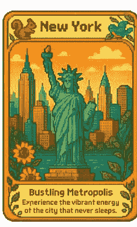

### New York
Bustling Metropolis
Experience the vibrant energy of the city that never sleeps.

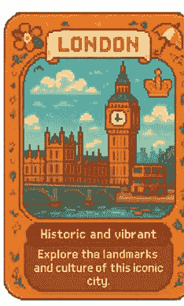

### LONDON
Historic and vibrant
Explore the landmarks and culture of this iconic city.

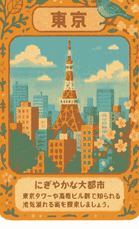

### 東京
にぎやかな大都市
東京や高ビルで見られる活気溢れる時間を過ごしましょう。

### PARIS
Ville emblématique
Découvrez la beauté de Paris avec ses monuments célèbres et son atmosphère romantique.

### دبي
مدينة عصرية
استكشف سحر دبي الحديثة والأسواق التقليدية والحياة الحيوية فيها

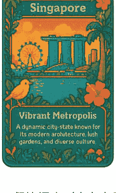

### Singapore
Vibrant Metropolis
A dynamic city-state known for its gardens, and diverse culture.

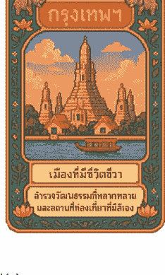

### กรุงเทพไทย
เมืองที่มีชีวิตชีวา
สัมผัสวัดวาอารามที่หลากหลาย和อาหารที่น่าสนใจ

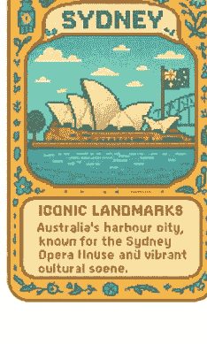

### SYDNEY
ICONIC LANDMARKS
Australia's harbour city, famous for the Opera House and vibrant culture.

- 3. 餐饮门店 (吉卜力风格)

加微信jntsg2, 免费资料分享群

## 沙县小吃
沙县小吃
地方风味
怡美可口的中式热面，提供多样化选择。

## 兰州拉面
兰州拉面
传统风味
享用一碗地道的手工拉面，延续正宗的味。

## 海底捞
海底火锅
热辣暖餐
享五大大横的美好功夫，来快捷的汤汁体验。

## 广州家煲
广州家煲
风味
美味食点，地道广式口味，受欢迎。

## 粤师傅
粤师傅
著名粤式餐厅，口碑正宗烧鹅和经典的美味。

## KFC
KFC
标志性的快餐连锁店对鸡肉和薯条的极致追求。

## 喜悦茶
HEYTEA
潮流饮，创新奶茶设计的丰富性，符合各种口味。

## 雪雪冰城
蜜雪冰城
特色冰饮，掌握冰域源源潮流甜口感。

- 4. 节日活动

## 春节
热闹非凡，人们聚集于灯火之中，灯火映照梦想，守护家园，为大家带来福。

## 元宵节
灯火燃，人们携手灯笼，在节日中抒怀梦想，踏上新的起点。

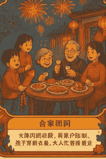
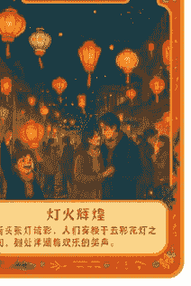

## 清明节
追寻青芳，缅怀故情，在春天时节中抒怀梦想。

## 端午节
龙舟竞力，斩破波浪，赛龙夺，祈愿家户丰岁康。

## 中秋节
月下团圆，农历月十五，全家人团聚，共享中秋佳景，共话团圆。

## 七夕
星洒邂逅，人们在星河边聚集，许下美好的心愿。

## 国庆节
普天盛庆，锦万户共享，处处洋溢着幸福气息。

## 1. 购物双节
电商平台大集合，消费者享，共享喜悦。

## 冬至节
冬至阳生，冬日中最温暖的时刻，融入温馨情事中消融。

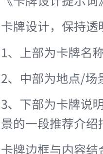
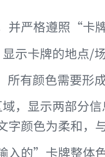

## 《卡片设计》

卡片设计，为保持透明，并严格遵循“卡片内容区域”的输入内容。

1. 上部为卡片名称区域，显示卡片的地点/场景概览，所有颜色需要形成统一的视觉效果，颜色调整与整体配色协调。
2. 中部为卡片说明文字区域，显示两部分信息，第一行显示地点/场景的特点标识，第二行地点/场景的一段推荐语，字体颜色柔和，与背景形成对比。
3. 下部为卡片边框包含用户输入的“卡片整体色调”，并增加“地点/人物/动物名称”和谐的细节装饰，比如植物、动物、自然元素、建筑、线条装饰、趣味形状等装饰物；

点击ins，获取资料数据集

装饰物与地点/场景名称需要保持一致的图案，请发挥想象力，让卡牌框、装饰物更加有趣、生动。颜色之间过渡自然和谐。边框使用圆角设计，给人一种平静、和谐、统一的视觉感受。

------卡片内容输入------

卡片整体色调：丰富的色彩，结合地点/场景本身的特定细节决定主色调，具体内容根据每个内容的实际颜色决定氛围渲染色调

（可选：亚橙绿蓝等体色调，根据实际内容决定氛围渲染色）

卡片内容语言：简体中文/英文/日文等

卡牌风格：像素风格

[可选风格：

+   1. 像素风格：保持柔润、线条和特点，没有尖锐边缘，像素点大小一致且有限，使用统一低饱和度的色彩
+   2. 吉卜风格：像是吉卜力一样的风格，主要以卡通漫画风格为主
+   3. Comix Wave Films风格：像新海诚一样的风格，主要以卡通风格为主

卡牌版本：竖版设计（可选：横版设计16:9、竖版设计16）

地点/场景名称：北京、上海、长城等地；樱花祭、春日游、情节活动；小红帽、大狼等

--------卡片内容输入--------

我们可以看到通过这套提示词可以生成任意地点或场景，并支持较为个性化：

| 配置内容 | 示例 |
| :--- | :--- |
| 地点/场景/人物 | 北京、上海、长城等地；樱花祭、春日游、情节活动；小红帽、大狼等 |
| 卡牌版本 | 可选：横版设计16:9、竖版设计16 |
| 卡牌风格 | 可选：像素风格、吉卜风格、Comix Wave风格 |
| 内容语言 | 可选：简体中文/英文/日文等 |

微信jnts2，免费资料分享

## 卡片整体色调 可可选：橙黄蓝紫等色调、根据实际内容等

不仅如此，提示词内还留了可选内容与说明，方便不知道如何调整提示词的小白，只需要参考选项即可获得个性化的卡片设计：保持清晰，严格遵循“卡片内容区域”。

1. 上方为角色描述，所有的角色图片将具有统一的风格，背景与色彩也保持一致。
2. 如果要生成不同的故事，可以修改提示词中的第二部分，例如生成你感兴趣的某一个故事，文字描述可以使用中文，例如：卡片设计与故事内容的融合，“卡片设计”、“保持清晰连贯”卡牌故事。

这是一次关于提示词产品化的探索，这份提示词希望带给大家一些有趣的工具，以及如何产品化的思考。接下来我将通过实际案例，帮助大家更好地使用这套提示词，此处可以开始创作《小红和大熊猫的故事》。

| 第一步：故事脚本创作 | 第二步：人物卡牌创作 | 第三步：故事卡牌创作 |
| :--- | :--- | :--- |
| 使用工具：AI 大模型辅助 | 使用工具：GPT-4o 创建插图 | 使用工具：GPT-4o 创建插图 |

微信jnts2，免费进资料群

## 选择 ‘ChatGPT 4o’ 模型

## 等待 AI 创作完成

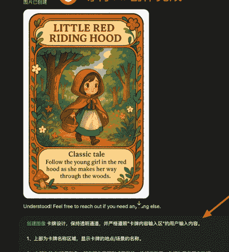

复制并粘贴替换内容的卡片提示词 Understand? Free to reach out if you need any, or else.

你可以添加卡片，然后选择生成，并将“提示词”内的内容替换为你想要的内容：

1. 上方为角色描述，所有的角色图片将具有统一的风格，背景与色彩也保持一致。
2. 如果要生成不同的故事，可以修改提示词中的第二部分，例如生成你感兴趣的某一个故事，文字描述可以使用中文，例如：

4. 点击‘创建图像’按钮，“提示词”内的描述、物体、动作决定了图像的生成。如果对生成的结果不满意，可以重新生成。
3. 点击‘...’按钮
5. 点击‘发送’按钮

## ChatGPT 4o 生成卡片详细教程

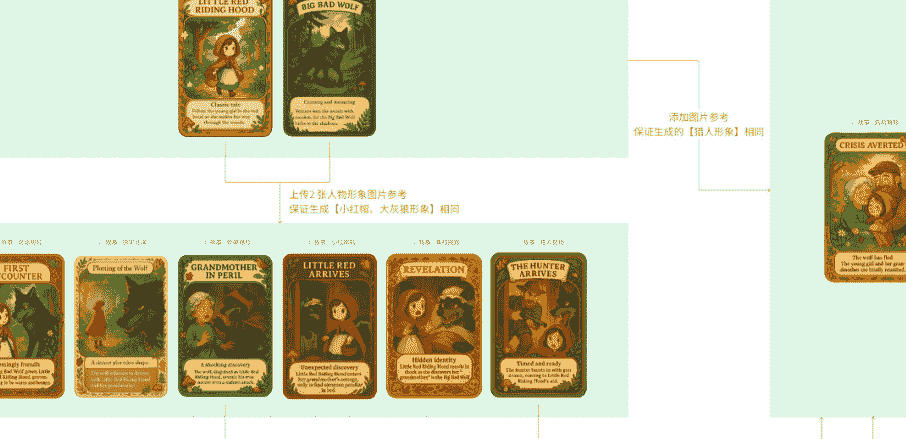

添加卡片参考保证生成的【人物形象】相同
添加两个人物故事参考保证生成的【场景】相同
添加卡片参考保证生成的【背景】相同
添加卡片参考保证生成的【动作描述】相同
不同故事人物形象，通过上传不同的卡片人物图片，保持人物形象一致

加微信jntg2 免费进资料群

## 通过 AI 模型助手，一句话就能完成故事脚本

《AI提问示例》

帮我设计动漫分镜脚本，一共9个镜头，典型地介绍小红帽与大灰的故事，前面2个镜头分别是小红帽、大灰。

通过这套提示词可以生成任意地点或场景，并支持较为个性化：

| 镜头 | 描述 |
| :--- | :--- |
| 镜头1 | 小红帽在森林中行走 |
| 镜头2 | 大灰在树后窥视 |
| 镜头3 | 小红帽遇到大灰 |
| 镜头4 | 大灰去奶奶家（伪装成奶奶） |
| 镜头5 | 小红帽进入奶奶家 |
| 镜头6 | 大灰吃掉小红帽 |
| 镜头7 | 猎人闯入救人 |
| 镜头8 | 大灰逃跑 |
| 镜头9 | 小红帽与奶奶重聚 |

通过 AI 模型助手，一句话就能完成故事脚本。

2. 吉卜风格: 像是吉卜力一样的风格，主要以卡通动画风格为主

3. Comix Wave Films 风格: 像是新海诚动画一样的风格，主要以卡通动画风格为主

卡牌设计: 竖版设计

(可选: 横版设计16:9、竖版设计9:16等)

地点/场景/人物/动物名称: 小红帽

(北京、上海、故宫、长城等地;樱花祭、春日郊游、故事情节场景活动;小红帽、大灰狼人物或动物)

——卡牌内容输入——

步骤: 在基础人形形成的前提下，修改卡牌设计提示的“地点/场景/人物/动物”分别为AI模型提供的剩余分镜故事片段，并上传步骤生成人物形象，每个分镜故事片段根据内容传递的人物形象。

如:小红帽与大灰狼的第一次故事卡牌，只需上传小红帽与大灰狼形象，保持故事内人物形象不一致

如：外婆与大灰狼的故事，只需上方大灰狼形象，外婆形象由AI自由发挥即可

最后，小红帽、外婆、猎人相邻，大灰狼逃跑的故事卡牌，可以将小红帽、外婆(如下第三个故事卡牌)、猎人(如下第六个故事卡牌)与大灰狼一起使用AI的参考，就可以完成最终的4人形象的卡牌生成。

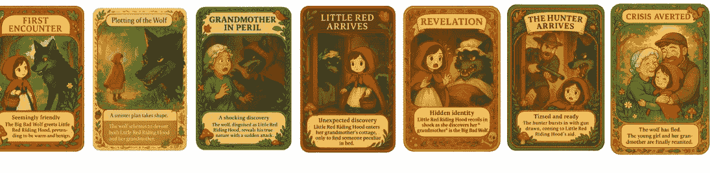

## 故事卡牌介绍教程

结合我们提供的2个人物形象(小红帽与大灰狼)进行卡牌设计(不改变所提供的人形)，保持透明通道，并严格遵循“卡牌内容输入区域”的“用户输入内容”。

- 1, 顶部为卡牌名称区域，显示卡牌的名称。
- 2, 中部为地点/场景形象，色彩需要形成和统一的视觉效果，色彩与整体配色协调。
- 3, 底部为卡牌说明文字区域，显示两部分信息，第一行显示地点/场景的特点概述，第二行地点/场景的一段推荐描述，字体颜色柔和，与背景色彩对比。

微信jntsg2 免费运营资源分享

卡片框与内容结合用户输入的“卡片整体色调，并增加与地/场景/人物/动物名称的协调”的细节装饰，比如植物、动物、自然元素、建筑、线框笔画、趣味标记、趣味形状等装饰物，装饰物与“地/场景名称”需要保持一致的图案，发挥想象力，让卡片边框、装饰物更加生动。卡片色彩要自然和谐。边框使用圆角设计，给人一份平静、和谐和统一的视觉感受。

------卡片内容输入------

卡片整体色调：丰富的色彩，结合地/场景本身的特点决定主色调，具体内容的颜色根据每个内容的实际颜色

(可选：赤橙绿蓝系等体色调，根据实际情况决定等氛围色彩索引)

卡片内容语言：英文

(可选：简体中文/英文/日文等)

卡片风格：Comix Wave Films 风格

(可选风格)

- 1. 像素风格保持圆润、柔和特点，没有尖锐边缘，像素点大小一致且有限，使用统一低饱和度的色彩
- 2. 吉卜风格：是吉卜力的风格，主要以卡通动漫风格为主
- 3. Comix Wave Films 风格：是像素新海诚动漫的风格，主要以卡通动漫风格为主
- 4. 卡片版本：竖版设计

(可选：横版布局16:9、竖版设计9:16)

地/场景/人物/动物名称：危机 危险发生（这段话不显示在卡片上，但需要你结合这段话画进卡片中）

场景背景展示：小红帽与外婆被狼咬，大灰狼逃跑。镜头切换到三人拥抱的温馨画面，背景音乐转为舒适的音乐，最后镜头拉远，阳光重洒森林中。

(可输入如北京、上海、故宫等地等；樱花节、春日郊游等场景活动)

------卡片内容输入------

至此，本文完整地介绍了一整套用于 AI 驱动的流程故事卡片设计流程，从故事分镜脚本创作，到卡片核心人物形象的设计，以及最终的不同人物形象组合成了多种多样的故事卡片。

整套流程只需要一张卡片的提示词，并且这套教程真的实现了零基础小白也可以参考内容进行快速解锁内容生成、个性化创作。

作为初学提示词的小白，希望这次机会与各位创造者交流交流，并尝试探索一条基于产品化降低提示词门槛，让小白也能通过提示词享受AI图像创作的强大能力。

微信 jnts2，免费交流分享群

# 免费 价值 及时 专注

# 扫码加入 知识星球TOP 免费资源群

- 每日免费获取价值资源
- 可提供各类资源搜索服务

| 热门付费文章 | 各行行业报告 |
| :--- | :--- |
| 精选图书资源 | 副业赚钱方法 |
| 职场实用资源 | AI政经自媒体 |

公众号：知识星球TOP 微信信号：jntsg8 微信信号：jntsg2

分享资料仅供个人学习，请及时删除，切勿商用传播
