# 如何使用 Google Trends

250416 生财精华

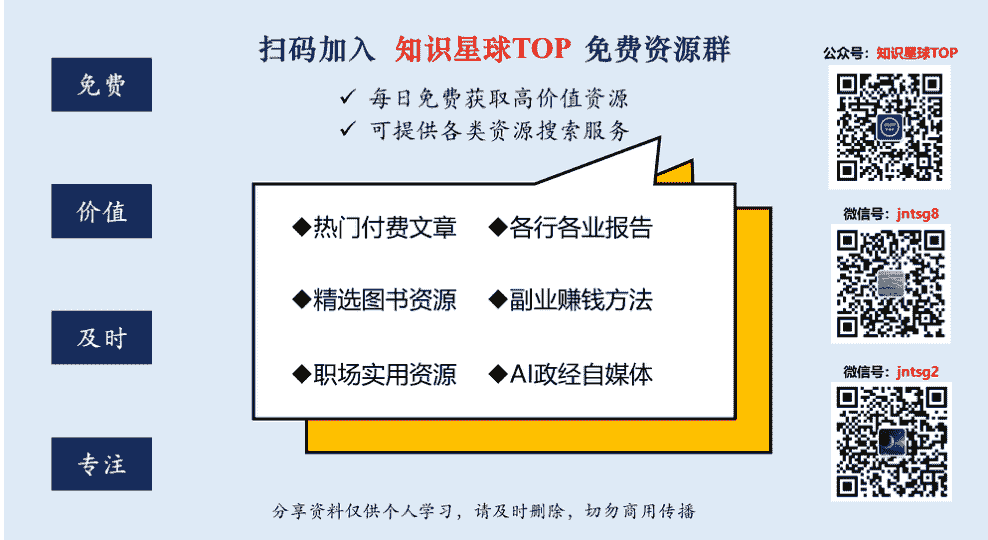

## 一、Google Trends 介绍

Google Trends 是实时抓取全球用户的搜索行为，能够捕捉词汇热度的瞬间变化。我们通过词语搜索量的变化趋势能够判断它是否属于新出新颖的词汇或长期存在的稳定需求。

网址：
https://trends.google.com/

如何用 Google Trends 判断词语的新旧？

新词的特征：
- 搜索量突然暴增：新词通常因技术突破、社会热点、流行文化或突发事件而诞生，短期内搜索量会急剧上升。
- 搜索量快速回落：热度消退后，搜索量会逐渐回归常水平，趋势呈现“上升→缓降”的尖峰形态。

老词的特征：
- 搜索长期稳定：老词通常是技术术语、基础概念或日常需求，搜索波动平缓，趋势图接近一条水平线。
- 季节性/周期性波动：部分老词可能有规律性波动（如“春节”“世界杯”），但整体趋势稳定，无突发性暴涨。

## 二、Google Trends 基础使用

### 2.1 界面及过滤条件

我们直接在首页搜索 coffee

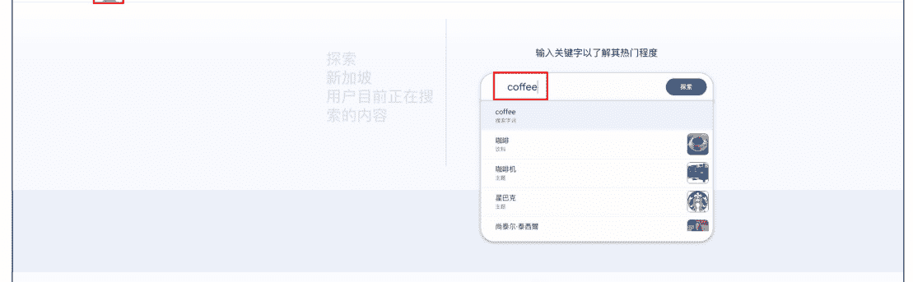

接下来就会来到「探险」页面，你就能看到 coffee 这个词在过去 l 天的搜索趋势

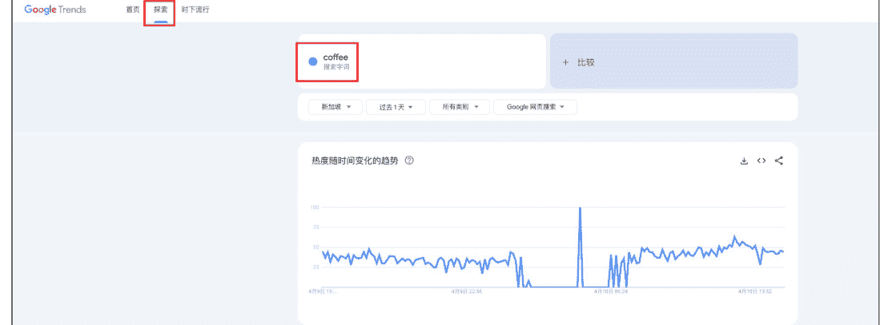

#### 筛选条件

- 1) 地区框可切换：点击下拉框即可切换。
  - 全球范围：选择“全世界”显示全球聚合数据。
- 2) 时间筛选：
  - 实时数据：过去 1小时/4小时。
  - 短期趋势：过去 1天/7天（适合热点事件追踪）。
  - 长期趋势：自定义时间段（2004年至今，最长5年跨度）。
- 3) 类别筛选：细化搜索场景。
  - 电商类：仅显示购物相关搜索（如 coffee maker）。
  - 新闻类：过滤新闻事件引发的搜索波动。
  - 餐饮类：适用于食品饮料行业分析。
  - 选择错误类别可能导致数据偏差（如 coffee 选择科技会过滤掉大部分数据）。
- 4) 搜索来源：
  - 网页搜索：默认全网搜索。
  - 图片搜索：分析视觉内容需求（适合产品设计参考）。
  - Google News：监测媒体报道热度。
  - Google Shopping：电商平台搜索趋势。
  - YouTube：视频内容搜索行为。

### 2.2 搜索词和搜索主题

搜索词 - Search term
搜索主题 - Topic

我们在搜索框搜索一个词语的时候，可以选择是搜索词还是搜索主题。

Search Terms（搜索词）和 Search Topics（搜索主题）是两种不同的数据匹配模式，直接影响结果范围与准确性。

使用场景举例：
如现在要分析“咖啡”的搜索趋势，如果用 Search Terms 输入 coffee，仅统计用户直接搜索“coffee”的精确匹配数据，忽略 cafe、coffee shop 等变体。结果可能低估实际热度（尤其是英语国家用户可能搜索本地语言）。

如果用 Search Topics 选择 Coffee 主题：系统自动聚合所有相关关键词（包括 cappuccino、咖啡、قهوة等语言变体），并排除无关词（如人名“Coffee”）。反映整个咖啡类的真实趋势。

总结：
- Search Terms = 精准狙击（微镜视角）
- Search Topics = 全局扫描（卫星视角）

### 2.3 谷歌热度

谷歌趋势反映的是搜索词的热度而不是搜索量。

所以你没办法知道有多少人搜索了某个特定的词语，所有的搜索数据被简化为一个叫指数的指标。

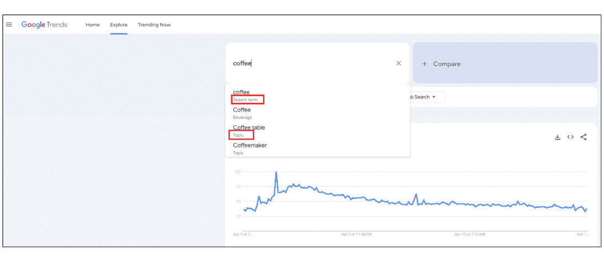

范围是 0-100，这样可以更好地保护 google 用户的隐私。

所以你虽然不能用这个数据来判断多少人搜索了某个特定的词语，但是能够用它来看这个词的流行程度，即随着时间的推移发生了什么样的变化。

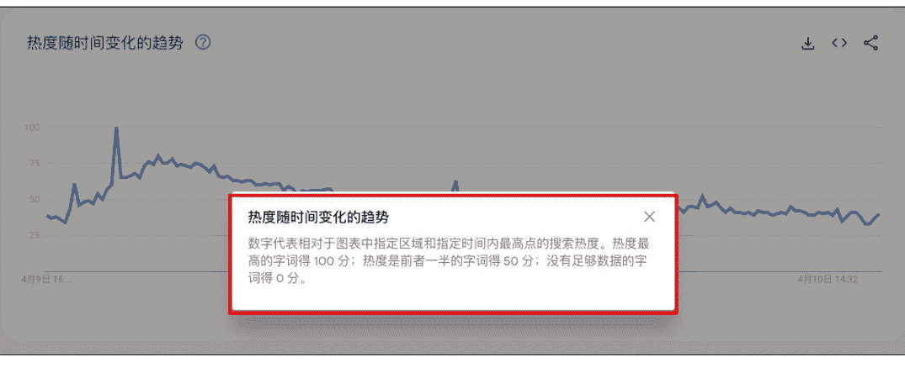

## 三、explore/探索

### 3.1 关键词趋势

假设你想了解咖啡店所在地区用户的喜好。我们在 Google Trends 主页输入 cappuccino（卡布奇诺），然后选择 coffee drink

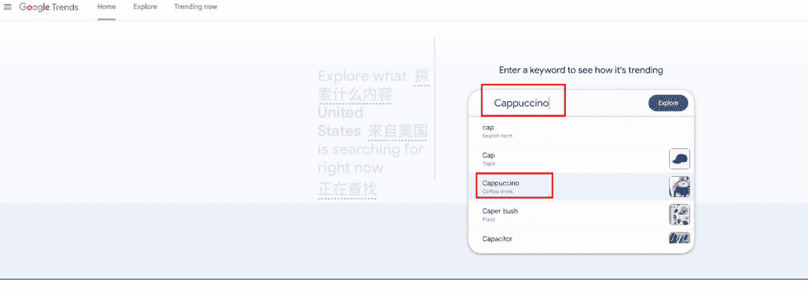

接下来就会跳到 explore/探索页面

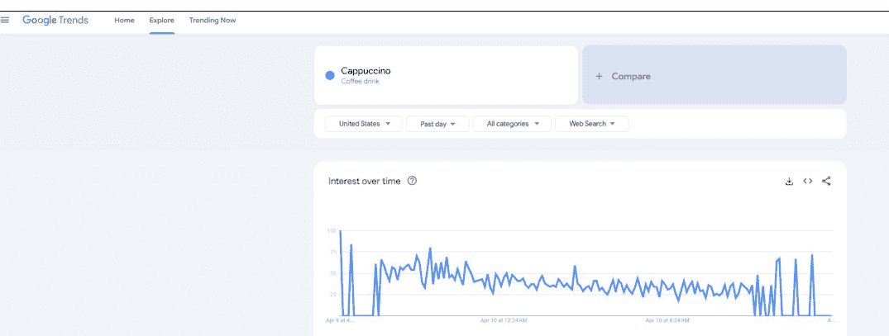

接下来添加对比词， latte（拿铁）和 espresso（浓缩咖啡）。注意，最好是同类比较，因为前面选择的是 Topic，那添加对比词也选择 Topic。

### 3.2 留空关键词

我在 Explore 页面不输入关键词，把关键词留空，直接选择下面的筛选条件，这样我就知道某个位置、某个时间段、某个类别、某个平台、常见的搜索主题和关键词。

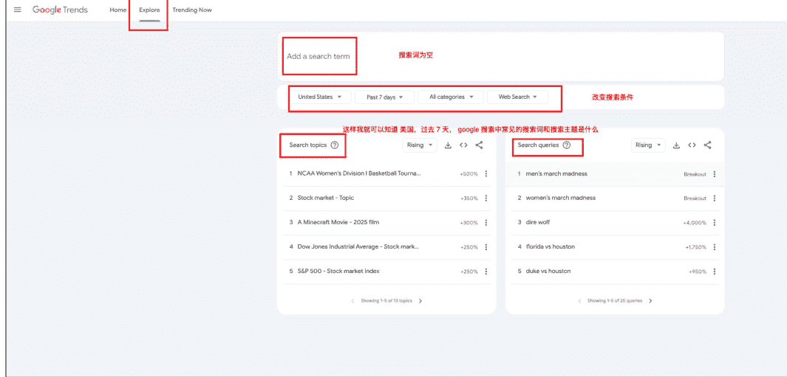

### 3.3 怎么去看搜索趋势

左边的柱状图代表你的搜索词或者搜索主题，我们对比了多个 Topic，这些柱状图展示的是各自的平均搜索兴趣，你可以把它理解成一个层次视角，通过这个视角判断每个 Topic 的热度高还是低。

右边的折线图反映随着时间变化的热度趋势。如果折线图跌到 0，表明你的搜索词足够的样本。如果你切换不同时间段，发现折线图很多跌到 0，代表在这个时间段搜索词的数据不足，搜索这个词的人太。

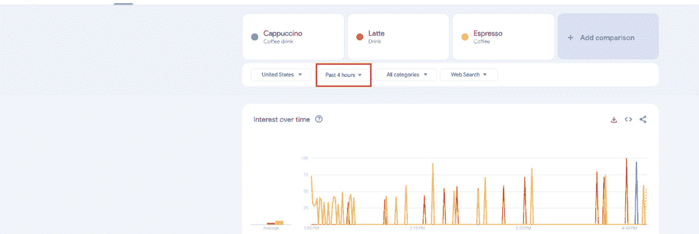

你可以换一下筛选条件，比如原来选的是美国，然后把地区换成全球，再看看数据。

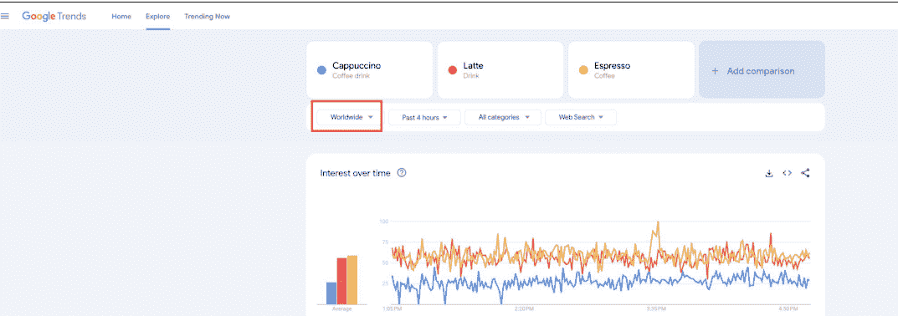

### 3.4 不同地区的细分数据

如果你把地区选成全球，这里就会按照国家/地区划分搜索兴趣。如果你的区域选择的是国家/地区，在这里就会看到按照区域划分的搜索兴趣。区域的阴影越深，表示搜索兴趣越高。

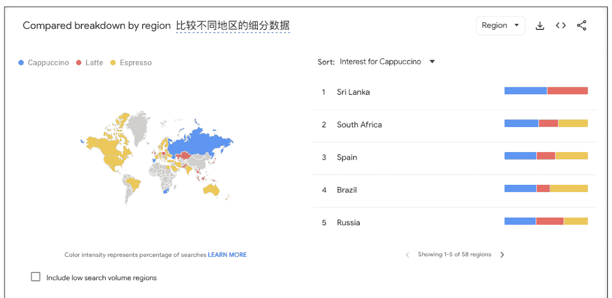

把标记在地图上的某个区域，可以显示该区域的搜索兴趣。

### 3.5 关键词的关联

显示你输入的搜索关键词相关的关联

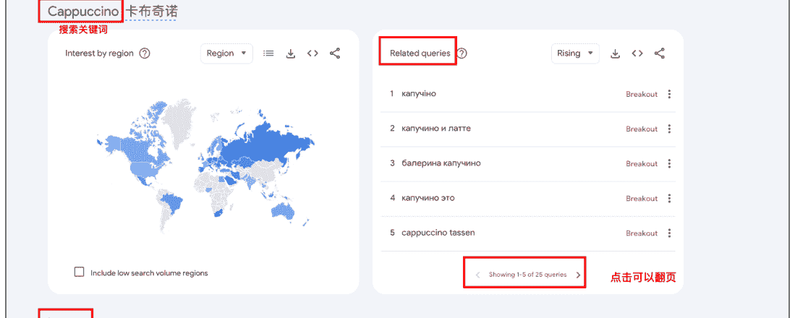
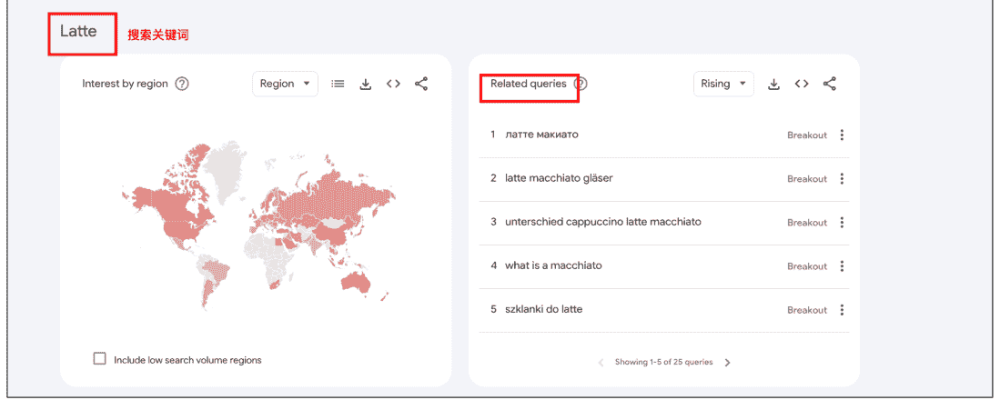

#### 指标含义

- Rising：根据近期搜索量激增的幅度筛选。百分比：表示特定搜索词在选定时间段内的搜索量增长幅度。
- Breakout：在选定时间段内增速超过5000%的词。
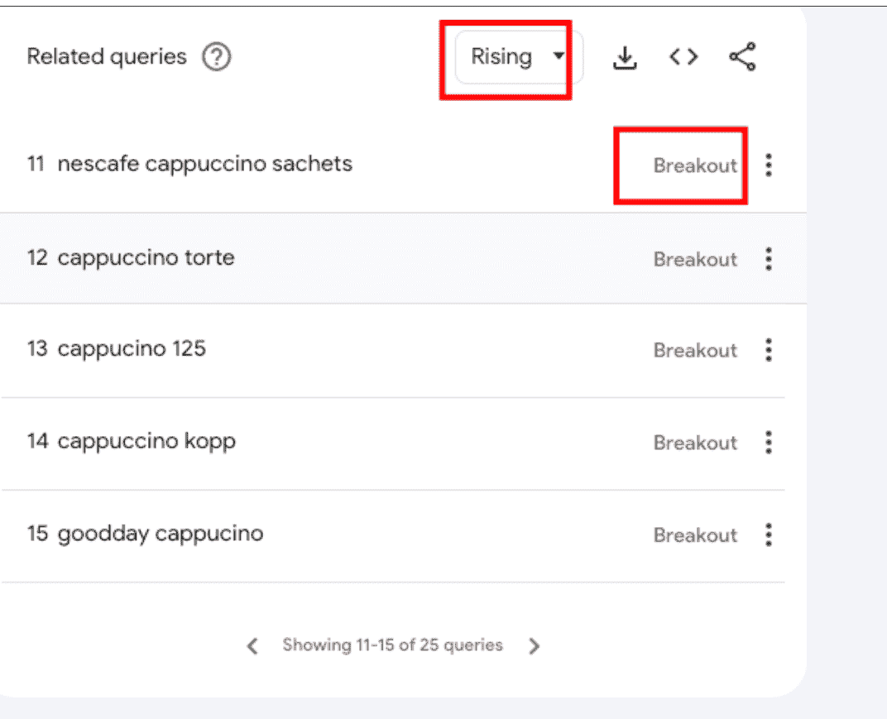
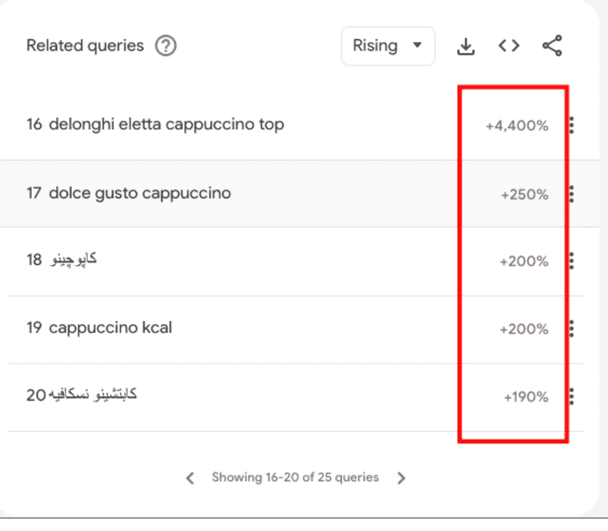
- Top：根据搜索兴趣筛选。按照 Top 排序，出来的都是按照搜索兴趣从高到低，但是这些词不一定是增长最快的，但一定是搜索兴趣最高的。

### 3.6 使用注意事项

1) Google Trends 展示的不是搜索量，而是近似值，可以理解成搜索兴趣。避免使用“增长了100%”之类的说法，这只是一个近似值。
2) 比较功能：如果你想比较两个关键词，直接使用 comparison。不要把两个关键词分别一遍，因为他们的指数不一样。

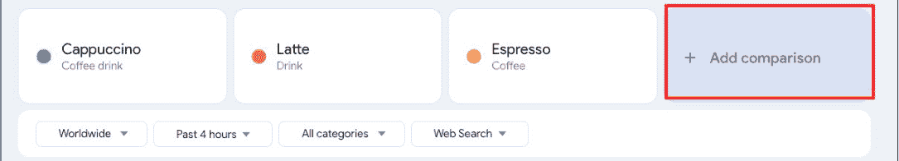

## 四、高级功能

### 4.1 标点符号

如果没有符合你搜索条件的，你可以使用标点符号找到你需要的内容。如果你搜索“boat trip”不带任何标点符号，结果包含任何拼写错误、变体以及复数形式。

- 引号：搜索带引号“boat trip”会显示带有前面的或者后面的单词。
- 加号：搜索带加号“boat+trip”结果广泛。
- 减号：搜索带减号“boat-trip”包含 boat但不包含 trip。

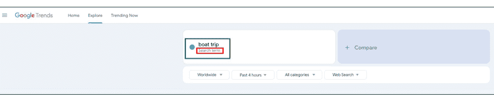
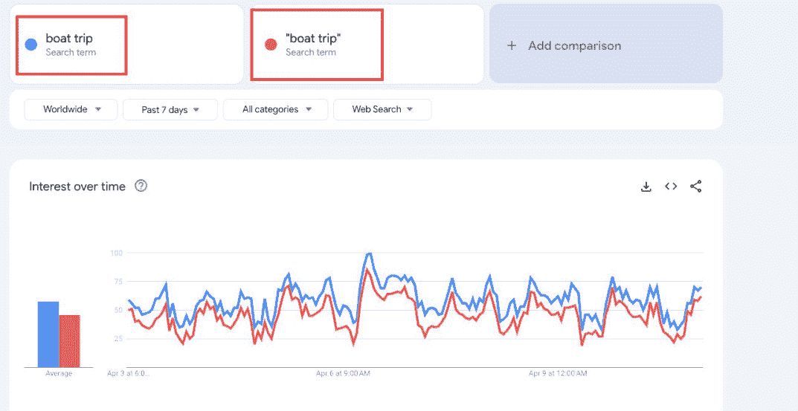

### 4.2 高级比较模式

假设有一家旅行社，你想知道用户对 boat trip 是否感兴趣，随着时间推移，用户对 boat trip 的兴趣是怎样的。我们直接查看过去 5 年“boat trip”的关键词趋势，从这张图我们能看出“boat trip”有非常强的季节性，英国夏季明显多于冬季。

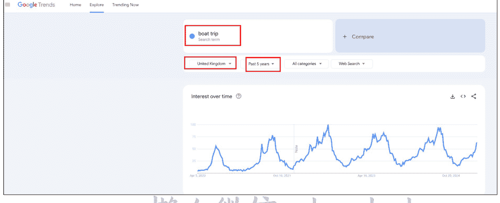

（2) 分析逐年的趋势

首先把时间筛选改成过去 12 个月，时间范围就是 24 年 4 月~25 年 4 月。

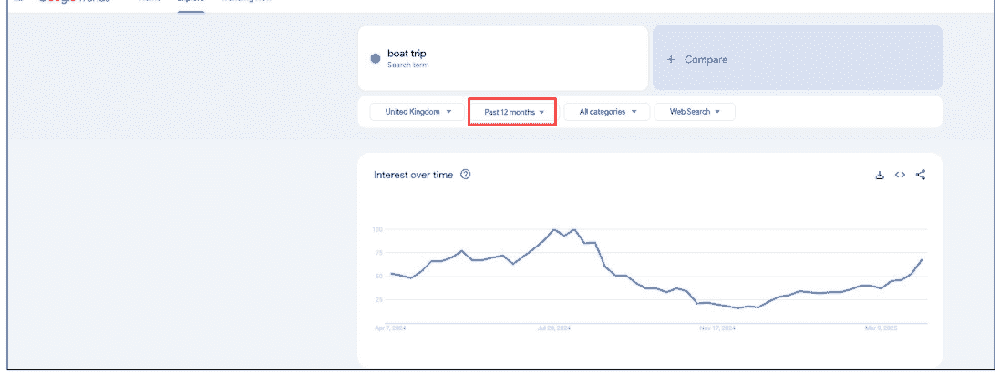

接下来添加一个一模一样的关键词，只不过把时间范围自定义成 23 年 4 月~24 年 4 月。

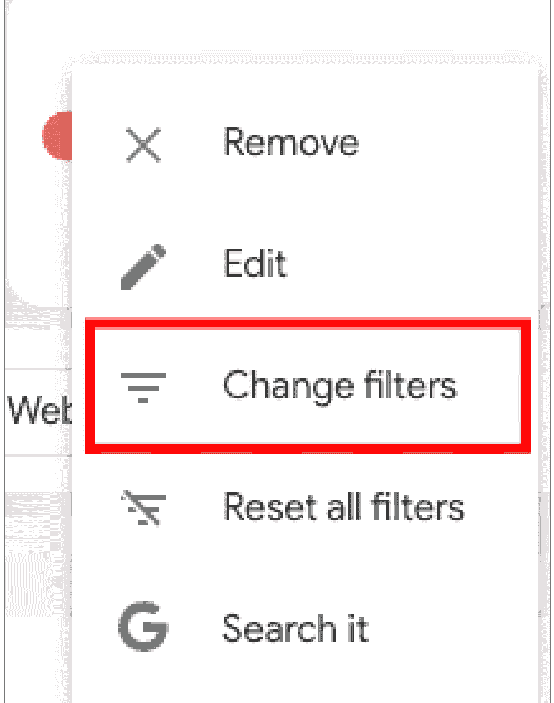

同样的方法，添加相同关键词，时间范围分别是 22 年 4 月~23 年 4 月、21 年 4 月~22 年 4 月、20 年 4 月~21 年 4 月。这样你就可以看到过去 5 年，每一个关键词在英国的趋势是什么样子的。

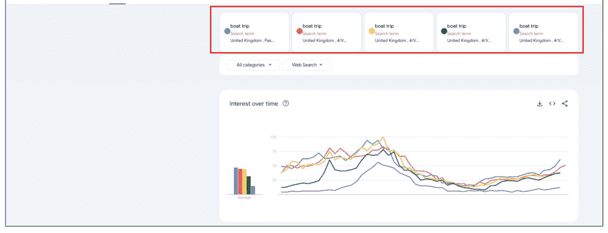

同关键词不同地区对比：假设你现在在英国，你想把业务拓展至美国，我们还是先看英国过去 5 年“boat trip”的搜索趋势。添加相同的关键词，地区选择美国，时间也是过去 5 年，你可以看到美国的搜索兴趣很低，显然不适合在美国开展业务。同样的方法，我们可以横向对比 5 个市场。

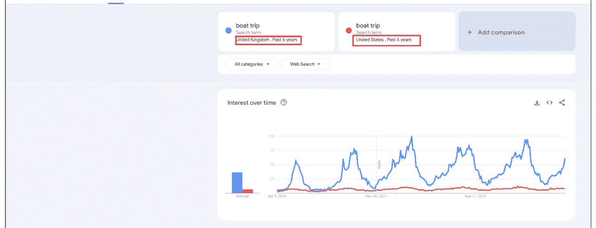

### 4.3 导出分享数据

1) 链接分享：如果你想要把你自己 Google Trends 分析的趋势分享给朋友，只需要复制链接并发送给朋友即可。你所做的筛选条件都会在链接的 URL 上有所体现，朋友看到的页面和你的页面都是一致的。
2) 网站嵌入：把嵌入代码直接粘贴到 HTML 代码中即可。

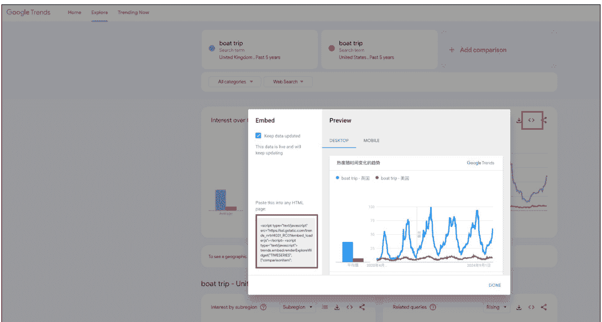

3) 下载 CSV：点击下载按钮获取原始数据。

用户行为：用户知道 ChatGPT 的通用能力 → 尝试其生成简历 → 发现效果不专业 → 寻找专用工具。

需求强度：中高（用户已意识到 AI 的价值，但需要更垂直的解决方案）

产品方向：开发“ChatGPT+专业简历库”的集成工具，宣传“比直接使用 ChatGPT 更高效”。

## 需求强度分析：

关键词中的“强度信号”

### 强需求信号

- “best”：用户进入对比选择阶段，商业价值高。
- “chatgpt resume builder”：用户明确需要 AI 与工具结合，需求具体。

### 弱需求信号

- “free”：用户价格敏感，付费转化难度大。
- 无功能描述词：如未出现“ATS”、“custom template”等，说明需求尚未细化。

## 步骤 2：查看「关联主题」

操作：在「关联主题」部分，发现以下关联主题

懒微信：lazyhelper
加微信intjsg2，免费资源分享群

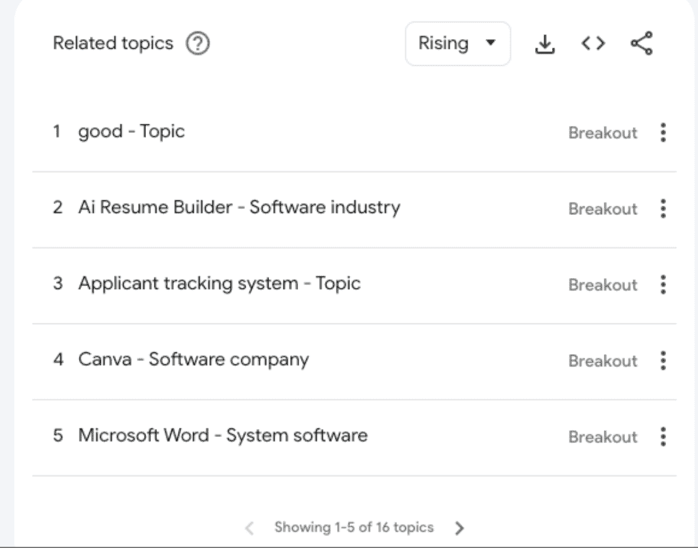

"good – Topic" ( Breakout )
可能是用户搜索 "good resume builder" 或 "good AI tools" 等短语的泛化归类，反映出用户对“优质工具”的筛选需求。

"AI Resume Builder - Software industry" ( Breakout )
明确指向“AI 简历生成工具”这一细分赛道，归属于“软件行业”，说明该工具已被市场认可为专业软件。

"Applicant tracking system - Topic" ( Breakout )
企业招聘系统中的简历筛选系统（ATS），与简历生成工具强关联，用户需要确保简历能通过机器筛选。

"Canva – Software company" ( Breakout )
用户正在对比 Canva（知名设计工具），说明部分用户尝试用设计工具制作简历，但需要更专业的解决方案。

## 懒人微信：lazyhelper

加微信intjs2，免费进资料分享群

## Microsoft Word - System software ( Breakout )

传统文档工具 Word 的关联，反映用户从“手动排版”向“自动化生成”过渡的需求。

## 需求场景分析：

1) 核心场景，生成符合 ATS 标准的简历证据链：
关键关键词 “AI Resume Builder” + 关联主题 “Applicant tracking system”。

### 用户行为逻辑
用户痛点：简历被企业 ATS 系统过滤 → 搜索 AI 生成工具 → 验证工具是否解决 ATS 兼容性。

### 产品方向
需强调工具内置“ATS 优化”功能（如关键词匹配、格式标准化）。
提供“简历通过率检测”报告，直接解决用户担忧。

2) 竞争场景，与传统工具（Word/Canva）争夺用户证据链：
关联主题中出现 Canva 和 Microsoft Word，且均为“Breakout”状态。

### 用户行为逻辑
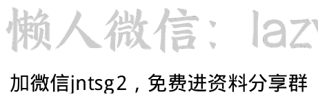

习惯：过去去用 Word 写简历 → 发现效率低 → 尝试 Canva 美化 → 仍不满意 → 转向 AI 工具

### 产品方向：
- 开发“一键从 Word/Canva 导入”功能，降低迁移成本。
- 宣传“比 Canva 更智能，比 Word 更高效”的核心优势。

3) 质量筛选场景，用户寻找可靠工具链：
关联主题“good - Topic”（可能包含“good resume builder”等搜索）。

### 用户行为逻辑
用户不信任通用类关键词 → 搜索“good”“best”等测评关键词 → 筛选优质产品

### 产品方向：
- 主动发布第三方测评报告（如“2024 最佳 AI 简历工具 Top 5”）。
- 官网突出“行业认证”“用户案例”等信任背书。

需求强度分析：
懒人微信：lazyhelper

图中所有关联主题均为 Breakout，说明：
- 整个“AI 简历生成”赛道处于高速增长期；
- 用户需求从传统工具（Word/Canva）向 AI 工具迁移的趋势显著。

## 2) 需求强度排序

为什么关键词类型能反应需求强度？
核心逻辑：搜索词越具体，付费意愿越强。

想象你准备额外：
- **弱需求场景**：你搜“附近有什么吃的”（泛需求，可能随便看看）
- **强需求场景**：你搜“AI resume builder”（明确需求，准备下单）

总结：从关键词到用户画像
用户痛点：简历被系统过滤 → 搜索“AI resume builder” → 担心简历通过率低。
通过分析相关查询和关联主题，定位用户真实痛点（而不只是表面需求）。

制定策略：
- 下次需求：精准功能（如内置 ATS 检测）。
- 定价策略：免费引流 + 付

懒人微信：lazyhelper

## 6. 对竞品关键词

为什么要对比竞品关键词？
核心逻辑：用户的注意力是有限的。当某个关键词搜索量上升，判断用户是放弃旧方案（市场空白）还是需要新方案（赛道扩张）。

2) 怎么去找竞品关键词?

① 我们使用 Google Trends 搜索关键词，在“Related topics”和“Related queries”里面出现竞品关键词：

② 问 AI：“用户不用这个产品会用什么？”以及社交媒体在 Reddit/Twitter 上一起讨论。

③ 从用户反馈中提炼竞品：
- 分析 App Store/Google Play 评论：简历类工具（如 Canva、ResumeStar）。
- 用户评论：“不如 Novoresume 好用”。
- 抓取高频被提及的工具名。

常见竞品词：Zety、ResumeGenius、VisualCV。

## 3) 分析竞品关键词

第一种：主关键词上升，竞品下降 → 替代需求爆发

数据表现：
- “AI resume builder”（主关键词）搜索量↑
- “Canva resume”（竞品关键词）搜索量↓
- “Microsoft Word resume template”（竞品关键词）搜索量↓

用户行为分析：
过去用 Canva（设计工具）或 Word（文档工具）制作简历 → 发现效率低或不够专业 → 转向 AI 专用工具。

市场结论：
AI 简历生成工具正在抢夺传统工具的市场 → 存在空白（用户需要更高效的垂直解决方案）。

案例验证：
“Canva”和“Microsoft Word”标记为 Breakout（搜索量激增），但结合时间范围：如果它们下降而主关键词上升 → 替代需求；

第二种：主关键词和竞品关键词均上升 → 赛道扩张

数据表现：
- “AI resume builder”（主关键词）搜索量↑
- “Canva resume”（竞品关键词）搜索量↑
- “Microsoft Word resume template”（竞品关键词）搜索量↑

用户行为分析：
简历制作需求整体增长 → 用户既尝试 AI 工具，继续使用传统工具 → 市场教育期，用户尚未明确偏好。

市场结论：
简历制作赛道整体热度上升（求职市场竞争加剧、远程工作普及）。

案例验证：
所有关联主题均为 Breakout（搜索激增500%+），若竞品关键词也处于上升，说明用户同时探索多种方案 → 需差异化能力（如 AI+ATS 优化）抢占市场。
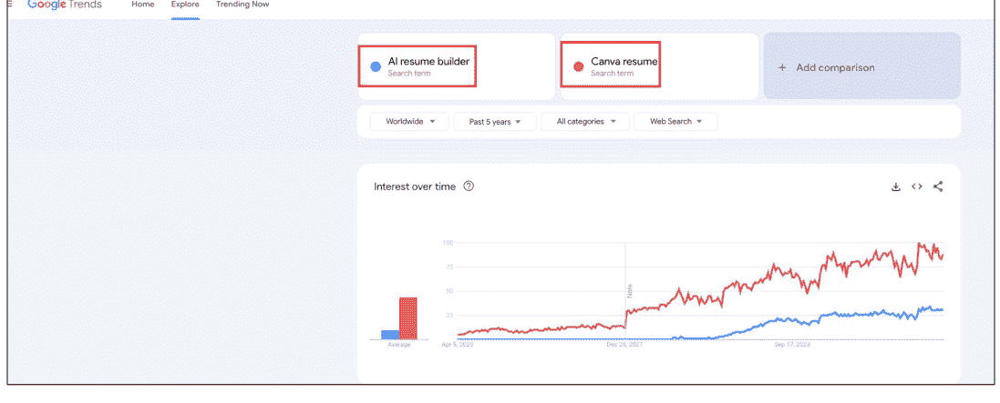

## 4) 制定策略

上面的图是主关键词和竞品关键词搜索量同步上升，说明赛道在扩张。

现在假设数据结论：

**情况 A：替代需求爆发实证（主关键词上升，竞品下降）**
- **攻击竞品弱点**：开发“Canva 简历一键 AI 优化”功能，降低迁移成本。
- **宣传优势**：宣传“比 Word 快 10 倍！AI 生成简历课程”。

**情况 B：赛道扩张实证（主关键词和竞品关键词同步上升）**
- **借势增长**：推出“AI+Canva 集成工具”，兼容设计需求与智能生成。
- **嵌入工作**：提供“Word 插件 AI 简历助手”，嵌入用户现有工作流。
- **差异化定位**：主打“AI 简历生成+ATS 检测”（竞品未覆盖的痛点）。

## 总结：对比竞品关键词的价值

- 用户是否在抛弃旧方案 → 找到市场空白，针对性开发替代功能；
- 赛道是否在爆发期 → 决定“快速抢占”或“协同共生”策略；
- 竞品动态预判 → 提前布局防御性功能（如 Canva 若集成 AI，你如何应对）。
