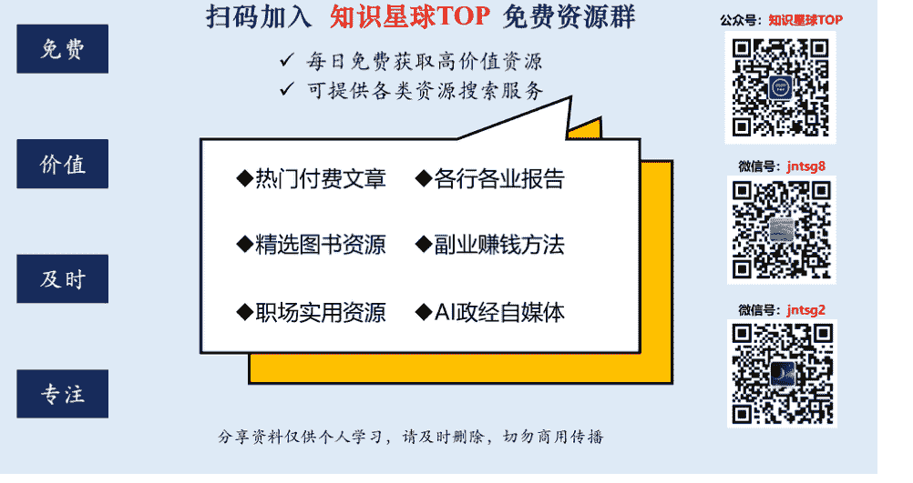
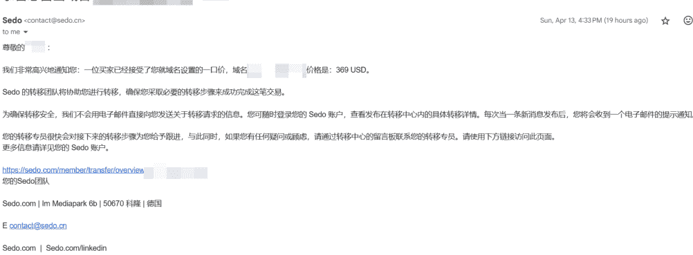
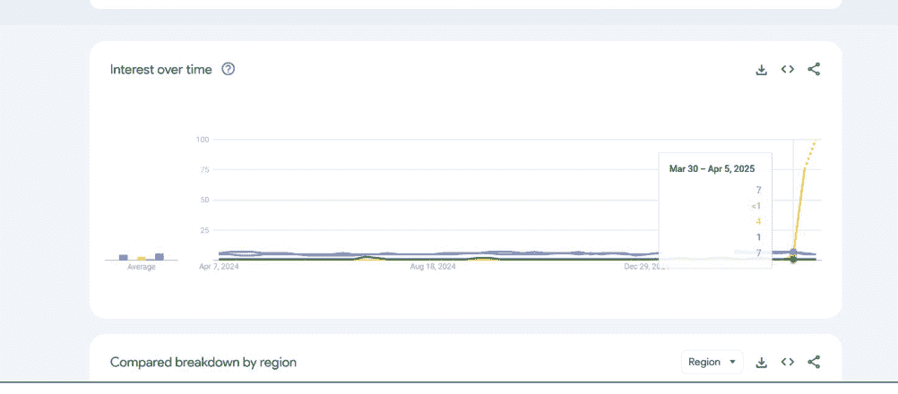
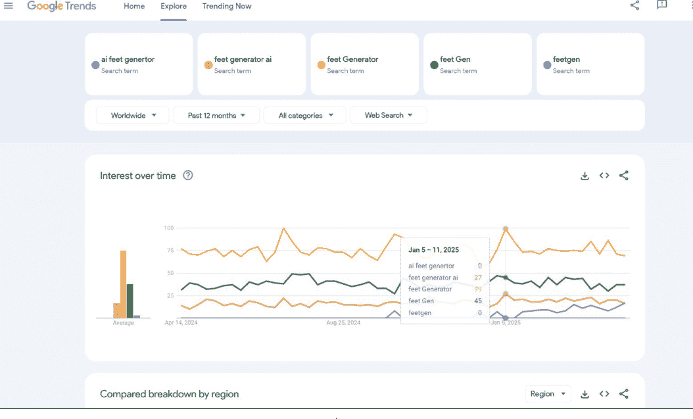
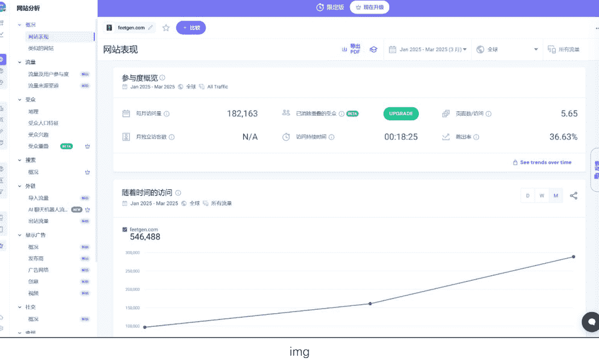

# 获得第一笔新词收入，来自卖域名，分享我的找词思路

# 250416 生财精华

# 昨天卖出了一个新词域名。

从谷歌趋势看，昨天，也就是13号，正是谷歌趋势更新，能够看到上周这个新词头部正才开始暴涨的时候，也许这时在谷歌趋势的热词里出现了这个词，开始被许多人关注。

但我我是9号看到的这个词，那时12号这段折线还没更新，在30号到5号刚出现小伤点的时候，搜索量显示还不太高，后面这黄色实线还是虚线，只是预测趋势。

根据我的能力，这个词的功能我实现不了，但是这么早发现潜力词，先拿下域名总没有坏掉，买到后立刻就挂在 sedo上出售了。

第一次卖域名，没什么经验，觉得能卖出去，验证这套流程的可行性就不亏，所以我挂了比较低的价格。

# 以下我的找思路：

根据我对自己能力和认知的了解，目前合适的是，找新词的第一阶段，挨个去看。

我是这么想的，我对某个词、某个领域的了解，几乎完全是小白，所以我需要大量去看这个词相关的概念，相关的搜索需求，来了解这个词能做什么、人们想用它来做什么。

我现在在很多教程中学到的找新词的方法，一个是看 semrush这一类数据分析平台，找竞争度低的新词，一个是谷歌趋势挖有商业潜力的热搜词。这两种方法，对我一个新手来说，我认为有些有些大，本人英语水平就不很好，还要看海量不同领域不同类型的词，太考验我的知识存量和判断力。

# 所以我用了一个笨方法，根据想了解的领域，去反查用户都在找什么工具。

方法就是，根据想了解的词根，用爬去批量获取相关下拉词，简单来

比如此看“AI”相关的词，就让在浏览器里模拟输入“ai a”到“ai z”，批量获取下拉词列表，看人们都在搜什么。

然后根据出现的词，其中一些感兴趣的、陌生的，去谷歌趋势看看，去放在谷歌搜索一下，看人们的真实搜索意图是什么，有没有解决方案。

往往会在其中发现另外一些有些潜力的词，作为词再去获取全部下拉词，挖掘潜力需求。

在这个过程中，会有很多“原来还有这种需求”“原来还有这种工具”的感叹。

我卖出名的潜力新词，就是用这种方法找到的。

随着对词相关关键词的了解越来越多，我的下一步思路是，每天用脚本跑一遍下拉词，和以前获取的列表作对比，去重获取每日新词，这个新词应该不会太多，人工判断不会耽误很多时间。

---

这个挖词的过程，也发现了一些我能力范围内能做出来的东西，还发现了很多有意思的需求和产品。

比如在 ai 的关键词里，我看到了这个词“ai feet generator”。

放在谷歌趋势或者 semrush看，搜索量很小，再拿去谷歌搜索，只有一个

# 网站满足了这个需求

https://www.feetgen.com/

通过这个网站反查搜索词，会发现“ feet generator ai ” “ foot Generator ” 搜索量相对较大。

去 similarweb 看，没有相似网站，满足这个需求，这个网站确实是独一个。

去看网站流量来源和去处，会发现搜索流量一直在增长，PayPal 和 stripe 占很大比例，也有增长趋势，说明变现能力不弱。

加微信jntsg2，免费进资料分享

# 去关键词域名，发现这个词也是他独一家，而且更适合 SEO 的全拼足 Generator 完全没有人注册。

现阶段的对这个工具的理解是，小众需求，没有竞争对手，在闷声发钱，大厂拉不下脸去做，但是个人开发者可以去分一杯羹，有能力实现的可以一试。

加微信 jntsg2，免费资料分享群

这种词方式，还有很多类似的小众需求只有零星一两个产品满足，我认为这就是我一直在找的 niche 市场，藏着很多闷声赚钱的工具。

- 星球发文章不能发附件，我把附件放网盘了：https://pan.quark.cn/s/db7dddcdfd3b

这两个文件，python 代码是我关键词的脚本，你可以根据自己的需求去修改。txt 文件是用这个脚本爬出来的ai词的上万个下词。我认为这套思路用在抖音、小红书、reddit、推特等其他平台也是行的，感兴趣的圈友可以去试一试。

以上，希望对你有所启发，如果其他扩展思路，欢迎评论区交流。
