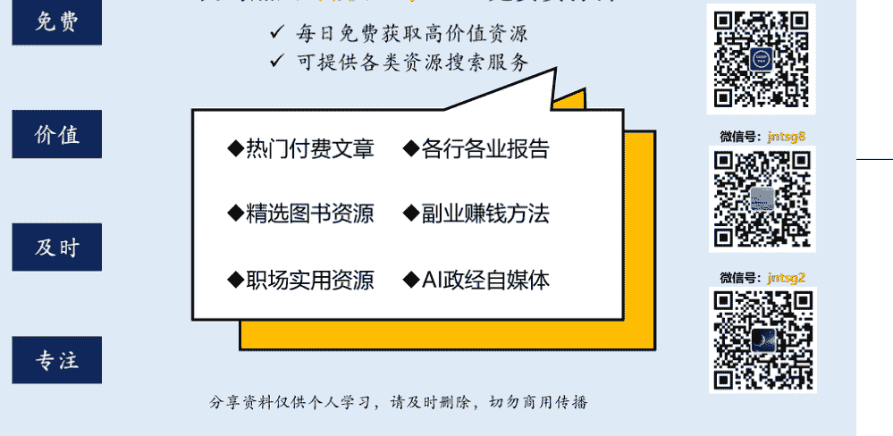
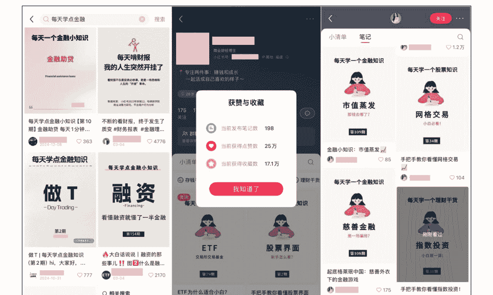
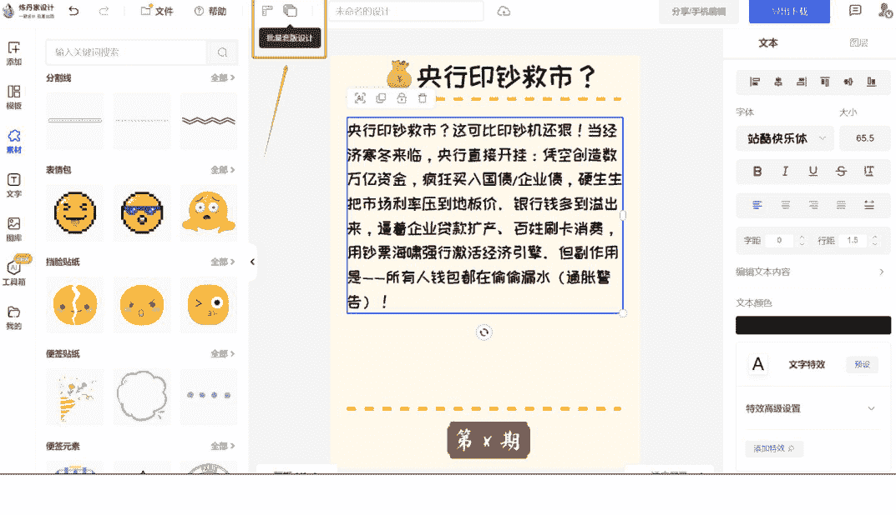
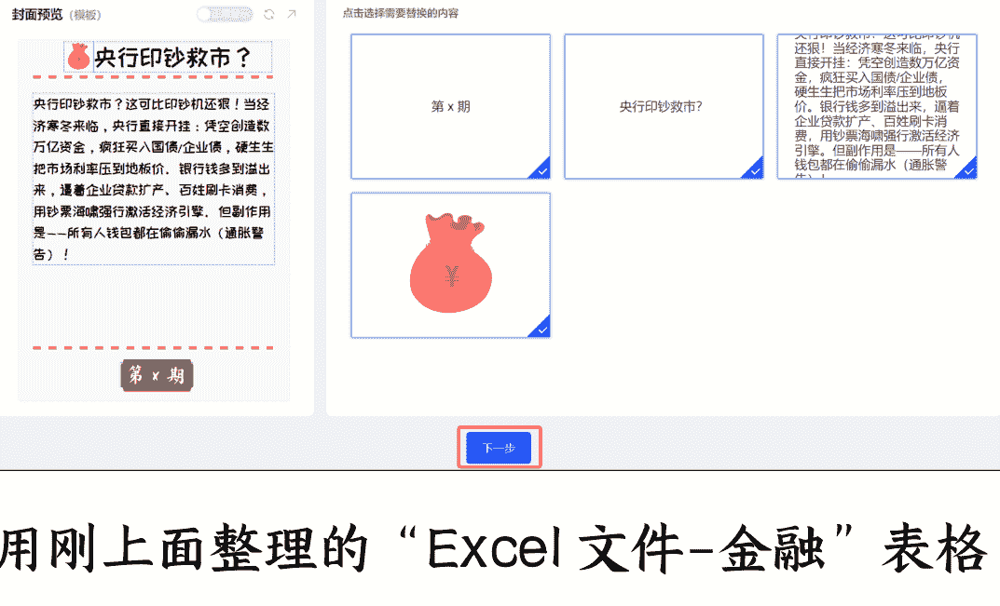
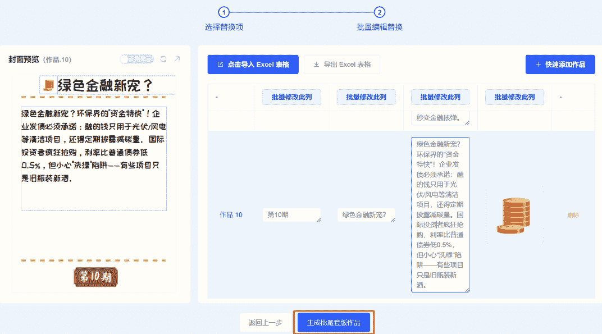
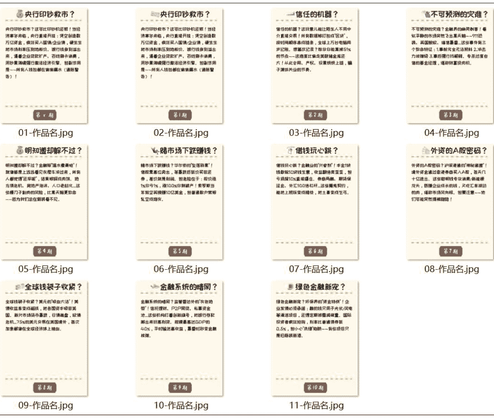

# 4步解锁，AI 小红书流量涨密码!(案例+保姆教程+工具)

250418 财精精华免费群

大家好，我是晓智！专注 AI 写作、绘画、海报的炼丹家 AI 工具作者。

发现好多朋友都是掌握了各种批量提效技能，但在内容创作上还是头疼，投入精力时间做作品，经常又没的数据反馈...试着换个方向，同样的创作技巧，可能事半功倍了！

本篇将分享如何在小红书找到合适的内容方向、DeepSeek 输出选题及内容、炼丹家设计如何批量制作小红书封面及配图，让大家都能掌握【更省时间、降低难度、显著效果】的本领。

# 正篇开始!

根据近期我对批量小红书封面的对标调研，发现有一类方向，几乎是通过同一种技巧生成的内容，那么只需要找到热门的细分定位，做小红书就很轻松了。

打开小红书 APP，直接搜“每天学点点”，能直观看到热度排行榜！

## 例子①金融类【高赞、热门、高效】，已发布 198 篇图文笔记，有了 17.2 万粉丝，获赞与收藏高达 42.1 万，基本上篇篇都是高赞笔记。

## 例子②心理类【快速速粉、高互动】，仅发布 33 篇图文笔记，就吸引了 17.2 万粉丝（真巧，跟上面一样，我自己都看呆了还确认了），获赞与收藏高达 19.4 万，近期百赞千粉是非常常有的。

## 例子③保养类【持续输出、高收藏】，已发布 201 篇图文笔记，拥有 1.9 万粉丝。

## 炼丹家海报

### 实操步骤:

- ①批量生成选题。
- ②生成文案。
- ③批量生成封面。
- ④批量生成配图。

# 第一步：批量选题

首先，根据对标的赛道，利用炼丹家 AI 工具批量生成选题。打开 AI 工具，输入指令：> 请我列举 50 个热门的金融词汇，以表格输出。表格有三个字段：字段一：具体期（第1到第50期），字段二：金融词汇（中文），字段三：对应标题（20字以内，例如：到底是什么？）。

| 期 | 金融词汇 | 标题 |
| :--- | :--- | :--- |
| 第1期 | 量化宽松 | 亚洲印钞 |
| 第2期 | 区块链 | 信任的机器 |
| 第3期 | 黑天鹅事件 | 不可预测的灾难 |
| 第4期 | 灰犀牛风险 | 明知却难不已 |
| 第5期 | 做空 | 市场下行趋势 |
| 第6期 | 杠杆利率 | 借钱无术 |
| 第7期 | 北向资金 | 外资的A级密码 |
| 第8期 | 美联储加息 | 全球口袋收割 |
| 第9期 | 影子银行 | 金融系统的暗网 |
| 第10期 | 碳中和债券 | 绿色金融宠 |
| 第11期 | 元宇宙 | 虚拟世界的危机 |
| 第12期 | 数字货币 | 钱的终结 |
| 第13期 | 大宗商品 | 经济的血肉 |
| 第14期 | 美债收益率 | 全球资产价值 |
| 第15期 | 矿石科技 | 技术突破 |
| 第16期 | ESG投资 | 价值标准 |

我们把 50 个选题相关内容，直接复制到“Excel文件-金融”存起来。

① 炼丹家 AI 对话默认上下文关联度，需要到“对话设置”里把长度调整至最高 100000 token，避免 AI 输出途中因为上下文关联度受限就不回复了。

② 这里可能有些朋友遇到文本表格复制到 Excel 中内容会被分成多行的问题，是因为文中带了手动换行符或回车导致，解决方法可以是复制内容中把手动换行符 (^)以及回车符 (p) 都替换成文档中没有的字符或字符串，复制到 Excel 之后再把替换的字符或字符串替换成换行符或回车就可以恢复了。

③ 建议用 WPS 表格去新建、保存，兼容性。

# 第二步：生成对标格式文案

举例两个高效方法，一个是让 AI 根据你提供的对标文案进行格式学习，然后结构表格形式输出上面 50 个金融词汇。打开 AI 工具，输入指令：> 请根据我提供的文案，将其结构和特点进行深入总结。分析完成后，请指定一个题目，你将根据分析的文案风格创作一篇全新的内容。

## 机器学习

### 完成作业：对数据集进行回归，使用多种方法。从结果中选择一个模型，比较这些优劣，给出一个结论。

- 线性回归
- 决策树 (Decision Tree)
- 集成回归
- 支持向量机 (SVR)
- 随机森林 (Random Forest)

### 场景：

- 面积
- 房间数量
- 楼层
- 交通

我们有两个特征：我们可以删掉不大的特征，只保留影响大的特征，比如“面积”、“房间数量”、“楼层”、“交通”等。选出特征后，重新训练模型，结果是准确吗？

1. 预测房价是多少？
2. 预测房价是多少？
3. 预测房价是多少？

如果结果准确，那么模型就是完美的。

## 金融文案创作公式

| 金融词汇 | 核心定义 | 标题建议（200字） | 标题建议（500字） |
| :--- | :--- | :--- | :--- |
| 1 做空 | 卖空机制 | 如何在波动中通过做空 | 2023年大跌：深度解析如何做空获利 |
| 2 避险 | 风险对冲 | 什么是避险资产 | 在危机动荡中保护你的资产 |
| 3 杠杆 | 风险放大 | 如何合理利用杠杆收益 | 揭秘杠杆：在高风险与回报之间找到平衡 |
| 4 流动性 | 资金变现 | 什么是流动性至关重要 | 预警：流动性枯竭时，你的资产怎么办 |
| 5 空头 | 市场情绪 | 什么是空头 | 看懂市场背后的恐惧与机会 |
| 6 通胀 | 购买力缩值 | 通胀时代，普通人如何保值 | 应对通胀：如何通过资产配置 |
| 7 利率 | 资金成本 | 利率变动对投资组合有什么影响 | 央行加息：深度解析利率重塑全球格局 |

打开 AI 工具，输入指令：> 请按顺序帮我把“XXX, XXX, XXX...”金融词汇对应标题以表格形式输出。表格格式有三个字段：字段一：金融词汇（中文），字段二：什么是 XX？（200字以内），字段三：举个例子（200字以内）。

提示：
好的，根据您的要求我将金融词汇对应标题整理成表格。由于您的需求比较灵活，我将为您提供几个示例，您可以根据需要调整表格中的数据。每行包含三个字段：什么是XX（200字以内）。举个例子（200字以内）。

根据您的要求，我将对金融词汇对应的标题进行分析，帮助用户规避风险。例如，金融词汇中可以避免的风险（如空仓情绪、恐慌过度）可以通过词汇（如“恐慌心态”、“贪婪指数”）来描述。例如：
我将根据金融词汇的含义来总结风险，并用表格展示风险程度。如果您对某个词汇有疑问，可以告诉我，我会为您详细解答。例如，“空仓情绪”的风险可能是在市场出现反转时由于恐慌性卖出而错过了低位机会；“贪婪指数”的风险可能是在市场高位时盲目追涨，导致在高位被套牢。

| 金融词汇（中文） | 什么是 XX?（200字以内） | 举个例子（200字以内） |
| :--- | :--- | :--- |
| 空仓情绪 | | |

# 第三步：批量生成封面

打开炼丹家，可以选择右角新建设计，找到适合的小红书模板，可以在模板中选择合适的图片。

### 操作步骤：

- ① 展示文字、图片全部支持批量替换。
- ② 如果参数不同导致乱了，优先在编辑里调整图层，再次考虑表格排序。
- ③ 考虑到需求，一样很简单，就块进炼丹设计器里。

### 导入 Excel 表格，选择追加数据或全量覆盖，这里表格就是我们刚刚整理好的“Excel文件-封面”。清楚格式，也可以先导出。

| A | B | C | D |
| :--- | :--- | :--- | :--- |
| 具体期 | 金融词汇 | 标题 | |
| 第1期 | 量化宽松 | 亚洲印钞 | |
| 第2期 | 区块链 | 信任的机器 | |
| 第3期 | 黑天鹅事件 | 不可预测的灾难 | |
| 第4期 | 灰犀牛风险 | 明知却难不已 | |
| 第5期 | 做空 | 市场下跌 | |
| 第6期 | 杠杆利率 | 借钱无术 | |

将 Excel 表格按内容格式化的新的进去，再导入 Excel。

### 确认：

- 如果表格内每行都有数据，没有可能出现视图切换，正常操作都是秒级。
- 如果表格内有富文本格式，导入后可能会出现不兼容的情况，可以在表格内提前对数据进行格式处理再导入。
- 确定内容没问题，点击生成批量版作品，进入最终的样式编辑，调整后点击右上角下载作品，勾选全部需要的板块即可。

11个笔记快速做完啦，无论多少个其实都是一样！

### 先准备的笔记页模板，排版，再点击左上角批量套版设计

### 进入炼丹家批量量计数器中，选择需要替换项，点击下一步。

### 用刚整理的“Excel文件-金融”表格，把我们笔记页内需要的信息筛选，新表格文件保存名为“Excel文件-笔记页元素”。

| 级别 | 知识点 |
|---|---|
| 第1级 | 行业计数器 |
| 第2级 | 信任的风险 |
| 第3级 | 不预测的风险 |
| 第4级 | 知道但是否的 |
| 第5级 | 市场下跌趋势 |
| 第6级 | 这种信心吗？ |

### 点击导入 Excel 文件-笔记内页元素，接着选择全量覆盖数据。

确定内容没问题，点击生成批量作品，可以进入最终的样式编辑器，不调整就点击右上角下载，勾选上方全部需要的画稿即可。

这种笔记内配配笔记，也瞬间搞定啦！
注：①提升笔记素材质量方面，还可以对海报上图文元素细分排版、设计，让 AI 对资料做对应分类，再批量替换设计输出。

②相信大力出奇迹，很多高质量也是慢慢堆量、迭代出来的！

上四步，利用 AI 高效批量生产图文，特别适合风格统一的爆款流量图账号，提效起来不要太舒适！

小红书平台，这类性质内容容易让用户互动反馈，就能够推向更高的流量池。

注：小红书的评分体系，叫做：CES=点赞数（1分)+收藏数（1分）+评论数（4分)+关注数（8分），笔记分数越高，排名越靠前。

### 举例一些金融新媒体变现方式：带货金融书籍：躺也能赚佣金

小红书的带货功能简直是个宝藏，只需挂上金融类书籍的链接，用户一旦通过你的链接下单，佣金就自动进账。选书也是门学问，挑那些热门、经典或者自带话题的，比如《爸爸爸爸爸爸》、《聪明的投资者》，这类书总能戳中理财小白的心。

### 金融知识变现：变现新风口

卖笔记、卖课程：如果你对金融知识有独特见解，不妨把学习笔记、思维导图、投资策略整理成付费内容。比如：《2025必学的5大金融投资策略》《如何用30分钟掌握一个金融概念？我的高效学习秘籍》

### 社群变现：私域

个金融投资社群，收取会员费，定期分享投资心得、深度解读市场动态，甚至搞线上投资研讨会，边学边聊，氛围热烈的同时，也是在建立信任！

### 小红书单单：接金融广告

注：跟流量的，都好赚钱，我近期调研案例看到很多某宝、某团黑钻会员等投放广告。

### 卖号：简单粗暴

如果你的账号已经积累了一定数量的金融类粉丝，卖号也是个不错的选择。直接将账号转让给有需求的金融公司或个人，既能快速变现，又能省去后续运营的麻烦。

# 最后

助大家都能轻松做流量，副业搞钱就不再遥不可及！
