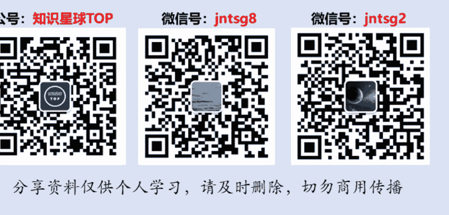

# 超级个体 IP 需具备的10 个能力（2.5 万字总结）

250514 生财精华

大家好，我是蓝蓝。6年来，我从职场做副业，辞职后做自由职业者，升级到超级个体，最后成为公司。这一路走来，生财一直陪伴着我，我现在的业务也越来越稳定，开始慢慢的一边旅行一边办公，享受人生。

我知道生财很多小伙伴都有个辞职创业的梦，或者想当个自由职业者，但是很多人其实不知道我上面说的那4个身份到底有啥不同。

今天给大家分享一些思路，把我这一路走来慢慢积累的10个赚钱能力和大家聊聊，当然这也是做IP所必须具备的能力。

10个赚钱能力：知识管理、时间管理、学习能力、沟通能力、决策能力、执行能力、产品能力、复盘能力、迁移能力、屏障能力。

## 一、知识管理

作为一个超级个体，你需要应对很多之前不需要去解决的问题。比如你之前在职场里是一位销售人员，你只需要去解决销售线索的获取、卖点的总结，和用户沟通推荐产品的术术，这三个问题就可以。

由于这个产品的营销素材应该怎么做？产品怎么去做市场推广？产品体系应该怎么去设置？这些不需要你来管，你在组织里面只需要专注自己的事情，处理好自己的事情好了。

但是当你一路走来成为一个超级个体之后，你会发现所有和营销相关的问题，你都需要自己去解决。

比如你要解决制作产品的问题，那怎样才能制作产品呢？你得找到用户的痛点，这就得做市场调研。找到了用户的痛点之后，你还得把这些痛点进行归总结一套课程的大纲，有了课程的提纲之后，你还要填充每一节的内容，那每节内容就包含了方法论+案例数据+流程步骤。

如果你想完成和营销相关的动作，你必须具备一种能力：知识管理。

什么是知识管理？这里有3个核心要素，并且给大家列出来：

1. 什么是用的知识？

有人提到知识管理，首先想到的场景就是，我把收集到的一些课程放到不同的文件夹里面，摆放整齐放在那里，然后如果时候想随时随取，就不叫知识管理，最多叫做资料收集，他只是知识管理中的一部分，但绝对不是最重要的那部分。

我们在做知识管理的时候，一定要记住一个核心逻辑，去管理那些对我们现在有用的知识，没有用的就不要管，把它放在那里，不要让它耽误你的时间。

举个例子，比如更新的《100条职业生存指南》专栏，现在卖了5000份，引流了1000多用户过来。在这个专栏更新的过程中，我可能会有几个模块，就像我今天说的，关于一个超级需要掌握的10个技能，10个技能我是怎么总结出来的呢？就是知识管理。

我追溯自己的成就，然后用成就倒退我需要掌握的能力，比如说我有5个8000-10000好友的微信，这些流量是怎么来的？我是通过不断地内容输出，通过不断地引流积累来的。那内容输出就是一个必要的能力，这个能力他适用于所有超级体的所有的场景，就是我们要掌握的。

很多人每天总是整理自己那些文件和资料，他甚至没有去思考这些东西自己未来是否用得上？你比如说这类这个营销技巧已经过时了，你还有必要给他做个分类下来吗？直接删除或者扔掉就了，甚至就放在那里不管它也可以。

在我看来，所谓用的知识，就是可以帮助解决当下的或者未来某一个时期的问题，这些知识才值得你去管理，才值得你为其搭建模型。

2. 有效收集信息

当我们知道了自己需要什么样的知识后，就去找到这样的信息，然后把信息通过实践给它变成知识存储的自己的知识体系。

这就你需要知道如何去收集优质的信息，收集对你有价值的信息。从我的角度来看，一共有两种方法：第一个是直接付费购买，你接触到的信息差，比如说付费买知识星球，比如比说付费买专料，我自己在得到app上卖了几万钱的产品。

第二个就是要善于从一些看似普通的信息里面提炼出有价值的要素，这就就像我在我的知识星球里面做一个栏目，叫做“#案例”拆解，拆解的解是自媒体平台上那些做得好的IP借鉴，其中可以复制到你自己的业务上的爆款因子。

只要能够找到某一类信息中的相同要素，这个就是有价值的，因为你可以快速复制这个要素来实现你想要的目标。

当然，信息收集高手还需要拥有很多能力，比如如何更科学的使用搜索引擎，比如此如何通过指定词和 AI 工具快速获得你想要的答案，甚至是找到关键人物，直接从关键人物那里得到你想要的信息。

3. 新旧知识链接

如果你不能把新的知识和自己旧的知识体系连接在一起，那你这新的知识也没法去使用，或者说没办法快速使用。

我来说说自己是怎么操作的吧，非常简单，我把所有知识全部变成了关键词，然后为这些关键词建立关联。

比如此，在我大脑里流量和产品这俩词进行链接就是“变现”。而产品、价格、渠道和推广又构成了营销，其中渠道我又可以拆分为私域和公域。

每一个关键词和其它关键词之间都有这种联系，当这种联系越来越紧密，你的知识体系就会越来越完整。你要做的就是把知识变成无限组合与拆分的模块，这些模块可以帮助你搭建任何自己想要的模型。

随着你获取的新颖知识越多，你可以搭建的模型种类就越多，能够解决的问题越多。

这里给大家总结一个逻辑，无论问他什么，都能很快给你一个答案。这4个动作分别是：

- 拆解系统 -> 要素
- 得到系统 -> 搭建模型
- 发现系统 -> 组合
- 沉淀系统 -> 优化

最终成功之后，它就变成了一个模型。

## 二、时间管理

当你辞职之后成为自由职业者之后，成为超级个体之后，你的时间就比之前充裕，这是一个错觉。当一个人不受约束的时候，他的时间利用率就会下降。

早上5:30到6:00起床，也没有特别早，保证自己的睡眠时间。起床之后在7:00之前，能有半小时的时间给自己发挥，我通常会利用这段时间来运动、读书、写作，完成今天的课程。这里给大家一个小建议，其实不用每天坚持某一件事情，这种循环，适当的让自己去放纵一下，有助于调整自己的心态和身体。

以上是我作为一个自由职业者一天的行为路径：

- 06:00 - 07:00：起床、早餐、运动、读书、写作、完成今日课程。
- 07:00 - 08:00：督促孩子起床、吃早餐、送他们上学。
- 09:30 - 10:00：到达咖啡厅，开始上午两个小时的工作。
- 10:00 - 12:00：回复新媒体会员以及合伙人的信息、给他们一些参考、更新我的知识星球专栏这类事情。
- 12:00 之后：按时去吃饭。我通常出门选择那种综合性的shoppingmall，里面会有餐饮、健身、咖啡厅等一系列设施。
- 13:00 - 14:00：吃完饭，不会选择回到咖啡店里工作，而是在商场里面逛一下，大约一个小时。
- 14:00 - 15:00：要不我就去找一个做spa的地方睡个午觉按摩一下，要不去找一个超级星球或者健身中心这种地方运动。每天保持一定量的有氧运动，可以让我的精神更好，脑部足够的血液循环，这样你在做决策的时候也会更高效。
- 16:00 - 18:00：回到咖啡厅工作，这两个小时的时间进行创作，比如去规划自己的新课程，去整理一些自己之前记录的笔记，把他们通过文章的形式输出到平台上面。
- 18:00 左右：回家吃饭，陪孩子学习或练钢琴之类。
- 20:00 - 22:30：孩子去看动画片或者娱乐，我也可以稍微工作一会儿。我在晚上不会给自己强度太大的工作，通常都是发发朋友圈，固定回自己的微信好友，挖掘他们新的需求。
- 22:30 左右：放下电子产品，洗漱，然后上床看看书就睡了。我自己属于到了22:30 到23:00 时候就已经困的受不了了。

对于时间管理这件事，一个自由职业者要想明白一个逻辑，就是无论你给自己制定了任何原则，这个原则本身不重要，重要的是你要有原则。原则是干嘛用的？其实是帮助与节省自己的决策成本。当你有了一个原则之后，遇到了那些事情，你就按照原则来。

这里衍生出一个概念，叫做周期：

- 识别周期
- 收入周期
- 精力周期
- 低谷周期（此处应为低谷）
- 焦虑周期

如果你担心和焦虑过了这个周期，就会陷入恶性循环。

## 三、学习能力

生财的小伙伴都能感觉到，学习能力强的人，总是能找到好项目并快速熟悉这个玩法并通过实践完成闭环，学习能力决定他后续第一桶金的速度。

为什么很多自由职业者学习总是没有结果？因为还在用学生时代的那一套方法。这里出现了两个词：唯一答案、系统学习方式。在学校的时候，检验学习效率的方法就是考试，看你学习态度怎么样，有没有认真学习。成年之后，任何事情其实都没有唯一的标准答案，你需要自己根据当前的情况来衡量，找到一个相对来说合适的方案。所以自由职业者的学习方向并不是用来检验你一个答案，而是你需要找到当前阶段自己最优的解决方案，然后在这个解决方案之上寻找自己的学习方式。

我自己当初就是这样。2017年刚刚辞职的时候，知识付费行业快速兴起，我观察了一圈发现做起来的KOL都是通过付费社群变现，这些付费群有70%以上分享的是关于互联网产品经理和运营这两个岗位需要基本能力的相关知识点和课程。我就快速拉群，通过学习用户运营、活动运营这三大模块的相关知识，就把会员群的第一批用户拿到手了，现在也已经是1000人社群了。这就需要你快速判断自己当前处于哪个阶段，自己当前最需要的是什么。

再来看第二个，你要抛弃学生时代那种框架、系统式的学习方法。举个例子，如果你现在想通过教别人手机摄影来赚钱，那请问你应该怎么学习手机摄影呢？大多数人可能会说我买一本摄影基础厚厚的一本，从头开始详细地学，打好基础未来学习速度就会加快。如果你这么学的话，我可以负责的告诉你你不过两个星期甚至一个时期，可能就把这事给放弃了。因为系统式学习方法最大的问题在于前期非常的枯燥，你需要记住各种概念、术语。如果是学生时代有老师监督每天上课这种场景，这种方法可能没问题。但是现在我们都是自由职业者，哪有时间去这么系统地学习知识？你又怎么有这种耐心坚持这么长时间呢？

这里就要引入一个学习概念，叫自然学习法。你想学习手机摄影，那我建议你先给自己设置一个场景的挑战。比如你去寻找用户关注的那几个手机摄影重点：很多人给自己女朋友拍照图片都不好看（包括我家王先生给我拍照片也是这个样子），只要在画面里就行了，才不管这个人的腿长不长，后面背景清不清晰。

（注：后续文本存在重复及断码，已根据语义逻辑合并理顺）

怎么办呢？那时立刻去给对方提供你的方案，你不能准备一个方案，你要准备好几个不同的可以从各种维度去让他接受你产品的方案来跟他沟通。

就像我向用户推荐我的知识星球的时候，那对方说“我先看看，看过这段时间，如果有需求就会找你来购买。”

如果是你聊到这一步，你会怎么说？你可能会说：“那好的，如果有需求随时来找我沟通，来找我咨询。”

你这样就把天聊没了，在你的思维里面把沟通变成了一个有限游戏，其实是可以变成无限游戏的。

那你可以说：“好的：您现在是在做什么工作呢？我正好有一个针对于某某行业的资料包，我整理了三个月，很多会员小伙伴都说很有价值，你要不要看看？”

这相当于什么？等于是重新开启了一个话题，然后等着对方回答，而且这个话题面所包含的信息量还非常高，就是高到对方他不可能不接收的那种步。

你想想，用三个月整理一份资料包然后还收到了很多会员的认可，那对方心里会想：“这个东西免费给我的，我一定得看看。”

这个时候他就会回答你提出的问题，那只要他说了自己的行业，自己所在的领域，这个时候你怎么办呢？你就可以说：“我们会会员或者我的学员里面也有一个跟您从事的是相同的行业状况，现在他已经有了什么什么样的成就，然后您要不要过来学习？正好他还在我的会员群里面做了复盘。”

你看，又向他推荐了一遍你的会员，只是用了一个不同的维度和不同的方法而已。

那如果他又拒绝了，这个时候你就可以把这个资料包给他，然后跟他说：“这个资料里面分门别类的设置了各种各样的文件，如果您对于什么什么感兴趣，最好先学习这个。”

那对方可能就会说“谢谢”，这个时候你就可以说：“其实像您这种情况，我特别建议应该先去做些事情。”

你看着又了一个新话题，自然我是说的这些我自己的一些实际案例操作，大家在和自己的用户沟通的时候还是要根据当前的一个场景，还有对方跟你说话的语气啊、态度啊，去判断怎么回应。

但是这个逻辑是不变的，一定要准备不同的方案，然后用不同的维度去跟对方聊，每一个新话题就会有一番对话，每一段对话，其实都是和用户情，都是在深度的了解对方的需求，然后调整你自己的话术方案。

## 3、给到对方最小执行路径

我跟大家分享了关于如何通过扶平双方的信息或者投其所好，把自己的各种方案传递给对方。

那如果对方已经慢慢地接受了你的这个理念，或者说你传递他的核心价值，这个时候应该怎么助攻？快速成交或者达成自己想要的结果呢？

那就是给到用户一个特别好执行的路径，比如如果用户已经准备买我的星球会员了，那个时候我会给他发一个星球新用户的学习方法。

那里有5个步骤，我还做了一张手绘，里面是一片森林，用户进入就是一个探险家，第一步是发现伙伴，第二步是寻找资源，第三步是开拓眼界，第四步是密林探索，由于图片比较长而带了二维这里就不放了。

其实就是为了让用户快速识别我加入那个星球之后，应该怎么去学习怎么利用好这个星球来实现我的目的。

有了这张图之后，那用户看一看：“哦，原来我加入星球之后，可以这样这样去学习”，那用户觉得自己的执行成本更低更清晰了，他就会加速付费的速度。

当然，这个方法不仅仅仅可以帮助咱们自由职业者更好地挣钱，更好地跟别人沟通和合作，还可以在你的职场生涯中帮助您更高效的解决问题。

比如你是产品经理，你在跟研发需求的时候是不是得对其颗粒度呢？那怎么对齐呢？提炼了你的需求之后是不是得给对一个今天的行动步骤呢？

比如你可以跟对方交流：“咱们今天讨论的是关于这个新产品落地页应该放在什么地方的问题”，那已经有了一个共识，看着今天在晚上 6:00 之前不能把这张产品落地页的第一部分做做好，然后我们来测试一下或者给老板一看？”

你看，这样大家聊完之后我就有了行动的指南了吗？就怕一起聊完，然后交流很充分，也很热闹，聊完聊完了，几天之后大家一碰，结果一点进展都没有，那这次沟通就白费了。

好啦，这篇内容写得有点多，但是如果你能够全部看完，并且去尝试的执行，我想一定可以有效提升你的沟通能力。

## 五、决策能力

首先问问朋友一个问题，你觉得决策和决定有什么区别？

很多人都会以为这这两个概念是同一回事，反正就是做选择。在我的认知逻辑里面，决定那种一眼就能看出来的答案，就比说要不要去锻炼身体，这就是一个决定，因为答案很简单，锻炼身体一定会对你的健康有好处。

那什么叫决策呢？那就是今天有一个饭局，好久没见过一个小伙你因为你吃饭而且吃的东西还挺糟糕的，大鱼大肉火锅串，你已经坚持健身一个月了，而且都是健康饮食。问题来了，你你是去还是不去呢？你看着这个就不好选择，没办法做出答案。一方面是好久没见的伙伴，如果你不去肯定就会伤心，有可能他还是特意从很远的地方来看你；另一方面你已经自律了很长时间了，如果今天真的去跟他吃饭了，一顿大鱼大肉，就破坏了你自己的整个计划，说完之后可能会后悔很长时间。

怎么办？这个时候就要看你的决策能力了。

作为一个超级个体，决策能力首先帮助你解决的就是挣钱的问题。

很多人都面临一个问题：到底是做自由职业还是上班？
- 自由职业：每个月拿 6000 元左右
- 上上班：每个月拿 5000 元左右

以上这些都需要消耗大量的脑细胞去做决策。在这个过程中，大家有三个方法：

### 第一方法：尽可能列出选项

当你遇到一个问题时，要尽可能列出你的选项。很多朋友会想：“我现在要做，还是不做？”

你可以这样从不同的维度去思考，比如：
- 选项 A：做自由职业
- 选项 B：继续上班
- 选项 C：暂时不做

但是想法越多，得到的答案就越多，多个答案进行筛选和组合，总能找到最好的办法。

### 第二方法：量化选项

把你的选项量化。选项列出来之后，你还要去分析和对比，找到成本最小、收益最高的那个。

比如我说的案例，小红书和公众号其实都有红利：
- 选项一：做小红书虚拟资料
- 选项二：做小红书带货项目
- 选项三：结合 AI 和公众号做爆款项目

作为一个自由职业者，刚离开职场我要选择哪个项目来养自己？核心能力是什么？
1. 选题
2. 封面制作

无论任何一个自媒体平台，其实你都要琢磨，选题不好，哪个平台也做好。但是封面就不一样了，做公众号是不需要费心思磨封面的。所以你自己对于图片制作这个能力是否有研究，或者自己之前的工作有没有涉及这块？如你不擅长做图，那可能你的小红书就做不好。我非常擅长文字输出，所以我喜欢写知乎，小红书做得不是很好，但是知乎的长内容输出依然可以给我带来精准和稳定的流量，我一样可以做转化变现。

你看这个就是分析成本，把选项列出来之后，你要看哪些选项是你现在成本最小的，或者是你最擅长的，然后选择那个。你在比较成本的时候，还要把机会考虑进去。比如如果一件事你不做，那块出来的时间去去做的话会不会给你更多的好处呢？比如说选择去吃了一顿大餐会花 500 元，如果省下来去报名一个 AI 学习班，那未来我获得的收益是不是比吃完那顿大餐的那个爽感得多？千万不要把机会成本这个维度忘掉，会让你错失很多机会。因为一个人当你做一事情的时候，必然就没有时间去做另一件事，那你做这件事情的成本可能就提高了。

### 第三个方法：快速决策

当你已经比较出这些选项的优劣势之后，就要立刻做出决策。在决策这件事上是没有灰色地带的，要不做，要就不不做。如果你一直在犹豫做还是不做，同样消耗你的大量精力和时间，而且让你很焦虑。

好多会员一年前就问我当前情况，要不要离职自己创业？跟我聊完之后又自己分析了一通，后来就没信儿了。一年之后，他们又来问了我，这回又带来了新的选项，可是他们依然没有辞职，或者说依然没有安心地下去。你看，这一年的时间，他在犹豫要不要辞职。

总结一下，决策能力要求你有更强的思考方式（横竖轴）来进行思考。想法越多，得到的答案就越多，多个答案进行筛选和组合。

## 六、执行能力

执行能力是一句话：不要执行。

大家有三个方法：

### 一、什么叫行动？

提高执行力，第一步就是搞明白到底什么叫行动。有人会说：“还不简单吗？就是动起来。”但重点是很多人根本没有搞清楚什么样的动作是可以执行的，才是让你立刻行动。我说一个场景，大家应该熟悉，就是你今天想点事情，比如写一篇文章，然后来到办公桌面前，打开电脑，打开备忘录，接下来就卡住了。为什么卡住了？因为你的行动指令不对。

对我来说，写一篇文章就是一个最小的行动指令。脑子里有很多选题，可以随时根据我的需要提取这些选题加上案例，还有我的想法，快速合成一篇文章。像这篇文字的文章，我是说是30 分钟内搞定的。你们不信？其实不是写出来的，是组合出来的，都是独立的。只需要在脑子里有一个“要写出一篇关于超级个体的文字”这个想法后，调用的我的内容进行组合就可以了。这个组合快速搞定的，其实都没有到30 分钟。只要我的行动指令清晰有逻辑，我就能通过关键词调用的我的个人本地库来进行内容组合。

### 二、目标拆解

清楚了什么叫真正的行动之后，接下来的问题就是要学会拆解，把一个当前没办法行动的指令把它拆成可以行动的指令。就拿我刚才举的例子来说，写一篇文章，你就知道它能拆成多少个具体的动作：
- 找选题
- 列题
- 填充案例
- 写开头
- 写结尾

这些都是一个更小的行动指令。具体要拆解到哪一步，这是你自己的能力了。但无论怎样，你都要学会把它拆解成多个适合你的行动指令。什么叫做适合你？比如你说你不擅长或者说不喜欢看书文章之类的，那你再拆解的时候就需要不是通过阅读去找选题，而是通过视频或者找一个行业高手聊一遍这种动作来完成你想要的目标。

对于我来说，就像我要完成这篇文章，我会怎么拆解呢？我会用 AI 去搜索我过去一年用的较多的关键词是什么，然后通过提炼关键词的方法找到过去针对这些关键词的文章，再把文章用 Kimi 进行排列组合，确保相同的话题都指向同一个关键词，这样10 个能力关键词就出来了，接着再用 WPS 进行排版之类的一系列操作。

### 三、行动成本

如果你已经进行了目标拆解，并确定拆解完之后的最小动作是可以立刻执行的，接下来你还要考虑一件事：行动的成本是多少？你的成本能够覆盖最后的收益？举一个简单的例子，有的人为了搭建自己的素材库，花了长时间学习如何使用 Notion 等应用，结果最后没有赚钱。

所以，不要浪费时间去研究工具，不如去研究工具的使用方法。

## 七、产品能力

产品能力是否稳定，看他的产品能力。没有产品，没办法跟别人交换价值。对于刚开始做职业者来说，如何做出自己的产品？按照这个模型：

### 第一阶段：出卖时间（0-1）

这个过程是最痛苦的，从没有产品你需要付出很大的精力和思考。如果你辞职之后发现自己没有专业技能，也没有人脉资源，这个时候要怎么做产品？答案就是：出卖自己的时间。

首先你没有任何专业技能和资源，前提下辞职是非常不明智的选择。第一步：先找到一个愿意购买知识产品的用户群体。这一步特别重要。他们根本没有付费意识，或者说本身能力就不强，那就算你做得好也没有买。一定要去那些有钱的人，大家现在想通过小红书和视频号来赚钱，你就为他们提供时间价值。他们的时间放在做内容、引流和转化，所以他们没有时间去做引流素材或者封面模板。

你可以像我一样，去花时间在小红书上搜索各种账号引流素材，然后给他们汇总在一起销售，或者是罗列100款小红书封面，然后再把他们做成 PPT 模板，定一个低的价格。再来说我的自由职业者专栏是 19 元，拿这个去销售，这些有钱的人一定会买，因为他们会算成本和收益。19 元买一份资料或对标模板，他们自己用的时候，只要交一个客户就一定能回成本。

在这个阶段，重点就是消耗自己的时间价值，为那些赚取更高价值的人提供原始资料。现在虚拟资料+小红书+AI 有新玩法，快速提升变现效率，用 AI 来做封面和虚拟素材更快了，你也能碰爆发。

### 第二阶段：陪伴用户成长

到了第二阶段，你通过为用户提供时间价值以及销售这些小的虚拟资料素材积累了一批用户也积累了一些资金，这时候你就可以把自己的成果进行复盘。可以说你可以写篇文章：“辞职之后，从0到1赚到3块钱，我是怎么做到的？”这篇文章有什么用处呢？就是让大家能够看到，之前大家都把你当成一个工具来使用，并没有真正感受到你的价值。写完这篇文章之后，把你自己在这个过程中的思考和操作分享出来，你一定会吸引一些和你同频的人，比如你是刚刚辞职但还没有找到一个挣钱方法的人。

这时候你就从一个工具过渡到了一个同伴者的姿态，你可以出一个自己的新产品，就是一个付费社群，陪伴你处于同一个阶段的人一起努力、一起进步、一起赚钱。具体的操作方式就是罗列好这个社群的权益，比如你可以把自己收集的这些资料进行类别的整理，然后拿给这个社群的小伙伴自由使用，你还可以教他们如何把这个资料卖出去。这样的话他们就等于你的第一个渠道销，他们拿的资料用你的方法赚到钱，你还可以用这个成功案例吸引更多的用户购买你的付费社群。

在这个阶段，你陪伴用户自己之前积累的资源，然后和自己的方法赚到钱，这就不在销售自己的单位价值了，因为你之前的资源和方法变成了一个固定成本，边际成本变

了，你已经把自己的资源和一些技能封装成了一个标准产品。

### 第三阶段：提炼核心技能

那到了第三阶段，等你已经帮助了很多像你一样的小伙伴赚了钱，积累了很多成功案例之后，这时候如果你想再次拔高一个自己的收入等级，你要做一个非常重要的事情，就是给自己建立一个知识模型，或者说垂直技能模型。

比如说我初期通过付费社群里分享我的学习笔记，把社群的人数扩展到1000人之后，就开始通过一些朋友圈营销方法来销售自己的社群，在这个过程中积累了一套朋友圈营销的技巧，然后我提炼出了一个朋友圈营销“4有模型”，即有用、有趣、友情和有钱。

然后又做了一套朋友圈营销课程，那我那时候的定位就变成了一个擅长用朋友圈营销方法销售知识付费的人。

你看，到了这个阶段，你就已经从一个陪伴者变成了一个某个领域有一些话语的导师，你的个人IP已经出来了。

接着你的产品就可以变成产品体系，比如我在做出了自己的第一套朋友圈营销课程之后，就开始了其他的课程创作，比如课程方法论，比如此数字营销引流课，比如裂变营销引流课等等。这些产品和我社群相结合，变成了我自己的一套产品体系，在这一套产品体系之下，我又升级出了合伙人等玩法。

所有的都是从第一个阶段开始做的，我第一个阶段做的就是一个叫做“拆解”的事情，我的老会员都懂的，那个时候只是付费产品刚起，很多人并不知道自己花几百甚至上千买来的课程效果如何？质量如何？那我自己先买回来，然后开始学习，一边学习一边把里面的精华内容做笔记，在付费社群分享给大家，就这样积累了大量的学习笔记内容素材，很多人就是这样被我吸引到社群里的。

以上就是我自己作为一个自由职业者，从零开始到现在的完整产品升级迭代经历，希望能够给大家一些启发。

当然，如果你一开始已经具备了某种专业技能，比如说你之前在单位里面就是负责新媒体账号营销的一些工作，特别擅长公众号或者朋友圈社群的一些营销运营工作，那我就建议你可以直接过渡到第三个阶段。

自己的专业技能快速变成一套标准产品，用这个标准产品配合一个比较低的价格，迅速积累第一批用户，有了第一批用户的成交案例之后，你再去进行复盘，让这个圈子里的人知道你擅长什么，以及你通过自己的专业技能获得了哪些销售绩效。

之后就可以直接过渡到产品体系升级这个阶段，利用低转高的方法，把购买你低价产品的用户升级到高价产品，提高自己的收入水平。

关于产品制作能力这块，大家还可以提到我前几天写的一篇精华文章，是关于如何把有效信息产品化的逻辑一样，都是在不同的阶段用不同的策略快速制造自己的产品。

现在有了AI这个过程更丝滑。对了，生财的伙伴一定要注意，千万不要陷入到“每天去研究AI工具使用”的场景里，炫技是没有的，是不赚钱的，是浪费时间的，AI必须要有使用场景才值得去研究。

就像我们最近做的的一个网站，用关键词直接图，很多人觉得是AI制图片，其实不是，仍然是HTML5可以直接生成高清卡片，生成自我介绍卡片，生成小红书封面卡片，用不用AI其实无所谓，重要的是，这些功能必须是真实场景下的真实需求才行。

## 复盘能力

在这个专栏之前的推文里大家分享过，一个优秀的自由职业者至少需要具备10个基础能力，其中一个就是，你要学会复盘，甚至把复盘当成自己的一个工作习惯。无论是简单的每天睡觉前把这一天的事情过一遍，还是真的拿出自己的复盘工具，一项一项地去罗列和分析，复盘都可以帮助你找到自己的人生突破。

### 一、复盘的意义是什么

我相信，大家从学校毕业后参加工作了，或者自己创业了，一定立下了很多flag，但这些flag80%应该都没有实现，我自己也一样，你们看到我每天的输出、每天坚持做的事情，都是少数坚持下来的，大部分还是放弃了。

但是，我不觉得那些放弃的flag毫无意义，除非你不复盘。因为当你在复盘的时候，你至少能找到自己放弃的原因，即使是多次放弃，你也能从中看到自己某项能力的缺失或者某种思维的缺失。

找到了这个缺失，就是你的收获，就是你的增量，好像你做了一次人生实验，虽然很多都失败了，但至少下次不会让这个失败的原因误误你。

以上我说的就是复盘的意义，只要你能明白这层含义，未来至少能获得一个自己的成长路径，慢一点无所谓，只要清晰就行。

### 二、复盘什么呢？

上面我跟大家说了复盘的意义是什么，在复盘的时候，应该从哪几个维度去操作、去思考呢？

你想去看各种教程的话，维度就可以多了，但我不想给大家这些能够从互联网上找到的东西，我只想和你聊聊我已经在复盘什么。不会超过3个维度，分别是营销、健康和关系。

**关于营销：**人想生存就必须赚钱，赚钱就是卖东西，无论的是自己的时间，还是自己的产品。在复盘的时候，就要围绕着卖产品开展思考，比如：
- 最近1个月月入情况怎么样？
- 今年我做了哪些产品？
- 这半年来学习了哪些新的技能？
- 我最近的信息获取渠道是什么？
- 我最近去参加什么新的技能学习了吗？
- 有哪些用户给了你正向的反馈？
- 有哪些用户给了你不好的反馈？
- 最近1个月的阅读量如何？

以上都是和你营销相关的问题，其实主要要围绕着自己的卖东西的结果，以及你去卖东西的方法。

**关注健康：**
- 最近的睡眠情况如何？
- 一个月平均睡眠时间是几点？
- 后第二天对你的影响是什么？
- 今年有坚持过长时间有氧运动？
- 最近3个月身体上有没有小毛病？
- 针对身体上的小毛病你是如何应对的？
- 你今年都吃了哪些营养补剂？效果如何？
- 你今年去了多少次医院？
- 炎症的次数有多少？（慢性炎症是需要注意的）
- 你的每日三餐以什么为主？
- 为什么最近的体重变化较大？

以上就是跟你健康相关的问题。健康三大要素：睡眠、饮食和运动，从这三个要素拓展思考，再结合一年季节身体给你的反馈。

这里要大家分享一个我自己的心得：在当下这个季节的放纵，你的身体会在下个季节反馈给你。比如，当你夏季狂吃冰水+吹空调的时候，夏天没啥感觉，还是挺爽的，但是到了冬天就开始有一些反馈了。运动也是这样，冬天狂肉，春天没啥感觉，夏天你就看看吧。

**关于关系：**
- 最近的家人关系如何？
- 最近和孩子的关系如何？
- 为什么孩子越来越不听话？
- 为什么你总是跟爱人吵架？
- 最近和客户的关系如何？
- 最近和朋友的关系如何？
- 你的用户续费率怎么样？

关系分为社交关系和家庭关系，重点是在你关系中的地位如何，以及你一年中有沉淀下来的关系，你的社交边界在哪里，或者说关系过于封闭导致没法产生新的合作。

### 三、怎么利用模型复盘？

复盘肯定要用PDCA模型，这个模型对于普通人来说好理解，流程分为四个步骤：

- **Plan（计划）**：描述最初的计划，包括目标、策略。
- **Do（执行）**：回顾实际执行过程，包括遇到的困难。
- **Check（检查）**：检查结果与计划的偏差。
- **Action（处理）**：根据检查结果采取相应的措施，调整计划或制定新的目标。

具体的执行策略包含：
- 第一个模块：通过小红书公众号引流，然后通过朋友圈转化。
- 第二个模块：通过合伙人提供策略，包括营销素材。
- 第三个模块：通过知识星球写文案，然后通过朋友圈实现转化。

以上就是利用模型复盘，流程不复杂。永远记住，复盘的目的是发现系统中反复出现的问题修复，这样你的系统才能持续运行。

## 九、迁移能力

我在之前的推文里分享过，今天就跟大家一下什么是迁移能力，以及怎么锻炼自己的能力。一定要熟练运用技巧：
1. 搜索
2. 建模
3. 迁移

### 什么是迁移能力？

在我看来，如果一个人能够连续做不同的事情，说明他可以依靠能力掌控系统，这种能力就是迁移能力。在我看来，他至少具备3种能力：
1. **精力管理**：很重要，你得平衡主业之间的关系，还有工作和个人生活以及家庭的关系等等。
2. **写作能力**：在工作上可以帮助你更快的搞定文档，在副业上帮你快速输出文章。
3. **需求识别**：在主业工作上可以帮助你看客户和老板的需求，才能不断迁移。

### 如何迁移？

遇到了新的挑战，是直接去学习某种新能力，还是直接复制之前的做法到新的项目上？我给大家分享自己的三个技巧：

- **自我梳理**：你需要先找到自己可以迁移的能力。比如你之前做小红书，现在要做公众号了，第一步要做什么？是不是直接去学习“公众号写作十节课”？不对，你需要了解规则，得知道小红书和公众号这两个平台之间哪些规则是相同的，哪些是不不同的。比如写标题的规则是相同的，那之前写小红书标题的方法就可以直接迁移到公众号上；比如行业赛道的逻辑不同，小红书的用户偏女性偏年轻，而公众号的用户画像比较杂或者年龄大一点，那你之前选择行业话题的那套逻辑不能用了，需要重新学习。只要你先梳理好自己的技能，就能帮你花更少的时间学习新知识，这样就能提升效率。
- **复制应用**：针对迁移到新事物的能力，不要不停地应用，才能不断适应新场景。举个例子，我自己在迁移能力的时候，会不停地试探每一个平台对我内容结构的接受程度。还记得几天给大家分享了一个公众号标题的写作方法吗？那这个标题写法，我会直接去复制到小红书、知乎、朋友圈、视频号等平台，去测试这些平台是不是可以用这个公式来写，效果如何，在哪里改？这个测试的频率越高，你的迁移速度和准确度就越高。
- **抽象处理**：迁移为同维度迁移和不同维度的迁移。有些人做事速度快还特别招人喜欢，还有的人玩游戏很厉害但是学习成绩也很好，这就说明他有意识或者无意识地已经学会对自己所掌握的能力进行抽象处理。比如有人做事速度快，说明他知道要先清楚做这件事的目标，以及达成这个目标可能需要的几个步骤，然后找到关键步骤把这个先搞定，剩下的简单多了。这就好像有些人总以为学习新技能需要先从概念开始，但其实是从具体的场景开始。

## 十、屏蔽能力

我在成为自由职业者的这些里，可以分为两个阶段：
- **第一个阶段向外求**：不断和别人比，不断被别人的情绪感染，不断被自己的欲望支配。
- **第二个阶段向内求**：探索自己的内心，认真思考自己到底喜欢什么，未来想要的工作和生活方式。

刚开始做自由职业者的小伙伴都很痛苦，痛苦不是不知道做什么，而是知道的太多了，信息量太大了，不知道该做什么。我要看什么？每天到了家里坐在电脑前，脑子里充斥着大量的信息和声音，没办法进入那种流状态。

其实这种感觉很正常，弱者面对强者的时候就会有一种焦虑感。屏蔽能力非常重要，主要分为三个维度：

- **屏蔽信息**：世界上有两种人，一种是想赢，目光长远；另一种是想赢，总是在无关紧要的事情上盲目追求。不喜欢就不看，就去找喜欢的。
- **屏蔽欲望**：你觉得很多事情可以做但不知道如何入手，原因在于你没有找到自己热爱的事情。对于自己喜欢的事情，是不是可以随时开始？就像我喜欢跳舞，听到任何歌曲都可以跟着旋律跳起来；我喜欢写作，在任何环节里都可以随时写作，甚至是刚刚参加聚会晚宴，刚刚经历过很high的聚会，我可以很快切换到一个写作的状态，从观点、案例、流程和总结四个模块进入状态。如果你不知道该做什么，你才就不会专注。
- **学会取舍**：人之所以会痛苦，本质是不知取舍。好像很多刚做自由职业者的会员问我：“芷蓝姐，我觉得我都会一点，可是不知道该选择哪一个好点。”这就是既要也要，总舍不得放弃东西，就不可能获得更多的东西。一个手机里面70%的软件，你下载后根本就不会打卡，但你还是要留着它，觉得它一定会用，不用就浪费这个软件上的功能了；你的百度网里永远充着一大堆资料，哪怕是一吃灰也不舍得删除，还会不断把更多东西加进来。这就是没办法屏蔽生活和工作中的欲望，不舍得放弃，最后自己被东西牵走精力，反而影响真正价值的事情。我的做法是：我要索取某些东西的时候，一定确保这个东西拿来现在就可以使用，用得上才行。这就是屏蔽欲望，让自己有效的精力放在更重要的事情上。

总之，世界不会因为你而改变，每天的信息量就是爆炸式增长，这是事实。但怎么让自己在这个复杂和嘈杂的世界中生存下来，就要看你的屏障强不强。我也给刚加入的小伙伴三个小建议：

- **第一个建议**：如果你是从身边某个朋友加入的，就可以多问他，他一定比你有经验。比如我在生财5年了，如果你问我怎么用生财，尤其是如何利用生财的信息、人脉、项目来赚钱，我在生财这5年里赚到了一套方法。
- **第二个建议**：你要把生财里的帖子刷起来，多看别人的思考。刷帖子不代表你看了，都要实操。
- **第三个建议**：一定要多搜索，要建立一个多维度的搜索意识。你在生财里看到一个帖子里提到的项目，通过它的关键词标签拿出来继续搜索，这会找到更多和这个项目相关的帖子。

# 大家可以利用查找的搜索功能查看我过往的精华文章。

评论区：
东山老师：太牛了n
花芳：先看后[哗呆]
咕咕嘟：谢谢蓝姐的分享，引发太大了[爱心]
段公子：好棒，对我未来的自由职业之路很有帮助，看完您的帖子深深感悟到优秀是一种能力，而这种能力可以是融会贯通的，也是说出来的能力。希望我以后我也可以写一篇这样的帖子，分享自己的经验[笑]
蓝蓝：加油，注意要认识到系统这个东西n
小熊：思维导图 IP*:太闲了
小欢：逐字看完了蓝姐的文章，感觉打通了督二脉，蓝姐太强啦！！n
蓝蓝：哈哈，小欢来啦

| 免费 | 价值 | 及时 | 专注 |
| :--- | :--- | :--- | :--- |
| 扫码加入 知识星球TOP 免费资源群 | 每日免费获取价值资源各类资源搜索服务 | | |
| ◆热门付费文章 | ◆各行业务报告 | | |
| ◆精选图书资源 | ◆副业赚钱方法 | | |
| ◆职场实用资源 | ◆AI财经自媒体 | | |

加微信jntsg2，进资料免费群