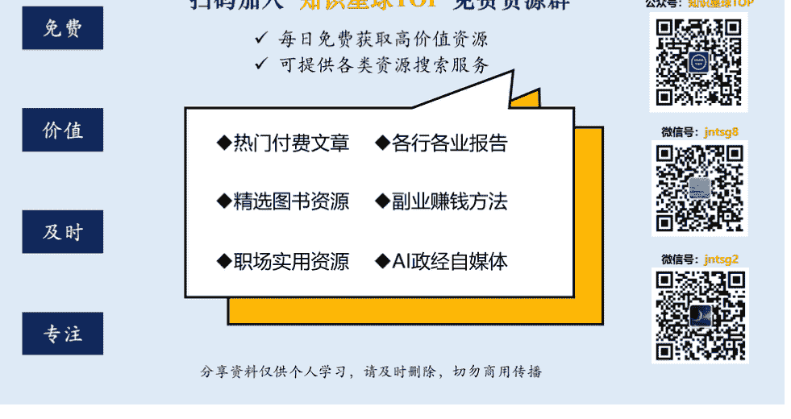
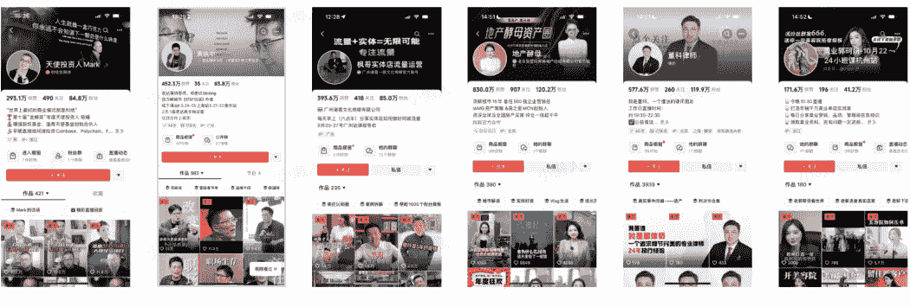
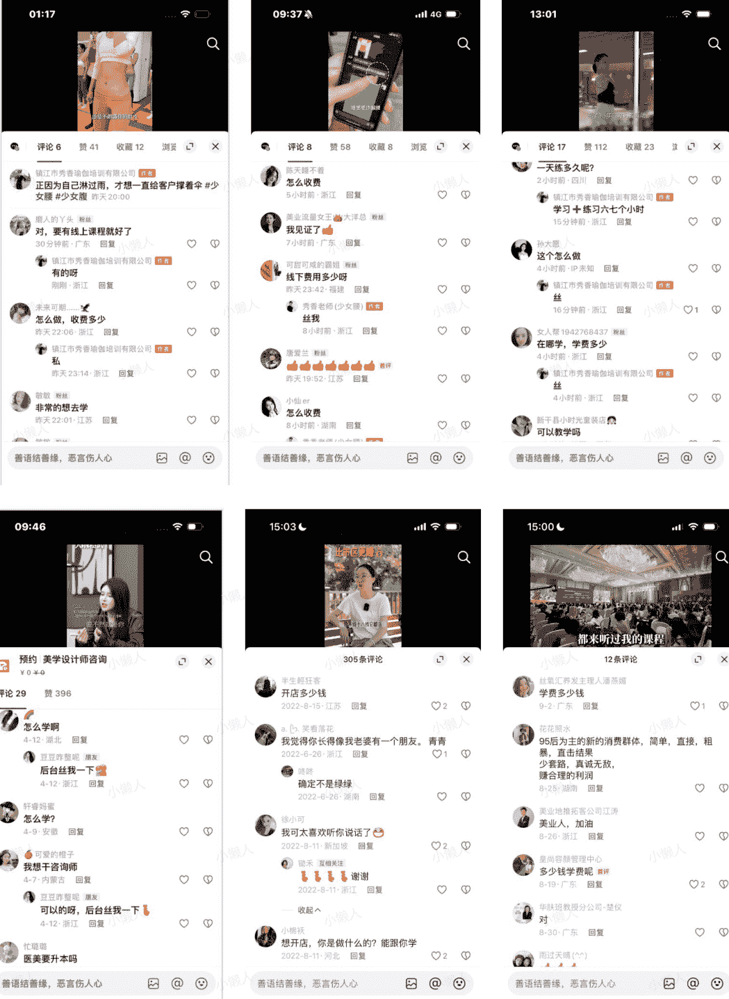

# 《黄金选手做流量，钻石选手做线索，每月自然流5000+线索获客打法分享
250515 生财精华

今天主要是来跟大家分享下，关于线索类业务如何在平台获客的一些方法和心得。

## 我是经纬

经纬，抖音同名“经纬”。目前是抖音商业板块的一名垂类博主，主要要做获客IP的流量业务。之前之前在MCN做过业务负责人，也做过代运营，现在公司自营6千千万的项目，加上我的培训盘就是7个。

虽然这个业务现在人人都在做，但我们确实能力还可以，算是在抖音自己的细分赛道活得还行吧，接了一些比较知名的case：天使投资人Mark、实体同城哥、地产薛雪母、美业郭妍、黄执中、锦锐...都算挺有名的IP了，主要帮他们做短视频或者直播的流量服务。

如果你做音量并且了解过我，应该听过的我的外号「头部收割机」，是业内少有的能让流量很高的头部博主为我们付付费流量的团队，这并不是一个轻松达成的成就，人家自己能做到上百万还愿意掏钱找我们做流量，你就知道我们的含金量了。

单说业务能力，业内能让我服的人不多。

- 如果是一个知识付费玩家，特别是千元高客单品，请一定要重视线索型短视频。
- 如果是一个电商卖家，特别是大健康、美业、母婴等复购高的行业，一定要重视线索型短视频。
- 如果是一个同城获客的玩家，例如：家装、美业、培、升学、房产，请一定重视线索型短视频。

这些赛道，单条视频也许就能帮你拿到10-50个甚至更多的精准线索。或许你们可以花点儿时间，把这个文档看完。

高客赛道，线索型视频是你必须掌握的流量打法，没有之一。

## 为什么要做线索短视频

答案很简单，因为你只能这么变现。我给你梳理一下，短视频能变现无非两种方法：

### 第一种：直播带货

你看抖音、猴哥说车、刘播宏、白冰他们都是这类类，他们只需要涨粉再涨粉就可以。

一方面可以在短视频里置入广告，像汽车、国际大牌、美妆护肤，收一广告费；另一方面他们可以在直播卖一些低客单的日用用品，这些产品是不挑用户的，基本什么样的人都可以购买。

所以这些网红现在的逻辑就是：涨粉，然后卖低客单刚需产品。

### 第二种：线索短视频获客

像知识付费高客单、招商加盟、留学、移民、地产、家装...这些行业，客单价都是千万起步甚至万元步，而且行业非常垂直，你跟我讲你如何在直播间把你的产品卖出去，你的产品又贵又非标，只能放在私域里成交。

还有一些做高复购的电商行业，比如做大健康的、做母婴的、做海鲜做艺术的，你们复购率这么高，为什么一定要在公域卷流量？把流量放在私域里，自己定价，自己设置退款条件，然后用用户的复购养十年，不香吗？

所以这些行业，注定了要走的路线不常规，你们不应该关注怎么做流量，怎么把短视频播放量做大，而是要把目的设置成：每条视频能不能给我带来几十条精准客资。

我很多外面你见到的刚入新手不太一样，过去的时间，我们一直在做“头部”的生意，我喊过一句口号，全网几乎所有团队都在做小白的生意，割不割我们不谈；但只有我们团队能接头部IP的案子，帮他们做流量。

这个生意有什么特点，就是一定要客户的结果为导向，什么播放量、爆款、直播泛流量的提升……这些对那些有成熟产品、只需要提高最终GMV的头部玩家来说根本不在乎，或者说他们已经通过了在虚名的阶段了，他们要的就是实实在在金额产出。

所以一直以来，我们团队对于“短视频”的唯一标准就是：线索。

『注意哦，这都是千元，甚至万元单价产品的线索，非常值钱』

## 线索型视频怎么做

### 一、不是播放量越大越好，而是人群越优质越好

哪怕播放量低点儿，也是人群越优质越好。

我听过的思维误区就是：我都没流量，怎么会有线索。好，关于这个节点我好好解释解释：

你是做装修的，如果你有条视频50万播放量，但是刷到你的人就是个新婚夫妻，会有线索吗？不会。因为新婚夫妻可能现在只是在考虑阶段，距离他们真的掏钱找装修公司，时间太久了，久到真装修的时候已经把你忘了，看似你有播放量，其实这50万播放量里几乎没有准客户。

但是如果你有条视频就5000播放量，刷到你的人正好最近在找装修他们所在小区的装修公司，会有线索吗？会。因为装修的人都知道，每个人都对自家的户型特别在意，都觉得自己的小区物业特别难，所以都希望找一个有同小区经验的人，而且他们因为刷到同小区装修，他们就会追不及待私信问问，能不能去看看那个装修现场。在这5000播放量里，看似没有太高播放量，但是每一个刷视频的人都是非常有意向愿付钱的准客户。

再举个例子：

做AI培训的，如果你有条视频50万播放量，但是刷你的全都是对AI感兴趣的人，会有线索吗？不会。因为绝大部分对AI兴趣的人都是大学生都是年轻人，他们习惯了在网上白嫖各种信息，你就算有50万播放量又如何，这些人根本就不可能付费，也不可能私信你。

但是如果你有条视频5000播放量，刷到的人正好是一个最近在苦恼怎么用AI给自己公司批量制作短视频的人，会有线索吗？会。因为这部分人对AI是真痛点，他们真有需求，有钱。

### 二、流量逻辑

流量的意义在于：播放量高，说明刷到你的人多；但如果他们不是精准客户，播放量高也没用。

我举个例子，我们今年月份操盘的一个项目，做美业加盟的，客单价足够要一万，目标客户全部都是瑜伽店或者美业的老板。这类用户全都是流量才精准。

- 案例A：
- 播放量：50万
- 人群：全是对AI感兴趣的人（大学生、年轻人）
- 结果：没有线索
- 流量：泛流量

- 案例B：
- 播放量：5000
- 人群：最近在苦恼怎么用AI给公司做短视频的人
- 结果：有线索
- 流量：精准

### 三、开头逻辑

不是流量越大越好，是开头越好。比如我们出过三个版本的视频：
- 第一版：我告诉你...
- 第二个版本：明明已经完美了，为什么还要找我？
- 第三个版本：去年我在深圳遇到了...，她知道我做了多少...

答案：第二个版本变现最好。因为第一个版本的开头虽然有流量，但是吸引的都是八卦粉，他们只是好奇；第三个开头也是吸引都是八卦粉。

我们要抓的是这批对流量很高要求的人，这就是对用户的洞察。有价值的线条视频，是非常懂得如何和目标客户对话，每句话都戳用户的心理，给用户强制种草，而不是冲着大流量去做。

### 四、全方位的了解

今天的互联网用户，现在处于超级没钱，超级焦虑的状态，他们的消费非常谨慎。你想去买东西，是不是现在货比三家，但凡超过300块的东西，你恨不得开个家庭会议讨论下要不要。

你拍的视频有干货价值，他们就会买单；他连你是谁，你能解决什么问题都不知道。试想一个真实的用户他是怎么通过互联网短视频账号了解你找你买东西的是不是偶然刷到的视频，然后给你点了个关注，然后经常刷你的视频，知道了你是干嘛、知道了你的身份、知道了你的产品、相信你的产品能解决的问题、相信你的人品、相信你的实力...

我常常在在线上跟同学们讲：关注只是变现的第一步，更重要的是关注之后，能不能让粉丝强化信任你买单。

因此，我们在做选题型视频的时候非常在意的，怎么让那些已经关注我的能够多维度的了解我。我们每条视频里都换着花样介绍自己，不断地强化营销的力量。最简单也是最直接的办法就是“定口”，的就是自己的差异化优势在每条视频里都念一遍。

如此：去年我自己是在抖音做到还不错的收入的，我当时的定位就是专门做IP直播，因为当时短视频培训已经非常卷了，没有任何细分市场我的机会。那凭什么是我呢？我主打的「一个颗粒度很细的男人」这个口号。为什么是这个口号？因为大家学直播普遍的体感就是到处都在教你怎么做数据，怎么提高表现，文案的框架是什么，学了之后根本不管，做的根本不够细，大家想学点非常细致的直播方法。再加上我做出了很多成功的案例，我就自然做到了行业头部。

再比如：今年我们做了一个项目叫「菲臀」，我们的定位就是专门练臀。在做这个业务之前我们发现抖音上一清一色全是大家怎么减脂，怎么瘦身，怎么瑜伽普拉的，就全是健身通类的培训。但是我们想，女性产后康复，女性练臀是一个非常大的赛道，抖音没有，然后我们就胆干，在抖音专门做女性练臀的培训，我们在直播间就经常说...

最后给大家做一些诚意的总结：越是高客单，越是没办法直播的产品，越要做线索型视频。知识付费、留学移民地律师、大健康、私域电商..都是最适合索获客的行业。
