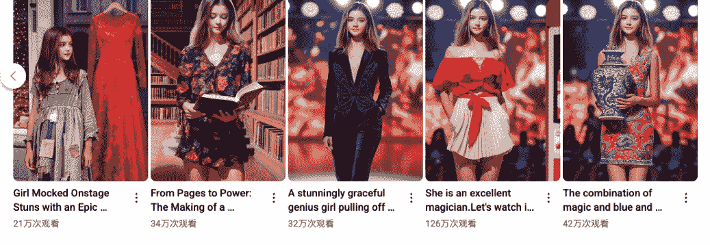
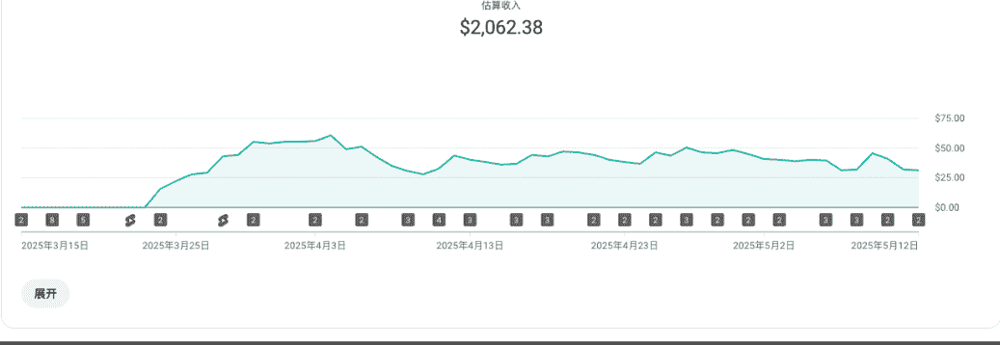
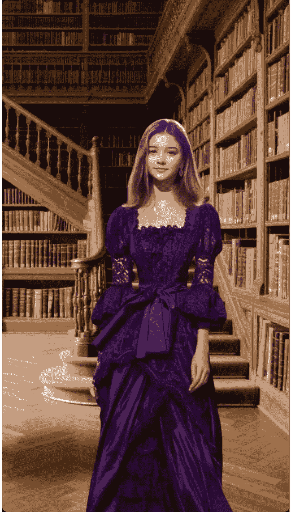
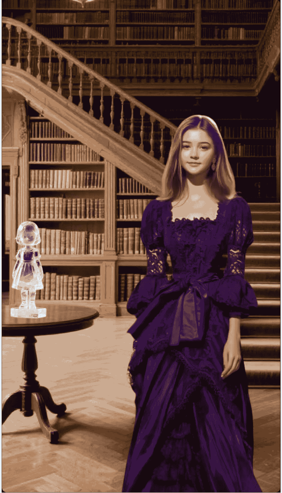
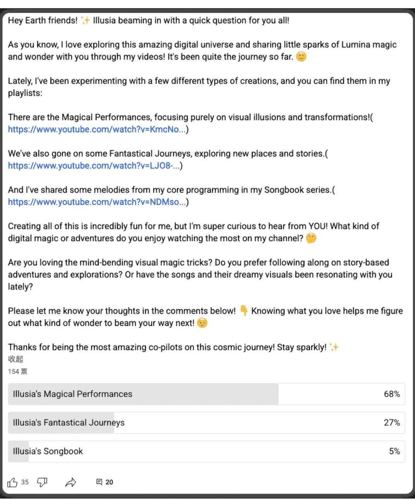

# YouTube 魔法女孩虚拟 IP 赚到第一千美元

# 250519 生财精华


## 背景介绍

大家好，我是围困，目前是 YouTube 生财深海实习训，去年加入生财开始探索副业方向，2 月参加 YouTube shorts 航海，3 月中旬加入 YouTube 深海，5 月晋升为 YouTube 生财深圈实习训。目前大号主要做魔法/魔术女孩（IP 方向），3 月 23 日开通首个 YPP，到 5 月 14 日为止收益 2062 刀。这篇内容主要分享关于魔法女孩视频的制作、数据情况、以及为基础的油管虚拟人物 IP 的探索。

## 微信 | nt sg2，进资料群


## 创造的频道


## Shorts



| 首页 | 视频 | Shorts | 订阅中心 | 更多频道 | “收藏”和“喜欢” | 新建分类标签 |
|---|---|---|---|---|---|---|
| 关注 | 关注频道 | Shorts 订阅中心 | 更多 | 收藏和喜欢 | 新建分类标签 |



我的频道并不是一开始就开始做魔术女孩方向的，但从一开始就一直在做人少女方向。不过前期的结构是“不固定的女孩+特定分方向的变装或变身+20s以内为主主”，有时也会在中间探索一些别的内容，比如返老还童、由胖变瘦等。中间切过几次对标和方向，而且很爱自己瞎创新，所以走了很多弯路。那时候的播放量有一个百万的和一些几十万的，剩下大多都是万播。

3月初刚更换了对标，就是做魔术女孩的方向。发布第三条的时候，数据起量的速度跟之前明显的不一样了，一直到现在，shorts 大多都能达到几十万播放的基础数据量，长视频也会有几千播的基础量。

刚开始魔术女孩的时候，使用的对账号的人脸做的提示词封面，并循环使用过生成的4、5个不同的女孩。之后开始固定使用其中的2个，数据也很稳定，从评论区可以看出，大家都很喜欢她们的长相。

4月初在曹教练的建议下，准备固定一个女孩并尝试往 IP的方向走，并准备制作第一个关于这个女孩的长视频。于是我是两个女孩 shorts 的评论区分析（哪个正面评价更多）选定了其中的一个，并正式开始让她 IP 化之旅。

## 视频数据部分

先简单看这类方向视频的一些基础数据，给大家一些参考。

### shorts

Shorts RPM:

因为有些视频是有一定播放量之后才开了YPP 收益，计算出来的 RPM 会不准，我们可以看到过去28天的，截止到5月10日，过去28界面面上计算的平均值是0.08/千次播放，下面是部分视频的具体RPM。

对比早期的达人秀 RPM，那时候均值在 0.02-0.05，总来说还是可以的。

| 互动观看次数 | 每千次显示收入 (RPM) |
|---|---|
| 2,393,143 29.1% | $0.07 |
| 918,096 11.2% | $0.07 |
| 629,005 7.6% | $0.09 |
| 500,148 6.1% | $0.06 |
| 236,067 2.9% | $0.09 |
| 181,812 2.2% | $0.12 |
| 256,926 3.1% | $0.08 |
| 245,869 3.0% | $0.07 |
| 181,831 2.2% | $0.09 |
| 144,167 1.8% | $0.10 |
| 146,877 1.8% | $0.09 |
| 246,615 3.0% | $0.06 |
| 156,483 1.9% | $0.09 |
| 133,303 1.6% | $0.09 |
| 106,898 1.3% | $0.11 |
| 139,290 1.7% | $0.09 |
| 158,126 1.9% | $0.07 |
| 131,583 1.6% | $0.08 |
| 153,647 1.9% | $0.07 |

### Shorts 地理分布

通常是第一印度、第二美国，后面几个东南亚国家。

| 地理位置 | 观看次数 | 每周时长 | 观看时长(小时) |
|---|---|---|---|
| 合计 | 268,369 | 0:32 | 1,289.9 |
| 印度 | 54,268 | 0:34 | 245.9.1 |
| 美国 | 35,571 | 0:33 | 185.6.4 |
| 菲律宾 | 24,116 | 0:39 | 127.0.9 |
| 印度尼西亚 | 12,714 | 0:37 | 67.0.5 |
| 越南 | 10,920 | 0:41 | 56.2.4 |
| 巴西 | 8,453 | 0:32 | 39.6.1 |
| 泰国 | 6,650 | 0:25 | 33.7.6 |
| 缅甸 | 6,056 | 0:23 | 28.6.2 |
| 巴基斯坦 | 5,957 | 0:22 | 28.0.2 |

对比下，下面这个是较期的达人秀变形类型的。

| 地理位置 | 观看次数 | 每周时长 | 观看时长(小时) |
|---|---|---|---|
| 合计 | 1,200,151 | 0:23 | 7,905.4 |
| 印度 | 718,571 | 0:59 | 424.9.55.0 |
| 印度尼西亚 | 58,859 | 0:43 | 291.2.6.2 |
| 加孟 | 48,361 | 0:40 | 285.9.3.6 |
| 巴基斯坦 | 41,560 | 0:35 | 246.4.3.1 |
| 哥伦比亚流量 | 34,875 | 0:29 | 209.0.2.6 |
| 越南 | 19,574 | 0:36 | 166.0.2.1 |
| 泰国 | 16,322 | 0:34 | 126.9.1.5 |
| 德国 | 14,066 | 0:32 | 129.2.1.6 |
| 美国 | 12,340 | 0:32 | 112.6.1.4 |
| 伊拉克 | 12,165 | 0:32 | 109.4.1.4 |

### 长视频

长视频 RPM:
我从4月初尝试长视频，已发布的视频时长大多在1分钟以内，最长的是2分钟多的，RPM 在 1~2+不等。截止到5月10日，过去28天频道长视频的 RPM 平均值是1.58，下面是具体的展示。

有一些50多秒的视频 RPM 也可以得到2+，但是播放量最高的视频后期被印度占了，所以把整体的值拉下去了。

| | | |
|---|---|---|
| 96,406 | 39.9% | $0.96 |
| 25,571 | 10.6% | $2.45 |
| 15,175 | 6.3% | $2.52 |
| 9,783 | 4.0% | $2.87 |
| 8,585 | 3.6% | $2.44 |
| 13,144 | 5.4% | $2.29 |
| 6,751 | 2.8% | $2.34 |
| 9,026 | 3.7% | $1.68 |
| 8,433 | 3.5% | $1.79 |
| 10,323 | 4.3% | $1.44 |
| 8,125 | 3.4% | $1.77 |
| 9,217 | 3.8% | $1.50 |
| 7,479 | 3.1% | $1.56 |
| 5,950 | 2.5% | $1.48 |
| 5,442 | 2.3% | $1.34 |
| 2,525 | 1.0% | $1.76 |

长视频地理位置分布：
通常是美国第一、印度第二，后面几个东南亚国家。以下是比较分布：

| 日期 | 观看次数 | 评论数 | 赞的比例 |
|---|---|---|---|
| --- | --- | --- | --- |
| 2025年5月9日 | 13,555 | 11 | 97.8% |
| 2025年5月7日 | 3,867 | 17 | 98.7% |
| 2025年5月3日 | 10,882 | 32 | 99.5% |
| 2025年5月1日 | 8,354 | 17 | 96.5% |
| 2025年4月29日 | 7,488 | 19 | 99.5% |
| 2025年4月27日 | 10,089 | 23 | 99.4% |
| 2025年4月25日 | 26,212 | 28 | 98.6% |
| 2025年4月23日 | 8,731 | 15 | 96.4% |
| 2025年4月21日 | 8,595 | 5 | 98.0% |
| 2025年4月18日 | 13,300 | 18 | 100.0% |
| 2025年4月16日 | 15,741 | 9 | 97.0% |
| 2025年4月13日 | 97,857 | 41 | 96.2% |
| 2025年4月12日 | 9,353 | 5 | 98.9% |
| 2025年4月10日 | 8,662 | 3 | 96.7% |
| 2025年4月9日 | 9,335 | 4 | 99.0% |
| 2025年4月6日 | 22,482 | 9 | 98.3% |

## 视频制作部分

shorts 视频内容发展

第一阶段：站桩式，原地表演魔术+变装。这个时候已经开始固定人物了，来回使用下面两个女孩。
播放量 444 万，播放量 729 万

第二阶段：走动式，在一个空间场景下像一个真实魔术师一样，来回走动与周围的物品交互。人物已经固定了，所有视频都使用下面这个女孩。
可以注意下面跟 KFC 菜单交互，虽然最开始的创意借鉴对标频道，但是我做的时候直接加了品牌上去。这也是这个 IP 人展示广告的一种探索，使用虚拟人物可以玩跟广告产品很有想象力的交互。
播放量 117 万，播放量 32 万

第三阶段：放飞自我式，偶尔带剧情。应该能看出第一个带有当时比较火，穿着破烂的猫/狗被嘲笑逆袭的那种。不过这个做的很随意，感觉还没开始就结束了，看起来有点好笑，数据也一般。
播放量 20 万，播放量 50 万

## 长视频内容发展

最开始做的长视频类型是按照跟 shorts 一样的类型，在舞台上变术。后面开始尝试做了很多不同方向。长视频的封面和标题，标题中没有任何元素。直到为止，长视频里都没有出现元素。

### 视频制作方式

（1）出图方式：早期女孩是 Midjourney 出的，所以我大部分图片都是在 Midjourney 来重绘的。想要更好的画质，不需要参数。如果使用的是 Midjourney 官网的方式，就在图片界面点击【Edit】。

### 服装设计大师

### 玫瑰主题设计提示：玫瑰花婚礼

设计方案一：玫瑰花婚礼

中文提示：
```
text
```
英文提示：
```
text
```

### 角色
中文提示：
```
text
```

(注：后续OCR文本存在重复且乱码已按要求省略或保持核心逻辑)


加微信 rntsg2，进资料群

# 3. 换装的女孩需要走到桌子旁边，画出一张站在桌子旁图，做视频的时候告诉 AI 女孩拿着左走。之后的剧情基本都是这个逻辑。





可以看到这套做完会有一堆小元素，我们做的就是给它排列组合，显示/隐藏图层，上拉下拉图层，然后再输出画布。只要人物的动线没问题，我测试下来大部分一次视频抽卡就通过了（灵活）。

此时，这套素材，还可以再来一条长视频，提示词都一样，一点不要浪费哈哈，比如下面这个和上文 shorts 对应的长视频。这个视频现在的播放量 1.6 万。

## 开始做一个 AIP 账号

以下内容都属于个人想法及实践，不代表绝对正确的方向，仅供参考。

## 把人物做成“真实”的还是假的

做过达人分享的圈友应该很熟悉，不管是视频评论还是直播间的讨论，都充斥着大量对 AI 视频的排斥和激烈的言辞。所以我最开始我想过，要不要，干脆往真了做，像真的魔术师变魔术一样。

以前我的视频做的魔术表演有很多都是在现实世界中不可能出现的情况。我记得有个魔术师还在我视频下面评论，“他有很多年的魔术经验，这种情况根本无法通过过魔术实现”。

这么想之后我就真对于真实会出现在舞台魔术中的内容，进行了一番调研。

## 微信 rntsg2，进阶资料

美国人的达人或是其他电视节目中记录了美国人最喜欢什么类型的魔术表演？


- "To ever appear in America's Got Talent - Magicians Magazine" 可能能输出魔术秀。
- @ 在 magiciansmag.com 搜索“types of magic"
- 从榜单看，许多美国魔术师 Michael John 和 Matt Faccatto 都得了魔术技巧和巨大的胜利。

**对比表现：**
- 近期魔术和心理魔术在观众中表现出似乎是观众和评委最喜欢的，基于魔术的成功。
- 卡片技巧和心理魔术似乎如 David Blaine 的魔术技巧则非常受欢迎。
- 提及的这类风格的魔术师如近期魔术和卡片技巧是卡片技巧和技巧。
- 从分析的魔术趋势和观众反馈来看，美国人最喜欢魔魔术，其中是近期魔术和心理魔术。
- 这类类型在 Mat Fraco、Shin Lin 和 David Tesla 等魔术师中出现，以及 The Clairvoyants的高排名得到体现。

**关键点：**

- 显示，美国人最喜欢近期魔术（尤其是纸魔术）和心理魔术。
- 证据的支持显示许多观众（尤其是美国观众）和在这些电视节目中可见。
- 存在一种趋势，部分人避免大型魔术，但数据显示近期魔术和心理魔术更受欢迎。

**近期魔术和心理魔术的流行**
从美国历年数据来看，近期魔术在观众和评委中特别受到关注。例如，Mat Fraco 和 Shin Lim 以纸魔术得了第九季和第三赛季冠军。心理魔术方面，The Clairvoyants在第一季获得亚军，Oz Pearlman在第十季获得第三名，这些都显示了这类魔术在比赛中的表现。

## 不过很快我否定了这个想法

1. 我要让大多数人完全看出来这些魔术是假的，在目前的 AI 视频方面需要花费的功夫是极大的，而且很难完全达成这个目标：
2. 做成了真的，然后呢？按照真实魔术师立人设吗？以后所有的内容全部围绕真真实性来走，行不通的，也没有必要，想想都很累。

那就铺陈直叙的假的，这样是避免了一部分厌恶这种内容的用户，那就忽略这些，让内容寻找喜欢它的人，不用因为这部分用户而纠结。

## 微信|rts sg2，进阶资料

美国人的达人或是其他电视节目中记录了美国人最喜欢什么类型的魔术表演？


- "To ever appear in America's Got Talent - Magicians Magazine" 可能能输出魔术秀。
- @ 在 magiciansmag.com 搜索“types of magic"
- 从榜单看，许多美国魔术师 Michael John 和 Matt Faccatto 都得了魔术技巧和巨大的胜利。

**对比表现：**
- 近期魔术和心理魔术在观众中表现出似乎是观众和评委最喜欢的，基于魔术的成功。
- 卡片技巧和心理魔术似乎如 David Blaine 的魔术技巧则非常受欢迎。
- 提及的这类风格的魔术如近期魔术和卡片技巧是卡片技巧和技巧。
- 从分析的魔术趋势和观众反馈来看，美国人最喜欢魔魔术，其中是近期魔术和心理魔术。
- 这类类型在 Mat Fraco、Shin Lin 和 David Tesla 等魔术师中出现，以及 The Clairvoyants的高排名得到体现。

**关键点：**

- 显示，美国人最喜欢近期魔术（尤其是纸魔术）和心理魔术。
- 证据的支持显示许多观众（尤其是美国观众）和在这些电视节目中可见。
- 存在一种趋势，部分人避免大型魔术，但数据显示近期魔术和心理魔术更受欢迎。

**近期魔术和心理魔术的流行**
从美国历年数据来看，近期魔术在观众和评委中特别受到关注。例如，Mat Fraco 和 Shin Lim 以纸魔术得了第九季和第三赛季冠军。心理魔术方面，The Clairvoyants在第一季获得亚军，Oz Pearlman在第十季获得第三名，这些都显示了这类魔术在比赛中的表现。

## 不过很快我否定了这个想法

1. 我要让大多数人完全看出来这些魔术是假的，在目前的 AI 视频方面需要花费的功夫是极大的，而且很难完全达成这个目标：
2. 做成了真的，然后呢？按照真实魔术师立人设吗？以后所有的内容全部围绕真真实性来走，行不通的，也没有必要，想想都很累。

那就铺陈直叙的假的，这样是避免了一部分厌恶这种内容的用户，那就忽略这些，让内容寻找喜欢它的人，不用因为这部分用户而纠结。

## 微信|rts sg2，进阶资料

...（此处重复部分逻辑，已按要求合并并去重处理）

## 做虚拟IP 准备

确认开始，取个名字，具体化。

## 标题：这个人物本身的。

## 频道名称：取个。

## 频道介绍：不要藏着，亮出。

我创作了一个在舞台表演AI女孩，想给她取一个名字？给我10个有趣且容易IP化的。

**以下是我的10个建议：**

- Magica
  - 含义：源自“Magic”（魔法），简单明了。
  - 为什么适合：这个名字直观就能想到魔法表演，而且听起来像一个女孩，非常适合AI的角色。
- Illusia
  - 含义：源自“Illusion”（幻觉），魔法的核心元素。
  - 为什么适合：这个名字充满了神秘和艺术气息，非常适合在舞台表演带有幻色彩。它特别优异，有活力成为标志性IP。
- Presto
  - 含义：“Presto”是魔法常用的词，意为“快！”或“成了”。
  - 为什么适合：名字短小，充满活力，容易让人记住。它带有魔法表演的经典气质，非常适合舞台AI女孩。
- Enchantilla
  - 含义：“Enchant”（入迷）和“AI”。
  - 为什么适合：名字体现了魔法的魅力，又加入了AI科技元素，非常适合艺术与科技结合的角色，让人联起梦幻与吸引力。
- Mystique
  - 含义：意为“神秘”。
  - 为什么适合：名字独特且充满色彩，与魔法的意境完美融合。它能激发众的好奇，是一个极具IP潜力的名字。

**我推荐的名字是 Illusia：**

- 主题相关：Illusia源自“Illusion”（幻觉），与魔法的核心元素密切相关，非常适合在舞台表演魔法的AI女孩，能够实现她的奇幻世界。
- 独特性：名字独特又精致，发音流畅，易记忆和传播，让人迅速建立起一个深刻的印象。
- 神秘感：Illusia带有神秘和梦幻的气，能够激发众的好奇和想象力，色彩更具吸引力和影响力。
- IP化潜力：名字识度、易读性，设计标签、周边产品扩展容易，在不同文化中发音佳，具有广泛推广的潜力。

综合来说，Illusia 在独特性、主题相关性、市场吸引力以及IP化潜力上表现出色，是为你的AI女孩赋予独特和深度的理想选择。

## 让拟人多元化

前期可以先固定内容形式把账号基础流量做起来，比如带上达人秀+固定舞台魔术。（可参考：https://www.youtube.com/@PyangToeBAI）。之后可以多做一些探索，比如我最近的长视频类型也是各种各样的。视频多了之后要考虑做不同的视频合集，让大家看到，这个虚拟人物是多元的。这个中间我做了一个尝试，因为数据是很清晰能看出大家的喜好，所以发起了一个投票，参与度还是可以的，可以看到观众的喜好。



## 找个属于你频道的专家提供支持

这类方向不像简单的达人秀，每个视频之间没有相关性，没有一个需要围绕的核心点，每次只需要考虑当下的新的视频创作即可。

## 但如果做人物，围绕人物做视频的话，不妨找一个想法上合理而且很有牛的助手（使用的是 Gemini 2.5 Pro），最开始把你频道的现状以及你的想法整理，再跟它深入一番，既能AI给你一些建议和方向又能让它随时生成视频创意、封面、标题、简介。


**提供了四个吸引力的选项：**

- **选项一（质感与节奏）：**
  - English：Greetings from Luma! I am Illusia, a virtual visitor weaving digital magic. Explore stunning illusions to spark wonder and offer more of a sense of calm.
  - 中文翻译：来自Luma的问候！我是Illusia，一位编织数字魔法的旅行者。探索不可思议的视觉效果，在奇妙之旅中开启心灵的宁静。订阅开启你的专属之旅！
- **选项二（轻松、神秘）：**
  - English：“Hey Earth!” I'm Illusia, born in magic from my home Luma. As a virtual illustrator, create beautiful visuals meant to give you a mini vacation. Pure wonder and chill vibes. Ready to relax?
  - 中文翻译：“地球！”我是Illusia，出生在魔法家乡Luma。作为一名虚拟插画师，创造美丽的视觉效果，给心灵带来一个小假期。准备好放松了吗？只有无尽的奇迹和氛围，订阅！
- **选项三（搞笑、突出）：**
  - English：“Illusia here! Your virtual guide from Luma, bringing you digital magic for relaxation &...


标准化的内容，没有额外的价值内容，比如专属视频，也没有抱太大希望。但是4月22号就有一个会员加入了，当时还兴奋的。不过人数还是很，目前为止只有4个。其实我也太理解，这四个人甚至完全没有给我评过，然后会员对他们也没有带去额外的价值。

| 会员 | 当前博客 | 位于此规则的时长 | 成为会员时长 | 最近更新 |
|---|---|---|---|---|
| W | Illusia's Magic Circle | 3 天 | 3 天 | 已加入·3 天 |
| | Illusia's Magic Circle | 4 天 | 4 天 | 已加入·4 天 |
| | Illusia's Magic Circle | 15 天 | 15 天 | 已加入·15 天 |
| T | Illusia's Magic Circle | 19 天 | 19 天 | 已加入·19 天 |

## （3）视频评论

骂的肯定还是很多，这没办法。看一个3月中旬的视频评论区。

## 微信分析 AI 术视频评论报告

### 1. 情感分析

总贴数：450

情感分布：

- 正面：25%
- 负面：60%
- 中性：15%

代表性评论：

- 正面：
- "Beautiful performances, i love it" - @marlineatac6021
- "Stunning work absolutely stunning" - @willamcaraway5085
- "Great AI trickery" - @thomasmiller6345

- 负面：
- "This AI bullshit needs to stop" - 多个用户
- "Fake video and fake AI comments" - @28Os02
- "Stop with the AI pranks" - @kumanlee99

### 2. 关键词分析

Top 10关键词及频率：

1. AI/人工智能（312次）
2. Fake假的（156次）
3. Beautiful真实的（89次）
4. Magic/魔术（76次）
5. Edit/编辑（67次）
6. Girl/女孩（58次）
7. AGT（54次）
8. Talent/天才（34次）
9. Real/真实（32次）
10. Video/视频（28次）

### 3. 热点话题

1. AI真实性争议
- 大量用户质疑视频的真实性
- 反对使用AI生成真实表演
- 担心信任危机
2. AI热门趋势
- 质疑将AI的内容与真实AI片段投放
- 担心无疑
3. 技术与艺术的边界
- 对AI创作的可信度
- 评价AI视频与真实表演

### 4. 意见领袖

1. @sharonwilliams1981
- 评价了144个人
- 观点：现在我们无法区分AI与真实
- 观点：直接指出这是AI魔术

2. @thomasmiller6382
- 评价了52个人
- 观点：直接指出这是AI魔术

### 5. 潜在问题与建议

1. 真实性识别问题
- 建议：明确标注AI内容，避免误导
2. 内容价值争议
- 建议：探索AI创作的独特特性，而非模仿真实表演

### 6. 总结

该视频引发了广泛的讨论，主要集中在对内容真实性的争议。多数观众对AI内容与真实视频片段的质疑，认为这种方法具有争议性。同时也反映出观众对AI创作内容的认可度较低。期待更真实、原创的内容。建议创作者在保持原创的同时，更注重内容的质量。

## 看一个月多的。

## 意见分析报告

### 情感分析报告：Illusia魔术视频评论分析

### 1. 情感分析

总评论数：89条

情感分布：

- 正面：75%(67条)
- 中性：18%(16条)
- 负面：7%(6条)

### 代表性评论

正面评论：

- "ABSOLUTELY GORGEOUS"
- "Superbly magnificent video with a heavenly angel doing magic"
- "Beautiful, and so talented, hoping you are having a beautiful Easter"

负面评论：

- "FAKE"
- "AI is working well. No magic here."
- "Es un ingenioso mezcla con el público”（这是一个骗局，混合了观众的剪辑）

### 2. 关键词分析

Top 10关键词及出现频率：

1. gorgeous/beautiful (32次)
2. AI/artificial(15次)
3. magic (12次)
4. love (10次)
5. nice (8次)
6. amazing (7次)
7. pretty (6次)
8. talent (5次)
9. fake (4次)
10. angel (4次)

### 3. 热点话题分析

负面评论有一种逐渐减少的趋势，一个是一个去掉了达人秀这种强烈现实关联，另一个是视频表现一种我就是假的姿态，还有就是“熟人”在变多。

有一个有趣的现象，打开新的视频评论区，挨个评论的头像点下去，会发现大部分已经在频道中发多次。虽然，他们都知道是 AI。

加微信：ntsg2

I love how she's opening up to the fact, and proudly proclaiming, she's AI creation. But I still don't believe. Everything about her is so innocently. It's so wonderful to finally hear her...

10 条评论

- "Pages to Power: The Making of ..." I can't believe how beautiful she is. Who inspired her? Nobody's going to believe me but I knew a girl who looked...
- "She is a special magician. Let us..." I love that the artist that created her made her a bit older. She's growing before our eyes.
- "The one and only magician, let us watch..." AI have come up with the finished product. But there was incredible artist in designing and creating her. She looks...

- "Toy Plane to REAL?! Instant Pilot..." ❤️🥰 Sweet LoVe😍💓
- "Wait For It... Stone's Happy End..." ❤️🥰 So Nice❤️💓
- "An unparalleled stage-changin..." ❤️🥰 Sweet LoVe❤️💓

- "Illusia's Magical Trip! Real Pla..." ❤️❤️❤️
- "Toy Plane to REAL?! Instant Pilot..." ❤️❤️❤️
- "An unparalleled stage-changin..." ❤️❤️❤️

- "Toy Plane to REAL?! Instant Pilot..." Very smart and beautiful with the uniform.
- "AGT: Beautiful Magician's Incre..." Very good size and sexy.
- "Window Magic! Illusia’s Instant Make... It seems that've been growing up but not yet. When the time is really coming, you'll be a much sexier and ...

刚发的长视频的评论区，舒服了哈哈。

30191b16ed1a079ac74b01bbf439ef2_33_0

还有一些好友的讨论。不乏建议增加各种标识，或是认为丢掉达人秀片段更加等等。能看出部分用户对于我取消了达人秀的关联是非常开心且赞赏的，相当给了我的正反反馈了。

30191b16ed1a079ac74b01bbf439ef2_33_1

This is really interesting to discuss the change in channel and the usage of AI in gaming. This news is even better. I had previously pretended to take full credit for the AI agents and not making them; I'm afraid because of the praise I received for the not making them. In the early days, I tried experimenting with partnering them until they found their own value.

30191b16ed1a079ac74b01bbf439ef2_34_0

大家觉得这个视频好不好？这种分享很有意义，在现在，这种视频真的可以被大家看到没有，以后全是AI的，我五十多年朋友了，这种视频我还是可以做吧，真的想让自己发现的，终于决定了！将妹妹的“前女友”改成是一个什么样的想法，更多的女孩的名字。

30191b16ed1a079ac74b01bbf439ef2_34_1

更多用户在发表评论时带上孩子的名字：

30191b16ed1a079ac74b01bbf439ef2_34_2

To the creator of Illusia: once you have done a wonderful job of bringing Illusia to life. I have also considered that you also have to design the clothes she wears. I love that you pay close attention to your designs. No one else pays attention to notice, but I do; and actually, there are two small details you might have missed: the skin folds and the skin wrinkles that exist in human. I know these are small details, and no one has probably ever noticed. But as I said, I appreciate your work and your attention to detail. 细节

All the way back to the beginning, you said this looks, go back to Asia and don't perform here. We have enough knowledge.

I can't believe how beautiful Illusia is. I love all the features you created for her. Everything is perfect. In that of gone! I've never wanted an AI creation like this.

Illusia is the most beautiful robot that has ever existed. Well, at least is. The cat made the most awesome VR groups, so I can enter her world and become part of it. Time to go back with Illusia. Good.

这个视频的评论区，舒服了哈哈。

30191b16ed1a079ac74b01bbf439ef2_33_0

还有一些好友的讨论。不乏建议增加各种标识，或是认为丢掉达人秀片段更加等等。能看出部分用户对于我取消了达人秀的关联是非常开心且赞赏的，相当给了我的正反反馈了。

30191b16ed1a079ac74b01bbf439ef2_33_1

This is really interesting to discuss the change in channel and the usage of AI in gaming. This news is even better. I had previously pretended to take full credit for the AI agents and not making them; I'm afraid because of the praise I received for the not making them. In the early days, I tried experimenting with partnering them until they found their own value.

30191b16ed1a079ac74b01bbf439ef2_34_0

大家觉得这个视频好不好？这种分享很有意义，在现在，这种视频真的可以被大家看到没有，以后全是AI的，我五十多年朋友了，这种视频我还是可以做吧，真的想让自己发现的，终于决定了！将妹妹的“前女友”改成是一个什么样的想法，更多的女孩的名字。

30191b16ed1a079ac74b01bbf439ef2_34_1

更多用户在发表评论时带上孩子的名字：

30191b16ed1a079ac74b01bbf439ef2_34_2

To the creator of Illusia: once you have done a wonderful job of bringing Illusia to life. I have also considered that you also have to design the clothes she wears. I love that you pay close attention to your designs. No one else pays attention to notice, but I do; and actually, there are two small details you might have missed: the skin folds and the skin wrinkles that exist in human. I know these are small details, and no one has probably ever noticed. But as I said, I appreciate your work and your attention to detail. 细节

All the way back to the beginning, you said this looks, go back to Asia and don't perform here. We have enough knowledge.

I can't believe how beautiful Illusia is. I love all the features you created for her. Everything is perfect. In that of gone! I've never wanted an AI creation like this.

Illusia is the most beautiful robot that has ever existed. Well, at least is. The cat made the most awesome VR groups, so I can enter her world and become part of it. Time to go back with Illusia. Good.

这个视频的评论区，舒服了哈哈。

30191b16ed1a079ac74b01bbf439ef2_33_0

还有一些好友的讨论。不乏建议增加各种标识，或是认为丢掉达人秀片段更加等等。能看出部分用户对于我取消了达人秀的关联是非常开心且赞赏的，相当给了我的正反反馈了。

30191b16ed1a079ac74b01bbf439ef2_33_1

This is really interesting to discuss the change in channel and the usage of AI in gaming. This news is even better. I had previously pretended to take full credit for the AI agents and not making them; I'm afraid because of the praise I received for the not making them. In the early days, I tried experimenting with partnering them until they found their own value.

30191b16ed1a079ac74b01bbf439ef2_34_0

大家觉得这个视频好不好？这种分享很有意义，在现在，这种视频真的可以被大家看到没有，以后全是AI的，我五十多年朋友了，这种视频我还是可以做吧，真的想让自己发现的，终于决定了！将妹妹的“前女友”改成是一个什么样的想法，更多的女孩的名字。
