# 小红书引流万能公式和操作手册

文章大概 16000 字，看完共需 53 分钟

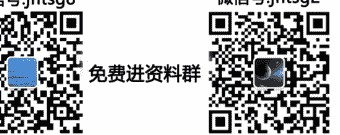

引流获客，这个东西应该所有行业的人都得到，不管是个人想要副业，还是公司想要做生意，都需要从公域流量。

应该没有人说自己是不缺客户的。

关于《抖音小红书导流技巧和万能引流公式》这个主题的分享，我在去年和前年很多线下分享过，那时候是1.0版本，已经帮助了非常多的人，甚至连分享的PPT都被搬运到海外去卖。

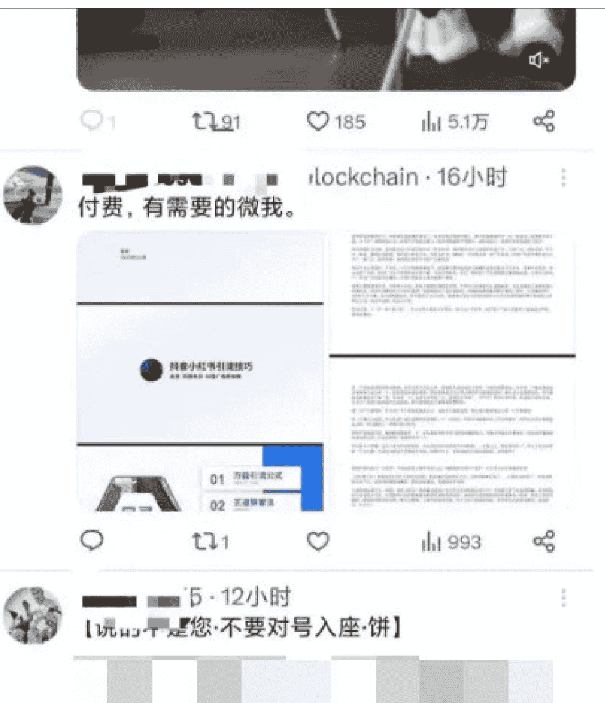

加微信jntsg2，进资料群分享群。

金坐

我昨天刚把自己的分享作为钩子挂在文章里，已经有人把我的内容拿到网上去引流了。

早上群友发现我的分享被挂在X上，而且两个资料卖68一份🙊。

这些人，执行力真强啊。

2023年11月20日 08:31

两年过去了，平台规则有了不小的变动，加上我对于引流这个事情的理解也有了一些变化，所以就有了这个2.0版本的小红书万能公式和操作手册。

大的逻辑没有变化，但是整个流程中的很多细节有了变化。

前段时间在北京线线下做了个分享，效果依然非常好。

现在就把这个稿子重新整理成文字版本，大家有需要的自行观看，全文大概16000多字。

这篇文章涉及别的东西，只讲一件事，就是讲明白怎么安全、高效地把用户从小红书搞到你的微信上面，就把这个事讲明白引流了。

包括但不限于：整个导流的逻辑应该是怎样的？需要准备哪些东西？整个工作流程是怎么样的？怎么搞是合规的？怎么不合规会被限流封的？什么动作是平台不允许但是安全性很高的？流量应该怎么搞？内容怎么输出？导流的路径是怎么样的？怎么样增加导流的效率等等。

当然，这些问题我并不是逐个去回，而是当我把整个逻辑给你讲明白之后，上面这些问题你自然就有答案了。

在正式开始前，我先卖一下焦虑。你们有没有想过，为什么这两年来，来越多的人想做小红书这个平台？

我给你们看一组数据：

24年一年不到的时间，小红书电商买手数量增加了27倍，账号数量增加了10倍，购买用户数增加了12倍，平台整体活跃用户数增加了1.6倍。

每天在平台发布的笔记，超过了 600w 篇，23 年这个数据是 300w。

小红书平台内，日均搜索查询量接近 6 亿次，23 年这个数据是 3 亿，并且 88% 的搜索行为是用户主动发起的。每天求链接、求购相关的评论接近 600 万条。

每天截图行为超过 1.2 亿。

这些是 24 年下半年的数据，现在肯定又有差距了。

那这些数据能看出什么？

一方面，商家数量增多，是不是说明平台的价值被认可，整个商业化的生态在完善？后续会有更多的商家入局，做生意，找客户。这是第一点，你不做，你同行也会做。

另一方面，用户数量变化和用户行为的数据是否说明平台用户需求正在增加？越来越多用户已经逐渐养成了在小红书内寻找自己的需求的解决方案。消费，本身就是解决需求的一种方式。比要需求是让狗狗毛顺顺滑，上小红书搜索了一通之后，能够买了一款宠物补给。这就是第二点，在小红书上，用户需求正在爆发。

然后还有一个自身体感，分享一下。我每年要给几千客户开广告账户。这些客户有大小，主力平台也各有不同，但是在和他们进行交流之后，我发现了一个共识：在小红书能拿到的用户数量不如抖音，但是流量价格更便宜，成交率更高。这是第三点，小红书流量便宜。

但是能便宜到什么时候呢？我不清楚。不过我估计，随着现在这个商家入局的速度和商业化生态发展的速度，等到明年年中，小红书大流量价格就要跟抖音持平。这就是我们要去做小红书，并且尽快开始做小红书的原因。

达成共识之后，下面正式开始。我们到底应该如何如何在小红书找到客户，并且加到微信。全文一共 4 个半部分：
1. 万能引流公式
2. 钩子怎么找
3. 流量怎么搞
4. 如何合规导流

前排提醒一下，本文主要是给客户精准的行业/老板看的，电商老板请随意。

## 万能引流公式

做引流之前，一定要先明白一个事情，引流的核心逻辑是什么。我们来想象一个场景，假设你在街上，遇到一个人，他跟你：“你好，我能不能加你一下，加完之后我在朋友圈打广告，这样你就能看到了。”你会不会觉得他是神经病？

但是如果她说：“你好，我给你转十块钱，你能不能加好友，都帮我完成一下任务”，你是不是会更有意愿？这个例子有点粗糙，不过道理能表达清楚就好。

想引流，想让别人加你，核心逻辑就是：利他。


万能引流公式 = 内容 + 钩子 + 渠道

为了方便理解，举个例子类比：
- 内容：鱼饵
- 钩子：鱼钩和饵
- 渠道：鱼线

把引流比作钓鱼，让目标客户加入你的的过程就是让鱼上钩的过程。然后我们一项来拆解：

### 内容

钓鱼之前，是要准备一大堆饲料倒下去，把整个池子里吃饲料的鱼引过来。回到小红书，做笔记就是通过算法到了目标人群面前。有需求的、兴趣的会点进来，没需求的自然不会进来，或者点进来一眼走了。阅读量越大，引流的效果越好。

**内容的作用：** 让目标人群看到，知道你。当然这里还有一个点，要针对性地打。精准流量和泛流量，引流效率有几十倍的差别，这个部分后面章节会详细讲。

### 钩子

“加我领资料”里面的“资料”类比钓鱼就是鱼钩以及饵，鱼对饵感兴趣了才会咬饵然后上钩。

**钩子的作用：** 让人对你产生兴趣，觉得自己能拿到好处。如果不准备钩子，或者饵准备的不完善，引流行为就全凭运气。发了一堆内容，阅读量也不低，但是没人加你，这就是原因。

### 渠道

用户可以通过什么渠道联系到你？把联系方式发给他类比钓鱼就是鱼线。

**渠道的作用：** 如果不准备鱼线或者鱼线不结实，鱼被吸引过来咬完就跑了，那不是在钓鱼，而在帮池塘主养鱼，帮平台培养生态留住用户是个大慈善，自己的项目可能得黄。所以鱼线一定要结实，渠道一定要稳定。

现在能理解引流万能公式的组成了吗？内容、钩子、渠道，三者缺一不可。市面上有很多非常引流的免费教程或者是付费课程，但他们基本上都没有把这个关系折腾明白：
- 教大家怎么做流量，去吸引人（内容部分）；
- 要么讲大家怎么把微信加到手（渠道部分）；
- 或者是给你们一个资料，告诉你们可以用资料去引流（钩子部分）。

但是怎么把这三者结合起来，怎么把整个链条打通，很多人都没有讲明白。引流效率不高、客户数量不多、流量成本不下来、有阅读没进粉等原因，其实都是因为这三个环节中的一个问题。下面开始拆解。

## 二、钩子怎么找

刚才才说了，钩子就是钓鱼时候的钩和饵，就是“加我领资料”里面的“资料”。那么钩子是什么，自然就很重要了。宝妈妈人群大概率不会对考研资料感兴趣，但是可能会对如何带娃、如何做产后康复感兴趣。

所以找钩子之前，要明确两个东西：
1. 确认自己的人群
2. 人群对应的需求

如果还是拿钓鱼举，这两个东西分别对应的是：我要钓哪一种鱼，这种鱼喜欢吃啥。

### 不同的鱼喜欢的东西肯定不一样

不同的人群，需求点肯定也是不一样的。比如：
- 男人：关心工作上的事情、数码产品、哪里可以钓鱼、前列腺健康……
- 女人：关心家人的情况、怎么美态护肤、最近的金价……
- 老人：关心有没有人陪、哪些保险、保健品……
- 老板：关心行业进展、投资……
- 学生：关心近期的一些考试、热门游戏、亚文化……

确定人群后，才能确定他的需求。按照人群标签的维度来划分：
- 城市、地段
- 性别
- 收入水平
- 学力水平
- 家庭结构
- 消费理念

### 常见的钩子类型

1. **行业资料**：这是最常用的，也是最好的方法。比如行业资料、大学生创业赛PPT模板、宝妈坐月子教程等等。
2. **PPT美化定制**：非遗传承赛项目的同学快来抄作业！
3. **运营资料**：考研历年真题。


   - 方案策划模板
   - 竞争分析模板
   - 视觉设计模板
   - 品牌推广模板
   - 汇报总结模板
   - 项目计划模板
   - 数据演示模板
   - 用户分析模板
   - 素材设计模板
   - 落地策略模板
   - 演示逻辑模板
   - 互动方案模板
   - 配色方案模板
   - 字体设计模板
   - 页面布局模板
4. **解决方案**：比如家装攻略、旅游攻略、踩坑指南，或者是出国经验等。
   - 例子：韩国济州岛厕所 | 保姆级攻略。被IU和朴宝剑《苦吟来遇见你》再次种草了济洲岛，不过去过济洲岛都知道，厕所有有多难找，突然意来临但是找不到厕所，尴尬到不敢想象！
5. **优惠信息**：比现在黄金大概是800左右。
6. **热门热点/吃瓜**：最近有个很有意思的瓜了，在微博上热搜。
7. **软件/插件**：很多好用的工具包。
8. **信息差**：针对特定人群的资料，引流效率非常高。
9. **翻译类**：
   - 沉浸式翻译Pro
   - 论文翻译
   - 网页翻译
   - 文档翻译
10. **AI编程**：发展迅速。
11. **壁纸/头像**：
    - 二次元壁纸（吸引次元人群）
    - 照片头像（吸引小清新、文青人群）
    - 星座星盘（吸引身心灵爱好者）
    - MBTI和星座（吸引理性爱好者）

钩子的本质就是人群的需求。如果你有需求的解决方案，或者能够唤起他的需求，就能加到微信。钩子背后是人性，只要你能抓住人性，就抓住了用户。有了钩子之后，应该怎么放？先下表一会再讲。

## 三、流量怎么搞

讲内容之前，我们先简单讲一下小红书的流量结构。有人可能会问，是不是讲内容吗？万能引流公式的三个部分内容、钩子和渠道，哪来的流量？其实流量和内容本质上是一回事儿，内容的作用就是用来拿流量。用钓鱼举例，打窝打成功了，这边的鱼就多，流量越大；如果打窝没打成功，前面的鱼儿就少，流量就小。那肯定是流量更大的时候，钓鱼成功的概率更高。

流量结构可以分几个维度来拆解一下，这个视角你们在其他地方没有听说过，我给你们重新拆解一下，总流量的流量结构是怎么样的？当然了，这个逻辑放在其他平台也同样适用，只不过这篇文章讲的是小红书，所以我用小红书的视角来讲，看明白之后，拿回去可以照套到其他的自媒体平台上。

### 流量来源

我们可以把流量分为自然流量和付费流量。
- **自然流量**：通过咱们自己发笔记视频，发完之后，平台根据算法给我们推的流量。
- **付费流量**：顾名义是花钱买来的，包括聚光、薯条、乘风、蒲公英等都属于内付费流量。

（此处后续省略，根据原文结束）


有些情况下，粉丝量多的博主，他的笔记权重不如粉丝少的博主。

但是一般来讲，专业的博主，他的内容生产能力都会远高于大部分素人和经验不多的运营。

按照上面说的这两个维度划分，我们可以把小红书的流量来源分成这 4 个维度，分成这 4 个象限。

然后就会得到一些基础的流量玩法：

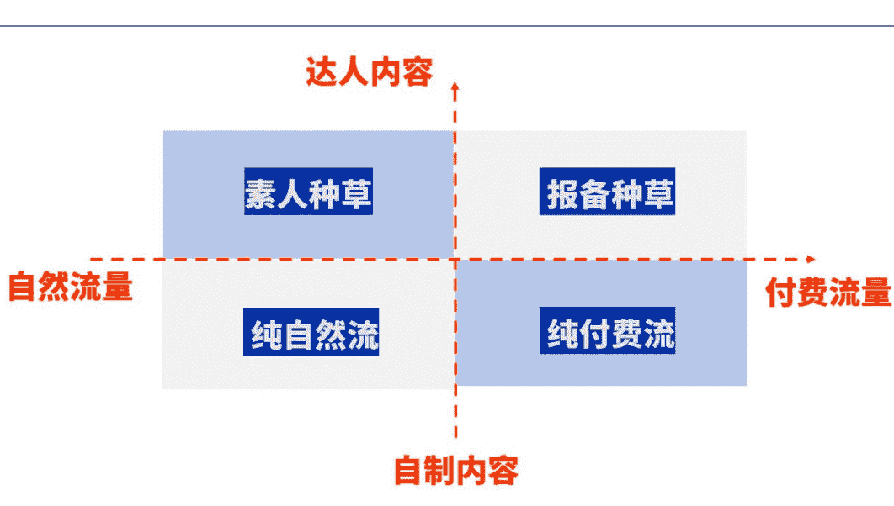

花钱找达人，买素材、买流量，其实就是报备种草，咱们走平台过找达人笔记，一方面拿到了他们的流量曝光，一方面来买他们的素材。

如果是找达人做内容，但是自然流量，其实就是做素人种草，就是大量的账号去发笔记。

还包括找一些人做代发，就咱们自己好的笔记，放到他们的账号上面去发布，拿流量。

自己的内容团队生产效率更高，质量更高，所以可以找他们买到更加优质的广告素材。

如果是自己做内容，然后走付费流量，其实就是付费投资的打法，每天更新笔记素材，然后通过付费买流量来找到目标用户。

如果是自制内容免免费流量，就是大部分中小玩家的打法，搞几个账号，然后每天更新的笔记，以此来获得自然流量。

当然一些团队他的管理比较牛，内容生产成本低，sop 比较强，也可以通过账号数量和经验技巧达到非常大的流量，比说前两年很有名的郑州。

像这些概念都好理解，然后我们再引入第三个维度。

如果按照流量的类型区分，我们将流量分为推荐流量和搜索流量。

推荐流量很好理解，就是在 APP 主页的 APP 主页往下刷，信息流里面的笔记就是算法推荐来的。

搜索流量，顾名义就是通过搜索来的流量，当用户有某个方向的需求或者问题，他在平台内发起搜索，然后在搜索出来的结果里面找到了我们的笔记，并且点击进来，这就是搜索流量。

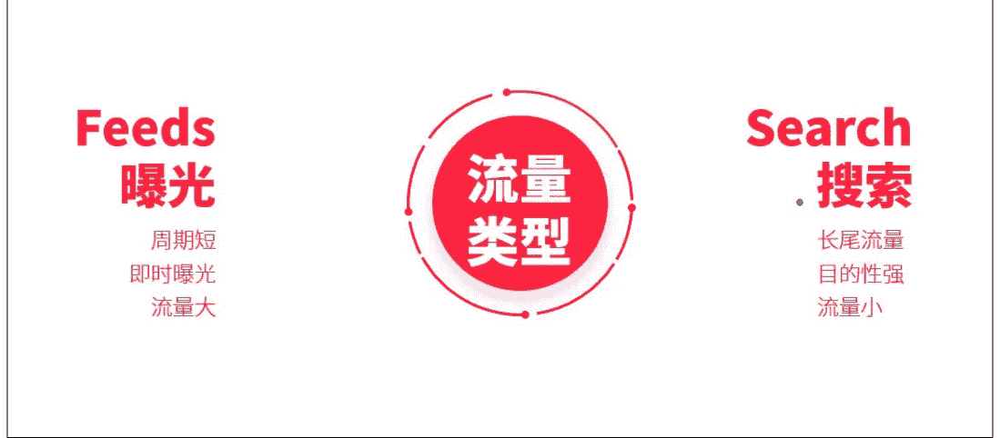

推荐流量的特点就是曝光更直接，短期内流量更大，但是相对的推荐周期会更短，没有爆的笔记推荐周期基本就在一周以内，爆了的笔记周期在一个月到三个月左右，很少有年为单位持续获得推荐流量。

搜索流量虽然流量小一点，但是吸引来的用户目的性会更强，转化更高，流量更持久。

现在把三个维度互相混溜，配合一些官方的功能和运营技巧，就能诞生出非常多的玩法：

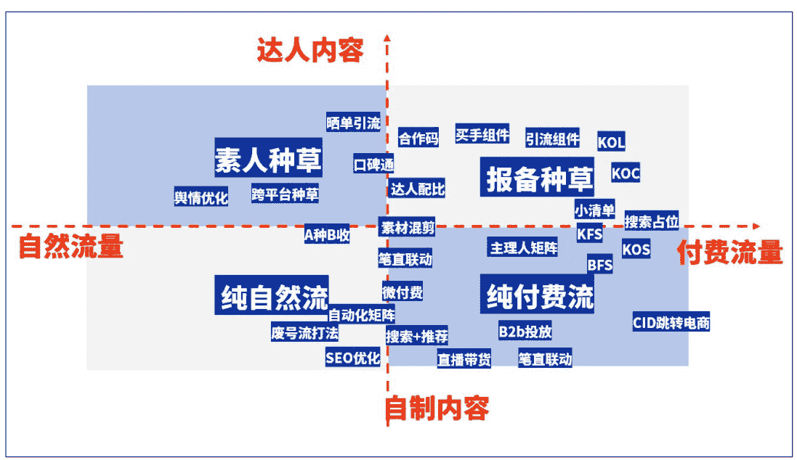

当然了这张图并不是今天的重点，我的目标主要是跟你们解释清楚流量可以怎么来，然后我们会重点讲这里里面的内容：引流的爆款笔记怎么做、关键词占位、付费投放。

至于里面其他的一些打法和关键词，以后有机会单独开文章再讲。

## 爆款笔记

### 那么先来讲爆款笔记，爆款笔记应该怎么写

CES = 点赞数 (1分) + 收藏数 (1 分) + 评论数 (4 分) + 关注数 (8 分)

```
CES = 点赞数(1分)+收藏数(1分)+评论数(4分)+关注数(8分)
```

这个公式很很多人可能都见过，据说就是小红书的推荐算法，我先澄清一下，它并不是官方真正的算法，它只是一个根据前人的运营经验倒推出来的算法，市面上还有其他版本的，比如说加入了转发数据、成交数据等等等，都不是真实的。

实际上的算法会比这个复杂很多，但是里面的权重关系是值得参考的。

所有的用户互动当中，权重相对较高，并且相对容易拿到的，就是评论。所以如果想要我们的笔记更容易爆，并且引流效率更高，想办法把评论做上去。咱们并不一定要做那种几十万的笔记，而是要做到那种评论数多于点赞和收藏数的笔记。

因为这类笔记意味着它的权重足够高，爆的概率更大，更容易吸引其他人来评论，反复累加咱们帖子的权重。

同时，一个评论区的文字会被算法计算，评论阅读越容易越精准的推送到目标群面前。

所以在账号的初期，咱们可以用这个方法来动点小技巧，快速的提升账号初期的权重。

在账号的后期，也可以用这个思路来写转化的引流笔记。

### 起号笔记怎么写

首先是起号的时候，发一些容易引发评论的帖子，快速把笔记做爆，提高基础权重。如此这篇笔记：

### 老公/男友那些年的照照...

参赛选手全凭本事上榜，排名不分先后！#笑死我了 #xswl #每天一天笑 #看一看一笑道 #原谅我我不懂的笑了 #笑不活了 #搞笑 #哈哈 #专攻不开心 #娱乐 #meme #梗图 #新西兰 #日常 #日更 #娱乐 娱乐评论大赏 #男友 #老公 #男朋友拍照技术pk #老公照

02-21

看 Ta 信息 好的

他抛了一个话题，就是那些年男朋友拍摄过的照片，同时晒了了很多张奇葩的照片。

### 目的是什么

就是为了他抛的钩，目的是为了吸引更多人评论。在评论区晒照片，为了引流，微信进资料群。

### 甜甜敏

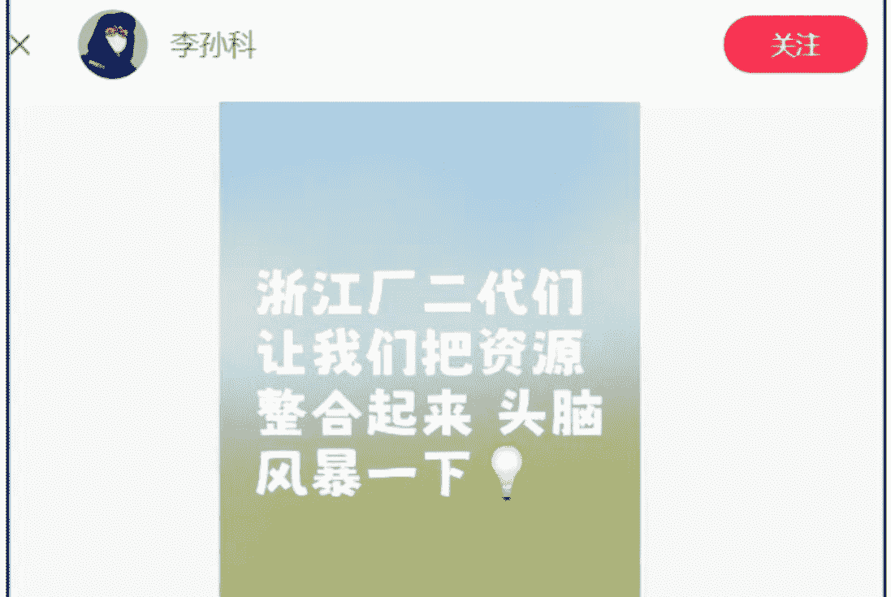

### 流量互动

这些笔记的共同特征就是可以筛选人，吸引同一人群。在前期快速做出爆款笔记，打好标签，让账号的基础权重上去。

其实也就稍微高一点，不会特别高，毕竟小红书中心化算法还是比较严格的，咱们追求一个小爆。这里还有小技巧，就是在新号初期积极参加官方活动，利用好官方送的流量券。

比如，账号注册的时候，把生日设定，等到生日的时候就可以领一张流量券，可以增加曝光，把它用来做笔记投放，原本是拉动的。

爆了之后，几号的时候怎么去找这类互动的笔记？

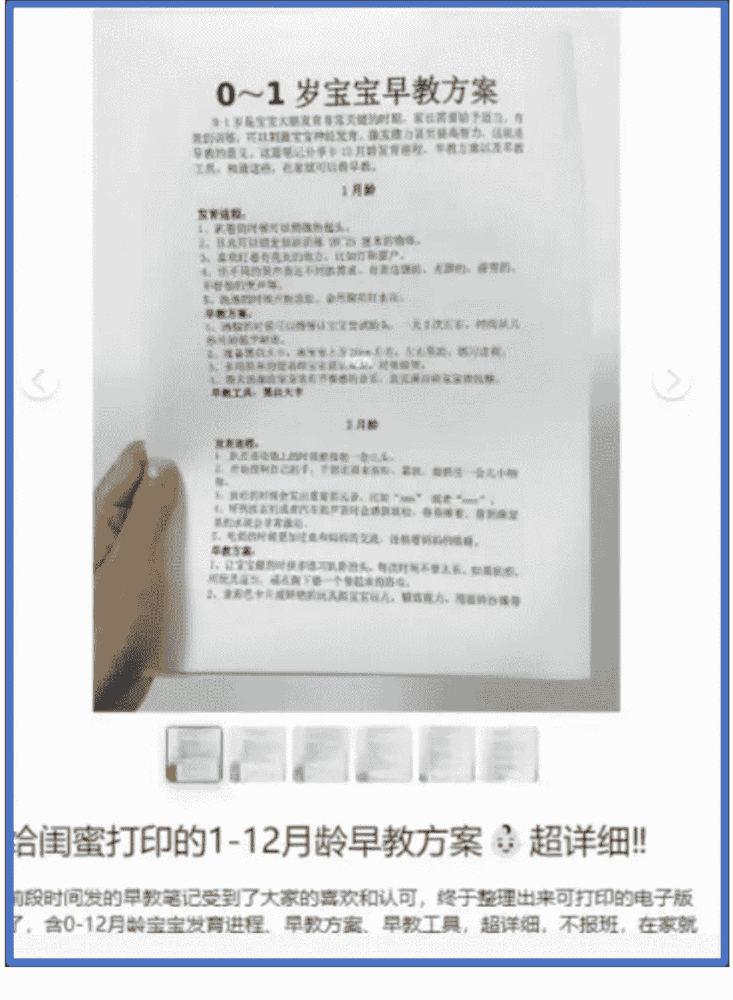

时间分享的早教收到了大家的喜爱和认可，整理出来可以打印的电子版，0-12个月宝宝发育，早教方子，早教工具，超详细，这份资料本身就是钩，他只要加了我们就可以领取。我们把这篇资料中的几页晒出来，它就成了内容可以发在红书上。

但是现在你这么做，你的流量肯定不是以前了。加微信进资料群分享群。因为时代已经变了，很多人都在这么玩，版本变了，咱们的笔记需要迭代一下。怎么迭代呢？一方面内容广度可以迭代一下，我们的思路可以换一下。前文讲过，钩子本质是需求，同时钩子可以是内容。根据粗浅的数学逻辑，a=b, b=c，是可以推理出 a=c。需求本身也可以是内容。

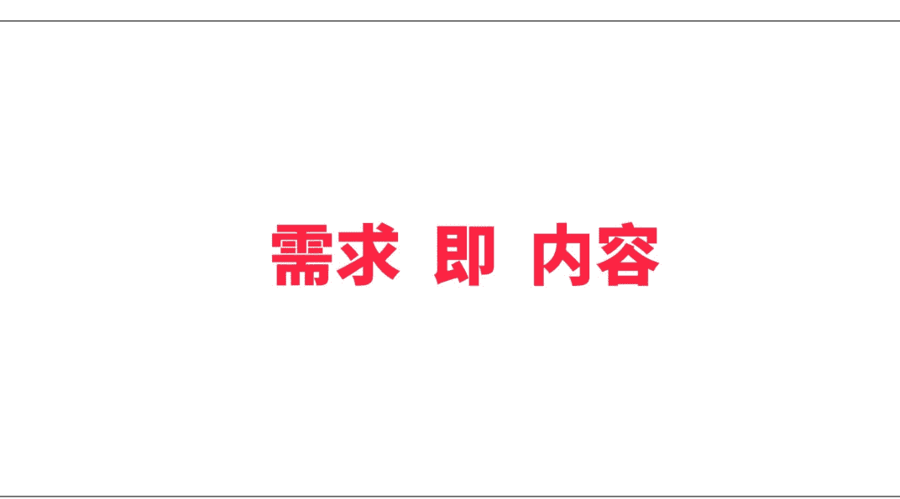

比如说，女生小腿脂肌减怎么办？我把这个问题抛出来让大家回答，就能吸引到同样问题的人群。然后在我在笔记中给出解决给出一个自己成功的解决方案。再比如，去西藏旅游踩坑了怎么办？也能吸引到想要去这个地方的人群。他们来找避坑的，但是进来笔记发现其实我是在踩坑之后，找到了合理的解决方案。想要这个解决方案，可以先来加我。加过来之后发现其实我其实是导游，但这个时候已经无所谓了，他根本不在意你是谁，他脑子里只记得他想要的是那份避坑的旅游攻略。如果销转团队厉害一点，那可以用消费者的身份加入，然后再把自己另一个导游的微信和攻略一起推荐过去，这样成交效果会更好。也可以把这个步骤前置，玩的隐藏一点，在笔记里面抛出一个问题之后，不做太多的解答，反是在评论区另外一个账号来做解答，然后两个账号或者三个账号在评论区唱双簧。用户如果对这个产品有需求，这就是流量入口。

### 引流笔记怎么写

然后我们要开始讲引流内容怎么做，以及钩子怎么放这两个问题。对于一篇引流贴来说，最简单的内容就是钩子本身，只要办法呈现在用户面前。

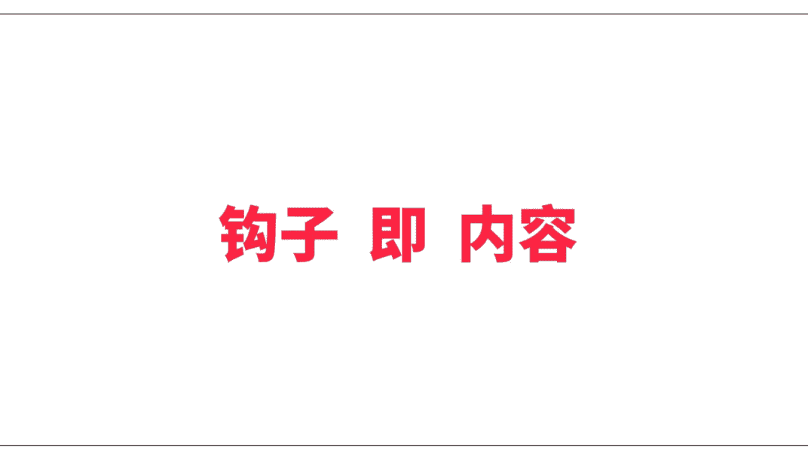

### 关键词占位

小红书自带搜索功能

| 类型 | 排序依据 | 发布时间 |
| :--- | :--- | :--- |
| 综合 | 最新 | 赞 |
| 笔记 | 最多赞 | 天内 |
| 笔记 | 最多评论 | 天内 |
| 笔记 | 最多收藏 | 周内 |
| 笔记 | 半年内 |
| 搜索 | 搜索范围 | 已看过 / 未看过 |

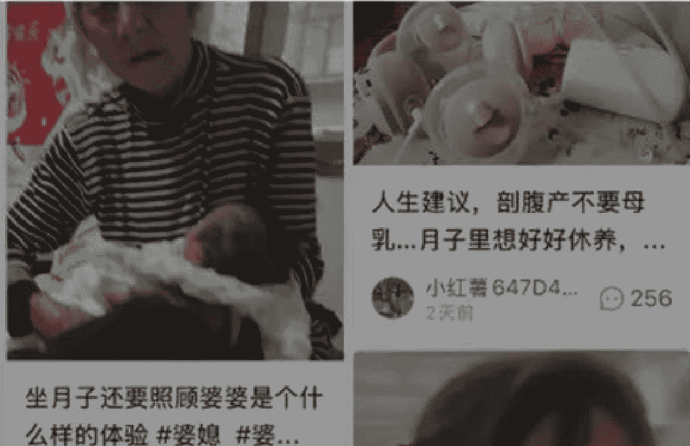

### 流量互动

| 用户 | 筛选依据 |
| :--- | :--- | :--- |
| 全部 | 综合 |
| 笔记 | 最多赞 |
| 笔记 | 最多评论 |
| 笔记 | 最多收藏 |
| 视频 | 图文 |
| 视频 | 天内 |
| 视频 | 周内 |
| 视频 | 半年内 |
| 搜索 | 搜索范围 |
| 搜索 | 已看过 / 未看过 |

### 比如：
- 综合
- 搜索内
- 周内
- 半年内
- 搜索
- 搜索
- 搜索功能

小红书是一个搜索流量平台，用户都有搜索习惯。小红书搜索下拉框以及搜索页面的推荐，这些都是咱们产品和行业的关键词。

### 怎么找关键词

小红书是一个体系，但是大的趋势是接近。一般把关键词拆成三个部分：

- 核心关键词：咱们品类词或者产品词，比如“考研”就是核心关键词。
- 相关关键词：咱们的核心词有关联的词汇，比如“上交大”、“清北”就是相关关键词。再比如“考研真题”、“2025考研”、“考研英语”。还有如果有品牌、竞品也可以算是相关关键词。
- 长尾关键词：或者叫长尾语，就是多个关键词组成的一个代表需求的短句，比如“25年考研冲刺”、“上交大考研历题”。这三种关键词逻辑关系就是一层递进，越递进需求就越精准。比如“考研”是一个超级大的词，考研这一类下面可以分出至少百个赛道，一个学校就是一个赛道。每个学校的真题是不一样的，高考是全国统考，考研是全国分开的。做内容之前，提前准备好自己行业的关键关键词，以及相关关键词，就可以把自己的内容精准定位到非常精准的人群和需求上面。

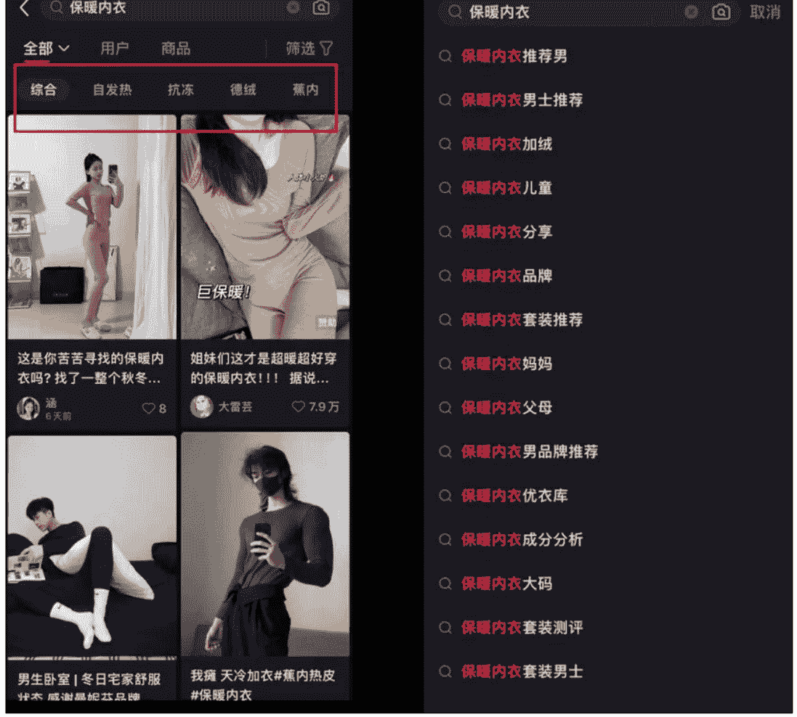

巨量算术（https://trendinsight.oceanengine.com ）不需要开户，手机登录一下就能免费使用，里面可以根据我们的搜索词去推搜索相关的词汇。

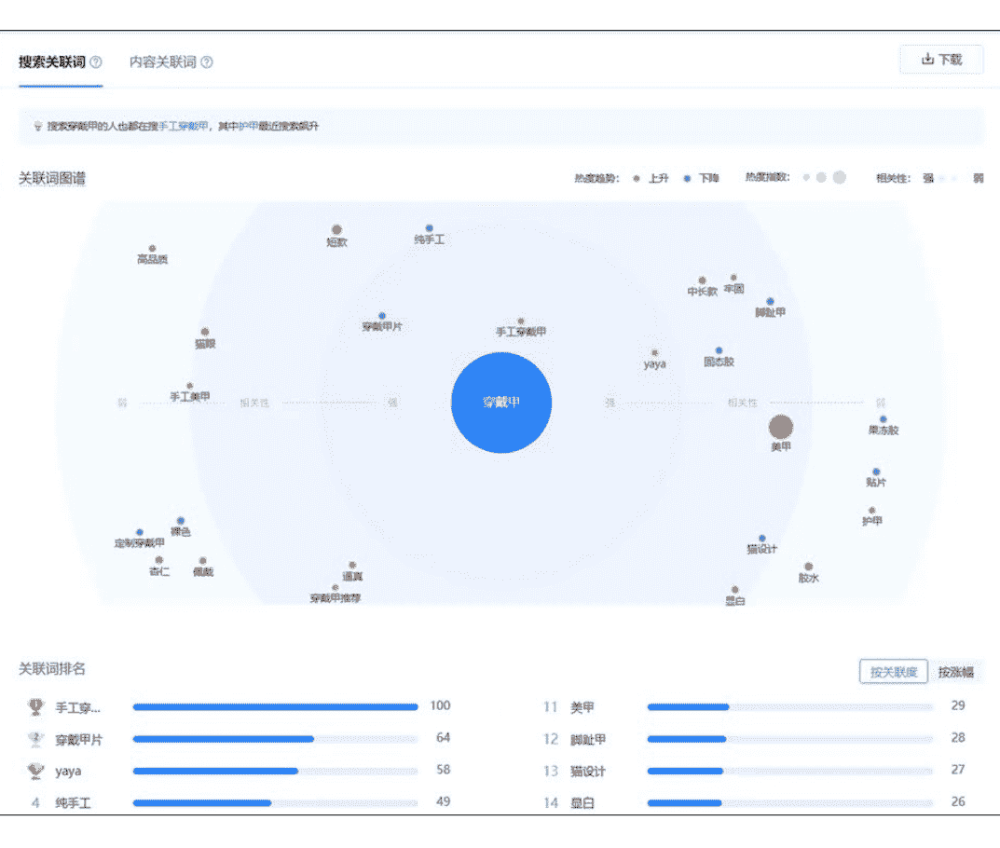

5118网站（https://www.5118.com）——专门做各个平台、专业词汇的网站。使用下载表格需要查看完整数据和下载表格需要会员，如果使用频率不高，可以去闲鱼或淘宝捡单。

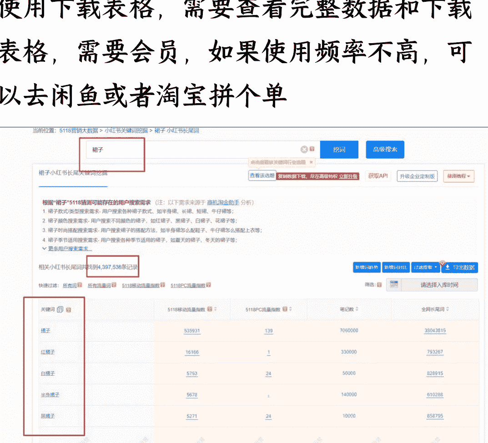

聚光后台的关键词规划工具（https://ad.xiaohongshu.com ）除了可以看到关键词的搜索指数以外，还能看到市场出价和竞争指数以及上下游关键词。

## 开通聚光

开通聚光需要先认证小红书的企业号，交600块钱认证费。如果没有聚光的，也可以找我要一份行业的关键词表。

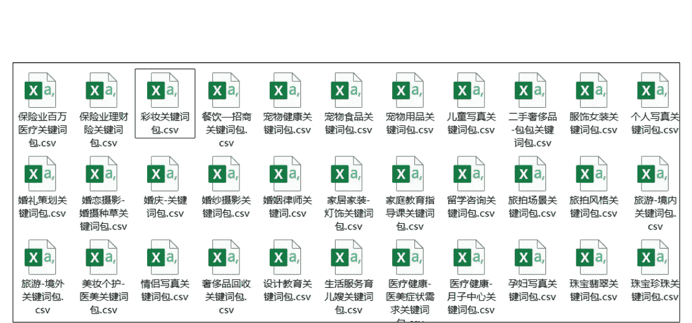

把这些关键词收集好之后，拉个表存好，方便后续使用。然后就是想办法把他们放到咱们内容里面去。我们要做的，就是找到对我们的产品和服务有需求的这部分用户。我在笔记里面入的关键词相关关键词越多，我这边笔记在这个行业内的权重就会越来越高。这里的权重包括用户主动搜索算法进行内容匹配的权重，也包括用户浏览信息流的时候算法进行兴趣推荐的。


在讲笔记内容制作的过程中，其实我已经列好了几个关于钩子怎么放的方式，这里一起总结一下，就不展开讲了。

内容本身是钩子
- 正文末尾放钩子
- 评论区放引导
- 评论区放托

会做引笔记以及知道怎么埋钩子之后，就可以打磨内容的制作流程，提高笔记产量，然后扩充账号......

这些部分就不展开讲了，以后有机会可以单独写。

## 3 付费投流

讲完内容怎么做之后，再来说一下流量部分的最后一个环节，付费投流。

当然这里不会涉及太多的投流相关的技巧，只是做一个投流相关的科普。

投流本身是一个很深的门道，虽然我经常对客户说投流的操作和技术没难，但是真要出来讲，光是把功能讲清楚就要讲一两个小时。

所以这里这里这里就只讲科普，帮你们对齐认知。

那为什么一定要加付费这个环节呢？

因为你不管是什么行业的，只要你的项目跑得顺利，最终你都会开始涉投流。有些人可能以前听说过，流量的终点就是付费。

为什么我们会有这种说法？逻辑很简单，因为自媒体平台的终点就是卖流量。

多年年前的自媒体平台，包括几年前的小红书，大多数都是在卖广告。

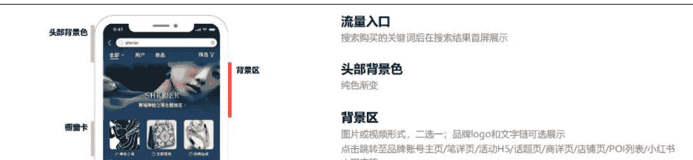

微信jnts2，进资料粉丝群。

这个平台上某个位置可以放广告，然后把这个位置卖给需要曝光的商家，比如我这文章拉到底，在评论区就能看到一个广告，这个位置就是一个广告位。

这个事情本质上和线下的传统广告牌，比如电梯广告、电视广告，没有什么区别。都是我打造了一个场域之后，让这个场域有足够的曝光，然后我把这个场域中的某一个位置作为广告位卖出去。

直到有一天，抖音横空出世，他把固定的广告位变成了流动的广告。从此以后，平台突然悟了，原来除了卖广告以外，还可以直接卖流量。原来钱还可以这么挣。

原本平台如果卖广告位，就要给商家广告位置，又要给他提供帮他做广告的内容，可能还要涉及到营销方案、放方案等等。但是直接卖流量的话，让商家自己去解决内容和营销方案的问题，他们自己去卷价格，卷内容，并且还可以把一份流量多次卖。

平台做的，就是给商家一个工具，告诉他们该怎么操作就行了。内容好的，对平台有帮助，可以买到更便宜的流量；出价高的，让平台赚得多的，可以买到更多的流量；商品好的，可以促进成交的，可以买到更便宜的流量。也就是说对平台而言，卖流量远比广告赚钱多了。

那么，既然流量是可以卖的，那么为什么还要免费给你？逻辑这么简单。

那有人说，咱们请了这么多写爆款笔记的技巧，我做好内容发笔记，不是拿流量吗？是的，没错。但是我们平台提供优质内容，帮助平台增加活跃、留住客户、促进成交……这本身也是一种价值交换，也是一种买卖。

小红书从年前开始商业化之后，他的所有商业化动作，目的都是为了更好高效地卖流量。当然，现在小红书的流量整体还是比较便宜的，除了一些已经被卷到死的行业以外，比如旅游、留学和医美。

还有很多行业，在抖音 50 到 100 左右的客资，在小红书可能成本只要 10 到 20 块钱。即使已经是卷到死的行业，还有很多细分赛道，和很多出价相对便宜的关键词可以操作。如果还没开始做投放，可以用这个表了解自己行业的获客成本。

| 小红书抖音2023年1月各行业获客成本对比（小红书成本更低，推荐：小红书） | |
| 行业 | 获客成本 | CPC | CPM | 转化率 | ROI | 抖音获客成本 | CPC | CPM | 转化率 | ROI | 小红书获客成本 | CPC | CPM | 转化率 | ROI |
| :--- | :--- | :--- | :--- | :--- | :--- | :--- | :--- | :--- | :--- | :--- | :--- | :--- | :--- | :--- | :--- | :--- |
| 文化教育 | 25.67% | 0.1 | 49.9 | 4.7 | 2.27% | 5.0 | 15.1 | 22.2 | 5.1% | 0.9 | 0.6 | 7.4 | 14.2 | 19.3 | |
| 电子 | | | | | | | | | | | | | | | | |
| 美妆 | | | | | | | | | | | | | | | | |
| 旅游 | | | | | | | | | | | | | | | | |
| 汽车 | | | | | | | | | | | | | | | | |
| 家装 | | | | | | | | | | | | | | | | |
| 服饰 | | | | | | | | | | | | | | | | |
| 医美 | | | | | | | | | | | | | | | | |
| 母婴 | | | | | | | | | | | | | | | | |
| 教育 | | | | | | | | | | | | | | | | |
| 职场 | | | | | | | | | | | | | | | | | |
| 游戏 | | | | | | | | | | | | | | | | | |
| 食品 | | | | | | | | | | | | | | | | | |
| 房产 | | | | | | | | | | | | | | | | | |
| 农林 | | | | | | | | | | | | | | | | | |
| 女生 | | | | | | | | | | | | | | | | | |
| 宠物 | | | | | | | | | | | | | | | | | |
| 运动 | | | | | | | | | | | | | | | | | |
| 休闲 | | | | | | | | | | | | | | | | | |
| 科技 | | | | | | | | | | | | | | | | | |
| 工业 | | | | | | | | | | | | | | | | | |
| 交通 | | | | | | | | | | | | | | | | | |
| 其他 | | | | | | | | | | | | | | | | | |
| 平均 | 10.8% | 0.2 | 36.2 | 5.2% | 19% | 36.8 | 55.5 | 1 | 0.6 | | | | | | | |


微信jnts2，进资料群。

那么，既然流量是可以卖的，那么为什么还要免费给你？逻辑这么简单。那有人说，咱们请了这么多写爆款笔记的技巧，我做好内容发笔记，不是拿流量吗？是的，没错。但是我们平台提供优质内容，帮助平台增加活跃、留住客户、促进成交……这本身也是一种价值交换，也是一种买卖。

小红书从年前开始商业化之后，他的所有商业化动作，目的都是为了更好高效地卖流量。当然，现在小红书的流量整体还是比较便宜的，除了一些已经被卷到死的行业以外，比如旅游、留学和医美。还有很多行业，在抖音 50 到 100 左右的客资，在小红书可能成本只要 10 到 20 块钱。即使已经是卷到死的行业，还有很多细分赛道，和很多出价相对便宜的关键词可以操作。如果还没开始做投放，可以用这个表了解自己行业的获客成本。

### 付费体系

- 聚光账户：小红书主要的广告系统，获客用到的。
- 乘风：店铺强绑定，用于电商带货。
- 薯条：仅作内容加热工具，可以给笔记做一些层数据，但不对转化结果负责。

开通之后可以：
- 图文笔记
- 视频笔记
- 搜索广告
- 信息流广告
- 视频广告
- 种草广告
- 客资广告
- CID广告等......

### 全站智投

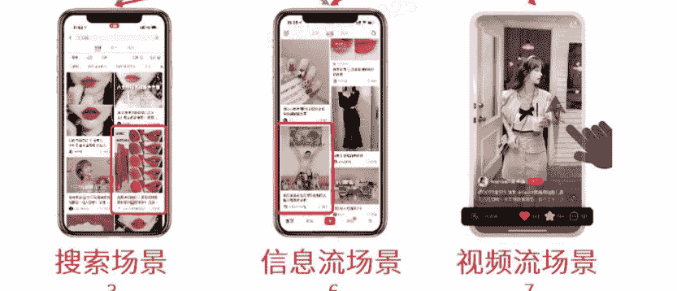

搜索场景 3，信息流场景 6，视频流场景 7。下面的那个数字代表这篇笔记在该场景下可能出现的位置，并且是依次增加，如信息流的第6、16、26、36......位置上更容易出现广告，搜索流则是3、13、23......

## 四、如何规引流

终于讲到最后一部分了，也就是按引流公式里面的渠道部分。我们怎么才能安全且丝滑地让用户加到我们的微信，并且小红书不会对我们限流或者封号？我先讲官方引导的正确姿势，再讲不太正确会有很多人需要的。

### 4.1 正规引流

平台商业化之后，它的所有行为都朝着更好的卖流量去。小红书引流规则经过一系列的变动，现在已经非常清晰了。商家名片功能：如图所示，当用户点击私信时，我们可以把微信
- 企业微信
- 电话
- 钉钉
直接送到对方。

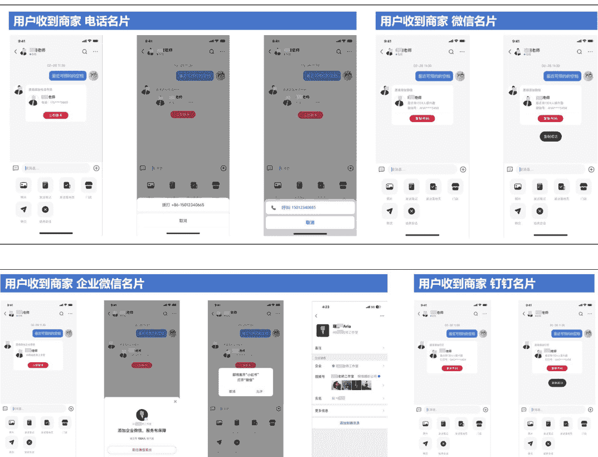

微信jnts2，进资料群。

目前来说，商家名片是小红书官方唯一允许的正规引流渠道。我们可以主动发给用户，也可以让用户点击底部触发。

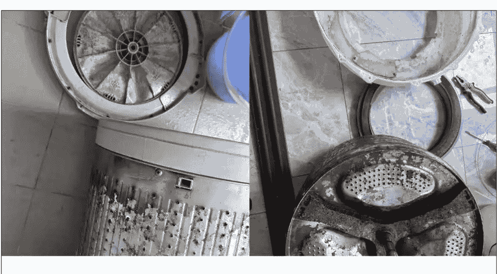

聊天框底部的菜单以及用户点击后的自动回复。商家名片的使用门槛：
- 企业号：必须得一张营业照（个体户或企业都行）。
- 充值600块的费用。
- 充值2000块（最低起）。

如果是副业从业者，不用去研究，直接认证专业号就行。如果是多个账号运营，还有一个工具可以使用。

### 小红书表单

在私信服务里面是不允许添加外部链接的，有一类除外。先用一个账号开通企业号，然后在后台创建一个表单页面，简单保留联系方式和昵称就行。


然后把链接复制出来，放到专业号私信服务组件，也可以给其他号使用。私信时要把表单发给用户。

### 4.2 偏门引流

开始讲偏门引流之前，我还是强调一句：你可以这么做，但一定要意识到自己这么是在小红书平台上违规的。小红书每隔两个月都会大规模的封违规引流账号。这些是小红书官方出来的违规场景示例：

- 正文里面放联系方式
- 昵称只明面放联系方式
- 简单里放手机号码
- 小红号改成微信
- 背景图里面暗接微信
- 把微信拆成多段放在瞬间
- 置顶记录放微信
- 把合或者收藏集合的名称改成微信
- 在直播间营销引流
- 把手机号改成同音字符放在评论区
- 在私信页面发微信
- 在群聊里面带有符号的联系方式

说起来是违规示例，其实也可以理解成是偏门引流的方法大全。那些方法还能用吗？能，但是既然官方会被晒出来，说明他们被查到的概率是非常大的，很容易一小心就把自己账号玩没了。

下面讲一下引流的核心要点，必备两个道具：

| 小号 | 群聊 |
| :--- | :--- |
| 利用引流避风险，主页@号，评论区@小号，引导至小号资料 | 用户群聊后，所有的运营、导流动作均由小号负责，不要发言，以降低被封风险，群封了不影响账号 |

这两个道具的用处是一样的，都是为了规避风险。我们做引流获客，天天发笔记不容易流量做起来。所以用小号加群的方式一起来规避风险，只用小号或者只用群聊，能规避百分之七八十的风险，这两个叠加起来基本上能保证你做流量的账号没有任何问题。当然我这里说的基本上并不是百分百，如果有用用户举报或者平台抽检到了，还是会给你警告、限流，甚至封号的。


这个方法的原理是表情只有在创建的时候触发审核，一旦审核通过之后就不会轻易再触发审核。

总结上面的几个方法，核心思路就是用小号和群号作为临时性的引流工具，帮助主账号去规避风险。

万一小号被封了，没关系，注销重开，或者再搞一个小号就行了。

只要主账号不受影响，流量就不会断，项目就没有影响。

然后关于群聊，还有一个玩法。

小红书的群聊和 QQ 群一样，是有自然流量的，能被别人通过关键词搜索到，或者在群聊广场里面刷到。

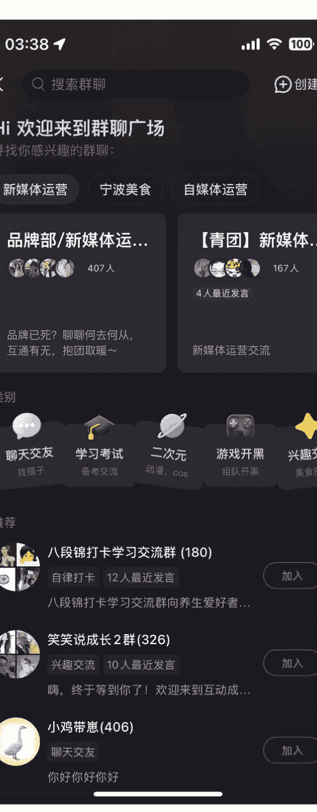

也就是只要设定好小红书群的名字，以及保证群聊的活跃度，

那么小红书的群聊不仅可以作为引流的渠道，可以作为引流的流量入口。

### 4.3 单个账号引流

然后可能还有人问，说上面说的这几个偏引流法也有门槛，它需要有多个账号，如果我只有一个账号，并且我也没有营业执照，我能不能用比较安全的方式引流呢？

有的，兄弟。

有的。

个人账号也是可以使用私信服务组件的，像这样：

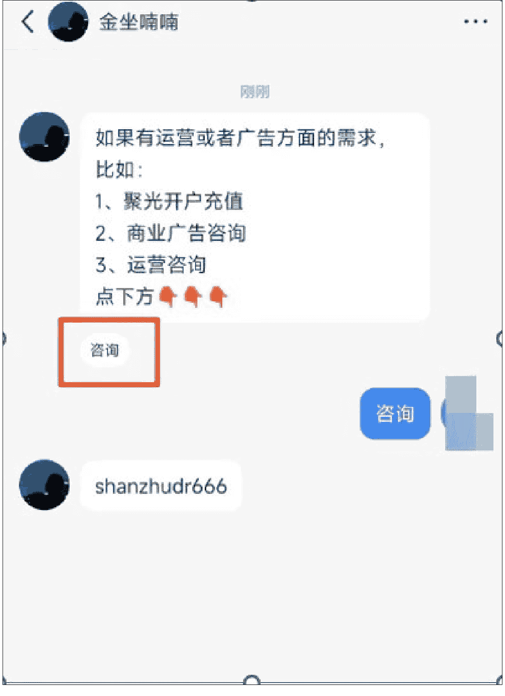

当然是有前提的，需要满足3个条件：

- 个人账号得实名
- 认证了个人专业号（免费）
- 开通个人店铺（不用上架）

两个条件都不难，很容易就能满足到。那么用这个方法，即使是个人号，也能自动的把你的微信发给用户。

但是现在小红书规则变严格了，在微信服务组件里面，直接把微信进去，那是不行的：

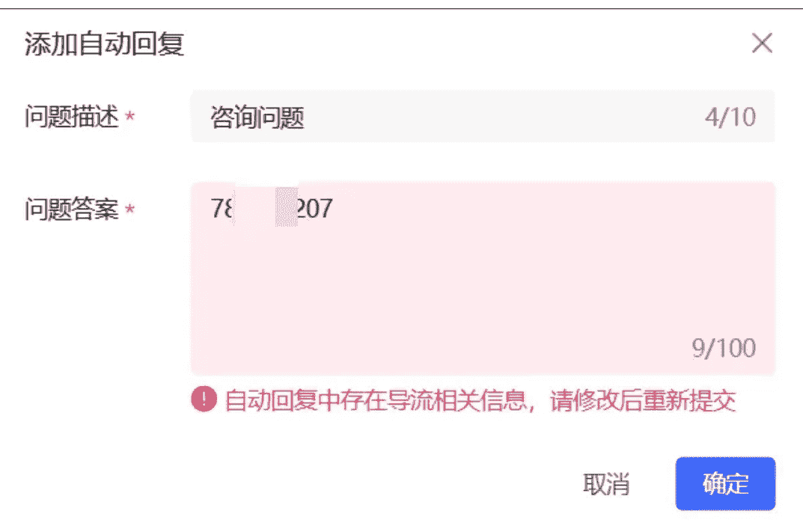

但是写的复杂点，然后稍兜绕一下就可以了：

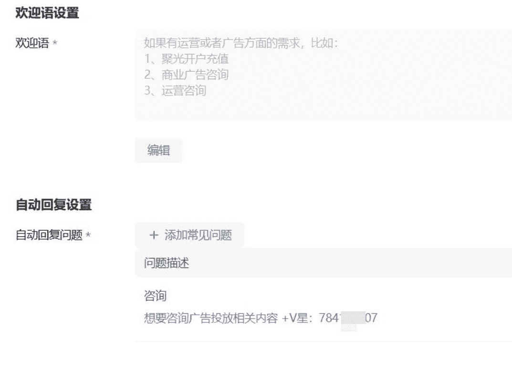

加微信jntsg2 进资料群分享群

可能还会有人问，就是，如果我的实名账号已经被封锁了，并且我有且只有一个账号，还没办法实名，也没有企业营业执照，我还能不能比较安全的引流呢？

有的，兄弟。

有的。

把小红书 App升级到最新版，在点私信面的右上角，就可以看到便利功能，这里你可以直接接微信，然后发过去。

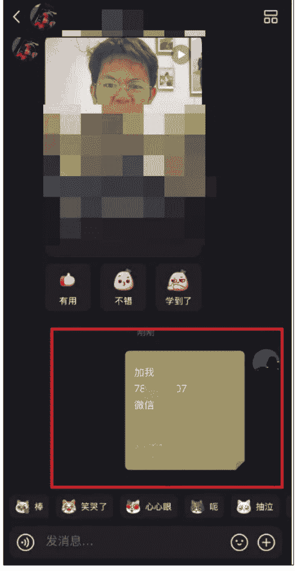

这个功能的门槛非常低，不需要实名，不需要企业账号，只需要你和对方互关。

加微信jntsg2，进资料群分享

还是再加强一下，这个方法属于日常功能的违规使用，现在是可以引流，但是指不定什么时候，就会成为前面违规列举单上的一个新例子。

最后总结一下：

在所有的引流渠道中，我最推荐同时最安全的方法，就是商家名片。

其次是用小号加群的组合拳。

再次是在私信服务组件里面放联系方式。

以上就是小红书引流万能公式以及操作流程的全部内容。

内容有点多，大家有需要的可以收藏一下多看一遍。

| 码加入 知识星球TOP 免费资源群 |
| :--- | :--- |
| 免费 | 每日免费获取高价值资源，可提供各类资源搜索服务 |
| 价值 | 热门付费文章，各行业报告 |
| 及时 | 精选图书资源，副业赚钱方法 |
| 专注 | 职场实用资源，AI自媒体 |

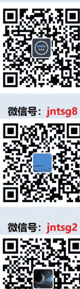

加微信jntsg2，进资料群分享群