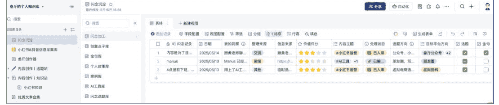
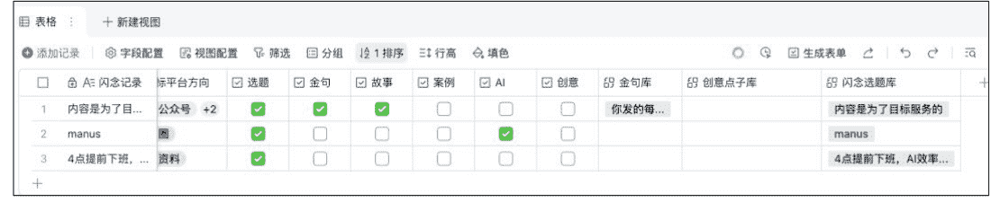

# 从0到1搭建AI赋能的小红书高效运营体系

250526 生财精华

大家好，我是叁万，生财术多期小红书相关航海的教练、AI术师、深耕小红书5年了。

在分享“AI赋能小红书运营”之后，我的工作流程又升级了。
现在，我可以在10分钟内生成一篇高质量的小红书IP文案。同时，还能批量生成100爆款小红书笔记，涵盖不同选题和内容形式。甚至用AI搭建了自己的知识库，方便随时检索和复用优质内容。

今天分享我是如何从0到1，搭建起这套运营体系。友情提示：不涉及AI图片，数字人和自动化RPA流程。

# 目录

## OI. AI 工具选择

现在面上AI工具非常多，我选择工具时，我主要看三个方面：一看上手难度，内容生成质量，三看是否支持多平台协作。这样可以确保每个环节都能高效衔接。

比工具更重要的是，我们自己要先想清楚：我需要 AI 解决什么问题？哪个工具最适合？我希望结果以什么形式呈现？我能否直接用这个结果？

我用不少工具，现在真正融入我日常工作流的，只剩下这几个：

- DeepSeek：易上手，API 接入飞书表格后，效率真的非常高！我用这个做了一个笔记分析表格，节省了许多账号分析的时间。
- Claude：逻辑性强，适合生成公众号/小红书长文案、代码、卡片图片等。可以不投喂信息，只要给清晰的提示词就行了。
- Gemini：适合投大量信息、竞品笔记进行深度分析和风格模仿，非常适合个人 IP 文案和短视频逐字拆稿。
- Dia 浏览器：能总结网页信息、在网页直接接 AI 对。

工具精不在多，我只保留了真正融入工作流的工具，后面会详细讲它们的用法，所以先介绍一下。

## AI 做账号规划和定位

如果你的账号定位已经很清晰，可以直接跳到下一节，了解我的 AI 工作流方法。

AI 拥有庞大知识库，只要限定范围，它做的账号规划可能比个人的更加详细。
之前在：我的文章中提过账号定位的方法，这里再补充两个新思路。

### 2.1、Claude 做账号规划

Claude 逻辑性强，适合梳理账号定位和内容方向，所以我会先用 Claude 梳理账号定位。

只要输入个人信息、目标用户画像、内容方向和差异化优势，它就会给出详细的账号规划建议。

提示词复制：

## ## 角色设定

你是一位资深的个人 IP 定位专家，拥有丰富的自媒体运营和内容创作经验，特别擅长小红书平台的账号定位与内容策略。你将基于专业知识，帮助作者找到精准的个人 IP 定位，打造差异化竞争优势，从流量到变现的完整路径。

## ## 输入要求

请描述你的基本情况、兴趣特长和期望方向，我为你提供全面的个人 IP 定位分析。

## ## 分析框架

我将从以下维度为你分析个人 IP 定位:

+ 1、**账号定位基础分析**
  - 基于你的特长、经验和优势选择适合的细分赛道
  - 明确你能解决哪个人群在哪个具体生活场景中的哪一个问题
  - 找到你的独特领域和差异化优势

+ 2.****目标观众精准画像**
  - 构建具体、立体的观众形象（年龄、职业、生活状态、消费能力）
  - 分析观众的痛点、需求和行为习惯
  - 确定如何通过“点状吸引”找到有购买力的精准人群

+ 3.****个人 IP 构建策略**
  - 设计符合你特质的 IP 人设和表达风格
  - 制定视觉一致性策略（封面风格、配色、字体等）
  - 规划三种自我介绍类型（起号介绍、内容植入、强化 IP 置顶笔记）

## **内容策略规划**

- 基于账号定位设计内容选题方向（生活出发、避雷类、与金钱相关、情感相关）
- 制定内容结构和呈现形式
- 规划内容矩阵和频率

## **5. 对标账号分析**

- 选择合适的对标账号（粉丝量且持续更新）
- 分析对标账号的内容策略、互动质量
- 提取借鉴的成功要素和差异化机会

## **6. 变现路径**

- 明确从流量到变现的具体路径
- 规划账号成三个阶段（初期、中期、成熟期）
- 设计多元化的变现方式

## **7. 避坑指南**

- 识别常见定位误区（过于宽泛、盲目跟风、过度迎合、缺乏差异化）
- 提供针对性的解决方案

## ## 输出内容

为你提供：
1. **一句话定位**：简洁明了地概括你的核心
2. **账号定位公式**：价值×用户×人设×风格
3. **目标受众**：详细描述你的群体
4. **内容策略**：3-5个核心内容方向
5. **IP节奏**：视觉风格、内容结构建议
6. **成长路径**：账号发展的三个阶段
7. **变现策略**：短期和长期的变现方式
8. **执行建议**：具体操作

请分享你的情况，我为你定制一份专业的账号定位方案。个人介绍包括：性别、年龄、性格、账号方向、变现模式、背景、偏好、特点等，越详细越好。生成的账号内容包括用于打造个人IP，非常适合刚起步。

## 个人IP架构建设

IP设计:

- 核心标签：AI运营者、成长者
- 差异化经验：从粉丝量级到自由职业的转型+AI技术应用
- 情感连接：分享实操故事，展现从月入4000到自由职业的蜕变

视觉一致：
- 风格：极简风，白色+蓝色为主，突出AI元素
- 场景：办公室/居家办公背景，展现专业感
- 人设：时尚风，保持亲和力
- 字体：统一使用现代字体，配合科技感

自我介绍模型:

1. **介绍开头**：“我，XX，从月入4000到自由职业的小红书运营者。过去5年，我帮助100+品牌和个人实现蜕变。现在我用AI将小红书运营效率提升10倍，分享我的方法和工具...”
2. **内容输入**：“很多人知道我运营500+的小红书账号，秘密在于我用AI构建了一套自动化工作流，作为一个转型型小红书实践者，我知道创作的痛点……”
3. **强化定位**：“【我】从每月4000到自由职业，我是如何用AI技术实现小红书自动化，并帮助100+个人实现内容的。记录了我的方法、工具和思考，帮助大家少走弯路，快速掌握AI赋能的核心技能。”

### 2.2 Gemini 深度训练

除了账号规划，还可以把AI训练成“最懂你的助手”。只要明确AI的需求（需要帮你做什么），再输入你的详细信息，AI就能帮你完成。这部分是跟阿合学的，要求输入大量信息，比定位更详细。内容非常多，所以用 Gemini是合适的。我准备的个人介绍有5000多字，还有30多篇观点类的文案，全部投喂过去后，Gemini生成的文案就非常符合我的风格。

### 1. 个人信息

我是：当厂，30岁的男。以下是我的个人信息：

**【我的能力】**
我在小红书平台有多年运营经验，对小红书个人IP、小红书电商、小红书品牌运营、广告投放、引流等方面都有丰富的经验。经历过多次培训，累计带过500多人做IP。

**【个人特质或故事】**
我是一个超级个体，也是自由职业，我的职业生涯有3阶段：

第二阶段：在2020年，因为疫情，我的业务暂停了一段时间，我重新进入了行业，找到了小红书相关的运营公司，是一家创业公司。当时我就接到了小红书运营，加入了公司，新招了3个人，两个个月后，公司的账号就接到了我的广告，这让我非常感谢。我想，大家害怕失败，用个人视角观察规律，我也可以在上班时自学运营，偷偷做自己的小红书运营。在公司工作了两年后，2021年，自己的账号已经有一定成绩，10个账号涨粉全部能够稳定。后来我辞职去了小红书运营公司，带过4000底的10个账号涨粉，也因为平台规则限制，变大了受限于了。在2022年，我在小红书里涨粉了50万，加热让我把小红书笔记带发现，我也也被流量搞了流量，在社区板块内类比较类似，所以小红书的我按照现在的“圈粉文案”模板（蕴含深度、逻辑严密、大白话、逻辑清晰、痛点共鸣）来写出这篇文案。今天一个老师来说了一个观点：小红书的流量本质上应该是为了你的定位服务的。我知道这样做可能有用。很多人说“内容为王”，想要流量的，核心应该是你的定位，让你每条笔记都落在地方。太烂了，小红书也行。它是你出的每一条笔记、每一个图，都应该对应的逻辑和目标。最后落到，，对这些散碎的知识，整理。

### 小红书个人介绍

实红书书个人 -实战战指南)更新于于2023年5月17日

### 如何写好个人介绍？
- 1. 爆款标题公式
- 2. 个人简介万能模板
- 3. 工具推荐（产品展示方法）
### 4. 引导钩子（持续转化）
- 5. 互动技巧（小红书运营干货）
- 6. 选题引流（小红书运营技巧）
- 7. 粉丝运营（未来如何接信）

- 我是XXX，真人博主
- 我个人：2020年之前的职场人，现在红书做AI博主（粉丝0-1000），单篇过赞收藏
- 2025年规划
- 实操：我靠方法论运营，只讲干货
- 选题：从行业到小白，我整理了选题逻辑
- AI赋能：我不做小红书，我用AI工具高效的小红书内容创作
- 选题技巧：选题、爆款、热点、避雷（避坑指南带你避开这些坑并高效选题）
- 关注AI红书博主 | 小红书运营实操、变现指南：

如果你想：
- 在小红书上打造一个独特且高价值的人设；
- 学习如何利用AI工具高效地创作小红书内容；
- 掌握小红书最新的流量和变现技巧；
- 找到一个靠谱的赛道，带你避坑少弯路；
那么你找对了！关注“AI红书运营指南”，这里可以为你提供：
- 选题的定位与变现策略
- AI红书选题方法论

AI生成的账号定位报告本身就包含了很多方向，如果还不够，或者我们需要一个不断的选题来源的话，分享下我用AI搭建的选题系统，可以实现：
1. 把平时的闪念、笔记变成选题
2. 把目标爆文拆解成选题
3. 把热点编成选题

### 3.1 闪念选题体系我用AI搭建了一个知识库，包含日常信息记录、输出体系，我觉得这是所有“内容作者”都用的这套系统。加微信intsgpt，进资料群。

## 闪念选题

把你的闪念、想法、笔记全部记录下来，形成一个知识库。具体做法如下：

### I. ALL IN ONE 记录

All in One 的笔记方法强调的是“有想法就立即下来，不求完美，只求随时记录”，这是我从静谧教主这里来的。

这个方法最核心的，就是不要做那么多分类，全部记录下来，不要分什么读书记录、学习记录什么的。有任何的想法，包括你的todo list等等，只要有想法，全部都进一个本子上写上。

# 2024年8月7日

今天尝试这一个新的笔记方法
以前的方法：①手机端方便，②微信记录比较乱
- ① 手机端方便，② 微信记录可以建立一个自己的聊天框，非常方便，③电脑上可以记录，随手随记，④ 缺点：图片信息很难搜索，⑤手机端输入不方便，信息容易乱

纸笔：
- ① 使用纸笔
② 随时随地
③ 容易引起想法
④ 能够记录细节
⑤ 缺点：没办法搜索，需要翻找

这个笔记方法我坚持了半年，但不够方便，因为有很多其他场景，没办法及时拿出。除了笔记本外，我增加了一些信息记录：

微信对话框：微信intsg2，导入资料群。
添加flomo笔记，在微信使用的中，有什么想法，就往flomo笔记丢。

## 阅读(2)

- 收藏书：feishu.cn/doc/
- 收藏记录：
- 收藏飞书分享
- 聊天记录监控：feishu.cn/doc/
- 聊天记录：feishu.cn/doc/
- 收藏记录：feishu.cn/doc/
- 收藏记录：feishu.cn/doc/
- 收藏记录：feishu.cn/doc/
- 收藏记录：feishu.cn/doc/
- 收藏记录：feishu.cn/doc/
- 收藏记录：feishu.cn/doc/
- 收藏记录：feishu.cn/doc/
- 收藏AI+小红书：feishu.cn/doc/
- 收藏笔记：feishu.cn/doc/
- 收藏笔记：feishu.cn/doc/
- 收藏笔记：feishu.cn/doc/
- 收藏笔记：feishu.cn/doc/
- 收藏笔记：feishu.cn/doc/
- 收藏笔记：feishu.cn/doc/
- 收藏笔记：feishu.cn/doc/
- 收藏AI+小红书：
- 收藏AI+小红书：
- 收藏AI+小红书：

## 普通人学习AI提示词技术与锐度

普通人其实并不深入学习AI技术，因为AI技术每天都在迭代。今天看到的新技术，可能明天就变得普遍了。更重要的是，我们需要学习的是如何与AI有效沟通的技巧，也就是将我们的需求准确地传达给AI，这涉及到提示词的使用。发现了吗？看似工具很多，但不同的工具只是用的场景不同，我会根据当下场景选择最敏捷的工具，确保有一想法，随手就能记录。不要错过任何想法，当想法产生时还要找到专门的笔记app记录，这对人不够友好。笔记本、微信对话框、备忘录、语音笔记，这些几乎覆盖了我所有产生想法的场景，我可以在每天晚上或者每周进行复盘，把这些“闪念碎片”统一发到知识库进行整理。

## 闪念复盘体系：搭建知识库

只有闪念记录还不够，这些想法都分散在若干工具里，而且是 ALL ONE，没有整理，意味着这些想法都是散碎的，不成体系的。所以定时需要对这些散碎的知识进行整理复盘，复盘是让零散记录产生价值的核心。

## 知识库体系简介：

在复盘的时候，我会把不同工具的记录进行筛选和提炼重点信息，收集到知识库中。一些不重要的想法或者todo list就不会记录进去。知识库的搭建有很多工具，如notion、飞书、ima等等，我用的是飞书。建议使用AI功能的效率会更高。大概流程如下：

1. 筛选信息记录到“闪念记录”库
2. 在“闪念记录”中对知识进行分类，收藏对应知识库
3. 有“输出”价值的信息会添加“#选题”标签

## 我的AI知识库体系

在知识库的第一栏，我放的是“闪念沉淀”的飞书多维表格，为了我一打开知识库，立马就能整理闪念。前面说的，在这里，我会把筛选过的有用信息全部放进来。

## 给你们看表格：

把所有信息放到“闪念记录”，在所有工具的信息都整理后，我会简单整理一下，潜在的选题方向。我还搭建了几个“专项素材库”，比如创意子、金句、个人故事，如果这个爆文的选题跟账号定位契合，我也会加上到“素材库”，其他素材库同步。

## AI 赋能小红书 IP 变现全流程实战指南

作为一名资深的个人品牌顾问，尤其擅长 AI 赋能媒体运营，你的任务是基于提供的爆款内容（标题与文案）以及个人定位，针对性的转化路径和具体选题方向。

### 一、 核心定位
- **核心定位：** AI 赋能小红书导师
- **对外标签/Slogan：** AI 赋能小红书 IP 变现
- **核心业务方向：** AI 赋能小红书 变现
- **目标用户：** 渴望通过小红书获得收入的个体创业者、自由职业者、职场人、大学生、宝妈。
- **用户痛点：** 
    - 不懂小红书运营
    - 缺乏时间
    - 不熟悉或不会利用 AI 工具
    - 创作效率低
    - 难通过小红书变现

### 二、 提供的核心价值
- 精准的 IP 定位与规划
- AI 驱动的内容创作与运营方案和实操
- 多样的小红书变现模式拆解与指导
- 可复制的从 0 到 1 小红书起号与持续增长策略

### 内容风格
- 专业、靠谱、实战派、冷静、乐于分享、建立朋友般的信任关系。

### 主要内容柱（参考）
- AI 提效工具在小红书的具体应用
- 个人 IP 从 0 到 1 的真实案例拆解
- 自媒体相关的变现项目分析与指导

### 三、 目标平台
- **公众号：** 深度分析、体系化方法论、AI 赋能工作流的完整介绍
- **小红书：** 个人 IP 成长技巧、AI 提效小妙招、学习心得的快速分享，风格实用易懂
- **小红书种草：** 具体 AI 工具在运营中的应用教程、虚拟资料亮点详细介绍、落地实操干货
- **朋友圈：** 精炼的干货 Tip、即时思考、互动、课程或产品动态的巧妙预热

### 四、 待转化的爆款内容
- **原爆款标题：** [待填充]
- **原爆款文案：** [待填充]
- **原爆款视频文案：** [待填充]

### 五、 任务与输出要求

#### 任务1：分析爆款内容的关键要素
从爆款内容中提炼出 2-4 个核心、最值得借鉴的成功要素或策略。例如：
- 选题切入点
- 标题吸引力
- 痛点共鸣技巧
- 价值呈现方式
- 内容结构
- 文案节奏
- 互动引导方法
- 独特的 AI 应用视角
对每个提炼出的要素进行简要说明。

#### 任务2：策划转化思路与选题方向
**1. 内容转化思路（总体策略）：**
- 针对任务1分析出的关键要素，提出 2-3 个核心转化策略。
- 详细说明如何学习和应用这些元素，并巧妙“AI 赋能小红书 IP 变现”的特点。
- 思考如何将这些要素与用户痛点相结合，提供独特的价值。

**2. 具体选题方向（按平台）：**
基于上述思路，为每个平台提供 2-3 个具体的、可操作的选题建议：
- **公众号：** 深度分析、体系化方法论、AI 赋能工作流的完整介绍。
- **小红书：** 个人 IP 成长技巧、AI 提效小妙招、学习心得快速分享。
- **小红书：** 具体 AI 工具在运营中的应用教程、虚拟资料亮点介绍、落地实操干货。
- **朋友圈：** 简单精炼的干货 Tip、即时思考、互动、产品动态预热。

**每个选题建议尽可能包含：**
- 选题标题（或核心点）
- 简要内容方向/切入点
- **（重点）如何巧妙融入 AI 元素：“AI 赋能小红书 IP 变现”的独特视角**

**请确保你的建议：**
- 高度契合个人品牌定位、目标用户及各平台特性。
- 具有强操作性，方便全矩阵直接收纳并进行内容创作。
- 鲜明体现“AI 赋能”的核心特色，传递全矩阵的专业价值。
- 针对不同平台的特性有所侧重，避免同质化。

---

### 六、 实战工具与实操流程

#### 1. 深度解析工具（如：飞瓜数据）
- **流程：** 
    - 打开飞瓜数据，筛选热门笔记、低粉爆款榜、涨粉榜。
    - 快速解析笔记的标题、封面风格。
- **作用：** 找到爆款来源，分析底层逻辑。

#### 2. 小红书底层逻辑拆解
- **流量分发机制：** 根据用户的标签、兴趣和行为分发。即使是新账号，内容优秀就有机会。
- **内容质量：** 取决完播率、点赞率、评论率和分享率。指标越高，流量越大。
- **变现方式：** 直播带货、橱窗、广告等。

#### 3. AI 内容创作流（以 Gemini / DeepSeek 为例）
**第一步：投喂（训练）**
- 先投喂个人的详细介绍。
- 投喂过去写的优质文案、逐字稿（建议 10 篇以上，通常 30 篇左右）。
- 如果没有文案，找一个风格好的标杆扒下来喂进去。
- **注意：** 一定专一，大量投同一种风格，不要东一个西的。

**第二步：输出（生成）**
- 让 AI 学习风格，并给它对应的选题。
- 根据风格输出文案。

**第三步：学习（优化）**
- AI 写的文案若不适合自己，需自行修改。
- **务必亲自开口读出来：** 不要用眼睛看，读出来的感觉完全不同。
- 发现问题修改后再投回去，AI 会持续学习和优化。

#### 4. 大模型应用（如 Manus / ChatGPT）
- **特点：** 功能强大，但在具体应用场景上存在困惑。
- **痛点：** 如何明确指示做什么、产生内容（调研、网页）的准确性及后续修改的门槛。

#### 5. 飞书多维表格
- **用途：** 将账号定位、提示词、选题库放在多维表格中。
- **操作：** 每次输入想法或全网热点，自动生成符合定位的选题方向。

---

### 七、 资源素材

