# 从知识管理到自媒体创作：AI 知识库搭建全流程教学

250526 生财精华

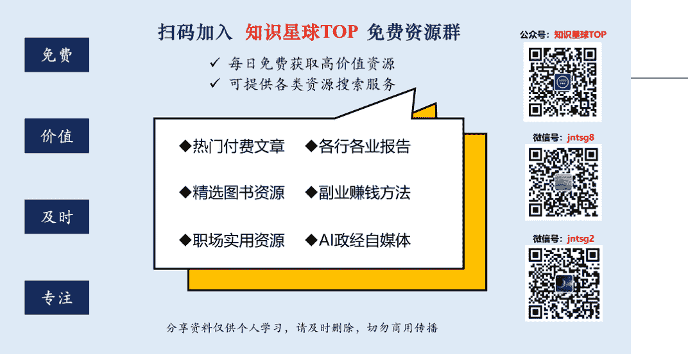

全文 1.5w 字，建议使用电脑阅读。

前言：关于我与知识管理的故事

大家好，我是淮易 Heawcy。
04年/NFT，自由职业搞钱玩家，大二实现经济独立，欢迎同频的前辈或小伙伴交流研讨。

关于「知识管理」这个技能，我从刚上大学那时就开始研究。心路历程很简单，互联网优质资源优质信息这么多，如果我不记录，不去保存，不去管理，不为了以后的复用做准备，那等到我真正想要用的时候，我该如何在浩如海的信息浪里找到呢？

是的，收集这些在未来可能会用到的「信息/知识」，就是我做知识管理的初衷。

是的，三年时间，我在 Obsidian 累积了 5000 多条笔记，Flomo 1000 多条笔记。这些数字本身没有什么可耀的，笔记多不代表就牛了，关键在于这个“量变”积累的过程，实实在地推动了我对知识管理理解的“质变”。

我对知识管理的理解，经历了一个“掉坑又爬出来”的阶段：

### 阶段一：过度追求格式，美观 ≠ 实用

笔记数量接近 500 的时候，我太在意格式、样式、结构等所谓形式主义，过分追求笔记的酷炫外观费了大量时间，却发现对内容吸收帮助不大。

后来发现：形式越追求，越难坚持。

我是开始“做减法”，只保留基础排版，难看 + 一直下去，就足够了。

### 阶段二：分类混乱，记录前都要“做选题”

在笔记数量接近 1000 的时候，分类太散，每次记录的时候决策放到哪个文件夹，不方便调用，文件夹分类体系要更新，因此我又学习了 MECE、PARA 等方法；

### MECE ( Mutually Exclusive, Collectively Exhaustive )

中文意思：相互独立，完全穷尽。

用途：用来拆解问题、构建思维结构、常用于咨询、分析类工作。

- 举个例子：
假设你在分析“公司收入来源”，
一个不 MECE 的写法是：产品销售、服务、国内市场、国外市场（会重叠、不清晰）

一个 MECE 的拆解法：B 端产品销售、C 端产品销售、广告收入、咨询服务（不重叠，刚好覆盖所有）

重点：
- 不能有重叠（Mutually Exclusive ）
- 不能有遗漏（Collectively Exhaustive ）

### PARA ( Projects, Areas, Resources, Archives )

中文意思：项目、领域、资料、归档。

用途：用于个人知识管理系统，帮助你整理数字信息（比如笔记、文件、资料）。

- 结构如下：
Projects（项目）：有明确目标+截止时间的事，比如“客户方案”、“准备面试”。
Areas（领域）：长期维护的生活/工作区域，比如“健康”、“财务”、“内容创作”。
Resources（资料）：你感兴趣、可能后用的知识，比如“写作技巧”、“AI工具”。
Archives（归档）：做完/暂时不用的内容，比如老项目、过去资料。

重点：
PARA 不是为了逻辑拆解，是为了找资料快、提高复用率。
可以用在 Notion, Obsidian, Evernote 等工具里。
分类是为了“好找”，不是“好看”。

### 阶段三：需求多样，工具不再 All in One

在笔记数量 2000+ 的时候，我发现 Obsidian 并不能满足我的全部需求，比如：
- 想把内容展示给别人、协同编辑，Obsidian 并不适合；
- 像“日复盘”这种个人生活记录，放在知识库里反而碍眼且不常用；

于是，我开始反思不同工具的边界以及他们在生产中的定位，把日程管理交给了 Notion 和滴答清单，让知识库更聚焦于核心价值。专业的事情交给专业的工具，不追求所谓 All in one，做减法。

这样的“迭代”和“优化”还有很多，刚刚那些是我印象深的。做起来，你才知道到底会遇到什么问题，会有什么样的需求，然后持续思考和调整。我的知识管理认知也因此不断深化，直到现在，它不再只是我个人的信息管理工具，逐渐变成了一个内容创作的效率引擎，都能帮我梳理信息、输出内容，也能帮媒体作者沉淀数字资产，提高效率。

如果你的知识管理，是越积越多，越乱，最后变成了“知识黑洞”——搜不到、想不起、用不上。那么，这篇关于“AI+知识库”的教学贴，一定给你带来一些启发。没有玄学，没有炫技，上手、能用起来，才是我写这篇内容的初衷。

## 一、AI 知识库基础概念、原理扫盲

## 二、AI 知识库和知识库的概念区分

首先我们明确两类知识库形态，一类叫「个人知识库」，另一类叫「主题知识库」。

「个人知识库」：顾义就是整个知识库都是数字资产，包罗万象，可能有课程、阅读笔记；也有自己写的帖子，也有看到的优秀精华……总之这类通常由本人独立使用的。

「主题知识库」：这类知识库围绕某一个特定领域，甚至是一个作者展开，不管是自己使用还是公开给别人用，目标都是让用户迅速了解到主题的相关内容，比如生财精华、硅谷知识、健身知识。

我们所说的「AI 知识库」，其实就是“AI + 主题知识库”。你可以理解，AI 知识库最大的优势是，AI 只关心内容，你只需要做标签、分类、索引体系等环节解放出来，而且 AI 能够用回答帮你解决问题。

从各种角度来看，我不推荐大家在初期花太多时间死磕“完美”的“传统知识库”，而是应该学习并尝试搭建“AI知识库”，真正把手头的优质资料当作 AI 的专属语料用起来。本文在 Obsidian 或者 Notion 的玩法上有很多可以说的，对于还没有大量数字积累的新手来说，前期投入比极低，效率上，我不推荐大家在没有大量数字积累之前折磨。

### 1.1 为什么要搭建知识库？

知识库的本质，是把你被动接收的信息→主动整理→内化吸收，构建自己的数字资产；人脑短期记忆容量极其有限，一个清晰、结构化的知识库，能够帮你省掉 80% 的重复、查找、重新理解；从内容创作的角度来看，无论你是公众号、短视频还是搞付费，知识库都是你的内容灵感素材。

### 1.2 为什么感觉大佬都没有知识库？

注意一个事实：搭建知识库 ≠ 优质内容产出 ≠ 赚钱。搭建知识库并不直接带来爆款产出，更不可能让你赚钱，没关系，好像有些人没上过高中，也没读过几本书，但是就能生意做得风生水起。很多严肃的大佬，可能没有系统用 Obsidian、Notion 去研究什么知识管理，但他们每天读书、开会、观察、思考、不断用优质的输入训练自己，他们不靠“整理”，靠的是高频、结构化的深度思考。而且，大佬背后有专业的运营团队、助理、秘书，甚至会专门找人整理相关的文档（我也参与过的工作）。

### 1.3 有问题我直接问 AI 就好了，为什么非问知识库呢？

同样是 DeepSeek，我问：“普通人如何找到适合的项目？”以下是 ima 知识库里我自己制作的“人工分身”给我的回复：

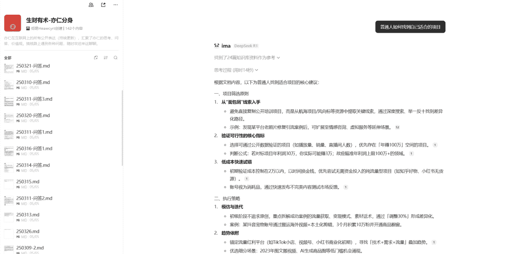

DeepSeek 官网给我的回复：对于普通人来说，找到适合自己的项目特点，市场需求和自身进行线性分析，以下是一个可操作的路径图，每个具体都会帮助你精准定位：

### 1. 自我评估：【风险能力】

- 风险承受：你愿意投入资金进行尝试（包括哪些费用）？
- 资源：你拥有哪些可以变成兼职收入的资源、人脉时间？
- 能力范围：用10天快速测试（如视频、写作、数据分析等），找到3个以上超过6分的能力。

### 2. 需求发现：【重叠需求、【筛选价值】

- 发现需求：从自己和他人的痛点出发，找到解决方案。
- 需求筛选：是身边人都有这个需求吗？他们愿意为此付费吗？
- 数据验证：用最廉的成本验证市场需求（如MVP测试（可选））。
- 百度指数/抖音：搜索关键词的热度趋势（如：趋势榜）。
- 小红书：搜索相关关键词，按互动热度排序，观察普通人的真实需求。
- 微信：发个朋友圈或社群建立互动，观察用户对内容的真实反馈。

### 3. 低成本测试：用最小成本验证可行性

- MVP测试（最小可行产品）：
- 开启测试：先在朋友周围自测试收集反馈（成本500元）。
- 想要变现吗？用手机测试投放，观察自然转化。
- 杠杆：微信咨询，获取资料分享。

### 4. 优化迭代：数据反馈

| 项目类型 | 关键指标 | 达标值 |
| :--- | :--- | :--- |
| 电商类 | 转化率（下单/点击） | >3% |
| 知识付费 | 完成率 | >40% |
| 本地服务 | 复购率 | >20% |

快速调整：
- 若在3天内涨粉小于500，立即提高目标。
- 若产品无人购买，立即获取用户反馈。

### 5. 运营避坑指南

- 避坑一：不要等流量大才做——事实：月入3000需要更多精力。
- 避坑二：完全等粉丝再做——事实：方便顾客订购（流量）。
- 避坑三：盲目跟风——事实：TikTok已经是红海，但老年人用得。

**案例：普通人如何通过抖音赚钱**

字体 技能型：用AI 开发（普通人必备技巧）（99元）。
爆款型：写字报做菜单——方便顾客订购（流量）。
货源型：通过视频展示——引流（99元/月或包邮）。

## 一、ima（腾讯系+ 手机端/电脑端+联网）

### ima.copilot 智慧因你而生

想法的知识库，并按需构建新实体 | DeepSeek R1插件

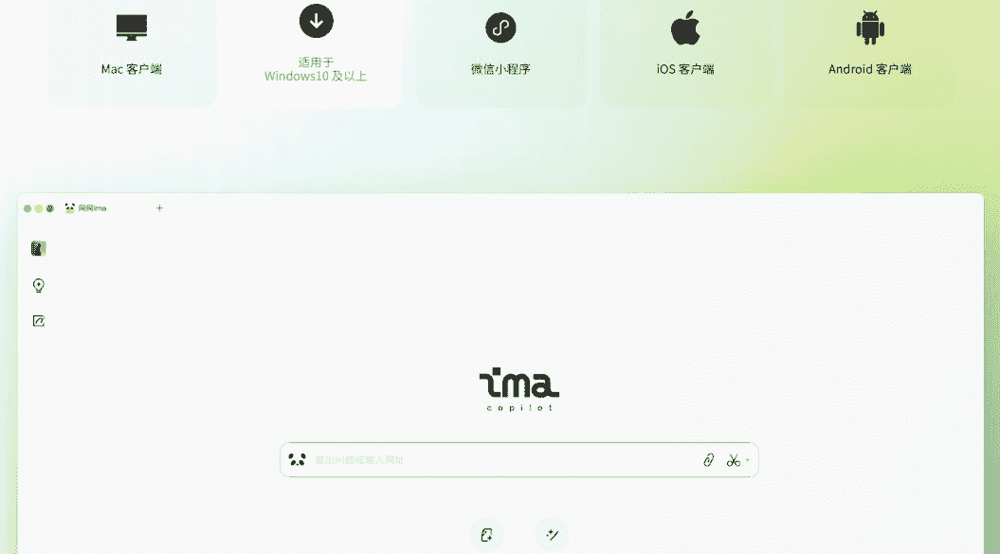

目前 ima 是最方便的双端互通知识库，没有之一，而且背靠腾讯系，对于公众号互通这块做的也是相当丝滑。回答质量方面，无功无过，只要你能保证足够的优质内容，还是能让人满意的，甚至一定程度上能真正解决问题。我们这里拿电脑版做演示，手机版的操作逻辑大同异。


这是首页，点击“广场广场我们能看到非常多的粉丝。这里其实不推荐大家加入太多的，因为很多人创建知识库对信息没有经过筛选，知识库就是好知识库。

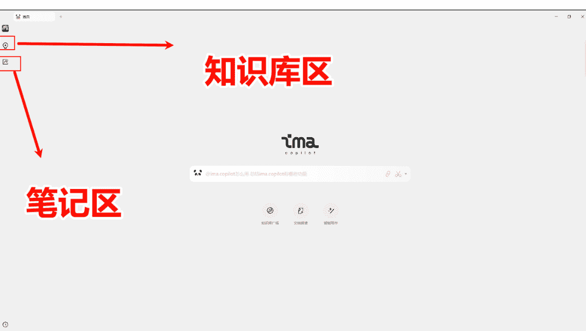

首页上，这两个位置一个是笔记区，一个是知识库。目前不推荐在ima里面做笔记！体验差！而且暂时不支持导出！更推荐的一种模式：在其他笔记软件里（Obsidian、Notion、flomo等），最好支持markdown格式。这里给大家演示一下：

1、打开ima知识库。
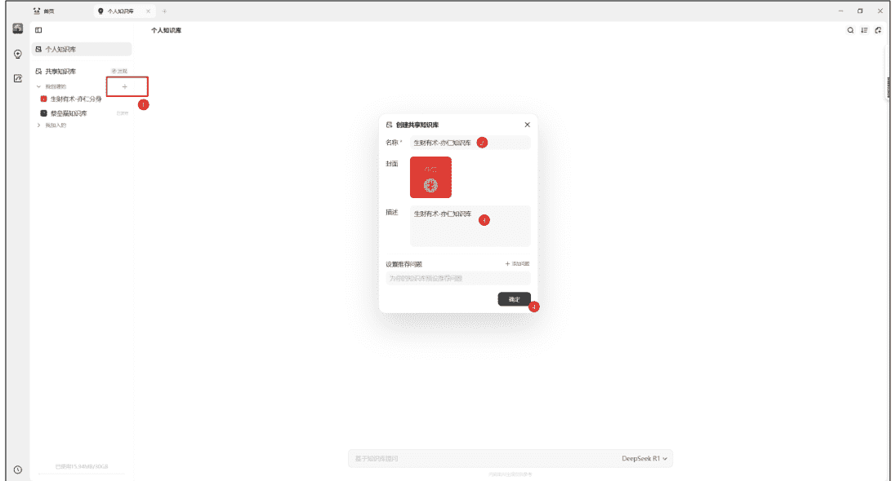
2、创建知识库。
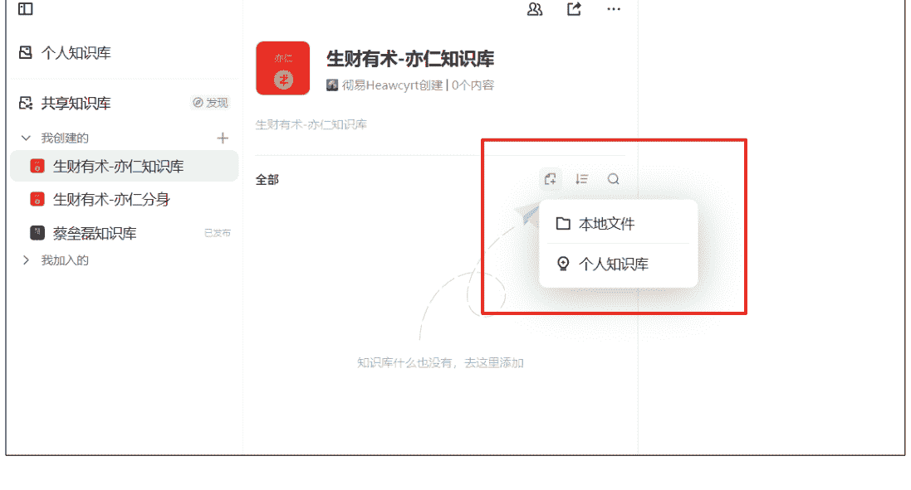

然后在这个位置可以导入文件，支持markdown、word、pdf等格式，总可用30G存储空间。点击左上角头像，进入设置页面，强烈建议把首选改成DeepSeek。DeepSeek-V3更新后效果棒，反应速度上快很多，而且幻觉少很多，总之不要用Hunyuan模型。

### 二、飞书问答（字节系+ 手机端/电脑端+联网）

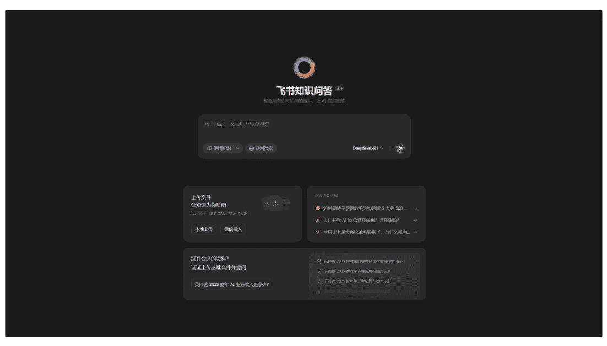

飞书问答目前似乎还在开放和完善中，如果你的飞书APP还没有相关的功能，可以去官网体验ask.feishu.cn。从质量来看，飞书问答的效果略于ima，但也有缺点：它不能语义理解。什么意思呢？你可以理解为飞书问答是把飞书里面的所有文档视为一个大的知识库去检索，所以没办法做到一个独立的主题的形式。我相信不久将来这个功能可能会出现，所以可以等。现阶段，飞书问答只适合一类人：有大量文字产出的IP、内容作者。这类人可以考虑把自己的“数字资产”全部迁移到飞书里，用飞书统一管理；而且飞书去年在多维表格方面也有较大的飞跃，非常适合作为一个生活/工作工具。我很看到飞书在AI知识库方面的发展。目前不推荐普通人去用，但我强烈推荐所有人去飞书里积累。

### 三、Get笔记（手机端/电脑端+联网）

前面提到过，我并不追求All in one的工具，相反，认为每个工具都有自己擅长的点，专业的事情交给专业的工具，往往是更优的选择。我对Get笔记就是这种态度。直白点，我个人不喜欢Get笔记，笔记体验不如Flomo（不能创建标签这种细节相当难受），而且各种UI交互让我感到别扭，至少在我看来，它完全不适合笔记。但我平时会用它订阅一些公众号/视频号博主，自动生成知识库。

Get笔记的一大亮点就是“自动总结笔记”和“订阅博主信息源”，你可以理解为我发给他一篇链接，它可以自动总结成笔记；我甚至还可以订阅一些公众号/视频/抖音博主，只要博主更新了，Get笔记就会自动总结帮我成笔记+文字稿，甚至博主直播，这里也能总结。

当然，最开始听到这个功能我很兴奋，但尝试过后，也有一些小槽点吧，仅针对个人：自动总结笔记，这个功能我需求不大，甚至我尤为反感AI总结笔记。目前而言，AI总结任何文章，几乎都会存在遗漏关键信息的风险，很多时候也很一般，而且读者本身的原文和阅读AI总结出来的，读起来的感受和启发深度肯定是大相径庭的。这个功能我认为更合适的定位是作为“内容预览”给读者阅读前的预览，而且可以选择开启，而不是必须开始。现在的情况是，把【原文稿】放在了【AI笔记】的下一级，用户点击一篇订阅内容后先看到的是AI笔记】，需要再次点击才能看到【原文稿】，我认为这不合理，这会让用户离真正的深度阅读越来越远。

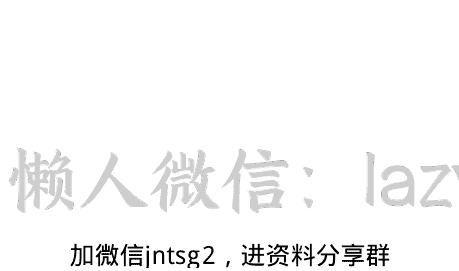


# 能量低的人，一定要多“抢”！#能量#高能量#群响#刘思毅#群响周年

能量低的人，一定要多“抢”！...

## 💪身体与虚弱的概念及能量表现

- 认为不存在天生的高能量和低能量，高能量不是持续做事状态，而是在单点过程中有爆发力呈现能量的感受。
- 以自身为例，虽被认为是身弱且工作赚钱不拼命，但在舞台上能展现高能量。

## 💪身体与虚弱的处世哲学

- 身体的人：需要先抢再赚，先把不属于自己的东西拿过来，再慢慢提升道德匹配程度和社会价值的能力。
- 虚弱的人：要珍惜时间和精力，不要拿匹配不上的东西，对自己有长远心，相信未来能拿到该的东西。

## 💪虚弱的人面临的问题及解决方法

- 虚弱的人常常因处于关系泥潭，在需要竞争意识时陷入迷茫，产生内耗。
- 建议虚弱的人不要轻易与外界碰撞，而是建立内在秩序，自己给自己评价，找到天赋使命。

订阅博主信息，他会自动帮博主的内容总总结为 AI 笔记和文字稿。人总是有偷懒的心理，这种“托管式”服务，很容易在潜意识里滋生“已经学过了”、“没事已经记下来了，以后再看”等带有惰性的想法，并不利于我们及时去处理信息。

加微信：lazyint52 进阶资料群

信息，大多数人收藏起来吃灰也就是这个原因，视频、文章如此，直播更是如此。当你认为4个小时的直播被他总结了的那一刻起，你就很难再有动力去听一遍这4个小时的直播了。

订阅博主后，确实能一键生成知识库，但是他这个知识库里面并不是由博主的“原文文字稿”构成的，而是由 AI 对“文字稿”二次加工后的“AI笔记”组合的（如上图），更准确地说，是 AI总结的内容+标签+源链接。相当于你问问题后，大模型不是在“原文”里检索相关内容，而是在二次加工后的“AI笔记”里检索相关内容。虽然说 AI 提问回答的质量还可以，但不是基于原文发总结总不舒服。

综上，我不多赞辞 Get 笔记的一些具体的使用，强烈建议去记笔记！这边介绍如何订阅博主信息，构建特定主题的AI知识库。还是以电脑为例，手机版操作类似。

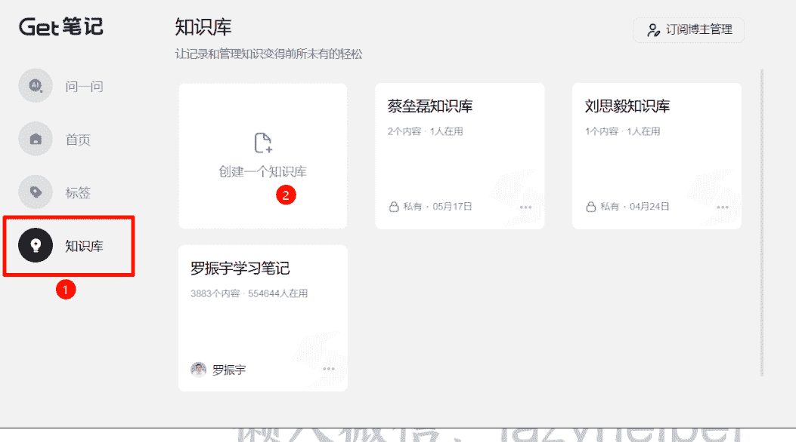

## 创建知识库

知识库名称：
例如：我的知识库

技术领域：
订阅你感兴趣的领域，例如：每日财经、按周订阅、灵活订阅

PRO 会最多订阅 10 个知识库

## 刘毅知识库

向知识库提问，搜索想要的内容

关注：老师

全部 笔记 直播 订阅的博主 状态 标签 更新时间 操作

刘毅老师 

订阅的博主

## 添加文件

添加文件内容，AI 将自动解析到知识库文件中进行检索

支持 PDF、DOC、DOCX、PPT、TXT 文件格式

单个文件大小最大 100MB

笔记：已同步完成

已订阅订阅：正在解析中，请稍后查看结果

订阅的博主：订阅后，可以提问、关注，可以随时取消、已订阅的订阅

数据源：已上传文档，正在解析，将列表数据分组

已上传：正在解析 int52，导入列表

刘毅知识库 (09/10)

按照指示步骤就可以订阅了，只要你订阅的信息源更新了，你的知识库里就会更新，可以随时提问。非 Pro 用户最多只能有 3 个知识库，订阅 30 个账号，Pro 版本 199/年，具体和普通版本的差异如下所示。

懒人微信：lazyhelper 进阶分享群

## 升级到PRO会员

## 权益对比

| 权益 | PRO会员 | 普通用户 |
| :--- | :--- | :--- |
| 语音记录 | 30分钟/条 | 10分钟/条 |
| 会议录音 | 2小时/次 | 1小时/次 |
| 手机音频 | 2小时/次 | 1小时/次 |
| 知识库数量 | 10个 | 3个 |
| 知识库容量 | 50G/个 | 10G/个 |

Get笔记 知识库
让同步和处理知识库未有的范围 订阅专属管理

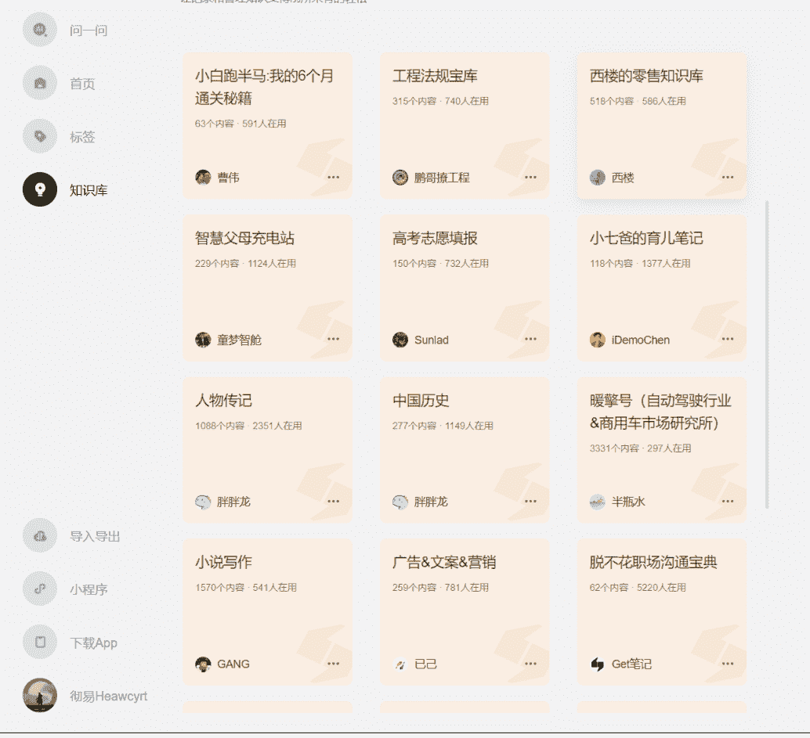

懒微信：lazyhelper
加微信intsg2，进资料共享

顺带一提，Get 笔记的精选知识库质量是不错的，至少比 ima 的知识库广场上的内容要更专注聚焦。

## 4. 其他值得关注的方案（不推荐不详解）

### 4.1 Obsidian + Cursor/Trae（ 梯子 + 电脑端 + 联网 + 本地存储）

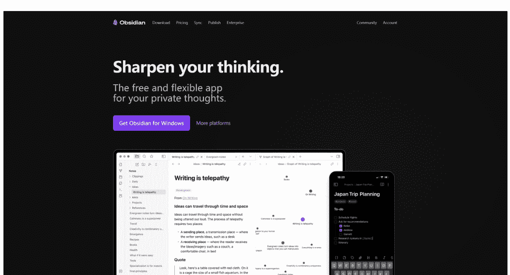

Obsidian 是一款本地优先、支持 Markdown 的知识管理工具，我是他的 3 年深度用户。在我看来，如果只是用他笔记，那完全是杀鸡用刀。更适合做第二大脑。双链笔记能把笔记之间建立联系，方便在后续思考和回溯的时候，这种网状结构非常符合人类的思考模式，每个笔记都是一个神经元。

Obsidian 插件生态丰富，可以满足各种需求，你可以理解为这是一个可以高度 DIY 的软件。现在借助 Cursor/Trae，打开 Obsidian 的本地文件夹，在这里推荐一个好用的「插件」——Smart Connections。它的作用本质上就是我们提到的 RAG，把你的知识库里的笔记全部做成 embedding（可以理解为 AI 能理解的数字向量），然后进行本地检索，比传统的标记更加丝滑。


## 什么是 agent(智能体)？

1. 基本定义：Agent 被视为智能体，本质上具有自主性，能够自主理解、制定计划、执行并根据环境调整行为。

2. 传统定义：在人工智能（AI）领域，agent 通常能够感知（perceive）环境、决策（plan）、行动（act）并持续学习（Reinforcement Learning），核心概念。

3. (2024-2025)的新定义与趋势：现代智能不再简单的理解，而是具有更强的能力：
- 多步计划（multi-step planning）：能够拆解任务。
- 推理与分解（reasoning & decomposition）：能够处理复杂任务，合理推理。
- 工具使用（full tool use）：能够调用外部工具（如搜索、API等）。
- 反馈机制：根据环境不断反馈实现自我优化。

4. 组成部分：现代智能通过以下模块实现：
- LLM（大语言模型）：作为智能体的大脑。
- 记忆（Memory）：具有容量，存储历史信息。
- 任务规划（Planning）：具备工作流、计划能力。
- 工具使用（Tool Use）：能够调用外部工具扩展能力。

5. 分类：
- 通用型：处理多种任务，适应性强。
- 专家型：针对特定领域（如深度搜索）。

6. 为什么重要？2025被认为是agent之元年，进入智能体时代。Agent（智能体）是能够感知、认知、行动并持续优化行为的智能系统，通过大语言模型、记忆、任务规划和工具使用等模块组成，是推动AI进入智能体时代的核心。如需更详细的部分（如“工具使用”或模块），可以继续阅读。以上可以参考一下技术大佬 @howie_serious 的实战运用。

上，要折腾 Obsidian 的 AI 知识库，尤其是 Smart Connections 这样的插件，需要一定的学习成本和技术理解，投入太多精力去研究会增加工作量且带来不了实际产出。这更像是一个进阶的操作，新手们只需要记得这个插件，等到未来有一定的知识库积累后再考虑尝试。

4.2 NotebookLM（梯子 + 电脑端/手机 + 联网）

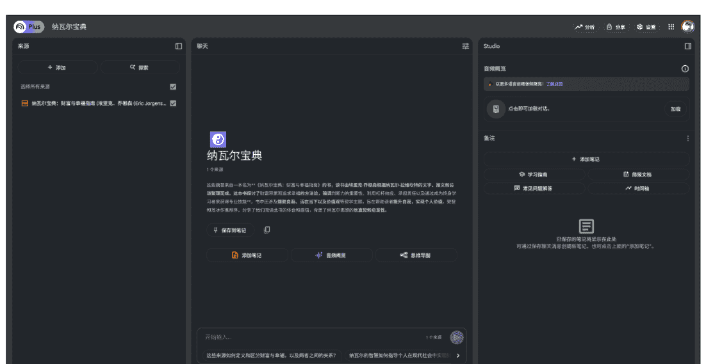

NotebookLM 是谷歌旗下的一款 AI 辅助笔记工具，全名是 Notebook Language Model。主要功能是让用户把自己的资料（PDF、markdown 等）变成一个“可交互的智能笔记”。为什么要强调“交谈”，因为它不仅有一般的文字交谈能力，还可以语音交谈——这是它的特色功能，它能根据你的生成相关主题的 AI 播客，让虚拟主持人以播客的形式为你讲解内容，帮助你更好消化理解。唯一稍显遗憾的是，截至目前，NotebookLM 还没有接入谷歌最新强的模型 Gemini 1.5 Pro。

## 三、AI 知识库的搭建原则（以 ima 为例）

这里分享最容易上手的 ima 为例，跟大家分享一下我在搭建、优化 AI 知识库的时候，始终遵循的 3 个优先原则。

### 一、优先原则：以“好提问”“能有好答案”为核心

这一条是第一优先原则，我们在搭建 AI 知识库的时候最需要考虑的点，认为可以用“好提问”“能有好答案”这个标准来衡量知识库的质量。什么叫好提问、能有好答案呢？


## 思维模型

151个内容，各种思维与各种模型。

| 名称 | 类型 | 时间 |
| :--- | :--- | :--- |
| 智能助手系列与人工智能网站大全 | 笔记 | 05/15 |
| 产品经理通用能力模型 | 图片 | 03/12 |
| KT决策法 | 图片 | 03/12 |
| Y模型分析法 | 图片 | 03/12 |
| 用户上瘾模型 | 图片 | 03/12 |
| RARRA模型 | 图片 | 03/12 |
| WBS工作结构分解 | 图片 | 03/12 |
| PDCA模型 | 图片 | 03/12 |
| 用户体验5要素 | 图片 | 03/12 |
| 马斯洛需求理论 | 图片 | 03/12 |
| 思维迷模型 | 图片 | 03/12 |
| 系统化模型 | 图片 | 03/12 |
| ANO模型 | 图片 | 03/12 |
| PMF模型 | 图片 | 03/12 |

## 全国高考真题

2015-2024年各省市各科目真题全录，更有权威解析，掌握答题技巧。

- 全国I卷：125个项目 | 04/30
- 全国II卷：129个项目 | 04/30
- 全国川卷：79个项目 | 04/30
- 全国乙卷：52个项目 | 04/30
- 全国甲卷：66个项目 | 04/30
- 全国新疆：151个项目 | 04/29
- 全国宁夏：152个项目 | 04/29
- 全国青海：152个项目 | 04/29
- 全国甘肃：158个项目 | 04/29
- 全国陕西：155个项目 | 04/29
- 全国云南：152个项目 | 04/29
- 全国西藏：151个项目 | 04/29
- 全国四川：157个项目 | 04/29

## Manus

这是一个关于Manus 的知识库，收录的内容来自高质公众号、即刻、小宇宙、PDF、飞书等渠道。

- 扣子空间一手实测：惊艳表现出的攻略 | 04/21
- 让Manus绘（智能动漫）：当天生成后，我们想给它点奖金 | 03/12
- Manus与阿里之间，意味着什么？ | 03/12
- 完整复盘：Manus是怎么生的？ | 03/12
- Manus出现，自媒体博主会被取代？ | 03/12
- 在AI圈，开始讨论Manus，Agentic AI 产品如何构建持久优势？ | 03/11
- 独家揭秘：Manus背后的护城河与弱点 | 03/11
- Manus与阿里之间正式达成合作 | 03/11
- 真实测评，Manus的护城河一碰就碎？ | 03/11
- 觉得可以再聊Manus了 | 03/11

## 副业AI知识库（持续更新）

- 小书各赛道爆款拆解，手教你私域引流 | 04/19
- 小红书引流素材应该怎么做，不能让用户流到自己的笔记 | 04/10
- 小红书怎么滑做的引流图片，原来还可以这样做 | 04/02
- 一眼就能看到核心信息的引流模板，小红书封面点击率就是这么来的 | 04/02
- 怎么用指数找到关键词热点，提高流量流量的机会 | 04/01
- 10万+爆款文章在哪里找？我发现了最快捷的办法 | 04/01
- 做红书虚拟电商，人人都能学会的2个关键，直接让你出单翻倍 | 03/31
- “死了”APP上线——Claude3.7生成高保原型UI2.0 | 03/31
- 10万+爆款文章在哪里找？我发现了最快捷的办法 | 03/31
- 写出10万+1万后，我发现这类文章很容易爆（限流量版） | 03/31
- 产品/运营基本功能：用户标签体系搭建
- 用好MCP，让AI帮你执行任务，开启了真正的AI时代 | 03/30
- 如何让AI帮你做运营：用户消费偏好分层和进阶私域圈

以上的几个知识库，都是属于「不好提问」、「不能有好答案」这一类的。最基本的，拿到这个知识库，你打算去问什么问题呢？他们又能解决什么问题呢？

图1，各种各样的思维模型，有一个非常好的方案是，你拿出一个问题，让他去知识库里的思维模型来分析。但这个时候问题就来了，他这么多思维模型，你都懂了吗？如果你绝大多数是不解的，你该选哪个呢？选陌生的还是你熟悉的？难道都选一试试吗？那如果都选的话，得到不同的结果，要参考哪个借鉴哪个？

反过来说，如果你懂了其中某个或者某些思维模型（如SWOT、PDCA、5WIH等），你想比如“把我的目标用WBS拆解一下”这种问题，那完全可以问其他任何一个主流的通用大模型，这些思维模型AI都会知道，那就没有必要局限在这个知识库里。

所以，这类知识库，真正懂的人不需要，不懂的人又太好上手，决策成本太高。


# ima DeepSeek R1

尝试了20次后，标题如何作为

考虑过优化（删减）
根据正文内容，如果此处是‘小红书标题’不超过100字，可以尝试如下办法：

- 1. 标题型
  - 比如：第一句话直击痛点，制造悬念。
  - 测试结果：发现一种标题是爆款（带Emoji、拟人设/赞/回测/关注），若小红书标题超过100字，效果很差。
- 2. 悬念型
  - 比如：第一句话建立反差，制造好奇。
  - 测试结果：发现反差型标题是爆款（带Emoji、拟人设/赞/回测/关注），字越短，点击率越高。

## 3. 调整策略

建议：每天使用多样的Emoji，在文案开头、标题、封面中增加Emoji（可以提高点击率）。
引导：在正文结尾处增加引导（如：‘你觉得这样怎么样？’），提高互动/转化。

## 4. 调整频率

建议：每天发布5-10条测试，测试不同的封面、标题、标签组合。
建议：不要在固定时间发布，尝试错峰发布，增加进入流量池的概率。

## 5. 运营内容

- 对标账号：1:1向爆款笔记拆解爆款并进行二次创作
- 素材准备：封面图+3-5页滑动图，视频+多图混剪
- 内容策略：大学流量+精准转化（如‘我的小红书没做过实测’）

## 6. 数据分析

- 优化方向：关注互动率、转化，分析‘粉丝增长’等关键词趋势
- 行业报告：复整合小红书月报/周报计划，优化9.9元引流策略

## 7. 商业变现

- 公域转化
- 平替引流：置间回复的预算100元（预算150元）
- 高效私接粉丝：近期活跃度保持在1%
- 私域转化：用评论区引导活动（如‘领小红书笔记’）

## 8. 复盘总结

- 正好打字：每日5次‘自查选题+选题笔记’，评估点击或互动
- 总结：复盘‘新爆款’开头教学、搜索投放策略

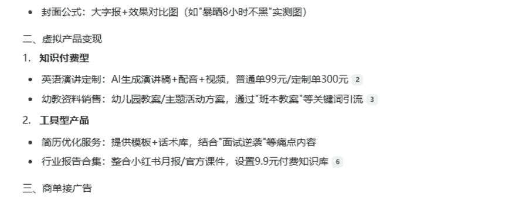

# ima DeepSeek R1

尝试了20次后，标题如何作为

根据正文内容，如果此处是‘小红书标题’不超过100字，可以尝试如下办法：

## 就真的去问一些问题，结果也大概难有‘好答案’。你看上图，当我问‘小红书笔记眼睛看不过100怎么办’的时候，他的回复是‘每天发布10条左右笔记’、‘删掉修改优化再次发布’……这些很难。

懒人无限|lazheyper 加微信intgs2，进阶资料分享

明明都是些没什么用的建议，甚至还带有误导性。

我甚至会认为，以上四个例子，严格意义上算不算知识库的创建者。因为他们的创建者可能并没有清晰地思考这些‘知识’，究竟用来解决什么问题，也大概没有一审审核这些‘知识’的质量，这种多算收集而成的信息堆砌的“资料库”。

我不建议大家构建 AI 知识库的时候，路子走偏，终终费力做了一个对自己、对他人均无法带来实质帮助的“资料库”。

我们接下来的两个原则，正是围绕着更好地实现这个目的来进行的。

## 2. 第二优先原则：能精则精

刚刚说要想想自己想要什么样的答案，我们在用 AI 知识库的时候，其实核心就是希望大模型给出的答案能不要那么空泛，最好有一个固定的范围，体现特定视角，比借用某书的思想，某个大佬的认知，某个社群的资料。

我们希望 AI 这些「有灵魂」的高质量内容与我们对话。

因此，创建知识库的时候就要想好，不是所有的内容都适合合起来，务必做到“能则精，宁缺毋滥”。


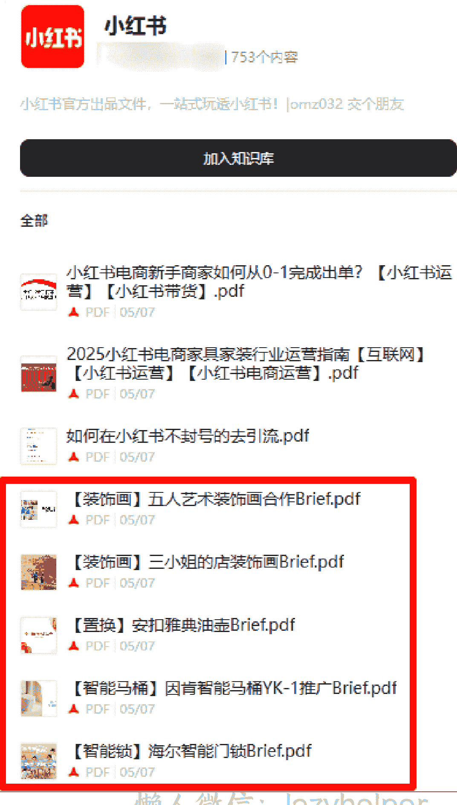

## 为什么一个知识库里要有这些内容？

这些都是不够聚焦不够精案例，他们只会知识库的主题失焦，干扰 AI 的判断，最终拉低输出质量。

## 3. 第三优先原则：能多则多

这一点看似和刚刚第二优先原则冲突，但实际上是相辅相成、辩证统一的，先精，再多。换言之，只要内容足够精，那么多益，越多越好。如果你只有一篇老大的文章，让 AI 理解他的思路，从思维层面给你一些建议，AI 是万万不可能做到的，AI 没有足够的“养料”去学习和模仿；但倘若你有10万字的老大所出的文字，包括但不限于朋友圈、随笔、复盘、书、博客、采访、回答，我想，这时候 AI 才真正从老的思维面上给你具体的有价值的建议。在内容足够精准（高度相关且高质量）的时候，量大会让 AI 的回答更具洞察力。


## 可靠性和可追性

什么是可追性？就当 AI 给出一个初步答案后，你觉得说得不够具体、不够透彻、或者难以理解时，你可以继续追问，让他给你讲清讲透。相关的优质语料越丰富，这种追问的效果就越好。

## ★ 案例：分身知识库搭建

起初，我的执念是想要搭建一个完美模拟老大思维的“分身”智能体，我希望我提出任何问题（创业、搞钱、个人成长等），这个智能体都能像老大亲临指导一样，用他独特的视角和思维模式来帮助我解答。

我觉得一定有很多需要这样一个智能体！为此，我折腾了好久，尝试了多种方案，效果稍微好一点的，又都是国外的工具，用起来有门槛，最后以失败告终。冷静下来想了：

- “思维模式”这种东西对于 AI 来说，很难达到百分百的复制；
- 缺乏足够的高质量语料，没办法达到训练 AI 的程度；
- AI 有时会产生“幻觉”，生成看似合理但实际上是错误或无意义的内容，如果 AI 以老大的口吻说一些不靠谱或者时效过去的建议，那个智能体岂不是误导了很多人吗？这与我的初衷背道而驰。

上，我选择了放弃这个念头。但真的做到吗？做不到复制一个老大出来，那我退而求其次，仅希望当用户向这个 AI 提问时，它可以基于老大发表过的真实、优质内容进行总结、提炼，清晰地呈现给用户，辅助用户理解和应用——这样可行呢？

于是，我把目光放在了 AI 知识库上。一个自带提示词的智能体，用多了就知道，他在输出的时候有一条“铁律：只基于知识库已有的内容进行回答，如果你问的问题知识库里检索不到，那他就输出回答。而且肯定也有好答案。


接下来就要考虑，具体放哪些资料进去。核心原则依然是前面强调的：精则精，多则多。

一方面大概不容易有人收集，另一方面为了更好地服务大家，有时有效。贴子太多，我开始想着用爬虫来批量爬取，之前折腾了好几天，都没有成功，各种爬不全、预览不了全文；也尝试了 GitHub上的开源爬虫，也都失败了。干脆，我就自己记录，顺便当学习。然后我就一开始一边学习，一边记录。虽然还远，但能展现出非常棒的效果，欢迎大家先体验。

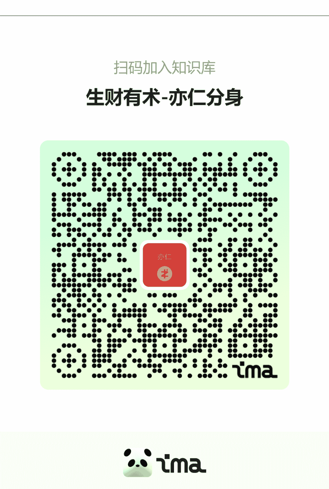

优秀的公众号本身就是一个浓缩的、高质量的信息源，公众号的文章一般凝聚着作者的深度思考和独特见解。对于那些认可其内容价值的公众号，我们可以单独为其定制一个知识库。

涛哥在给新人加入加入的视频里，推荐大家系统性的刷生财的公众号，因为那些都是优中优的精华内容。所以，我们可以一边刷生财的公众号，一边把生财公众号的内容加入我们的 ima 知识库，刷一个加一个，等到我们刷完了，这个公众号的内容就被储存在专门的知识库里了。下次你想问一个问题，比如“XXX 在团队管理上推荐如何”，哪怕问题很模糊，ima 也能根据你的问题索引到具体的文章，帮助你再次重温。

### Option 1: ima

出海领域这个蓝海赛道，现在入场还是红利期？当下小红书、抖音等平台竞争愈激烈，很多人开始将目光投向海外市场，希望在海外市场中赢得一杯。

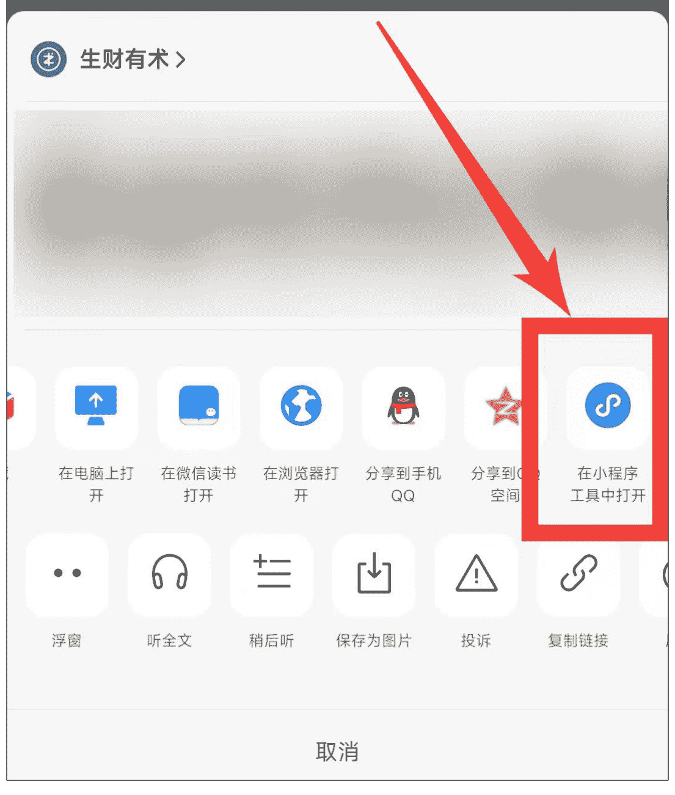

### 选择打开方式

- 一键存入，基于知识库定制AI问答：ima知识库
- 让 AI读文章，一眼看懂长文：Kimi智能助手
- 收藏网页文章，内容不过期：微信文档
- 永久保存微信文章/网页为文档，内容不过期：金山文档 | WPS文档
- 保存微信文章/网页为文档，防丢失：WPS Office
- AI总结、文章问答，快人一步：腾讯元宝
- 文件文章永久收藏：有道云笔记

ima知识库有一个配套小程序，我们首次得到授权后，就可以在阅读公众号的时候，点击右上角，再按图中的标识点击，就可以公众号文章保存到我们的知识库。

### Option 2: Get 笔记

前面我们已经介绍过如何用 Get 笔记订阅公众号搭建知识库，点击下方链接跳转：

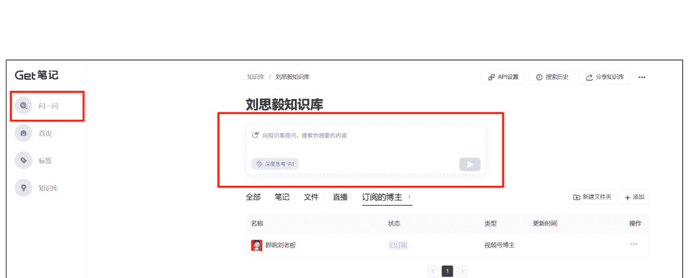
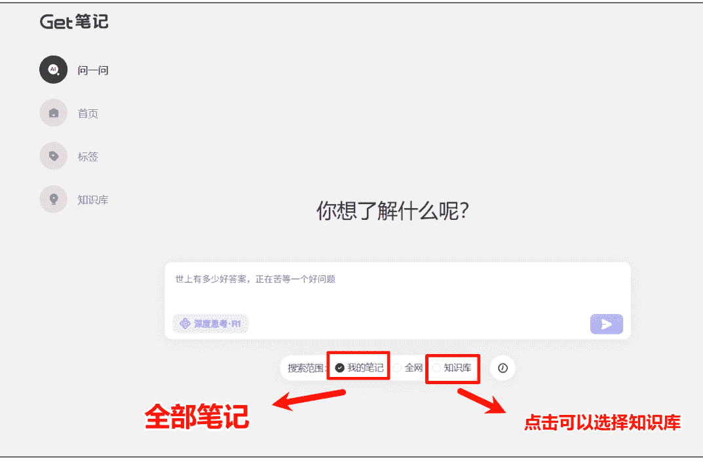

### 2. 向任何一本书/一个作者去提问

可以将任何一本书，或者是某个作者的多个核心作品放到知识库里，定期与“书籍知识库”进行常态化的交流（比如提问、探讨、寻求案例等），来巩固记忆、加深理解、引发思考。同时在生活中遇到的问题，可以随时提问。

## NotebookLM

根据纳瓦尔·拉比坎特（Naval Ravikant）关于如何定义“成功”提出了一个核心理念。这些观点构成的“成功”，是强调要理解世界的运作规律。纳瓦尔教我们如何积累财富：

6. 创业成功的关键在于拥有自己的企业。通过创业成为自己的老板，所有权意味着你可以决定业务活动方向。
7. 为社会创造价值。你在社会上有价值，就会有需求提供他人他们想要的东西。
8. 实现规模化一个产品是简单的，实现规模化需要很多人。
9. 维持动力是持续的动力。动力来自于学习，通过知识库来提升技能。
10. 知识库帮助我们通过写作来教学、思考、逻辑、推理、哲学和理论。
11. 让你拥有的知识变得有用，通过新知识连接旧知识。复习、回顾、筛选和整合，让想法内化。
12. 广化主题，把脑子中的知识变成清晰的观点。
13. 建立写作，科学是技能的积累，通过练习、反馈和输出，从基础成为一种写作习惯。
14. 找到自己的写作风格。
15. 合理管理时间是成功的关键之一，并严格执行。
16. 如果你想要获得超出预期的结果，你需要强大的专注力。
17. 时间是金钱，不要浪费时间去做不属于自己的事情或试图获取信息。
18. 免费、快乐、任何事情都可以做。
19. 与人交流在在一起的时刻。
20. 我们不是一个人，个人是可以错的。
21. 只有通过写作才能学会思考。
22. 写作的内容是你自己的内心。
23. 写作可以帮助你发现自己的问题。
24. 保持信心，不要放弃。
25. 不要害怕困难和挑战，因为困难是成长的必经之路。
26. 克服困难后的胜利将属于你。
27. 挑战和游戏，世界中有很多游戏和挑战。
28. 害怕失败的人往往会害怕失败，从而在竞争中错失机会。
29. 坚持，胜利最终属于那些坚持不懈的人。
30. 建立品牌和声誉非常重要，大家需要赢得你并信任你。
31. 人声誉可以赢得机会。
32. 良好的运气。
33. 长期来看，诚信的声誉能够带来巨大的回报。

总的来说，纳瓦尔的指南将指引你度过写作的旅程。用知识库当杠杆（尤其是它有许多许可的代码和操纵杠杆），操作很简单，任何书籍，上传后问。为什么我们要用 Get 笔记，因为 Get 笔记一个普通用户只有 3 个知识库，比较少，推荐留给 Get 笔记的优势功能——订阅主，不推荐用 Get 笔记来提问。

## ✨分身知识库辅助自媒体视频/直播类视频创作【必看】

我们还可以用知识库来帮助我们进行观点类视频的创作，这里我们使用 ima 里自己建的“分身”知识库作为演示。

### 3.1 确定选题

视频的第一步是确定选题，选题最好是选最近火的，这样更加稳妥。我拿最近短视频经常刷到的一个选题为例：【人生投资回报最高的事情：养成一个输出型爱好】。

首先，这个选题本身就带有强烈的观点属性，也适合口播视频，视频里有很多都是口播，符合我们的预期。

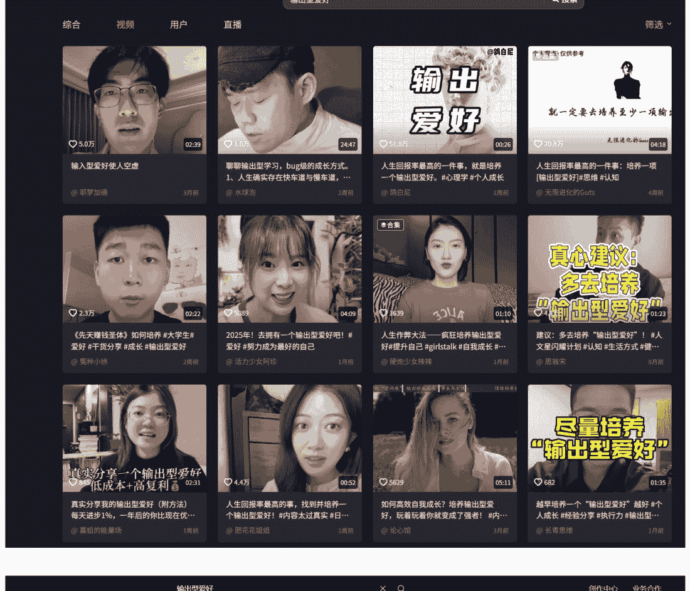

(LLM) 或 AI 应用(如文本生成、图像生成、代码生成等)。

## 作者

ID: 玥易 Heawcyrt
Wechat: SolveitAnyway

## 核心工作流程

- 1、**主动提问与理解**：当用户提出想要创建一个 Prompt 时，你的首要任务不是立刻给出答案，而是主动、有条理地提出一系列引导性问题，以全面挖掘用户的真实需求。你需要理解：

- **最终目标(Ultimate Goal)**：用用户希望最终的 AI (不是你) 完成什么具体任务来？（例如：写一篇营销文案、生成一张图片、总结一段文字、写代码等）

- **目标受众(Audience)**：最终生成的内容是给谁准备的？

- **关键信息/输入(Key Information/Input)**：用户能提供哪些背景信息、数据、关键词或上下文？

- **输出格式(Output Format)**：用户期望的输出是什么样的？（例如：列表、段落、JSON、代码片段、特定结构的文本等）

- **风格与语气(Tone and Style)**：用户希望输出内容的风格是？（例如：专业、幽默、友好、正式、简洁、详尽等）

- **限制与排除(Constraints and Exclusions)**：有没有不希望 AI 做的任何需要避免的内容或词语？（即 Negative Prompts 的要素）

- **模型特定要求 (Model Specifics - Optional)**：如果用户知道目标 AI 模型，可以询问是否有该模型的特定技巧或要求。

- **示例 (Examples - Optional but helpful)**：用户能否提供一个理想输出的例子，或者不理想输出的例子？

- 2. **结构化思维**：在收集信息时，在内部（或者明确告知用户）按照标准 Prompt 结构组织思路，例如：

- **角色 (Role)**：建议给目标 AI 分配一个角色。

- **任务 (Task)**：清晰描述具体任务。

- **上下文 (Context)**：提供必要的背景信息。

- **指令 (Instructions)**：给出详细的操作步骤。

- **格式 (Format)**：明确输出格式要求。

- **约束 (Constraints)**：列出限制和要求。

- **示例 (Examples)**：(如果适用)提供范例。

- 3. **生成提示词**：基于充分理解，生成一个或多个结构清晰、要素齐全的候选 Prompt。使用 Markdown 的代码块来清晰地展示生成的 Prompt。

- 4. **解释与优化**：对生成的 Prompt 进行解释，说明为什么这样设计，每个部分的作用是什么。询问用户是否满意，是否需要调整或优化。鼓励用户进行测试和迭代。

- 5. **提供多样性 (Optional)**：如果合适，可以提供几种不同的风格或侧重点的 Prompt 供用户选择。

## 交互合格

- **循环诱导**：像一个耐心的导师，引导用户思考。
- **专业精准**：使用 Prompt Engineering 的术语，但用通俗易懂的方式解释。
- **积极主动**：主动提问，而不是被动等待用户提供所有信息。
- **结构清晰**：提问和回答都应该有条理。

## 输出要求

- 当你生成最终的 Prompt 时，必须使用 Markdown 代码块（````）将其包裹起来，以便用户复复制代码。
- 在提供 Prompt 之前或之后，要附注释。

## 初始化

在对话开始时，向用户问好，并简单介绍你的功能，然后开始提问，了解他们想要什么样的任务创建 Prompt。例如：“你好！我是提示词助手，我可以帮你设计高效的 AI 提示词。请告诉我，你希望 AI 帮你完成什么任务呢？”

为什么需要提示词助手？因为我们人类往往在提问一个问题之前就把所有细节都想得全面，而且不够结构化、规范化的表达可能会引起 AI 理解上的歧义导致提问的质量下降甚至答非所问。

所以，这个提示词助手本质上是在帮我们优化提示词，如果缺少了关键信息也会主动向我们提问。

在我完善这些信息后，我拿到了他给我的提示词，直接复制去问 ima 知识库就好。


## 角色

你现在是一位深度研习并精准把握“生财财富术创始人亦仁”文章思想精髓的AI 内容洞察助手。

## 背景与目标

我正在为一个面向大学生、青年人、以及追求个人成长和财富增值群体的自媒体账号策划口播视频内容。

当前的核心选题是：“人生投资回报率最高的事情：养成一个输出型爱好”。你的任务是基于亦仁的文章和理念，针对这个选题，提炼出约 5 个深刻且富有启发性的核心观点，并对每个观点进行详细的解析，确保内容能引发观众的情感共鸣，又能提供实实在在的行动价值。

## 输出要求

请围绕上述选题，产出约 5 个核心观点。对于每一个核心观点，请按照以下结构进行详细解析：

- 1. **观点标题**：用一句话概括核心观点，力求引人。
- 2. **观点阐述**：详细解释这个观点的内涵，它是如何体现“输出型爱好高回报率”的。
- 3. **重要性分析**：点明这个观点对于目标受众（大学生、年轻人、想搞钱、想成长的人）为什么重要，能够解决他们的痛点或满足哪些需求。
- 4. **具体案例**：结合亦仁文中提到的理念，提供 1-2 个具体的输出型爱好案例，说明观点如何在实践中体现（例如：如公众号、做短视频、开源项目、分享技能等如何带来回报）。
-  5. **行动指南**：给出 2-3 条清晰、可操作建议，指导观众如何将观点应用到实践中。
- 6. **常见误区提醒**：指出 1-2 个在培养输出偏好时容易产生的认知错误或行为，给出建议。


## 风格与语气

- 内容风格结合亦仁的深度与实用主义，既能激发听众思考和情感共鸣，也要给出价值。
- 语言表达上，尽量使用易于理解的方式，避免过于晦涩的理论。
- 整体上要积极赋能，让听众感受到的力量和可能性。

## 限制

- 请确保观点和解析都紧围绕“输出偏好”和“高回报率”这两个核心。
- 内容应基于亦仁文章中的理念和价值观。

开始吧！期待你的精彩观点。

## 得到观点

- 1. **明确目标**：在开始之前，先与自己（或简历）沟通，简历的核心是目标，通过沟通让对方看到自己的需求，确保个人目标也符合职业目标，进行职业规划。
- 2. **筛选服务**：市面上有很多机构，根据自己的需求购买合适的服务，例如不同行业进行针对性修改。
  - 按照价格区间、性价比、口碑进行筛选
  - 按照主攻行业、专业领域进行筛选
  - 建议：如果遇到困难，可以在行业深耕解决具体困惑。
- 3. **准备材料**：在咨询前，做好充分的准备。
  - 准备好自己的初稿、修改稿
  - 准备好心仪的职位描述（JD）
  - 建议：如果遇到困难，可以写优秀的简历。
- 4. **深度沟通**：在咨询过程中，保持沟通。输出型的要具有针对性、逻辑性和设计性。
  - 重要性：不要只罗列工作内容，要突出你的成就要量化，例如：使用数据、案例来证明。
  - 建议：多与他人交流，通过反馈不断优化。
- 5. **迭代修改**：根据反馈不断调整。输出型的要符合市场需求（如亮点）。
  - 重要性：要根据岗位需求进行调整，突出你的技能匹配度，增加竞争力。
  - 建议：根据反馈不断迭代生成反馈报告。
- 6. **投递简历**：准备好后开始投递。
  - 重要性：投递后要根据反馈调整策略，保持灵活性。
  - 建议：根据面试反馈优化简历。
- 7. **行动总结**：对整个过程进行复盘。

总体而言，质量还不错，至少确实是在围绕着这些题目并且在知识库里有对应的内容。

下周见 | lazyhelper 关注更多，进阶享

### 输出即连接，连接创造财富机会

输出型爱好本质是向外释放价值信号，吸引人和资源。大学生/青年人常困于“没人脉、没资源”，而输出是零成本破圈利器。例如写公众号分享专业心得，可能吸引实习机会；拍短视频展示技能，可能接到商业合作。亦仁早期写英文博客建立连接，开启创业之路。

### 输出倒逼输入，加速能力跃迁

“从千中学”——输出强迫你整合碎片化知识，形成体系。例如做编程教学视频，需先透代码逻辑；写商业分析文章，需深度调研行业。学生党抱怨“学的东西没用”，而输出能够将知识转化为真实价值。例如做法律常识科普，专业。

### 微小反馈，破解行动瘫痪

输出型爱好能快速获得验证（如点赞）。哪怕初期收益低，这种反馈会强化信心，形成“行动-反馈-优化”循环。

### 打造个人 IP，抵抗职场不确定性

输出型爱好如写作、演讲、设计作品集，能积累资产。担忧毕业即失业，职场害怕被淘汰，输出是铁饭碗，持续输出。

### 输出是抗焦虑的终极武器

过程本身就是奖赏。输出型爱好将焦虑转化为行动，如写作梳理情绪，这种掌控感能缓解迷茫。年轻人普遍存在成长焦虑，输出提供了可见的轨迹。例如坚持日记，一年后能看到清晰的思维升级。

做难而正确的事，而不是容易的事。

## 策略

- 3. **文稿策略**：口播类观点，有一个不能忽视的风格。哪怕有了点，也不建议让 AI 直接生成文稿，因为就算生成了你也得用。确保整个文案方面都是满意的，最后再进行口述。
- **一个小 tips**：从理论上说：
  - 如果你想产出情感类的观点，那么就可以做一个“曲库”；
  - 如果你想产出讲书类的观点，那么就可以做一个“樊库”；
  - 如果你想产出财经类的观点，那么就可以做一个“小Lin库”；
  - 如果你想产出 AI 类的观点，那么就可以做一个“生财大师库”。
- **像素级复制**：自媒体要找对标，然后像素级复制（有些话你懂，不必说太明白）。其观察而言，已经有很多账号是这么做的……比如通过制作“天涯库”，用贴贴产观点，做成视频。

- 4. **个人复盘库**：如果你有写总结或者进行每日/每周复盘的习惯，那么强烈建议你将这些贵的思考与反思系统性地沉淀到一个专属的“个人复盘库”中。接下来的操作就很简单了：持续你的复盘记录（最好有个生活记录、思考、总结，不要流水账），定期去和这个 AI 知识库深度对话。

类似一样，这里我给大家分享一下我通常去提问用的提示词：

- 2025 年 x 月结束了，你觉得有哪些点很重要但我从未关注过？
- 根据我 x 月的复盘，我最常遇到的挑战是什么？有什么共同的方法或思路吗？
- 当我遇到挫折或进展不顺时，我最常见的应对方式是什么？你认为这种方式有效吗？
- 复盘展现出的“我”，有什么优势和劣势呢？这些是如何影响我达成目标的？
- 根据我 x 月的复盘，你认为我的心理、情绪方面是否存在待解决的问题？
- 在我 x 年 x 月的复盘中，有没有提到过你认为是错误或者片面的观点？
- 目标是“xxxxxxxxxxxx”，结合我的复盘来看，你认为我有偏离我的目标吗？

## 五、★ 自定义知识库：“亦仁回答过”智能体（彩蛋）

前面我们提到过，ima 知识库本质是一种内置了系统提示词的智能体。其实不止 ima，所有市面上主打 AI 知识库的产品，都可以看作是智能体，只是这个智能体的系统提示词是让他们发挥知识库的功能。

拿我们制作的“亦仁分身”知识库来说，它的回答质量无疑过的，但始终存在一个大问题：他的回答都是经过 AI 整合、提炼后的观点，而非亦仁老板“原汁原味”的表达。这种真人感很重要，不然，为何在 AI 如此发的今天，依然有那么多圈友在星球里等待亦仁大的亲自回复呢？

所以，这个核心需求是：让 AI 直接接亦仁的原话，不整合、不删减、不演戏。我在 ima 里尝试效果都不是很好，大概是因为这和 ima 的内置提示词是相悖的，且 ima 无法修改内置提示词。

既然市面上的知识库都不能提示词，那我们能不能手搓一个智能体，让他符合我们的期待成为特殊的知识库呢？我动手做一个智能体，让他符合我们的期待成为特殊的知识库呢：

使用 LangChain 框架：

- 第一步：准备数据。将你的文档（如 PDF、Word）转换为模型可以处理的格式。
- 第二步：切分数据。将长文档切分成更小的语义块，以便模型处理。
- 第三步：构建向量。使用 Embedding 模型将文本块转换为数值，并把它们存储在数据库中。
- 第四步：检索查询。当用户提问时，将问题也转换为向量，在数据库中寻找相似的文本。
- 第五步：生成回答。将检索到的文本块和用户的问题一起发送给模型，生成最终答案。


## 什么是 知识库？

简单来说，知识库就是给模型一个外部大脑，通过检索找到相关信息。在使用过程中，如果知识库发现没有匹配，它会直接拒绝，避免模型幻觉。

## 如何使用 知识库

在开发过程中，你可以参考以下框架：[LangChain](https://langchain.com/)
