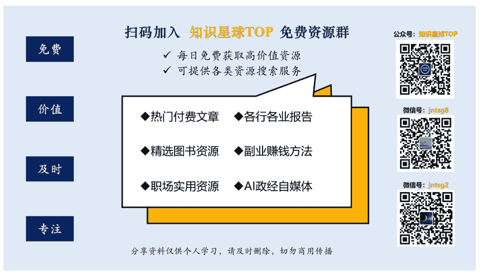
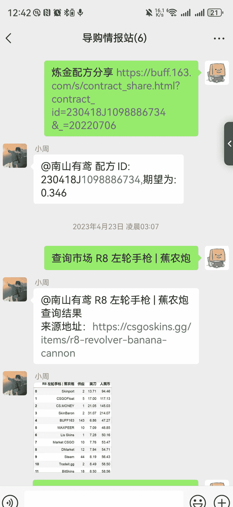
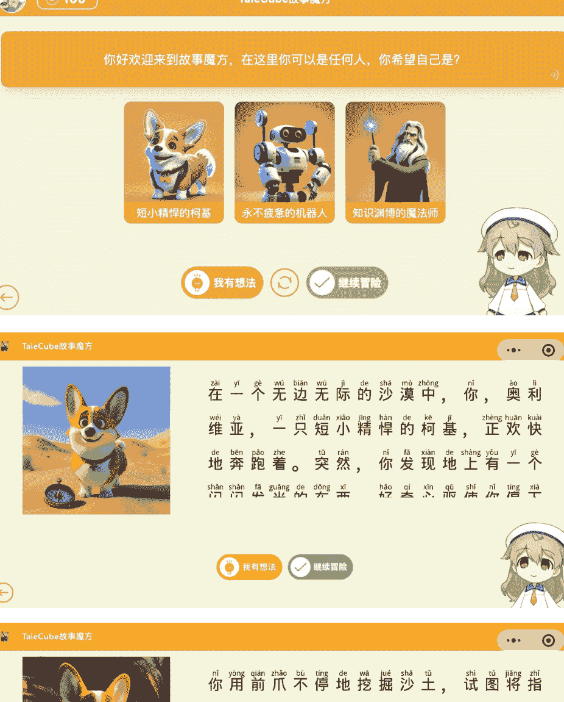
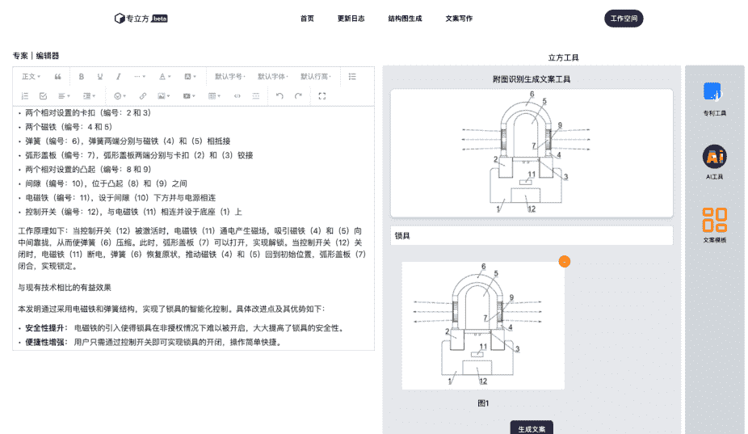
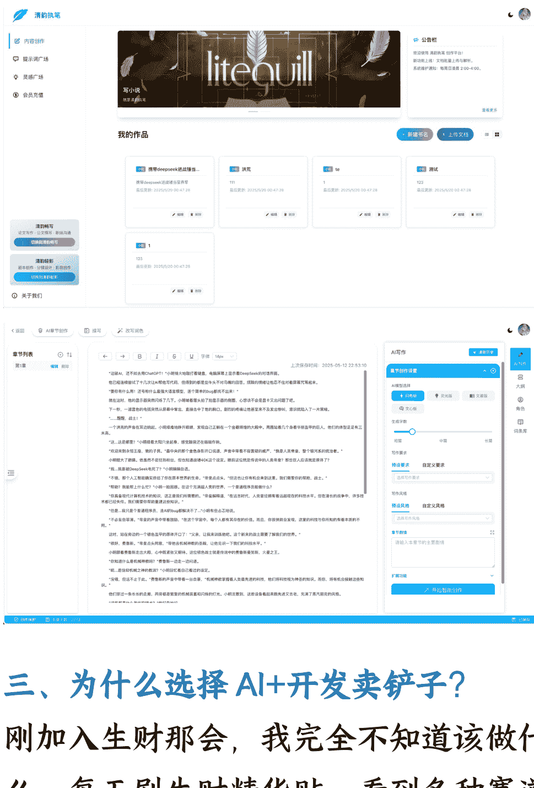

# 从零开始的 AI 开发炉子之路：一个程序员的4个月复盘

250526 生财精华 免费资源群

# 一、背景介绍

大家好，我是 cyrus，一个普通的程序员，今年4月加入生财，从4月加入生财之前一直在做 AI 开发卖炉子，现在还没有一款能拿得出手，经常会把台子做到无人问津的地步。

相比生财里那些每个月入xx 万的大佬，我的成绩简直惨惨人寰。作为执行力极高的人，遇到风口就会去开发工具（卖炉子），感觉自己是经常开发飘不定的浅层且泛化的工具，总是在担心短期没收益，长期费时间。

对商业化一窍不通的纯技术人，我从一个成绩比较的开发者分享一下过去的经历和经验，希望我失败和迷茫的经历（自认为）能够与圈友产生共鸣，引发奇妙的连锁反应，至于可以链接到大家。欢迎大家的指导和评论交流！

## 二、过往开发过的产品（可跳）

tips: 该章节只是展示我过往的一些项目经历，但大多项目基本告吹，仅用于展示我卖铲子的决心

### CSGO 市场漏捡工具机器人（游戏饰品价格爬虫+游戏内合成概率计算）

微信intsg2，资料分享

### 故事魔方
闯关式 AI 绘本创作与 2D 数字人讲解，将绘本与闯关式游戏相结合，让小朋友也能创造出自己的作品

你好，欢迎来到故事魔方，在这里你可以任任何，你希望自己是谁？

- 小精明的树鸦
- 不怕的机器人
- 知识沟通的魔法
- 有想法
- 魔法隧道

### 专立方
从其他专利参考中使用 AI 创新，将图片中的专利结构使用 AI 进行重新想象

加微intsg2，进阶资料分享

### 魔镜复刻
这个玩法从国外一个视频中复刻而来的，我们在线下搭建了一套类似的装置展出

### 写作平台：litequill

## 三、为什么选择AI+开发兼鸭子？

刚加入生财，我完全不知道怎么做。每天刷生财精华贴，看到各种赛道，从 AI 创作看到跨境电商，从多音带货到知识付费，眼光缭乱，基本上和我之前的状态差不多多。

微信ints2，进阶分享群

深入了解后发现，很多赛道对我这种技术人并不友好：要么需要投入大量资金，要么需要面对镜头（我是极度内向选择选手），要么需要很强的文案和营销能力。

我了解到AI其实非常早期，我的专业就是计算机专业，但是早期的学校只有基础开发的课程（对我来说完成学业非常简单，但是我学习成绩比较差，我自己擅长的也只有代码这一块，很多高级的技术并不在我的学校开放），而机器学习和深度学习（算是我感兴趣才给自己开的小灶，自己在网上教程里捡），刚 GPT-2 开始就有进行关注，直到 Deepseek 在国内才火了起来（中间跨度有点长），我觉得这个机会——程序员就不应该在技术革命时卖炉子了吗？而且我本身就有全栈开发能力，门槛相对较低。于是决定从 AI创作切入，边学边做。

## 四、AI创作平台-从0到1：最难的起步

### 让我们回归写作平台复盘

### 1. 定义产品形态：一个All级别的AI写作助手

回顾这段时间的历程，我发现自己陷入了典型的技术人错误。我以为只要产品做得好，用户自然来，但实现上给了我一棒。

### 2. 学习和试错：研究市面上流行的AI写作工具，分析它们的功能和商业模式

搭建了第一个demo：AI写作助手（只有初步功能）。当demo完成后，我满怀期待地等待用户涌入，结果是一片寂。这时才意识到，开发只是小部分，找到用户痛点才是核心。

### 3. 确定目标群体

我的目标大多是网文作者，一直认为AI写作工具是为了帮助作者提高效率，简化流程。但我忽略了一个关键问题：我真的了解网文作者吗？
- 他们的痛点究竟是什么？
- 他们真的需要AI辅助创作吗？

我尝试写了两篇小说，虽然完成了课程，但最后分钱都没赚到。

## 五、参加生财圈友的线下聚尝试破局

4月底的时候在杭州举办了一个关于AI写作的线下聚，好多人都来了。我在局内展示了我的平台，很多人都有意向：

- “兄弟，你AI写作现在有啥功能？”
- “嗯，目前主要是针对网文写作、短篇小说这块，效果还好？”
- “AI润色应用场景还有点坎哈？”
- “还有那个论文查重润色，简直是学生的福音啊！”
- “想要流量，简直可以！”

聚完局后觉得卧槽，说得太有了！热血上头的结果就是，回来我就跟打了血一样，拉着我们那个小的团队开始搞功能。什么论文AI检测、文本润色、甚至还有视频脚本自动生成，能想到的都排上了。那段时间天天熬夜，奔着新功能上线惊艳所有人。

但实现很快就给我泼了盆冷水。新功能确实陆续开发出来了，可实际用起来怎么说呢？特别一言难尽。

- AI检测：本以为刚需，结果用户反馈检测结果不如某些免费工具准，而且提示不够清晰，用起来费劲。
- 文本润色：听起来高上吧？实际上要么润色得驴唇不对嘴，要么改了跟没一样，用户试用就跑了。

一来二，这些新功能就成了“鸡肋”——一食无味，弃之可惜。投入了那么多时间和精力，结果用户不买账，活跃度也没有上来，反而因为功能复杂、bug不断。

为什么会这样？我也反思过，可能有两个主要原因：

1. 需求理解偏差，缺乏深度调研。当时在线下听到的需求，更多的是一种“我觉得你需要”，而不是用户真正的痛点。我们没有沉下心去细致调研用户在什么场景下需要这些东西，需要什么样的效果，就盲目上了。有点像看到人家餐厅生意好，就着急把人家的招牌菜搬过来，结果发现自家灶子做不出那个味儿。
2. 技术与应用的脱节，对AI能力的边界认识不清。AI写作确实很火，但现阶段的AI并非万能。很多以为AI能轻松搞定的事情，比如深度理解语义又进行完美润色，或者创作富有创意和情感的短视频脚本，其实技术上还有很长的路要走。我们可能过于乐观，把AI当成了阿拉神灯，以为许许多愿就能实现。

也是在这些功能反响平平之后，我才意识到意识到自己真的比较缺乏总结能力。圈友给的建议听起来很有道理，我也记下来了，但怎么办这些散散的点子，结合自己舞台的实际情况，炼出真正有价值的要领？就像一堆散落的珍珠，一直掌握不到。

## 六、其他的思考

其实决定把平台当作一个长期项目，心里已经做好了准备。虽然嘴上说着不在意收益，但内心的焦虑却一点没少，这种感觉比单纯追求短期更累。

焦虑的第一个点就是对“长期”这个时间维度的确定性：一年算长期吗？三年还是更久？如果投入了大量时间，几年后发现方向错了，或者市场变了，那种损失难以接受。这种对未知的恐惧是真实的。

第二个焦虑点来源于“价值”的定义和衡量：我追求的到底是什么？是用户数量的增长？是功能的深度积累？还是某种平台的建立？这些目标听起来都好，但不像金钱那样有明确的衡量标准。这种标准上的摇不定，很容易在过程中迷失方向，或者因为看不到显性的成果而自我怀疑。这就是选择一条看重长期价值的路必须承受的代价之一吧。这种焦虑也时刻提醒着我，需要不断思考和调整，确保自己没有偏离最初设定的航向太远，也确保自己在这个过程中是真的在积累和成长，而不是单纯地消耗时间。这些思考其实也是一种自我对话和梳理，希望能够让自己在未来的路上走得更坚定一些。

我焦虑的一个方面是怕自己眼高手低，想法很好，但执行力跟不上。虽然决定了长期投入，但也尽量不去那些短期能带来回报的事情，但这种源于未来不确定性、对自我能力怀疑、对机会成本权衡所产生的焦虑几乎是伴随性的。它不像为了明天拿到钱那么直接，但却更深沉、更磨人。

可能跟我之前提到的“打造自己的产品或系统”的想法有关。当我目标设定得比较大，希望做一个不仅是出卖体力的东西时，无形中给自己增加了难度和压力。打造一个“系统”，意味着需要考虑的层面更多，从内在定位、用户体验到后续的运营维护，每一个环节都需要细打磨。这个过程不像接一个单子完成了结束了，它是一个持续迭代、不断优化的过程，需要更大的心力。我是否具备足够的韧性支持这样一个复杂的系统？

## 免费 价值 及时 专注

# 扫码加入 知识星球TOP 免费资源群

- 每日免费获取有价值资源
- 可提供各类资源搜索服务

公众号: 知识星球TOP 微信信号: jntsg8 微信: jntsg2

分享资料仅供个人学习，请及时删除，切勿商用传播
