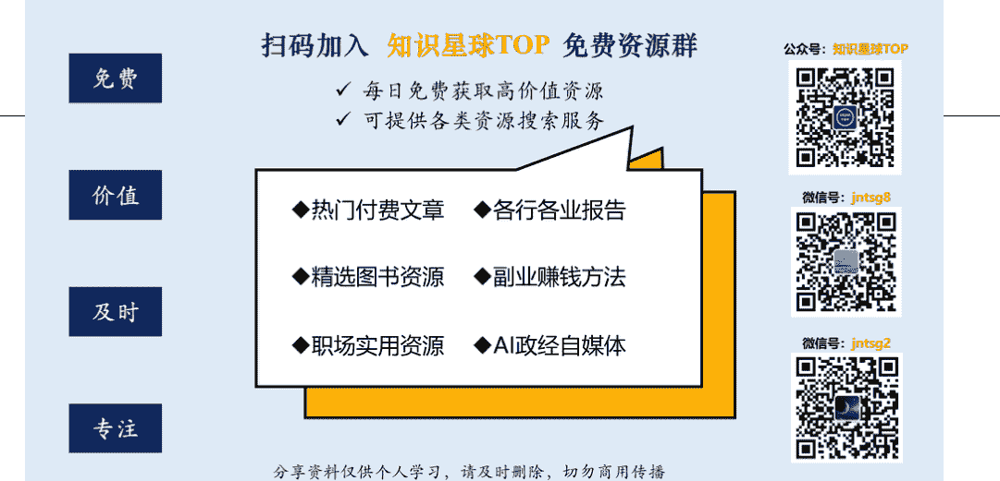
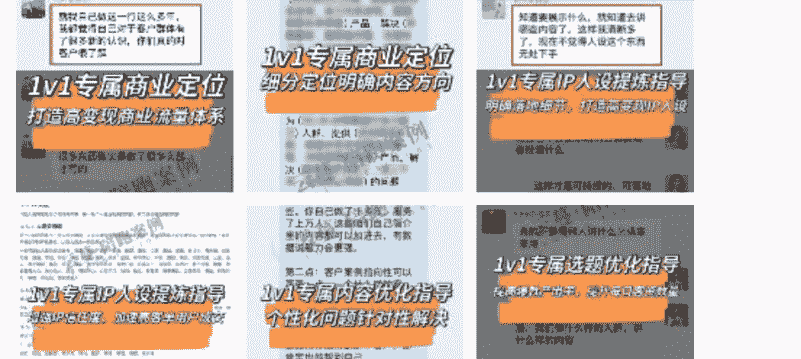

# 如何做低粉圈的小红书 IP 模型？

# 250526 生财精华

今天这篇文章主要就是分享一些干货和方法论，以及自己的一些心态和认知上的转变，因为我自己一直认同一个点：就是最好的老师一定不是在讲台上，而是在战场上。

只有一刀枪闯过来的人知道，每个环节到底应该怎么做，才能保证大方向是正确的，不走弯路，对于真正想做事的人来说，实时时间成本是最贵的，方向对，架构对，精细化的运营才能拿到结果，把我走过的路，尽量大家做还原，帮你们约一下时间。

那究竟什么是商业 IP？

## 一、【商业 IP 的定义】

那究竟什么是商业 IP？

实在 2025 年今天，大家对于商业底层逻辑的理解还是是有问题的。就比如刚才我给大家看了很多的矩阵账号，你们可以猜一下我 60 多万粉丝的账号和一万粉丝的账号变现有什么本质上的区别？

我可以很负责任的告诉大家：没有任何的区别，甚至很多时候我的大号变现跑不过一个小号，而我的大号更新一遍又很麻烦，但是小号基本都能实现一天 100 条的量，所以这也是为什么我不喜欢更新大号的原因。

所以在今天，我认为细分商业 IP 的时代，在慢慢崛起。大家在竞争上的差异慢慢变成变现上的差异，利润上的差异，而不是谁有巨大的粉丝量。

所以商业 IP 的核心不是内容，而是商业模型，通过商业模型我们再去倒推内容、产品、客户。

我们每一个内容的设计，每一个互动，其实都是在引导成交。所以商业 IP 的底层逻辑是：以内容建立信任，以结构推动转化，以产品完成价值交付。

用人话说：“一个成功的商业 IP 能讲故事、输出价值观，而是要让客户清晰地知道：他究竟能提供什么？解决什么问题？怎么和他链接？为什么信任他？给客户一个强力的购买理由。”

不信大家对于市面上做得好的商业 IP 进行拆解，不管是是什么赛道的，只要变现好的 IP。你会发现它背后都有一个非常清晰的公式：产品模型 + 内容结构 + 成交路径。

换句话说：

- 普通 IP 是自我表达：我是谁？我经历了什么？
- 商业 IP 是价值传递型：你是谁？你需要我解决什么问题？你凭什么信任我？

我在后台经常收到一些小伙伴的私信，大家总是问我：

> “为什么你们很低的粉丝量做到很高的变现？”

我可以很负责的告诉大家：粉丝量和你变现好坏没有必然关系。

比如说我的客户里边有很多，已经到了三、五百万粉丝的体量，但他真的不挣钱。在2025年的今天，其实大家的自然流量都在往下掉。

所有大红的收益都是在锐减的。但是我们在孵化和陪跑的客户里，真的有很多四个粉丝开始变现、七个粉丝开始变现，甚至有 1000 多粉丝变现几十万，这种案例真的比皆皆。

所以低粉高变现的 IP 和网红 IP 的打法，它是有本质上的区别。商业 IP 的第一点就是以终为始，先设计我们的商业闭环。

为什么我的打法永远是“以终为始”？因为我认为：产品大于流量，商业路径大于流量。用人话来说，就是你在开始做这个 IP 之前，一定要想清楚你到底卖什么。

其实在互联网上，无非就是这么几种变现模式：卖产品、卖资源、卖咨询、卖课程、卖机会、卖社交，所有的变现其实都是围绕我们用户的需求来的。所以一定要从变现路径先入手。我的打法不太建议先去涨粉。

比如我们有一些客户，哪怕是他的变现路径非常清晰，我们都会去重新给他做定位梳理，梳理他的变现体系，包括梳理清楚他第一个阶段的打法是什么？卖什么产品？引流款是什么？盈利款是什么？

所有产品设计都清晰、成熟之后，我们才会让客户做流量，那样才能保证我们在很少的粉丝量的情况下，做到高效变现。

因为现在做自媒体的人很多。在我看来自媒体的那一套东西其实不是核心，真正影响变现的其实就是商业模型。用最低的粉丝量，快速把高单卖出去。

那具体粉丝变现怎么做？从客户入手，带大家拆解。

### 案例 1：海外求职

- 客户情况：小红书只有万粉丝，但是一年的变现非常好。
- 痛点分析：你说变现好，是因为文案写好吗？是因为标题写好吗？是因为坚持吗？
- 核心逻辑：不是，本质上在于产品足够的好，从一开始定位就比较清晰。

### 案例 2：保险

- 客户情况：粉丝量不高，只有几千粉丝，但是一年的变现也是千万。
- 痛点分析：生意在线上不可能直接成交。
- 核心路径：通过短视频做筛选 → 引流到微信 → 通过微信线下 → 最后成交。

## 【关于高价产品的逻辑】

其实大家想要做小红书高单商业 IP，本质上就是要卖高单，而且你们先卖高价品还是便宜的产品？这个问题问了很多人，大多数人的答案都是：我先卖给他便宜的产品，再引导他升级高单。

但低粉变现的商业 IP恰恰是反过来的：一定是先卖贵的，让对方觉得有点，再卖便宜的。这个和小品牌逻辑是一样的。我之前去别的公司分享或者拍短视频，都会说：如果今天你是做小品牌，就一定要卖高价，不要打价格战。

每次这条视频都会爆，下面就有一堆做品牌的。但实际上，小品牌就应该卖高价。因为你去铺规模、打价格你是打不过大品牌的。但是小品牌最重要的你要活下来。

所以对于小的商业 IP而言，最好的差异就是去做非标品，而不是标品。这就是低粉变现的核心打法——一定要定位在高价产品。比如我们有很多客户做健康的、做疗愈的，公司都不大，十个人以内，我都会让他们去非标品卖高价。因为对于创业公司、小品牌来讲，最重要的其实是利润。在一开始没有利润，其实你是很难持续下去，更不可能给客户提供好的服务。

小品牌和大品牌核心的差异其实就是服务差异。大品牌做不了这件事，大品牌做的是标品，要的是效率，而这恰恰从小品牌盈利的机会。我一直认为，个人品牌和品牌本质就是一件事情，只是一个人载体，一个以产品为载体，但是想要盈利，它的操作逻辑是一模一样的。所以在今天我们做个人品牌的时候，一定要避开市场上已经非常成熟的 IP 盘和标准化产品。在粉丝不多的情况下，反而要去卖高价，还要服务拉满。因为这是大 IP 的团队不愿意做的事情。

为什么我们有的客户四个粉丝开始变现，七个粉丝开始变现，核心都是让他们开了长期陪伴的服务类产品。你们也可以理解为：撬动用户情绪价值的产品。这种产品交付累不累呢？累。但是一定是有利润的，而且不需要你的粉丝量太大，这个产品是有市场需求的。因为人喜欢定制化、喜欢陪伴、喜欢确定性、喜欢节省时间。所以你在任何一个细分领域，都会分为两波客户：一波是比较价格，一波是比较价值和体验。去后者的钱相对容易很多。

我第一次创业是因为家里欠了几百万债务。当时我在思考产品的时候，我想找到市面上价值一万的产品，我算了一下，就算一万的价格，我也要找到 600 个人，这个难度对于自媒体来说是非常困难的。最后这个钱赚到了，不是找了 600 个人，而是找到了高单。

## 【关于小红书 IP 的人设设计】

大家分享一下具体的思路：产品设计、人设计、营销设计。

当我们在做高客单的时候，人设需要说清楚几个点：
- 你是谁？
- 你的角色是什么？
- 为什么走上这条路？
- 客户为什么要链接？
- 你的价值观是什么？

人设必须是有陪伴的、柔软的，甚至带一点共情。我是怎么从疗愈的伤痛里走出来的。在讲人设故事的时候，我会讲我是失败的，我是怎么靠线上崛起的。

举个例子，我是如何通过一条人设故事让一个 IP 突破业绩高峰的。比如说我在做疗愈 IP 的时候，单月变现已经 220 万。当时其实就把她的人设故事重新做了梳理，重新提炼。我问了她几个问题：
- 你怎么走上这一行的？
- 你为什么做这一行？
- 在做这一行的过程中，你开始是怎样的，现在的情况是怎样的？
- 你未来的愿景是什么？

其实就这几个问题，她的回答做成了一条短视频，这条短视频差不多能帮她变现了 100 多万。这条短视频的主要内核结构是：

“我是朱莉，我为什么走上了这条路？是因为我觉得我自己心里是有空洞，我发现我的很多内在在小孩是没有被疗愈到的。我本来是一个消费者，我进入到这个行业，我去扎根去学习。我入行的时候，我接一个小时的咨询是 52 元，到我现在年变现超过千万，其实没有花长的时间，只花了三年的时间。我为什么要做这个业务？是因为我有两重身份，一种是消费者，第二重身份是一个咨询师。我会发现消费者其实他需要的不是课程，比起一个消费者，看似是婚姻的问题，但其实是她的内在需求没有得到满足；看似是拖延的问题，但其实是她内在恐惧的问题。我希望我能帮助千千万万心里空洞的消费者。”

同样我是一个咨询师，我发现这个行业的痛点就是咨询师根本不敢要任何高价，咨询师是非常穷的群体，像我当初一样。那我分享出来为什么要卖高价？为什么一定要大胆地收钱？因为今天你是一个咨询师，心智必须是健康的。

# 详情

云晏个人号（不讲废话）

分享一个做百赛的商业打法，不管你做哪个赛道、哪个阶段、哪个客群，都躲不开底层逻辑。我的结论就一句话，透了，马上能解决卡点：

- 非标准化市场，先把“标准”做出来，谁就赢；
- 标准化市场，谁能做出“非标准感”，谁就能突围。

这不是我的观点，而是我之前的亲身上手干，以及帮客户做转型几十个项目后，真看出的一个规律。我分享两个例子，以便大家理解解决方法：

第一个案例是：我们去年合作了一个大健康的客户，以前全靠她服务，满意度高，一天能接两单。但是实话说，她的产品属于中客单，必须上量才能盈利。但是基础没有标准，没有流程。后来我们做的第一件事就是：标准化，执行流程。

# 详情

云曼个人号（不讲废话）

今天早上5点起床，跑步回来去喝了一杯好茶。
茶馆开得很早）开得很早，只有几个老客人，到处都是烟火气。

我突然想起一句：人生是旷野，四面八方都是方向。

瞬间食欲大增，一个人吃了1斤老麻抄手~回公司干活，今天7个面试+一篇业务文章。真的很喜欢这种充实满满的感觉。

2025年5月19日 13:29

## 云个个人号 (不讲废话)

我确定、一定、以及肯定：这绝对是5w以内，你能够买到最好的红书跑陪产品，没有之一。
你有客户也经常问，你们IP成功率高，是因为有什么奇技巧了吗？

我的答案很简单：把我们自己，毫不保留地1:1交给客户。

一定是1:1。做内量、做获客，本身就是创业，0—1要很细节很细细节，才有可能。
能把每件事的颗粒度都做到极致，动作落地的时候才会有偏差、变形。
每一个细节都对了，还得无限坚持，才能拿到最好的结果。

我也是创业者，我懂创业者的痛苦。
产品再好，没有营销、没有客户，也拿不到成绩。

所以我，我真的希望和大家一起把线上渠道给做出来~~~

我是产品人，所以在做产品的时候提醒自己：忘掉流量，忘掉销量。
眼下只有客户，团队应该是如此。

我的模板以下几类：

第一类，我会每天分享我自己的生活，我在工作，我今天在开会，我在吐槽，我跟客户探讨，我跟团队的人探讨，这个部分是为了增加我的活人感。就是让大家知道今天你加微信，你加的是一个活生生的人，他不是你加了一个牛皮广告。

## 第二类我会分享我每天的思考和认知，为什么这部分很重要？

因为在你卖高单的时候，其实大家已经无法在产品的功能层面上卷了。那需要的是我的客户能看到我的文字跟我同频，那我怎么让他觉得跟我同频呢？

这一步其实我们做到的是一个用户的留存，做高单产品的销售，你是绝对不能急急的。

客户今天到了私域，让他知道他链接的这些人是一个有思想有价值的人，所以现在今天，无论我们做什么IP。

我会告诉他们一个点：每天把你自己的思考记录下来，发出去，这个动作不会让你有任何转化，你就记住这个动作是在持续输出。

这个动作是你的思想能跟你持续同步，你做了三个月、四个月、五个月、六个月以后，随着你做的时长越多，用户觉得跟你是贴近状态，他单的几率就会更大，他就不会被别人带去。你想一个人365天受你思想的影响，他会买你的产品，还是会买别人的产品？

所以这个记录认知的内容是占我朋友圈比重的 40%。

第三类朋友我会分享一些行业干货，行业的打法。那一部分朋友圈其实是为了让客户在短时间内不把你删除，我们带入一下客户的想法：客户加了你，他肯定要看你的朋友圈，如果你长得不是那种绝美、绝帅，那其实大概率会把你删掉。

我拿我自己举例子，比方说我的客户都是创业者。那我会把我能分享的干货价值分成几类：

- 客户需不需要一些爆款逻辑，怎么做产品？
- 他是不是需要一些管理知识？
- 他是不是需要一些流量知识？
- 他是不是需要一些私域的知识？
- 他是不是想知道这个行业的变迁？
- 甚至有一些客户，他需要知道一些赛道信息？现在面上到底有哪些赛道，它是在赚钱的？

你长时间的输出这种高密度、高价值的信息，客户就会舍得把你删掉，对他来说，这一类朋友圈是有功能属性的。因为刚才讲的是人设属性、认知属性、功能属性，最后一部分是营销属性。

## 关于高单IP的销售链路

做高单的销售，也一定是价值层面。。很多人问高单到底怎么卖，怎么跟客户聊天。

我会说：
1. 信任：在第一个环节没有打通客户的信任。客户为什么信任你？一定是专业，一定是深度，一定是你人在收他钱的情况下，愿不愿意帮他解决问题。他要的是你的态度。对吧？很多人一上来摆那种姿态说“我们产品是要收费的”，那高单客户会想：“你是觉得我不起钱吗？我都不知道你的价值。”
2. 价值：高单用户的逻辑是什么？一定是你先满足他的需求，满足他的部分需求，让他知道：你有病我有药，并且我有解决方案，你的解决方案只能在我这买，因为别人满足不了你，你有且只有我一个选择。这时候就会直接下单。为什么？
- 他有需求。
- 他认可你的专业。
- 他认可你这个人想交朋友。
- 他经常看你的朋友圈，知道你是一个稳重、踏实、专业、有温度的人。

我们叫包围式攻击，那客户就会买单。在今天大家觉得高单产品难卖，我觉得不难卖。难卖只是因为精细化运营没有做的太好。我其实跟大家分享的是小红书商业IP高客单怎么做，我从产品设计的角度、人设计的角度以及销售的角度讲了这件事怎么做。那可能我讲的是一个框架和方法论，但是只要你去执行了，你会发现我讲的一定是对的。因为在这些五多年的时间里，我们做了大小无数低粉丝高变现的商业IP，跨越了30多个行业。

懒人微信：lazyhelper

我最后跟大家分享的是，在存量经济的时代边缘，我特别想推崇一个人，叫做凯文·凯利。他讲了一句话：如果今天你有1000个铁杆粉丝，你下半辈子是衣食无忧的。大家觉得他说这句话很夸张，但我可以很负责地告诉你这句话一定是真的。

所以我们需要做到的反而是不是技法，我跟大家讲了很多技术，但是技术在我看来不是最重要的，最重要的还是心法，就是你愿不愿意踏实实解决客户遇到的问题。

在这个时代，真正能活下来的人，就是那些踏实实解决工作中遇到的任何微小的问题，而且能用正向的方式看待这个问题。这个世界上不缺聪明人，甚至我在分享这个打法的时候，可能很多人看到的都是案例：2000粉丝赚了3000万，他200粉丝赚了500万，其实这些信息对你来说没有用吗？

我认为没有想象中的有用，因为最重要的是你能不能做到在当下把一个用户当作用户，把他当做朋友，把他尊重他的想法，先贡献价值，而不是先索要。

此篇文章致敬踏实做产品的生财术，更多具体的打法和心里话，想放在6月7日流量大会上和大家分享，想一起找我聊天的小伙伴，来找我呀~虽然我是人，但我能量很高，希望大家一起快乐！passion！
