# 无需代码！零基础玩 GitHub：找工具、搭网站、白嫖资源的指南 附：详细截图+中文界面操作

250526 财财精华

你是否觉得 GitHub 是程序员专属的？不不，其实它能帮你：

- 一键下载全免费 AI 工具（省下99% 费用）
- 10 分钟搭建个人网站（无需写代码）
- 白嫖资料/工具（工具、资料、课程、电子书）
- 了解国内外最新趋势（跟着趋势走）

这篇指南专为非程序员设计，用最简单的步骤教你玩转 GitHub！

# 第一章：GitHub 能为你做什么？

找不到好的提示词？找不到学习资料？不会搭建网站？不知道近期热点？全部都可以以上 GitHub，表格链接及资料总结于生财（部分），还有很多，感兴趣的宝子可以自己搜索，而且很多都是中藏的哦

| 项目名称 | 网址 |
| :--- | :--- |
| 提示词网站 | https://github.com/jamesz-bondos/awesome-gpt4o-images |

## 功能描述
包括但不限于四格漫画、卡通形象、海报等等

## 大厂开源模型
https://github.com/bytedance/UI-TARS-desktop

加微int5g2，进阶分享群

字符跳转的通用型 AI agent，TARS，全球首个三维一体通用 AI Agent，浏览器、文件系统、命令行全部打通，可以通过对话的方式下达任务，比如打开某个网站，查找某个文件，还能通过截图识别屏幕内容并操作，关键是完全免费，支持 Windows、Mac、手机等都能使用。

## 中国独立开发者
https://github.com/lc7/chinese-independent-developer

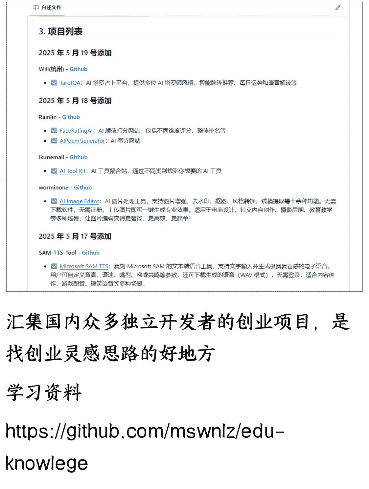

## 汇集国内独立开发者的创业项目，是找创业灵感思路的好地方

## 学习资料
https://github.com/mswnlz/edu-knowledge

加微信ints52，进资料分享群

## edu-knowledge
教育各种类，从幼儿园到小学、大学、毕业论文等涵盖学而思、万维、搜等多个机构，持续增加中

## 少儿
【安全全美英语学习教材】
链接:https://pan.quark.com/s/fd37e446b009

《美国公共图书馆Top 100英语文本》
共100本、PDF、英语文本、初学者的数字故事、链接:https://pan.quark.com/s/4794af77713ac

《阿伯伯学习活动“什么是科学”》
链接:https://pan.quark.com/s/bd7d0958ae42

《少儿童科学探索》
这套教材专为青少年设计的互动式教材，包括“王爸爸橡皮和动漫”、从认知到到规则形成科学课程。课程以基础知识开始，详细、有趣、大的逻辑规律与孩子互动。通过做对、规则设定等任务建立基础知识，通过经验发现数学规律，配对数学解决技巧攻关策略、提升思维能力等强化能力，涵盖小学数学、英语系统基础知识、拼图、找数字等32种训练，配合三类游戏将孩子融入、互动、鼓励，通过互动保护组件功能、空间逻辑、认知识三大核心功能，成为儿童教学

央视版权数字胶片《酷我是一只动物》2018版1080P普通话数字儿童启蒙胶片4件
链接:https://pan.quark.com/s/57d63abe8711

从幼儿园到小学、大学、涵盖学而思、万维、猴摄导等多个机构

## 图片处理器
https://github.com/Sanster/IOPaint

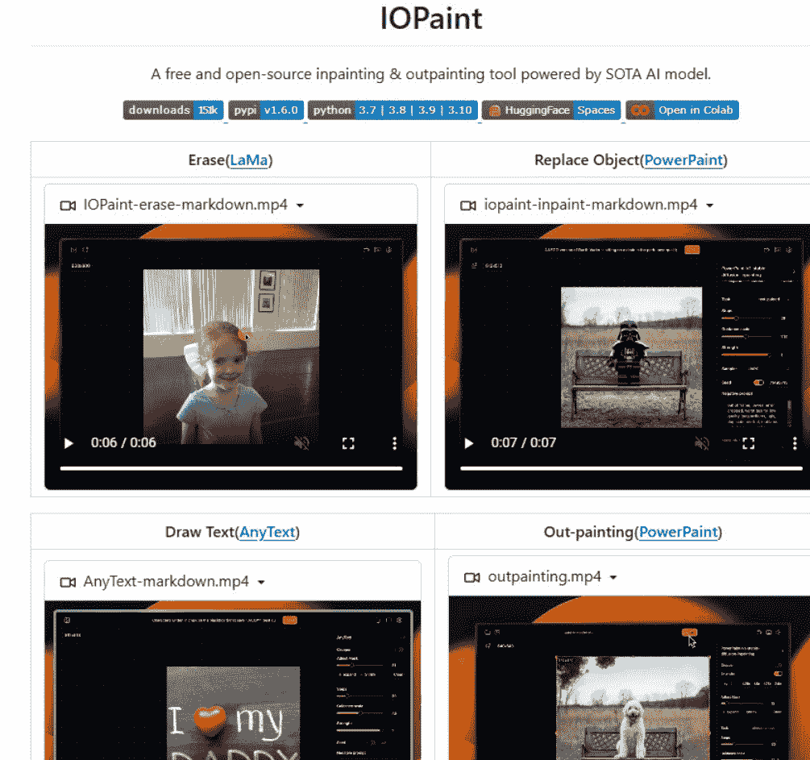

图片处理器还可以本地部署。功能包括：去除水印、抠除杂物、修复老照片、改变图中选中区域的内容等

## 自动投递简历
懒人微信：lazyhelper
加微int5g2，进资料分享

https://github.com/noBaldAaa/find-job?tab=readme-ov-file

**操作步骤**
1. 用链接获取自己免费的 apikey: GPT-API-free 项目
2. 全局搜索【自己的 apiKey】替换为你自己的 apikey
3. 修改你自己的简历基本信息.txt
4. yarn install && yarn start 启动

--- 前言 ---

最近在 GitHub 上发现了一个非常有意思的项目: GitHub 链接。这类者巧妙地结合 GPT 和 RPA 技术，打造了一个自动简历助手。这是作者的效果演示。可以根据你的简历内容自动生成简历。

## 部署网站
https://scys.com/view/docx/YlvbdL38f9dByAc7n5ea3dfevRoiflZxbqucc

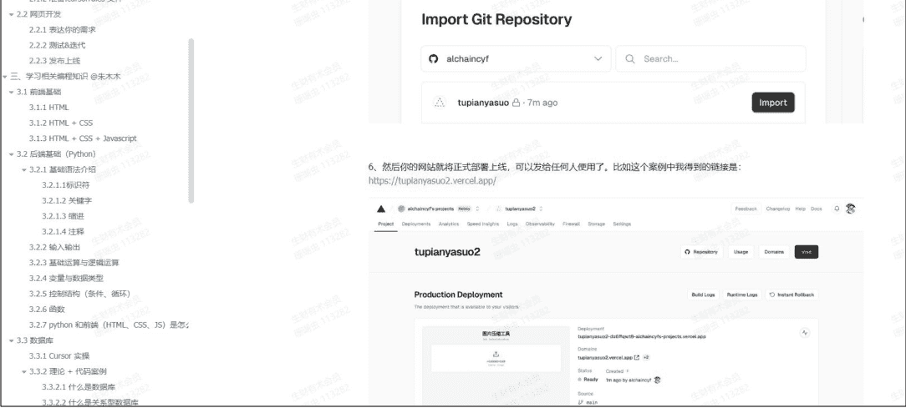

找到喜欢的代码复制一份后用 vercel 部署即可。

# 第二章：快速上手：注册与汉化

 步骤一：注册账号
访问 github.com, 点击右上角 Sign Up，填写邮箱/密码/用户名。用户提示：用户名只能包含字母、数字或字符。加微信ints52，进资料分享

 步骤二：安装汉化插件
搜索“汉化插件”，点击“安装”，刷新页面自动生效（可根据自己的浏览器选择）。进入后向下滑找到【扩展管理器】，根据自己的需求选择合适的插件即可。

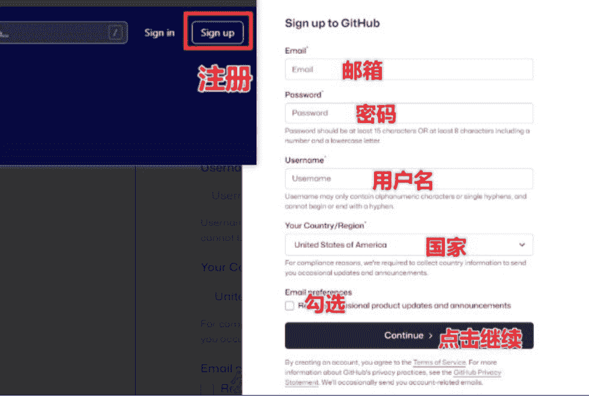

## GitHub 中文插件
本项目：52cik/github-hans

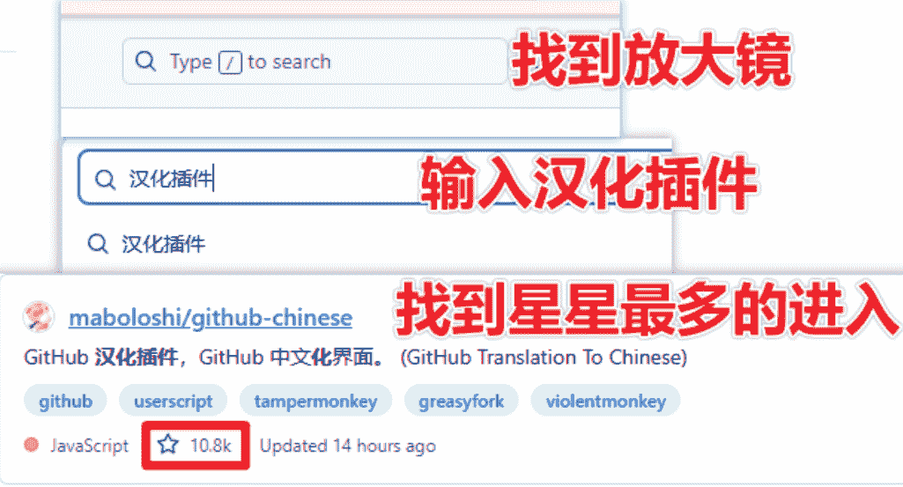

⚠️ Warning 本项目尚未发布至 GitCode，如有发现请及时反馈。

### 功能
- 中文化 GitHub 菜单栏、标签、按钮等
- 完美的翻译功能
- 支持项目设置进行人工翻译（参考：沉浸式翻译，或者火山翻译）

### 根据你使用的浏览器选择合适的插件
| 浏览器 | 商店管理 |
| :--- | :--- |
| Chrome 或 Chromium 内核 | Tampermonkey |
| Safari (macOS, iOS) | Stay |
| Firefox 或 Gecko 内核 | Tampermonkey |
| Via (Android) | 浏览器自带 |

我用的是 chrome 比较多，所以选择第一个（点击后进入的是界面），点击添加至 chrome，把这个插件添加一下，安装之后回到 github 页面，刷新一下就会变成中文了。

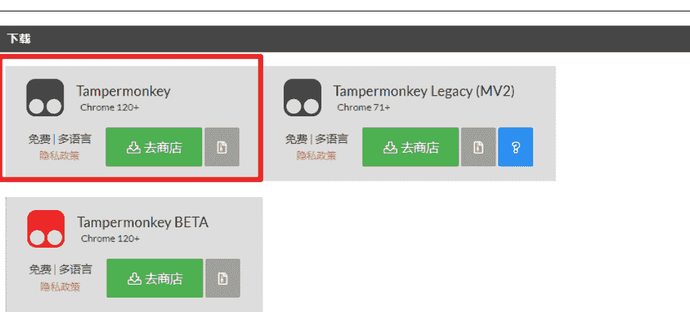
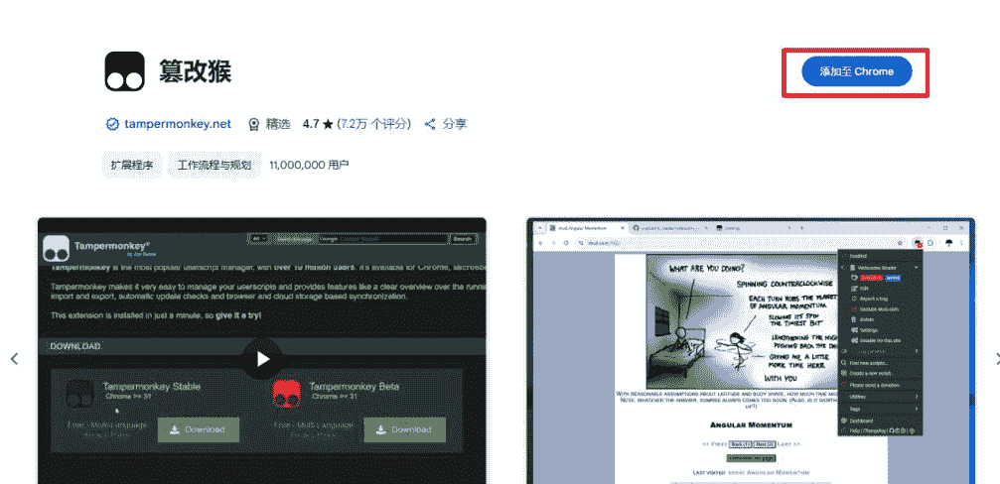

加微信ints2，进资源群

# 第三章：资源探索与快速上站

### 1.搜索功能
- 找工具：用途 + 免费 (如 ai-tool free)
- 找资源：awesome + 领域 (如 awesome-design )
- 找模板：用途 + template (如 blog-template )

实操如下：
很多人不知道怎么快速连接，毕竟这个界面真的是空如也，好像什么都没有。其其实可以像刚才一样找到放大镜，然后输入你想要的资源，比如我输入了【生财有术】，好家伙，又找到盗版生财术资料了。

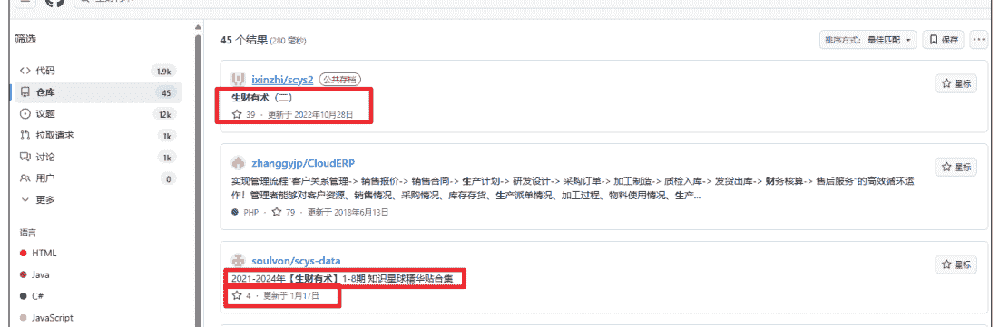

换个词，比如搜索【阅读】，结果出来 10.7k 个结果，但并不是都是用的。

加微信ints52，进资料分享群

### 2.筛选指标
这个筛选指标是通用的，大家可以根据自己的需求来，可以选择复刻多的，也可以选择星标多的。

一般情况下星标和复刻越多就是这个项目越受欢迎，我们可以顺便点击一个进去的介绍，基本上每个打开的都是这样的一个界面，大家可以看一下我的标注。网址基本上都是主域+开发者名字+仓库名称组合而成的，如果找不到相关的展示链接可以按照这样的顺序进入展示的页面。最左边就是代码部分，可以点击进去查看代码的情况，不过我不懂哈哈哈哈。

注意：若项目最后更新时间为2 年前，可能已失效！

技巧：在 Issues 搜索“error”或“bug”，快速排查常见问题。

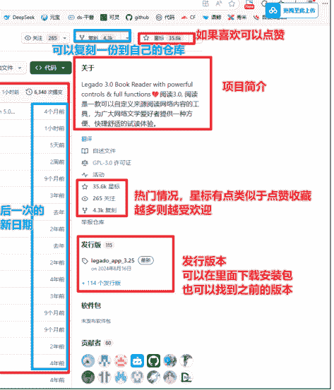

### 3.下载与版本选择
大家觉得某个项目感兴趣可以点击右上角的绿色的星标进行下载，直接将整个代码压缩下载（也可以下载到本地）。点开某个项目之后往下就是整个项目的介绍，github 会读取 readme 文件然后内容展示出来，一般介绍了项目是做什么用的，解决了什么问题以及如何使用。

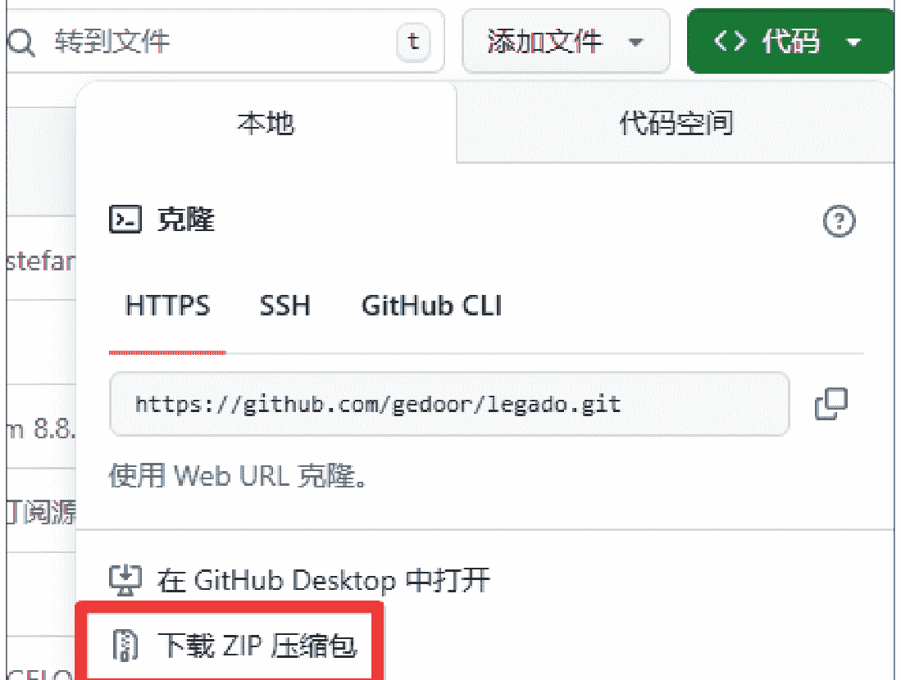

### 4.复刻与网站搭建（快速上线）
找到项目 -> 点击右上角的 Fork -> 项目自动复制到你的仓库。修改内容后，用 Vercel 一键部署（具体部署可以看手册）。复刻后注册并授权自己的 github 在 vercel 上进行登录，点击右上角的 add new project，选择你刚刚复刻在 github 上的项目，点击 import，然后点击 deploy。

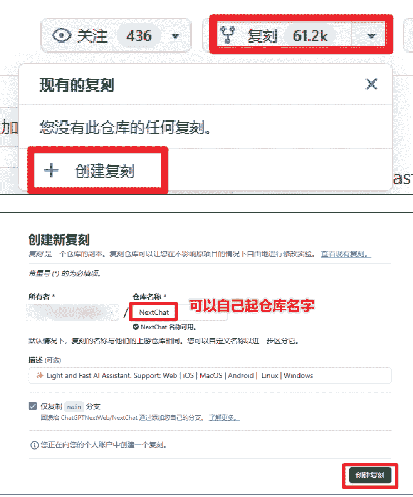

部署成功后你就能得到模一样的网站了，不过用的是 vercel 的域名，后期可以根据自己的需求修改 github 上的代码修改网站的功能，也可以直接用自己的域名，感兴趣可以一看。

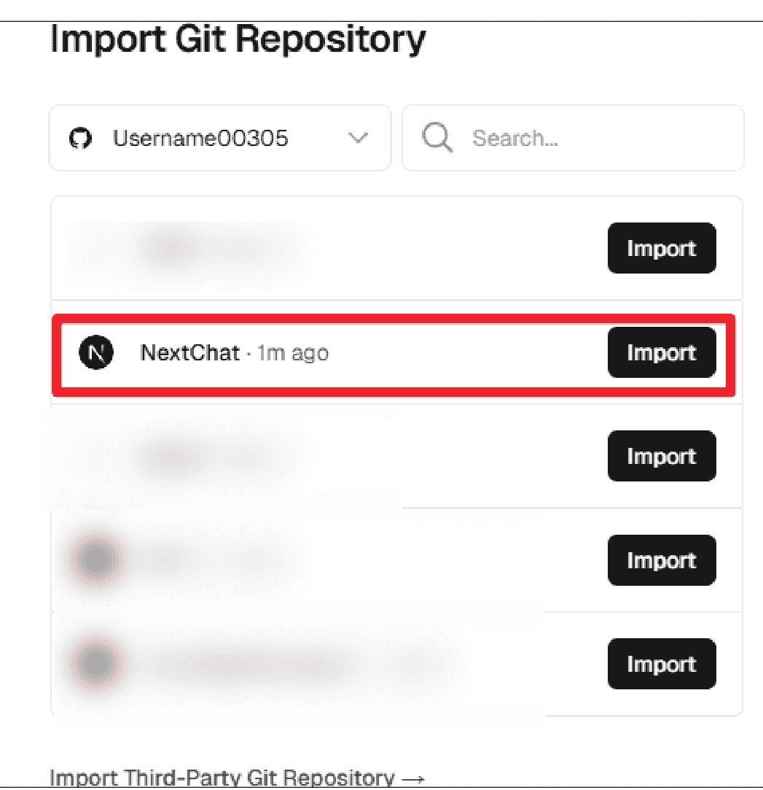

加微信ints52，进阶分享群

# 第四章：GitHub 隐藏功能

### 1.社区互动（issues 提问与讨论）
如果你觉得项目哪些可以继续完善修改，可以将你的修改通过合并。

### Legado 阅读
legado.github.io / legado.top
Legado is a free and open source novel reader for Android。软件提供内容，需要用户自己导入，例如导入书籍等。查看官方文档，这里就有答案。

| 发行版 | 状态 | 更新 |
| :--- | :--- | :--- |
| legado_app.25 | 测试版 | 2024-06-16 |
| legado_app.25 | 正式版 | 存在不稳定情况，升级前务必备份数据 |
| legado_app.25 | 稳定版 | 修复 BUG |

- Function：主要功能
- Community：交流社区（Telegram 频道）

有些项目会有多个版本和安装包，每次修复了 bug 还是新增了功能都会在里面包含的版本号。成功了，回到 github 界面，刷新一下，就会变成中文了。刚才那个插件主要是针对菜单还有按钮能完成汉化。如果遇到文件里面的大段英文看不懂，可以借助中文插件，像是【沉浸式翻译】或者【火山翻译】，有些还有网站自带的翻译，可以在网页上点击右键，选择【翻译为中文】，这样就可以快速连接 github 了。遇到问题的时候可以根据你的需要进行搜索，因为有些问题别人也遇到过，并且里面已经给出了解决方案。

### 2.个性化推荐（探索页和星标联动）
平时遇到觉得不错的仓库或者项目可以给它星标，github会自动根据你星标的项目给你推荐类似的（有点像是小红书点你赞了哪篇笔记，系统会自动再给你推荐相似的）。

可以在自己仓库的主页角找到【探索仓库】，下面的【探索更多】，点开之后你就可以像逛小红书一样逛 github，基本上都是基于你星标项目给你推荐的。

## 探索仓库
| 项目 | 描述 | 语言 |
| :--- | :--- | :--- |
| SimonAKing / HomePage | A modern and elegant personal homepage with fluid animation background, responsive design and smooth page transitions | 686 JavaScript |
| Sathish2905 / sample-website-templates | 160+ Website Templates - https://sathish2905.github.io/sample-website-templates/ | 280 JavaScript |
| OSSPhilippines / freefolio | 100% FREE portfolio website templates | 256 CSS |

775037abd55ba44f_14_0.png

### 3.趋势追踪 ( Trending 页使用指南 )
在探索仓库的下面有一个热门仓库，你点进去之后会看到最近比较热门的仓库/项目排行榜。右上角有个筛选功能，可以找到今天、这周甚至这个月最受欢迎的项目，如果找不到的话可以直接点击 https://github.com/trending 进入，你还可以筛选中文类的项目，对于程序员可以筛选某种语言的项目，遇到喜欢的还可以点个星标，或者觉得有异常值的还可以来反馈。

如果实在找不到的话可以在搜索栏最后面加入作者的名字，就可以自动跳到作者主页了。

# 结尾

我这里也介绍了 GitHub 的部分功能，其实 GitHub 的功能还能不止于此，也有官方的文档供大家学习 GitHub Docs。

感兴趣的宝子可以直接学习官方教程~

加微信intsg2，进资料分享群
