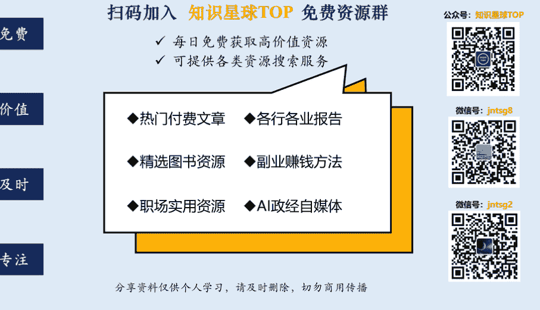
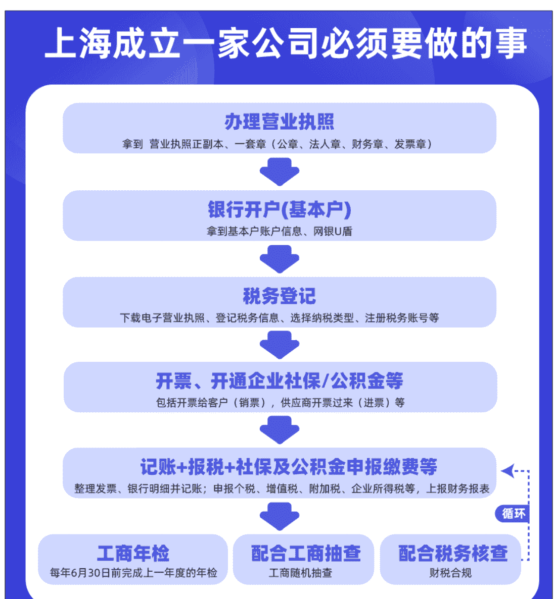

# 注册公司常见问题【工商/财税/社保】

# 250526 生财精华 免费资源群

## 一、背景介绍

大家好，前段时间看到精华帖里有一篇关于开办企业的帖子，里面有很多人评论说能不能分享一些税务相关的问题，本着分享、利他的财税价值，作为财税行业服务十年的创业者，怎么也得分享一下。

自我介绍：我是smoney，4月出生财人的新星，星球号是152006；上海财税行业的创业者，从业行业十几年，每天都是解答/解决客户问题，跟税务局、工商局、社保局、园区等打交道。

本贴主要整理一些客户的高频问题，范围包括工商、税务、社保等，均为小微企业老板的常见问题；本人主要服务的上海地区的客户，但是公司法、税法都是全国性的，大部分问题差异不大，但是有些细节具有区域性，我会具体说明。

## 二、工商部分

### 1.注册公司怎么选，个人独资企业、个体工商户、有限责任公司怎么选？

个人独资企业、个体工商户是非法人的性质，个人承担无限责任；

有限责任公司是法人企业，承担的是有限责任，正常就是注册资本对应的概念。

关于概念的问题我就不过过多赘述，想了解的可以自行搜索，我主要说明大家普遍关心的内容。

- 个人独资企业-不推荐；在疫情期间个人独资企业是有对应的税收优惠，这个时候就可以考虑注册来降低企业税收成本；而目前政策（上海）个人独资企业限有限责任公司对比，基本没有什么优势，都是查账征收，个体经营所得税率从5%-35%。

- 个体工商户-适合有门店，toc的用户：很多伙伴有自己的门店，平时主要的客户是c端用户（基本不开票），那可以注册一个个体工商户，也不用找代办，自己去附近的市场监督管理所办理就行（要什么材料去问下就行，不同行业要求不一样的）。

**但是要注意**：上海区域已全面取消核定征收（根据行业核定一个税率，按照税率纳税），都是查账征收（根据收入与支出纳税），要记得每个季度、每年要进行增值税和个体经营所得纳税申报，还有人工年龄，都是要按时去做的，比较简单（目前成本都是自己填😊）。目前全国对于核定征收的政策基本也在收缴，但是部分城市还是有的，例如河南、湖北等。

- 有限责任公司-推荐：我们主要聊的也是有限责任公司，除了部分用户可以选择个体工商，其他的基本都是选择有限责任公司，有限责任公司小规模申报，大可发展上市公司，我们后面介绍的基本上都是介绍有限责任公司。

### 2.注册公司需要哪些材料？后面所有注册公司指的都是有限责任公司）

这里指的是上海，其他地区可能有细微差异。

如果对注册地址没有要求，就找代办提供园区地址，那你就只需要提供身份证正反照片就可以办理了！其他信息你跟代办沟通好，可以自己想，也可以让代办给你整理，你来确认，具体信息请看下图。

如果你要实地注册，就是使用你的办公地址作为营业执照的地址，那材料就要增加对应的产权证明，要看你产权的性质，产权关系等，例如租房合同、房产证、产调、分割图等。

#### 办理营业执照所需材料

| 公司名称 | 准备2-5个 | 上海八分注册企业有限公司 |
|---|---|---|
| 行业类别 | 参考同行，例如网络科技 | |
| 注册资本 | 承担有限责任的资金，5年需缴实 | |
| 经营范围 | 参考同行 | |
| 高管信息 | 法人、股东、监事（不可设）准备身份证正版照片和手机号 | |
| 股份分配 | 投资/企业出资，占比例 | |
| 地址资料 | 实地地址注册租赁租房合同、调证、房产证复件或备案号/可直接挂靠园区虚拟地址 | |

获得营业执照正本公章、法人、财务、发票章

### 3.注册公司要花多少钱?

这里特指上海，其他地区不是很了解如果你自己不会做账，也不准备招个单独的财务，找财税公司就行，注册公司都是免费的，收取的都是代账费用（怎么选择财税公司，以及代账费用，后面单独写）。

如果你的行业有特殊要求，需要挂实地地址，那很多园区就需要挂靠，1000到5000/年不等，看对应的区，市区一般比较贵，所以小微企业一般都是注册在奉贤、临港、崇明、金山等，这些园区挂靠地址都是免费的。

如果你不准备找代账公司，那办一般是500-2000，你看用什么地址，实地注册麻烦一些，所以相对一些。

### 4.注册公司的流程，以及注册好后要做些事？

请看下图，如果急着开票，也可以先税务登记再开户，社保公金可以不开；

### 5.关于实缴政策，什么时候缴，怎么缴？

2024年7月起执行。

- 注册缴政策：新注册的公司，5年内。
- 缴流程：通过自己的银行卡打款进公司，备注“投资款”，然后跟财务说，其他的操作就好。
- 限制：没有次数限制，操作也很简单。

#### 注意事项/常见问题

- 注册缴：新注册的公司，5年内根据注册资本。
- 注册缴：新注册的公司，3年过渡期最长8年内。
- 注册缴：新注册的公司，如果发生变更，例如融资、变更范围、法人等人，需5年内。
- 注册缴流程：从个人账户转账到公司账户，备注上“投资款”。
- 注册缴：公司收到款后，财务入账为“银行存款”。
- 注册缴：公司收到款后，财务需要申报印花税（小微企业）。

#### 实缴方式

- 资金实缴
- 物实缴（有形资产）
- 知识产权实缴（无形资产）
- 债权实缴（无形资产）
- 高新技术实缴（无形资产）
- 土地使用权实缴（无形资产）
- 股权实缴（无形资产）
- 劳务实缴

### 6.电子营业照，电子印章

每个公司都可以下载电子营业照，电子印章，通过扫描就可以盖章了，很简单而且免费。

## 三.财税代理

### 1.财税代理公司怎么选?

代账公司大概分为四种：

- 规模比较大的公司：这种公司一般都是层层架构，例如老板-总监-组长-财务。合作之后一般是拉一个工作群，主要服务对应的财务，财务正常到点下班，上班的主要工作也是记报税。这种公司的缺点明显（组织架构重，成本高），服务跟不上，优点是流程正规，跑路风险较低。

- 会计事务所：由几个注册会计师合，规模一般不大，主要服务高单价的用户，特点就是专业性强，适合业务复杂、有审计需求、需要跟税务局谈判等，缺点就是价格高。

- 规模不大，有完整的团队，正规办公场所：市场上这种公司比较多，我也属于这种类型。记报税的财务是招聘的，销售/客户服务是老板。这种公司分两种：一种老板不是懂财税，所以也是拉群财务沟通；另一个老板自己懂财务，所以很多时候都是自己（包括合伙人或者家里）对接客户。这种体验很高（有问题随时沟通），老板对客户更有耐心，性价比也高。这种公司需要注意甄别，遇到不靠谱的会乱收费，不说这个事花了多少钱找了关系，其实可能就跑趟税务局的事。

- 家里几个人就是一个财税公司，小区办公：这种公司超级，听说前几年一个村的人都来干了。这种公司谨慎选择，虽然也有靠谱的，但是不容易甄别，跑路风险高，乱收费概率高，这部分人往往通过低价吸引客户，然后通过其他途径收费。

### 2.财务代理，工商服务费用参考？

这里信息仅限上海-仅供参考；像会计事务所的价格远高于这个，低价的可能低的不可想！

| 纳税人类型 | 企业规模 | 价格/月 | 价格/年 |
|---|---|---|---|
| 小规模纳税人 | 0申报 | 100/月 | 1200/年 |
| | 0申报+社保代理 | 125/月 | 1500/年 |
| | 年开票不超过20万 | 200/月 | 2400/年 |
| | 年开票不超过50万 | 300/月 | 3600/年 |
| 一般纳税人 | 0申报 | 200/月 | 2400/年 |
| | 年开票不超过50万 | 400/月 | 4800/年 |
| | 年开票不超过100万 | 500/月 | 6000/年 |
| | 代开发票（10万以内） | 100/月 | -- |
| | 代开发票（50万以内） | -- |

| 服务项目 | 价格 | 准备材料 |
|---|---|---|
| 注册增资（注册资本） | 500/次 | 执照正副本 |
| 工商变更 | 500/次 | 执照正副本 |
| 实地迁移 | 1000/次 | 执照正副本、公章、租赁合同 |
| 股权转让 | 2000/次 | 执照正副本、公章、产权证明 |
| 公司注销 | 2000/次 | 执照正副本、财务报表 |
| 解除异常 | 2000/次 | 执照正副本、身份证 |
| 核定个体办理 | 5000/次 | 执照正副本、身份证 |
| 公司实地注册 | 1000/次 | 租赁合同、产权证明、身份证 |
| 居住证咨询+办理 | 2000/次 | 学历、税证、身份证 |
| 户口咨询+办理 | 5000/次 | 学历、税证、身份证 |
| 商标办理 | -- | 执照正副本、名称、对应扫描件 |

## 四.小规模纳税部分

### 1.小规模纳税人、一般纳税人怎么选？

正常开票且金额不大（例如季度30万以内），都是选小规模；有些客户要求开13%/9%/6%专票，那必须一般纳税人。具体差异看下图：

| 小规模 | 一般纳税人 |
|---|---|
| 月销售额10万以内 | 累计销售额大于500万 |
| 销售对象 | 买方对发票没有要求 | 买方要求开6/9/13票 |
| 抵扣 | 进项不能抵扣 | 增值税=销额-票额 |
| 税率 | 1%、3% | 6%、9%、13% |
| 增值税申报 | 季度报 | 月报 |
| 增值税政策 | 每个季度30万内免值税 | 增值税=销额-票额 |
| 代账费用 | 更低 | 更高 |

#### 小规模纳税人增值税

- 季度普规模30万以内，全额按1%征税。
- 季度普规模超过30万，普票按照1%征税，专票按照税率征收。
- 季度普规模专票不超过30万，普票免税，专票按照税率征收。

#### 企业所得

- 年应所得额不超过300万，实际税率：5%。
- 年应所得额超过300万，税率：25%。

#### 开票

- 专票税率：1%、3%。
- 普票税率：1%。
- 可开具发票：增值税专票、增值税普票、电子普票、电子专票。
- 进项不可抵扣。

### 一般纳税人

#### 增值税

- 增值进票可抵扣。
- 当月应交增值税=当月销税额-未抵扣增值税额-历史留存。
- 税率：6%(技术服务等），9%(建筑工程等）、13%。

#### 企业所得税

- 年应所得税不超过300万，实际税率：5%。
- 年应所得税超过300万，25%。

#### 其他税费

- 附加税：根据当月的增值税计算，有城市维护费、教育费附加、地方教育费附加。
- 个人所得税：根据发放的工资计算，税率根据年收入跨度计算。

### 2.企业主要需要考虑的税费（增值税、企业所得税、个人所得税）

### 2.1 增值税——小规模公司

小规模公司目前有优惠政策，1个季度30万内的普票是免征增值税的，所以只要你开的是普票，季度金额30万内的，就不用考虑增值税。

有些客户要求你开专票，那这个专票对应的税费是你必须交的，可以开1个点，也可以开3个点，税费是多少你就要交多少。

1个季度开票超过了30万（包括普票和专票的总额）呢，就没有这个免征的优惠政策了，全额都要交增值税的，所以请注意，超过30万不是超过的部分交税，是全额按照对应的税费缴额增值税。风险提示：请尽量规避季度开票在30万之间，现在识别，到时候提供凭证。

### 2.2 增值税——一般纳税人

一般纳税人没有减免政策，专票可以抵扣。一般纳税人的增值税=销额-进项。只有专票才能抵扣。

### 2.3 企业所得税

企业所得其实就是利润，企业所得=（销售收入-成本）。合规的成本包括工资、房租、水电费、交通费、办公用品等。利润不超过30万，所得率是5%，超过了25%。

### 2.4 个人所得税

个人所得税每个月都要申报，不管有没有业务，必须报，每个月是有罚款。

#### 2024个人所得税税率表（月度计算）

| 级数 | 月应缴所得 | 适用税率 | 速算扣数 |
|---|---|---|---|
| 1 | <= 5000 | 0 | 0 |
| 2 | 5001-8000 | 3% | 0 |
| 3 | 8001-17000 | 10% | 210 |
| 4 | 17001-30000 | 20% | 1410 |
| 5 | 30001-40000 | 25% | 2660 |
| 6 | 40001-60000 | 30% | 4410 |
| 7 | 60001-85000 | 35% | 7160 |
| 8 | > 85000 | 45% | 15160 |

#### 2024个人所得税税率表（年度计算）

| 级数 | 全年应缴所得 | 适用税率 | 速算扣数 |
|---|---|---|---|
| 1 | <= 36000 | 3% | 0 |
| 2 | 36001-144000 | 10% | 2520 |
| 3 | 144000-300000 | 20% | 16920 |
| 4 | 300001-420000 | 25% | 31920 |
| 5 | 420001-660000 | 30% | 52920 |
| 6 | 660001-960000 | 35% | 85920 |
| 7 | > 960000 | 45% | 181920 |

2023年汇算清缴政策：全年累计收入12万或应补税小于400元可以不用补缴税费。

#### 一次性年终奖单独计税

| 级数 | 全年应所得 | 适用税率 | 速算扣数 |
|---|---|---|---|
| 1 | <= 36000 | 3% | 0 |
| 2 | 36001-144000 | 10% | 210 |
| 3 | 144001-300000 | 20% | 1410 |
| 4 | 300001-420000 | 25% | 2660 |
| 5 | 420001-660000 | 30% | 4410 |
| 6 | 660001-960000 | 35% | 7160 |
| 7 | > 960000 | 45% | 15160 |

### 3 其他不常见的方式就不举例了，基本也用不上

### 4. 税费都是什么时候交，怎么交？

个税都是按月申报，增值税规模是按季申报，一般纳税人是按月申报；企业所得税是按季申报，然后还有年报；

不管是季报还是月报都是周期结束之后的那个月申报费，正常是15日前，有假期就顺延；

税费缴纳超过申报期，就会产生滞纳金，滞纳金按日算，税率万分之五/日，时间拖得久会影响企业纳税信用，建议及时缴；

税费正常都是通过公司账户签订第三方扣款，也方便财务按时扣款。

### 5. 发票内容怎么开？

现在税务都是大数据匹配，贸易类发票要注意进销一致，就是买进来怎么开的，就怎么开出去，否则很容易被判定为虚开发票；服务类的就对应服务的类目，例如设计服务、咨询服务等，这种不需要进票，主要是人工成本。

### 6.没有进票怎么办？

有些客户总说，我没有进票，直接交税还不行吗？例如开钢材出去，没有进项，增值税全额！

有销无进，基本就被判定为虚开，目前大数据时代，税务专管员是不敢解除你的风险的！

服务类的、咨询类等公司就不一定需要开票了，其实原理就是符合真实的业务场景，禁止虚开

| 工资基数 | 企业实际扣除/月 | 员工承担金额 |
| --- | --- | --- |
| 最低 | 7384 | 2667 | 775 |
| 0.8倍 | 9846 | 3570 | 1034 |
| 1倍 | 12307 | 4463 | 1292 |
| 1.3倍 | 16000 | 5802 | 1680 |
| 1.5倍 | 18461 | 6694 | 1938 |
| 2倍 | 24614 | 8925 | 2584 |
| 3倍 | 36921 | 13388 | 3877 |

# 免费 价值 及时 专注

# 扫码加入 知识星球TOP 免费资源群

- 每日免费获取价值资源
- 可提供各类资源搜索服务

| 热门付费文章 | 各行行业报告 |
| 精选图书资源 | 副业赚钱方法 |
| 职场实用资源 | AI经营自媒体 |

公众号:知识星球TOP | 微信号:jntsg8 | 微信号:jntsg22

分享资料仅供个人学习，请及时删除，切勿商用传播
