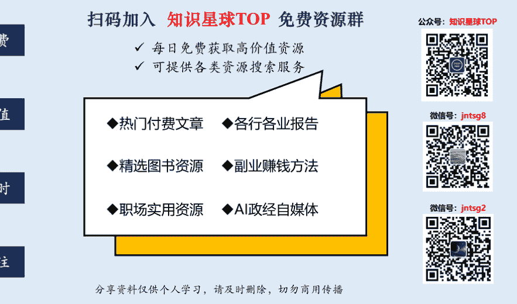

# 闲鱼电动项目完整攻略：实变现指南（月入5k+、附详细操作流程）

250526 生财精华

“杨老师，我不想听你讲什么知识大大的，我就只想按照步骤走，你告诉我 123，我完成 123，然后收款赚钱。”

这是上周一周圈友在看完我上一篇文章后我说的话。

看到这条留言时，我放下手机，静静思考了好一会儿。

太多朋友被各种“大道理”和“高概念”围困了，听了一堆，看了一堆文章，结果啥也没落地的。说实话，我理解的这种焦虑，因为三年前的我就是这样——知识越来越多，钱却没变化。

所以今天，我不讲理论，只讲实操。手把手教你怎么在闲鱼上卖电动车，月入5000+。

这是我过去 3 年，经过 100 多个账号实战、数千单交易沉淀下来的方法。没有任何花哨的东西，全是我亲自踩过的坑和验证过的经验。

## 为什么我放弃了爆单的小百货，转做电动车？

很多老友知道，我一开始在闲鱼做小百货和图书。那时候单多到爆炸，记得最忙那阵子我和合伙人轮流填单号，经常到凌晨两三点。

累是真累，钱也是真赚，问题太多了：每天填写单号到头疼，凌晨不睡觉。售后问题层出不穷，管理售后难上加难。

闲鱼当时对小百货管控越来越严。最要命的是，那阵子我们几个账号被同行红眼举报，收入从万元跌到几千，关键是看不到希望在哪里……痛定思痛，转型成了必然选择。

当时我已经积累了接近 100 个账号，放弃闲鱼太可惜了。经过一周的头脑风暴和市场调研，我们决定：继续用闲鱼这个平台，只是换个赛道。

这个决定背后，是我闲鱼平台本质的理解。闲鱼的灵魂是二手交易，它怎么变，也不会掉二手交易。在电商领域，闲鱼就是老大，其他平台小弟都算不上。

## 我是怎么锁定电动车这个类的？

找新品时，我列了几个必须满足的条件：

- 二手属性强：符合闲鱼的基因
- 需求量大：没有流量等于零
- 客单价高：一单赚个百八十的，值得花时间
- 不便携带：就是搬家的时候容易弄丢，只能卖掉。
- 有损耗性：就是市场一直需要
- 用户群匹配：得适合闲鱼的主力用户（大学生、年轻上班族）

筛选了半天，最后就剩下几个选项：山地车、电动车、洗衣机、小冰箱和空调。

最终锁定电动车，是因为我发现了三个独特优势：

1. 使用频率、使用场景广（学生上课、白领通勤、送外卖）
2. 损耗明显，二手转卖有充分理由，想买的想卖的都在里面
3. 客单价在 600-800 元，既不让人犹豫太久，又有足够的利润空间

> 实战数据展示：这是我真实的成绩单

讲再再不如看数据。下面是我团队一个普通账号的表现：

每天 99+ 的咨询量，客单价 600-900 元，利润 100-200 元/单。

没有任何奇迹，就是踏踏实实的数字。有人会问：咨询这么多，转化率怎么这么低？

就是电动车类的特点——咨询多，真正下单需要时间。数据表明，平均 50 咨询才能成交 1 单，这是行业常态，别被听到。

关键是咨询量，只要你及时回复，总能转化一部分。一个账号出一 1-2 单已经很不错了，三个账号运营起来，月入 5000+ 一都不夸张。

## 第一步：注册账号（人最多3个）—— 打造你的闲鱼军团

闲鱼不同于其他平台，它有自己的“规则”。掌握这些，能让你少走很多弯路。

### 账号规划与注册技巧

首先记住：一机一卡号。具体来说：
- 一个人最多同时运营 3 个支付宝账号（对应 3 个闲鱼账号）
- 每个账号需要独立手机号绑定，理想情况是每个账号配一台手机，但预算有限可以使用分身软件
- 闲鱼可以绑定微信登录，并且有了闲鱼小程序，支持微信支付，这对于我们来说，操作更方便了。

实操建议与避坑指南：
- 优先选用新号：我测试过，新号流量明显高于老号
- 别用有违规记录的账号：系统会有“记忆”，这些建议注销重新开
- 分批注册：一次性注册多个容易触发风控

### 坚持登录 IP 稳定：频繁 IP 会被系统盯上

去年我有学员不听劝，用了一个违规的老号，结果辛辛苦苦养了一周，流量还是一没起色，还不如直接销号重来，白忙活了一场。

## 第二步：养号与市场调研——打造高权重账号

很多朋友一上来就猛发产品，然后抱怨流量。我想说：养号不是选项，是必修课！

### 养号技巧与实战指南

根据账号状态，养号方式有区别：

1. 全新注册的账号：
- 完善个人资料：传头像（用成年女性照片，增加信任感）
- 搜索里加行业关键词，比如“XX 电动车行”，前 3 天每天登录至少 30 分钟，浏览相关类商品（不用同一时间，分散开）
- 收藏 5-10 件同行商品，关注 3-5 个同行店铺

2. 长期闲置的老号：
- 修改密码重新登录（告诉系统“我回来了”）
- 清理历史消息和无效收藏
- 按照新号方式重置活跃操作

适当点赞、评论，但别太频繁，现在可以私信一些同行了解产品。

去年我重启动了一个闲置了 8 个月的号，就是用这个方法，两周后这个号居然比新号还活跃，月入过万。所以老号也不是没戏，关键看下方法。

### 高效市场调研方法

养号同时，一定要调研市场。我的独门秘密是：先以“买家”身份咨询同行。

- 了解行业标准和销售话术
- 收集优质同行，分析竞争对手
- 特别提醒：记录下回复速度和专业度

### 如何快速找到优质同行

- 筛选：带“XX车行”、“电动车”等关键词
- 发布多个同类宝贝（10个以上）看评价

## 第三步：坚持以上破万——打造你的电动帝国

这是整个项目的核心，把它称为“坚持破万”，最终实现月入过万。

### 文案准备：让你的产品脱颖而出

- 标题优化化：标题加热门关键词如“上班代步”、“大学生电动车”等
- 借鉴法：直接查看市场上最好的文案，尝试不同价格区间（同款产品设置 300-600 元价格）
- 辅助法：把优质文案复制，用 AI 重组
- 改写法：使用成熟模板，替换里面部分

### 图片获取：视觉决定第一印象

好的图片能极大提升点击率。有几个渠道：
- 拼多多：用 Fatkun 插件下载
- 淘宝：用 Fatkun 插件下载
- 闲鱼：找相似图片下载

图片原则：
- 充足、清晰、无水印
- 多角度展示：正面、侧面、细节特写等
- 背景简洁，占据主体

### 产品发布攻略：细节决定成败

发布时还有注意：
- 价格和库存设置：区间 300-600 元之间（经过测试的最佳价位）
- 太低不行：低于 300 元
- 太高不行：超过 600 元
- 数量：可以设置 100 个以上

### 属性与参数填写

- 分类：电动自行车、摩托车、汽车改装、小微电动
- 品牌：爱玛、雅迪、其他
- 成色：全新、几乎全新、轻微使用痕迹、旧
- 年限：未使用、6个月内、6个月(含)-12个月内
- 续航里程：25km(不含)、25km(含)-35km(不含)
- 电压：24V、36V、48V、54V、60V
- 规格：非必填，设置多个颜色、尺码等
- 价格：¥358.00
- 发货方式：包邮
- 同步到圈子
- 24小时发货：承诺在买家付款后24小时内发货

### 发布时间与频率

- 最佳发布时间：工作日 10:00-11:30 和 14:00-16:00
- 针对发布困难的圈友，不用看时间，有时间就发
- 避开时间：深夜和凌晨
- 单日发布频率：每个账号3-5个产品，前期可以少，后面稳定5个就行

## 起号技巧：从0到1的关键48小时

新账号最关键的是度过初始的“冷启动”阶段。我的快速起：

1. 朋友助力法：
- 上班后立即分享链接给 1-2 个朋友
- 请让他们依次点击、浏览、咨询、收藏
- 引导1位完成下单流程（发货无需寄件）
- 3-4 天朋友完成好评

2. 标题优化化：
- 标题加热门关键词如“上班代步”、“大学生电动车”等，发布后不要进行修改，这个是首次用的
- 记录效果最好的标题组合，重点使用

3. 限时优惠法：
- 发布后第3天小幅降价（10-30 元），后页面也可以操作降价
- 系统会推送给收藏过的用户

每日任务清单（必须坚持）：
- 坚持每天上架 3-5 个新产品
- 后续每天看后台数据，淘汰流量差的链接
- 发布很长时间都是流量低的
- 有咨询的产品重点维护
- 确保咨询 10 分钟内及时回复

坚持一周，上架30+链接，账号流量会趋于稳定。我们团队的经验是：新账号在3-5天内能获得第一单自然成交。

## 后端维护核心：回复是命脉，速度决定一切

电动车项目最大特点：咨询量大但转化率低。回复速度和质量，是绝对关键。回复速度决定成交率。

### 高效回复策略

- 设置标准快捷语，覆盖常见问题
- 快速回复：在5分钟内响应
- 提高转化的核心：记录下高转化话术
- 自动回复：不要完全用
- 引导提问：亲亲，看哪款？

### 矩阵运营方案

- 账号：多个账号运营
- 工具：群控软件
- 作用：采集同行的链接

### 进货渠道与注意事项

- 初期：拼多多拿货
- 进阶：找商家拿货
- 稳定：找线下合作，找厂家供货
- 注意事项：不要详细填写电话、地址

## 第四步：风险防控与问题处理

### 封号原因分析

正常情况下，闲鱼无故封号。常见封号原因包括：
- 引导站外交易导致的禁言处罚
- 违规操作触发风控机制
- 上传信息有误通常只会删除链接

### 账户恢复方案

如果之前经营过品类产品导致封号，可以选择注销当前账户重新注册。
应急处理技巧：账户被封禁后，可以尝试打2345政务热线投诉闲鱼平台，有一定的概率获得账户恢复机会。

### 预防建议

良好的经营习惯，严格遵守平台规则，是避免账户风险的根本方法。关注平台政策更新，及时调整策略。

## 写在最后

电动车项目门槛不高，但需要耐心和执行力。这是一个适合踏实人的项目。

一个人3-5个账号，坚持每天上架及及时回复，一单赚100-200元，一天一二单，月入5000+不是问题。（非常保守，正常全职可以破万）

我带过很多学员，最后能赚到钱的都是那些“看完就扔”的人。理论不值钱，行动才是硬道理。

做起来，比十篇文章都有效。

把手弄脏！

电动车实操有问题可以私信我，我会尽力帮助大家。因为我深信，他终将利己。

[content]
分享资料仅供个人学习，请及时删除，切勿商用传播
